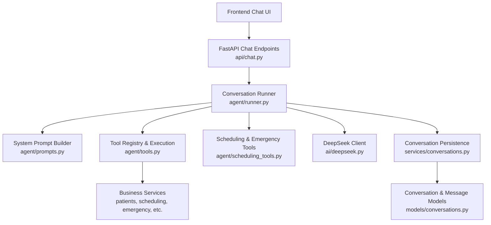
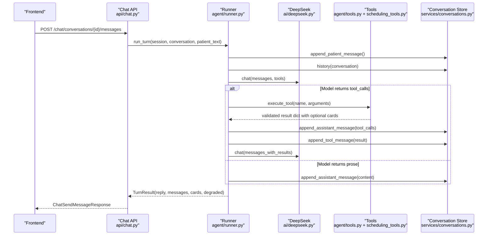
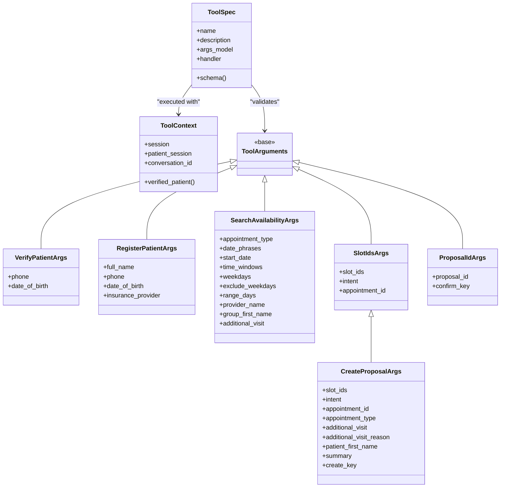
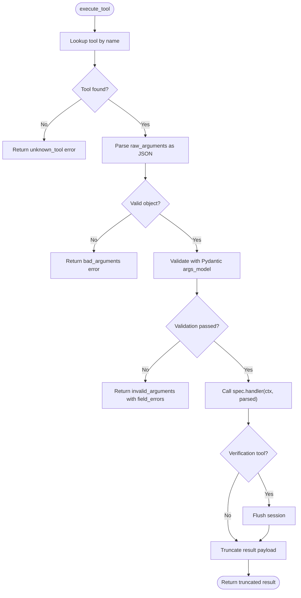
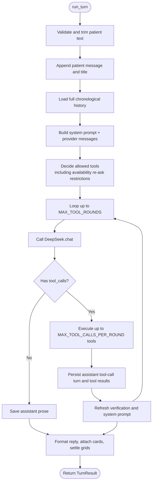
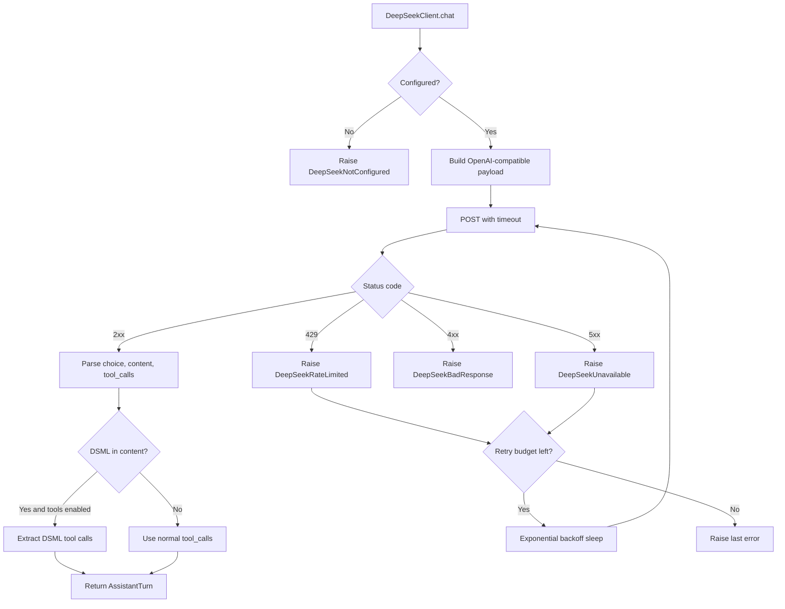
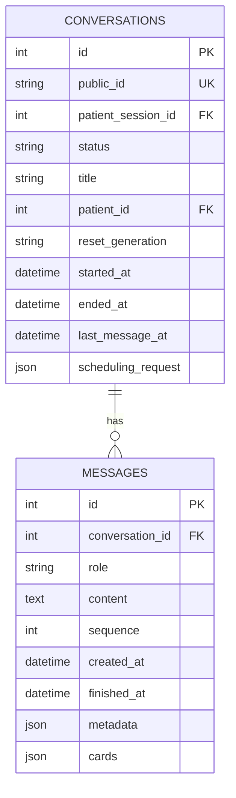
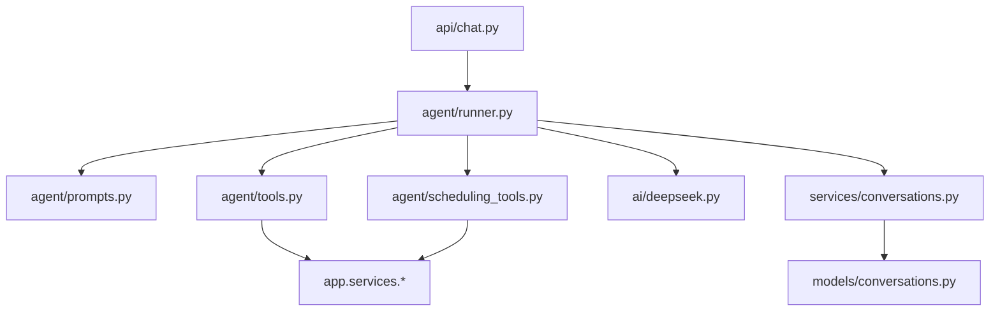

# AI Agent System

<cite>
**Referenced Files in This Document**
- [tools.py](file://backend/app/agent/tools.py)
- [scheduling_tools.py](file://backend/app/agent/scheduling_tools.py)
- [runner.py](file://backend/app/agent/runner.py)
- [prompts.py](file://backend/app/agent/prompts.py)
- [deepseek.py](file://backend/app/ai/deepseek.py)
- [chat.py](file://backend/app/api/chat.py)
- [conversations_service.py](file://backend/app/services/conversations.py)
- [conversations_model.py](file://backend/app/models/conversations.py)
</cite>

## Table of Contents
1. [Introduction](#introduction)
2. [Project Structure](#project-structure)
3. [Core Components](#core-components)
4. [Architecture Overview](#architecture-overview)
5. [Detailed Component Analysis](#detailed-component-analysis)
6. [Dependency Analysis](#dependency-analysis)
7. [Performance Considerations](#performance-considerations)
8. [Troubleshooting Guide](#troubleshooting-guide)
9. [Conclusion](#conclusion)

## Introduction
This document explains the AI agent system that powers natural language understanding and tool selection for a dental practice chat experience. The system does not let the model directly modify database state. Instead, it:

- Accepts patient messages through a REST API.
- Builds a bounded conversation loop between an LLM provider and deterministic tools.
- Validates every tool argument with Pydantic before execution.
- Persists full chronological history so the thread can be replayed exactly.
- Enforces safety rules through prompts, context, and tool design.
- Integrates DeepSeek with retries, timeouts, and fallback messaging when the provider is unavailable.

The result is a receptionist-like assistant that can verify patients, register accounts, look up clinic policy, search availability, hold proposals, confirm bookings, reschedule existing visits, handle emergencies, and hand off to staff -- all while keeping business logic deterministic and auditable.

## Project Structure
The AI agent lives under `backend/app/agent`, with supporting pieces in `backend/app/ai`, `backend/app/api`, `backend/app/services`, and `backend/app/models`.

**Diagram sources**
- [chat.py:233-274](file://backend/app/api/chat.py#L233-L274)
- [runner.py:171-406](file://backend/app/agent/runner.py#L171-L406)
- [prompts.py:292-311](file://backend/app/agent/prompts.py#L292-L311)
- [tools.py:493-615](file://backend/app/agent/tools.py#L493-L615)
- [scheduling_tools.py:1-50](file://backend/app/agent/scheduling_tools.py#L1-L50)
- [deepseek.py:178-329](file://backend/app/ai/deepseek.py#L178-L329)
- [conversations_service.py:218-331](file://backend/app/services/conversations.py#L218-L331)
- [conversations_model.py:39-123](file://backend/app/models/conversations.py#L39-L123)

**Section sources**
- [chat.py:1-47](file://backend/app/api/chat.py#L1-L47)
- [runner.py:1-23](file://backend/app/agent/runner.py#L1-L23)

## Core Components
The system has five core layers:

| Layer | Responsibility | Key Files |
|---|---|---|
| API layer | Authenticates sessions, loads conversations, runs one turn per message, returns transcript and cards | [chat.py](file://backend/app/api/chat.py) |
| Conversation runner | Manages the bounded loop between LLM interpretation and tool execution; persists turns and cards | [runner.py](file://backend/app/agent/runner.py) |
| Tool architecture | Defines Pydantic-validated input schemas, a registry, safe execution, and result truncation | [tools.py](file://backend/app/agent/tools.py), [scheduling_tools.py](file://backend/app/agent/scheduling_tools.py) |
| Provider integration | Calls DeepSeek with retries, timeouts, DSML parsing, and typed error handling | [deepseek.py](file://backend/app/ai/deepseek.py) |
| History persistence | Stores full chronological history and reconstructs provider-compatible messages | [conversations_service.py](file://backend/app/services/conversations.py), [conversations_model.py](file://backend/app/models/conversations.py) |

**Section sources**
- [chat.py:233-274](file://backend/app/api/chat.py#L233-L274)
- [runner.py:171-406](file://backend/app/agent/runner.py#L171-L406)
- [tools.py:1-11](file://backend/app/agent/tools.py#L1-L11)
- [deepseek.py:1-12](file://backend/app/ai/deepseek.py#L1-L12)
- [conversations_service.py:1-14](file://backend/app/services/conversations.py#L1-L14)

## Architecture Overview
At runtime, each patient message follows this flow:

1. The API validates the session and conversation ownership.
2. The runner appends the patient message and loads full history.
3. A system prompt is built from clinic facts, persona, hard rules, and current session state.
4. The runner calls DeepSeek with the allowed tool schemas.
5. If the model requests tools, the runner executes them through validated handlers.
6. Tool results are persisted as tool messages and attached to the thread.
7. The runner asks DeepSeek again until prose or exhausted bounds are reached.
8. Cards are merged, deduplicated, settled, and attached to the final assistant turn.
9. The response includes visible messages, live cards, and a degraded flag when provider errors occurred.

**Diagram sources**
- [chat.py:233-274](file://backend/app/api/chat.py#L233-L274)
- [runner.py:171-406](file://backend/app/agent/runner.py#L171-L406)
- [runner.py:409-557](file://backend/app/agent/runner.py#L409-L557)
- [tools.py:703-739](file://backend/app/agent/tools.py#L703-L739)
- [conversations_service.py:218-262](file://backend/app/services/conversations.py#L218-L262)
- [deepseek.py:205-249](file://backend/app/ai/deepseek.py#L205-L249)

## Detailed Component Analysis

### Tool Architecture
Every capability is implemented as a tool with:

- A Pydantic argument model describing required fields, defaults, ranges, and descriptions.
- A handler function taking a request-scoped `ToolContext` and validated arguments.
- A `ToolSpec` entry in the registry that exposes a JSON schema to the provider.
- Safe execution through `execute_tool`, which never raises to the caller.

Key design principles:

- **No direct database writes from the model.** Only registered handlers may touch services and databases.
- **Identity comes from the runner, not the model.** `ToolContext` carries the authenticated session, verified patient, and conversation id.
- **Arguments are validated before any service call.** Bad dates, missing fields, or extra fields become structured errors the model can recover from.
- **Results are bounded.** Large payloads are trimmed while preserving decision fields and interactive cards.

**Diagram sources**
- [tools.py:41-126](file://backend/app/agent/tools.py#L41-L126)
- [tools.py:493-515](file://backend/app/agent/tools.py#L493-L515)
- [scheduling_tools.py:59-157](file://backend/app/agent/scheduling_tools.py#L59-L157)

#### Example Tool Definitions
The repository defines several example tools:

| Capability | Tool Name | Input Schema | Purpose |
|---|---|---|---|
| Identity verification | `verify_existing_patient` | `VerifyPatientArgs(phone, date_of_birth)` | Verifies an existing patient before discussing their appointments. |
| New registration | `register_patient` | `RegisterPatientArgs(full_name, phone, date_of_birth, insurance_provider)` | Registers a new patient and marks the session verified. |
| Child linkage | `register_child_for_verified_parent` | `RegisterChildArgs(full_name, date_of_birth, insurance_provider, use_parent_insurance)` | Links a minor child to the verified parent’s household. |
| Availability search | `search_availability` | `SearchAvailabilityArgs(...)` | Searches open slots based on visit type, dates, time windows, weekdays, provider, and family hints. |
| Hold proposal | `create_booking_proposal` | `CreateProposalArgs(slot_ids, appointment_type, additional_visit, ...)` | Holds slots for a new booking or reschedule move after validation. |
| Confirm booking | `confirm_booking_proposal` | `ProposalIdArgs(proposal_id, confirm_key)` | Confirms a held proposal into a real appointment. |

These definitions live in:

- Registration and identity tools: [tools.py:511-588](file://backend/app/agent/tools.py#L511-L588)
- Scheduling tools: [scheduling_tools.py:59-360](file://backend/app/agent/scheduling_tools.py#L59-L360)

**Section sources**
- [tools.py:511-588](file://backend/app/agent/tools.py#L511-L588)
- [scheduling_tools.py:59-360](file://backend/app/agent/scheduling_tools.py#L59-L360)

#### Tool Execution Safety
`execute_tool` performs these steps:

1. Look up the tool by name. Unknown names return a structured error instead of failing the turn.
2. Parse raw arguments as JSON.
3. Validate arguments against the tool’s Pydantic model.
4. Call the handler with `ToolContext` and parsed arguments.
5. Flush the session for verification-related tools.
6. Truncate large results without dropping interactive cards.

**Diagram sources**
- [tools.py:703-739](file://backend/app/agent/tools.py#L703-L739)

**Section sources**
- [tools.py:123-126](file://backend/app/agent/tools.py#L123-L126)
- [tools.py:617-700](file://backend/app/agent/tools.py#L617-L700)
- [tools.py:703-739](file://backend/app/agent/tools.py#L703-L739)

### Conversation Runner and Bounded Loop
The runner is the central coordinator. It enforces:

- `MAX_TOOL_ROUNDS = 4`: limits how many times the model can call tools in one patient message.
- `MAX_TOOL_CALLS_PER_ROUND = 4`: limits fan-out from a single model turn.
- `MAX_PATIENT_MESSAGE_CHARS = 2000`: prevents extremely long inputs from consuming too much context.
- Safe fallback replies when the provider fails or an unexpected exception occurs.
- Card lifecycle management so slot grids, proposals, and confirmations are shown exactly once and stay consistent with database state.

Special behaviors include:

- Time re-ask detection: if the patient asks for times again, the runner can refresh stored scheduling preferences and replay the latest grid.
- Availability exhaustion: if a complete availability search returns no cards, the runner stops asking for more searches in that turn.
- Family option action injection: when the UI sends a clicked family card identity, the runner injects internal instructions into the system prompt without exposing identifiers to the transcript.

**Diagram sources**
- [runner.py:171-406](file://backend/app/agent/runner.py#L171-L406)
- [runner.py:409-557](file://backend/app/agent/runner.py#L409-L557)

**Section sources**
- [runner.py:51-55](file://backend/app/agent/runner.py#L51-L55)
- [runner.py:76-88](file://backend/app/agent/runner.py#L76-L88)
- [runner.py:91-121](file://backend/app/agent/runner.py#L91-L121)
- [runner.py:171-406](file://backend/app/agent/runner.py#L171-L406)
- [runner.py:409-557](file://backend/app/agent/runner.py#L409-L557)

### Prompt Engineering and Safety Boundaries
The system prompt is constructed by `build_system_prompt` and includes:

- Persona: warm, efficient American dental front-desk voice.
- Hard rules: privacy, no fabrication, no direct booking without confirmation, emergency priority, plain-text formatting, no tool leakage.
- Tool guidance: step-by-step workflows for verification, registration, availability, family booking, rescheduling, cancellation, emergencies, and staff handoff.
- Clinic facts: hours, address, accepted insurance, and policy topics.
- Session state: whether the patient is verified, what registration fields are missing, today’s clinic date, and next-step guidance.

Safety measures enforced by prompts:

- Never reveal chart details before verification.
- Never invent prices, coverage, or availability.
- Never compute calendar dates manually; pass the patient’s words to tools.
- Never list times or dentists in prose; rely on cards.
- Never claim staff have acted unless a tool confirms it.
- Never bypass business logic by asserting outcomes.

**Diagram sources**
- [prompts.py:23-87](file://backend/app/agent/prompts.py#L23-L87)
- [prompts.py:89-201](file://backend/app/agent/prompts.py#L89-L201)
- [prompts.py:204-289](file://backend/app/agent/prompts.py#L204-L289)
- [prompts.py:292-311](file://backend/app/agent/prompts.py#L292-L311)

**Section sources**
- [prompts.py:23-87](file://backend/app/agent/prompts.py#L23-L87)
- [prompts.py:89-201](file://backend/app/agent/prompts.py#L89-L201)
- [prompts.py:292-311](file://backend/app/agent/prompts.py#L292-L311)

### DeepSeek API Integration
The DeepSeek client implements:

- Strict timeouts: connect, read, and total timeouts.
- Retry logic: exponential backoff for transient failures such as rate limits and server errors.
- Typed exceptions: `DeepSeekNotConfigured`, `DeepSeekTimeout`, `DeepSeekUnavailable`, `DeepSeekRateLimited`, `DeepSeekBadResponse`.
- DSML support: when the provider returns native tool markup inside content rather than structured `tool_calls`, the client extracts tool invocations only when tools were offered.
- No sensitive logging: API keys and prompt contents are not logged.

When the provider is unavailable:

- The runner catches `DeepSeekError`.
- It logs a non-sensitive failure event.
- It persists a safe assistant message.
- It returns a `degraded=True` response so the frontend can indicate reduced capability.

**Diagram sources**
- [deepseek.py:31-65](file://backend/app/ai/deepseek.py#L31-L65)
- [deepseek.py:101-175](file://backend/app/ai/deepseek.py#L101-L175)
- [deepseek.py:205-249](file://backend/app/ai/deepseek.py#L205-L249)
- [deepseek.py:251-329](file://backend/app/ai/deepseek.py#L251-L329)

**Section sources**
- [deepseek.py:31-65](file://backend/app/ai/deepseek.py#L31-L65)
- [deepseek.py:178-249](file://backend/app/ai/deepseek.py#L178-L249)
- [deepseek.py:251-329](file://backend/app/ai/deepseek.py#L251-L329)
- [runner.py:264-292](file://backend/app/agent/runner.py#L264-L292)

### Conversation Context and Chronological History
The system maintains conversation context in two complementary ways:

1. **Persistent history:** Every patient message, assistant reply, tool call, and tool result is stored as a row in the `messages` table.
2. **Replay-ready provider format:** `to_provider_messages` reconstructs the exact sequence expected by the provider, including assistant turns with `tool_calls` followed by matching `tool` messages.

Additional safeguards:

- Conversations are scoped to `patient_session_id`; a public conversation id alone cannot access another user’s thread.
- Titles are auto-generated from the first meaningful patient message.
- Visible messages exclude internal tool payloads and strip internal family-action markers from the browser view.
- Cards are attached to the assistant turn that produced them, so refreshing the thread replays the same interactive state.

**Diagram sources**
- [conversations_model.py:39-123](file://backend/app/models/conversations.py#L39-L123)

**Section sources**
- [conversations_service.py:41-58](file://backend/app/services/conversations.py#L41-L58)
- [conversations_service.py:165-183](file://backend/app/services/conversations.py#L165-L183)
- [conversations_service.py:218-262](file://backend/app/services/conversations.py#L218-L262)
- [conversations_service.py:265-331](file://backend/app/services/conversations.py#L265-L331)
- [conversations_service.py:354-366](file://backend/app/services/conversations.py#L354-L366)
- [conversations_model.py:39-123](file://backend/app/models/conversations.py#L39-L123)

### Safety Measures Against Bypassing Business Logic
The system uses multiple layers to prevent the AI from inventing policies or modifying state directly:

| Risk | Control |
|---|---|
| Model claims to book or cancel without confirmation | Prompts forbid assertions; only confirmed tool results change state. |
| Model reads another patient’s data | Verification gate requires phone and date of birth; tools read `ToolContext`, not model-supplied identities. |
| Model invents prices or coverage | Policy answers come from `get_practice_info`; unknown topics return structured errors. |
| Model computes wrong dates | Prompts forbid manual calendar math; tools receive natural-language date phrases. |
| Model bypasses scheduling workflow | Reschedules go through dedicated reschedule tools; new bookings require proposals and explicit confirmation. |
| Model emits unbounded or confusing output | Reply formatting strips dashes, avoids listing times, and prefers cards over prose. |
| Provider failure leaves half-written state | Runner wraps the turn in try/except, rolls back on unexpected errors, and persists safe fallback text. |

**Section sources**
- [prompts.py:34-87](file://backend/app/agent/prompts.py#L34-L87)
- [tools.py:1-11](file://backend/app/agent/tools.py#L1-L11)
- [tools.py:134-145](file://backend/app/agent/tools.py#L134-L145)
- [tools.py:465-481](file://backend/app/agent/tools.py#L465-L481)
- [runner.py:264-292](file://backend/app/agent/runner.py#L264-L292)

## Dependency Analysis
The main dependency relationships are:

**Diagram sources**
- [chat.py:22-47](file://backend/app/api/chat.py#L22-L47)
- [runner.py:35-47](file://backend/app/agent/runner.py#L35-L47)
- [tools.py:25-29](file://backend/app/agent/tools.py#L25-L29)
- [scheduling_tools.py:27-49](file://backend/app/agent/scheduling_tools.py#L27-L49)

Coupling observations:

- The runner depends on both the tool registry and the provider client, but tool implementations depend only on `ToolContext`, not on the runner itself.
- Scheduling tools import base tool primitives from `tools.py`, avoiding circular imports by lazy loading combined specs.
- Conversation persistence is isolated behind a service layer, so the runner and API do not query message rows directly.
- External business logic (patients, scheduling, emergency, audit, availability) is kept out of the agent layer.

**Section sources**
- [tools.py:590-615](file://backend/app/agent/tools.py#L590-L615)
- [scheduling_tools.py:27-49](file://backend/app/agent/scheduling_tools.py#L27-L49)
- [conversations_service.py:265-331](file://backend/app/services/conversations.py#L265-L331)

## Performance Considerations
- **Bounded loops:** `MAX_TOOL_ROUNDS` and `MAX_TOOL_CALLS_PER_ROUND` limit LLM round-trips and fan-out per patient message.
- **Timeouts:** DeepSeek requests use separate connect, read, and total timeouts to avoid hanging threads.
- **Retries:** Transient failures trigger exponential backoff with jitter, reducing thundering-herd pressure.
- **Result truncation:** Tool results larger than a character threshold are slimmed down while preserving interactive cards and decision fields.
- **Threadpool execution:** The FastAPI endpoint runs the synchronous runner off the event loop to avoid blocking async workers.
- **Card deduplication and merging:** Prevents duplicate grids and stale offers from degrading the UI or confusing the model.

[No sources needed since this section provides general guidance]

## Troubleshooting Guide

### Common Symptoms and Causes

| Symptom | Likely Cause | What to Check |
|---|---|---|
| Assistant says the online assistant is not configured | `DEEPSEEK_API_KEY` is missing | DeepSeek configuration and settings |
| User sees “I hit a snag on my side” | Unexpected exception during turn processing | Runner exception path and database rollback |
| Provider returns 429 repeatedly | Rate limiting | DeepSeek retry behavior and backend load |
| Tool arguments fail validation | Model supplied malformed or incomplete parameters | Pydantic validation errors and tool guidance |
| Same slot card appears twice | Duplicate card identity across rounds | Card identity and deduplication logic |
| Times are repeated in prose instead of cards | Model ignored card rule | Prompt enforcement and reply formatting |
| Emergency alert exists but patient-facing promise is missing | Runner did not add the front-desk notice | Emergency notice enforcement |

### Debugging Steps

1. **Check conversation history:** Use the conversation restore endpoint to see the full chronological transcript, including tool calls and tool results.
2. **Inspect tool execution logs:** The runner logs tool name and success/failure without logging arguments or patient details.
3. **Validate tool schemas:** If a tool fails with `invalid_arguments`, review the corresponding Pydantic model and prompt guidance.
4. **Review provider errors:** DeepSeek errors are typed and logged without prompt bodies; check status codes and latency metrics.
5. **Confirm card state:** If cards look stale, check whether they were superseded by a later search or already booked/held.

**Section sources**
- [runner.py:264-292](file://backend/app/agent/runner.py#L264-L292)
- [runner.py:751-760](file://backend/app/agent/runner.py#L751-L760)
- [deepseek.py:251-329](file://backend/app/ai/deepseek.py#L251-L329)
- [conversations_service.py:334-366](file://backend/app/services/conversations.py#L334-L366)

## Conclusion
The AI agent system is intentionally conservative: the model interprets intent, but deterministic tools enforce business rules. Pydantic schemas validate inputs, `ToolContext` supplies identity, and the runner bounds the conversation loop. History is fully persistent and replayable, cards carry live state, and DeepSeek failures degrade gracefully. Together, these layers keep the assistant helpful and conversational while preventing hallucinated policies, unauthorized data access, and unsafe database mutations.

[No sources needed since this section summarizes without analyzing specific files]