# Card Management System

<cite>
**Referenced Files in This Document**   
- [cards.ts](file://frontend/src/lib/cards.ts)
- [liveCards.ts](file://frontend/src/lib/liveCards.ts)
- [CardStack.tsx](file://frontend/src/components/cards/CardStack.tsx)
- [SlotCardView.tsx](file://frontend/src/components/cards/SlotCardView.tsx)
- [ProposalCardView.tsx](file://frontend/src/components/cards/ProposalCardView.tsx)
- [useCardActions.ts](file://frontend/src/hooks/useCardActions.ts)
- [chat.py](file://backend/app/api/chat.py)
- [runner.py](file://backend/app/agent/runner.py)
- [reply_format.py](file://backend/app/agent/reply_format.py)
- [scheduling.py](file://backend/app/services/scheduling.py)
- [proposals.py](file://backend/app/models/proposals.py)
- [test_settled_grids.py](file://backend/tests/test_settled_grids.py)
</cite>

## Table of Contents
1. [Introduction](#introduction)
2. [Project Structure](#project-structure)
3. [Core Components](#core-components)
4. [Architecture Overview](#architecture-overview)
5. [Detailed Component Analysis](#detailed-component-analysis)
6. [Dependency Analysis](#dependency-analysis)
7. [Performance Considerations](#performance-considerations)
8. [Troubleshooting Guide](#troubleshooting-guide)
9. [Conclusion](#conclusion)

## Introduction
This document explains the card management system that turns scheduling data into interactive UI cards, merges and deduplicates them across conversation turns, and attaches them to the correct assistant message. Cards represent three main ideas:

- **Scheduling options**: clickable slot grids for new bookings or replacement times during rescheduling.
- **Family proposals**: complete plans where one confirmation books multiple people together.
- **Informational content**: booking proposals, confirmations, cancellation confirmations, appointment summaries, and handoff alerts.

The system keeps the database as the source of truth. The frontend never invents a slot; it posts identifiers back to the server, which re-derives the run from SQLite. A card identity system prevents duplicate rendering, a merge strategy combines rounds without losing important informational cards, and a settlement process marks already-booked or held slots as context rather than offers.

## Project Structure
The card system spans backend services, the agent runner, API endpoints, and frontend components:

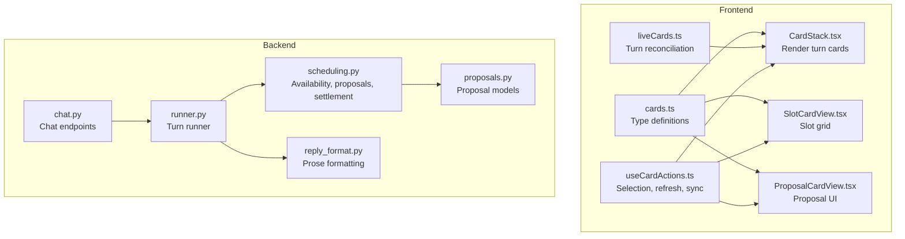

**Diagram sources**
- [cards.ts:9-187](file://frontend/src/lib/cards.ts#L9-L187)
- [liveCards.ts:18-77](file://frontend/src/lib/liveCards.ts#L18-L77)
- [CardStack.tsx:36-107](file://frontend/src/components/cards/CardStack.tsx#L36-L107)
- [SlotCardView.tsx:18-135](file://frontend/src/components/cards/SlotCardView.tsx#L18-L135)
- [ProposalCardView.tsx:57-159](file://frontend/src/components/cards/ProposalCardView.tsx#L57-L159)
- [useCardActions.ts:144-761](file://frontend/src/hooks/useCardActions.ts#L144-L761)
- [chat.py:233-274](file://backend/app/api/chat.py#L233-L274)
- [runner.py:171-406](file://backend/app/agent/runner.py#L171-L406)
- [reply_format.py:295-428](file://backend/app/agent/reply_format.py#L295-L428)
- [scheduling.py:238-295](file://backend/app/services/scheduling.py#L238-L295)
- [proposals.py:35-141](file://backend/app/models/proposals.py#L35-L141)

**Section sources**
- [cards.ts:9-187](file://frontend/src/lib/cards.ts#L9-L187)
- [liveCards.ts:18-77](file://frontend/src/lib/liveCards.ts#L18-L77)
- [CardStack.tsx:36-107](file://frontend/src/components/cards/CardStack.tsx#L36-L107)
- [SlotCardView.tsx:18-135](file://frontend/src/components/cards/SlotCardView.tsx#L18-L135)
- [ProposalCardView.tsx:57-159](file://frontend/src/components/cards/ProposalCardView.tsx#L57-L159)
- [useCardActions.ts:144-761](file://frontend/src/hooks/useCardActions.ts#L144-L761)
- [chat.py:233-274](file://backend/app/api/chat.py#L233-L274)
- [runner.py:171-406](file://backend/app/agent/runner.py#L171-L406)
- [reply_format.py:295-428](file://backend/app/agent/reply_format.py#L295-L428)
- [scheduling.py:238-295](file://backend/app/services/scheduling.py#L238-L295)
- [proposals.py:35-141](file://backend/app/models/proposals.py#L35-L141)

## Core Components
The card system is built around typed payloads, rendering logic, action handling, and backend orchestration.

| Area | Responsibility | Key Implementation |
|---|---|---|
| Card types | Define slot, proposal, family option, confirmation, appointments, and handoff shapes | [cards.ts:9-187](file://frontend/src/lib/cards.ts#L9-L187) |
| Turn reconciliation | Decide whether prose should be hidden when no grid is present | [liveCards.ts:32-77](file://frontend/src/lib/liveCards.ts#L32-L77) |
| Card rendering | Group slot cards into one grid and render other cards individually | [CardStack.tsx:36-107](file://frontend/src/components/cards/CardStack.tsx#L36-L107) |
| Slot grid UI | Show time, provider, duration, and disabled reasons | [SlotCardView.tsx:18-135](file://frontend/src/components/cards/SlotCardView.tsx#L18-L135) |
| Proposal UI | Render pending, confirmed, cancelled, superseded, or expired proposals | [ProposalCardView.tsx:57-159](file://frontend/src/components/cards/ProposalCardView.tsx#L57-L159) |
| Interactive behavior | Hold slots, confirm or decline proposals, refresh availability, settle grids | [useCardActions.ts:144-761](file://frontend/src/hooks/useCardActions.ts#L144-L761) |
| Chat endpoint | Run one patient message through the agent and return messages plus cards | [chat.py:233-274](file://backend/app/api/chat.py#L233-L274) |
| Runner | Execute tools, merge cards, deduplicate, attach to the correct turn, format prose | [runner.py:171-406](file://backend/app/agent/runner.py#L171-L406) |
| Prose formatter | Remove time echoes, replace questions, write card-derived intros | [reply_format.py:295-428](file://backend/app/agent/reply_format.py#L295-L428) |
| Scheduling service | Build slot cards, family options, proposals, and settled-grid projections | [scheduling.py:238-295](file://backend/app/services/scheduling.py#L238-L295), [scheduling.py:2180-2259](file://backend/app/services/scheduling.py#L2180-L2259) |
| Proposal model | Persist multi-appointment suggestions and their lifecycle | [proposals.py:35-141](file://backend/app/models/proposals.py#L35-L141) |

**Section sources**
- [cards.ts:9-187](file://frontend/src/lib/cards.ts#L9-L187)
- [liveCards.ts:32-77](file://frontend/src/lib/liveCards.ts#L32-L77)
- [CardStack.tsx:36-107](file://frontend/src/components/cards/CardStack.tsx#L36-L107)
- [SlotCardView.tsx:18-135](file://frontend/src/components/cards/SlotCardView.tsx#L18-L135)
- [ProposalCardView.tsx:57-159](file://frontend/src/components/cards/ProposalCardView.tsx#L57-L159)
- [useCardActions.ts:144-761](file://frontend/src/hooks/useCardActions.ts#L144-L761)
- [chat.py:233-274](file://backend/app/api/chat.py#L233-L274)
- [runner.py:171-406](file://backend/app/agent/runner.py#L171-L406)
- [reply_format.py:295-428](file://backend/app/agent/reply_format.py#L295-L428)
- [scheduling.py:238-295](file://backend/app/services/scheduling.py#L238-L295)
- [proposals.py:35-141](file://backend/app/models/proposals.py#L35-L141)

## Architecture Overview
A patient message flows through the chat endpoint into the runner, which runs the model loop, executes scheduling tools, builds cards, merges rounds, settles grids, deduplicates, formats prose, and attaches cards to the current turn. On restore, the API replays stored messages with cards projected against live database state.

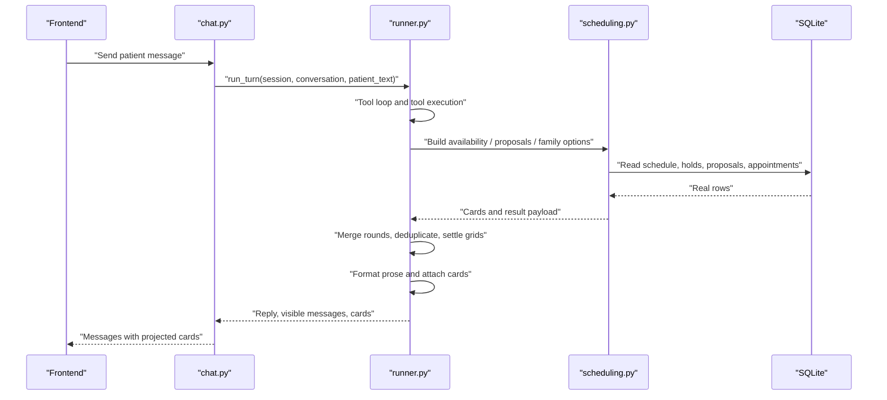

**Diagram sources**
- [chat.py:233-274](file://backend/app/api/chat.py#L233-L274)
- [runner.py:171-406](file://backend/app/agent/runner.py#L171-L406)
- [scheduling.py:238-295](file://backend/app/services/scheduling.py#L238-L295)

## Detailed Component Analysis

### Card Types and Data Model
Card types define what the UI can render and what the backend may send. They separate scheduling options from proposals and informational cards.

| Card Type | Purpose | Important Fields |
|---|---|---|
| `slot` | Clickable scheduling option | `slot_id`, `starts_at`, `ends_at`, `time_range`, `provider`, `intent`, `require_open`, `settled`, `settled_by`, `additional_visit`, `request_id` |
| `proposal` | Pending or resolved booking/reschedule/cancellation | `proposal_id`, `kind`, `status`, `items`, `actions`, `expires_at`, `target_appointment_id` |
| `family_proposal` | Multi-person proposal rendered as a family card | Same base fields, but grouped by multiple items |
| `family_option` | Complete plan for several people | `option_id`, `slots`, `back_to_back`, `settled`, `require_open`, `request_id` |
| `confirmation` | Confirmed booking result | `proposal_id`, `booking_group_id`, `appointments`, `moved_from` |
| `cancellation_confirmation` | Cancellation result | `proposal_id`, `cancelled` |
| `appointments` | Appointment summary list | `title`, `appointments` |
| `handoff` | Front desk alert or request | `title`, `entries` |

The frontend type layer mirrors these backend payloads so the UI can distinguish slot grids, family options, and proposals safely.

**Section sources**
- [cards.ts:9-187](file://frontend/src/lib/cards.ts#L9-L187)
- [proposals.py:35-141](file://backend/app/models/proposals.py#L35-L141)

### Card Identity and Deduplication
Card identity prevents the same option from being rendered twice after retries, re-derived proposals, or merged rounds.

Identity rules:

- Proposals use `proposal_id` plus status.
- Slot cards use `slot_id`.
- Family options use `option_id`.
- Other informational cards fall back to their type.

Deduplication scans cards in order and keeps only the first occurrence of each identity.

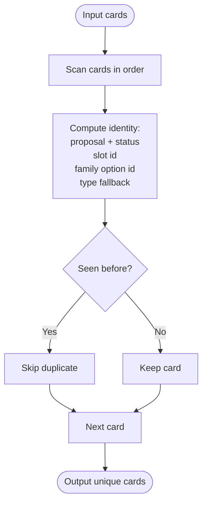

**Diagram sources**
- [runner.py:597-648](file://backend/app/agent/runner.py#L597-L648)

**Section sources**
- [runner.py:597-648](file://backend/app/agent/runner.py#L597-L648)

### Merge Strategy Across Rounds
During a single turn, the model may call multiple tools. The runner collects cards from each round and merges them carefully:

- If a fresh round contains offer cards (`slot` or `family_option`), those supersede earlier offer grids.
- Informational cards from earlier rounds (confirmations, handoffs, appointment summaries) are preserved.
- The merged list is then deduplicated by card identity.

This avoids showing two competing slot grids while keeping important results like confirmations visible alongside the latest search.

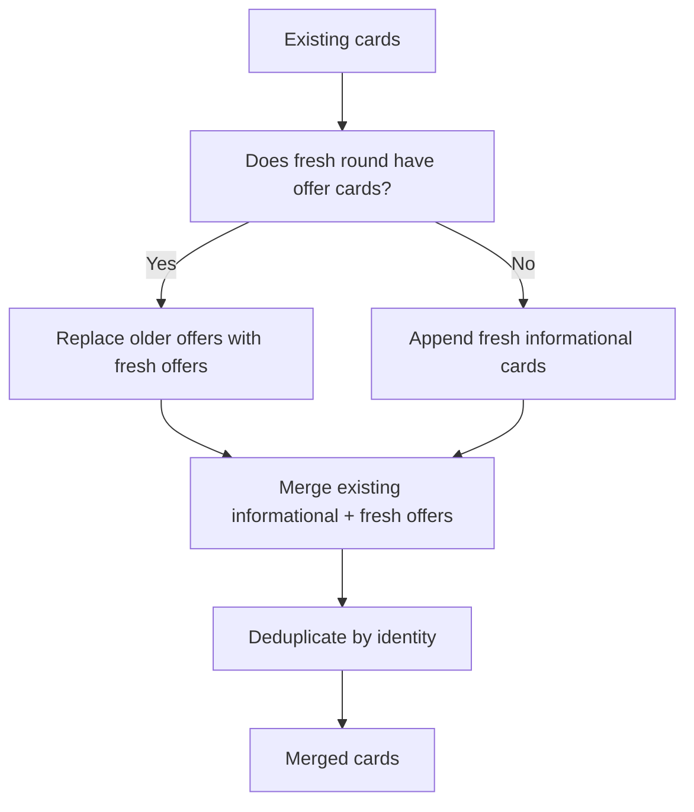

**Diagram sources**
- [runner.py:609-637](file://backend/app/agent/runner.py#L609-L637)

**Section sources**
- [runner.py:609-637](file://backend/app/agent/runner.py#L609-L637)

### Settlement Process and Settled Grid Detection
A “settled” grid means the request behind it is no longer an open offer. This happens when:

- The request has a booked visit.
- The request has a pending hold.
- A family option or slot selection has been made.

When settled, slot cards and family-option cards are marked as context:

- `settled` becomes true.
- `require_open` becomes false.
- `settled_by` records whether the reason is a hold or a booking.
- For family options, every nested slot is also marked settled.

An explicitly requested additional visit is exempt from this retirement because it represents a different request.

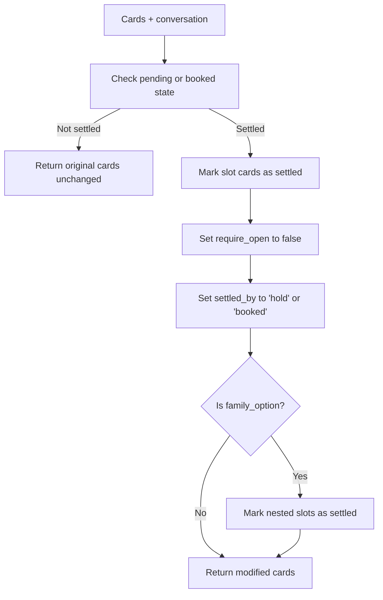

**Diagram sources**
- [scheduling.py:2180-2259](file://backend/app/services/scheduling.py#L2180-L2259)
- [test_settled_grids.py:30-141](file://backend/tests/test_settled_grids.py#L30-L141)

**Section sources**
- [scheduling.py:2180-2259](file://backend/app/services/scheduling.py#L2180-L2259)
- [test_settled_grids.py:30-141](file://backend/tests/test_settled_grids.py#L30-L141)

### Turn Attachment and Card-Only Turns
The runner determines the correct place to attach cards using a `turn_floor`:

1. Before running tools, it records the newest assistant message id.
2. Tool results build cards for the current turn.
3. After merging and settling, cards are attached to the most recent assistant text that belongs to this turn.
4. If no suitable assistant message exists, a card-only assistant message is appended.

This ensures cards are not attached to an older reply the patient saw before the search ran, and it supports card-only turns when the model returns structured cards without prose.

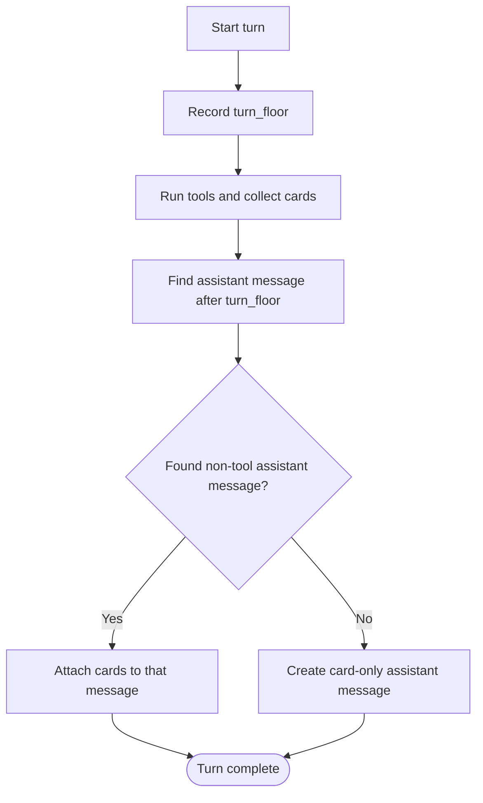

**Diagram sources**
- [runner.py:199-206](file://backend/app/agent/runner.py#L199-L206)
- [runner.py:693-718](file://backend/app/agent/runner.py#L693-L718)

**Section sources**
- [runner.py:199-206](file://backend/app/agent/runner.py#L199-L206)
- [runner.py:693-718](file://backend/app/agent/runner.py#L693-L718)

### Prose Formatting and Settled Intro Replacement
The prose formatter enforces a “cards, not prose” rule:

- Time-list echoes are removed.
- Questions about “which works for you?” are replaced by a card-derived question.
- An intro that names a day or provider not present in the grid is replaced.
- When any slot card is settled, the prose is replaced with a settled introduction.
- Refreshed availability uses wording that acknowledges the refresh.

This prevents the model from contradicting the card state, such as asking the patient to pick a time when the server says the grid is already settled.

**Section sources**
- [reply_format.py:201-222](file://backend/app/agent/reply_format.py#L201-L222)
- [reply_format.py:295-428](file://backend/app/agent/reply_format.py#L295-L428)
- [runner.py:294-305](file://backend/app/agent/runner.py#L294-L305)

### Frontend Rendering and Interaction
The frontend renders cards per turn:

- Slot cards are grouped into one grid.
- Other cards render individually.
- Unknown card types are ignored so older clients remain compatible.
- Disabled states come from both backend flags and frontend synchronization.

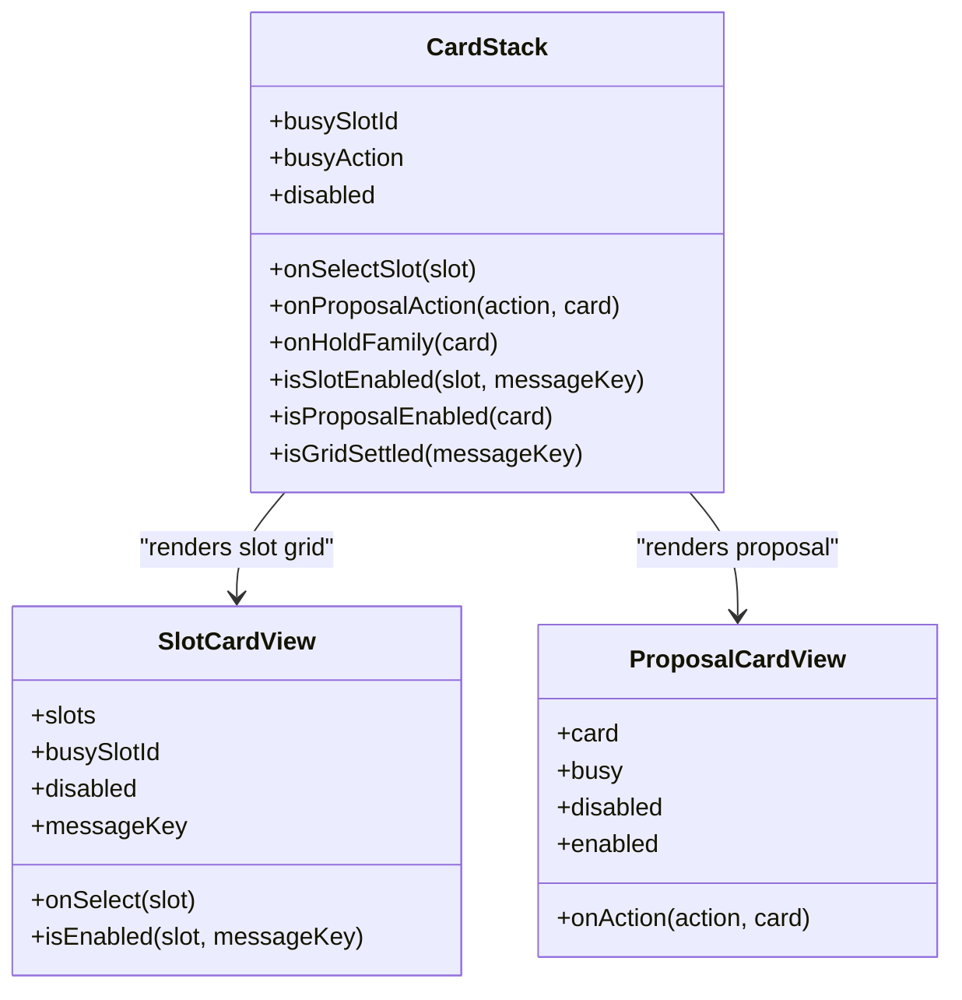

**Diagram sources**
- [CardStack.tsx:36-107](file://frontend/src/components/cards/CardStack.tsx#L36-L107)
- [SlotCardView.tsx:18-135](file://frontend/src/components/cards/SlotCardView.tsx#L18-L135)
- [ProposalCardView.tsx:57-159](file://frontend/src/components/cards/ProposalCardView.tsx#L57-L159)

**Section sources**
- [CardStack.tsx:36-107](file://frontend/src/components/cards/CardStack.tsx#L36-L107)
- [SlotCardView.tsx:18-135](file://frontend/src/components/cards/SlotCardView.tsx#L18-L135)
- [ProposalCardView.tsx:57-159](file://frontend/src/components/cards/ProposalCardView.tsx#L57-L159)

### Slot Lifecycle: Creation Through Attachment
A typical slot lifecycle is:

1. Backend availability search produces real `SlotOption` objects.
2. `slot_card` converts each option into a slot card with stable identifiers and metadata.
3. The runner merges the new round’s cards with earlier informational cards.
4. The runner deduplicates by identity.
5. Superseded grids are settled if the request is already held or booked.
6. Cards are attached to the current turn’s assistant message.
7. The frontend groups slot cards into a grid and lets the user select one.
8. Selecting a slot posts its `slot_id` and intent back to the server.
9. The server creates or updates a proposal and returns confirmation or error cards.
10. The frontend synchronizes pending proposals and availability, disabling stale or rejected slots.

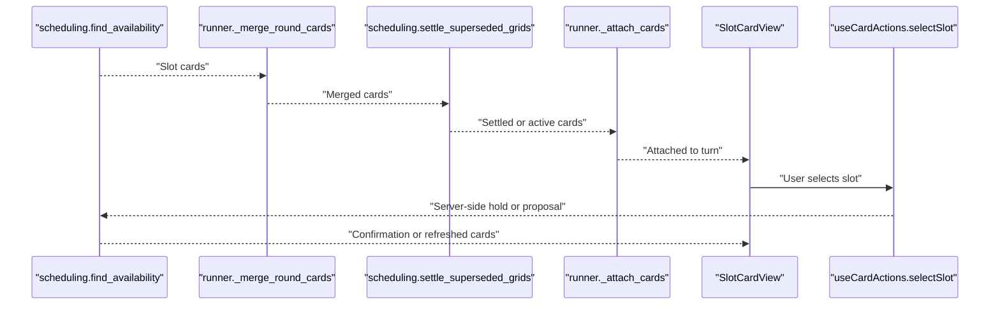

**Diagram sources**
- [scheduling.py:238-295](file://backend/app/services/scheduling.py#L238-L295)
- [runner.py:609-637](file://backend/app/agent/runner.py#L609-L637)
- [runner.py:693-718](file://backend/app/agent/runner.py#L693-L718)
- [useCardActions.ts:482-559](file://frontend/src/hooks/useCardActions.ts#L482-L559)

**Section sources**
- [scheduling.py:238-295](file://backend/app/services/scheduling.py#L238-L295)
- [runner.py:609-637](file://backend/app/agent/runner.py#L609-L637)
- [runner.py:693-718](file://backend/app/agent/runner.py#L693-L718)
- [useCardActions.ts:482-559](file://frontend/src/hooks/useCardActions.ts#L482-L559)

### Family Options Versus Slot Grids
Family options differ from ordinary slot grids:

- A family option is one complete plan for multiple people.
- It carries an ordered list of slots, one per person.
- Its identity is derived from the plan’s slot sequence and patient ids.
- Holding a family option books everyone together.
- When a request is settled, the whole family option and its nested slots become context.
- The frontend disables a family option card when it is settled or when the message’s offered grids are history.

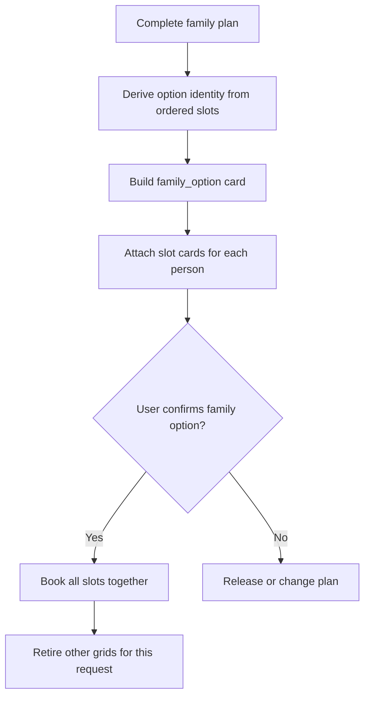

**Diagram sources**
- [scheduling.py:341-390](file://backend/app/services/scheduling.py#L341-L390)
- [scheduling.py:2217-2259](file://backend/app/services/scheduling.py#L2217-L2259)
- [CardStack.tsx:82-90](file://frontend/src/components/cards/CardStack.tsx#L82-L90)

**Section sources**
- [scheduling.py:341-390](file://backend/app/services/scheduling.py#L341-L390)
- [scheduling.py:2217-2259](file://backend/app/services/scheduling.py#L2217-L2259)
- [CardStack.tsx:82-90](file://frontend/src/components/cards/CardStack.tsx#L82-L90)

### Proposal Lifecycle and Status Projection
Proposals represent what the patient is about to do. Their lifecycle includes:

- `pending`: awaiting confirmation.
- `accepted`: confirmed and converted to appointments.
- `rejected`: declined; holds released.
- `expired`: superseded, timed out, or reset.
- `superseded`: replaced by a newer option.

The backend projects historical proposal cards onto their persisted status so the UI does not infer all non-pending states as superseded. Only pending proposals are actionable.

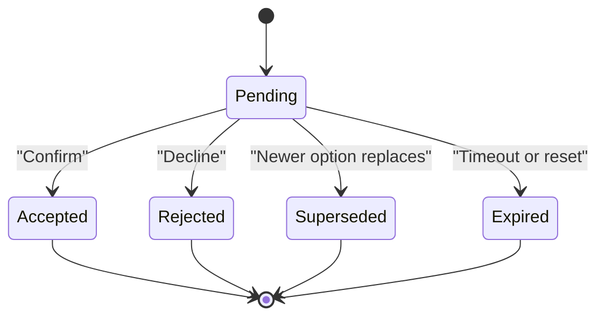

**Diagram sources**
- [proposals.py:35-141](file://backend/app/models/proposals.py#L35-L141)
- [scheduling.py:2262-2296](file://backend/app/services/scheduling.py#L2262-L2296)

**Section sources**
- [proposals.py:35-141](file://backend/app/models/proposals.py#L35-L141)
- [scheduling.py:2262-2296](file://backend/app/services/scheduling.py#L2262-L2296)

### Conversation Restore and Database Synchronization
On restore, the chat endpoint reads the stored thread and projects cards against live database state:

- Stored slot cards pass through `settle_superseded_grids`.
- Proposal cards pass through `reconcile_proposal_cards`.
- Pending proposals are returned separately so the client can keep them actionable until they resolve.

This makes the transcript honest: a grid that was once clickable can become context after a hold or booking, and a proposal card shows its real database status instead of guessing.

**Section sources**
- [chat.py:72-98](file://backend/app/api/chat.py#L72-L98)
- [chat.py:207-230](file://backend/app/api/chat.py#L207-L230)
- [scheduling.py:2180-2259](file://backend/app/services/scheduling.py#L2180-L2259)
- [scheduling.py:2262-2296](file://backend/app/services/scheduling.py#L2262-L2296)

## Dependency Analysis
The card system has clear boundaries between presentation, interaction, orchestration, and persistence.

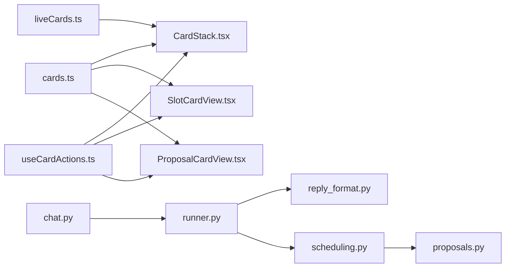

**Diagram sources**
- [cards.ts:9-187](file://frontend/src/lib/cards.ts#L9-L187)
- [CardStack.tsx:36-107](file://frontend/src/components/cards/CardStack.tsx#L36-L107)
- [SlotCardView.tsx:18-135](file://frontend/src/components/cards/SlotCardView.tsx#L18-L135)
- [ProposalCardView.tsx:57-159](file://frontend/src/components/cards/ProposalCardView.tsx#L57-L159)
- [liveCards.ts:18-77](file://frontend/src/lib/liveCards.ts#L18-L77)
- [useCardActions.ts:144-761](file://frontend/src/hooks/useCardActions.ts#L144-L761)
- [chat.py:233-274](file://backend/app/api/chat.py#L233-L274)
- [runner.py:171-406](file://backend/app/agent/runner.py#L171-L406)
- [reply_format.py:295-428](file://backend/app/agent/reply_format.py#L295-L428)
- [scheduling.py:238-295](file://backend/app/services/scheduling.py#L238-L295)
- [proposals.py:35-141](file://backend/app/models/proposals.py#L35-L141)

**Section sources**
- [cards.ts:9-187](file://frontend/src/lib/cards.ts#L9-L187)
- [CardStack.tsx:36-107](file://frontend/src/components/cards/CardStack.tsx#L36-L107)
- [SlotCardView.tsx:18-135](file://frontend/src/components/cards/SlotCardView.tsx#L18-L135)
- [ProposalCardView.tsx:57-159](file://frontend/src/components/cards/ProposalCardView.tsx#L57-L159)
- [liveCards.ts:18-77](file://frontend/src/lib/liveCards.ts#L18-L77)
- [useCardActions.ts:144-761](file://frontend/src/hooks/useCardActions.ts#L144-L761)
- [chat.py:233-274](file://backend/app/api/chat.py#L233-L274)
- [runner.py:171-406](file://backend/app/agent/runner.py#L171-L406)
- [reply_format.py:295-428](file://backend/app/agent/reply_format.py#L295-L428)
- [scheduling.py:238-295](file://backend/app/services/scheduling.py#L238-L295)
- [proposals.py:35-141](file://backend/app/models/proposals.py#L35-L141)

## Performance Considerations
- **Round limits**: The runner caps tool rounds and tool calls per round to avoid unbounded model loops.
- **Merge cost**: Merging and deduplicating cards is linear in the number of cards per turn.
- **Settlement projection**: Settling grids is applied to displayed cards rather than mutating stored rows, avoiding expensive full-thread mutations on every read.
- **Frontend refresh batching**: Availability and pending-proposal checks are debounced and de-duplicated to reduce network churn.
- **Restore path**: The restore endpoint projects cards against live state once per message, keeping the client consistent without replaying the full agent loop.

[No sources needed since this section provides general guidance]

## Troubleshooting Guide
Common issues and how the system handles them:

| Symptom | Likely Cause | System Behavior |
|---|---|---|
| Duplicate slot or proposal card appears | Retried tool call or re-derived proposal | Runner deduplicates by identity |
| Old grid stays clickable after holding a time | Missing settlement projection | `settle_superseded_grids` marks grids as context |
| Prose asks the patient to pick a time when the grid is settled | Model wrote conflicting prose | Runner replaces prose with settled intro |
| Prose points at a grid that is not on screen | Transcript drift between prose and cards | Frontend hides the turn if it looks like an offer without a grid |
| Family option click selects a historical option | Browser reconstructed names instead of posting identity | Runner forces `option_identity` and `request_id` from the action |
| Stale slot remains clickable after refresh | Frontend did not update availability state | `useCardActions.resync` compares server answers and retired ids |
| Proposal card still shows buttons after confirmation | Local state not synchronized | Pending-proposal set is refreshed and resolved cards are removed |

**Section sources**
- [runner.py:597-648](file://backend/app/agent/runner.py#L597-L648)
- [runner.py:721-744](file://backend/app/agent/runner.py#L721-L744)
- [reply_format.py:201-222](file://backend/app/agent/reply_format.py#L201-L222)
- [liveCards.ts:57-77](file://frontend/src/lib/liveCards.ts#L57-L77)
- [useCardActions.ts:291-386](file://frontend/src/hooks/useCardActions.ts#L291-L386)
- [useCardActions.ts:562-680](file://frontend/src/hooks/useCardActions.ts#L562-L680)

## Conclusion
The card management system treats cards as the display truth for scheduling interactions. Backend services derive cards from SQLite, the runner merges and deduplicates them safely, and the frontend renders them as grids, family options, and proposals. The identity system prevents duplicates, the merge strategy preserves important information while replacing stale offers, and the settlement process ensures that already-held or booked requests are shown as context rather than clickable offers. Together, these pieces keep the conversation honest, resilient to retries and restores, and aligned with the database state.

[No sources needed since this section summarizes without analyzing specific files]