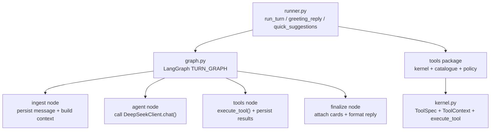
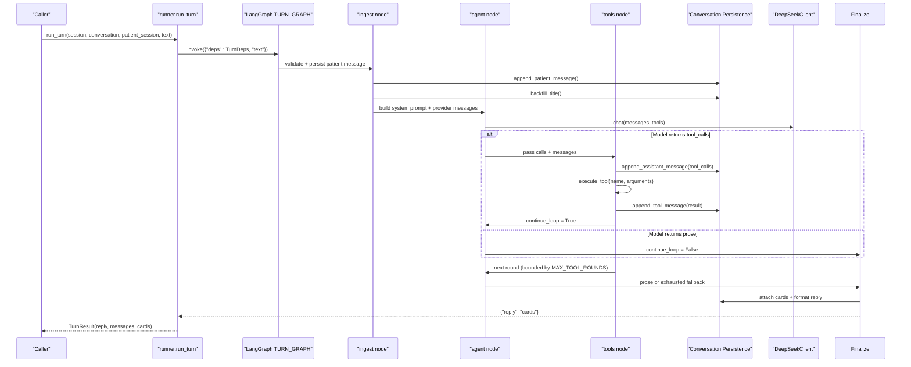
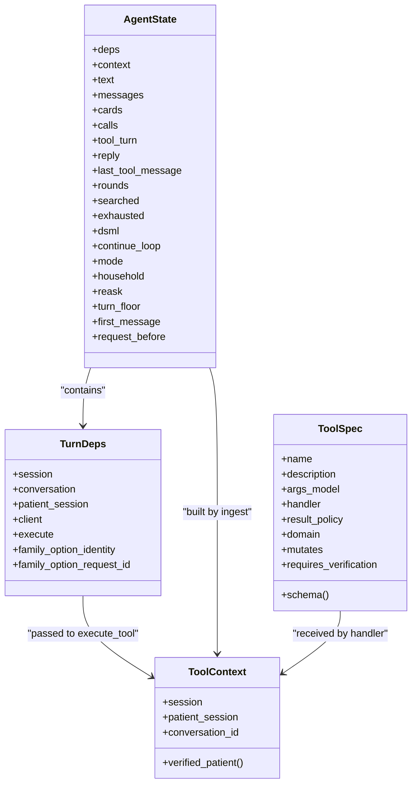
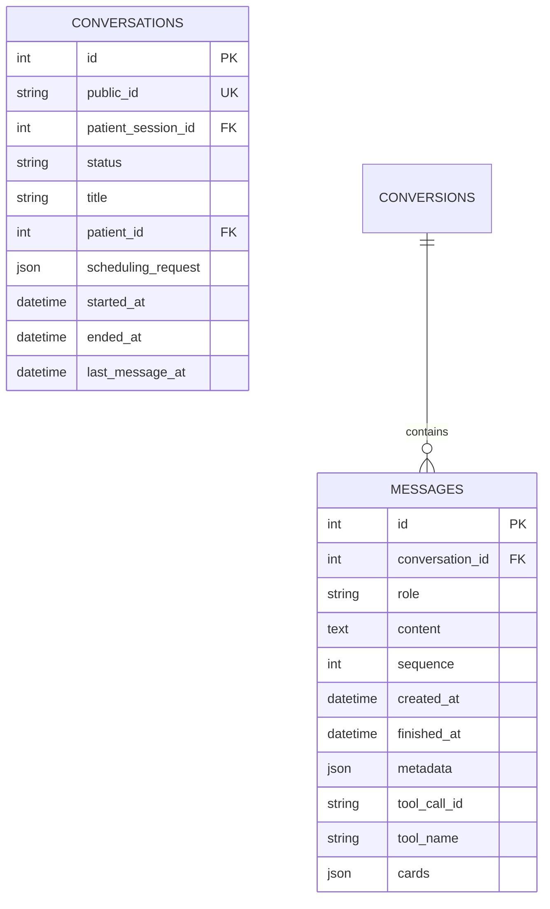
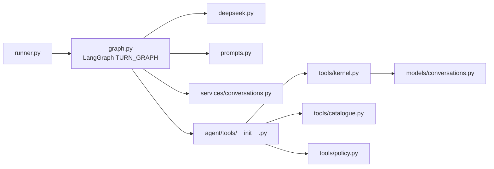

# Conversation Runner

<cite>
**Referenced Files in This Document**   
- [runner.py](file://backend/app/agent/runner.py)
- [graph.py](file://backend/app/agent/graph.py)
- [tools/__init__.py](file://backend/app/agent/tools/__init__.py)
- [tools/kernel.py](file://backend/app/agent/tools/kernel.py)
- [deepseek.py](file://backend/app/ai/deepseek.py)
- [conversations_service.py](file://backend/app/services/conversations.py)
- [conversations_model.py](file://backend/app/models/conversations.py)
- [test_agent_graph.py](file://backend/tests/test_agent_graph.py)
</cite>

## Update Summary
**Changes Made**   
- Updated architecture section to reflect LangGraph-based orchestration
- Simplified runner implementation from 760 lines to 38 lines
- Moved conversation state management and loop control to LangGraph nodes
- Updated component analysis to show new graph-based workflow
- Revised dependency analysis to reflect new LangGraph integration
- Updated diagrams to show LangGraph StateGraph structure

## Table of Contents
1. [Introduction](#introduction)
2. [Project Structure](#project-structure)
3. [Core Components](#core-components)
4. [Architecture Overview](#architecture-overview)
5. [Detailed Component Analysis](#detailed-component-analysis)
6. [Dependency Analysis](#dependency-analysis)
7. [Performance Considerations](#performance-considerations)
8. [Troubleshooting Guide](#troubleshooting-guide)
9. [Conclusion](#conclusion)

## Introduction
The conversation runner is a thin entry point that delegates orchestration to a LangGraph workflow. It validates input, assembles request-scoped dependencies, invokes the compiled `TURN_GRAPH`, and handles failure paths without ever leaving a half-written turn in the transcript. The actual bounded loop between AI interpretation and tool execution lives in the graph's `ingest → agent → tools → finalize` pipeline.

Key responsibilities include:
- Validating patient input and session ownership.
- Building `TurnDeps` for the graph, including the SQLAlchemy session, client, and tool executor.
- Invoking `TURN_GRAPH.invoke` with the current text and dependencies.
- Catching `DeepSeekError` and unexpected exceptions, persisting safe fallback replies, and returning degraded turns.
- Returning visible messages through `_visible`, which reconciles proposal cards and settles grids.

**Updated** The old hand-written loop, state machine, and inline safety checks have been replaced by LangGraph nodes that own validation, model calls, tool execution, and finalization.

**Section sources**   
- [runner.py:1-157](file://backend/app/agent/runner.py#L1-L157)
- [graph.py:1-29](file://backend/app/agent/graph.py#L1-L29)

## Project Structure
The runner now owns only HTTP-facing concerns; the orchestration lives in `app.agent.graph`:



**Diagram sources**   
- [runner.py:39-93](file://backend/app/agent/runner.py#L39-L93)
- [graph.py:466-490](file://backend/app/agent/graph.py#L466-L490)
- [tools/__init__.py:1-57](file://backend/app/agent/tools/__init__.py#L1-L57)
- [tools/kernel.py:110-143](file://backend/app/agent/tools/kernel.py#L110-L143)

**Section sources**   
- [runner.py:1-23](file://backend/app/agent/runner.py#L1-L23)
- [graph.py:1-29](file://backend/app/agent/graph.py#L1-L29)
- [tools/__init__.py:1-57](file://backend/app/agent/tools/__init__.py#L1-L57)

## Core Components
- **Conversation runner**: `run_turn` validates input, builds `TurnDeps`, invokes `TURN_GRAPH.invoke`, and converts failures into degraded `TurnResult` objects.
- **LangGraph workflow**: `TURN_GRAPH` is a compiled `StateGraph` with four nodes -- `ingest`, `agent`, `tools`, and `finalize` -- wired with conditional routing.
- **Agent state**: `AgentState` carries request-scoped data such as provider messages, tool calls, cards, round counters, exhaustion flags, and mode information.
- **Tool kernel**: `ToolSpec`, `ToolContext`, `ToolArguments`, `ResultPolicy`, and `execute_tool` define the contract every domain tool implements.
- **AI client**: `DeepSeekClient.chat` sends messages and optional tool schemas, retries transient failures, parses responses, and normalizes both standard function calls and DSML-style invocations into `AssistantTurn`.
- **Conversation persistence**: Stores patient messages, assistant replies, tool-call metadata, tool results, and UI cards; reconstructs provider messages for exact replay.

**Updated** The previous monolithic runner class has been split into focused LangGraph nodes, each responsible for one phase of the turn lifecycle.

**Section sources**   
- [runner.py:31-93](file://backend/app/agent/runner.py#L31-L93)
- [graph.py:84-124](file://backend/app/agent/graph.py#L84-L124)
- [graph.py:131-450](file://backend/app/agent/graph.py#L131-L450)
- [tools/kernel.py:59-143](file://backend/app/agent/tools/kernel.py#L59-L143)
- [deepseek.py:178-329](file://backend/app/ai/deepseek.py#L178-L329)
- [conversations_service.py:218-331](file://backend/app/services/conversations.py#L218-L331)

## Architecture Overview
The runner delegates to a LangGraph workflow shaped as:

```
START → ingest → agent → (tools → agent)* → finalize → END
```

One invocation represents one patient message. The `ingest` node persists the patient message, loads full history, builds system prompt plus provider messages, and computes turn mode. The `agent` node is the only place that calls the model; it owns the round counter and terminal conditions when no tool calls are returned or when all tools have been withdrawn. The `tools` node executes each call through `execute_tool`, persists results, merges cards, refreshes verification state, and updates the system prompt. The `finalize` node applies card and prose rules, replays slot grids for re-asks, ensures emergency notices, and returns the final reply.



**Diagram sources**   
- [runner.py:39-93](file://backend/app/agent/runner.py#L39-L93)
- [graph.py:131-450](file://backend/app/agent/graph.py#L131-L450)
- [graph.py:466-490](file://backend/app/agent/graph.py#L466-L490)
- [conversations_service.py:218-331](file://backend/app/services/conversations.py#L218-L331)
- [deepseek.py:205-249](file://backend/app/ai/deepseek.py#L205-L249)

## Detailed Component Analysis

### Runner Entry Point
The runner performs minimal work:
1. Trim and validate patient text.
2. Reject empty input with a friendly degraded reply.
3. Enforce maximum message length.
4. Verify the conversation belongs to the authenticated session.
5. Build `TurnDeps` containing the SQLAlchemy session, conversation, patient session, `DeepSeekClient`, `execute_tool`, and optional family option identifiers.
6. Invoke `TURN_GRAPH.invoke`.
7. Catch `DeepSeekError`, log the failure type without sensitive prompts, and return a degraded turn with a user-facing message.
8. Catch any other exception, roll back the session, and return a fallback reply.
9. Return `TurnResult` with visible messages produced by `_visible`.

Safety mechanisms:
- `MAX_PATIENT_MESSAGE_CHARS = 2000` prevents oversized input.
- Session ownership check is defense-in-depth beyond route-level guards.
- All failure paths persist a safe assistant message so history never ends on a dangling call.

**Updated** The previous inline loop, state machine, and safety checks have been removed; they now live in LangGraph nodes.

**Section sources**   
- [runner.py:39-93](file://backend/app/agent/runner.py#L39-L93)
- [runner.py:139-147](file://backend/app/agent/runner.py#L139-L147)

### LangGraph Workflow Nodes

#### Ingest Node
Responsible for turn initialization:
- Load existing conversation history.
- Touch the patient session.
- Append the patient message and backfill the title.
- Compute `turn_floor` so cards attach to this turn, not an older assistant reply.
- Read the current scheduling request to determine household mode.
- Detect time re-asks and compute `TurnMode`.
- Build provider messages starting with the system prompt followed by stored thread messages.
- Inject family option action into the system prompt when present.
- Initialize `AgentState` with context, messages, mode, flags, and empty cards.

**Section sources**   
- [graph.py:131-187](file://backend/app/agent/graph.py#L131-L187)

#### Agent Node
Performs one model round:
- Resolve visible tools based on mode, search/exhaustion state, and household flag.
- Call `DeepSeekClient.chat` with provider messages and tool schemas.
- Handle tool calls arriving after all tools were withdrawn by returning prose instead of executing invalid calls.
- If no tool calls, close the turn with prose.
- If tool calls exist, cap fan-out at `MAX_TOOL_CALLS_PER_ROUND`, persist the assistant turn with pending tool-call metadata, append the assistant message to provider context, mark rounds incremented, and signal continuation.

Terminal conditions:
- Prose reply.
- Tool calls after tools were withdrawn.
- Exhausted availability.
- Synthetic DSML tool-call ids.
- Maximum tool rounds reached.

**Section sources**   
- [graph.py:190-238](file://backend/app/agent/graph.py#L190-L238)

#### Tools Node
Executes this round's calls:
- Iterate over pending calls and execute each through `_execute`, which delegates to `deps.execute(context, name, arguments)`.
- Track the last tool message for fallback prose.
- Mark searches performed during re-ask mode.
- Detect complete empty availability searches and set `exhausted = True`.
- Extract and merge cards from results.
- Persist each tool result as a separate message linked by `tool_call_id`.
- Refresh patient verification and rebuild the system prompt before the next model round.
- Apply early exit for synthetic DSML ids or round limits.

**Section sources**   
- [graph.py:241-324](file://backend/app/agent/graph.py#L241-L324)
- [graph.py:742-775](file://backend/app/agent/graph.py#L742-L775)

#### Finalize Node
Single exit point:
- Refresh re-ask searches against live SQLite state.
- Ensure emergency handoff notices are explicit.
- Replace assistant prose with settled-grid wording when slots are already held or booked.
- Attach cards to the turn floor, avoiding duplication across earlier tool turns.
- Reconcile proposals and settle superseded grids.
- Deduplicate cards by identity.
- Replay earlier slot grids for re-asks when the model did not search again.
- Format prose according to card presence, stripping dashes and replacing card-driven intros.
- Persist cleaned text only when it differs from what was stored.

**Section sources**   
- [graph.py:327-450](file://backend/app/agent/graph.py#L327-L450)

### Tool Calling Mechanism
Tools are defined as frozen `ToolSpec` instances containing a name, description, Pydantic argument model, handler, result policy, domain, mutation flag, and verification requirement. The kernel enforces two rules:
- Arguments arrive as JSON strings from the provider and are validated before any service is called.
- Identity is never taken from model arguments; handlers read `ToolContext`, which the graph populates from the authenticated session.

Execution flow:
1. The graph resolves visible tools through `visible_tools`.
2. Each tool schema is sent to the model as a structured function definition.
3. When the model returns tool calls, the graph persists them as pending assistant tool calls.
4. `_execute` injects UI-supplied family option identity for `hold_family_option`, then delegates to `execute_tool`.
5. `execute_tool` validates names, parses JSON, validates arguments with Pydantic, invokes handlers safely, truncates large results, and logs outcome events.
6. Results are persisted as tool messages and folded into the turn's cards.



**Diagram sources**   
- [graph.py:84-124](file://backend/app/agent/graph.py#L84-L124)
- [tools/kernel.py:59-143](file://backend/app/agent/tools/kernel.py#L59-L143)

**Section sources**   
- [tools/kernel.py:110-143](file://backend/app/agent/tools/kernel.py#L110-L143)
- [tools/kernel.py:146-182](file://backend/app/agent/tools/kernel.py#L146-L182)
- [graph.py:742-775](file://backend/app/agent/graph.py#L742-L775)

### Conversation State Management
State is carried explicitly through `AgentState` rather than hidden instance variables:
- `TurnDeps` holds request-scoped dependencies built by the runner, never by the model.
- `ToolContext` carries the SQLAlchemy session, verified patient lookup, and conversation id.
- Provider messages are rebuilt each turn with current system prompt and history.
- Scheduling request persistence stores canonical participants, preferences, and coordination flags.
- Family option identity and request id are injected into the system prompt so the model cannot select a different historical option.
- Card attachment uses `turn_floor` to ensure cards belong to the latest assistant reply and are not attached to older messages.

Security and safety:
- Identity and session binding come from `ToolContext`, not model arguments.
- Family option selection uses an opaque identity supplied by the UI, not by the model.
- Availability re-ask restricts tools to read/search operations and prevents accidental holds or confirmations based on older cards.

**Section sources**   
- [graph.py:84-124](file://backend/app/agent/graph.py#L84-L124)
- [graph.py:165-187](file://backend/app/agent/graph.py#L165-L187)
- [graph.py:519-536](file://backend/app/agent/graph.py#L519-L536)
- [tools/kernel.py:59-70](file://backend/app/agent/tools/kernel.py#L59-L70)

### Chronological Message History and Replay
Every turn is stored chronologically:
- Patient messages are appended with sequence numbers.
- Assistant messages store content and optional tool-call metadata.
- Tool results are stored as separate messages linked by `tool_call_id`.
- Cards produced during a turn are attached to the assistant message.
- `to_provider_messages` reconstructs the OpenAI-compatible message stream, pairing assistant tool calls with their tool results and dropping orphaned tool rows.

This enables:
- Exact replay of the conversation to the AI.
- Auditability of what was said, what tools were called, and what results were returned.
- Safe public projections that exclude internal tool payloads.



**Diagram sources**   
- [conversations_model.py:39-84](file://backend/app/models/conversations.py#L39-L84)
- [conversations_model.py:87-123](file://backend/app/models/conversations.py#L87-L123)

**Section sources**   
- [conversations_service.py:165-240](file://backend/app/services/conversations.py#L165-L240)
- [conversations_service.py:243-262](file://backend/app/services/conversations.py#L243-L262)
- [conversations_service.py:265-331](file://backend/app/services/conversations.py#L265-L331)
- [conversations_service.py:334-366](file://backend/app/services/conversations.py#L334-L366)
- [conversations_model.py:39-123](file://backend/app/models/conversations.py#L39-L123)

### Error Handling and Graceful Degradation
When AI services fail:
- `DeepSeekNotConfigured`, `DeepSeekTimeout`, `DeepSeekUnavailable`, `DeepSeekRateLimited`, and `DeepSeekBadResponse` provide user-friendly messages.
- The runner catches `DeepSeekError`, logs the failure type without sensitive prompt data, persists a safe assistant message, and returns a degraded turn.
- Unexpected exceptions roll back the session and persist a fallback reply.
- The AI client retries transient failures with exponential backoff before failing.

When tools fail:
- Unknown tool names return a structured error.
- Invalid JSON or Pydantic validation errors return field-level feedback.
- Handler exceptions are caught and converted to a generic tool failure result.
- Large tool results are truncated while preserving decision fields and cards.

The graph also handles edge cases:
- Tool calls after tools were withdrawn return prose instead of executing invalid calls.
- Synthetic DSML tool-call ids stop the loop and speak from tool results.
- Exhausted availability marks the turn terminal so hallucinated follow-up tool calls do not cause HTTP 400 errors.

**Section sources**   
- [runner.py:71-87](file://backend/app/agent/runner.py#L71-L87)
- [graph.py:206-221](file://backend/app/agent/graph.py#L206-L221)
- [graph.py:311-323](file://backend/app/agent/graph.py#L311-L323)
- [graph.py:742-775](file://backend/app/agent/graph.py#L742-L775)
- [deepseek.py:205-249](file://backend/app/ai/deepseek.py#L205-L249)

### Preventing Infinite Loops and Enforcing Boundaries
The LangGraph workflow enforces multiple layers of boundary control:
- `MAX_TOOL_ROUNDS = 4` limits model round-trips per patient message.
- `MAX_TOOL_CALLS_PER_ROUND = 4` limits fan-out from a single model turn.
- `MAX_PATIENT_MESSAGE_CHARS = 2000` trims oversized input.
- Availability exhaustion detection after complete empty searches.
- Tool withdrawal after exhaustion to avoid hallucinated tool calls.
- Synthetic DSML tool-call id handling to prevent 400 errors on subsequent rounds.
- Card deduplication and merging to avoid duplicate offers.
- Settling grids when a booking is already held or confirmed.

The test suite verifies that the compiled graph is built once per process, that tool rounds feed results back to the model, and that the cycle stops at the round limit.

**Section sources**   
- [runner.py:25-28](file://backend/app/agent/runner.py#L25-L28)
- [graph.py:65-76](file://backend/app/agent/graph.py#L65-L76)
- [graph.py:311-323](file://backend/app/agent/graph.py#L311-L323)
- [test_agent_graph.py:60-102](file://backend/tests/test_agent_graph.py#L60-L102)

### Example Conversation Flow
A typical successful flow under the new architecture:
1. Caller invokes `runner.run_turn`.
2. Runner validates input and builds `TurnDeps`.
3. `TURN_GRAPH.invoke` starts at `ingest`, persists the patient message, and builds provider messages.
4. `agent` calls `DeepSeekClient.chat` with available tools.
5. If the model requests tools, `tools` executes them through `execute_tool`, persists results, and continues the loop.
6. After tool results are fed back, `agent` makes another round up to `MAX_TOOL_ROUNDS`.
7. When prose is returned, `finalize` attaches cards, formats reply, and exits.
8. Runner returns `TurnResult` with visible messages.

A reschedule flow:
1. Runner validates session and passes dependencies to the graph.
2. `ingest` detects pending moves and sets appropriate mode.
3. `agent` calls `get_patient_appointments`, then `reschedule_appointment`.
4. `tools` persists the move proposal and waits for confirmation.
5. On confirmation, the original appointment is retired and the replacement is booked atomically.

A family booking flow:
1. Runner passes `family_option_identity` and `family_option_request_id` in `TurnDeps`.
2. `ingest` injects the family option action into the system prompt.
3. `agent` calls `search_family_availability`, receives family option cards.
4. `tools` executes `hold_family_option` using the UI-supplied option identity, not model arguments.
5. One confirmation books everyone together.

**Section sources**   
- [graph.py:131-450](file://backend/app/agent/graph.py#L131-L450)
- [graph.py:519-536](file://backend/app/agent/graph.py#L519-L536)
- [graph.py:742-775](file://backend/app/agent/graph.py#L742-L775)

## Dependency Analysis
The runner now depends on a small, focused set of modules:



**Diagram sources**   
- [runner.py:15-21](file://backend/app/agent/runner.py#L15-L21)
- [graph.py:42-61](file://backend/app/agent/graph.py#L42-L61)
- [tools/__init__.py:12-33](file://backend/app/agent/tools/__init__.py#L12-L33)

Coupling and cohesion:
- The runner is cohesive around one patient message lifecycle and delegates orchestration to LangGraph.
- The graph owns the turn lifecycle, keeping nodes focused on ingestion, model calls, tool execution, and finalization.
- Tool execution is decoupled from AI calling through `execute_tool` and `ToolSpec`.
- Domain tool implementations live under `tools/domains/` and depend on business services.
- Conversation persistence is independent of AI and tool details, exposing simple append/replay APIs.
- External dependencies are limited to the DeepSeek client, LangGraph runtime, and database session.

**Section sources**   
- [runner.py:15-21](file://backend/app/agent/runner.py#L15-L21)
- [graph.py:42-61](file://backend/app/agent/graph.py#L42-L61)
- [tools/__init__.py:1-57](file://backend/app/agent/tools/__init__.py#L1-L57)

## Performance Considerations
- The LangGraph workflow limits AI round-trips and fan-out to reduce latency and cost.
- The compiled `TURN_GRAPH` is built once at import and reused across turns.
- The DeepSeek client uses strict connect/read/total timeouts and retries transient failures with exponential backoff.
- Tool results are truncated to preserve interactive cards while avoiding unbounded payloads.
- Conversation history is loaded fully for fidelity, but provider messages skip system/staff rows and rebuild the system prompt per turn with current state.
- Card deduplication and merging prevent redundant UI rendering.
- Availability exhaustion stops further tool offers, preventing repeated searches that yield no value.

[No sources needed since this section provides general guidance]

## Troubleshooting Guide
Common issues and recovery strategies:
- **AI service unavailable or rate-limited**: The client retries transient errors; if retries fail, the runner persists a friendly message and marks the turn degraded.
- **Malformed tool arguments**: Pydantic validation returns field-level errors guiding the model to ask the patient for corrected details.
- **Unknown tool name**: The runner logs a warning and returns a structured error telling the model it does not have that tool.
- **Hallucinated tool calls after empty availability search**: Tools are withdrawn; the runner returns prose and avoids HTTP 400 errors.
- **Duplicate cards**: Deduplication by card identity prevents showing the same slot, proposal, or family option twice.
- **Stale or superseded grids**: Settling logic marks times as context when a booking is already held or confirmed.
- **Emergency handoff without explicit notice**: The runner adds a front-desk notification sentence when an emergency-style handoff card is present.

Operational checks:
- Inspect `TurnResult.degraded` to detect AI-side failures.
- Monitor tool execution events for success/failure and card counts.
- Review conversation history for exact replay and audit trails.
- Use visible message projection for the UI to hide internal tool payloads.
- Verify that `TURN_GRAPH` is a process singleton and not rebuilt per request.

**Section sources**   
- [runner.py:71-87](file://backend/app/agent/runner.py#L71-L87)
- [graph.py:206-221](file://backend/app/agent/graph.py#L206-L221)
- [graph.py:311-323](file://backend/app/agent/graph.py#L311-L323)
- [graph.py:742-775](file://backend/app/agent/graph.py#L742-L775)
- [test_agent_graph.py:60-102](file://backend/tests/test_agent_graph.py#L60-L102)

## Conclusion
The conversation runner is now a thin, secure entry point that delegates orchestration to a LangGraph workflow. The old hand-written loop, state machine, and inline safety checks have been replaced by focused nodes -- `ingest`, `agent`, `tools`, and `finalize` -- that together enforce identity, registration, and booking policies through validated tools, maintain full chronological history for replay, and handle AI and tool failures gracefully. By bounding tool rounds, limiting fan-out, withdrawing tools after exhaustion, and attaching cards deterministically, the LangGraph-based runner keeps the AI within operational boundaries while delivering a smooth patient experience.

[No sources needed since this section summarizes without analyzing specific files]