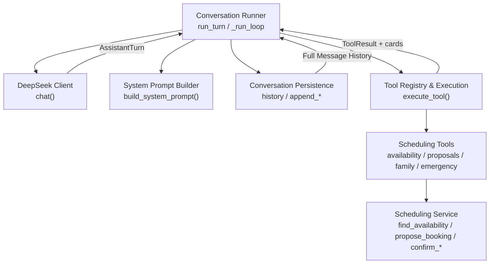
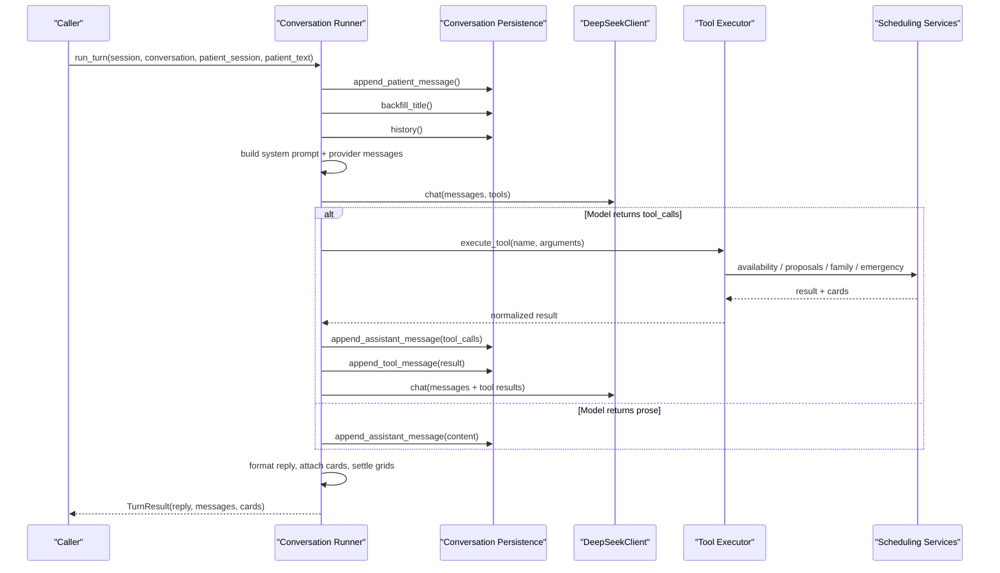
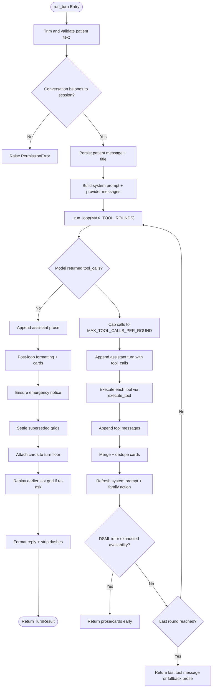
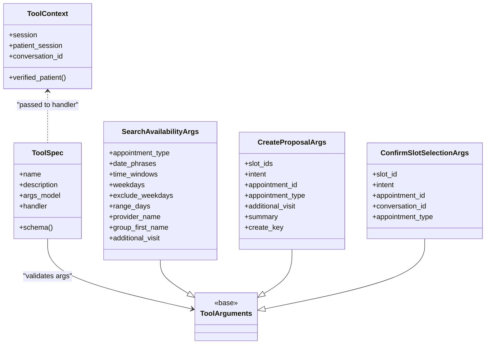
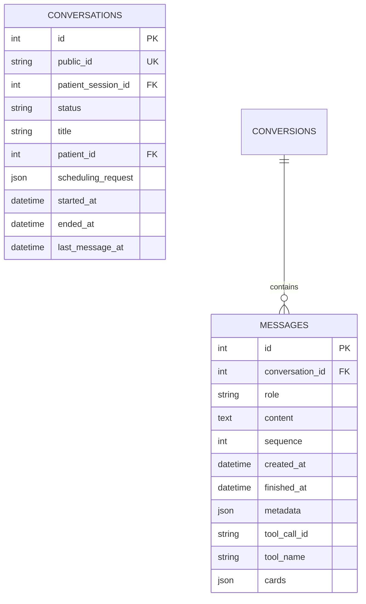
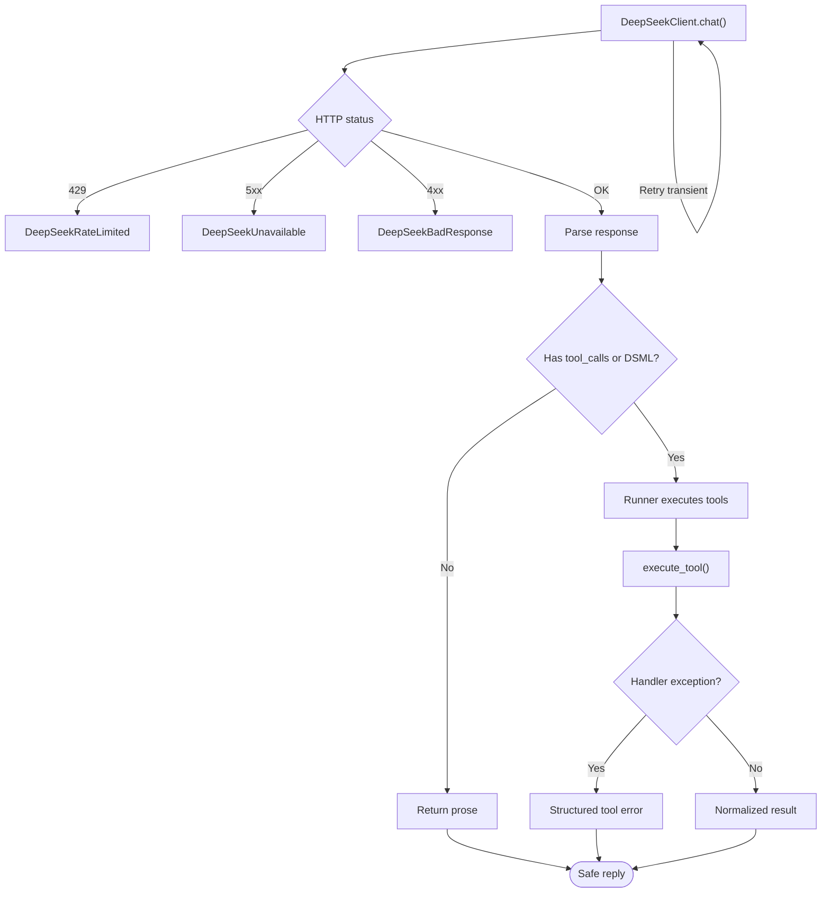
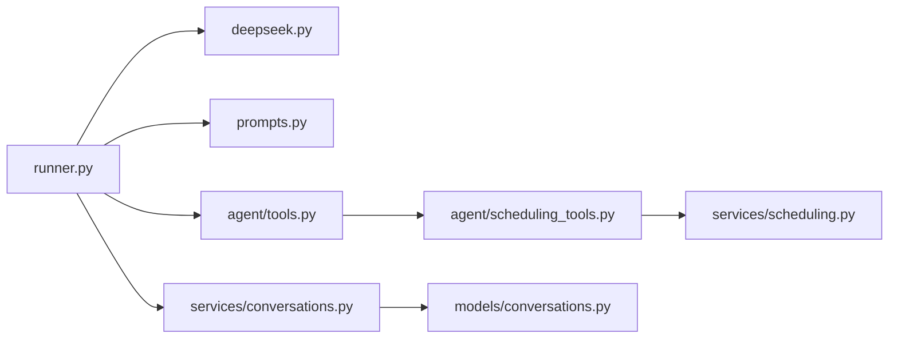

# Conversation Runner

<cite>
**Referenced Files in This Document**   
- [runner.py](file://backend/app/agent/runner.py)
- [tools.py](file://backend/app/agent/tools.py)
- [scheduling_tools.py](file://backend/app/agent/scheduling_tools.py)
- [prompts.py](file://backend/app/agent/prompts.py)
- [deepseek.py](file://backend/app/ai/deepseek.py)
- [conversations_service.py](file://backend/app/services/conversations.py)
- [conversations_model.py](file://backend/app/models/conversations.py)
- [scheduling_service.py](file://backend/app/services/scheduling.py)
- [test_tool_loop_exhausted.py](file://backend/tests/test_tool_loop_exhausted.py)
</cite>

## Table of Contents
1. [Introduction](#introduction)
2. [Project Structure](#project-structure)
3. [Core Components](#core-components)
4. [Architecture Overview](#architecture-overview)
5. [Detailed Component Analysis](#detailed-component-analysis)
6. [Dependency Analysis](#dependency-analysis)
7. [Performance Considerations](#performance-considerations)
8. [Troubleshooting Guide](#troubleshooting-guide)
9. [Conclusion](#conclusion)

## Introduction
The conversation runner is the central orchestrator for one patient message: it persists the input, loads full chronological history, builds a system prompt and provider messages, calls the AI model with structured tool schemas, executes validated tools against business services, persists every turn, and returns a safe assistant reply plus UI cards. It enforces strict safety boundaries so the AI cannot bypass verification, registration, or booking policy logic.

Key responsibilities include:
- Managing conversation state per session and per thread.
- Maintaining chronological message history for exact replay.
- Limiting AI tool rounds and fan-out to prevent infinite loops.
- Validating all tool arguments through Pydantic models.
- Persisting full dialogue history for audit and replay.
- Handling AI service failures with graceful degradation.
- Ensuring interactive cards are attached to the correct turn and never duplicated.

## Project Structure
The runner lives in the agent layer and depends on:
- The AI client for DeepSeek-compatible chat-completions.
- Tool definitions and execution.
- Scheduling tools for availability, proposals, appointments, family options, emergencies, and staff requests.
- Conversation persistence for full transcript storage.
- Prompt construction for persona, hard rules, and session state.
- Business services for scheduling, patients, availability, and handoff.

**Diagram sources**
- [runner.py:171-406](file://backend/app/agent/runner.py#L171-L406)
- [deepseek.py:178-329](file://backend/app/ai/deepseek.py#L178-L329)
- [tools.py:703-739](file://backend/app/agent/tools.py#L703-L739)
- [scheduling_tools.py:474-552](file://backend/app/agent/scheduling_tools.py#L474-L552)
- [scheduling_service.py:393-716](file://backend/app/services/scheduling.py#L393-L716)
- [conversations_service.py:218-331](file://backend/app/services/conversations.py#L218-L331)

**Section sources**
- [runner.py:1-23](file://backend/app/agent/runner.py#L1-L23)
- [tools.py:1-11](file://backend/app/agent/tools.py#L1-L11)
- [conversations_service.py:1-14](file://backend/app/services/conversations.py#L1-L14)

## Core Components
- **Conversation runner**: `run_turn` and `_run_loop` implement the bounded loop between AI interpretation and tool execution. They persist patient input, build provider messages, call the AI, execute requested tools, attach cards, and return a final reply.
- **AI client**: `DeepSeekClient.chat` sends messages and optional tool schemas, retries transient failures, parses responses, and normalizes both standard function calls and DSML-style tool invocations into `AssistantTurn`.
- **Tool registry**: `execute_tool` validates tool names, parses JSON arguments, validates them with Pydantic models, invokes handlers safely, truncates large results, and never raises to the caller.
- **Scheduling tools**: Availability search, proposal creation, confirmation, reschedule, cancellation, family planning, emergency reporting, and staff request creation. These enforce business rules such as verified identity, registration completeness, slot ownership, and move vs new-booking routing.
- **Conversation persistence**: Stores patient messages, assistant replies, tool-call metadata, tool results, and UI cards. Provides provider-message reconstruction for exact replay.
- **Prompt builder**: Produces persona, hard rules, tool guidance, clinic facts, insurance/policy blocks, and session state that constrain the AI’s behavior.

**Section sources**
- [runner.py:171-406](file://backend/app/agent/runner.py#L171-L406)
- [runner.py:409-557](file://backend/app/agent/runner.py#L409-L557)
- [deepseek.py:67-85](file://backend/app/ai/deepseek.py#L67-L85)
- [deepseek.py:178-329](file://backend/app/ai/deepseek.py#L178-L329)
- [tools.py:41-53](file://backend/app/agent/tools.py#L41-L53)
- [tools.py:703-739](file://backend/app/agent/tools.py#L703-L739)
- [scheduling_tools.py:59-113](file://backend/app/agent/scheduling_tools.py#L59-L113)
- [conversations_service.py:218-331](file://backend/app/services/conversations.py#L218-L331)
- [prompts.py:23-87](file://backend/app/agent/prompts.py#L23-L87)
- [prompts.py:89-201](file://backend/app/agent/prompts.py#L89-L201)

## Architecture Overview
The runner follows a deterministic phase flow: authenticate session, persist incoming message, load full thread, build system prompt and provider messages, call DeepSeek with tools, execute requested tools through validated services, persist assistant tool-call turns and tool results, call DeepSeek again with results, persist final assistant text, and return it. Safety bounds limit tool rounds and tool calls per round.

**Diagram sources**
- [runner.py:171-406](file://backend/app/agent/runner.py#L171-L406)
- [runner.py:409-557](file://backend/app/agent/runner.py#L409-L557)
- [conversations_service.py:218-331](file://backend/app/services/conversations.py#L218-L331)
- [deepseek.py:205-249](file://backend/app/ai/deepseek.py#L205-L249)
- [tools.py:703-739](file://backend/app/agent/tools.py#L703-L739)
- [scheduling_tools.py:474-552](file://backend/app/agent/scheduling_tools.py#L474-L552)

## Detailed Component Analysis

### Conversation Runner Loop
The runner performs these steps:
1. Validate and trim patient input.
2. Verify conversation belongs to the authenticated session.
3. Append the patient message and update title/backfill.
4. Load full history and construct provider messages with system prompt.
5. Build `ToolContext` from the authenticated session only.
6. Optionally restrict tools for re-ask scenarios.
7. Enter `_run_loop`, which calls the AI up to `MAX_TOOL_ROUNDS`.
8. For each AI turn:
   - If no tool calls, persist prose and return.
   - If tool calls exist, cap fan-out at `MAX_TOOL_CALLS_PER_ROUND`.
   - Persist assistant turn with tool-call metadata.
   - Execute each tool through `execute_tool`.
   - Persist tool results and append tool messages to provider context.
   - Merge and deduplicate cards.
   - Refresh system prompt and family option action when needed.
   - Stop early for synthetic DSML ids or exhausted availability.
   - Return fallback prose if the last round is reached.
9. After the loop, ensure emergency notices, settled-grid wording, card attachment, grid replay for re-asks, and style cleanup.

Safety mechanisms:
- `MAX_TOOL_ROUNDS = 4` limits model round-trips per patient message.
- `MAX_TOOL_CALLS_PER_ROUND = 4` limits fan-out from a single model turn.
- `MAX_PATIENT_MESSAGE_CHARS = 2000` trims oversized input.
- Availability re-ask tool filtering prevents dispatching hold/confirm based on older historical cards.
- Synthetic DSML tool-call ids are not retried; the runner speaks from tool results instead.
- Exhausted availability marks the turn terminal so hallucinated follow-up tool calls do not cause HTTP 400 errors.

Error handling:
- `DeepSeekError` variants produce user-facing messages and mark the turn degraded.
- Unexpected exceptions roll back the session and persist a safe fallback reply.
- Tool execution failures are converted to structured tool results rather than raising.

**Diagram sources**
- [runner.py:171-406](file://backend/app/agent/runner.py#L171-L406)
- [runner.py:409-557](file://backend/app/agent/runner.py#L409-L557)
- [runner.py:567-594](file://backend/app/agent/runner.py#L567-L594)
- [runner.py:597-637](file://backend/app/agent/runner.py#L597-L637)
- [runner.py:693-718](file://backend/app/agent/runner.py#L693-L718)

**Section sources**
- [runner.py:51-55](file://backend/app/agent/runner.py#L51-L55)
- [runner.py:91-121](file://backend/app/agent/runner.py#L91-L121)
- [runner.py:171-406](file://backend/app/agent/runner.py#L171-L406)
- [runner.py:409-557](file://backend/app/agent/runner.py#L409-L557)
- [runner.py:567-594](file://backend/app/agent/runner.py#L567-L594)
- [runner.py:597-637](file://backend/app/agent/runner.py#L597-L637)
- [runner.py:693-718](file://backend/app/agent/runner.py#L693-L718)

### Tool Calling Mechanism
The AI requests tools through structured function calls. The runner converts those calls into a persisted assistant turn, then executes them through `execute_tool`:
- Unknown tool names return a structured error.
- Arguments are parsed from JSON and validated by Pydantic models.
- Validation errors return field-level feedback to guide the model.
- Handlers receive `ToolContext` built from the authenticated session, never from model arguments.
- Handler exceptions are caught and turned into safe tool results.
- Results are truncated to keep interactive cards while trimming secondary detail.

**Diagram sources**
- [tools.py:41-53](file://backend/app/agent/tools.py#L41-L53)
- [tools.py:493-508](file://backend/app/agent/tools.py#L493-L508)
- [tools.py:511-588](file://backend/app/agent/tools.py#L511-L588)
- [scheduling_tools.py:59-113](file://backend/app/agent/scheduling_tools.py#L59-L113)
- [scheduling_tools.py:115-157](file://backend/app/agent/scheduling_tools.py#L115-L157)
- [scheduling_tools.py:160-178](file://backend/app/agent/scheduling_tools.py#L160-L178)

**Section sources**
- [tools.py:703-739](file://backend/app/agent/tools.py#L703-L739)
- [tools.py:617-700](file://backend/app/agent/tools.py#L617-L700)
- [scheduling_tools.py:474-552](file://backend/app/agent/scheduling_tools.py#L474-L552)
- [scheduling_tools.py:555-682](file://backend/app/agent/scheduling_tools.py#L555-L682)

### Conversation State Management
The runner maintains state through:
- `ToolContext`, carrying the SQLAlchemy session, verified patient session, and conversation id.
- Provider messages, rebuilt each turn with current system prompt and history.
- Scheduling request persistence, which stores canonical participants, preferences, and coordination flags.
- Family option identity and request id, injected into the system prompt so the model cannot select a different historical option.
- Card attachment tied to the turn floor, ensuring cards belong to the latest assistant reply and are not attached to older messages.

Security and safety:
- Identity and session binding come from `ToolContext`, not model arguments.
- Family option selection uses an opaque identity supplied by the UI, not by the model.
- Availability re-ask restricts tools to read/search operations and prevents accidental holds or confirmations based on older cards.

**Section sources**
- [tools.py:41-53](file://backend/app/agent/tools.py#L41-L53)
- [runner.py:153-168](file://backend/app/agent/runner.py#L153-L168)
- [runner.py:214-221](file://backend/app/agent/runner.py#L214-L221)
- [runner.py:693-718](file://backend/app/agent/runner.py#L693-L718)
- [scheduling_service.py:137-191](file://backend/app/services/scheduling.py#L137-L191)

### Chronological Message History and Replay
Every turn is stored chronologically:
- Patient messages are appended with sequence numbers.
- Assistant messages store content and optional tool-call metadata.
- Tool results are stored as separate messages linked by `tool_call_id`.
- Cards produced during a turn are attached to the assistant message.
- `to_provider_messages` reconstructs the OpenAI-compatible message stream, pairing assistant tool calls with their tool results and dropping orphaned tool rows.

This enables:
- Exact replay of the conversation to the AI.
- Auditability of what was said, what tools were called, and what results were returned.
- Safe public projections that exclude internal tool payloads.

**Diagram sources**
- [conversations_model.py:39-84](file://backend/app/models/conversations.py#L39-L84)
- [conversations_model.py:87-123](file://backend/app/models/conversations.py#L87-L123)

**Section sources**
- [conversations_service.py:165-240](file://backend/app/services/conversations.py#L165-L240)
- [conversations_service.py:243-262](file://backend/app/services/conversations.py#L243-L262)
- [conversations_service.py:265-331](file://backend/app/services/conversations.py#L265-L331)
- [conversations_service.py:334-366](file://backend/app/services/conversations.py#L334-L366)
- [conversations_model.py:39-123](file://backend/app/models/conversations.py#L39-L123)

### Error Handling and Graceful Degradation
When AI services fail:
- `DeepSeekNotConfigured`, `DeepSeekTimeout`, `DeepSeekUnavailable`, `DeepSeekRateLimited`, and `DeepSeekBadResponse` provide user-friendly messages.
- The runner catches `DeepSeekError`, logs the failure type without sensitive prompt data, persists a safe assistant message, and returns a degraded turn.
- Unexpected exceptions roll back the session and persist a fallback reply.
- The AI client retries transient failures (rate limits, server errors, network issues) with exponential backoff before failing.

When tools fail:
- Unknown tool names return a structured error.
- Invalid JSON or Pydantic validation errors return field-level feedback.
- Handler exceptions are caught and converted to a generic tool failure result.
- Large tool results are truncated while preserving decision fields and cards.

**Diagram sources**
- [deepseek.py:38-64](file://backend/app/ai/deepseek.py#L38-L64)
- [deepseek.py:205-249](file://backend/app/ai/deepseek.py#L205-L249)
- [deepseek.py:251-329](file://backend/app/ai/deepseek.py#L251-L329)
- [tools.py:703-739](file://backend/app/agent/tools.py#L703-L739)
- [runner.py:264-292](file://backend/app/agent/runner.py#L264-L292)

**Section sources**
- [deepseek.py:38-64](file://backend/app/ai/deepseek.py#L38-L64)
- [deepseek.py:205-249](file://backend/app/ai/deepseek.py#L205-L249)
- [deepseek.py:251-329](file://backend/app/ai/deepseek.py#L251-L329)
- [tools.py:703-739](file://backend/app/agent/tools.py#L703-L739)
- [runner.py:264-292](file://backend/app/agent/runner.py#L264-L292)

### Preventing Infinite Loops and Enforcing Boundaries
The runner enforces multiple layers of boundary control:
- Maximum tool rounds per patient message.
- Maximum tool calls per round.
- Maximum patient message length.
- Availability exhaustion detection after complete empty searches.
- Tool withdrawal after exhaustion to avoid hallucinated tool calls.
- Synthetic DSML tool-call id handling to prevent 400 errors on subsequent rounds.
- Card deduplication and merging to avoid duplicate offers.
- Settling grids when a booking is already held or confirmed.

The test suite includes a scenario where an empty availability search causes the model to hallucinate another tool call; the runner withdraws tools and returns prose instead of looping or producing an HTTP 400.

**Section sources**
- [runner.py:51-55](file://backend/app/agent/runner.py#L51-L55)
- [runner.py:433-557](file://backend/app/agent/runner.py#L433-L557)
- [runner.py:597-637](file://backend/app/agent/runner.py#L597-L637)
- [test_tool_loop_exhausted.py:61-121](file://backend/tests/test_tool_loop_exhausted.py#L61-L121)

### Example Conversation Flow
A typical successful flow:
1. Patient asks for a cleaning appointment next Tuesday afternoon.
2. Runner persists the message and loads history.
3. System prompt indicates the patient is verified and ready for scheduling.
4. AI calls `search_availability` with date phrases and time windows.
5. Runner executes the tool, receives slot cards, and persists the assistant turn and tool result.
6. AI returns prose inviting the patient to pick a time.
7. Runner attaches the slot cards to the assistant message and formats the reply.

A reschedule flow:
1. Patient says they want to move their existing appointment.
2. Runner ensures the session is verified and reads pending moves.
3. AI calls `get_patient_appointments`, then `reschedule_appointment` with either a replacement slot id or date/time hints.
4. Runner persists the move proposal and waits for confirmation.
5. On confirmation, the original appointment is retired and the replacement is booked atomically.

A family booking flow:
1. Patient asks for two people on the same day.
2. Runner restricts tools to family-aware operations.
3. AI calls `search_family_availability`, receives family option cards.
4. Runner executes `hold_family_option` using the UI-supplied option identity.
5. One confirmation books everyone together.

**Section sources**
- [prompts.py:89-201](file://backend/app/agent/prompts.py#L89-L201)
- [scheduling_tools.py:474-552](file://backend/app/agent/scheduling_tools.py#L474-L552)
- [scheduling_tools.py:555-682](file://backend/app/agent/scheduling_tools.py#L555-L682)
- [scheduling_tools.py:690-717](file://backend/app/agent/scheduling_tools.py#L690-L717)
- [scheduling_tools.py:788-800](file://backend/app/agent/scheduling_tools.py#L788-L800)

## Dependency Analysis
The runner depends on several modules with clear separation of concerns:

**Diagram sources**
- [runner.py:25-47](file://backend/app/agent/runner.py#L25-L47)
- [tools.py:25-29](file://backend/app/agent/tools.py#L25-L29)
- [scheduling_tools.py:27-49](file://backend/app/agent/scheduling_tools.py#L27-L49)
- [conversations_service.py:24-27](file://backend/app/services/conversations.py#L24-L27)

Coupling and cohesion:
- The runner is cohesive around one patient message lifecycle.
- Tool execution is decoupled from AI calling through `execute_tool`.
- Scheduling tools depend on the scheduling service for deterministic business logic.
- Conversation persistence is independent of AI and tool details, exposing simple append/replay APIs.
- External dependencies are limited to the DeepSeek client and database session.

Potential circular imports are avoided by lazy loading combined tool specs and by splitting scheduling tools into a separate module.

**Section sources**
- [runner.py:25-47](file://backend/app/agent/runner.py#L25-L47)
- [tools.py:590-614](file://backend/app/agent/tools.py#L590-L614)
- [scheduling_tools.py:1-17](file://backend/app/agent/scheduling_tools.py#L1-L17)

## Performance Considerations
- The runner limits AI round-trips and fan-out to reduce latency and cost.
- The DeepSeek client uses strict connect/read/total timeouts and retries transient failures with exponential backoff.
- Tool results are truncated to preserve interactive cards while avoiding unbounded payloads.
- Conversation history is loaded fully for fidelity, but provider messages skip system/staff rows and rebuild the system prompt per turn with current state.
- Card deduplication and merging prevent redundant UI rendering.
- Availability exhaustion stops further tool offers, preventing repeated searches that yield no value.

[No sources needed since this section provides general guidance]

## Troubleshooting Guide
Common issues and recovery strategies:
- **AI service unavailable or rate-limited**: The client retries transient errors; if retries fail, the runner persists a friendly message and marks the turn degraded.
- **Malformed tool arguments**: Pydantic validation returns field-level errors guiding the model to ask the patient for corrected details.
- **Unknown tool name**: The runner logs a warning and returns a structured error telling the model it does not have that tool.
- **Hallucinated tool calls after empty availability search**: Tools are withdrawn; the runner returns prose and avoids HTTP 400 errors.
- **Duplicate cards**: Deduplication by card identity prevents showing the same slot, proposal, or family option twice.
- **Stale or superseded grids**: Settling logic marks times as context when a booking is already held or confirmed.
- **Emergency handoff without explicit notice**: The runner adds a front-desk notification sentence when an emergency-style handoff card is present.

Operational checks:
- Inspect `TurnResult.degraded` to detect AI-side failures.
- Monitor tool execution events for success/failure and card counts.
- Review conversation history for exact replay and audit trails.
- Use visible message projection for the UI to hide internal tool payloads.

**Section sources**
- [deepseek.py:38-64](file://backend/app/ai/deepseek.py#L38-L64)
- [deepseek.py:205-249](file://backend/app/ai/deepseek.py#L205-L249)
- [tools.py:703-739](file://backend/app/agent/tools.py#L703-L739)
- [runner.py:264-292](file://backend/app/agent/runner.py#L264-L292)
- [runner.py:433-557](file://backend/app/agent/runner.py#L433-L557)
- [runner.py:567-594](file://backend/app/agent/runner.py#L567-L594)
- [runner.py:597-637](file://backend/app/agent/runner.py#L597-L637)
- [conversations_service.py:334-366](file://backend/app/services/conversations.py#L334-L366)

## Conclusion
The conversation runner provides a secure, auditable, and resilient orchestration layer between patient input and AI-driven scheduling workflows. It enforces identity, registration, and booking policies through validated tools, maintains full chronological history for replay, and handles AI and tool failures gracefully. By bounding tool rounds, limiting fan-out, withdrawing tools after exhaustion, and attaching cards deterministically, it keeps the AI within operational boundaries while delivering a smooth patient experience.

[No sources needed since this section summarizes without analyzing specific files]