# Conversation State Management

<cite>
**Referenced Files in This Document**   
- [runner.py](file://backend/app/agent/runner.py)
- [conversations.py](file://backend/app/models/conversations.py)
- [conversations_service.py](file://backend/app/services/conversations.py)
- [chat_api.py](file://backend/app/api/chat.py)
</cite>

## Table of Contents
1. [Introduction](#introduction)
2. [Project Structure](#project-structure)
3. [Core Components](#core-components)
4. [Architecture Overview](#architecture-overview)
5. [Detailed Component Analysis](#detailed-component-analysis)
6. [Dependency Analysis](#dependency-analysis)
7. [Performance Considerations](#performance-considerations)
8. [Troubleshooting Guide](#troubleshooting-guide)
9. [Conclusion](#conclusion)

## Introduction
This document explains how the runner system manages conversation state for patient chat threads. It covers chronological message history, multi-turn context, session persistence, turn boundaries, card attachment safety, first-message detection, title backfilling, and the `TurnResult` data structure that carries reply text, visible messages, cards, and degradation status. The goal is to make the runner’s behavior clear to both developers and non-technical readers who need to understand how a single patient message becomes a safe, replayable assistant response.

## Project Structure
The conversation state logic spans four main layers:

- API layer: validates the patient session, loads the correct conversation, and invokes the runner.
- Runner layer: orchestrates one turn, persists history, calls the model, executes tools, and finalizes cards and replies.
- Service layer: provides conversation persistence, thread reconstruction, visibility rules, and title management.
- Model layer: defines conversations, messages, feedback, and relationships.

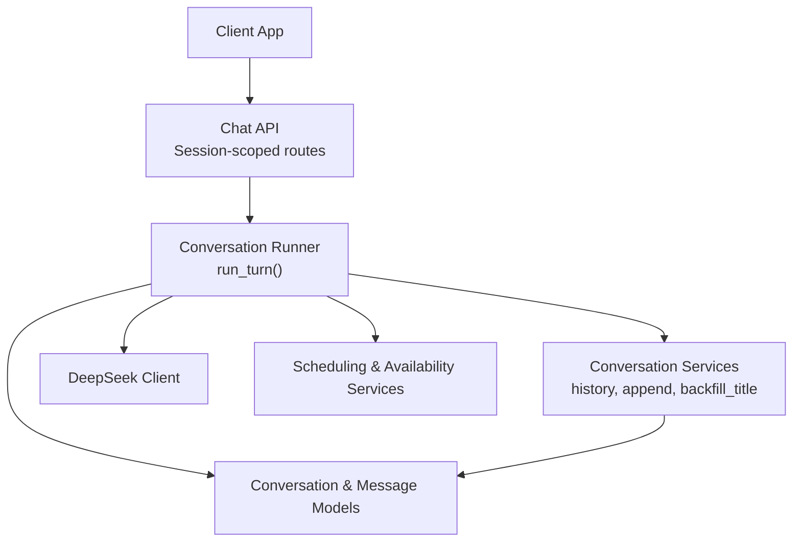

**Diagram sources**
- [chat_api.py:111-163](file://backend/app/api/chat.py#L111-L163)
- [chat_api.py:233-274](file://backend/app/api/chat.py#L233-L274)
- [runner.py:171-406](file://backend/app/agent/runner.py#L171-L406)
- [conversations_service.py:165-282](file://backend/app/services/conversations.py#L165-L282)
- [conversations.py:39-123](file://backend/app/models/conversations.py#L39-L123)

**Section sources**
- [chat_api.py:1-47](file://backend/app/api/chat.py#L1-L47)
- [runner.py:1-55](file://backend/app/agent/runner.py#L1-L55)
- [conversations_service.py:1-14](file://backend/app/services/conversations.py#L1-L14)
- [conversations.py:1-16](file://backend/app/models/conversations.py#L1-L16)

## Core Components
The runner is the central state machine for one patient message. Its responsibilities include:

- Validating that the conversation belongs to the current patient session.
- Persisting the incoming patient message.
- Detecting whether this is the first substantive message.
- Backfilling or setting the conversation title.
- Capturing the “turn floor” so cards attach only to this turn.
- Rebuilding provider-facing message history.
- Running the tool loop with bounded rounds and calls.
- Executing tools safely and persisting tool results.
- Formatting prose and attaching cards without duplication.
- Returning a `TurnResult` containing reply, visible messages, cards, and degradation status.

Key implementation anchors:

- Turn orchestration and safety checks: [runner.py:171-406](file://backend/app/agent/runner.py#L171-L406)
- Tool loop and round limits: [runner.py:409-557](file://backend/app/agent/runner.py#L409-L557)
- Card identity, deduplication, and attachment: [runner.py:597-718](file://backend/app/agent/runner.py#L597-L718)
- Visible transcript projection: [runner.py:810-822](file://backend/app/agent/runner.py#L810-L822)
- Title creation and backfill: [conversations_service.py:165-215](file://backend/app/services/conversations.py#L165-L215)
- Thread persistence and provider reconstruction: [conversations_service.py:218-331](file://backend/app/services/conversations.py#L218-L331)
- Message and conversation schema: [conversations.py:39-123](file://backend/app/models/conversations.py#L39-L123)

**Section sources**
- [runner.py:124-130](file://backend/app/agent/runner.py#L124-L130)
- [runner.py:171-406](file://backend/app/agent/runner.py#L171-L406)
- [conversations_service.py:165-215](file://backend/app/services/conversations.py#L165-L215)
- [conversations_service.py:218-331](file://backend/app/services/conversations.py#L218-L331)
- [conversations.py:39-123](file://backend/app/models/conversations.py#L39-L123)

## Architecture Overview
The end-to-end flow for sending a message is:

1. The client posts a message to the chat endpoint.
2. The API resolves the patient session and conversation scoped to that session.
3. The runner validates ownership, persists the patient message, and captures the turn floor.
4. The runner builds provider messages from the full stored history.
5. The runner calls the model, executes tools, and persists each step.
6. The runner formats the reply, attaches cards, and returns `TurnResult`.
7. The API serializes visible messages and cards for the UI.

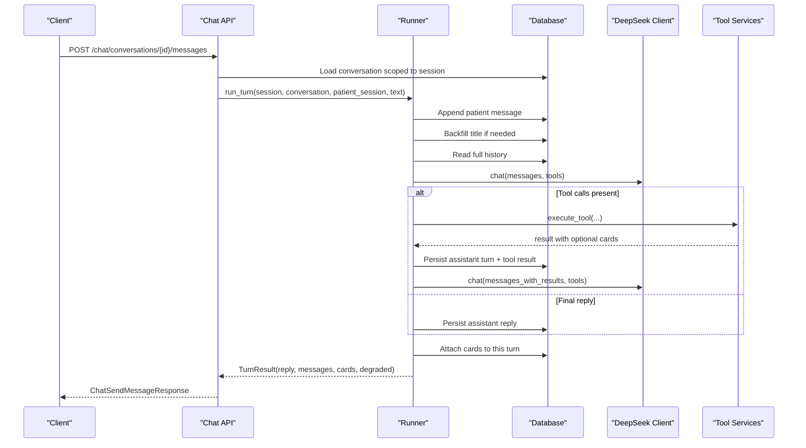

**Diagram sources**
- [chat_api.py:233-274](file://backend/app/api/chat.py#L233-L274)
- [runner.py:171-406](file://backend/app/agent/runner.py#L171-L406)
- [runner.py:409-557](file://backend/app/agent/runner.py#L409-L557)
- [conversations_service.py:165-282](file://backend/app/services/conversations.py#L165-L282)

## Detailed Component Analysis

### TurnResult Data Structure
`TurnResult` is the runner’s return contract. It encapsulates:

- `reply`: The assistant’s prose response.
- `messages`: The visible transcript projected for the client.
- `cards`: Cards produced by this turn, such as slot grids or proposals.
- `degraded`: A boolean indicating whether the turn completed through a fallback path.

This structure allows the API to return both user-visible content and operational metadata like degradation status.

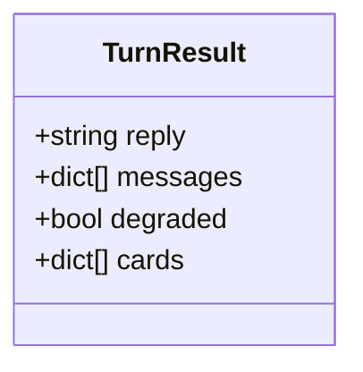

**Diagram sources**
- [runner.py:124-130](file://backend/app/agent/runner.py#L124-L130)

**Section sources**
- [runner.py:124-130](file://backend/app/agent/runner.py#L124-L130)
- [chat_api.py:266-274](file://backend/app/api/chat.py#L266-L274)

### Chronological Message History and Provider Reconstruction
The system stores every turn shape:

- Patient messages.
- Assistant messages, optionally with tool calls.
- Tool result messages linked to assistant turns.
- System/staff notices (filtered out when rebuilding provider messages).

History is ordered by sequence, and provider reconstruction pairs assistant tool calls with their corresponding tool results. Orphaned tool rows are handled defensively so the provider does not receive malformed sequences.

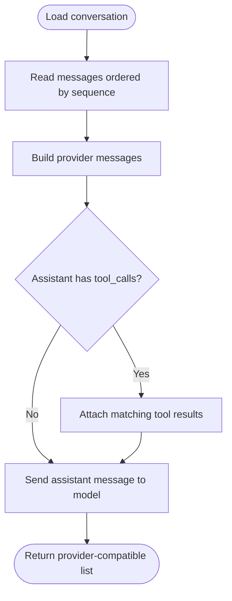

**Diagram sources**
- [conversations_service.py:265-331](file://backend/app/services/conversations.py#L265-L331)

**Section sources**
- [conversations_service.py:265-331](file://backend/app/services/conversations.py#L265-L331)
- [conversations.py:87-123](file://backend/app/models/conversations.py#L87-L123)

### Session Ownership and Safety Mechanisms
Safety is enforced at multiple levels:

- The API loads conversations only through the current patient session.
- The runner raises a permission error if the conversation’s session does not match the provided session.
- Resume logic requires a verified session, matching reset generation, and matching patient binding before reassigning ownership.
- Public endpoints never expose internal metadata such as tool payloads or arguments.

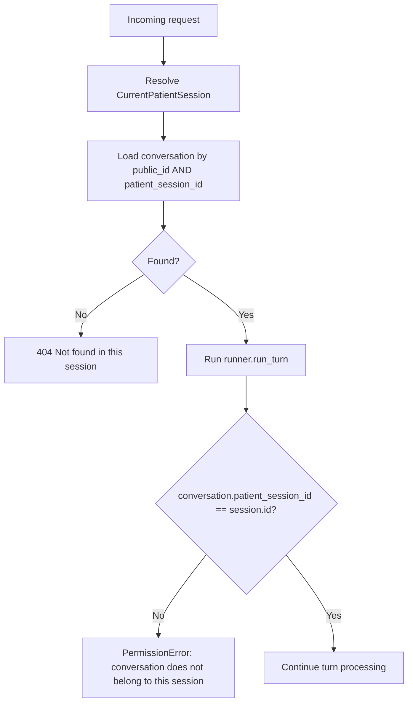

**Diagram sources**
- [chat_api.py:101-108](file://backend/app/api/chat.py#L101-L108)
- [runner.py:187-189](file://backend/app/agent/runner.py#L187-L189)
- [conversations_service.py:61-70](file://backend/app/services/conversations.py#L61-L70)
- [conversations_service.py:100-138](file://backend/app/services/conversations.py#L100-L138)

**Section sources**
- [chat_api.py:101-108](file://backend/app/api/chat.py#L101-L108)
- [runner.py:187-189](file://backend/app/agent/runner.py#L187-L189)
- [conversations_service.py:61-70](file://backend/app/services/conversations.py#L61-L70)
- [conversations_service.py:100-138](file://backend/app/services/conversations.py#L100-L138)

### Turn Boundaries and Turn Floor
A “turn floor” is the newest message ID captured after the patient message is persisted but before the assistant reply is written. It prevents cards generated during this turn from being attached to an older assistant message the patient already saw.

Key behaviors:

- The runner records `turn_floor = conversations.last_message_id(session, conversation)` after appending the patient message.
- Card attachment walks history backwards and stops at the floor.
- If no suitable assistant message exists after the floor, a new card-only assistant message is appended.
- Tests assert that earlier questions do not gain later grids and that a card-only turn is created when necessary.

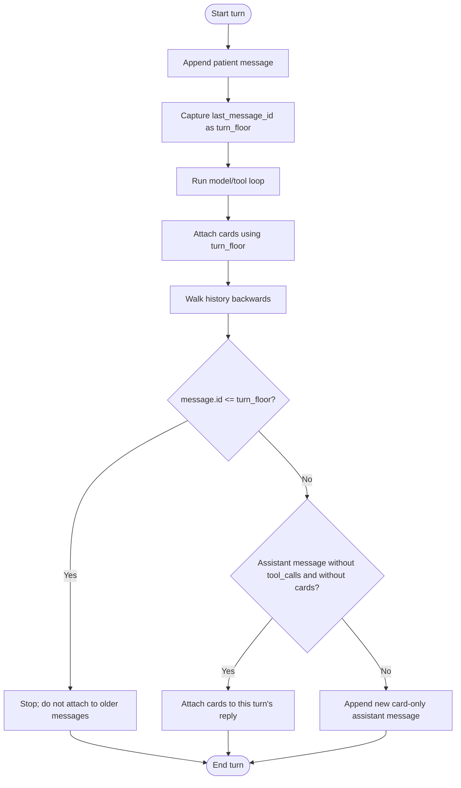

**Diagram sources**
- [runner.py:191-203](file://backend/app/agent/runner.py#L191-L203)
- [runner.py:693-718](file://backend/app/agent/runner.py#L693-L718)
- [conversations_service.py:275-282](file://backend/app/services/conversations.py#L275-L282)

**Section sources**
- [runner.py:191-203](file://backend/app/agent/runner.py#L191-L203)
- [runner.py:693-718](file://backend/app/agent/runner.py#L693-L718)
- [conversations_service.py:275-282](file://backend/app/services/conversations.py#L275-L282)

### First-Message Detection and Conversation Titles
First-message detection is used to log meaningful events and to decide whether to replay or enrich availability responses. Title handling is separate but related:

- When appending a patient message, if the conversation has no title and it is the first patient message with at least three words, the title is set immediately.
- `backfill_title` runs on every turn to catch cases where the first message was too short; if a later first patient message meets the word threshold, the title is updated.
- The runner logs when the first patient message is stored.

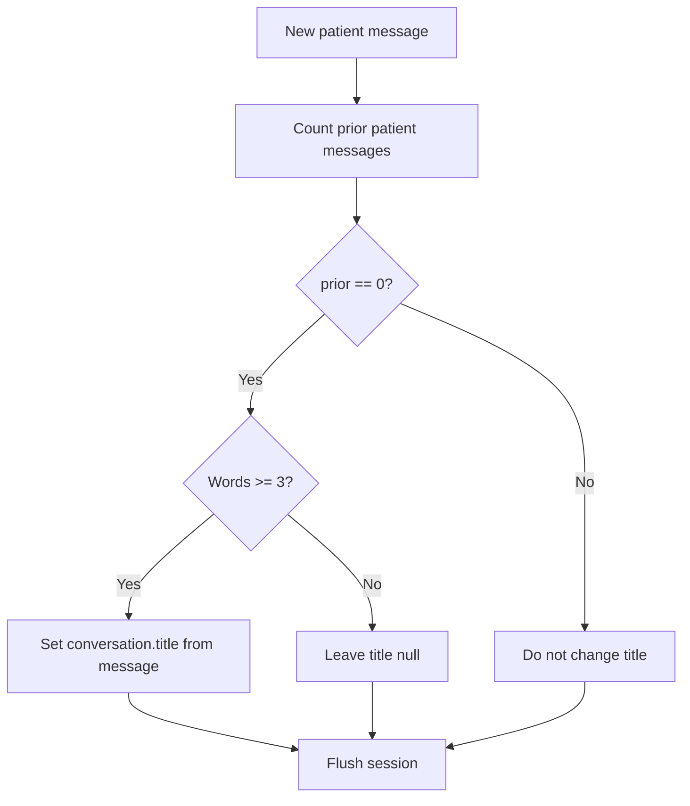

**Diagram sources**
- [conversations_service.py:165-183](file://backend/app/services/conversations.py#L165-L183)
- [conversations_service.py:197-215](file://backend/app/services/conversations.py#L197-L215)
- [runner.py:403-405](file://backend/app/agent/runner.py#L403-L405)

**Section sources**
- [conversations_service.py:165-183](file://backend/app/services/conversations.py#L165-L183)
- [conversations_service.py:197-215](file://backend/app/services/conversations.py#L197-L215)
- [runner.py:403-405](file://backend/app/agent/runner.py#L403-L405)

### Patient Session Touching and Validation
During each turn:

- The runner verifies that the conversation belongs to the provided session.
- The runner touches the patient session to mark activity.
- The runner may sync the conversation’s bound patient ID if verification occurs inside a tool call.
- The system prompt is refreshed after mid-turn state changes so the model sees current verification and scheduling context.

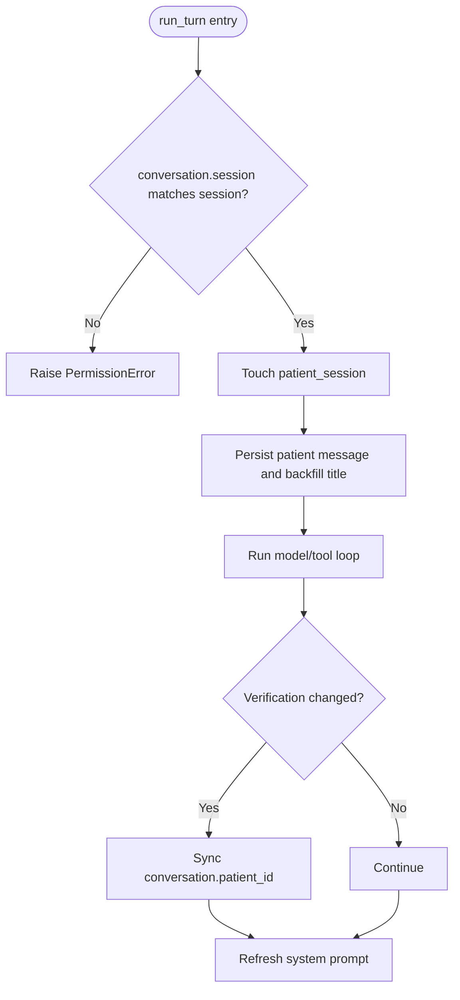

**Diagram sources**
- [runner.py:187-197](file://backend/app/agent/runner.py#L187-L197)
- [runner.py:524-531](file://backend/app/agent/runner.py#L524-L531)
- [runner.py:802-807](file://backend/app/agent/runner.py#L802-L807)

**Section sources**
- [runner.py:187-197](file://backend/app/agent/runner.py#L187-L197)
- [runner.py:524-531](file://backend/app/agent/runner.py#L524-L531)
- [runner.py:802-807](file://backend/app/agent/runner.py#L802-L807)

### Card Attachment, Deduplication, and Replay Behavior
Cards represent interactive UI elements such as slot grids, family options, and proposals. The runner ensures they are:

- Attached only to the correct turn using the turn floor.
- Deduplicated by identity.
- Merged carefully so fresh grids supersede older grids while informational cards remain.
- Settled or reconciled so already held or booked slots are not presented as offers.
- Replayed on refresh so the UI shows the same cards that were originally rendered.

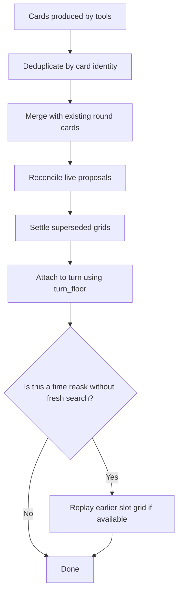

**Diagram sources**
- [runner.py:294-335](file://backend/app/agent/runner.py#L294-L335)
- [runner.py:597-648](file://backend/app/agent/runner.py#L597-L648)
- [runner.py:651-718](file://backend/app/agent/runner.py#L651-L718)

**Section sources**
- [runner.py:294-335](file://backend/app/agent/runner.py#L294-L335)
- [runner.py:597-648](file://backend/app/agent/runner.py#L597-L648)
- [runner.py:651-718](file://backend/app/agent/runner.py#L651-L718)

### Error Handling and Degraded Turns
The runner protects against incomplete or inconsistent history:

- DeepSeek failures produce a friendly user message and mark the turn as degraded.
- Unexpected exceptions roll back the session, persist a fallback assistant message, and return a degraded result.
- Tool execution failures are logged and converted into safe outcomes.
- Fallback replies avoid exposing internal details.

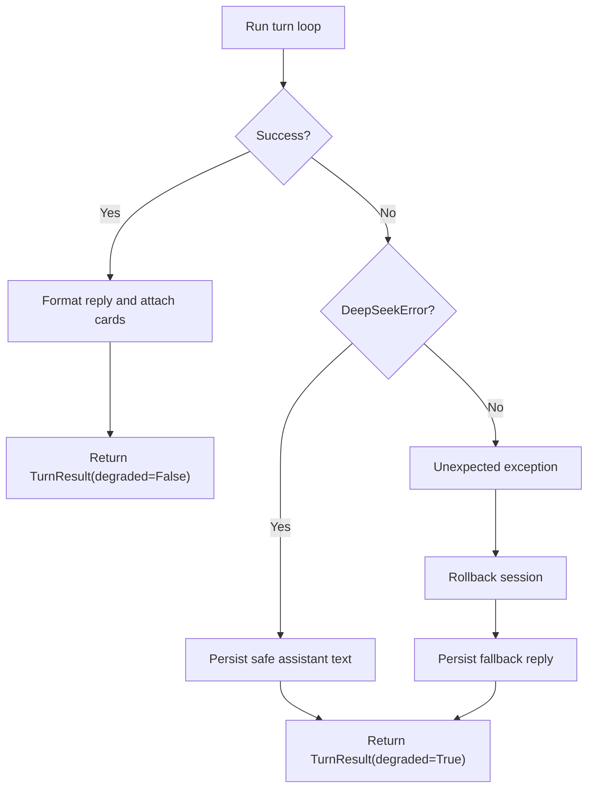

**Diagram sources**
- [runner.py:264-292](file://backend/app/agent/runner.py#L264-L292)
- [runner.py:745-761](file://backend/app/agent/runner.py#L745-L761)

**Section sources**
- [runner.py:264-292](file://backend/app/agent/runner.py#L264-L292)
- [runner.py:745-761](file://backend/app/agent/runner.py#L745-L761)

## Dependency Analysis
The runner depends on several subsystems:

- Conversation services for persistence, history, and provider reconstruction.
- Scheduling and availability services for tool execution and card lifecycle.
- Patient session and patient services for verification and context.
- DeepSeek client for model calls.
- Observability utilities for structured logging.

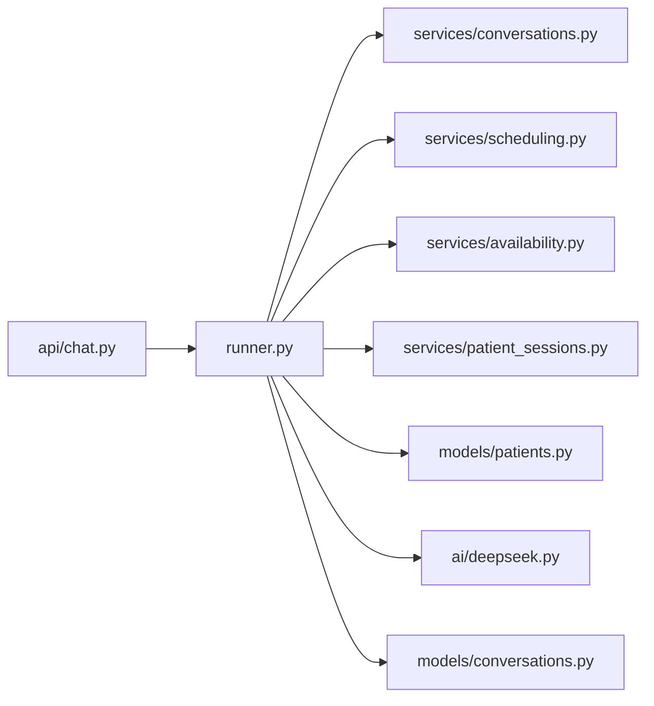

**Diagram sources**
- [runner.py:35-47](file://backend/app/agent/runner.py#L35-L47)
- [chat_api.py:22-47](file://backend/app/api/chat.py#L22-L47)

**Section sources**
- [runner.py:35-47](file://backend/app/agent/runner.py#L35-L47)
- [chat_api.py:22-47](file://backend/app/api/chat.py#L22-L47)

## Performance Considerations
- The runner uses bounded tool rounds and per-round call limits to prevent runaway model loops.
- History is fully replayed to the model each turn, which preserves fidelity but increases payload size over long threads.
- Card deduplication and careful merging reduce redundant UI rendering.
- The API runs the synchronous runner off the event loop to avoid blocking HTTP workers.
- Title backfill and first-message checks are lightweight database operations.

[No sources needed since this section provides general guidance]

## Troubleshooting Guide
Common issues and their likely causes:

- **Permission errors**: Occur when a conversation ID is used outside its owning session. Verify the API route scopes the conversation lookup to `patient_session_id`.
- **Cards attached to wrong messages**: Usually caused by missing or incorrect `turn_floor`. Ensure the floor is captured after appending the patient message and passed to card attachment.
- **Missing cards on refresh**: Can happen if the latest assistant turn has no cards but a live proposal still exists. The API and frontend reconcile pending proposals, but server-side attachment should also ensure cards are persisted.
- **Empty or broken transcripts**: May indicate partial writes due to exceptions. Check rollback paths and fallback assistant message persistence.
- **Titles not appearing**: Confirm that the first patient message has enough words or that `backfill_title` runs after the first message is stored.

**Section sources**
- [runner.py:187-189](file://backend/app/agent/runner.py#L187-L189)
- [runner.py:191-203](file://backend/app/agent/runner.py#L191-L203)
- [runner.py:264-292](file://backend/app/agent/runner.py#L264-L292)
- [conversations_service.py:165-215](file://backend/app/services/conversations.py#L165-L215)

## Conclusion
The runner system treats conversation state as a durable, replayable timeline. Each turn persists the patient input, rebuilds the full provider history, executes tools under strict bounds, and attaches cards only to the correct turn boundary. Safety mechanisms enforce session ownership, protect against malformed tool sequences, and ensure degraded turns leave consistent history. Titles are backfilled from early substantive messages, and patient sessions are touched and validated throughout the flow. Together, these components keep conversations accurate, secure, and resilient across retries, refreshes, and multi-turn interactions.