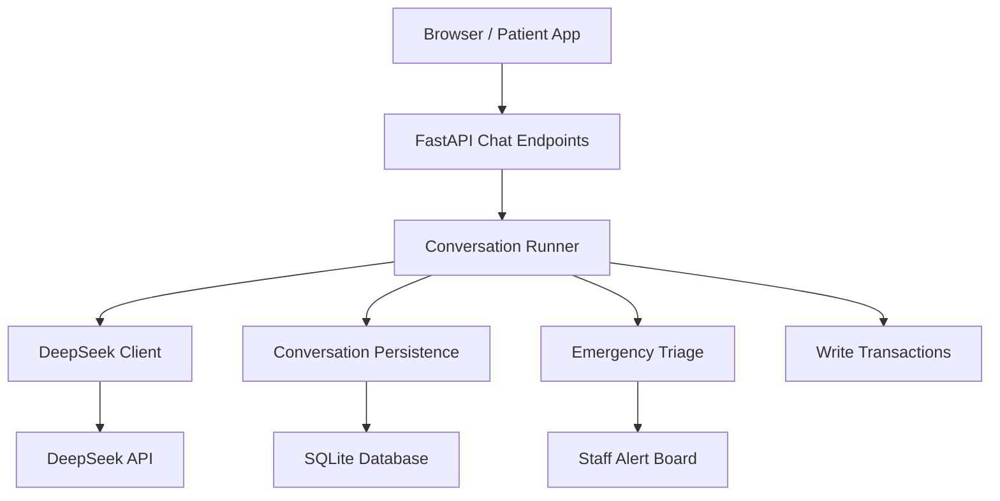
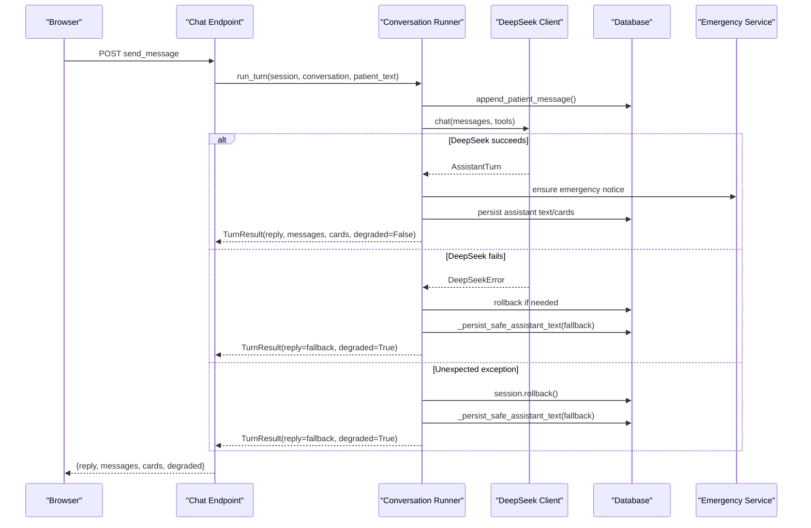
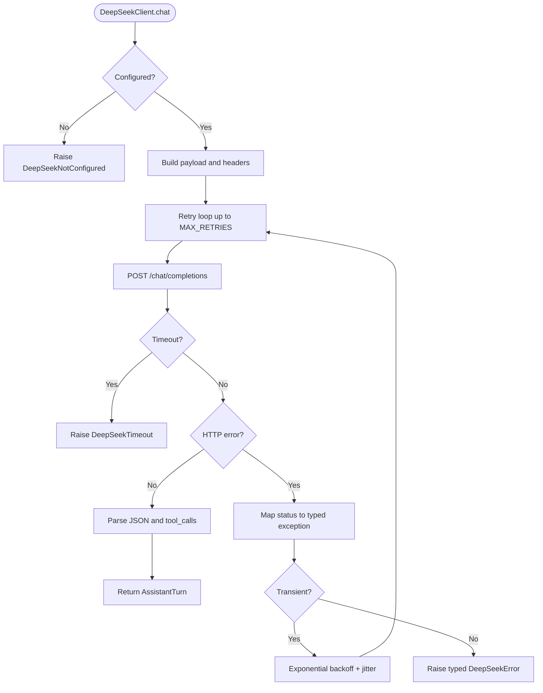
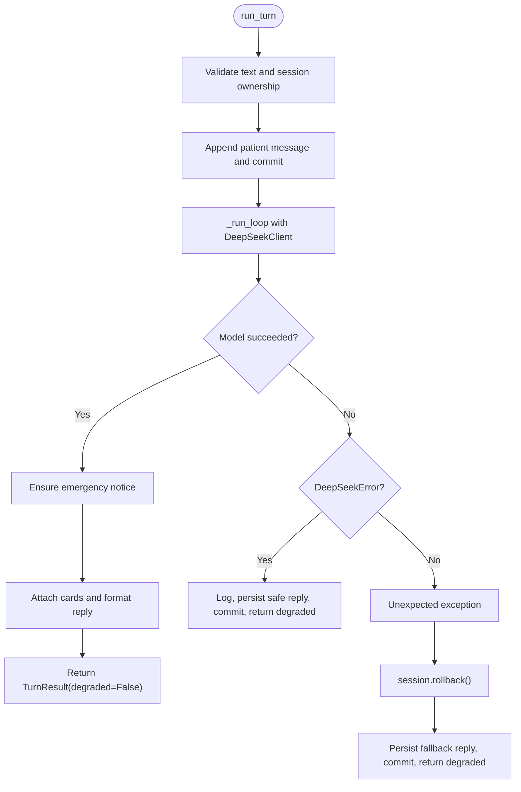
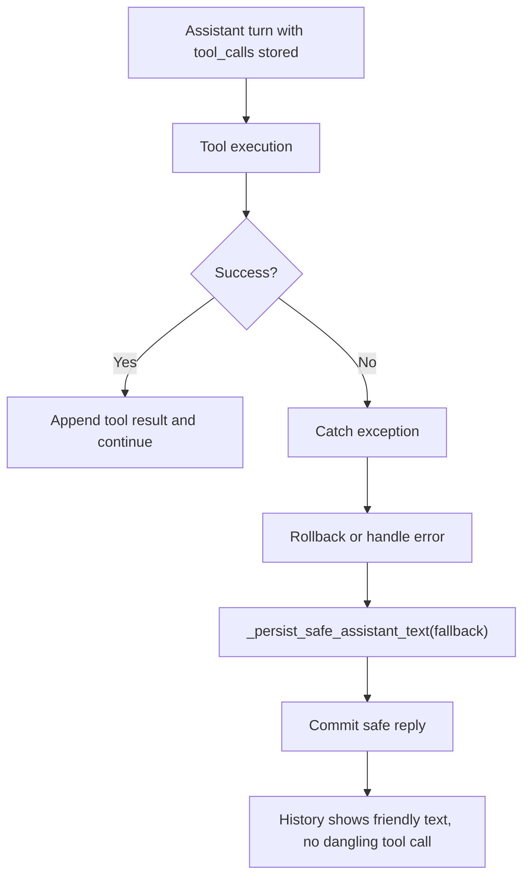
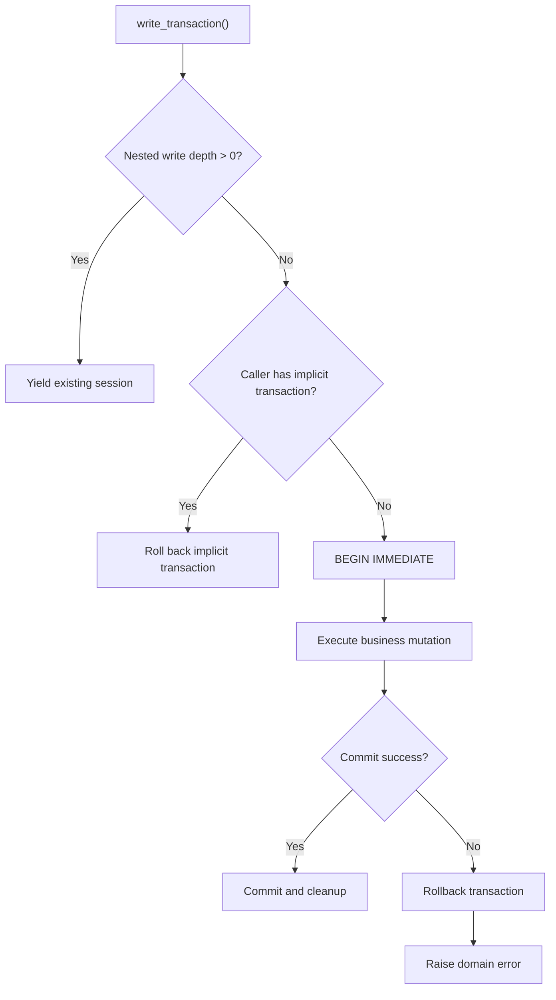
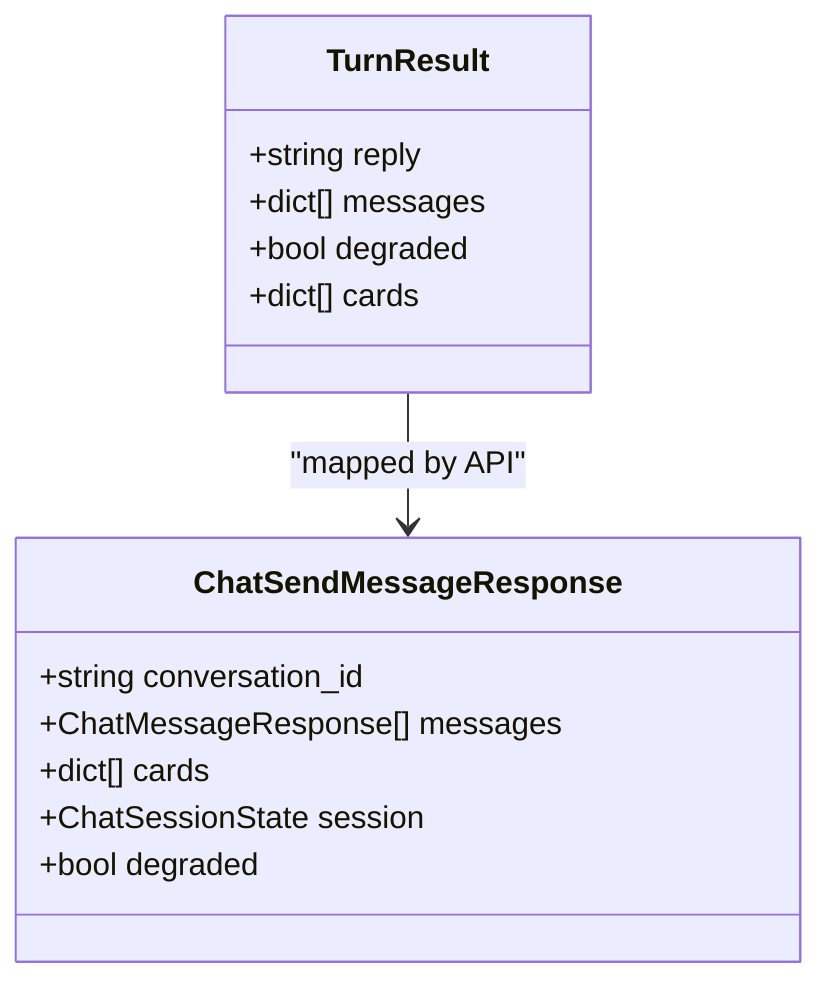
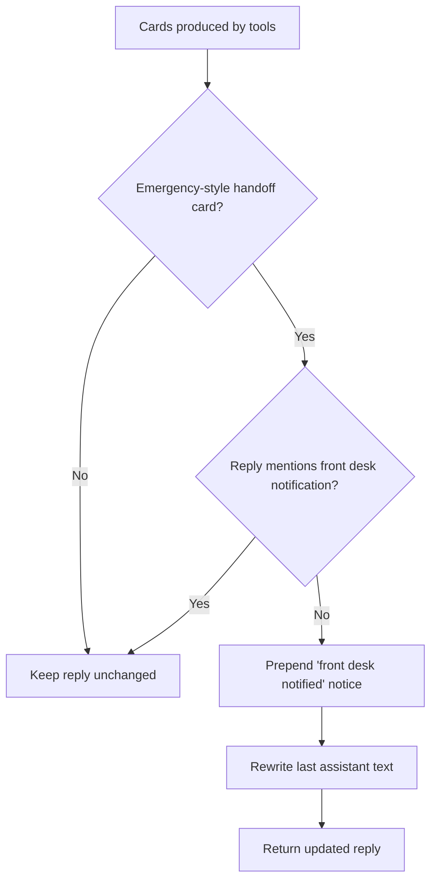
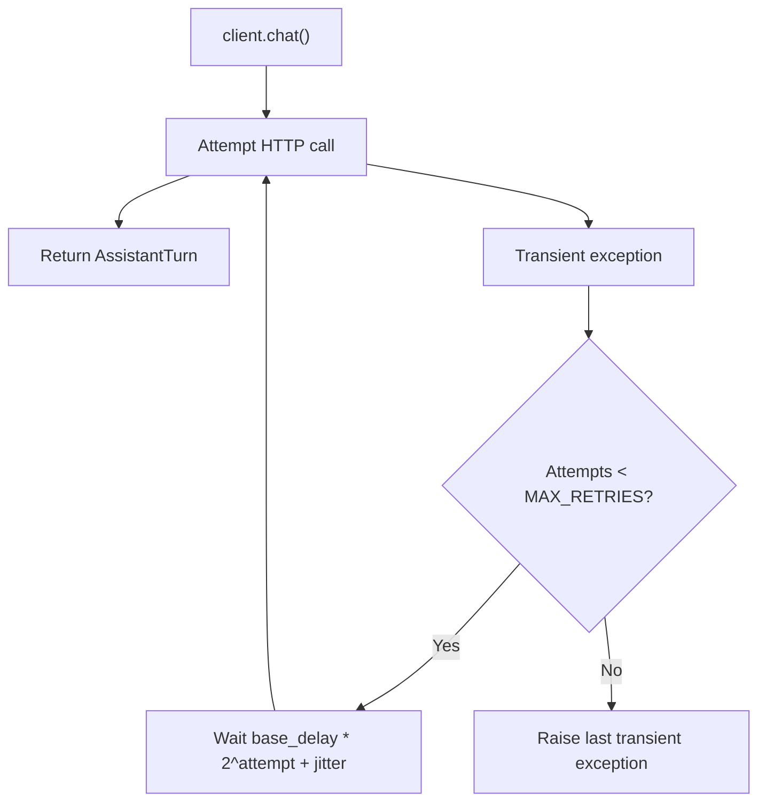
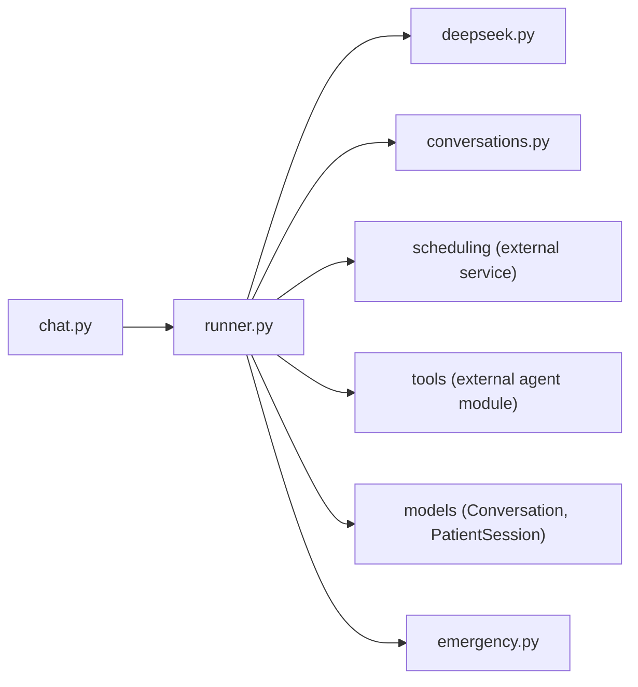

# Error Handling and Recovery

<cite>
**Referenced Files in This Document**
- [runner.py](file://backend/app/agent/runner.py)
- [deepseek.py](file://backend/app/ai/deepseek.py)
- [conversations.py](file://backend/app/services/conversations.py)
- [emergency.py](file://backend/app/services/emergency.py)
- [chat.py](file://backend/app/api/chat.py)
- [transactions.py](file://backend/app/services/transactions.py)
- [schemas.py](file://backend/app/schemas.py)
</cite>

## Table of Contents
1. [Introduction](#introduction)
2. [Project Structure](#project-structure)
3. [Core Components](#core-components)
4. [Architecture Overview](#architecture-overview)
5. [Detailed Component Analysis](#detailed-component-analysis)
6. [Dependency Analysis](#dependency-analysis)
7. [Performance Considerations](#performance-considerations)
8. [Troubleshooting Guide](#troubleshooting-guide)
9. [Conclusion](#conclusion)

## Introduction
This document explains how the conversation runner keeps patient conversations safe when DeepSeek API calls fail, network timeouts occur, or unexpected exceptions happen. It covers:

- How failures are classified and surfaced to users without exposing internal details.
- The fallback reply system that prevents history from containing dangling tool calls.
- Safe assistant text persistence and transaction rollback for database consistency.
- The degradation flag system that signals UI components about service issues.
- Emergency notice enforcement so staff are alerted for urgent cases.
- Retry strategies for transient DeepSeek failures.
- Examples of failure scenarios, recovery flows, and graceful degradation without losing conversation context.

## Project Structure
The error-handling logic spans several layers:

- **API layer**: Receives messages, runs the turn off the event loop, and returns a response including a degradation flag.
- **Runner**: Orchestrates one patient message into one assistant reply, handles retries at the model level, persists safe replies on failure, and enforces emergency notices.
- **DeepSeek client**: Wraps HTTP calls with strict timeouts, typed exceptions, and exponential backoff retries.
- **Conversation persistence**: Stores messages, tool results, and cards while reconstructing provider-compatible history.
- **Emergency triage**: Classifies symptoms, captures contact details, and raises alerts for staff.
- **Transaction utilities**: Provide exclusive SQLite write locks and safe rollback behavior.

**Diagram sources**
- [chat.py:233-274](file://backend/app/api/chat.py#L233-L274)
- [runner.py:171-406](file://backend/app/agent/runner.py#L171-L406)
- [deepseek.py:178-249](file://backend/app/ai/deepseek.py#L178-L249)
- [conversations.py:218-331](file://backend/app/services/conversations.py#L218-L331)
- [emergency.py:258-366](file://backend/app/services/emergency.py#L258-L366)
- [transactions.py:85-134](file://backend/app/services/transactions.py#L85-L134)

**Section sources**
- [chat.py:1-49](file://backend/app/api/chat.py#L1-L49)
- [runner.py:1-55](file://backend/app/agent/runner.py#L1-L55)
- [deepseek.py:1-36](file://backend/app/ai/deepseek.py#L1-L36)

## Core Components
The runner is the central coordinator for error handling during a single conversation turn. Its responsibilities include:

- Validating input and session ownership.
- Persisting the patient message before calling the model.
- Running the model tool loop with bounded rounds and calls.
- Catching DeepSeek-specific errors and generic exceptions.
- Returning a friendly fallback reply when needed.
- Marking the result as degraded so the UI can show reduced capability.
- Ensuring emergency notices are included when required.
- Attaching cards only to the correct assistant turn.

Key data structures:

- `TurnResult`: carries the final reply, visible messages, cards, and a `degraded` flag.
- `AssistantTurn` and `ToolCall`: normalized model output used by the runner.
- Conversation persistence functions: append patient messages, assistant messages, tool results, and reconstruct provider messages.

**Section sources**
- [runner.py:124-130](file://backend/app/agent/runner.py#L124-L130)
- [runner.py:171-235](file://backend/app/agent/runner.py#L171-L235)
- [deepseek.py:67-84](file://backend/app/ai/deepseek.py#L67-L84)
- [conversations.py:218-262](file://backend/app/services/conversations.py#L218-L262)

## Architecture Overview
The end-to-end flow for sending a message includes error handling at multiple points.

**Diagram sources**
- [chat.py:233-274](file://backend/app/api/chat.py#L233-L274)
- [runner.py:171-292](file://backend/app/agent/runner.py#L171-L292)
- [deepseek.py:205-249](file://backend/app/ai/deepseek.py#L205-L249)
- [conversations.py:165-240](file://backend/app/services/conversations.py#L165-L240)

## Detailed Component Analysis

### DeepSeek Client Retries and Timeouts
The DeepSeek client isolates external failure modes and converts them into typed exceptions:

- Configuration check: if the API key is missing, it raises `DeepSeekNotConfigured`.
- Strict timeouts: connect, read, and total timeouts prevent long hangs.
- Network and timeout mapping: `httpx.TimeoutException` becomes `DeepSeekTimeout`; other HTTP errors become `DeepSeekUnavailable`.
- Status-code classification: 429 becomes `DeepSeekRateLimited`; 5xx becomes `DeepSeekUnavailable`; other 4xx becomes `DeepSeekBadResponse`.
- Retry strategy: transient failures (`DeepSeekTimeout`, `DeepSeekUnavailable`, `DeepSeekRateLimited`) are retried up to a fixed maximum with exponential backoff plus jitter. Non-retryable `DeepSeekError` subclasses are raised immediately.
- Response parsing: malformed responses raise `DeepSeekBadResponse`.

**Diagram sources**
- [deepseek.py:178-249](file://backend/app/ai/deepseek.py#L178-L249)
- [deepseek.py:251-329](file://backend/app/ai/deepseek.py#L251-L329)

**Section sources**
- [deepseek.py:38-65](file://backend/app/ai/deepseek.py#L38-L65)
- [deepseek.py:178-249](file://backend/app/ai/deepseek.py#L178-L249)
- [deepseek.py:251-329](file://backend/app/ai/deepseek.py#L251-L329)

### Runner Failure Handling and Fallback Replies
The runner protects conversation integrity by catching failures around the model call and ensuring a user-friendly reply is persisted.

- Empty or invalid input: returns a short request to retry and marks the result as degraded.
- DeepSeek errors: logs a warning, records an observability event, uses the exception’s user-facing message, persists a safe assistant message, commits, and returns a degraded result.
- Unexpected exceptions: logs the full exception, rolls back the session, persists a fallback reply, commits, and returns a degraded result.
- The fallback reply constant ensures patients receive a consistent, non-technical message when something goes wrong.

**Diagram sources**
- [runner.py:171-292](file://backend/app/agent/runner.py#L171-L292)

**Section sources**
- [runner.py:51-55](file://backend/app/agent/runner.py#L51-L55)
- [runner.py:171-235](file://backend/app/agent/runner.py#L171-L235)
- [runner.py:264-292](file://backend/app/agent/runner.py#L264-L292)

### Safe Assistant Text Persistence and Dangling Tool Call Prevention
A critical safety rule is that history must never contain a half-finished assistant turn with tool calls but no results.

- Before calling the model, the runner appends the patient message and commits.
- During the tool loop, assistant turns with tool calls are stored, followed by tool-result messages.
- If any failure occurs after an assistant turn has been stored but before its final prose is committed, the runner writes a safe assistant message through `_persist_safe_assistant_text`.
- `_persist_safe_assistant_text` normalizes dashes and appends a clean assistant message, preventing the UI from showing a dangling tool-call row.
- The conversation persistence layer also guards replay: orphaned tool rows are dropped or replaced with a synthetic missing-result entry so the provider does not reject the thread.

**Diagram sources**
- [runner.py:473-479](file://backend/app/agent/runner.py#L473-L479)
- [runner.py:776-781](file://backend/app/agent/runner.py#L776-L781)
- [conversations.py:285-331](file://backend/app/services/conversations.py#L285-L331)

**Section sources**
- [runner.py:473-479](file://backend/app/agent/runner.py#L473-L479)
- [runner.py:776-781](file://backend/app/agent/runner.py#L776-L781)
- [conversations.py:285-331](file://backend/app/services/conversations.py#L285-L331)

### Transaction Rollback and Database Consistency
The runner uses SQLAlchemy sessions directly for conversation persistence. When an unexpected exception occurs, it explicitly rolls back the session to avoid partial state.

For booking and scheduling mutations elsewhere in the system, explicit write transactions provide stronger guarantees:

- `write_transaction` opens an exclusive SQLite transaction using `BEGIN IMMEDIATE`.
- It detects nested write blocks and reuses the outer lock safely.
- It rolls back on exceptions and ensures the caller’s session does not leave a lingering implicit read transaction that would block other writers.
- Booking code catches slot conflicts, write transaction errors, and integrity errors, converting them into controlled outcomes rather than leaving inconsistent state.

**Diagram sources**
- [transactions.py:85-134](file://backend/app/services/transactions.py#L85-L134)

**Section sources**
- [runner.py:282-292](file://backend/app/agent/runner.py#L282-L292)
- [transactions.py:1-32](file://backend/app/services/transactions.py#L1-L32)
- [transactions.py:85-134](file://backend/app/services/transactions.py#L85-L134)

### Degradation Flag System
The runner sets `degraded=True` whenever the system cannot fully complete the requested operation:

- Empty or unreadable patient input.
- DeepSeek API failures.
- Unexpected exceptions during the turn.

The API layer forwards this flag to the client:

- `ChatSendMessageResponse` includes `degraded`.
- Frontend components can use this flag to adjust UI behavior, such as disabling interactive cards, showing a warning banner, or encouraging retry.

**Diagram sources**
- [runner.py:124-130](file://backend/app/agent/runner.py#L124-L130)
- [chat.py:267-274](file://backend/app/api/chat.py#L267-L274)
- [schemas.py:269-270](file://backend/app/schemas.py#L269-L270)

**Section sources**
- [runner.py:183-183](file://backend/app/agent/runner.py#L183-L183)
- [runner.py:264-292](file://backend/app/agent/runner.py#L264-L292)
- [chat.py:267-274](file://backend/app/api/chat.py#L267-L274)
- [schemas.py:269-270](file://backend/app/schemas.py#L269-L270)

### Emergency Notice Enforcement
When a turn produces handoff cards indicating an emergency or urgent alert, the runner ensures the reply explicitly tells the patient that the front desk has been notified.

- `_ensure_emergency_notice` inspects cards for handoff entries with emergency-style alert kinds.
- If the reply already acknowledges the front desk, it is left unchanged.
- Otherwise, a notice sentence is prepended and the last assistant text is rewritten so the patient sees the promise.
- Emergency triage itself creates alerts, captures contact information, and provides guidance, including immediate 911 advice for life-threatening symptoms.

**Diagram sources**
- [runner.py:567-594](file://backend/app/agent/runner.py#L567-L594)
- [emergency.py:258-366](file://backend/app/services/emergency.py#L258-L366)

**Section sources**
- [runner.py:260-263](file://backend/app/agent/runner.py#L260-L263)
- [runner.py:567-594](file://backend/app/agent/runner.py#L567-L594)
- [emergency.py:258-366](file://backend/app/services/emergency.py#L258-L366)

### Retry Strategies for Transient Failures
Retries are implemented at the DeepSeek client level, not inside the runner:

- Only transient exceptions are retried: timeouts, unavailable service, and rate limits.
- Non-transient `DeepSeekError` subclasses are raised immediately.
- Each retry waits for an exponentially increasing delay with small random jitter.
- After exhausting retries, the last transient exception is raised, allowing the runner to convert it into a user-friendly fallback reply.

**Diagram sources**
- [deepseek.py:205-249](file://backend/app/ai/deepseek.py#L205-L249)

**Section sources**
- [deepseek.py:31-35](file://backend/app/ai/deepseek.py#L31-L35)
- [deepseek.py:205-249](file://backend/app/ai/deepseek.py#L205-L249)

### Example Failure Scenarios and Recovery Flows

#### DeepSeek Rate Limit
- The client receives a 429 status and raises `DeepSeekRateLimited`.
- The client retries with backoff.
- If retries are exhausted, the runner catches `DeepSeekError`, logs a warning, persists a safe reply, and returns `degraded=True`.
- The UI can show a temporary limitation and encourage retry.

#### Network Timeout
- The client raises `DeepSeekTimeout`.
- The client retries up to the configured limit.
- On exhaustion, the runner falls back to a friendly message and marks the turn degraded.

#### Unconfigured DeepSeek API
- The client raises `DeepSeekNotConfigured`.
- The runner treats it as a provider failure and returns a user-facing message explaining that the online assistant is not configured.

#### Unexpected Python Exception
- The runner catches the exception, rolls back the session, persists a fallback reply, and returns `degraded=True`.
- No partial assistant turn remains in history.

#### Emergency Handoff Without Explicit Notice
- Cards indicate an emergency alert.
- The runner adds a notice that the front desk has been told and rewrites the last assistant message.
- Emergency triage may also create or update a staff alert and capture contact details.

**Section sources**
- [deepseek.py:44-64](file://backend/app/ai/deepseek.py#L44-L64)
- [deepseek.py:205-249](file://backend/app/ai/deepseek.py#L205-L249)
- [runner.py:264-292](file://backend/app/agent/runner.py#L264-L292)
- [runner.py:567-594](file://backend/app/agent/runner.py#L567-L594)
- [emergency.py:258-366](file://backend/app/services/emergency.py#L258-L366)

## Dependency Analysis
The runner depends on several services and models:

- `app.ai.deepseek.DeepSeekClient`: model communication and retry logic.
- `app.services.conversations`: message persistence, history reconstruction, and provider-message formatting.
- `app.services.scheduling`: availability searches, proposal reconciliation, and card settlement.
- `app.services.patient_sessions` and `app.services.patients`: verified patient lookup and session updates.
- `app.agent.tools`: tool execution and schema definitions.
- `app.models.Conversation`, `app.models.PatientSession`, and related entities: persistent state.

**Diagram sources**
- [runner.py:35-47](file://backend/app/agent/runner.py#L35-L47)
- [chat.py:22-47](file://backend/app/api/chat.py#L22-L47)

**Section sources**
- [runner.py:35-47](file://backend/app/agent/runner.py#L35-L47)
- [chat.py:22-47](file://backend/app/api/chat.py#L22-L47)

## Performance Considerations
- The runner bounds model round-trips with `MAX_TOOL_ROUNDS` and limits parallel tool calls per round with `MAX_TOOL_CALLS_PER_ROUND`.
- The DeepSeek client uses strict timeouts to avoid blocking requests indefinitely.
- Retries add latency but protect against transient failures; they are limited to avoid excessive delays.
- Conversation persistence commits frequently during the tool loop to keep history recoverable, which trades some throughput for safety.
- The API runs the synchronous runner off the event loop using `run_in_threadpool`, preventing blocking I/O from starving the server.

[No sources needed since this section provides general guidance]

## Troubleshooting Guide

### Symptom: Patient sees a friendly error instead of the expected answer
- Likely cause: DeepSeek API failure, timeout, rate limit, or unexpected exception.
- What to check:
  - Whether `degraded=True` was returned by the API.
  - Logs for `DeepSeekError` subclasses or unexpected exceptions.
  - Whether a safe assistant message was persisted.
- Expected recovery:
  - The runner persists a fallback reply.
  - The UI can prompt the patient to retry.

**Section sources**
- [runner.py:264-292](file://backend/app/agent/runner.py#L264-L292)
- [chat.py:267-274](file://backend/app/api/chat.py#L267-L274)

### Symptom: History contains a tool call with no result
- Likely cause: A failure occurred after the assistant turn was stored but before the final prose was committed.
- What to check:
  - Whether `_persist_safe_assistant_text` was called.
  - Whether the session was rolled back before committing partial state.
- Expected recovery:
  - The runner writes a clean assistant message and commits.
  - Provider-message reconstruction drops or replaces orphaned tool rows.

**Section sources**
- [runner.py:473-479](file://backend/app/agent/runner.py#L473-L479)
- [runner.py:776-781](file://backend/app/agent/runner.py#L776-L781)
- [conversations.py:285-331](file://backend/app/services/conversations.py#L285-L331)

### Symptom: Emergency alerts are not shown to the patient
- Likely cause: The reply did not explicitly mention the front desk despite an emergency-style handoff card.
- What to check:
  - Whether `_ensure_emergency_notice` detected an emergency alert.
  - Whether the last assistant text was rewritten.
- Expected recovery:
  - The runner prepends a notice and rewrites the assistant message.
  - Emergency triage creates or updates a staff alert.

**Section sources**
- [runner.py:567-594](file://backend/app/agent/runner.py#L567-L594)
- [emergency.py:258-366](file://backend/app/services/emergency.py#L258-L366)

### Symptom: Booking or scheduling writes fail under load
- Likely cause: SQLite write contention or slot conflict.
- What to check:
  - Whether `write_transaction` obtained `BEGIN IMMEDIATE`.
  - Whether `SlotConflictError` or `WriteTransactionError` was raised.
- Expected recovery:
  - Write transactions roll back on failure.
  - Booking code converts conflicts into controlled outcomes.

**Section sources**
- [transactions.py:85-134](file://backend/app/services/transactions.py#L85-L134)

## Conclusion
The conversation runner implements layered error handling to keep patient conversations reliable and safe:

- External failures are classified and converted into typed exceptions.
- Retries protect against transient DeepSeek issues.
- Fallback replies and safe assistant text persistence prevent confusing or incomplete history.
- Transaction rollback preserves database consistency.
- The degradation flag enables graceful UI degradation.
- Emergency notice enforcement ensures urgent cases are clearly communicated to patients and staff.

Together, these mechanisms allow the system to degrade gracefully without losing conversation context, while keeping patients informed and staff alerted when necessary.