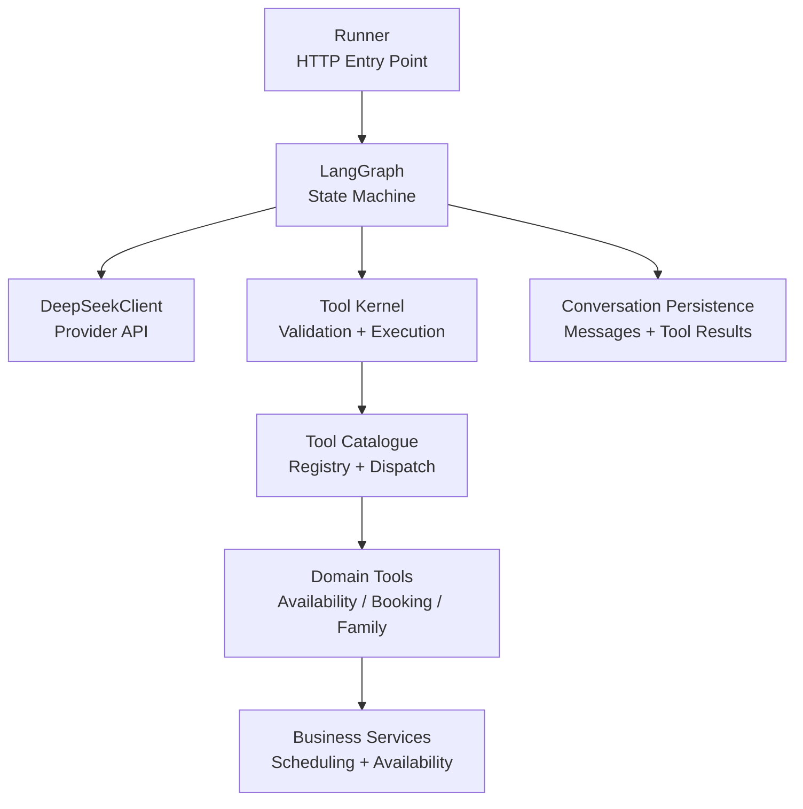
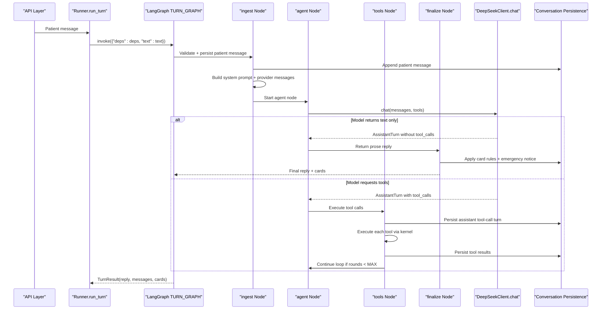
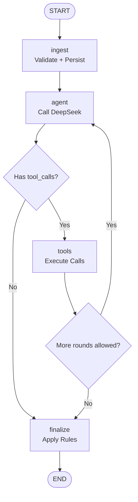
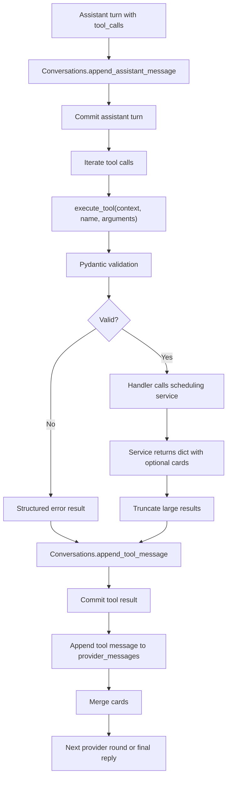
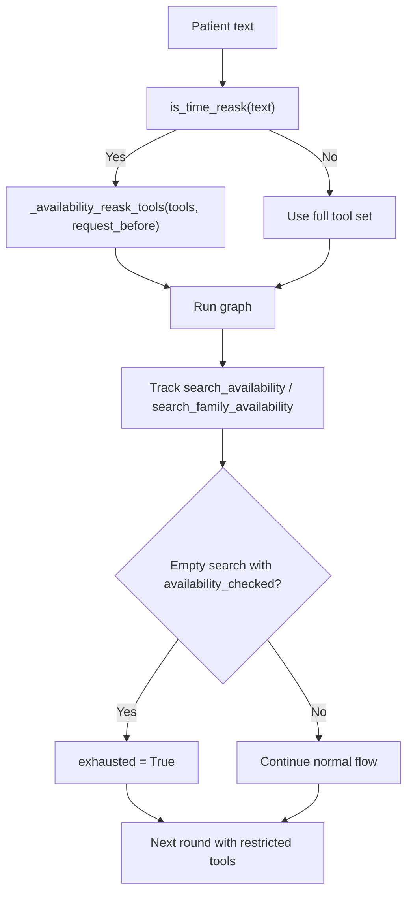
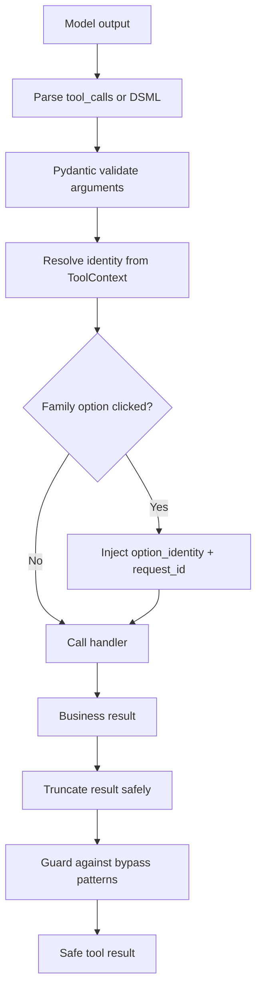
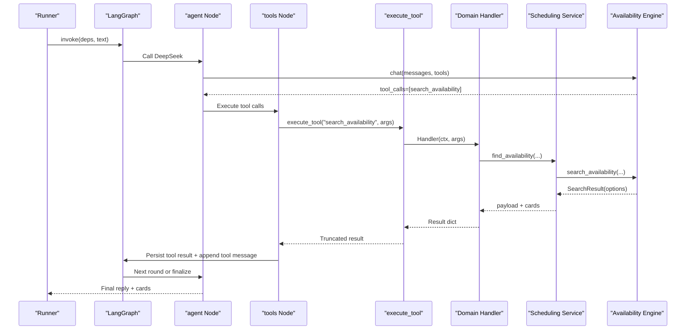
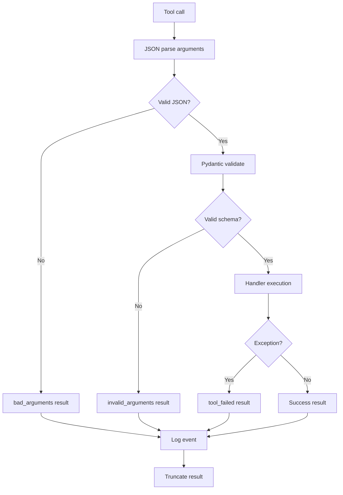
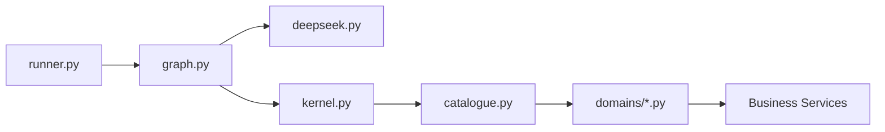

# Tool Orchestration Loop

<cite>
**Referenced Files in This Document**
- [runner.py](file://backend/app/agent/runner.py)
- [graph.py](file://backend/app/agent/graph.py)
- [deepseek.py](file://backend/app/ai/deepseek.py)
- [tools/__init__.py](file://backend/app/agent/tools/__init__.py)
- [kernel.py](file://backend/app/agent/tools/kernel.py)
- [catalogue.py](file://backend/app/agent/tools/catalogue.py)
- [policy.py](file://backend/app/agent/tools/policy.py)
- [availability.py](file://backend/app/agent/tools/domains/availability.py)
- [booking.py](file://backend/app/agent/tools/domains/booking.py)
- [family.py](file://backend/app/agent/tools/domains/family.py)
</cite>

## Update Summary
**Changes Made**
- Updated architecture overview to reflect LangGraph-based orchestration replacing monolithic runner
- Replaced scheduling_tools.py references with domain-specific tool modules
- Updated tool execution flow to show new kernel and catalogue structure
- Revised component analysis to document graph nodes and state management
- Updated dependency analysis to reflect new modular tool architecture
- Added new sections for LangGraph state machine and domain tool organization

## Table of Contents
1. [Introduction](#introduction)
2. [Project Structure](#project-structure)
3. [Core Components](#core-components)
4. [Architecture Overview](#architecture-overview)
5. [Detailed Component Analysis](#detailed-component-analysis)
6. [Dependency Analysis](#dependency-analysis)
7. [Performance Considerations](#performance-considerations)
8. [Troubleshooting Guide](#troubleshooting-guide)
9. [Conclusion](#conclusion)

## Introduction
This document explains the tool orchestration loop that mediates between the AI model and the clinic's business logic. The system has been restructured from a monolithic runner to a LangGraph-based orchestration pattern, where the runner now serves as a thin entry point delegating core orchestration to `graph.py`.

The loop is intentionally bounded:
- `MAX_TOOL_ROUNDS` limits how many times the runner calls DeepSeek for a single patient message.
- `MAX_TOOL_CALLS_PER_ROUND` limits how many tool calls are executed from one model turn.

These bounds prevent infinite loops, excessive provider round-trips, and resource exhaustion while still allowing multi-step workflows such as availability search, proposal creation, and confirmation.

**Updated** The architecture now uses LangGraph's state machine pattern with explicit nodes (ingest → agent → tools → finalize) instead of imperative loop control in a single runner module.

## Project Structure
The orchestration spans several layers with a clear separation of concerns:

| Layer | Responsibility | Key Files |
|---|---|---|
| Runner | HTTP entry point, input validation, failure handling | `backend/app/agent/runner.py` |
| Graph Orchestrator | LangGraph state machine, node coordination, persistence | `backend/app/agent/graph.py` |
| Provider client | HTTP call to DeepSeek, retries, DSML parsing, typed exceptions | `backend/app/ai/deepseek.py` |
| Tool Kernel | Pydantic argument validation, safe execution wrapper, result truncation | `backend/app/agent/tools/kernel.py` |
| Tool Catalogue | Registry assembly, tool dispatch, error handling | `backend/app/agent/tools/catalogue.py` |
| Domain Tools | Business logic organized by functional area | `backend/app/agent/tools/domains/*.py` |
| Policy Engine | Tool visibility rules, turn mode detection | `backend/app/agent/tools/policy.py` |

**Diagram sources**
- [runner.py:39-93](file://backend/app/agent/runner.py#L39-L93)
- [graph.py:131-450](file://backend/app/agent/graph.py#L131-L450)
- [deepseek.py:178-328](file://backend/app/ai/deepseek.py#L178-L328)
- [kernel.py:189-224](file://backend/app/agent/tools/kernel.py#L189-L224)
- [catalogue.py:31-88](file://backend/app/agent/tools/catalogue.py#L31-L88)

**Section sources**
- [runner.py:1-157](file://backend/app/agent/runner.py#L1-L157)
- [graph.py:1-847](file://backend/app/agent/graph.py#L1-L847)

## Core Components
The tool orchestration loop is now centered on LangGraph nodes rather than imperative functions:

### Graph Nodes
- **ingest**: Validates input, persists patient message, builds system prompt and provider messages
- **agent**: Calls DeepSeek with available tools, handles tool call routing
- **tools**: Executes tool calls through the kernel, persists results, manages card merging
- **finalize**: Applies card rules, refreshes re-asks, ensures emergency notices

### Key Constants
- `MAX_TOOL_ROUNDS = 4`: maximum number of provider round-trips per patient message.
- `MAX_TOOL_CALLS_PER_ROUND = 4`: maximum number of tool calls executed from one model turn.
- `MAX_PATIENT_MESSAGE_CHARS = 2000`: input length guard.
- `MAX_TOOL_RESULT_CHARS = 6000`: result size guard applied by the tool layer.

### State Management
The graph maintains an `AgentState` TypedDict that carries request-scoped objects including the SQLAlchemy session, client, and tool executor. This design allows tests to inject scripted clients or fake tool executors without serializing state.

**Section sources**
- [graph.py:65-124](file://backend/app/agent/graph.py#L65-L124)
- [graph.py:131-450](file://backend/app/agent/graph.py#L131-L450)
- [runner.py:25-36](file://backend/app/agent/runner.py#L25-L36)

## Architecture Overview
The end-to-end flow for one patient message now follows a LangGraph state machine:

**Diagram sources**
- [runner.py:39-93](file://backend/app/agent/runner.py#L39-L93)
- [graph.py:131-450](file://backend/app/agent/graph.py#L131-L450)
- [graph.py:466-490](file://backend/app/agent/graph.py#L466-L490)

## Detailed Component Analysis

### LangGraph State Machine
The graph defines four nodes with explicit routing logic:

**Diagram sources**
- [graph.py:466-490](file://backend/app/agent/graph.py#L466-L490)

**Section sources**
- [graph.py:466-490](file://backend/app/agent/graph.py#L466-L490)

### Tool Call Lifecycle
The lifecycle now flows through the kernel and catalogue:

| Step | Actor | Behavior |
|---|---|---|
| Assistant turn storage | Agent node | Stores assistant content and pending tool calls before execution. |
| Tool dispatch | Catalogue.execute_tool | Iterates over sliced tool calls and tracks search dispatch. |
| Argument validation | Kernel | Parses JSON, validates against Pydantic models, converts errors into structured tool results. |
| Business execution | Domain handlers | Resolves identity from `ToolContext`, not model arguments, and calls deterministic services. |
| Result persistence | Tools node | Persists each tool result with tool name, ID, and payload. |
| Provider update | Tools node | Appends a tool message containing the serialized result for the next provider round. |
| Card attachment | Finalize node | Merges cards from tool results and attaches them to the turn's final assistant text. |

**Diagram sources**
- [graph.py:241-324](file://backend/app/agent/graph.py#L241-L324)
- [catalogue.py:40-88](file://backend/app/agent/tools/catalogue.py#L40-L88)

**Section sources**
- [graph.py:241-324](file://backend/app/agent/graph.py#L241-L324)
- [catalogue.py:40-88](file://backend/app/agent/tools/catalogue.py#L40-L88)

### Search Dispatch Tracking and Availability Reask Handling
The graph tracks whether a search was dispatched during a round using `searched` state. It also marks `exhausted` when a complete empty search occurs for availability-related tools.

When the patient asks to see times again:
- The ingest node detects time re-asks using fuzzy matching.
- For a natural-language re-ask without a family-option click, the policy restricts tools to a safe subset.
- After the finalize node, if the re-ask refreshes the scheduling request, the graph replays the refreshed grid and updates the latest assistant message.

This prevents the model from treating a re-ask as a new booking intent and avoids replaying stale historical cards.

**Diagram sources**
- [graph.py:154-156](file://backend/app/agent/graph.py#L154-L156)
- [policy.py:67-75](file://backend/app/agent/tools/policy.py#L67-L75)
- [graph.py:260-270](file://backend/app/agent/graph.py#L260-L270)

**Section sources**
- [graph.py:154-156](file://backend/app/agent/graph.py#L154-L156)
- [policy.py:67-75](file://backend/app/agent/tools/policy.py#L67-L75)
- [graph.py:260-270](file://backend/app/agent/graph.py#L260-L270)

### Preventing AI Bypass Through Tool Manipulation
The kernel and catalogue enforce several security boundaries:

| Boundary | Mechanism | Purpose |
|---|---|---|
| Identity source | `ToolContext` built from authenticated session | Prevents the model from choosing another patient. |
| Argument validation | Pydantic models with strict schemas | Rejects hallucinated or malformed fields. |
| Unknown tools | `execute_tool` returns an error for unknown names | Blocks arbitrary function invocation. |
| Family option authority | Graph injects `option_identity` and `request_id` | Browser action is authoritative; model cannot select a different historical option. |
| Tool result size | `_truncate` keeps decision fields and cards but drops secondary detail | Prevents unbounded payloads from corrupting the loop. |
| DSML fallback guard | Synthetic DSML IDs are detected and stop further provider rounds | Avoids HTTP 400 from invalid synthetic IDs. |
| Availability tool restriction | Re-ask path removes dangerous tools | Prevents accidental holds or confirmations based on old transcript context. |

**Diagram sources**
- [kernel.py:59-70](file://backend/app/agent/tools/kernel.py#L59-L70)
- [catalogue.py:40-88](file://backend/app/agent/tools/catalogue.py#L40-L88)
- [graph.py:742-775](file://backend/app/agent/graph.py#L742-L775)

**Section sources**
- [kernel.py:59-70](file://backend/app/agent/tools/kernel.py#L59-L70)
- [catalogue.py:40-88](file://backend/app/agent/tools/catalogue.py#L40-L88)
- [graph.py:742-775](file://backend/app/agent/graph.py#L742-L775)

### Example Tool Execution Flow: Availability Search
A typical availability workflow proceeds as follows:

1. The runner invokes the LangGraph with dependencies.
2. The ingest node persists the patient message and builds provider messages.
3. The agent node calls DeepSeek with available tools.
4. DeepSeek returns a tool call for `search_availability` or `search_family_availability`.
5. The tools node stores the assistant turn with pending tool calls.
6. The catalogue executes the scheduling tool through the kernel.
7. The domain handler resolves the verified patient and stored scheduling request.
8. The scheduling service computes preferences, applies booking policy, and queries the availability engine.
9. The availability engine returns bookable slot runs.
10. The scheduling service builds slot or family-option cards.
11. The tools node persists the tool result and appends a tool message.
12. The finalize node merges cards and returns the final reply.

**Diagram sources**
- [graph.py:190-238](file://backend/app/agent/graph.py#L190-L238)
- [graph.py:241-324](file://backend/app/agent/graph.py#L241-L324)
- [catalogue.py:40-88](file://backend/app/agent/tools/catalogue.py#L40-L88)
- [availability.py:89-163](file://backend/app/agent/tools/domains/availability.py#L89-L163)

**Section sources**
- [graph.py:190-238](file://backend/app/agent/graph.py#L190-L238)
- [graph.py:241-324](file://backend/app/agent/graph.py#L241-L324)
- [catalogue.py:40-88](file://backend/app/agent/tools/catalogue.py#L40-L88)
- [availability.py:89-163](file://backend/app/agent/tools/domains/availability.py#L89-L163)

### Error Handling During Tool Calls
Errors are handled at multiple layers with improved isolation:

| Failure Point | Handling Strategy |
|---|---|
| DeepSeek configuration missing | Raises a typed exception with a user-facing message. |
| Network timeout or unavailable provider | Retries with exponential backoff for transient failures; otherwise raises a recoverable exception. |
| Bad provider response | Logs status and error type without echoing prompts; raises a bad-response exception. |
| Unknown tool name | Returns a structured error instead of crashing. |
| Invalid JSON arguments | Returns a structured error asking for clarification. |
| Pydantic validation failure | Returns field-level errors so the model can ask for corrected values. |
| Unexpected tool exception | Logs the exception and returns a generic tool-failure result. |
| Unexpected runner exception | Rolls back the session, persists a fallback assistant message, and returns degraded state. |

**Diagram sources**
- [catalogue.py:40-88](file://backend/app/agent/tools/catalogue.py#L40-L88)
- [graph.py:742-775](file://backend/app/agent/graph.py#L742-L775)
- [deepseek.py:38-64](file://backend/app/ai/deepseek.py#L38-L64)

**Section sources**
- [catalogue.py:40-88](file://backend/app/agent/tools/catalogue.py#L40-L88)
- [graph.py:742-775](file://backend/app/agent/graph.py#L742-L775)
- [deepseek.py:38-64](file://backend/app/ai/deepseek.py#L38-L64)

### Recovery Strategies When Tools Fail
The graph is designed so that history never contains a dangling tool call:

- If DeepSeek fails during a turn, the runner logs the failure, persists a short friendly assistant message, and returns degraded state.
- If any unexpected exception occurs before the final text is persisted, the session is rolled back, a fallback reply is stored, and the visible message list is returned.
- Tool execution itself is wrapped so that even a buggy handler returns a safe result rather than breaking the loop.
- DSML-sourced tool calls are stopped after one round to avoid invalid synthetic IDs on subsequent provider calls.
- Availability exhaustion stops repeated searches and guides the model toward alternative days or times.

**Section sources**
- [runner.py:71-93](file://backend/app/agent/runner.py#L71-L93)
- [graph.py:314-323](file://backend/app/agent/graph.py#L314-L323)
- [graph.py:742-775](file://backend/app/agent/graph.py#L742-L775)

## Dependency Analysis
The runner now depends only on the graph orchestrator, while the graph coordinates all other components. The tool kernel provides a clean interface to domain-specific tools organized by functional area.

**Diagram sources**
- [runner.py:15-21](file://backend/app/agent/runner.py#L15-L21)
- [graph.py:42-61](file://backend/app/agent/graph.py#L42-L61)
- [kernel.py:189-224](file://backend/app/agent/tools/kernel.py#L189-L224)
- [catalogue.py:31-37](file://backend/app/agent/tools/catalogue.py#L31-L37)

**Section sources**
- [runner.py:15-21](file://backend/app/agent/runner.py#L15-L21)
- [graph.py:42-61](file://backend/app/agent/graph.py#L42-L61)
- [kernel.py:189-224](file://backend/app/agent/tools/kernel.py#L189-L224)
- [catalogue.py:31-37](file://backend/app/agent/tools/catalogue.py#L31-L37)

## Performance Considerations
- Provider timeouts are explicit: connect, read, and total timeouts protect long-running requests.
- Transient provider failures retry up to a small number of times with exponential backoff.
- Tool results are truncated to keep payloads within bounds while preserving interactive cards.
- Availability search caps options and spreads results across days to avoid overwhelming the model and UI.
- The graph limits both rounds and fan-out, preventing runaway provider usage.
- LangGraph compilation happens once at import time, avoiding per-turn graph construction overhead.

## Troubleshooting Guide
Common issues and their likely causes:

| Symptom | Likely Cause | Recommended Action |
|---|---|---|
| Infinite provider calls | Missing or incorrect loop bounds | Verify `MAX_TOOL_ROUNDS` and `MAX_TOOL_CALLS_PER_ROUND` are enforced in graph routing. |
| HTTP 400 after DSML tool calls | Synthetic DSML IDs replayed on next round | Ensure DSML-sourced calls stop after one round in tools node. |
| Stale slot cards shown | Cards attached to wrong turn or not settled | Check card attachment logic in finalize node and settled-grid handling. |
| Model tries to book directly | Tool manipulation or missing validation | Confirm Pydantic validation and `ToolContext` identity resolution. |
| Availability repeats after empty search | Availability exhaustion not tracked | Verify `exhausted` flag and tool restriction in policy. |
| Large tool results break the loop | Result truncation not applied | Confirm `_truncate` is used and `MAX_TOOL_RESULT_CHARS` is respected. |
| Graph state corruption | Improper state transitions | Review node return values and ensure proper state merging. |

**Section sources**
- [graph.py:314-323](file://backend/app/agent/graph.py#L314-L323)
- [policy.py:101-121](file://backend/app/agent/tools/policy.py#L101-L121)
- [kernel.py:146-182](file://backend/app/agent/tools/kernel.py#L146-L182)

## Conclusion
The tool orchestration loop has evolved from a monolithic runner to a sophisticated LangGraph-based state machine that provides better separation of concerns, testability, and maintainability. The new architecture clearly separates concerns between conversation orchestration (graph.py), tool execution (kernel/catalogue), and business logic (domain tools). By persisting assistant tool-call turns, tool results, and provider messages, and by enforcing strict validation and bounded retries, the system ensures that every patient message produces a safe, auditable, and user-friendly outcome while being more resilient to failures and easier to extend with new capabilities.