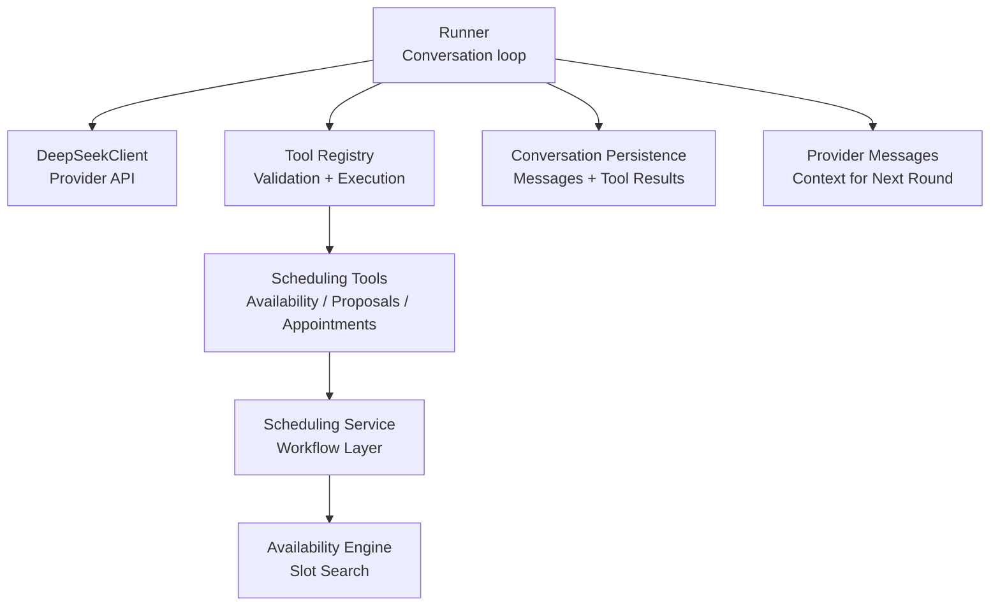
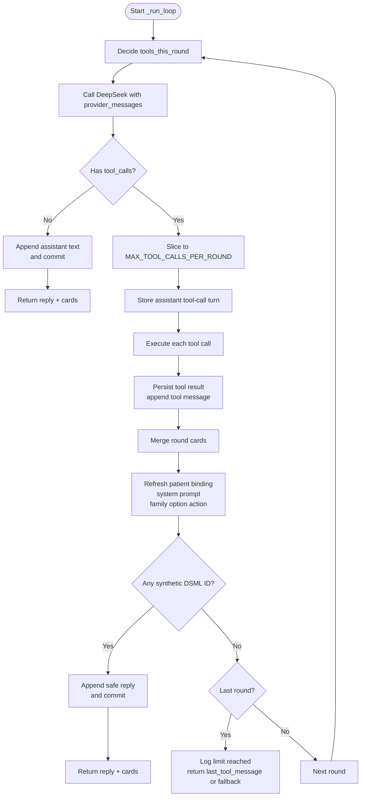
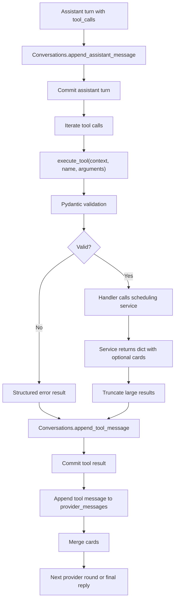
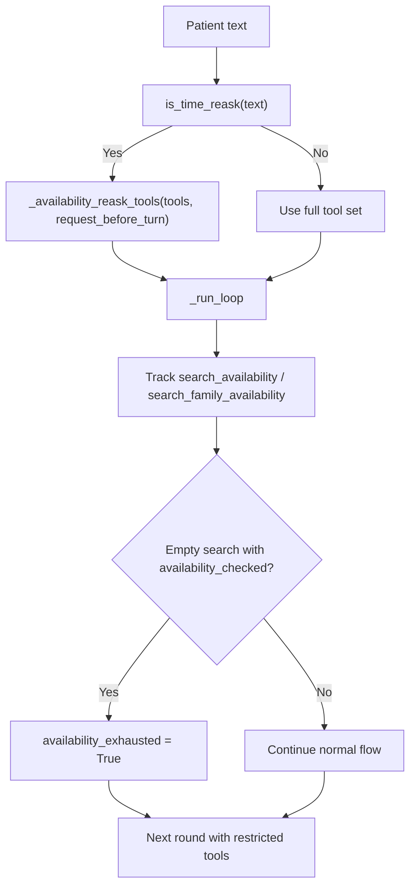
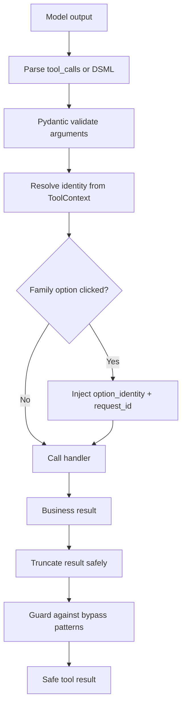
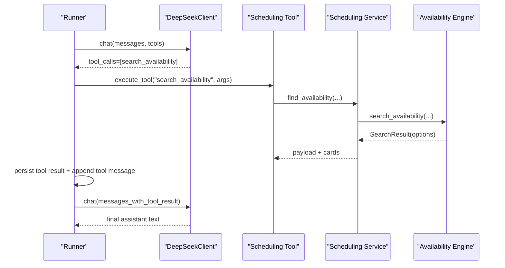
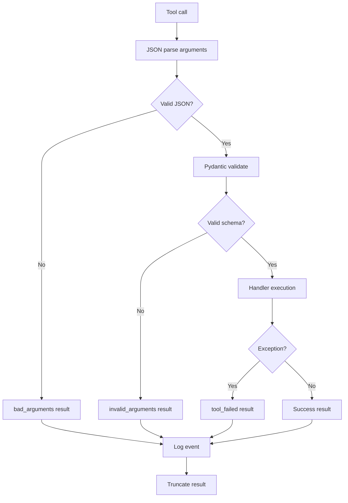
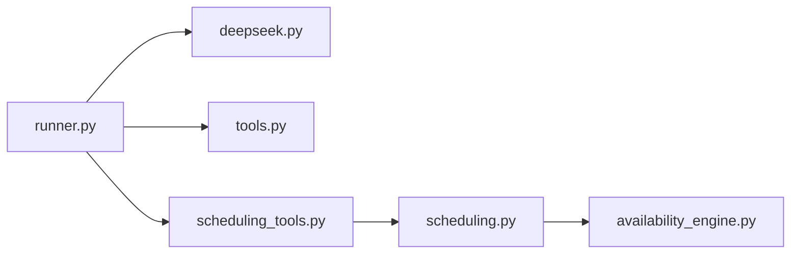

# Tool Orchestration Loop

<cite>
**Referenced Files in This Document**
- [runner.py](file://backend/app/agent/runner.py)
- [deepseek.py](file://backend/app/ai/deepseek.py)
- [tools.py](file://backend/app/agent/tools.py)
- [scheduling_tools.py](file://backend/app/agent/scheduling_tools.py)
- [scheduling.py](file://backend/app/services/scheduling.py)
- [availability_engine.py](file://backend/app/services/availability_engine.py)
</cite>

## Table of Contents
1. [Introduction](#introduction)
2. [Project Structure](#project-structure)
3. [Core Components](#core-components)
4. [Architecture Overview](#architecture-overview)
5. [Detailed Component Analysis](#detailed-component-analysis)
6. [Dependency Analysis](#dependency-analysis)
7. [Performance Considerations](#performance-considerations)
8. [Troubleshooting Guide](#troubleshooting-guide)
9. [Conclusion](#conclusion)

## Introduction
This document explains the tool orchestration loop that mediates between the AI model and the clinic’s business logic. The runner receives one patient message, asks DeepSeek to interpret it, executes any requested tools through validated services, persists the conversation state, and feeds results back until a final assistant reply is produced.

The loop is intentionally bounded:
- `MAX_TOOL_ROUNDS` limits how many times the runner calls DeepSeek for a single patient message.
- `MAX_TOOL_CALLS_PER_ROUND` limits how many tool calls are executed from one model turn.

These bounds prevent infinite loops, excessive provider round-trips, and resource exhaustion while still allowing multi-step workflows such as availability search, proposal creation, and confirmation.

## Project Structure
The orchestration spans several layers:

| Layer | Responsibility | Key Files |
|---|---|---|
| Runner | Conversation lifecycle, loop control, persistence, error handling | `backend/app/agent/runner.py` |
| Provider client | HTTP call to DeepSeek, retries, DSML parsing, typed exceptions | `backend/app/ai/deepseek.py` |
| Tool registry | Pydantic argument validation, safe execution wrapper, result truncation | `backend/app/agent/tools.py` |
| Scheduling tools | Availability, proposals, appointments, family options, emergencies | `backend/app/agent/scheduling_tools.py` |
| Scheduling service | Workflow composition, request tracking, card generation | `backend/app/services/scheduling.py` |
| Availability engine | Read-only slot discovery and bookability checks | `backend/app/services/availability_engine.py` |



**Diagram sources**
- [runner.py:171-406](file://backend/app/agent/runner.py#L171-L406)
- [deepseek.py:178-328](file://backend/app/ai/deepseek.py#L178-L328)
- [tools.py:703-739](file://backend/app/agent/tools.py#L703-L739)
- [scheduling_tools.py:474-552](file://backend/app/agent/scheduling_tools.py#L474-L552)
- [scheduling.py:393-716](file://backend/app/services/scheduling.py#L393-L716)
- [availability_engine.py:238-354](file://backend/app/services/availability_engine.py#L238-L354)

**Section sources**
- [runner.py:1-23](file://backend/app/agent/runner.py#L1-L23)
- [runner.py:171-406](file://backend/app/agent/runner.py#L171-L406)

## Core Components
The tool orchestration loop is centered on two functions:

- `run_turn`: prepares context, builds system prompt and provider messages, handles re-asks, and delegates to the loop.
- `_run_loop`: performs the bounded interaction with DeepSeek, executes tool calls, persists assistant turns and tool results, and returns the final reply and cards.

Key constants:
- `MAX_TOOL_ROUNDS = 4`: maximum number of provider round-trips per patient message.
- `MAX_TOOL_CALLS_PER_ROUND = 4`: maximum number of tool calls executed from one model turn.
- `MAX_PATIENT_MESSAGE_CHARS = 2000`: input length guard.
- `MAX_TOOL_RESULT_CHARS = 6000`: result size guard applied by the tool layer.

The runner also enforces safety around availability re-asks, synthetic DSML tool-call IDs, settled grids, and card deduplication so the UI shows consistent, non-stale offers.

**Section sources**
- [runner.py:51-55](file://backend/app/agent/runner.py#L51-L55)
- [tools.py:33](file://backend/app/agent/tools.py#L33)
- [runner.py:171-235](file://backend/app/agent/runner.py#L171-L235)
- [runner.py:409-557](file://backend/app/agent/runner.py#L409-L557)

## Architecture Overview
The end-to-end flow for one patient message is:

```mermaid
sequenceDiagram
participant Caller as "API Layer"
participant Runner as "Runner.run_turn"
participant Loop as "_run_loop"
participant Client as "DeepSeekClient.chat"
participant DB as "Conversation Persistence"
participant Tools as "execute_tool"
participant Services as "Scheduling Services"
Caller->>Runner : Patient message
Runner->>DB : Append patient message
Runner->>Runner : Build system prompt + provider messages
Runner->>Loop : Start tool loop
Loop->>Client : chat(messages, tools)
alt Model returns text only
Client-->>Loop : AssistantTurn without tool_calls
Loop->>DB : Append assistant text
Loop-->>Runner : Final reply + cards
else Model requests tools
Client-->>Loop : AssistantTurn with tool_calls
Loop->>DB : Store assistant tool-call turn
Loop->>Tools : Execute each tool call
Tools->>Services : Validate arguments + run business logic
Services-->>Tools : Result dict with optional cards
Tools-->>Loop : Truncated, safe result
Loop->>DB : Persist tool result
Loop->>Loop : Update provider messages
Loop->>Client : chat(messages, tools) next round
end
Runner-->>Caller : TurnResult(reply, messages, cards)
```

**Diagram sources**
- [runner.py:171-406](file://backend/app/agent/runner.py#L171-L406)
- [runner.py:409-557](file://backend/app/agent/runner.py#L409-L557)
- [deepseek.py:205-328](file://backend/app/ai/deepseek.py#L205-L328)
- [tools.py:703-739](file://backend/app/agent/tools.py#L703-L739)

## Detailed Component Analysis

### Bounded Interaction Loop
The loop runs at most `MAX_TOOL_ROUNDS` iterations. In each iteration:

1. The runner may restrict available tools when the patient is asking to see times again or when availability has been exhausted.
2. DeepSeek is called with the current provider messages and allowed tools.
3. If no tool calls are returned, the assistant text is persisted and the loop exits.
4. If tool calls are returned, they are sliced to `MAX_TOOL_CALLS_PER_ROUND`.
5. The assistant turn with pending tool calls is stored.
6. Each tool call is executed, its result is persisted, and a tool message is appended to provider messages.
7. Cards from the round are merged into the latest round’s card set.
8. If the last round is reached, the loop stops and returns a safe fallback reply.



**Diagram sources**
- [runner.py:409-557](file://backend/app/agent/runner.py#L409-L557)

**Section sources**
- [runner.py:409-557](file://backend/app/agent/runner.py#L409-L557)

### Tool Call Lifecycle
The lifecycle covers storage, execution, persistence, and provider message updates:

| Step | Actor | Behavior |
|---|---|---|
| Assistant turn storage | Runner | Stores assistant content and pending tool calls before execution. |
| Tool dispatch | Runner | Iterates over sliced tool calls and tracks search dispatch. |
| Argument validation | Tool registry | Parses JSON, validates against Pydantic models, and converts errors into structured tool results. |
| Business execution | Scheduling tools | Resolves identity from `ToolContext`, not model arguments, and calls deterministic services. |
| Result persistence | Runner | Persists each tool result with tool name, ID, and payload. |
| Provider update | Runner | Appends a tool message containing the serialized result for the next provider round. |
| Card attachment | Runner | Merges cards from tool results and attaches them to the turn’s final assistant text. |



**Diagram sources**
- [runner.py:469-520](file://backend/app/agent/runner.py#L469-L520)
- [tools.py:703-739](file://backend/app/agent/tools.py#L703-L739)

**Section sources**
- [runner.py:469-520](file://backend/app/agent/runner.py#L469-L520)
- [tools.py:703-739](file://backend/app/agent/tools.py#L703-L739)

### Search Dispatch Tracking and Availability Reask Handling
The runner tracks whether a search was dispatched during a round using `search_dispatched`. It also marks `availability_exhausted` when a complete empty search occurs for availability-related tools.

When the patient asks to see times again:
- The runner detects time re-asks using fuzzy matching.
- For a natural-language re-ask without a family-option click, the runner restricts tools to a safe subset.
- After the loop, if the re-ask refreshes the scheduling request, the runner replays the refreshed grid and updates the latest assistant message.

This prevents the model from treating a re-ask as a new booking intent and avoids replaying stale historical cards.



**Diagram sources**
- [runner.py:76-97](file://backend/app/agent/runner.py#L76-L97)
- [runner.py:100-121](file://backend/app/agent/runner.py#L100-L121)
- [runner.py:204-235](file://backend/app/agent/runner.py#L204-L235)
- [runner.py:486-509](file://backend/app/agent/runner.py#L486-L509)

**Section sources**
- [runner.py:76-97](file://backend/app/agent/runner.py#L76-L97)
- [runner.py:100-121](file://backend/app/agent/runner.py#L100-L121)
- [runner.py:204-235](file://backend/app/agent/runner.py#L204-L235)
- [runner.py:486-509](file://backend/app/agent/runner.py#L486-L509)

### Preventing AI Bypass Through Tool Manipulation
The runner and tool layer enforce several security boundaries:

| Boundary | Mechanism | Purpose |
|---|---|---|
| Identity source | `ToolContext` built from authenticated session | Prevents the model from choosing another patient. |
| Argument validation | Pydantic models with strict schemas | Rejects hallucinated or malformed fields. |
| Unknown tools | `execute_tool` returns an error for unknown names | Blocks arbitrary function invocation. |
| Family option authority | Runner injects `option_identity` and `request_id` | Browser action is authoritative; model cannot select a different historical option. |
| Tool result size | `_truncate` keeps decision fields and cards but drops secondary detail | Prevents unbounded payloads from corrupting the loop. |
| DSML fallback guard | Synthetic DSML IDs are detected and stop further provider rounds | Avoids HTTP 400 from invalid synthetic IDs. |
| Availability tool restriction | Re-ask path removes dangerous tools | Prevents accidental holds or confirmations based on old transcript context. |



**Diagram sources**
- [tools.py:41-51](file://backend/app/agent/tools.py#L41-L51)
- [tools.py:703-739](file://backend/app/agent/tools.py#L703-L739)
- [runner.py:721-761](file://backend/app/agent/runner.py#L721-L761)
- [runner.py:100-121](file://backend/app/agent/runner.py#L100-L121)

**Section sources**
- [tools.py:41-51](file://backend/app/agent/tools.py#L41-L51)
- [tools.py:703-739](file://backend/app/agent/tools.py#L703-L739)
- [runner.py:721-761](file://backend/app/agent/runner.py#L721-L761)
- [runner.py:100-121](file://backend/app/agent/runner.py#L100-L121)

### Example Tool Execution Flow: Availability Search
A typical availability workflow proceeds as follows:

1. The runner calls DeepSeek with available tools.
2. DeepSeek returns a tool call for `search_availability` or `search_family_availability`.
3. The runner stores the assistant turn with pending tool calls.
4. The scheduling tool resolves the verified patient and stored scheduling request.
5. The scheduling service computes preferences, applies booking policy, and queries the availability engine.
6. The availability engine returns bookable slot runs.
7. The scheduling service builds slot or family-option cards.
8. The runner persists the tool result and appends a tool message.
9. The runner merges cards and continues the loop or returns the final reply.



**Diagram sources**
- [runner.py:469-520](file://backend/app/agent/runner.py#L469-L520)
- [scheduling_tools.py:474-552](file://backend/app/agent/scheduling_tools.py#L474-L552)
- [scheduling.py:393-716](file://backend/app/services/scheduling.py#L393-L716)
- [availability_engine.py:238-354](file://backend/app/services/availability_engine.py#L238-L354)

**Section sources**
- [runner.py:469-520](file://backend/app/agent/runner.py#L469-L520)
- [scheduling_tools.py:474-552](file://backend/app/agent/scheduling_tools.py#L474-L552)
- [scheduling.py:393-716](file://backend/app/services/scheduling.py#L393-L716)
- [availability_engine.py:238-354](file://backend/app/services/availability_engine.py#L238-L354)

### Error Handling During Tool Calls
Errors are handled at multiple layers:

| Failure Point | Handling Strategy |
|---|---|
| DeepSeek configuration missing | Raises a typed exception with a user-facing message. |
| Network timeout or unavailable provider | Retries with exponential backoff for transient failures; otherwise raises a recoverable exception. |
| Bad provider response | Logs status and error type without echoing prompts; raises a bad-response exception. |
| Unknown tool name | Returns a structured error instead of crashing. |
| Invalid JSON arguments | Returns a structured error asking for clarification. |
| Pydantic validation failure | Returns field-level errors so the model can ask for corrected values. |
| Unexpected tool exception | Logs the exception and returns a generic tool-failure result. |
| Unexpected runner exception | Rolls back the session, persists a fallback assistant message, and returns degraded state. |



**Diagram sources**
- [tools.py:703-739](file://backend/app/agent/tools.py#L703-L739)
- [runner.py:721-761](file://backend/app/agent/runner.py#L721-L761)
- [deepseek.py:38-64](file://backend/app/ai/deepseek.py#L38-L64)
- [deepseek.py:205-328](file://backend/app/ai/deepseek.py#L205-L328)

**Section sources**
- [tools.py:703-739](file://backend/app/agent/tools.py#L703-L739)
- [runner.py:721-761](file://backend/app/agent/runner.py#L721-L761)
- [deepseek.py:38-64](file://backend/app/ai/deepseek.py#L38-L64)
- [deepseek.py:205-328](file://backend/app/ai/deepseek.py#L205-L328)

### Recovery Strategies When Tools Fail
The runner is designed so that history never contains a dangling tool call:

- If DeepSeek fails during a turn, the runner logs the failure, persists a short friendly assistant message, and returns degraded state.
- If any unexpected exception occurs before the final text is persisted, the session is rolled back, a fallback reply is stored, and the visible message list is returned.
- Tool execution itself is wrapped so that even a buggy handler returns a safe result rather than breaking the loop.
- DSML-sourced tool calls are stopped after one round to avoid invalid synthetic IDs on subsequent provider calls.
- Availability exhaustion stops repeated searches and guides the model toward alternative days or times.

**Section sources**
- [runner.py:264-292](file://backend/app/agent/runner.py#L264-L292)
- [runner.py:533-557](file://backend/app/agent/runner.py#L533-L557)
- [runner.py:721-761](file://backend/app/agent/runner.py#L721-L761)

## Dependency Analysis
The runner depends on the provider client, tool registry, conversation persistence, and scheduling services. The scheduling tools depend on the scheduling service and availability engine. The availability engine is read-only and does not mutate bookings.



**Diagram sources**
- [runner.py:35-47](file://backend/app/agent/runner.py#L35-L47)
- [tools.py:590-614](file://backend/app/agent/tools.py#L590-L614)
- [scheduling_tools.py:36-49](file://backend/app/agent/scheduling_tools.py#L36-L49)

**Section sources**
- [runner.py:35-47](file://backend/app/agent/runner.py#L35-L47)
- [tools.py:590-614](file://backend/app/agent/tools.py#L590-L614)
- [scheduling_tools.py:36-49](file://backend/app/agent/scheduling_tools.py#L36-L49)

## Performance Considerations
- Provider timeouts are explicit: connect, read, and total timeouts protect long-running requests.
- Transient provider failures retry up to a small number of times with exponential backoff.
- Tool results are truncated to keep payloads within bounds while preserving interactive cards.
- Availability search caps options and spreads results across days to avoid overwhelming the model and UI.
- The loop limits both rounds and fan-out, preventing runaway provider usage.

[No sources needed since this section provides general guidance]

## Troubleshooting Guide
Common issues and their likely causes:

| Symptom | Likely Cause | Recommended Action |
|---|---|---|
| Infinite provider calls | Missing or incorrect loop bounds | Verify `MAX_TOOL_ROUNDS` and `MAX_TOOL_CALLS_PER_ROUND` are enforced. |
| HTTP 400 after DSML tool calls | Synthetic DSML IDs replayed on next round | Ensure DSML-sourced calls stop after one round. |
| Stale slot cards shown | Cards attached to wrong turn or not settled | Check card attachment logic and settled-grid handling. |
| Model tries to book directly | Tool manipulation or missing validation | Confirm Pydantic validation and `ToolContext` identity resolution. |
| Availability repeats after empty search | Availability exhaustion not tracked | Verify `availability_exhausted` flag and tool restriction. |
| Large tool results break the loop | Result truncation not applied | Confirm `_truncate` is used and `MAX_TOOL_RESULT_CHARS` is respected. |

**Section sources**
- [runner.py:409-557](file://backend/app/agent/runner.py#L409-L557)
- [tools.py:617-700](file://backend/app/agent/tools.py#L617-L700)
- [deepseek.py:205-328](file://backend/app/ai/deepseek.py#L205-L328)

## Conclusion
The tool orchestration loop is a controlled bridge between conversational AI and clinic operations. It protects the system from infinite loops, unbounded tool fan-out, malformed inputs, and model-driven bypass attempts. By persisting assistant tool-call turns, tool results, and provider messages, and by enforcing strict validation and bounded retries, the runner ensures that every patient message produces a safe, auditable, and user-friendly outcome.

[No sources needed since this section summarizes without analyzing specific files]