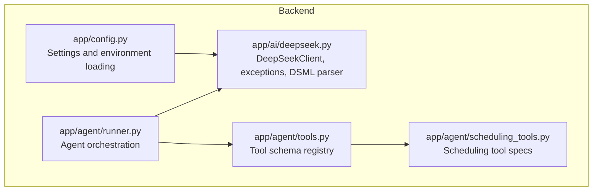
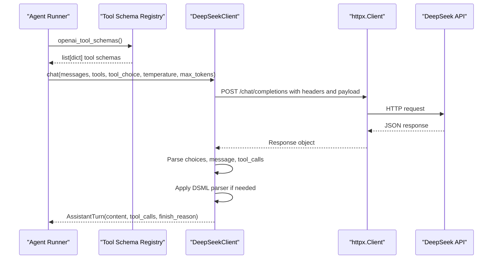
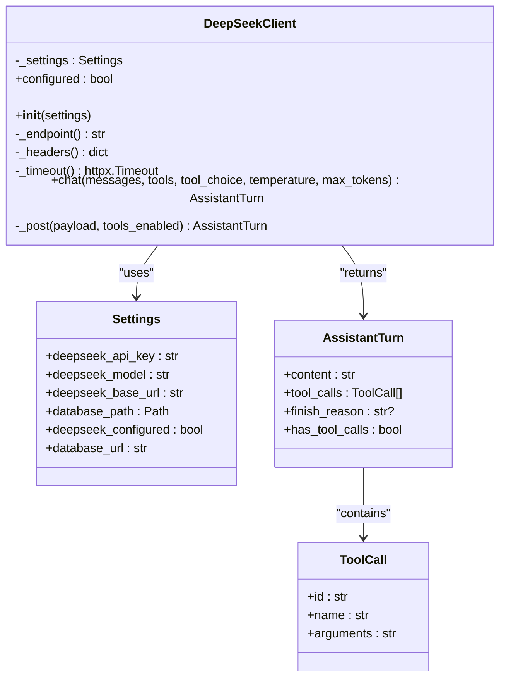
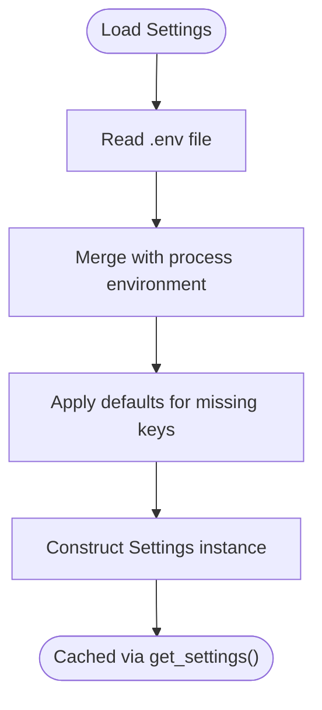
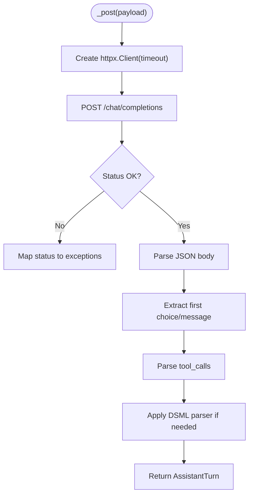
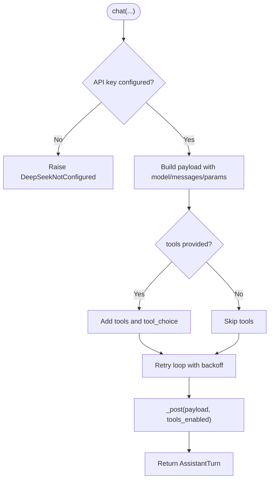
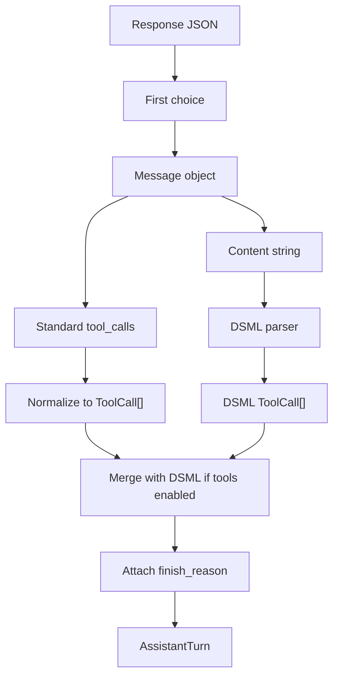
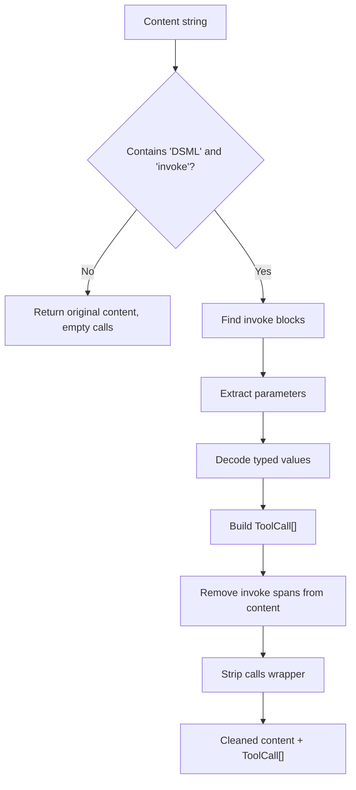
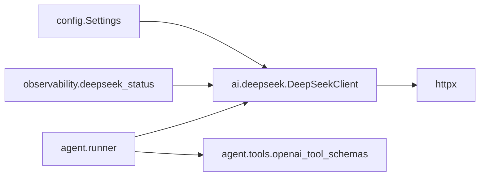

# Client Implementation

<cite>
**Referenced Files in This Document**
- [deepseek.py](file://backend/app/ai/deepseek.py)
- [config.py](file://backend/app/config.py)
- [runner.py](file://backend/app/agent/runner.py)
- [tools.py](file://backend/app/agent/tools.py)
- [scheduling_tools.py](file://backend/app/agent/scheduling_tools.py)
- [test_deepseek_dsml.py](file://backend/tests/test_deepseek_dsml.py)
</cite>

## Table of Contents
1. [Introduction](#introduction)
2. [Project Structure](#project-structure)
3. [Core Components](#core-components)
4. [Architecture Overview](#architecture-overview)
5. [Detailed Component Analysis](#detailed-component-analysis)
6. [Dependency Analysis](#dependency-analysis)
7. [Performance Considerations](#performance-considerations)
8. [Troubleshooting Guide](#troubleshooting-guide)
9. [Conclusion](#conclusion)

## Introduction
This document explains the DeepSeek client implementation used by the application to call a DeepSeek-compatible chat-completions API. It covers:
- The `DeepSeekClient` class architecture and initialization
- Configuration management through `Settings`
- HTTP client setup with `httpx`, including timeouts and headers
- The `chat` method signature, parameter validation, payload construction, retries, and response parsing into `AssistantTurn`
- The DSML (DeepSeek Markup Language) parser for native tool syntax responses
- Usage examples showing client instantiation, making chat requests with tools, and handling different response types

## Project Structure
The DeepSeek client lives under the backend AI layer and is consumed by the agent runner. Settings are centralized in the configuration module. Tool schemas are defined in the agent tools modules and passed to the client when tool calling is enabled.

**Diagram sources**
- [config.py:27-89](file://backend/app/config.py#L27-L89)
- [deepseek.py:178-329](file://backend/app/ai/deepseek.py#L178-L329)
- [runner.py:210-235](file://backend/app/agent/runner.py#L210-L235)
- [tools.py:613-614](file://backend/app/agent/tools.py#L613-L614)
- [scheduling_tools.py:1606-1650](file://backend/app/agent/scheduling_tools.py#L1606-L1650)

**Section sources**
- [deepseek.py:1-329](file://backend/app/ai/deepseek.py#L1-L329)
- [config.py:1-90](file://backend/app/config.py#L1-L90)
- [runner.py:210-235](file://backend/app/agent/runner.py#L210-L235)
- [tools.py:613-614](file://backend/app/agent/tools.py#L613-L614)
- [scheduling_tools.py:1606-1650](file://backend/app/agent/scheduling_tools.py#L1606-L1650)

## Core Components
- `DeepSeekClient`: Thin HTTP client over `httpx` that builds payloads, handles retries, parses responses, and normalizes tool calls.
- `Settings`: Frozen dataclass holding DeepSeek configuration and database path, loaded from environment variables or `.env`.
- `AssistantTurn` and `ToolCall`: Normalized response structures returned by the client.
- DSML parser functions: Extract native tool invocations embedded in model text responses.

Key responsibilities:
- Read configuration at runtime without logging secrets.
- Enforce strict timeouts and retry transient failures.
- Convert provider responses into typed domain objects.
- Support both standard OpenAI-style `tool_calls` and DSML markup fallback.

**Section sources**
- [deepseek.py:67-98](file://backend/app/ai/deepseek.py#L67-L98)
- [deepseek.py:178-329](file://backend/app/ai/deepseek.py#L178-L329)
- [config.py:27-89](file://backend/app/config.py#L27-L89)

## Architecture Overview
The client is invoked by the agent runner during conversation turns. The runner supplies messages and tool schemas; the client returns an `AssistantTurn` containing either assistant text, tool calls, or both.

**Diagram sources**
- [runner.py:210-235](file://backend/app/agent/runner.py#L210-L235)
- [tools.py:613-614](file://backend/app/agent/tools.py#L613-L614)
- [deepseek.py:205-329](file://backend/app/ai/deepseek.py#L205-L329)

## Detailed Component Analysis

### DeepSeekClient Class
Responsibilities:
- Initialize with optional `Settings`; otherwise use cached global settings.
- Provide endpoint URL, headers, and timeout configuration.
- Validate configuration before making requests.
- Build OpenAI-compatible payloads.
- Retry transient failures with exponential backoff.
- Parse provider responses into `AssistantTurn`.
- Normalize tool calls from both standard and DSML formats.

Initialization parameters:
- `settings: Settings | None = None`: Optional explicit settings; defaults to `get_settings()`.

Configuration properties:
- `configured`: Boolean indicating whether a DeepSeek API key is present.

HTTP setup:
- Endpoint: `{deepseek_base_url}/chat/completions`.
- Headers: Authorization Bearer token, Content-Type, Accept.
- Timeouts: connect=5s, read=45s, write=45s, total=60s.

Retry policy:
- Retries up to `MAX_RETRIES` times on timeouts, server errors (5xx), and rate limits (429).
- Uses exponential backoff with jitter.

Response parsing:
- Reads first choice’s message content and tool_calls.
- Applies DSML parser to extract tool calls from markup when present.
- Promotes DSML tool calls only when tools were offered in the request.

**Diagram sources**
- [deepseek.py:67-98](file://backend/app/ai/deepseek.py#L67-L98)
- [deepseek.py:178-329](file://backend/app/ai/deepseek.py#L178-L329)
- [config.py:27-41](file://backend/app/config.py#L27-L41)

**Section sources**
- [deepseek.py:178-329](file://backend/app/ai/deepseek.py#L178-L329)
- [config.py:27-41](file://backend/app/config.py#L27-L41)

### Settings and Configuration Management
`Settings` is a frozen dataclass that holds:
- `deepseek_api_key`: Required for authentication.
- `deepseek_model`: Model identifier, defaulting to a specific value when not provided.
- `deepseek_base_url`: Base URL for the DeepSeek-compatible API.
- `database_path`: SQLite database path.

Loading behavior:
- Loads values from process environment variables with precedence over `.env` file values.
- Provides safe defaults for model and base URL.
- Exposes `deepseek_configured` based on presence of the API key.

Environment variables:
- `DEEPSEEK_API_KEY`: Authentication key.
- `DEEPSEEK_MODEL`: Model name.
- `DEEPSEEK_BASE_URL`: API base URL.

**Diagram sources**
- [config.py:44-89](file://backend/app/config.py#L44-L89)

**Section sources**
- [config.py:27-89](file://backend/app/config.py#L27-L89)

### HTTP Client Setup with httpx
Timeout configuration:
- Connect timeout: 5 seconds.
- Read timeout: 45 seconds.
- Write timeout: 45 seconds.
- Total timeout: 60 seconds.

Headers:
- Authorization: Bearer token from settings.
- Content-Type: application/json.
- Accept: application/json.

Error mapping:
- `httpx.TimeoutException` maps to `DeepSeekTimeout`.
- Other `httpx.HTTPError` maps to `DeepSeekUnavailable`.
- Status codes 429 and 5xx map to rate limit or unavailable exceptions.
- Other 4xx status codes map to `DeepSeekBadResponse`.

Connection pooling:
- A new `httpx.Client` is created per request using a context manager. There is no persistent connection pool across requests in this client.

**Diagram sources**
- [deepseek.py:197-203](file://backend/app/ai/deepseek.py#L197-L203)
- [deepseek.py:251-329](file://backend/app/ai/deepseek.py#L251-L329)

**Section sources**
- [deepseek.py:197-203](file://backend/app/ai/deepseek.py#L197-L203)
- [deepseek.py:251-329](file://backend/app/ai/deepseek.py#L251-L329)

### Chat Method Signature and Payload Construction
Signature:
- `messages: list[dict[str, Any]]`: Conversation history in provider format.
- `tools: list[dict[str, Any]] | None = None`: Optional tool schemas.
- `tool_choice: str | dict[str, Any] = "auto"`: Tool selection strategy.
- `temperature: float = 0.3`: Sampling temperature.
- `max_tokens: int = 700`: Maximum tokens in response.

Payload construction:
- Always includes model, messages, temperature, max_tokens, and stream=False.
- Adds tools and tool_choice when tools are provided.

Validation:
- Raises `DeepSeekNotConfigured` if API key is missing.

Retries:
- Retries transient failures with exponential backoff and jitter.

**Diagram sources**
- [deepseek.py:205-249](file://backend/app/ai/deepseek.py#L205-L249)

**Section sources**
- [deepseek.py:205-249](file://backend/app/ai/deepseek.py#L205-L249)

### Response Parsing and AssistantTurn
Parsing steps:
- Deserialize JSON response.
- Extract first choice and its message.
- Parse standard `tool_calls` array into `ToolCall` objects.
- Apply DSML parser to extract tool calls from markup in content.
- Promote DSML tool calls only when tools were offered in the request.
- Attach `finish_reason` from the choice.

Output:
- Returns `AssistantTurn` with normalized content, tool calls, and finish reason.

**Diagram sources**
- [deepseek.py:291-329](file://backend/app/ai/deepseek.py#L291-L329)

**Section sources**
- [deepseek.py:291-329](file://backend/app/ai/deepseek.py#L291-L329)

### DSML (DeepSeek Markup Language) Parser
Purpose:
- Some DeepSeek-compatible deployments return native DSML tool syntax inside `message.content` instead of populating `message.tool_calls`.
- The parser extracts invoke blocks and their parameters, converting them into normalized `ToolCall` objects.

Regex patterns:
- Invoke start/end markers.
- Parameter start/end markers.
- Calls wrapper marker.

Parameter decoding:
- Supports typed parameters marked with `string="true"` or JSON-like values.
- Malformed typed values fall back to raw strings so downstream Pydantic validation can handle invalid arguments consistently.

Promotion rules:
- DSML tool calls are promoted only when tools were offered in the request; otherwise they are ignored to avoid corrupting subsequent rounds.

**Diagram sources**
- [deepseek.py:101-176](file://backend/app/ai/deepseek.py#L101-L176)

**Section sources**
- [deepseek.py:101-176](file://backend/app/ai/deepseek.py#L101-L176)
- [test_deepseek_dsml.py:12-49](file://backend/tests/test_deepseek_dsml.py#L12-L49)
- [test_deepseek_dsml.py:62-94](file://backend/tests/test_deepseek_dsml.py#L62-L94)

### Usage Examples

#### Client Instantiation
- Default instantiation uses cached settings:
  - Instantiate `DeepSeekClient()` without arguments.
- Explicit settings instantiation for tests or custom environments:
  - Create a `Settings` instance with required fields and pass it to `DeepSeekClient(settings=...)`.

References:
- [deepseek.py:178-180](file://backend/app/ai/deepseek.py#L178-L180)
- [test_deepseek_dsml.py:62-69](file://backend/tests/test_deepseek_dsml.py#L62-L69)

#### Making Chat Requests with Tools
- Build provider messages and tool schemas.
- Call `client.chat(messages=..., tools=..., tool_choice="auto", temperature=0.3, max_tokens=700)`.
- The runner obtains tool schemas via `openai_tool_schemas()` and passes them to the client.

References:
- [runner.py:214-220](file://backend/app/agent/runner.py#L214-L220)
- [tools.py:613-614](file://backend/app/agent/tools.py#L613-L614)

#### Handling Different Response Types
- If `AssistantTurn.has_tool_calls` is true, execute tool handlers and continue the conversation loop.
- Otherwise, treat `AssistantTurn.content` as the final reply.
- Errors raised by the client (`DeepSeekError` subclasses) should be caught and converted into user-friendly messages.

References:
- [deepseek.py:74-85](file://backend/app/ai/deepseek.py#L74-L85)
- [runner.py:264-281](file://backend/app/agent/runner.py#L264-L281)

## Dependency Analysis
The client depends on:
- `Settings` for configuration.
- `httpx` for HTTP transport.
- Observability utilities for metrics.

The agent runner depends on:
- `DeepSeekClient` for LLM calls.
- Tool schema registry for tool definitions.

**Diagram sources**
- [deepseek.py:24-27](file://backend/app/ai/deepseek.py#L24-L27)
- [runner.py:214-220](file://backend/app/agent/runner.py#L214-L220)
- [tools.py:613-614](file://backend/app/agent/tools.py#L613-L614)

**Section sources**
- [deepseek.py:24-27](file://backend/app/ai/deepseek.py#L24-L27)
- [runner.py:214-220](file://backend/app/agent/runner.py#L214-L220)
- [tools.py:613-614](file://backend/app/agent/tools.py#L613-L614)

## Performance Considerations
- Timeouts: Strict connect/read/total timeouts protect against slow or hanging upstream services.
- Retries: Exponential backoff with jitter mitigates transient failures and rate limiting.
- Logging: Avoids logging sensitive prompt content and API keys; logs coarse error types and latency.
- Connection pooling: No persistent connection pool per client instance; each request creates a short-lived `httpx.Client`. For high-throughput scenarios, consider reusing a shared client or adjusting deployment concurrency accordingly.

[No sources needed since this section provides general guidance]

## Troubleshooting Guide
Common issues and resolutions:
- Missing API key:
  - Symptom: `DeepSeekNotConfigured` raised during `chat`.
  - Resolution: Ensure `DEEPSEEK_API_KEY` is set in environment or `.env`.
- Rate limiting:
  - Symptom: `DeepSeekRateLimited` due to 429 responses.
  - Resolution: Back off and retry; reduce request frequency.
- Server errors:
  - Symptom: `DeepSeekUnavailable` due to 5xx responses.
  - Resolution: Retry after backoff; check upstream service health.
- Network errors:
  - Symptom: `DeepSeekUnavailable` wrapping `httpx.HTTPError`.
  - Resolution: Verify network connectivity and DNS resolution.
- Bad responses:
  - Symptom: `DeepSeekBadResponse` for malformed JSON or unexpected structure.
  - Resolution: Inspect provider response schema; ensure compatibility.

References:
- [deepseek.py:38-65](file://backend/app/ai/deepseek.py#L38-L65)
- [deepseek.py:251-289](file://backend/app/ai/deepseek.py#L251-L289)

**Section sources**
- [deepseek.py:38-65](file://backend/app/ai/deepseek.py#L38-L65)
- [deepseek.py:251-289](file://backend/app/ai/deepseek.py#L251-L289)

## Conclusion
The DeepSeek client is a focused, secure, and robust integration layer that:
- Centralizes configuration through `Settings`.
- Enforces strict timeouts and retries.
- Normalizes provider responses into typed domain objects.
- Supports both standard tool calls and DSML markup fallback.
- Integrates cleanly with the agent runner and tool schema registry.

Adopting this client ensures consistent behavior, safety around secrets, and resilience against transient failures while providing clear error semantics for higher-level components.

[No sources needed since this section summarizes without analyzing specific files]