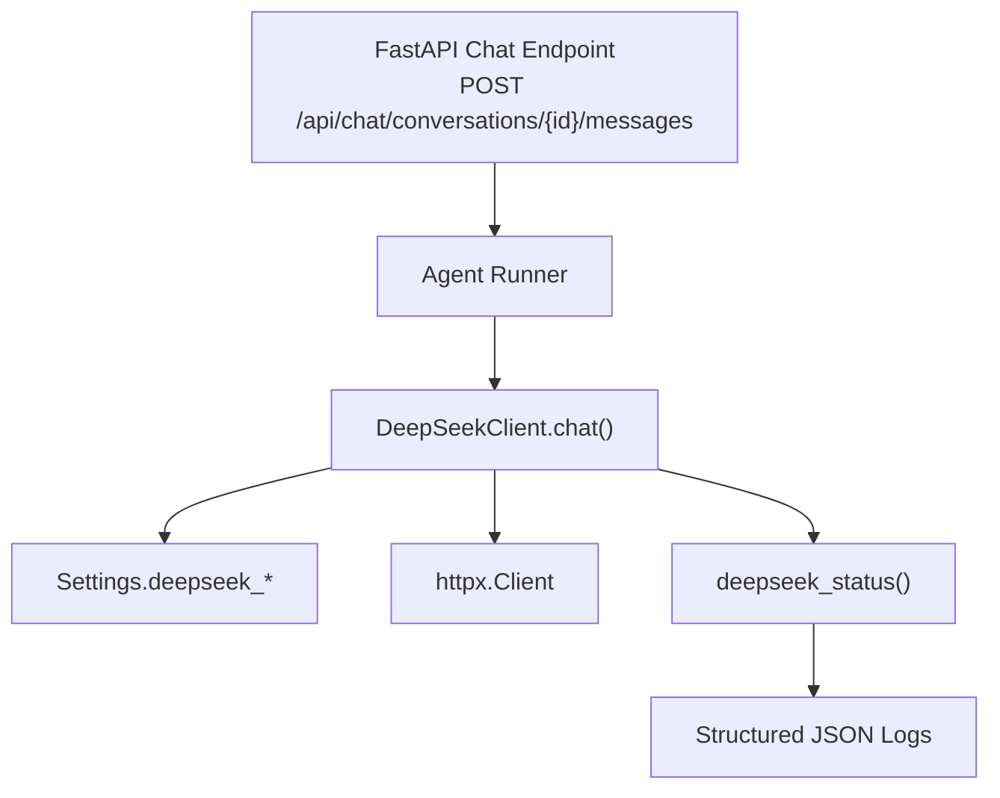
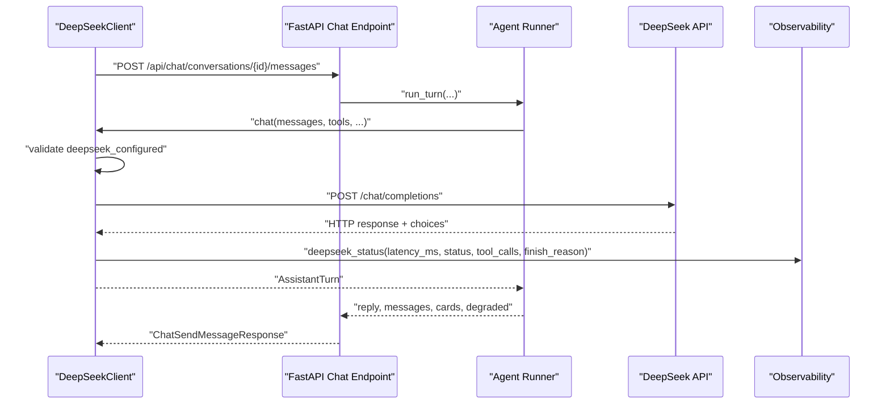
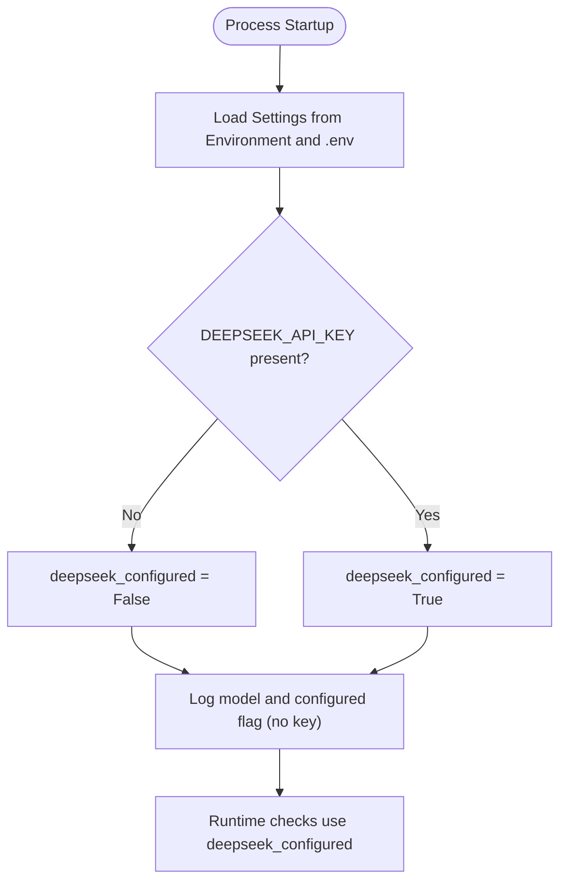
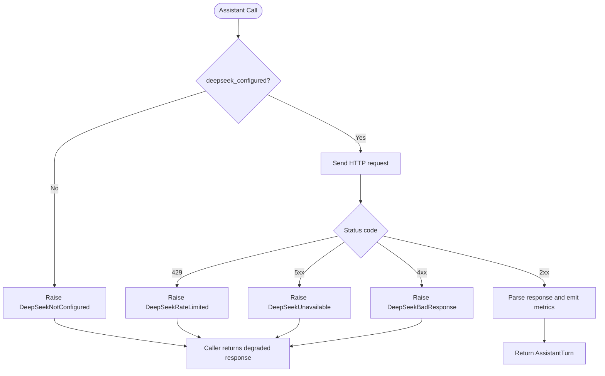
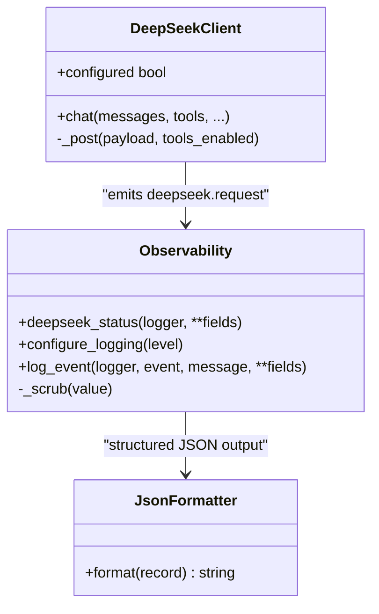
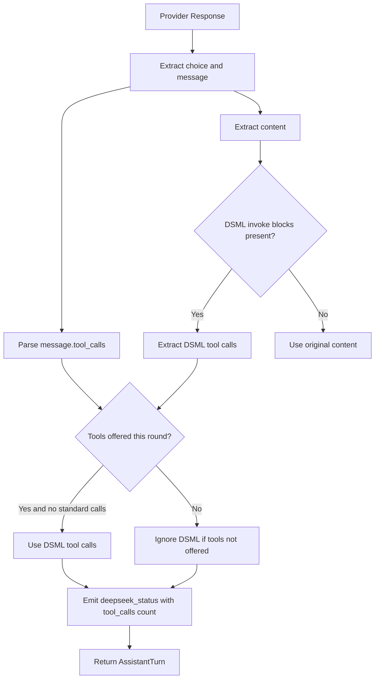
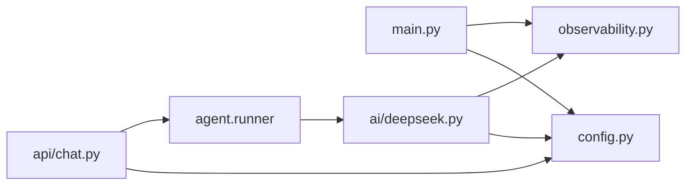

# Configuration and Monitoring

<cite>
**Referenced Files in This Document**
- [deepseek.py](file://backend/app/ai/deepseek.py)
- [config.py](file://backend/app/config.py)
- [observability.py](file://backend/app/observability.py)
- [chat.py](file://backend/app/api/chat.py)
- [main.py](file://backend/app/main.py)
- [README.md](file://README.md)
</cite>

## Table of Contents
1. [Introduction](#introduction)
2. [Project Structure](#project-structure)
3. [Core Components](#core-components)
4. [Architecture Overview](#architecture-overview)
5. [Detailed Component Analysis](#detailed-component-analysis)
6. [Dependency Analysis](#dependency-analysis)
7. [Performance Considerations](#performance-considerations)
8. [Troubleshooting Guide](#troubleshooting-guide)
9. [Conclusion](#conclusion)
10. [Appendices](#appendices)

## Introduction
This document explains how DeepSeek is configured, how service availability is checked, how the system degrades gracefully when the provider is unavailable, and how observability captures latency, status codes, tool call counts, and finish reasons. It also provides production-oriented guidance for environment configuration, logging safety, monitoring dashboards, alerting rules, and performance tuning.

The implementation uses a small OpenAI-compatible DeepSeek client with strict timeouts, retry logic, typed exceptions, and structured JSON logs that intentionally avoid sensitive data such as API keys or prompt contents.

## Project Structure
DeepSeek integration lives under the backend application:

- `backend/app/ai/deepseek.py` implements the DeepSeek HTTP client, retries, error mapping, DSML tool parsing, and observability emission.
- `backend/app/config.py` loads environment variables and exposes a `deepseek_configured` property.
- `backend/app/observability.py` provides structured JSON logging and the `deepseek_status` event helper.
- `backend/app/api/chat.py` integrates assistant configuration into chat session state and response payloads.
- `backend/app/main.py` configures logging, request context, startup diagnostics, and health/error handling.
- `README.md` documents the required environment variables.



**Diagram sources**
- [chat.py:233-274](file://backend/app/api/chat.py#L233-L274)
- [deepseek.py:178-328](file://backend/app/ai/deepseek.py#L178-L328)
- [config.py:27-37](file://backend/app/config.py#L27-L37)
- [observability.py:215-216](file://backend/app/observability.py#L215-L216)

**Section sources**
- [deepseek.py:1-329](file://backend/app/ai/deepseek.py#L1-L329)
- [config.py:1-90](file://backend/app/config.py#L1-L90)
- [observability.py:1-241](file://backend/app/observability.py#L1-L241)
- [chat.py:1-347](file://backend/app/api/chat.py#L1-L347)
- [main.py:1-256](file://backend/app/main.py#L1-L256)
- [README.md:82-84](file://README.md#L82-L84)

## Core Components
- **Settings**: Loads `DEEPSEEK_API_KEY`, `DEEPSEEK_MODEL`, and `DEEPSEEK_BASE_URL`. The presence of an API key determines whether the DeepSeek assistant is considered configured.
- **DeepSeekClient**: Sends chat-completion requests, handles retries, maps HTTP errors to typed exceptions, parses tool calls including DSML fallbacks, and emits observability events.
- **Observability**: Emits one JSON log line per event, scrubs sensitive fields, and exposes `deepseek_status` for provider metrics.
- **Chat API**: Exposes assistant configuration state to clients and returns a `degraded` flag when the model path fails.
- **Application Startup**: Logs only the model name and configured flag, never the API key value.

**Section sources**
- [config.py:27-37](file://backend/app/config.py#L27-L37)
- [deepseek.py:38-64](file://backend/app/ai/deepseek.py#L38-L64)
- [deepseek.py:178-328](file://backend/app/ai/deepseek.py#L178-L328)
- [observability.py:92-141](file://backend/app/observability.py#L92-L141)
- [observability.py:215-216](file://backend/app/observability.py#L215-L216)
- [chat.py:54-61](file://backend/app/api/chat.py#L54-L61)
- [chat.py:253-274](file://backend/app/api/chat.py#L253-L274)
- [main.py:35-42](file://backend/app/main.py#L35-L42)

## Architecture Overview
The DeepSeek integration follows a layered pattern:

1. The FastAPI chat endpoint receives a patient message.
2. The agent runner prepares messages and tools.
3. `DeepSeekClient.chat()` validates configuration, builds the payload, and retries transient failures.
4. `httpx.Client` performs the outbound request with strict connect/read/write/total timeouts.
5. Responses are parsed into normalized assistant turns with optional tool calls.
6. `deepseek_status` emits structured metrics without exposing secrets or prompts.
7. The API layer returns a `degraded` response when the assistant cannot be used.



**Diagram sources**
- [chat.py:233-274](file://backend/app/api/chat.py#L233-L274)
- [deepseek.py:205-328](file://backend/app/ai/deepseek.py#L205-L328)
- [observability.py:215-216](file://backend/app/observability.py#L215-L216)

## Detailed Component Analysis

### Environment Variables and Settings
The application supports exactly three DeepSeek-related environment variables:

| Variable | Required | Default | Purpose |
|---|---:|---|---|
| `DEEPSEEK_API_KEY` | Yes for full functionality | Empty string | Authentication token sent in the Authorization header. Presence determines `deepseek_configured`. |
| `DEEPSEEK_MODEL` | No | `deepseek-flash` | Model name included in the chat-completion payload. |
| `DEEPSEEK_BASE_URL` | No | `https://api.deepseek.com` | Base URL appended with `/chat/completions`. |

Configuration loading order:
1. Process environment variables.
2. `.env` file values.
3. Code defaults.

The API key is read at call time and never returned by settings or logged.

**Section sources**
- [config.py:27-37](file://backend/app/config.py#L27-L37)
- [config.py:44-84](file://backend/app/config.py#L44-L84)
- [README.md:82-84](file://README.md#L82-L84)

### Service Availability Check: `deepseek_configured`
`Settings.deepseek_configured` returns `True` only when `deepseek_api_key` is non-empty. This property is used in multiple places:

- `DeepSeekClient.configured` delegates to settings.
- Chat session state includes `assistant_configured` so the frontend can hide or disable AI features.
- The chat endpoint logs a warning when a message arrives but the key is missing.
- Application startup logs the model name and configured flag without the key value.



**Diagram sources**
- [config.py:27-37](file://backend/app/config.py#L27-L37)
- [config.py:69-84](file://backend/app/config.py#L69-L84)
- [main.py:35-42](file://backend/app/main.py#L35-L42)

**Section sources**
- [config.py:27-37](file://backend/app/config.py#L27-L37)
- [deepseek.py:178-184](file://backend/app/ai/deepseek.py#L178-L184)
- [chat.py:54-61](file://backend/app/api/chat.py#L54-L61)
- [chat.py:253-254](file://backend/app/api/chat.py#L253-L254)
- [main.py:35-42](file://backend/app/main.py#L35-L42)

### Graceful Degradation When DeepSeek Is Unavailable
When the assistant is not configured or the provider fails, the system avoids leaking internal details and returns user-safe behavior:

- If `deepseek_configured` is false, the client raises `DeepSeekNotConfigured`.
- Timeout, network, server, and rate-limit failures map to typed exceptions.
- The chat endpoint still processes the request through the runner; if the assistant path fails, the response includes a `degraded` flag.
- Frontend-facing user messages are defined on each exception class rather than echoing provider errors.



**Diagram sources**
- [deepseek.py:44-64](file://backend/app/ai/deepseek.py#L44-L64)
- [deepseek.py:205-249](file://backend/app/ai/deepseek.py#L205-L249)
- [deepseek.py:251-289](file://backend/app/ai/deepseek.py#L251-L289)
- [chat.py:253-274](file://backend/app/api/chat.py#L253-L274)

**Section sources**
- [deepseek.py:38-64](file://backend/app/ai/deepseek.py#L38-L64)
- [deepseek.py:205-249](file://backend/app/ai/deepseek.py#L205-L249)
- [deepseek.py:251-289](file://backend/app/ai/deepseek.py#L251-L289)
- [chat.py:253-274](file://backend/app/api/chat.py#L253-L274)

### Observability Integration Through `deepseek_status`
Every successful DeepSeek response emits a structured event with:

- Event name: `deepseek.request`
- Latency in milliseconds
- HTTP status code
- Number of tool calls
- Finish reason from the provider response

The observability layer:

- Uses JSON lines for greppable and parseable logs.
- Adds request ID, endpoint, duration, method, and scrubbed fields.
- Scrubs sensitive keys recursively, including API keys, tokens, passwords, dates, phone numbers, messages, content, arguments, and prompts.
- Never logs raw tracebacks or long exception strings.



**Diagram sources**
- [deepseek.py:316-322](file://backend/app/ai/deepseek.py#L316-L322)
- [observability.py:92-141](file://backend/app/observability.py#L92-L141)
- [observability.py:144-171](file://backend/app/observability.py#L144-L171)
- [observability.py:215-216](file://backend/app/observability.py#L215-L216)

**Section sources**
- [deepseek.py:316-322](file://backend/app/ai/deepseek.py#L316-L322)
- [observability.py:1-30](file://backend/app/observability.py#L1-L30)
- [observability.py:92-141](file://backend/app/observability.py#L92-L141)
- [observability.py:144-171](file://backend/app/observability.py#L144-L171)
- [observability.py:215-216](file://backend/app/observability.py#L215-L216)

### Logging Best Practices
The codebase enforces several safeguards against sensitive data exposure:

- API keys are read from settings and sent only in the Authorization header.
- Startup logs include model name and configured flag, explicitly noting that the key value is never logged.
- Error responses from DeepSeek are parsed carefully; bodies may echo prompt content and are not written to logs.
- Structured fields are scrubbed recursively for sensitive keys and patterns.
- Tracebacks are reduced to exception type and a short scrubbed message.
- HTTP access logs from httpx are downgraded to WARNING to reduce noise.

Recommended operational practices:

- Store `DEEPSEEK_API_KEY` in a secrets manager or container runtime secret store.
- Avoid printing environment variables or settings objects.
- Use structured log aggregation that supports field filtering.
- Redact any custom fields added by callers before emitting them.
- Keep log levels conservative in production; use DEBUG only in controlled environments.

**Section sources**
- [deepseek.py:1-12](file://backend/app/ai/deepseek.py#L1-L12)
- [deepseek.py:273-289](file://backend/app/ai/deepseek.py#L273-L289)
- [config.py:1-10](file://backend/app/config.py#L1-L10)
- [main.py:35-42](file://backend/app/main.py#L35-L42)
- [observability.py:24-30](file://backend/app/observability.py#L24-L30)
- [observability.py:92-141](file://backend/app/observability.py#L92-L141)
- [observability.py:169-171](file://backend/app/observability.py#L169-L171)

### Tool Calls and Finish Reasons
The client normalizes assistant responses into `AssistantTurn` objects containing:

- `content`: cleaned text after removing DSML invoke blocks.
- `tool_calls`: list of parsed tool invocations.
- `finish_reason`: copied from the provider response.

Tool call parsing supports both standard `message.tool_calls` and a DSML fallback embedded in content. DSML parsing is narrow and only activates when tools were offered in the current round.



**Diagram sources**
- [deepseek.py:67-84](file://backend/app/ai/deepseek.py#L67-L84)
- [deepseek.py:141-175](file://backend/app/ai/deepseek.py#L141-L175)
- [deepseek.py:291-328](file://backend/app/ai/deepseek.py#L291-L328)

**Section sources**
- [deepseek.py:67-84](file://backend/app/ai/deepseek.py#L67-L84)
- [deepseek.py:141-175](file://backend/app/ai/deepseek.py#L141-L175)
- [deepseek.py:291-328](file://backend/app/ai/deepseek.py#L291-L328)

## Dependency Analysis
The main dependencies between components are:

- `DeepSeekClient` depends on `Settings` for configuration and `deepseek_status` for observability.
- `chat.py` depends on `get_settings` to expose assistant configuration and return degradation state.
- `main.py` configures logging and startup diagnostics using `Settings`.
- `observability.py` is a shared logging utility used across the application.



**Diagram sources**
- [main.py:19-28](file://backend/app/main.py#L19-L28)
- [main.py:35-42](file://backend/app/main.py#L35-L42)
- [chat.py:25-25](file://backend/app/api/chat.py#L25-L25)
- [deepseek.py:24-27](file://backend/app/ai/deepseek.py#L24-L27)

**Section sources**
- [main.py:19-28](file://backend/app/main.py#L19-L28)
- [chat.py:25-25](file://backend/app/api/chat.py#L25-L25)
- [deepseek.py:24-27](file://backend/app/ai/deepseek.py#L24-L27)

## Performance Considerations
Current implementation characteristics:

- Timeouts:
  - Connect timeout: 5 seconds
  - Read timeout: 45 seconds
  - Write timeout: 45 seconds
  - Total timeout: 60 seconds
- Retries:
  - Up to two retries for transient failures.
  - Exponential backoff with jitter.
- HTTP client:
  - A new `httpx.Client` is created per request inside a context manager.
- Payload:
  - Streaming is disabled.
  - Temperature defaults to 0.3.
  - Max tokens defaults to 700.

Recommendations:

- Connection reuse:
  - If throughput increases significantly, consider sharing an `httpx.Client` instance per process or worker, while keeping thread-safety and timeout semantics in mind.
- Timeout tuning:
  - Increase read/total timeouts for models or deployments with longer generation times.
  - Reduce connect timeout for high-latency networks if connection setup becomes a bottleneck.
- Retry tuning:
  - Adjust `MAX_RETRIES` and `RETRY_BASE_DELAY_SECONDS` based on observed 429 and 5xx rates.
  - Add circuit breaker behavior if the provider remains unhealthy for extended periods.
- Cost monitoring:
  - Track `max_tokens` usage and tool call frequency.
  - Correlate latency and failure rates with cost drivers.
  - Monitor finish reasons such as `length` to detect truncation and adjust `max_tokens`.
- Model selection:
  - Use smaller or faster models for development and cheaper workloads.
  - Reserve larger models for complex reasoning tasks.

[No sources needed since this section provides general guidance]

## Troubleshooting Guide
Common issues and signals:

| Symptom | Likely Cause | Evidence | Action |
|---|---|---|---|
| Assistant feature hidden or degraded | Missing `DEEPSEEK_API_KEY` | `deepseek_configured` is false | Configure the API key in environment or secrets manager |
| Frequent retries | Network instability, rate limits, or server errors | Warnings about transient failures and retries | Inspect status codes and latency; tune timeouts and retries |
| 429 responses | Rate limiting | `DeepSeekRateLimited` raised | Reduce request rate, implement client-side backoff, or increase quota |
| 5xx responses | Provider outage | `DeepSeekUnavailable` raised | Monitor provider status; enable alerts |
| 4xx responses | Invalid configuration or malformed request | `DeepSeekBadResponse` raised | Validate API key, base URL, model name, and payload schema |
| Long tail latency | Slow model or large outputs | High `latency_ms` in `deepseek.request` events | Tune `max_tokens`, temperature, and model choice |
| Missing tool calls | Tools not offered or DSML ignored | Tool call count zero | Ensure tools are passed and DSML fallback is enabled only when appropriate |

Operational checks:

- Verify environment variables are loaded correctly.
- Confirm startup logs show the expected model and configured flag.
- Search logs for `deepseek.request` events to analyze latency and status distribution.
- Use request IDs to correlate client errors with backend logs.
- Avoid inspecting raw provider error bodies in logs because they may contain prompt content.

**Section sources**
- [deepseek.py:38-64](file://backend/app/ai/deepseek.py#L38-L64)
- [deepseek.py:230-249](file://backend/app/ai/deepseek.py#L230-L249)
- [deepseek.py:263-289](file://backend/app/ai/deepseek.py#L263-L289)
- [main.py:35-42](file://backend/app/main.py#L35-L42)
- [observability.py:215-216](file://backend/app/observability.py#L215-L216)

## Conclusion
The DeepSeek integration is intentionally minimal, secure, and observable. Configuration is driven by three environment variables, service availability is exposed through `deepseek_configured`, and failures degrade gracefully without leaking sensitive data. Observability is implemented through structured JSON logs and the `deepseek_status` function, enabling reliable monitoring of latency, status codes, tool call counts, and finish reasons. For production deployments, combine these logs with a structured logging pipeline, dashboard queries, and alerting rules focused on error rates, latency percentiles, rate limits, and configuration drift.

[No sources needed since this section summarizes without analyzing specific files]

## Appendices

### Configuration Examples

#### Environment Variables
Set the following variables in your deployment environment:

- `DEEPSEEK_API_KEY`
- `DEEPSEEK_MODEL`
- `DEEPSEEK_BASE_URL`

These are documented in the project README and loaded by the settings module.

**Section sources**
- [README.md:82-84](file://README.md#L82-L84)
- [config.py:69-84](file://backend/app/config.py#L69-L84)

#### Example `.env` File
A typical local `.env` file should contain:

```text
DEEPSEEK_API_KEY=your_deepseek_api_key
DEEPSEEK_MODEL=deepseek-flash
DEEPSEEK_BASE_URL=https://api.deepseek.com
```

Environment variables take precedence over `.env` file values.

**Section sources**
- [config.py:44-84](file://backend/app/config.py#L44-L84)

### Monitoring Dashboard Setup
Use the structured `deepseek.request` event to build dashboards tracking:

- Requests per minute
- Latency percentiles (p50, p95, p99)
- Status code distribution
- Tool call count distribution
- Finish reason distribution
- Error rate by error type

Query examples:

- Count `deepseek.request` events grouped by `status`.
- Compute average and percentile `latency_ms` over time windows.
- Filter events where `tool_calls > 0` to measure tool-heavy workflows.
- Alert on elevated `DeepSeekRateLimited` or `DeepSeekUnavailable` occurrences.

[No sources needed since this section provides general guidance]

### Alerting Rules
Recommended production alerts:

| Rule | Condition | Severity | Response |
|---|---|---|---|
| DeepSeek error rate | `deepseek.request` status >= 400 exceeds threshold over window | Critical | Page on-call engineer |
| Rate limiting spike | 429 rate exceeds baseline | Warning | Investigate quota and throttling |
| High latency | p95 latency exceeds SLA | Warning | Review model, payload size, and timeouts |
| Configuration missing | `deepseek_configured` is false at startup | Critical | Fix secrets deployment |
| Tool call regression | Tool call count drops unexpectedly | Warning | Validate tool definitions and prompts |

**Section sources**
- [deepseek.py:263-289](file://backend/app/ai/deepseek.py#L263-L289)
- [main.py:35-42](file://backend/app/main.py#L35-L42)
- [observability.py:215-216](file://backend/app/observability.py#L215-L216)