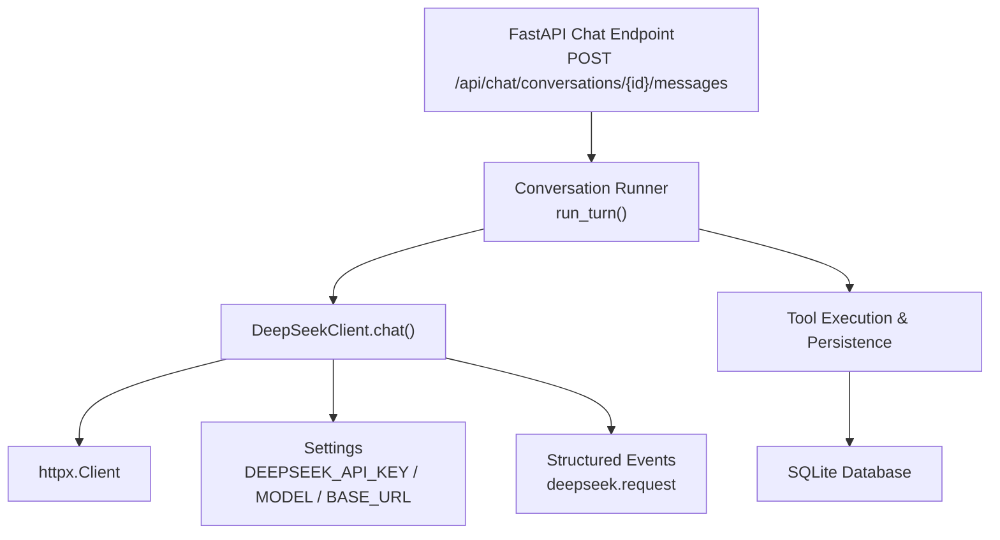
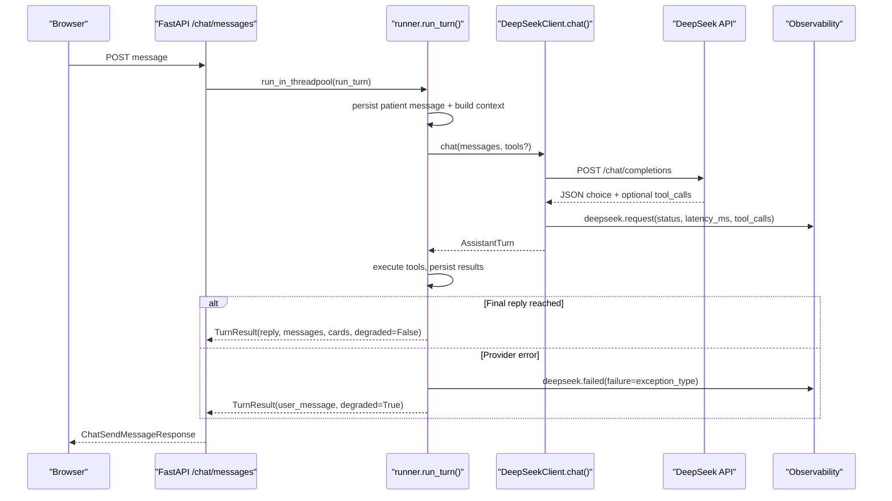
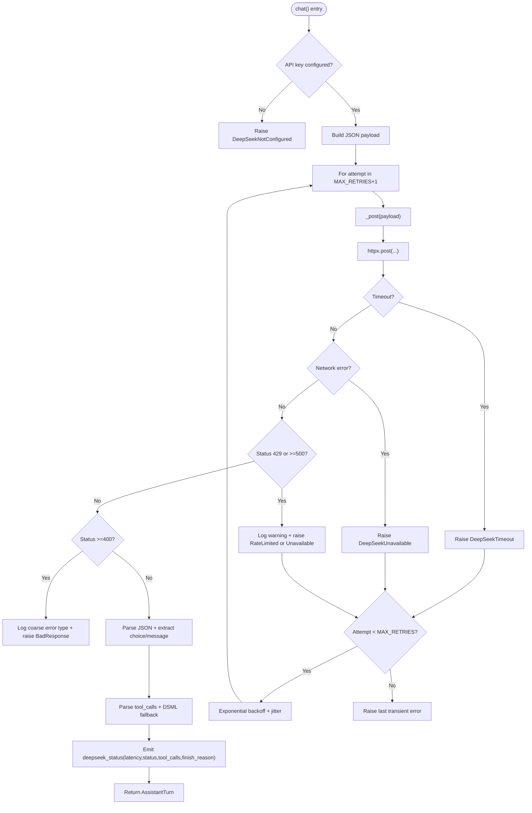
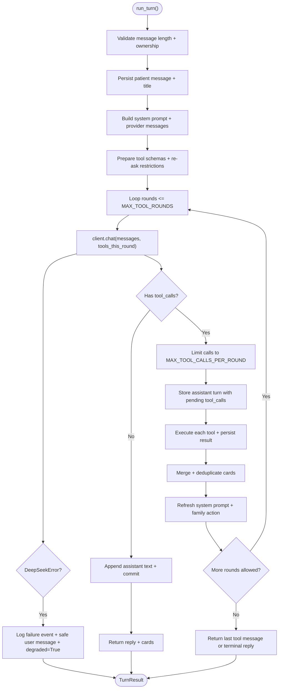
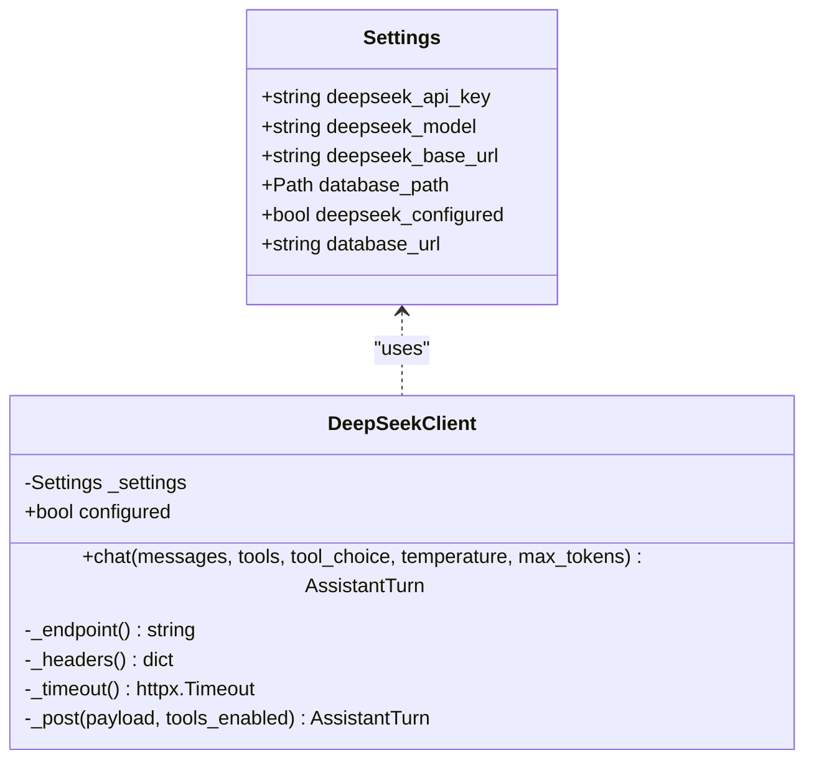
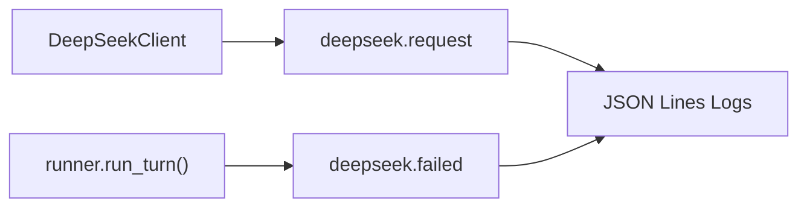
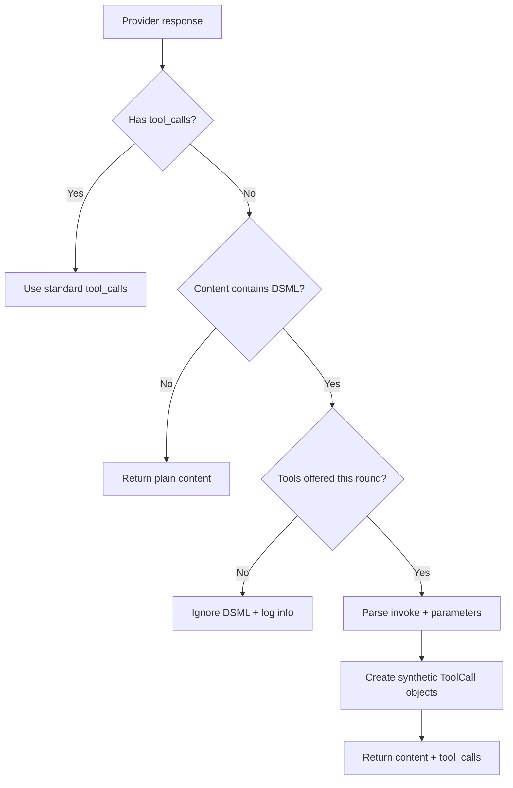
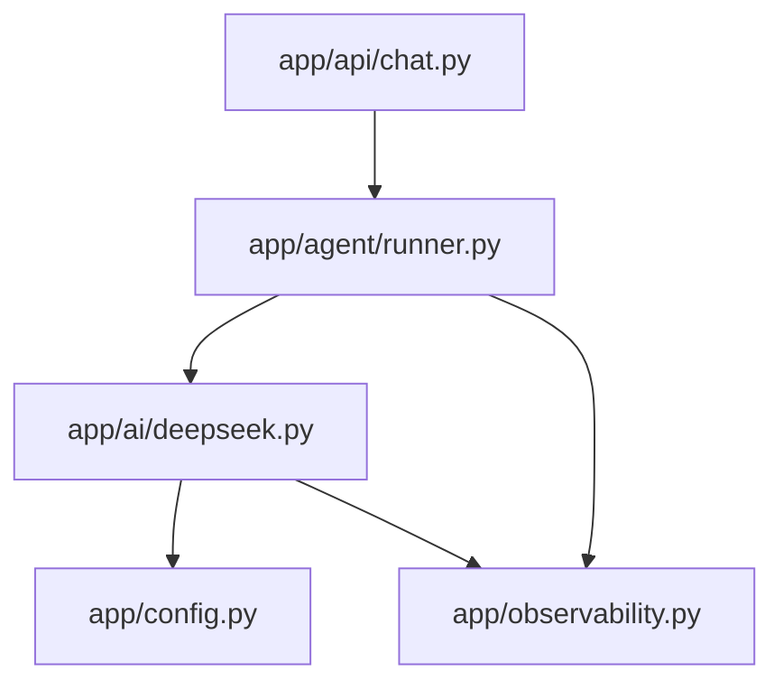

# DeepSeek API Integration

<cite>
**Referenced Files in This Document**
- [deepseek.py](file://backend/app/ai/deepseek.py)
- [config.py](file://backend/app/config.py)
- [chat.py](file://backend/app/api/chat.py)
- [runner.py](file://backend/app/agent/runner.py)
- [observability.py](file://backend/app/observability.py)
- [test_deepseek_dsml.py](file://backend/tests/test_deepseek_dsml.py)
</cite>

## Table of Contents
1. [Introduction](#introduction)
2. [Project Structure](#project-structure)
3. [Core Components](#core-components)
4. [Architecture Overview](#architecture-overview)
5. [Detailed Component Analysis](#detailed-component-analysis)
6. [Dependency Analysis](#dependency-analysis)
7. [Performance Considerations](#performance-considerations)
8. [Troubleshooting Guide](#troubleshooting-guide)
9. [Conclusion](#conclusion)

## Introduction
This document explains how the backend integrates with the DeepSeek chat-completions API to power patient conversations. It covers the client implementation, connection and timeout management, request/response serialization, retry logic, error handling, tool-call processing, configuration, observability, fallback behavior, and operational guidance.

The integration is intentionally conservative: it uses a small HTTP client wrapper, typed exceptions for provider failures, strict timeouts, bounded retries, structured logging without sensitive data, and a conversation runner that keeps state consistent even when the AI service fails.

## Project Structure
The DeepSeek integration lives primarily under `backend/app/ai`, is configured through `backend/app/config`, is invoked by the agent runner under `backend/app/agent`, and is exposed via the FastAPI chat endpoints under `backend/app/api`. Observability helpers live under `backend/app/observability`.

**Diagram sources**
- [chat.py:233-274](file://backend/app/api/chat.py#L233-L274)
- [runner.py:171-406](file://backend/app/agent/runner.py#L171-L406)
- [deepseek.py:178-328](file://backend/app/ai/deepseek.py#L178-L328)
- [config.py:27-84](file://backend/app/config.py#L27-L84)
- [observability.py:215-216](file://backend/app/observability.py#L215-L216)

**Section sources**
- [chat.py:1-47](file://backend/app/api/chat.py#L1-L47)
- [runner.py:1-55](file://backend/app/agent/runner.py#L1-L55)
- [deepseek.py:1-36](file://backend/app/ai/deepseek.py#L1-L36)
- [config.py:1-10](file://backend/app/config.py#L1-L10)
- [observability.py:1-30](file://backend/app/observability.py#L1-L30)

## Core Components
- **DeepSeekClient**: An OpenAI-compatible HTTP client for DeepSeek chat completions. It builds requests, manages timeouts, serializes tool calls, parses responses, handles transient errors with retries, and emits observability events.
- **AssistantTurn and ToolCall**: Normalized response models used by the runner to represent assistant text and tool invocations.
- **Settings**: Environment-driven configuration for the API key, model name, base URL, and database path.
- **Conversation Runner**: Orchestrates one turn of conversation, including prompt assembly, tool execution, persistence, and fallback messaging.
- **Observability**: Structured JSON logging with request IDs, event names, scrubbed fields, and latency/status metrics.

Key responsibilities:
- Connection management: per-call `httpx.Client` with explicit connect/read/write/total timeouts.
- Serialization: JSON payloads for messages, tools, and tool arguments; DSML markup parsing as a fallback.
- Error handling: typed exceptions (`DeepSeekTimeout`, `DeepSeekUnavailable`, `DeepSeekRateLimited`, `DeepSeekBadResponse`, `DeepSeekNotConfigured`) surfaced to callers.
- Retry strategy: exponential backoff with jitter for transient failures.
- Observability: latency, status code, tool call count, finish reason, and failure events.

**Section sources**
- [deepseek.py:38-98](file://backend/app/ai/deepseek.py#L38-L98)
- [deepseek.py:178-328](file://backend/app/ai/deepseek.py#L178-L328)
- [config.py:27-84](file://backend/app/config.py#L27-L84)
- [runner.py:124-130](file://backend/app/agent/runner.py#L124-L130)
- [observability.py:174-216](file://backend/app/observability.py#L174-L216)

## Architecture Overview
The end-to-end flow for a patient message is:

1. The FastAPI endpoint validates input and runs the synchronous runner off the event loop.
2. The runner persists the patient message, loads history, builds system prompt and provider messages, and prepares tool schemas.
3. The runner calls `DeepSeekClient.chat()` with messages and optional tools.
4. The client posts JSON to the configured DeepSeek endpoint, applies retries/backoff, and normalizes the response into an `AssistantTurn`.
5. The runner executes requested tools, persists results, and may call DeepSeek again until a final reply or a bounded limit is reached.
6. On provider failure, the runner catches typed exceptions, logs structured events, and returns a safe user-facing message marked as degraded.

**Diagram sources**
- [chat.py:233-274](file://backend/app/api/chat.py#L233-L274)
- [runner.py:171-406](file://backend/app/agent/runner.py#L171-L406)
- [deepseek.py:205-328](file://backend/app/ai/deepseek.py#L205-L328)
- [observability.py:215-216](file://backend/app/observability.py#L215-L216)

## Detailed Component Analysis

### DeepSeekClient: Connection, Timeouts, Retries, and Response Parsing
`DeepSeekClient` encapsulates all outbound communication with DeepSeek.

- **Configuration access**: Reads settings at call time; never exposes the API key.
- **Endpoint construction**: Appends `/chat/completions` to the configured base URL.
- **Headers**: Sets Authorization, Content-Type, and Accept.
- **Timeouts**: Uses separate connect, read, write, and total timeouts.
- **Request building**: Serializes model, messages, temperature, max_tokens, stream flag, and optional tools/tool_choice.
- **Retry loop**: Retries on timeout, network errors, rate limits (429), and server errors (5xx). Uses exponential backoff with jitter. Non-retryable 4xx errors are logged and raised as bad response errors.
- **Response normalization**: Parses choices, extracts content and tool_calls, supports DSML fallback only when tools were offered, and records observability metrics.

**Diagram sources**
- [deepseek.py:205-249](file://backend/app/ai/deepseek.py#L205-L249)
- [deepseek.py:251-328](file://backend/app/ai/deepseek.py#L251-L328)

Key behaviors:
- **Retries**: Up to two retries beyond the first attempt, with delay = base_delay × 2^attempt + random jitter.
- **Timeouts**: Connect 5s, read 45s, write 45s, total 60s.
- **Error classification**:
  - `DeepSeekTimeout`: HTTP timeout.
  - `DeepSeekUnavailable`: Network error or 5xx.
  - `DeepSeekRateLimited`: 429.
  - `DeepSeekBadResponse`: 4xx or unparseable body.
  - `DeepSeekNotConfigured`: Missing API key.
- **DSML fallback**: If the provider returns native DSML markup inside content rather than `tool_calls`, the client can parse it into synthetic tool calls, but only when tools were actually offered this round.

**Section sources**
- [deepseek.py:31-35](file://backend/app/ai/deepseek.py#L31-L35)
- [deepseek.py:38-64](file://backend/app/ai/deepseek.py#L38-L64)
- [deepseek.py:101-176](file://backend/app/ai/deepseek.py#L101-L176)
- [deepseek.py:178-328](file://backend/app/ai/deepseek.py#L178-L328)

### Conversation Runner: Tool Loop, Fallbacks, and Degraded Mode
The runner coordinates one assistant turn:

- Validates and bounds the patient message.
- Persists the incoming message and updates session activity.
- Builds system prompt and provider messages from history.
- Optionally restricts available tools for re-ask scenarios.
- Calls the DeepSeek client in a bounded loop up to `MAX_TOOL_ROUNDS`.
- Executes tool calls through validated services and persists results.
- Merges and deduplicates cards across rounds.
- Handles provider failures by returning a safe user message and marking the turn as degraded.
- Ensures emergency notices and card-only replies are handled consistently.

**Diagram sources**
- [runner.py:171-406](file://backend/app/agent/runner.py#L171-L406)
- [runner.py:409-557](file://backend/app/agent/runner.py#L409-L557)

Important details:
- **Bounded tool loops**: Prevents runaway provider round-trips.
- **Availability re-ask handling**: Restricts tools after a search has been dispatched or exhausted.
- **DSML safety**: Stops further provider rounds when tool calls came from DSML parsing to avoid invalid follow-up requests.
- **Fallback messaging**: Catches `DeepSeekError` and returns a friendly message while marking the turn as degraded.
- **Card lifecycle**: Cards are attached to the correct turn floor, merged across rounds, and deduplicated by identity.

**Section sources**
- [runner.py:51-55](file://backend/app/agent/runner.py#L51-L55)
- [runner.py:91-121](file://backend/app/agent/runner.py#L91-L121)
- [runner.py:171-406](file://backend/app/agent/runner.py#L171-L406)
- [runner.py:409-557](file://backend/app/agent/runner.py#L409-L557)

### Configuration and Authentication
Settings are loaded from environment variables with a minimal dotenv parser:

- `DEEPSEEK_API_KEY`: Required for AI features; presence determines whether the assistant is configured.
- `DEEPSEEK_MODEL`: Defaults to a specific model if not provided.
- `DEEPSEEK_BASE_URL`: Defaults to the official DeepSeek API base URL.
- `database_path`: SQLite file location.

Authentication is performed by adding a Bearer token header built from the API key. The key is read at call time and never returned to callers or logged.

**Diagram sources**
- [config.py:27-84](file://backend/app/config.py#L27-L84)
- [deepseek.py:178-203](file://backend/app/ai/deepseek.py#L178-L203)

**Section sources**
- [config.py:1-10](file://backend/app/config.py#L1-L10)
- [config.py:27-84](file://backend/app/config.py#L27-L84)
- [deepseek.py:190-195](file://backend/app/ai/deepseek.py#L190-L195)

### Streaming Responses and Real-Time Updates
The current client implementation does not use streaming:

- The request payload sets `stream=False`.
- The response is parsed as a complete JSON object.
- Real-time partial updates are not emitted over SSE or similar transport.

If real-time streaming is required later, the client would need to switch to streaming mode, parse incremental chunks, and propagate partial content and tool-call deltas to the runner and UI. That capability is not present in the current code.

**Section sources**
- [deepseek.py:217-223](file://backend/app/ai/deepseek.py#L217-L223)

### Circuit Breaker Pattern
There is no explicit circuit breaker implementation in the client or runner. Failures are handled by:

- Typed exceptions for different failure categories.
- A bounded retry loop with exponential backoff and jitter.
- Runner-level fallback messaging that marks turns as degraded.

A future enhancement could add a circuit breaker around `DeepSeekClient.chat()` to short-circuit calls during sustained outages, reduce load, and return cached or degraded responses more aggressively.

**Section sources**
- [deepseek.py:229-249](file://backend/app/ai/deepseek.py#L229-L249)
- [runner.py:264-292](file://backend/app/agent/runner.py#L264-L292)

### Rate Limiting and Cost Optimization
- **Rate limiting**: The client treats HTTP 429 as a transient error and retries with backoff. There is no application-side rate limiter or token bucket.
- **Cost optimization**:
  - Temperature and max_tokens are configurable parameters passed to the provider.
  - Tools are only sent when needed.
  - The runner bounds tool rounds and tool calls per round.
  - Prompt content is not logged, reducing accidental cost leakage through log retention.

Operational recommendations:
- Monitor 429 rates and adjust retry/backoff if needed.
- Tune `max_tokens` and temperature based on quality/cost trade-offs.
- Avoid sending unnecessary tools to reduce provider usage.

**Section sources**
- [deepseek.py:263-271](file://backend/app/ai/deepseek.py#L263-L271)
- [runner.py:51-53](file://backend/app/agent/runner.py#L51-L53)
- [deepseek.py:217-226](file://backend/app/ai/deepseek.py#L217-L226)

### Fallback Mechanisms and Graceful Degradation
When DeepSeek is unavailable or misconfigured:

- The runner catches `DeepSeekError` and returns a safe user-facing message.
- The turn is marked as `degraded=True`.
- The FastAPI endpoint includes the `degraded` flag in the response so the frontend can adapt UX.
- If the API key is missing, the endpoint logs a warning and still proceeds through the runner, which will surface a provider-specific user message.

Cached responses are not implemented. Graceful degradation relies on friendly fallback text and preserving conversation consistency.

**Section sources**
- [runner.py:264-292](file://backend/app/agent/runner.py#L264-L292)
- [chat.py:253-274](file://backend/app/api/chat.py#L253-L274)

### Monitoring and Observability
All provider interactions emit structured events:

- `deepseek.request`: Includes latency in milliseconds, HTTP status, number of tool calls, and finish reason.
- `deepseek.failed`: Emitted by the runner when a provider error occurs, including the exception type and conversation ID.
- Request IDs are propagated through structured logging and can be correlated across layers.

Logs are JSON lines with sensitive fields scrubbed. HTTPX access logs are downgraded to warnings to reduce noise.

**Diagram sources**
- [deepseek.py:316-322](file://backend/app/ai/deepseek.py#L316-L322)
- [runner.py:264-273](file://backend/app/agent/runner.py#L264-L273)
- [observability.py:174-216](file://backend/app/observability.py#L174-L216)

**Section sources**
- [observability.py:1-30](file://backend/app/observability.py#L1-L30)
- [observability.py:109-171](file://backend/app/observability.py#L109-L171)
- [observability.py:215-216](file://backend/app/observability.py#L215-L216)

### Tool Call Processing and DSML Fallback
The client supports both standard `tool_calls` and a DSML markup fallback:

- Standard tool calls are extracted from the response message.
- If the provider returns DSML invoke blocks inside content, the client parses them into synthetic tool calls.
- DSML parsing is only promoted when tools were offered in the current round; otherwise, the markup is ignored to avoid corrupting subsequent provider rounds.
- Tests verify that DSML tool calls are promoted only when tools are enabled.

**Diagram sources**
- [deepseek.py:291-315](file://backend/app/ai/deepseek.py#L291-L315)
- [test_deepseek_dsml.py:62-94](file://backend/tests/test_deepseek_dsml.py#L62-L94)

**Section sources**
- [deepseek.py:87-98](file://backend/app/ai/deepseek.py#L87-L98)
- [deepseek.py:101-176](file://backend/app/ai/deepseek.py#L101-L176)
- [deepseek.py:291-315](file://backend/app/ai/deepseek.py#L291-L315)
- [test_deepseek_dsml.py:62-94](file://backend/tests/test_deepseek_dsml.py#L62-L94)

## Dependency Analysis
The integration has clear layering:

- API layer depends on the runner.
- Runner depends on the DeepSeek client and domain services.
- DeepSeek client depends on configuration and observability.
- Observability is shared across components.

**Diagram sources**
- [chat.py:22-47](file://backend/app/api/chat.py#L22-L47)
- [runner.py:35-47](file://backend/app/agent/runner.py#L35-L47)
- [deepseek.py:24-27](file://backend/app/ai/deepseek.py#L24-L27)

Potential coupling concerns:
- The runner imports `DeepSeekClient` directly; injecting a test client is supported via the `client` parameter in `run_turn`.
- The client reads settings globally through `get_settings`; tests can pass a `Settings` instance to the client constructor.

**Section sources**
- [runner.py:171-180](file://backend/app/agent/runner.py#L171-L180)
- [deepseek.py:178-184](file://backend/app/ai/deepseek.py#L178-L184)

## Performance Considerations
- **Timeouts**: Strict connect/read/write/total timeouts prevent long-running requests from blocking workers.
- **Retries**: Exponential backoff reduces pressure on transiently failing providers.
- **Tool bounds**: Limits on rounds and calls per round prevent excessive provider usage.
- **Logging**: Sensitive data is scrubbed; HTTPX logs are downgraded to reduce I/O overhead.
- **Streaming**: Not currently used; switching to streaming would reduce perceived latency but requires additional infrastructure changes.

Recommendations:
- Monitor latency and error rates using the structured events.
- Adjust `max_tokens` and temperature based on observed quality and cost.
- Consider adding application-level rate limiting if upstream quotas are tight.
- Evaluate streaming if real-time feedback is critical for UX.

[No sources needed since this section provides general guidance]

## Troubleshooting Guide
Common issues and resolutions:

- **Missing API key**:
  - Symptom: Assistant indicates the online assistant is not configured.
  - Action: Set `DEEPSEEK_API_KEY` in the environment or `.env` file.
  - Evidence: `DeepSeekNotConfigured` is raised when the key is absent.

- **Timeouts**:
  - Symptom: User sees a “took longer than expected” message.
  - Action: Check network conditions, provider latency, and timeout constants.
  - Evidence: `DeepSeekTimeout` wraps `httpx.TimeoutException`.

- **Rate limits**:
  - Symptom: Requests fail with 429 and are retried with backoff.
  - Action: Reduce request volume or wait for quota recovery.
  - Evidence: `DeepSeekRateLimited` is raised for HTTP 429.

- **Server errors**:
  - Symptom: 5xx responses cause retries and eventual fallback.
  - Action: Monitor provider health and consider temporary feature disablement.
  - Evidence: `DeepSeekUnavailable` is raised for 5xx and network errors.

- **Malformed responses**:
  - Symptom: Provider returns unexpected JSON structure.
  - Action: Inspect provider version or deployment compatibility.
  - Evidence: `DeepSeekBadResponse` is raised for unparseable responses.

- **DSML tool calls not executing**:
  - Symptom: Tool calls appear only when tools are offered.
  - Action: Ensure tools are included in the request; DSML fallback is intentionally conditional.
  - Evidence: Tests assert promotion only when tools are enabled.

- **Observability correlation**:
  - Use `request_id` from structured logs to trace a single request across API, runner, client, and provider events.

**Section sources**
- [deepseek.py:44-64](file://backend/app/ai/deepseek.py#L44-L64)
- [deepseek.py:251-289](file://backend/app/ai/deepseek.py#L251-L289)
- [test_deepseek_dsml.py:62-94](file://backend/tests/test_deepseek_dsml.py#L62-L94)
- [observability.py:109-171](file://backend/app/observability.py#L109-L171)

## Conclusion
The DeepSeek integration is a focused, resilient client layered behind a robust conversation runner. It prioritizes safety, bounded retries, typed errors, and structured observability. While streaming and circuit breaking are not implemented, the current design provides strong fallback behavior, clear configuration, and actionable monitoring signals. Future enhancements should consider streaming responses, explicit circuit breaking, and application-level rate limiting to match evolving operational requirements.

[No sources needed since this section summarizes without analyzing specific files]