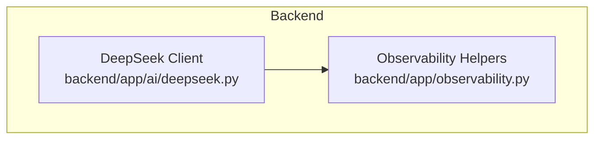
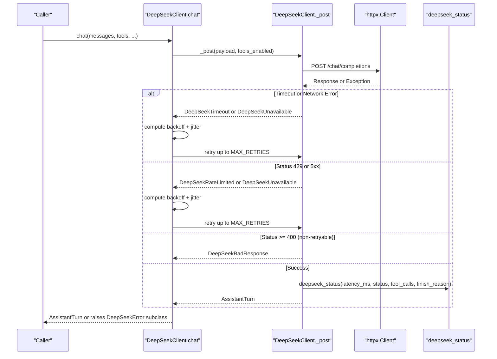
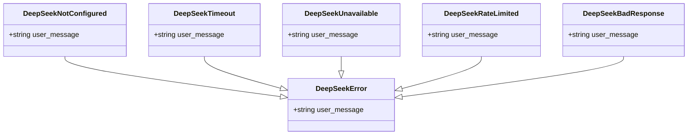
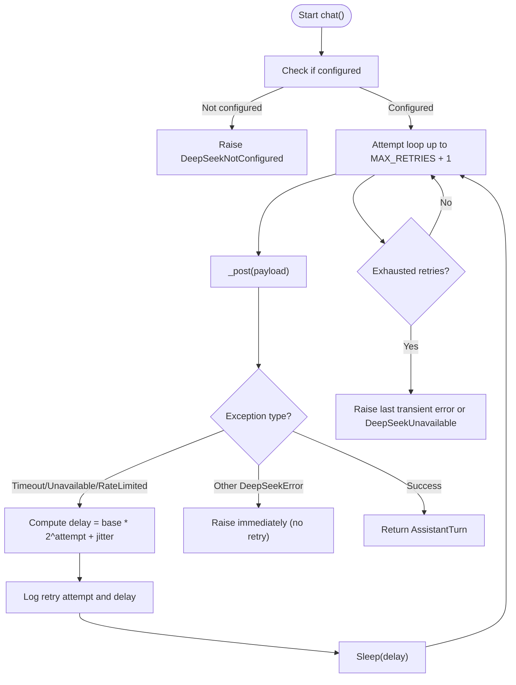
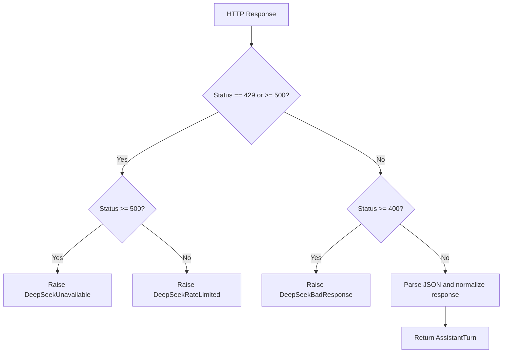
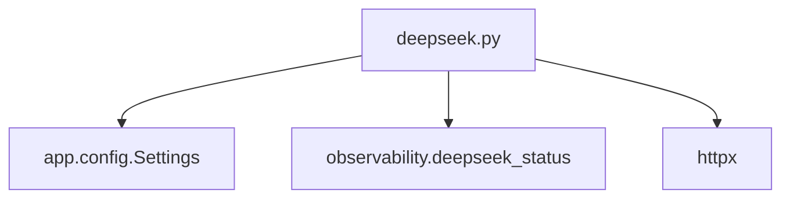

# Error Handling and Retry Logic

<cite>
**Referenced Files in This Document**
- [deepseek.py](file://backend/app/ai/deepseek.py)
- [observability.py](file://backend/app/observability.py)
</cite>

## Table of Contents
1. [Introduction](#introduction)
2. [Project Structure](#project-structure)
3. [Core Components](#core-components)
4. [Architecture Overview](#architecture-overview)
5. [Detailed Component Analysis](#detailed-component-analysis)
6. [Dependency Analysis](#dependency-analysis)
7. [Performance Considerations](#performance-considerations)
8. [Troubleshooting Guide](#troubleshooting-guide)
9. [Conclusion](#conclusion)

## Introduction
This document explains the error handling and retry mechanisms used by the DeepSeek integration. It focuses on the custom exception hierarchy, user-facing messages, exponential backoff with jitter, status code handling for transient and non-retryable errors, and the monitoring surface exposed through structured observability logs. The goal is to help developers and operators understand how failures are classified, retried, observed, and surfaced to users without leaking sensitive data.

## Project Structure
The DeepSeek integration lives under the backend application’s AI layer:
- Provider client and error model: `backend/app/ai/deepseek.py`
- Structured logging and metrics helper: `backend/app/observability.py`

**Diagram sources**
- [deepseek.py:1-30](file://backend/app/ai/deepseek.py#L1-L30)
- [observability.py:215-216](file://backend/app/observability.py#L215-L216)

**Section sources**
- [deepseek.py:1-30](file://backend/app/ai/deepseek.py#L1-L30)
- [observability.py:1-30](file://backend/app/observability.py#L1-L30)

## Core Components
- Custom exception hierarchy rooted at `DeepSeekError`, with typed subclasses for configuration, timeouts, unavailability, rate limiting, and bad responses. Each exception exposes a `user_message` intended for safe presentation to end users.
- `DeepSeekClient.chat` implements the retry loop with exponential backoff and jitter for transient failures.
- `_post` classifies HTTP responses into transient (retryable) and non-retryable categories, raising the appropriate exception type.
- Successful requests emit structured events via `deepseek_status` for observability.

Key constants:
- Timeouts: connect, read, total.
- Retries: maximum number of retries and base delay.
- Jitter: small random offset added to each retry delay.

**Section sources**
- [deepseek.py:31-35](file://backend/app/ai/deepseek.py#L31-L35)
- [deepseek.py:38-64](file://backend/app/ai/deepseek.py#L38-L64)
- [deepseek.py:205-249](file://backend/app/ai/deepseek.py#L205-L249)
- [deepseek.py:251-328](file://backend/app/ai/deepseek.py#L251-L328)

## Architecture Overview
The client performs an HTTP request to the DeepSeek-compatible endpoint, wraps transport-level exceptions into domain exceptions, classifies HTTP status codes, and applies a retry policy only for transient failures. On success, it emits a structured event containing latency, status, tool call count, and finish reason.

**Diagram sources**
- [deepseek.py:205-249](file://backend/app/ai/deepseek.py#L205-L249)
- [deepseek.py:251-328](file://backend/app/ai/deepseek.py#L251-L328)
- [observability.py:215-216](file://backend/app/observability.py#L215-L216)

## Detailed Component Analysis

### Exception Hierarchy and User-Facing Messages
The exception classes form a clear taxonomy that separates configuration issues from runtime failures and distinguishes transient from permanent problems.

User-facing messages:
- Base `DeepSeekError`: generic message indicating temporary difficulty reaching the scheduling system.
- `DeepSeekNotConfigured`: informs the user that the online assistant is not configured and offers an alternative path.
- `DeepSeekTimeout`: suggests retrying after a longer-than-expected response time.
- `DeepSeekUnavailable`: indicates connection trouble and advises trying again shortly.
- `DeepSeekRateLimited`: tells the user they are being throttled and should retry after a few seconds.
- `DeepSeekBadResponse`: conveys that something went wrong on the provider side and invites a retry.

These messages are designed to be safe for direct display to users and do not include internal details or sensitive data.

**Diagram sources**
- [deepseek.py:38-64](file://backend/app/ai/deepseek.py#L38-L64)

**Section sources**
- [deepseek.py:38-64](file://backend/app/ai/deepseek.py#L38-L64)

### Retry Strategy: Exponential Backoff with Jitter
The retry loop is implemented in `DeepSeekClient.chat`. It attempts the request once and then retries up to `MAX_RETRIES` times when transient exceptions occur.

Retry behavior:
- Maximum retries: `MAX_RETRIES = 2`, so there can be up to three total attempts (initial plus two retries).
- Base delay: `RETRY_BASE_DELAY_SECONDS = 0.6`.
- Exponential growth: delay grows as `base_delay * 2^attempt`.
- Jitter: adds a random value between 0 and 0.25 seconds to reduce thundering herd effects.
- Logging: each retry attempt logs the attempt number, exception type, and computed delay.

Transient exceptions that trigger retries:
- `DeepSeekTimeout`
- `DeepSeekUnavailable`
- `DeepSeekRateLimited`

Non-transient exceptions are raised immediately without retries:
- `DeepSeekNotConfigured`
- `DeepSeekBadResponse`
- Any other `DeepSeekError` subclass not explicitly caught for retry.

**Diagram sources**
- [deepseek.py:205-249](file://backend/app/ai/deepseek.py#L205-L249)

**Section sources**
- [deepseek.py:31-35](file://backend/app/ai/deepseek.py#L31-L35)
- [deepseek.py:205-249](file://backend/app/ai/deepseek.py#L205-L249)

### Status Code Handling and Circuit Breaker Pattern
The client classifies HTTP responses in `_post`:

- Transient (retryable):
  - 429 Too Many Requests: raise `DeepSeekRateLimited`.
  - 5xx Server Errors: raise `DeepSeekUnavailable`.
- Non-retryable (immediate failure):
  - 4xx client errors (e.g., 400, 401, 403, 422): raise `DeepSeekBadResponse`.
  - Other parsing or structural errors: raise `DeepSeekBadResponse`.

This classification acts like a circuit breaker for non-retryable errors: invalid input, authentication, authorization, or validation failures are surfaced immediately without retries, preventing wasted work and noisy logs.

Transport-level errors:
- `httpx.TimeoutException` becomes `DeepSeekTimeout`.
- Other `httpx.HTTPError` becomes `DeepSeekUnavailable`.

**Diagram sources**
- [deepseek.py:251-296](file://backend/app/ai/deepseek.py#L251-L296)

**Section sources**
- [deepseek.py:251-296](file://backend/app/ai/deepseek.py#L251-L296)

### Observability and Monitoring Surface
On successful completion, the client emits a structured event using `deepseek_status`. This event includes:
- Latency in milliseconds
- HTTP status code
- Number of tool calls
- Finish reason

The observability module provides:
- A JSON line formatter that scrubs sensitive fields.
- Request correlation via `request_id`.
- Domain event helpers, including `deepseek_status`.

Operators can monitor:
- Retry rates by correlating warning logs emitted during retries with request IDs.
- Error patterns by filtering for `deepseek.request` events and analyzing status distributions.
- Latency percentiles from the recorded `latency_ms`.

**Diagram sources**
- [deepseek.py:316-322](file://backend/app/ai/deepseek.py#L316-L322)
- [observability.py:215-216](file://backend/app/observability.py#L215-L216)
- [observability.py:109-141](file://backend/app/observability.py#L109-L141)

**Section sources**
- [deepseek.py:316-322](file://backend/app/ai/deepseek.py#L316-L322)
- [observability.py:109-141](file://backend/app/observability.py#L109-L141)
- [observability.py:215-216](file://backend/app/observability.py#L215-L216)

## Dependency Analysis
The DeepSeek client depends on:
- HTTPX for network I/O and timeout handling.
- Application settings for API key, base URL, and model selection.
- Observability helpers for structured logging.

**Diagram sources**
- [deepseek.py:24-27](file://backend/app/ai/deepseek.py#L24-L27)
- [deepseek.py:251-259](file://backend/app/ai/deepseek.py#L251-L259)
- [observability.py:215-216](file://backend/app/observability.py#L215-L216)

**Section sources**
- [deepseek.py:24-27](file://backend/app/ai/deepseek.py#L24-L27)
- [deepseek.py:251-259](file://backend/app/ai/deepseek.py#L251-L259)

## Performance Considerations
- Timeouts are strict: connect, read, and total timeouts prevent long-running requests from blocking resources.
- Retries use exponential backoff with jitter to avoid synchronized bursts and reduce load on the provider during outages.
- Only transient errors are retried; non-retryable errors fail fast to minimize unnecessary work.
- Successful responses emit lightweight structured metrics without payload bodies, keeping overhead low.

[No sources needed since this section provides general guidance]

## Troubleshooting Guide

Common scenarios and recommended actions:

- Configuration missing:
  - Symptom: Immediate `DeepSeekNotConfigured`.
  - Action: Ensure the DeepSeek API key and base URL are configured before invoking the client.

- Rate limiting:
  - Symptom: 429 responses leading to `DeepSeekRateLimited`.
  - Action: Allow retries with backoff and jitter. If persistent, consider reducing request rate or negotiating higher quotas.

- Server errors:
  - Symptom: 5xx responses leading to `DeepSeekUnavailable`.
  - Action: Rely on retries. Monitor error rates and provider health. Investigate sustained outages.

- Timeouts:
  - Symptom: `DeepSeekTimeout` due to connect/read/total timeouts.
  - Action: Check network conditions and provider latency. Tune timeout constants if necessary.

- Bad requests or validation failures:
  - Symptom: 400/401/403/422 leading to `DeepSeekBadResponse`.
  - Action: Fix input validation, authentication, or authorization issues. These are not retried.

- Unparseable responses:
  - Symptom: `DeepSeekBadResponse` for malformed JSON or unexpected structure.
  - Action: Inspect provider compatibility and version changes. Avoid logging raw payloads.

Monitoring strategies:
- Track `deepseek.request` events to analyze status distribution, latency, and tool usage.
- Correlate retry warnings with request IDs to measure retry frequency per request.
- Alert on elevated rates of `DeepSeekRateLimited` or `DeepSeekUnavailable`.
- Use structured logs to detect spikes in 4xx vs 5xx errors and identify non-retryable patterns.

**Section sources**
- [deepseek.py:230-249](file://backend/app/ai/deepseek.py#L230-L249)
- [deepseek.py:251-296](file://backend/app/ai/deepseek.py#L251-L296)
- [observability.py:215-216](file://backend/app/observability.py#L215-L216)

## Conclusion
The DeepSeek integration uses a focused, robust error model and a conservative retry strategy. Transient failures are retried with exponential backoff and jitter, while non-retryable errors fail fast. Structured observability enables effective monitoring of latency, status codes, and error patterns without exposing sensitive data. Operators should focus on tracking retry rates, error distributions, and latency percentiles to maintain reliability and responsiveness.

[No sources needed since this section summarizes without analyzing specific files]