# LangGraph Orchestration System

<cite>
**Referenced Files in This Document**
- [README.md](file://README.md)
- [main.py](file://backend/app/main.py)
- [chat.py](file://backend/app/api/chat.py)
- [graph.py](file://backend/app/agent/graph.py)
- [runner.py](file://backend/app/agent/runner.py)
- [tools/__init__.py](file://backend/app/agent/tools/__init__.py)
- [kernel.py](file://backend/app/agent/tools/kernel.py)
- [conversations.py](file://backend/app/services/conversations.py)
- [scheduling.py](file://backend/app/services/scheduling.py)
- [conversations_model.py](file://backend/app/models/conversations.py)
</cite>

## Table of Contents
1. [Introduction](#introduction)
2. [Project Structure](#project-structure)
3. [Core Components](#core-components)
4. [Architecture Overview](#architecture-overview)
5. [Detailed Component Analysis](#detailed-component-analysis)
6. [Dependency Analysis](#dependency-analysis)
7. [Performance Considerations](#performance-considerations)
8. [Troubleshooting Guide](#troubleshooting-guide)
9. [Conclusion](#conclusion)

## Introduction
This document explains the LangGraph orchestration system that powers the patient-facing receptionist agent. The system is a bounded, turn-based workflow: each patient message becomes one request that validates input, builds conversation history, asks the model to interpret intent and optionally call tools, executes those tools through deterministic services, and finalizes a reply with structured UI cards.

The design keeps language understanding separate from state mutation. DeepSeek selects tools and prose; Python and SQLite own identity, scheduling, authorization, transactions, and every state change. A compiled LangGraph `StateGraph` drives the turn without a checkpointer because SQLite is the authoritative source for conversations, proposals, and availability.

## Project Structure
At runtime, the FastAPI application mounts health, clinic, demo, chat, scheduling, and staff routers. For patient chat, the HTTP layer resolves an opaque session token, loads the session-owned conversation, persists the incoming message, and delegates to the agent runner. The runner assembles request-scoped dependencies and invokes the compiled graph.

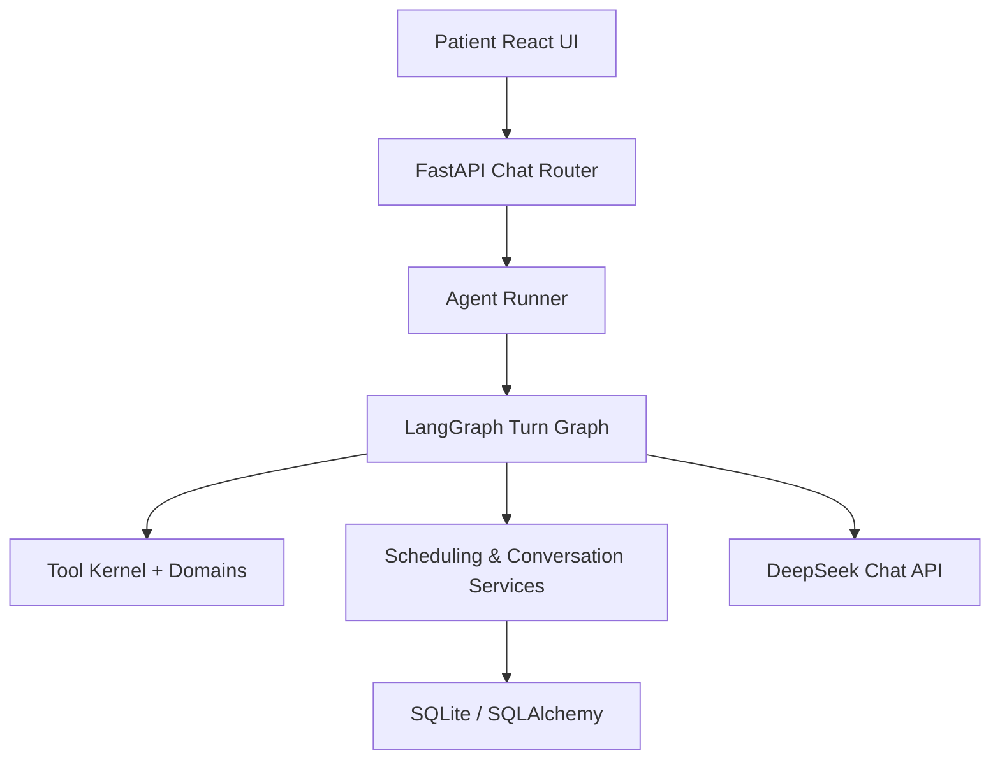

**Diagram sources**
- [main.py:202-252](file://backend/app/main.py#L202-L252)
- [chat.py:233-274](file://backend/app/api/chat.py#L233-L274)
- [runner.py:39-93](file://backend/app/agent/runner.py#L39-L93)
- [graph.py:466-490](file://backend/app/agent/graph.py#L466-L490)

**Section sources**
- [README.md:44-57](file://README.md#L44-L57)
- [main.py:202-252](file://backend/app/main.py#L202-L252)

## Core Components
- **FastAPI application**: configures logging, CORS, error handling, and routes.
- **Chat router**: owns session lifecycle, conversation restoration, message sending, feedback, and reset behavior.
- **Agent runner**: public entry point for one turn, including validation, dependency assembly, failure handling, and degraded-mode replies.
- **LangGraph turn graph**: defines ingest, model round, tool execution, and finalize nodes plus routing logic.
- **Tool kernel and registry**: validates arguments, enforces verification policy, truncates results safely, and dispatches handlers.
- **Conversation service**: persists messages, reconstructs provider-compatible history, and projects client-safe output.
- **Scheduling service**: orchestrates availability, proposals, holds, family plans, and card construction.
- **Conversation models**: define threads, messages, feedback, and metadata columns used by the replay pipeline.

**Section sources**
- [main.py:202-252](file://backend/app/main.py#L202-L252)
- [chat.py:111-347](file://backend/app/api/chat.py#L111-L347)
- [runner.py:31-93](file://backend/app/agent/runner.py#L31-L93)
- [graph.py:84-124](file://backend/app/agent/graph.py#L84-L124)
- [kernel.py:59-143](file://backend/app/agent/tools/kernel.py#L59-L143)
- [conversations.py:41-348](file://backend/app/services/conversations.py#L41-L348)
- [scheduling.py:69-295](file://backend/app/services/scheduling.py#L69-L295)
- [conversations_model.py:39-158](file://backend/app/models/conversations.py#L39-L158)

## Architecture Overview
The turn graph follows a small, explicit control flow:

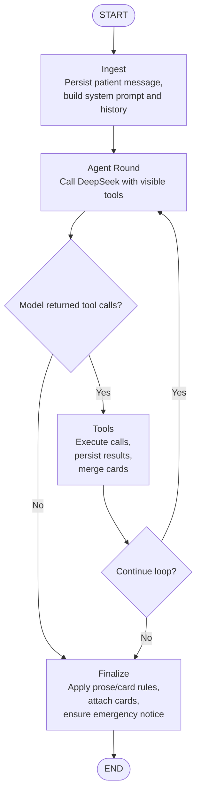

**Diagram sources**
- [graph.py:131-450](file://backend/app/agent/graph.py#L131-L450)
- [graph.py:458-490](file://backend/app/agent/graph.py#L458-L490)

The system separates concerns clearly:
- The HTTP layer handles sessions, authorization, and response shaping.
- The runner owns turn boundaries and failure recovery.
- The graph owns orchestration and model interaction.
- Tools execute validated business operations.
- Services own scheduling, availability, proposals, and persistence.
- Models define the relational schema.

**Section sources**
- [README.md:44-57](file://README.md#L44-L57)
- [graph.py:1-29](file://backend/app/agent/graph.py#L1-L29)

## Detailed Component Analysis

### FastAPI Application Factory
The application factory configures observability middleware, CORS, exception handlers, and route inclusion. It logs configuration presence without secrets, attaches request IDs, measures duration, and converts database exceptions into stable JSON responses.

Key responsibilities:
- Create and return the FastAPI instance.
- Install request context, timing, and structured logging.
- Map HTTP errors to user-safe codes and include request IDs.
- Handle SQLite operational and integrity errors gracefully.
- Mount health, clinic, demo, chat, scheduling, and staff routers.

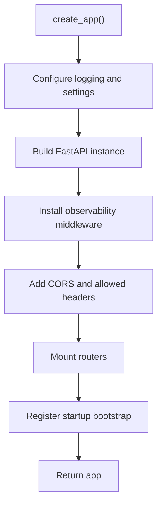

**Diagram sources**
- [main.py:202-252](file://backend/app/main.py#L202-L252)

**Section sources**
- [main.py:35-108](file://backend/app/main.py#L35-L108)
- [main.py:110-179](file://backend/app/main.py#L110-L179)
- [main.py:202-252](file://backend/app/main.py#L202-L252)

### Patient Chat Router
The chat router exposes session creation, conversation listing, conversation restoration, message sending, feedback submission, and in-session reset. It ensures every conversation lookup is scoped to the authenticated patient session and runs the blocking agent turn off the event loop.

Important behaviors:
- Session start creates an opaque token and either resumes or creates a thread.
- Message send validates text length, loads the session-scoped conversation, and returns the assistant reply, visible messages, cards, and degradation flag.
- Restoration replays live proposal state so held or booked cards reconcile with SQLite.
- Feedback updates an existing rating row and trims optional reasons.

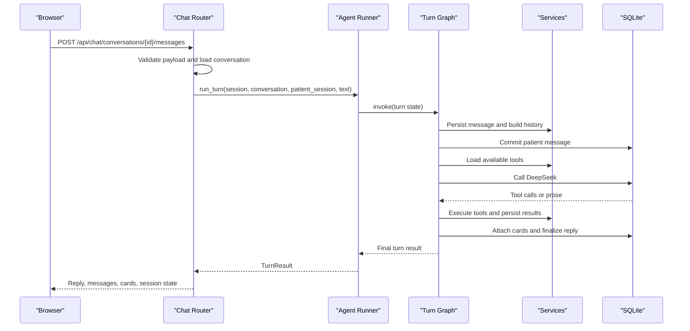

**Diagram sources**
- [chat.py:233-274](file://backend/app/api/chat.py#L233-L274)
- [runner.py:39-93](file://backend/app/agent/runner.py#L39-L93)
- [graph.py:131-450](file://backend/app/agent/graph.py#L131-L450)

**Section sources**
- [chat.py:54-99](file://backend/app/api/chat.py#L54-L99)
- [chat.py:111-163](file://backend/app/api/chat.py#L111-L163)
- [chat.py:207-274](file://backend/app/api/chat.py#L207-L274)
- [chat.py:277-347](file://backend/app/api/chat.py#L277-L347)

### Agent Runner
The runner is the boundary between HTTP and LangGraph. It validates input size, enforces conversation ownership, constructs `TurnDeps`, invokes the compiled graph, and handles both provider failures and unexpected exceptions without leaving half-written turns.

Key properties:
- Empty input returns a safe fallback reply.
- Long input is truncated before processing.
- DeepSeek failures are logged without sensitive payloads and return a degraded result.
- Unexpected exceptions roll back the session and return a friendly fallback.

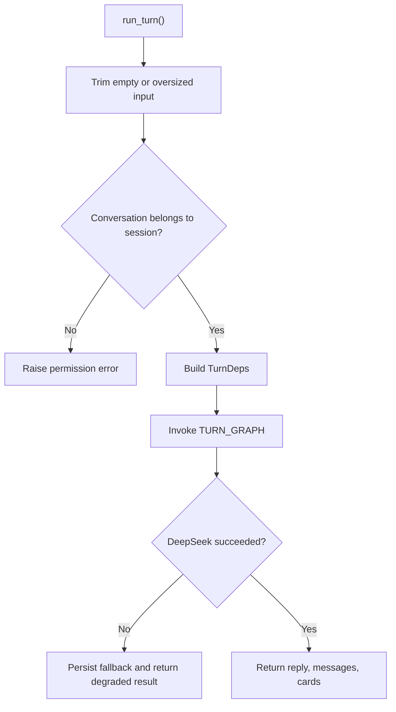

**Diagram sources**
- [runner.py:39-93](file://backend/app/agent/runner.py#L39-L93)

**Section sources**
- [runner.py:31-93](file://backend/app/agent/runner.py#L31-L93)
- [runner.py:96-147](file://backend/app/agent/runner.py#L96-L147)

### LangGraph Turn Graph
The graph defines four nodes and two conditional edges. It intentionally avoids a checkpointer because SQLite is the single source of truth for conversation state.

Node responsibilities:
- **ingest**: persist the patient message, refresh the session, build system prompt and provider messages, detect re-ask mode, and initialize turn state.
- **agent**: call DeepSeek with visible tools, record assistant messages and tool calls, and decide whether to continue looping.
- **tools**: execute calls via the kernel, persist tool results, merge cards, refresh system prompt after mid-turn verification, and enforce round limits.
- **finalize**: apply prose and card formatting rules, attach cards to the correct turn floor, settle superseded grids, ensure emergency notices, and handle empty outcomes.

Routing:
- After the agent node, go to tools if there are tool calls; otherwise finalize.
- After tools, go back to agent if the loop should continue; otherwise finalize.

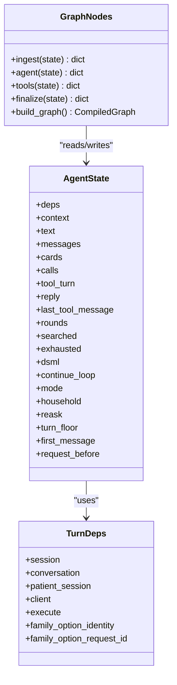

**Diagram sources**
- [graph.py:84-124](file://backend/app/agent/graph.py#L84-L124)
- [graph.py:131-450](file://backend/app/agent/graph.py#L131-L450)
- [graph.py:466-490](file://backend/app/agent/graph.py#L466-L490)

**Section sources**
- [graph.py:1-29](file://backend/app/agent/graph.py#L1-L29)
- [graph.py:131-187](file://backend/app/agent/graph.py#L131-L187)
- [graph.py:190-238](file://backend/app/agent/graph.py#L190-L238)
- [graph.py:241-324](file://backend/app/agent/graph.py#L241-L324)
- [graph.py:327-450](file://backend/app/agent/graph.py#L327-L450)
- [graph.py:458-490](file://backend/app/agent/graph.py#L458-L490)

### Tool Kernel and Registry
The tool kernel defines the contract every tool must follow. Tools receive JSON arguments from the model, validate them with Pydantic, and return structured results. Identity is never taken from model arguments; it comes from `ToolContext`, which is built from the authenticated session.

Key concepts:
- `ToolContext` carries request-scoped session, patient session, and conversation information.
- `ToolArguments` forbids extra fields to reject hallucinated parameters.
- `ToolSpec` describes name, description, argument schema, handler, result policy, domain, mutation flag, and verification requirement.
- `ToolRegistry` provides immutable, name-addressable access and fails loudly on duplicate names.
- Result trimming preserves decision fields and interactive cards while dropping secondary detail when payloads exceed limits.

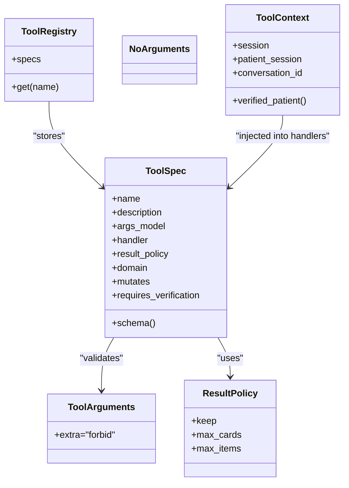

**Diagram sources**
- [kernel.py:59-143](file://backend/app/agent/tools/kernel.py#L59-L143)
- [kernel.py:189-209](file://backend/app/agent/tools/kernel.py#L189-L209)

**Section sources**
- [tools/__init__.py:1-57](file://backend/app/agent/tools/__init__.py#L1-L57)
- [kernel.py:1-18](file://backend/app/agent/tools/kernel.py#L1-L18)
- [kernel.py:59-143](file://backend/app/agent/tools/kernel.py#L59-L143)
- [kernel.py:146-182](file://backend/app/agent/tools/kernel.py#L146-L182)
- [kernel.py:189-209](file://backend/app/agent/tools/kernel.py#L189-L209)

### Conversation Service
The conversation service persists the full provider-compatible transcript and projects client-safe output. Every turn stores patient messages, assistant messages, and tool results so the model can be replayed exactly as it happened.

Important behaviors:
- Conversations are created with a generation value that invalidates stale browser state.
- Messages are appended with sequence numbers and timestamps.
- Assistant turns may carry `tool_calls` and UI `cards`.
- History reconstruction pairs assistant tool calls with their tool results.
- Public projections strip internal metadata and sanitize family-action hints.

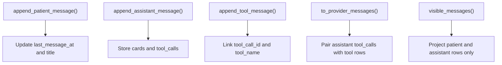

**Diagram sources**
- [conversations.py:147-244](file://backend/app/services/conversations.py#L147-L244)
- [conversations.py:267-348](file://backend/app/services/conversations.py#L267-L348)

**Section sources**
- [conversations.py:41-120](file://backend/app/services/conversations.py#L41-L120)
- [conversations.py:147-244](file://backend/app/services/conversations.py#L147-L244)
- [conversations.py:247-348](file://backend/app/services/conversations.py#L247-L348)

### Scheduling Service
The scheduling service is the deterministic workflow layer behind availability searches, slot cards, family options, proposals, holds, and confirmations. It returns plain dicts carrying `cards` for the UI and never trusts model-supplied identity.

Key responsibilities:
- Resolve appointment types and date preferences.
- Compute booking scope and prevent duplicate visits where required.
- Search availability and construct slot cards.
- Build family option cards for coordinated multi-person plans.
- Remember and revise the canonical scheduling request per conversation.
- Reconcile pending proposals and settled grids for refresh paths.

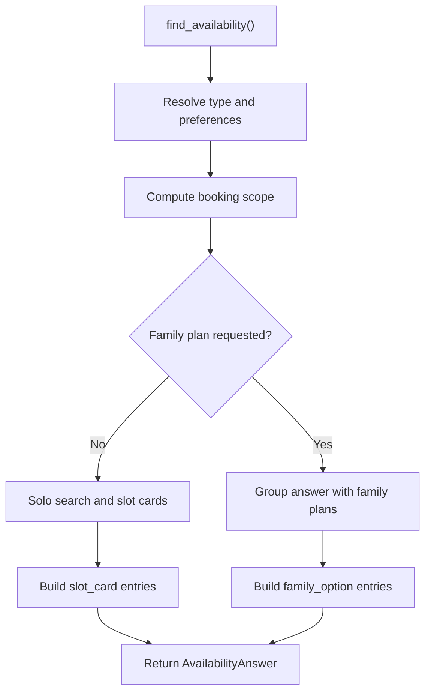

**Diagram sources**
- [scheduling.py:393-716](file://backend/app/services/scheduling.py#L393-L716)
- [scheduling.py:719-792](file://backend/app/services/scheduling.py#L719-L792)
- [scheduling.py:238-295](file://backend/app/services/scheduling.py#L238-L295)

**Section sources**
- [scheduling.py:1-12](file://backend/app/services/scheduling.py#L1-L12)
- [scheduling.py:69-191](file://backend/app/services/scheduling.py#L69-L191)
- [scheduling.py:238-295](file://backend/app/services/scheduling.py#L238-L295)
- [scheduling.py:393-716](file://backend/app/services/scheduling.py#L393-L716)
- [scheduling.py:719-792](file://backend/app/services/scheduling.py#L719-L792)

### Conversation Models
The models define the relational backbone for conversations, messages, and feedback. They support full-thread replay, indexed lookups, and JSON metadata for provider-facing bookkeeping.

Highlights:
- `Conversation` links to a patient session, tracks status, generation, and scheduling request state.
- `Message` stores role, content, sequence, timestamps, tool metadata, and UI cards.
- `ConversationFeedback` records one rating per assistant message.

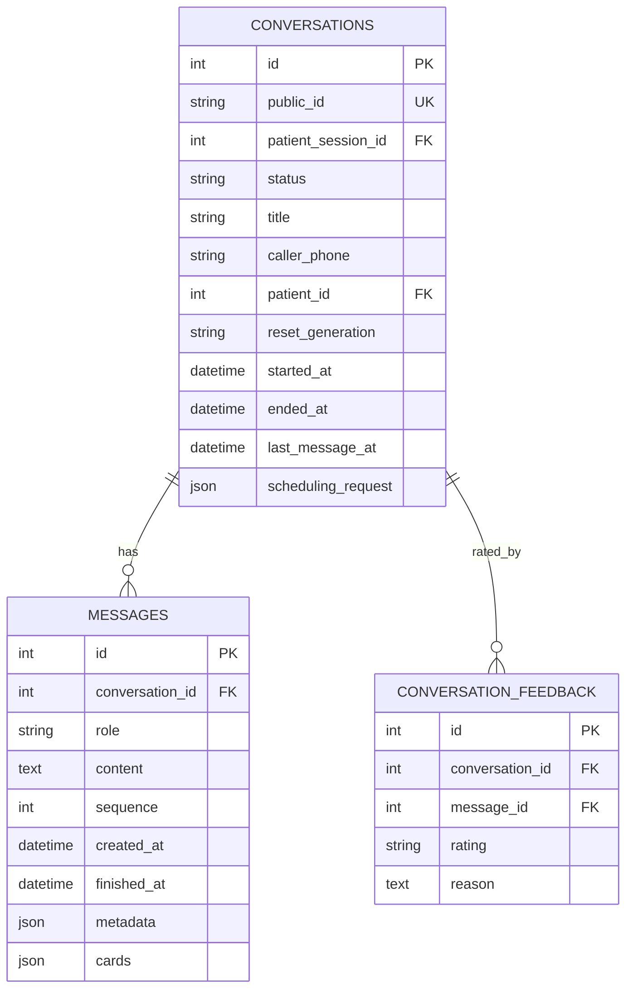

**Diagram sources**
- [conversations_model.py:39-158](file://backend/app/models/conversations.py#L39-L158)

**Section sources**
- [conversations_model.py:39-158](file://backend/app/models/conversations.py#L39-L158)

## Dependency Analysis
The orchestration has clear directional dependencies:

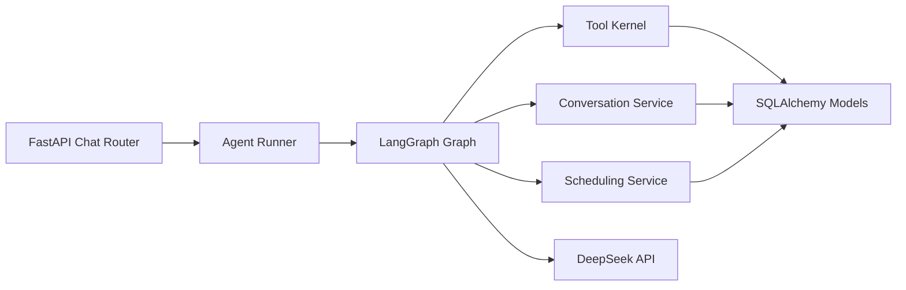

**Diagram sources**
- [chat.py:233-274](file://backend/app/api/chat.py#L233-L274)
- [runner.py:39-93](file://backend/app/agent/runner.py#L39-L93)
- [graph.py:466-490](file://backend/app/agent/graph.py#L466-L490)
- [kernel.py:189-209](file://backend/app/agent/tools/kernel.py#L189-L209)
- [conversations.py:247-348](file://backend/app/services/conversations.py#L247-L348)
- [scheduling.py:393-716](file://backend/app/services/scheduling.py#L393-L716)

Coupling and cohesion observations:
- The HTTP layer depends only on the runner and services; it does not implement scheduling logic.
- The graph depends on the tool kernel and services but does not import domain modules directly.
- The tool kernel is independent of the catalogue and domains, avoiding circular imports.
- Services depend on models and other services but keep business rules centralized.
- External dependencies are limited to DeepSeek and SQLite/SQLAlchemy.

Potential risks:
- Large tool results require careful trimming to avoid losing actionable cards.
- Full-thread replay increases memory and provider payload size over long conversations.
- Blocking SQLite and network calls are moved off the event loop, but concurrency still shares the same database connection pool.

**Section sources**
- [kernel.py:146-182](file://backend/app/agent/tools/kernel.py#L146-L182)
- [README.md:117-130](file://README.md#L117-L130)

## Performance Considerations
- **Bounded tool rounds**: The graph limits tool-call rounds and calls per round to prevent runaway loops.
- **Result trimming**: Tool results are trimmed to preserve decision fields and cards while reducing payload size.
- **Threadpool execution**: The chat endpoint runs the synchronous agent turn off the event loop.
- **Full-thread replay**: History is not summarized, improving fidelity at the cost of larger prompts.
- **SQLite WAL and constraints**: Atomicity and overlap protection reduce expensive conflict resolution downstream.
- **Card deduplication and merging**: Prevents redundant UI rendering and repeated offers.

Recommendations:
- Monitor DeepSeek latency and error rates separately from database latency.
- Track tool round counts and result sizes to tune bounds.
- Keep conversation lists paginated and avoid loading extremely long histories unnecessarily.
- Use the existing degraded path to protect responsiveness when the model is unavailable.

[No sources needed since this section provides general guidance]

## Troubleshooting Guide
Common issues and their signals:

- **Empty or too-long patient message**: The runner returns a safe fallback reply and marks the turn degraded.
- **Conversation not found in session**: The chat router raises a not-found error because reads are scoped to the patient session.
- **DeepSeek failure**: The runner logs the failure type without sensitive payloads and returns a degraded reply with restored messages.
- **Database busy**: FastAPI returns a 503 with a retry hint and a stable error code.
- **Integrity conflict**: FastAPI returns a 409 conflict so clients refetch instead of assuming success.
- **Stale or superseded cards**: The finalize and restore paths settle grids and reconcile pending proposals against SQLite.
- **Emergency handoff without acknowledgment**: The finalize node adds an explicit front-desk notice when an emergency-style alert is present.

Operational tips:
- Use the request ID included in error responses to correlate logs.
- Refresh a conversation to reconcile UI cards with database state.
- Reset within a session to close active threads while keeping verification.
- Run the backend tests and e2e script to validate registration, booking, rescheduling, family planning, and emergency triage scenarios.

**Section sources**
- [runner.py:49-93](file://backend/app/agent/runner.py#L49-L93)
- [chat.py:101-108](file://backend/app/api/chat.py#L101-L108)
- [main.py:124-179](file://backend/app/main.py#L124-L179)
- [graph.py:594-621](file://backend/app/agent/graph.py#L594-L621)
- [README.md:121-130](file://README.md#L121-L130)

## Conclusion
The LangGraph orchestration system is a deliberately small, deterministic workflow layered on top of FastAPI, SQLite, and a DeepSeek-compatible model. Its strength lies in separating language interpretation from state mutation: the model chooses tools and prose, while Python and SQLite enforce identity, scheduling rules, atomicity, and recoverable failure. The turn graph’s bounded loops, result trimming, card reconciliation, and explicit finalize step make the system predictable, testable, and suitable for a receptionist workflow where correctness matters more than AI capability alone.

[No sources needed since this section summarizes without analyzing specific files]