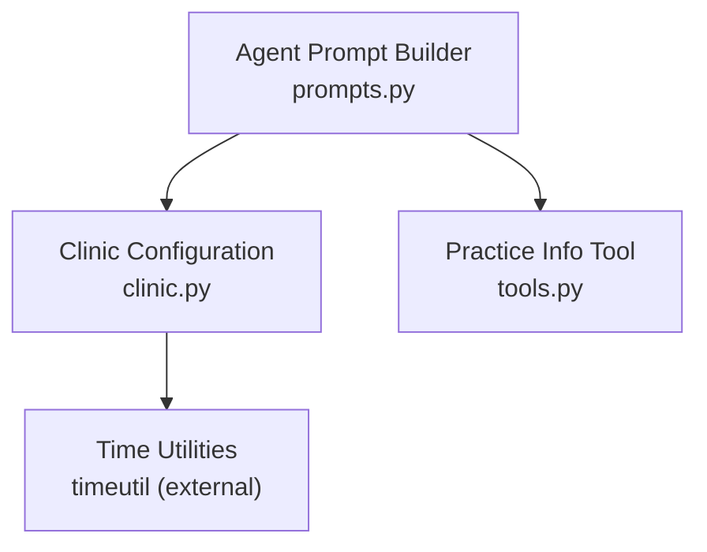
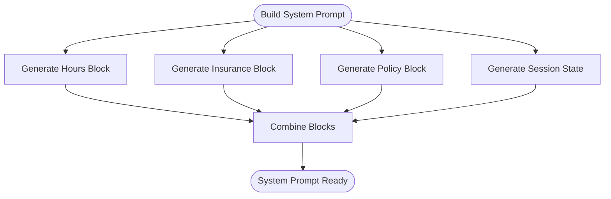
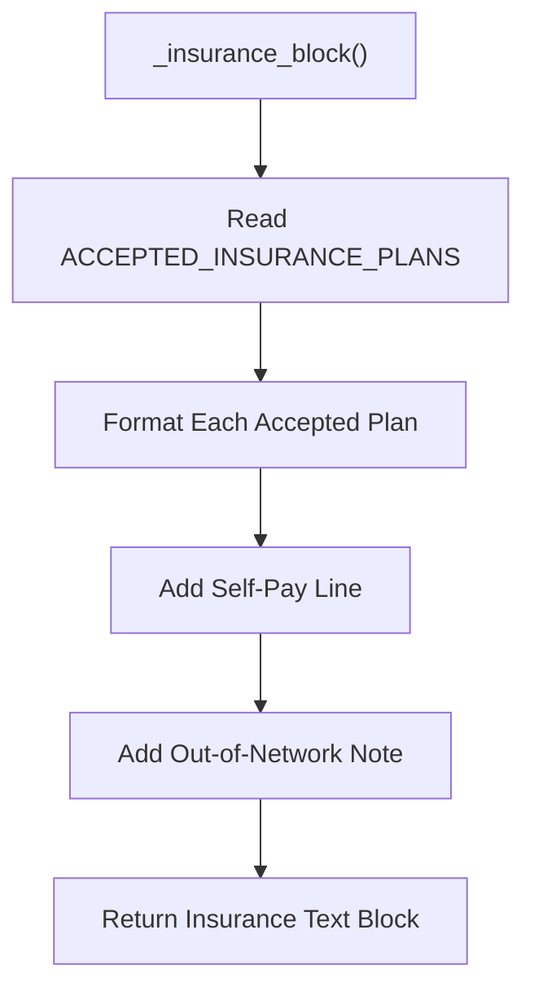
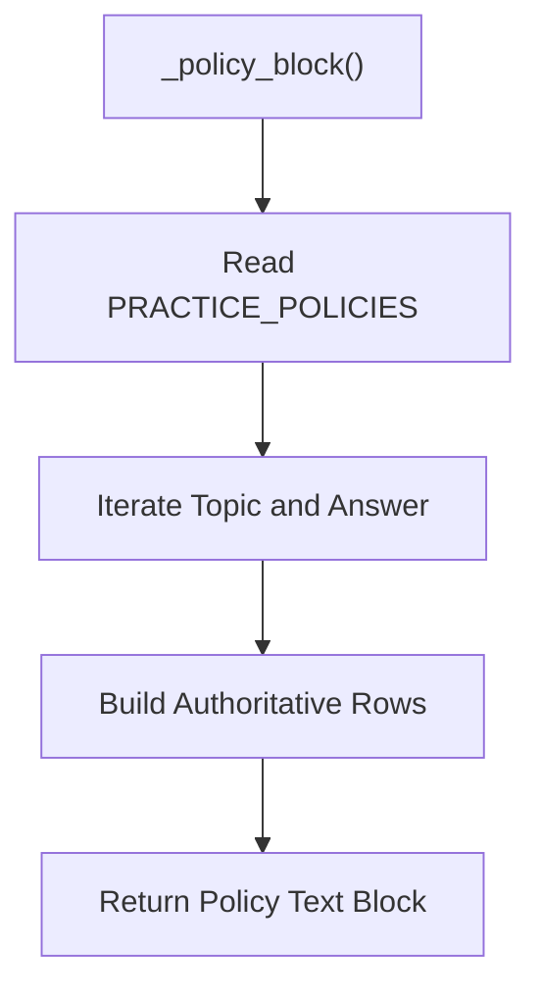
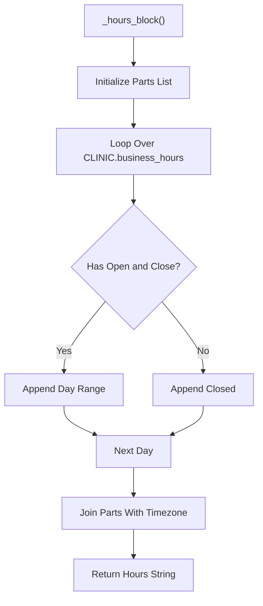
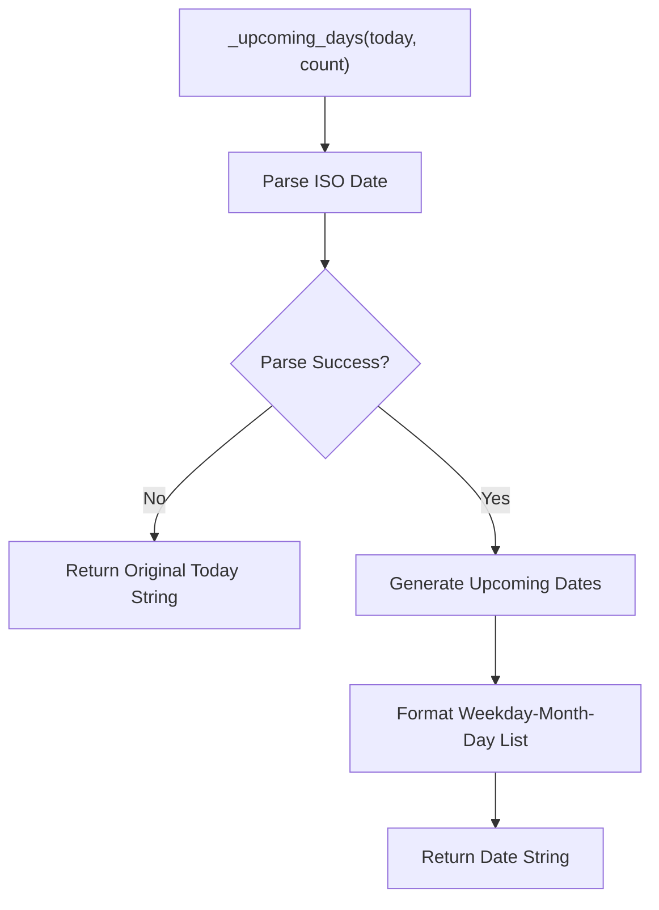
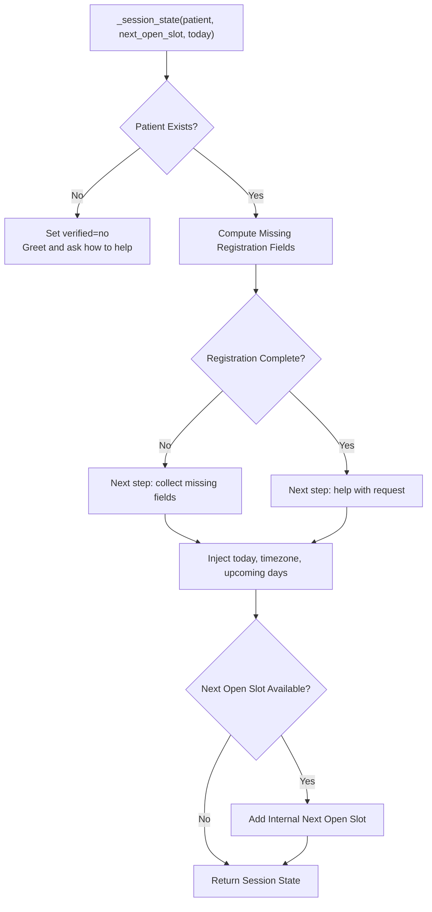
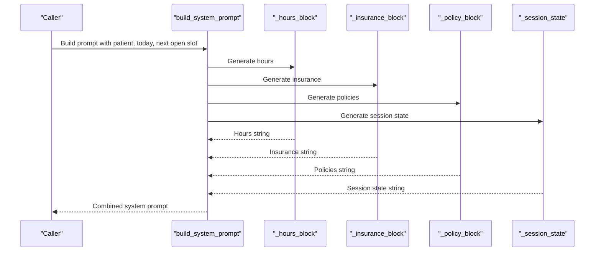
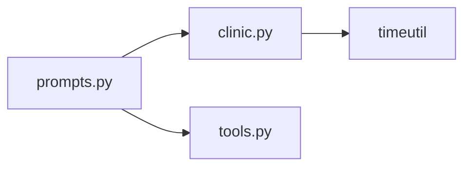

# Dynamic Content Generation

<cite>
**Referenced Files in This Document**
- [prompts.py](file://backend/app/agent/prompts.py)
- [clinic.py](file://backend/app/clinic.py)
- [tools.py](file://backend/app/agent/tools.py)
</cite>

## Table of Contents
1. [Introduction](#introduction)
2. [Project Structure](#project-structure)
3. [Core Components](#core-components)
4. [Architecture Overview](#architecture-overview)
5. [Detailed Component Analysis](#detailed-component-analysis)
6. [Dependency Analysis](#dependency-analysis)
7. [Performance Considerations](#performance-considerations)
8. [Troubleshooting Guide](#troubleshooting-guide)
9. [Conclusion](#conclusion)

## Introduction
This document explains the dynamic content generation functions that keep the AI assistant’s system prompt accurate and context-aware. The key responsibilities are:

- Present accepted insurance plans and self-pay guidance.
- Provide authoritative clinic policy statements.
- Display business hours with timezone context.
- Adapt behavior based on patient verification, registration completeness, and conversation state.
- Supply a safe calendar reference so relative dates like “tomorrow” or “next Tuesday” are not computed by the model itself.

These functions live in the agent prompt builder and read from static clinic configuration. Together, they ensure the AI always has consistent, up-to-date information about clinic operations without guessing.

## Project Structure
The dynamic content generation is centered around one prompt-building module and one clinic configuration module:

- `backend/app/agent/prompts.py`: Builds persona, rules, tool guidance, and dynamic blocks for insurance, policies, hours, session state, and upcoming dates.
- `backend/app/clinic.py`: Defines the clinic configuration, accepted insurance plans, practice policies, and business hours.
- `backend/app/agent/tools.py`: Provides tools such as `get_practice_info`, which the model can call to retrieve authoritative policy details when needed.

**Diagram sources**
- [prompts.py:1-22](file://backend/app/agent/prompts.py#L1-L22)
- [clinic.py:10-18](file://backend/app/clinic.py#L10-L18)
- [tools.py:465-485](file://backend/app/agent/tools.py#L465-L485)

**Section sources**
- [prompts.py:1-22](file://backend/app/agent/prompts.py#L1-L22)
- [clinic.py:1-18](file://backend/app/clinic.py#L1-L18)
- [tools.py:465-485](file://backend/app/agent/tools.py#L465-L485)

## Core Components
The dynamic content generation consists of five focused functions plus a helper:

| Function | Purpose | Primary Inputs | Primary Output |
|---|---|---|---|
| `_insurance_block` | Generates accepted insurance plan information and self-pay guidance. | Accepted insurance plans and self-pay label from clinic configuration. | A text block describing accepted plans and coverage caveats. |
| `_policy_block` | Generates authoritative clinic policy statements. | Practice policies from clinic configuration. | A text block listing policy topics and answers. |
| `_hours_block` | Generates business hours display with timezone context. | Clinic business hours and timezone. | A human-readable hours string. |
| `_upcoming_days` | Supplies calendar reference dates to prevent date calculation errors. | Current date string and optional count. | Comma-separated list of upcoming weekday-month-day references. |
| `_session_state` | Adapts the prompt based on patient verification status, registration completeness, and conversation context. | Patient record, next open slot, and today’s date. | A structured session state block used by the system prompt. |
| `build_system_prompt` | Assembles the full system prompt using all dynamic blocks. | Patient, clinic today, next open slot. | Complete system prompt string. |

**Section sources**
- [prompts.py:204-311](file://backend/app/agent/prompts.py#L204-L311)
- [clinic.py:123-290](file://backend/app/clinic.py#L123-L290)

## Architecture Overview
The prompt builder composes the AI’s operating instructions from stable persona and rules, then injects dynamic operational facts and per-session state.

**Diagram sources**
- [prompts.py:292-311](file://backend/app/agent/prompts.py#L292-L311)
- [prompts.py:222-289](file://backend/app/agent/prompts.py#L222-L289)

## Detailed Component Analysis

### `_insurance_block`: Accepted Insurance Plan Information
`_insurance_block` reads the accepted insurance plans and self-pay label from the clinic configuration and produces a concise insurance section for the system prompt. It iterates over each accepted plan, formats it as an accepted entry with its note, includes the self-pay option, and adds a caution that other plans may be seen but coverage cannot be promised.

Key behaviors:
- Uses `ACCEPTED_INSURANCE_PLANS` from `clinic.py`.
- Uses `SELF_PAY_LABEL` from `clinic.py`.
- Produces a deterministic, non-guessing insurance summary.
- Explicitly avoids promising coverage for out-of-network plans.

Example scenarios:
- Verified patient with an accepted plan: the AI knows the plan is accepted and can proceed with scheduling while following policy guidance.
- Unverified patient asking about insurance: the AI relays accepted plans and self-pay options without inventing coverage details.
- Out-of-network plan: the AI states that claims may be submitted but does not promise coverage.

**Diagram sources**
- [prompts.py:204-214](file://backend/app/agent/prompts.py#L204-L214)
- [clinic.py:123-143](file://backend/app/clinic.py#L123-L143)

**Section sources**
- [prompts.py:204-214](file://backend/app/agent/prompts.py#L204-L214)
- [clinic.py:123-143](file://backend/app/clinic.py#L123-L143)

### `_policy_block`: Clinic Policy Statements
`_policy_block` converts the seeded practice policies into a flat list of topic-and-answer rows. It marks these facts as authoritative and instructs the model to use `get_practice_info` to retrieve any of them rather than paraphrasing freely.

Key behaviors:
- Reads `PRACTICE_POLICIES` from `clinic.py`.
- Emits each policy’s topic and answer verbatim.
- Directs the model to call `get_practice_info` for authoritative retrieval.
- Prevents the model from inventing prices, coverage, or policy details.

Example scenarios:
- New patient asks about first visit: the AI uses the new-patient exam policy.
- Patient asks about cleaning cost: the AI uses the cleaning cost policy and avoids quoting beyond the stored range.
- Patient asks about cancellation: the AI uses the cancellation policy and warns about repeated late cancellations.

**Diagram sources**
- [prompts.py:217-219](file://backend/app/agent/prompts.py#L217-L219)
- [clinic.py:149-290](file://backend/app/clinic.py#L149-L290)
- [tools.py:465-481](file://backend/app/agent/tools.py#L465-L481)

**Section sources**
- [prompts.py:217-219](file://backend/app/agent/prompts.py#L217-L219)
- [clinic.py:149-290](file://backend/app/clinic.py#L149-L290)
- [tools.py:465-481](file://backend/app/agent/tools.py#L465-L481)

### `_hours_block`: Business Hours Display
`_hours_block` generates a single line summarizing the clinic’s weekly hours and timezone. For each day, it checks whether both open and close times exist; if so, it prints the time range, otherwise it prints “closed.”

Key behaviors:
- Reads `CLINIC.business_hours` and `CLINIC.timezone` from `clinic.py`.
- Handles open and closed days uniformly.
- Includes timezone context so the model understands local time.

Example scenarios:
- Monday through Saturday open: the AI shows ranges for open days.
- Sunday closed: the AI explicitly says Sunday is closed.
- Customized clinic hours: changing `business_hours` updates the generated hours automatically.

**Diagram sources**
- [prompts.py:222-229](file://backend/app/agent/prompts.py#L222-L229)
- [clinic.py:92-121](file://backend/app/clinic.py#L92-L121)

**Section sources**
- [prompts.py:222-229](file://backend/app/agent/prompts.py#L222-L229)
- [clinic.py:92-121](file://backend/app/clinic.py#L92-L121)

### `_upcoming_days`: Calendar Reference Helper
`_upcoming_days` takes a current ISO date string and returns a short list of upcoming weekday-month-day references. Its purpose is to give the model a safe calendar anchor so it does not compute relative dates itself.

Key behaviors:
- Parses the input date safely; if parsing fails, it returns the original string unchanged.
- Generates a fixed number of upcoming days (default 10).
- Formats each date as a readable weekday and month abbreviation with the day number.
- Leaves actual date conversion to the scheduling tools.

Example scenarios:
- Today is October 24: the function returns a sequence starting with the next few weekdays and months.
- Invalid date input: the function returns the invalid input unchanged instead of crashing.
- Relative phrases: the model uses this list to interpret “tomorrow,” “next Tuesday,” etc., without doing arithmetic.

**Diagram sources**
- [prompts.py:232-246](file://backend/app/agent/prompts.py#L232-L246)

**Section sources**
- [prompts.py:232-246](file://backend/app/agent/prompts.py#L232-L246)

### `_session_state`: Context-Aware Prompt Adaptation
`_session_state` adapts the system prompt based on whether a patient is verified, what registration fields are missing, and what the next available slot is. It also injects the current clinic date and the upcoming calendar reference.

Key behaviors:
- If no patient is present, it sets verification to “no” and directs the model to greet and ask how to help without offering times.
- If a patient exists, it computes missing required fields: full name, phone, date of birth, and insurance provider.
- It labels registration as complete or incomplete and lists only the missing fields.
- It provides a next step: collect missing fields before offering times, or proceed with the patient’s request.
- It includes clinic timezone, today’s date, and the upcoming calendar reference.
- If a next open slot is known, it includes it as internal context without presenting it as a promise.

Example scenarios:
- Unverified caller: the AI greets and collects identity information before scheduling.
- Verified patient with incomplete registration: the AI asks only for missing fields.
- Verified patient with complete registration: the AI proceeds directly to scheduling or other requests.
- Conversation with urgency: the session state still guides the model to avoid premature time offers until required data is collected.

**Diagram sources**
- [prompts.py:249-289](file://backend/app/agent/prompts.py#L249-L289)

**Section sources**
- [prompts.py:249-289](file://backend/app/agent/prompts.py#L249-L289)

### `build_system_prompt`: Full Prompt Assembly
`build_system_prompt` combines persona, hard rules, tool guidance, hours, address, insurance, policies, and session state into one system prompt. It ensures the AI receives both static operational facts and per-session context.

Key behaviors:
- Always includes hours, address, phone, slot duration, and booking days.
- Always includes insurance and policy blocks.
- Always includes session state tailored to the current patient and availability context.
- Keeps the prompt deterministic except for dynamic inputs like today’s date and next open slot.

**Diagram sources**
- [prompts.py:292-311](file://backend/app/agent/prompts.py#L292-L311)
- [prompts.py:222-289](file://backend/app/agent/prompts.py#L222-L289)

**Section sources**
- [prompts.py:292-311](file://backend/app/agent/prompts.py#L292-L311)

## Dependency Analysis
The dynamic content generation depends on clinic configuration and, indirectly, on time utilities.

**Diagram sources**
- [prompts.py:12-21](file://backend/app/agent/prompts.py#L12-L21)
- [clinic.py:12-18](file://backend/app/clinic.py#L12-L18)
- [tools.py:465-485](file://backend/app/agent/tools.py#L465-L485)

**Section sources**
- [prompts.py:12-21](file://backend/app/agent/prompts.py#L12-L21)
- [clinic.py:12-18](file://backend/app/clinic.py#L12-L18)
- [tools.py:465-485](file://backend/app/agent/tools.py#L465-L485)

## Performance Considerations
- All dynamic blocks are lightweight string construction operations. They do not perform database queries or network calls.
- `_upcoming_days` performs minimal date arithmetic and formatting, bounded by a small default count.
- `_session_state` performs simple field checks and string joins, making it suitable for every prompt build.
- Because these functions run during system prompt assembly, keeping them fast helps maintain responsive chat startup and turn processing.

[No sources needed since this section provides general guidance]

## Troubleshooting Guide
Common issues and how to diagnose them:

| Symptom | Likely Cause | Resolution |
|---|---|---|
| Model guesses dates incorrectly | Relative date computation was attempted by the model instead of using the provided calendar reference. | Ensure `_upcoming_days` is included in session state and that the model is instructed to rely on tools for date conversion. |
| Wrong business hours shown | Clinic configuration or timezone changed but prompt was not rebuilt. | Rebuild the system prompt with updated `CLINIC.business_hours` and `CLINIC.timezone`. |
| Insurance coverage promises appear | Model ignored policy guidance or guessed coverage. | Reinforce that coverage must come from `get_practice_info` and that `_insurance_block` never promises coverage for out-of-network plans. |
| Missing registration fields repeatedly asked | Session state did not reflect collected data. | Verify that `_session_state` receives the correct `Patient` object and that missing fields are computed accurately. |
| No times offered too early | Session state indicates unverified or incomplete registration. | Follow the next-step guidance in session state: verify and collect required fields before searching availability. |

**Section sources**
- [prompts.py:232-289](file://backend/app/agent/prompts.py#L232-L289)
- [clinic.py:92-143](file://backend/app/clinic.py#L92-L143)

## Conclusion
The dynamic content generation functions provide a reliable bridge between static clinic configuration and per-session context. `_insurance_block`, `_policy_block`, and `_hours_block` supply authoritative operational facts. `_upcoming_days` prevents date calculation errors by giving the model a safe calendar reference. `_session_state` tailors the AI’s behavior to verification status, registration completeness, and conversation context. Together, they ensure the AI always has accurate, up-to-date information about clinic operations and responds consistently with the right next steps.

[No sources needed since this section summarizes without analyzing specific files]