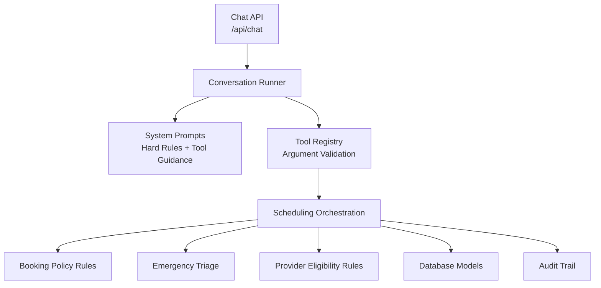
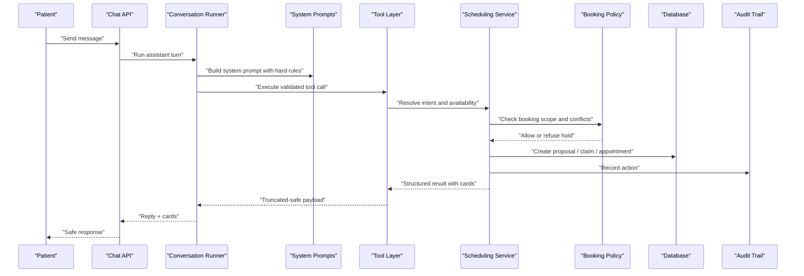
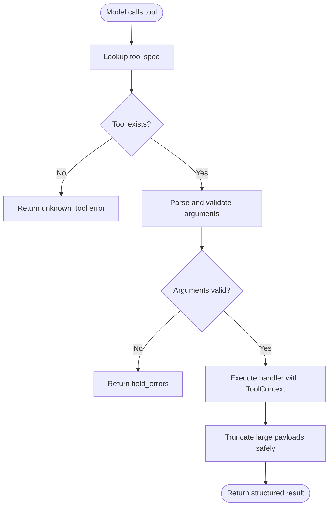
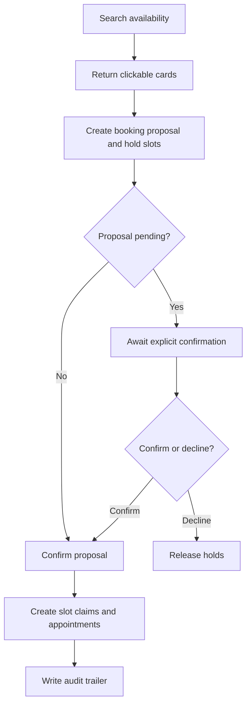
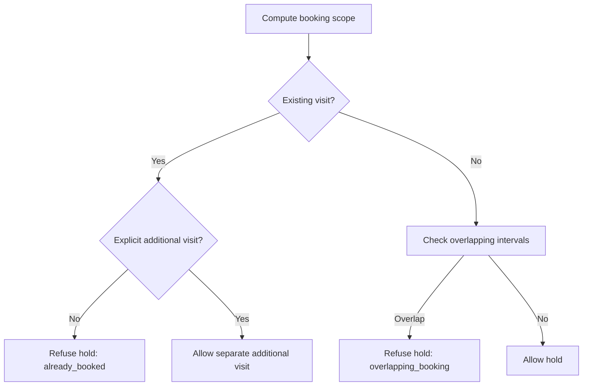
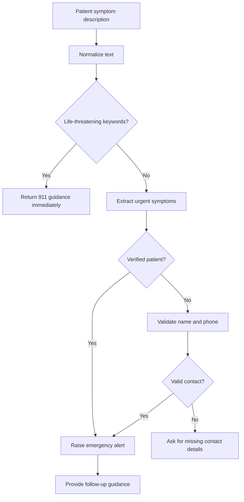
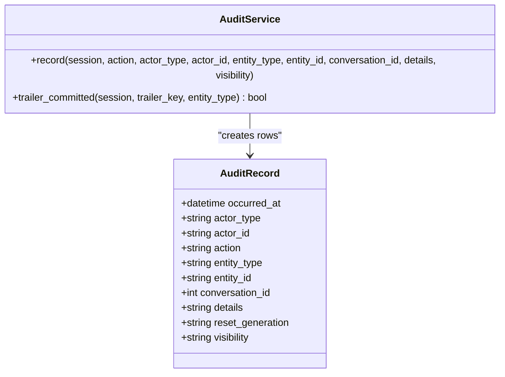
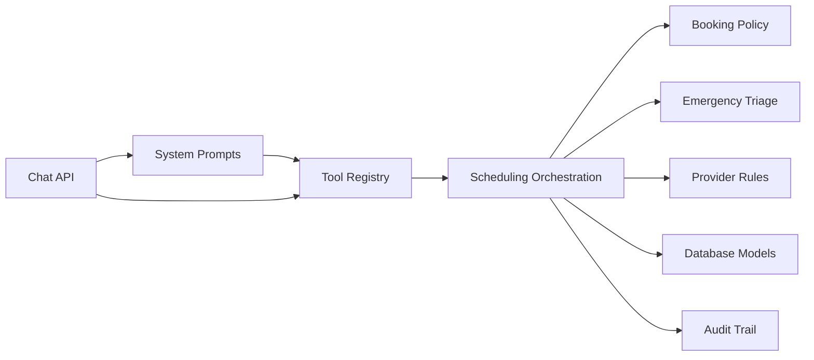

# Hard Rules and Safety Constraints

<cite>
**Referenced Files in This Document**   
- [prompts.py](file://backend/app/agent/prompts.py)
- [tools.py](file://backend/app/agent/tools.py)
- [chat.py](file://backend/app/api/chat.py)
- [scheduling.py](file://backend/app/services/scheduling.py)
- [booking_policy.py](file://backend/app/services/booking_policy.py)
- [emergency.py](file://backend/app/services/emergency.py)
- [provider_rules.py](file://backend/app/services/provider_rules.py)
- [audit.py](file://backend/app/services/audit.py)
- [security.py](file://backend/app/services/security.py)
- [conversations.py](file://backend/app/models/conversations.py)
- [proposals.py](file://backend/app/models/proposals.py)
- [scheduling_models.py](file://backend/app/models/scheduling.py)
</cite>

## Table of Contents
1. [Introduction](#introduction)
2. [Project Structure](#project-structure)
3. [Core Components](#core-components)
4. [Architecture Overview](#architecture-overview)
5. [Detailed Component Analysis](#detailed-component-analysis)
6. [Dependency Analysis](#dependency-analysis)
7. [Performance Considerations](#performance-considerations)
8. [Troubleshooting Guide](#troubleshooting-guide)
9. [Conclusion](#conclusion)

## Introduction
This document defines the hard rules and safety constraints that govern AI behavior in the dental practice context. It explains how the system prevents the model from inventing clinic policies, making unauthorized decisions, providing clinical advice, or violating patient privacy. It also documents emergency escalation, appointment state ownership, double-booking prevention, family booking consistency, and compliance monitoring through audit trails.

The rules are enforced at multiple layers:
- Prompt-level instructions constrain what the model may say.
- Tool schemas and argument validation restrict what the model may do.
- Service-layer policy functions enforce business rules against live database state.
- Database constraints prevent overlapping bookings and inconsistent state.
- Audit records provide an immutable trail for compliance review.

## Project Structure
The hard rules span several modules:

**Diagram sources**
- [chat.py:233-274](file://backend/app/api/chat.py#L233-L274)
- [prompts.py:34-201](file://backend/app/agent/prompts.py#L34-L201)
- [tools.py:703-739](file://backend/app/agent/tools.py#L703-L739)
- [scheduling.py:1-63](file://backend/app/services/scheduling.py#L1-L63)
- [booking_policy.py:1-21](file://backend/app/services/booking_policy.py#L1-L21)
- [emergency.py:1-31](file://backend/app/services/emergency.py#L1-L31)
- [provider_rules.py:1-17](file://backend/app/services/provider_rules.py#L1-L17)
- [audit.py:15-51](file://backend/app/services/audit.py#L15-L51)

**Section sources**
- [chat.py:1-12](file://backend/app/api/chat.py#L1-L12)
- [prompts.py:1-6](file://backend/app/agent/prompts.py#L1-L6)
- [tools.py:1-11](file://backend/app/agent/tools.py#L1-L11)

## Core Components
The hard rules are implemented by these core components:

| Component | Responsibility | Rule Enforcement Mechanism |
|---|---|---|
| System prompts | Define persona, non-negotiable rules, tool guidance, and authoritative clinic facts | Prevents fabrication, limits data disclosure, forbids clinical advice, mandates verification |
| Tool registry | Exposes validated operations to the model | Blocks unknown tools, rejects invalid arguments, derives identity from session context |
| Scheduling orchestration | Translates patient intent into availability searches, proposals, and confirmations | Enforces one-visit-per-person, holds before confirmation, reschedule vs new booking separation |
| Booking policy | Computes allowed scope for a conversation’s current request | Prevents double-booking, overlapping holds, and unintended additional visits |
| Emergency triage | Classifies symptoms and routes life-threatening cases immediately | Bypasses registration for emergencies; requires callback details for non-life-threatening reports |
| Provider rules | Filters which providers may be offered for which visit types | Ensures emergency visits go only to eligible providers |
| Audit trail | Records actions with actor, entity, conversation, and generation metadata | Enables compliance review and replayability |
| Security utilities | Hashes passwords and session tokens | Protects stored credentials and tokens |

**Section sources**
- [prompts.py:34-201](file://backend/app/agent/prompts.py#L34-L201)
- [tools.py:54-120](file://backend/app/agent/tools.py#L54-L120)
- [scheduling.py:1-63](file://backend/app/services/scheduling.py#L1-L63)
- [booking_policy.py:1-21](file://backend/app/services/booking_policy.py#L1-L21)
- [emergency.py:1-31](file://backend/app/services/emergency.py#L1-L31)
- [provider_rules.py:1-17](file://backend/app/services/provider_rules.py#L1-L17)
- [audit.py:1-12](file://backend/app/services/audit.py#L1-L12)
- [security.py:1-6](file://backend/app/services/security.py#L1-L6)

## Architecture Overview
The end-to-end flow enforces safety at every step:

**Diagram sources**
- [chat.py:233-274](file://backend/app/api/chat.py#L233-L274)
- [prompts.py:292-311](file://backend/app/agent/prompts.py#L292-L311)
- [tools.py:703-739](file://backend/app/agent/tools.py#L703-L739)
- [scheduling.py:393-716](file://backend/app/services/scheduling.py#L393-L716)
- [booking_policy.py:300-475](file://backend/app/services/booking_policy.py#L300-L475)
- [audit.py:15-51](file://backend/app/services/audit.py#L15-L51)

## Detailed Component Analysis

### Non-Negotiable Rules in System Prompts
The system prompt is the first line of defense. It establishes:
- Privacy: no chart data until verified by phone number and date of birth.
- Verification: household links do not authorize access to another adult’s data.
- Tool-only mutations: the model cannot assert that it registered, booked, cancelled, or rescheduled anyone.
- No fabrication: prices, insurance coverage, dentist availability, and confirmations must come from tools.
- Appointment state ownership: showing times does not book; held proposals are not appointments.
- Date resolution: relative dates are passed to tools, not computed by the model.
- Clinical boundary: no diagnoses, medication advice, or treatment recommendations.
- Emergency priority: life-threatening symptoms trigger immediate 911 guidance before scheduling.
- Staff claims: the model may not claim a staff member acted unless a tool result confirms it.
- UI card discipline: the model must not recite times, dates, or dentists; it refers to cards.
- Visit count discipline: one booking covers one visit per person; no competing holds.
- Additional visit discipline: a second visit is only valid when explicitly requested.

These rules prevent the AI from inventing clinic policies, making unauthorized decisions, or providing clinical advice.

**Section sources**
- [prompts.py:34-87](file://backend/app/agent/prompts.py#L34-L87)
- [prompts.py:89-201](file://backend/app/agent/prompts.py#L89-L201)

### Tool Usage Policies and Argument Validation
Every tool exposed to the model has a Pydantic schema. Unknown tools are rejected, malformed JSON is handled gracefully, and invalid fields return structured errors rather than exceptions. Identity is never taken from model arguments; it comes from `ToolContext`, built from the authenticated session.

Key enforcement points:
- Unknown tool names return a safe error.
- Invalid arguments return field-specific validation messages.
- Registration and verification require required fields.
- Child registration uses the already verified parent and refuses adult family members.
- Practice info must be retrieved via the tool; the model must not guess pricing or coverage.

**Diagram sources**
- [tools.py:703-739](file://backend/app/agent/tools.py#L703-L739)
- [tools.py:54-120](file://backend/app/agent/tools.py#L54-L120)

**Section sources**
- [tools.py:1-11](file://backend/app/agent/tools.py#L1-L11)
- [tools.py:703-739](file://backend/app/agent/tools.py#L703-L739)
- [tools.py:287-333](file://backend/app/agent/tools.py#L287-L333)

### Patient Privacy Protection and Verification Requirements
Privacy is enforced by requiring explicit verification before any chart discussion:
- A new or unverified session cannot see appointments, history, or insurance.
- Verification requires both phone number and date of birth.
- A household link alone is not consent to view another adult’s record.
- When registering a child, the parent must be verified; the child’s insurance can use the parent’s plan only after explicit permission.
- Emergency callback name and phone are contact details, not identity; they do not verify the caller.

```mermaid
stateDiagram-v2
[*] --> Unverified
Unverified --> Verified : "verify_existing_patient succeeds"
Unverified --> Registered : "register_patient succeeds"
Registered --> Verified : "registration marks verified"
Verified --> Verified : "update_patient_details"
Unverified --> EmergencyCallback : "report_emergency without verified patient"
EmergencyCallback --> Verified : "not identity; still needs verification for chart access"
```

**Diagram sources**
- [tools.py:192-218](file://backend/app/agent/tools.py#L192-L218)
- [tools.py:221-284](file://backend/app/agent/tools.py#L221-L284)
- [tools.py:287-333](file://backend/app/agent/tools.py#L287-L333)
- [emergency.py:15-31](file://backend/app/services/emergency.py#L15-L31)

**Section sources**
- [prompts.py:34-40](file://backend/app/agent/prompts.py#L34-L40)
- [tools.py:192-218](file://backend/app/agent/tools.py#L192-L218)
- [tools.py:287-333](file://backend/app/agent/tools.py#L287-L333)
- [emergency.py:15-31](file://backend/app/services/emergency.py#L15-L31)

### Data Integrity Constraints and Appointment State Ownership
Appointment state is owned by the system, not by the model’s prose:
- Showing available times does not book anything.
- A held proposal is not an appointment.
- “Booked” is only said after a confirmation tool returns confirmed.
- “Cancelled” is only said after cancellation confirmation.
- Reschedules are moves, not new bookings.
- Cancellations require explicit confirmation.
- The database enforces uniqueness of active slot claims, preventing two active reservations for the same interval.

**Diagram sources**
- [prompts.py:44-46](file://backend/app/agent/prompts.py#L44-L46)
- [scheduling.py:238-295](file://backend/app/services/scheduling.py#L238-L295)
- [scheduling_models.py:175-239](file://backend/app/models/scheduling.py#L175-L239)
- [audit.py:27-33](file://backend/app/services/audit.py#L27-L33)

**Section sources**
- [prompts.py:44-46](file://backend/app/agent/prompts.py#L44-L46)
- [scheduling_models.py:1-11](file://backend/app/models/scheduling.py#L1-L11)
- [scheduling_models.py:175-239](file://backend/app/models/scheduling.py#L175-L239)

### Double-Booking Prevention and Family Booking Consistency
The booking policy module centralizes the rule that a booking request covers exactly one visit per person. It reads live database state to determine:
- Whether a visit is already booked.
- Whether a proposal is already held.
- Whether proposed intervals overlap existing visits or each other.
- Whether the patient explicitly asked for an additional visit.

For family bookings:
- One card holds one time for every person on the same day.
- Visits are ranked to stay close together.
- One confirmation books everyone or nobody.
- Single times for multiple people are rejected.
- If no complete family option is found, the system offers different dates, providers, or coordination preferences rather than falling back to solo bookings.

**Diagram sources**
- [booking_policy.py:1-21](file://backend/app/services/booking_policy.py#L1-L21)
- [booking_policy.py:300-475](file://backend/app/services/booking_policy.py#L300-L475)
- [booking_policy.py:514-531](file://backend/app/services/booking_policy.py#L514-L531)

**Section sources**
- [booking_policy.py:1-21](file://backend/app/services/booking_policy.py#L1-L21)
- [booking_policy.py:300-475](file://backend/app/services/booking_policy.py#L300-L475)
- [booking_policy.py:514-531](file://backend/app/services/booking_policy.py#L514-L531)

### Emergency Escalation Protocols and Life-Threatening Situation Handling
Emergency handling is deliberately split into two speeds:
- Life-threatening symptoms trigger immediate 911 guidance before registration, verification, or scheduling.
- Non-life-threatening urgent symptoms create an alert for the front desk and require a callback name and phone number.

Triage is keyword-driven and conservative: it errs toward caution so that medical emergencies are never missed. Follow-up messages update the same case instead of creating duplicates, and worsening updates reopen resolved cases when appropriate.

**Diagram sources**
- [emergency.py:1-31](file://backend/app/services/emergency.py#L1-L31)
- [emergency.py:219-232](file://backend/app/services/emergency.py#L219-L232)
- [emergency.py:258-366](file://backend/app/services/emergency.py#L258-L366)
- [emergency.py:458-517](file://backend/app/services/emergency.py#L458-L517)

**Section sources**
- [emergency.py:1-31](file://backend/app/services/emergency.py#L1-L31)
- [emergency.py:219-232](file://backend/app/services/emergency.py#L219-L232)
- [emergency.py:258-366](file://backend/app/services/emergency.py#L258-L366)
- [emergency.py:458-517](file://backend/app/services/emergency.py#L458-L517)

### Compliance Monitoring and Audit Trail Generation
Every important action can be recorded in an append-only audit table. Audit entries include:
- Timestamp.
- Actor type and ID.
- Action name.
- Entity type and ID.
- Conversation ID.
- Details payload.
- Reset generation identifier.
- Visibility level.

For bookings, the system writes a HOLD row inside the write transaction and a COMMIT trailer after the transaction commits. This ensures that a failed transaction cannot masquerade as a successful booking.

**Diagram sources**
- [audit.py:15-51](file://backend/app/services/audit.py#L15-L51)
- [audit.py:54-75](file://backend/app/services/audit.py#L54-L75)

**Section sources**
- [audit.py:1-12](file://backend/app/services/audit.py#L1-L12)
- [audit.py:15-51](file://backend/app/services/audit.py#L15-L51)
- [audit.py:54-75](file://backend/app/services/audit.py#L54-L75)

### Provider Eligibility and Policy Authority
Provider eligibility rules ensure that:
- Emergency visits are offered only to providers configured for emergency care.
- Routine visits are not offered to emergency-only providers.
- Required specialties are respected.
- Clinic policies, hours, insurance acceptance, and pricing are retrieved through the practice info tool, not invented by the model.

**Section sources**
- [provider_rules.py:1-17](file://backend/app/services/provider_rules.py#L1-L17)
- [provider_rules.py:20-33](file://backend/app/services/provider_rules.py#L20-L33)
- [tools.py:465-481](file://backend/app/agent/tools.py#L465-L481)
- [prompts.py:204-219](file://backend/app/agent/prompts.py#L204-L219)

## Dependency Analysis
The hard rules depend on layered enforcement:

**Diagram sources**
- [prompts.py:34-201](file://backend/app/agent/prompts.py#L34-L201)
- [tools.py:703-739](file://backend/app/agent/tools.py#L703-L739)
- [scheduling.py:1-63](file://backend/app/services/scheduling.py#L1-L63)
- [booking_policy.py:1-21](file://backend/app/services/booking_policy.py#L1-L21)
- [emergency.py:1-31](file://backend/app/services/emergency.py#L1-L31)
- [provider_rules.py:1-17](file://backend/app/services/provider_rules.py#L1-L17)
- [audit.py:15-51](file://backend/app/services/audit.py#L15-L51)
- [chat.py:233-274](file://backend/app/api/chat.py#L233-L274)

**Section sources**
- [chat.py:233-274](file://backend/app/api/chat.py#L233-L274)
- [scheduling.py:1-63](file://backend/app/services/scheduling.py#L1-L63)

## Performance Considerations
Safety enforcement should not block responsiveness:
- Tool results are truncated to keep payloads bounded while preserving interactive cards.
- Availability searches return structured options rather than free-form lists.
- Emergency triage is keyword-driven and deterministic, avoiding expensive LLM judgment for safety-critical classification.
- Session restoration reconciles stale cards with live database state to avoid presenting expired holds.

[No sources needed since this section provides general guidance]

## Troubleshooting Guide
Common rule violations and their prevention mechanisms:

| Violation Scenario | Prevention Mechanism | Expected Behavior |
|---|---|---|
| Model reveals another adult’s appointments because they share a household | Hard rule requiring phone and date of birth verification; household link is not consent | Assistant asks for verification before discussing chart data |
| Model claims it booked an appointment without a tool call | Hard rule stating only tools change records; “booked” only after confirmation | Assistant waits for explicit confirmation and tool result |
| Model invents price or insurance coverage | Hard rule directing model to `get_practice_info`; tool returns known topics | Assistant either returns policy answer or creates a staff request |
| Model computes calendar dates itself | Hard rule delegating date conversion to tools | Assistant passes patient’s words to availability search |
| Model gives clinical advice | Hard rule forbidding diagnoses and medication instructions | Assistant offers emergency visit or directs to emergency services |
| Model ignores life-threatening symptoms | Emergency triage detects airway, bleeding, trauma, or unconsciousness | Immediate 911 guidance before scheduling |
| Model books two visits for the same person in one request | Booking policy refusal for already-booked or pending booking | Assistant presents existing visit or asks for move/reschedule |
| Model holds overlapping times | Booking policy overlap detection and database unique active slot claim | Assistant refuses overlapping hold and suggests alternatives |
| Model treats a family request as single times | Family availability shaping and policy shape check | Assistant returns complete family plans or explains no complete option |
| Model claims staff called or responded personally | Hard rule limiting strongest claim to logging for front desk | Assistant says it logged the request unless a tool result confirms otherwise |
| Model mentions tools, JSON, IDs, or system prompts | Hard rule forbidding internal implementation references | Assistant replies in plain receptionist language |

**Section sources**
- [prompts.py:34-87](file://backend/app/agent/prompts.py#L34-L87)
- [prompts.py:89-201](file://backend/app/agent/prompts.py#L89-L201)
- [booking_policy.py:404-475](file://backend/app/services/booking_policy.py#L404-L475)
- [emergency.py:258-366](file://backend/app/services/emergency.py#L258-L366)

## Conclusion
The hard rules and safety constraints in this system are not suggestions; they are enforced across prompts, tool schemas, service logic, and database constraints. Together, they:
- Protect patient privacy by requiring explicit verification.
- Prevent the AI from inventing clinic policies or clinical advice.
- Ensure appointment state ownership remains with the system.
- Block double-booking and maintain family booking consistency.
- Escalate life-threatening emergencies immediately.
- Provide auditable compliance records for review.

When designing future features, preserve this layered approach: constrain the model through prompts, validate inputs through tools, enforce business rules through service functions, and guarantee data integrity through database constraints.

[No sources needed since this section summarizes without analyzing specific files]