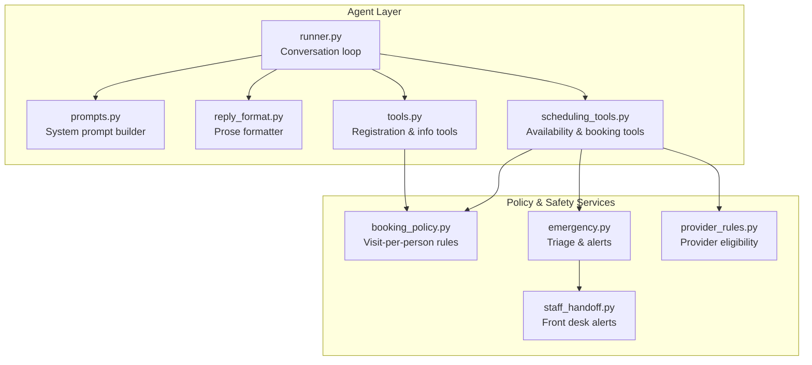
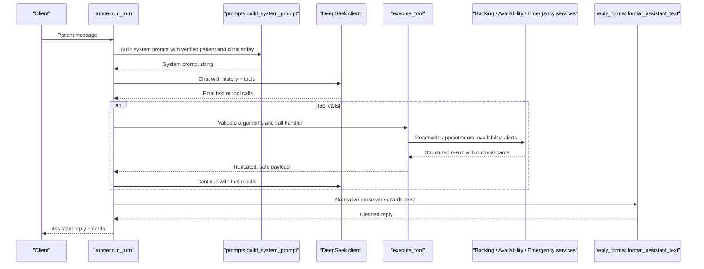
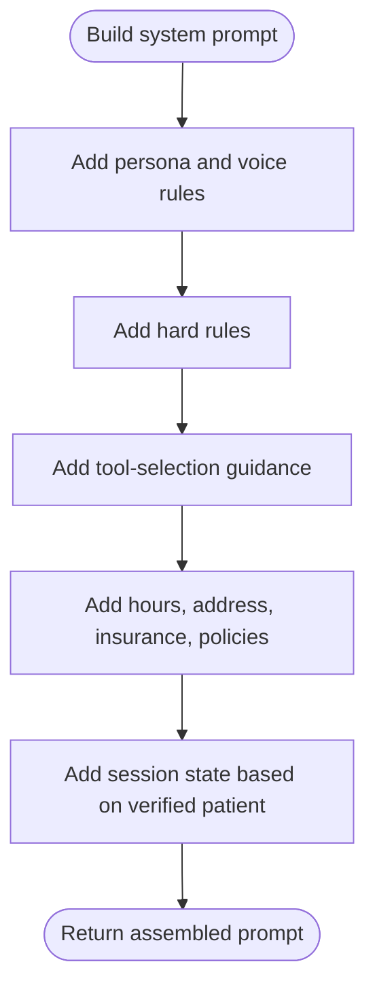
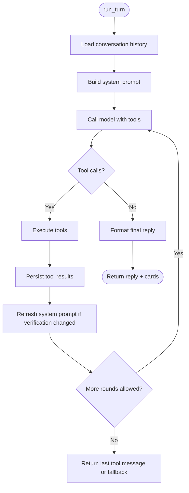
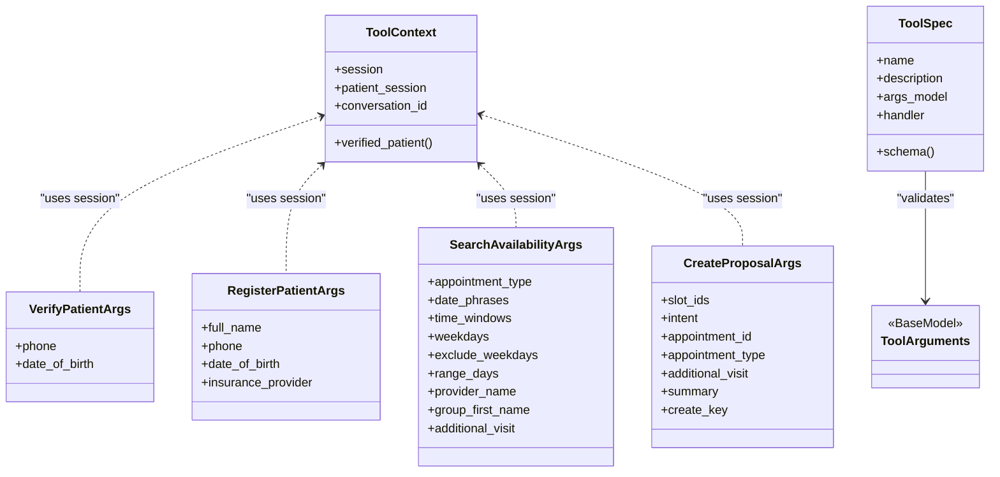
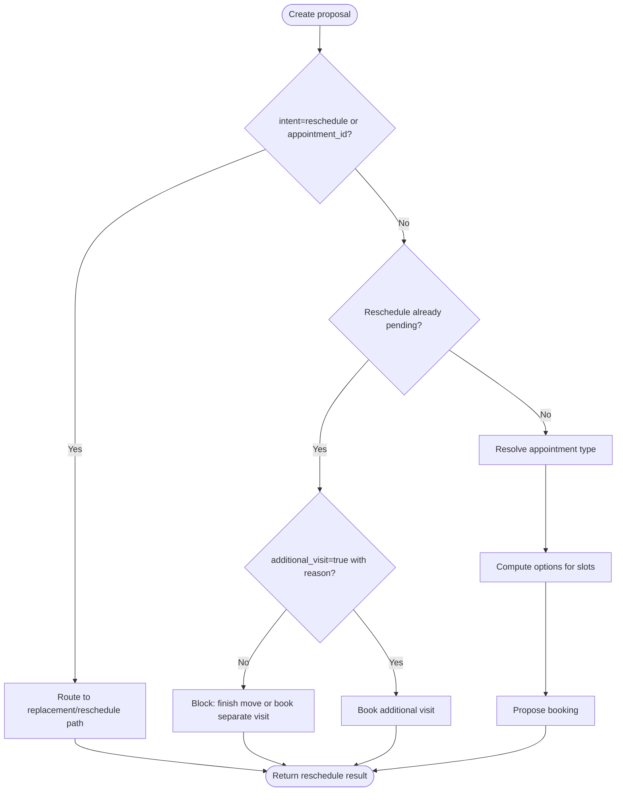
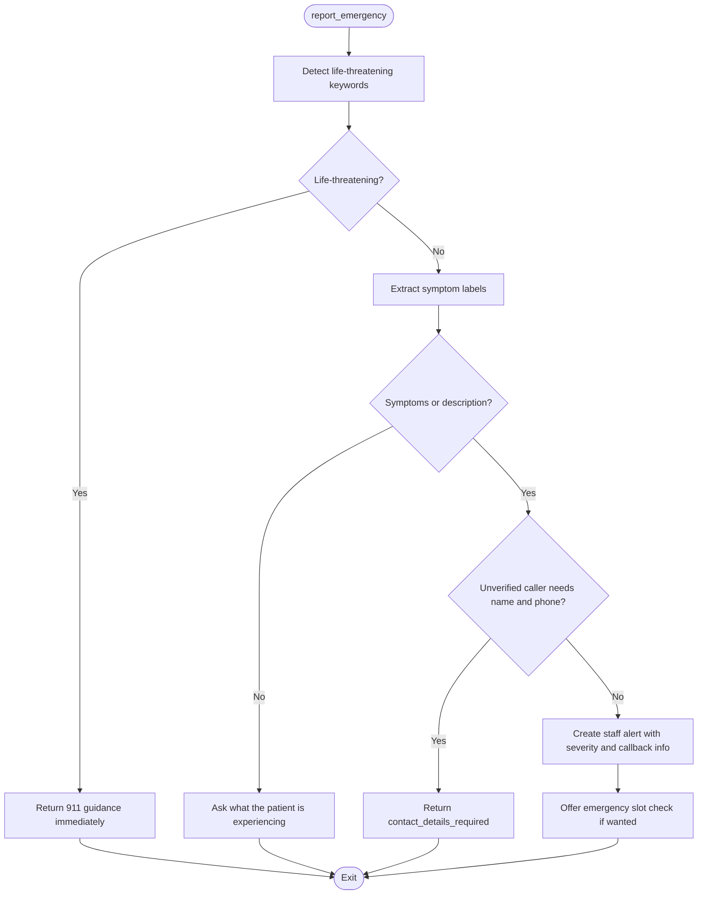
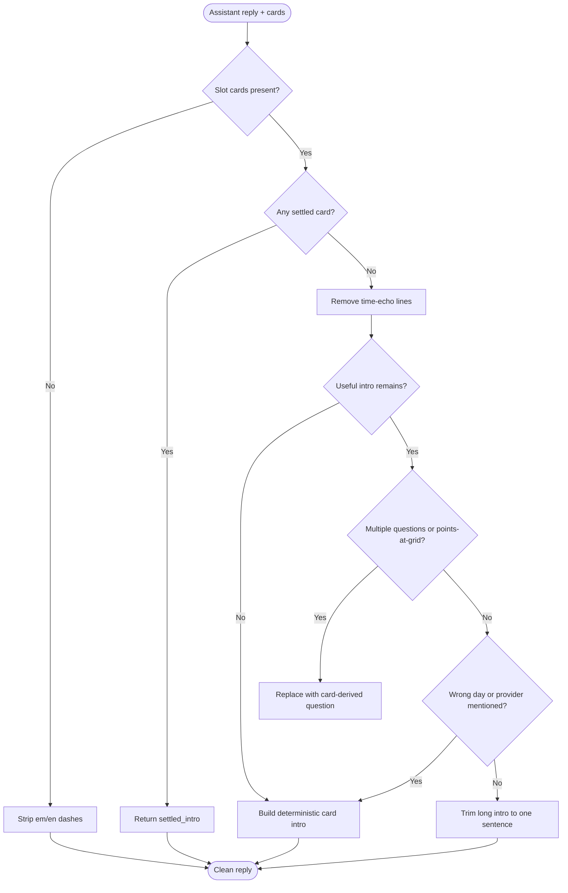
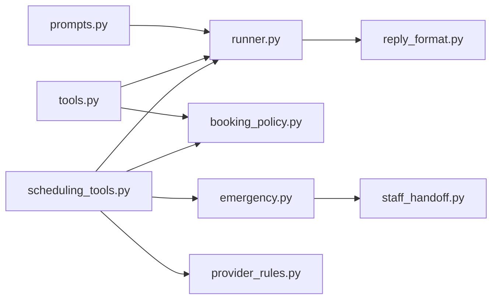

# Prompt Engineering

<cite>
**Referenced Files in This Document**   
- [prompts.py](file://backend/app/agent/prompts.py)
- [reply_format.py](file://backend/app/agent/reply_format.py)
- [tools.py](file://backend/app/agent/tools.py)
- [scheduling_tools.py](file://backend/app/agent/scheduling_tools.py)
- [runner.py](file://backend/app/agent/runner.py)
- [emergency.py](file://backend/app/services/emergency.py)
- [booking_policy.py](file://backend/app/services/booking_policy.py)
- [provider_rules.py](file://backend/app/services/provider_rules.py)
- [staff_handoff.py](file://backend/app/services/staff_handoff.py)
</cite>

## Table of Contents
1. [Introduction](#introduction)
2. [Project Structure](#project-structure)
3. [Core Components](#core-components)
4. [Architecture Overview](#architecture-overview)
5. [Detailed Component Analysis](#detailed-component-analysis)
6. [Dependency Analysis](#dependency-analysis)
7. [Performance Considerations](#performance-considerations)
8. [Troubleshooting Guide](#troubleshooting-guide)
9. [Conclusion](#conclusion)
10. [Appendices](#appendices)

## Introduction
This document explains the prompt engineering system that guides the AI to act as a dental practice receptionist while enforcing safety, privacy, and operational boundaries. It covers:

- The role, voice, and conversation style enforced by system prompts.
- How tool selection is guided so the model never invents clinic policy or makes unauthorized decisions.
- How response formatting prevents duplicate time listings and keeps UI cards authoritative.
- Emergency triage behavior and escalation protocols.
- How prompts adapt to verification status, workflow stage, and family scheduling context.
- Versioning, testing, and maintenance practices implied by the codebase.

The system separates what the model is told (prompts), how it is allowed to act (tool schemas and validation), and what the backend enforces deterministically (policy, availability, handoff, and reply formatting).

## Project Structure
The prompt engineering surface lives primarily under `backend/app/agent`, with supporting policy and safety logic under `backend/app/services`.

**Diagram sources**
- [runner.py:132-139](file://backend/app/agent/runner.py#L132-L139)
- [runner.py:409-557](file://backend/app/agent/runner.py#L409-L557)
- [prompts.py:292-321](file://backend/app/agent/prompts.py#L292-L321)
- [reply_format.py:295-428](file://backend/app/agent/reply_format.py#L295-L428)
- [tools.py:511-588](file://backend/app/agent/tools.py#L511-L588)
- [scheduling_tools.py:59-360](file://backend/app/agent/scheduling_tools.py#L59-L360)
- [booking_policy.py:1-21](file://backend/app/services/booking_policy.py#L1-L21)
- [emergency.py:1-31](file://backend/app/services/emergency.py#L1-L31)
- [provider_rules.py:1-17](file://backend/app/services/provider_rules.py#L1-L17)
- [staff_handoff.py:1-16](file://backend/app/services/staff_handoff.py#L1-L16)

**Section sources**
- [runner.py:1-23](file://backend/app/agent/runner.py#L1-L23)
- [prompts.py:1-6](file://backend/app/agent/prompts.py#L1-L6)

## Core Components
The prompt system has four cooperating parts:

| Component | Responsibility | Key Behaviors |
|---|---|---|
| System prompt builder | Defines persona, hard rules, tool guidance, clinic facts, hours, insurance, and session state | Injects live clinic data; avoids drift between `/api/clinic` and model instructions |
| Tool registry | Exposes validated functions for identity, registration, practice info, availability, proposals, reschedules, cancellations, emergencies, and staff requests | Rejects unknown tools; validates arguments; truncates large results safely |
| Scheduling tools | Implements availability search, proposal holding, confirmation, reschedule flow, family planning, and emergency reporting | Enforces one visit per person, pending-move protection, and explicit additional visits |
| Reply formatter | Normalizes prose when slot cards are present | Removes time echoes, replaces multiple questions, strips em/en dashes, and writes deterministic intros |

**Section sources**
- [prompts.py:23-87](file://backend/app/agent/prompts.py#L23-L87)
- [tools.py:1-11](file://backend/app/agent/tools.py#L1-L11)
- [tools.py:511-588](file://backend/app/agent/tools.py#L511-L588)
- [scheduling_tools.py:1-17](file://backend/app/agent/scheduling_tools.py#L1-L17)
- [reply_format.py:1-16](file://backend/app/agent/reply_format.py#L1-L16)

## Architecture Overview
The runner builds a fresh system prompt from current session state, calls the model with tool schemas, executes requested tools through validated handlers, and formats the final assistant text before persisting it.

**Diagram sources**
- [runner.py:171-235](file://backend/app/agent/runner.py#L171-L235)
- [runner.py:409-557](file://backend/app/agent/runner.py#L409-L557)
- [runner.py:373-401](file://backend/app/agent/runner.py#L373-L401)
- [tools.py:703-739](file://backend/app/agent/tools.py#L703-L739)
- [prompts.py:292-321](file://backend/app/agent/prompts.py#L292-L321)

## Detailed Component Analysis

### System Prompt Construction
The system prompt establishes three layers:

1. **Persona and voice**: Warm American front-desk receptionist, plain sentences, no markdown lists, no emoji, short messages, mirroring urgency.
2. **Hard rules**: Privacy, no fabrication, appointment-state ownership, relative-date handling, no clinical advice, emergency priority, honesty about staff actions, no tool/JSON mentions, card-first time presentation, one-visit-per-person rules.
3. **Tool guidance**: Step-by-step decision tree for verification, registration, availability, household booking, proposal holding, confirmation, rescheduling, cancellation, emergency reporting, and staff requests.

The prompt also injects:

- Clinic hours and address.
- Accepted insurance plans and self-pay policy.
- Authoritative practice policies.
- Session state including verification, missing fields, next step, clinic date, upcoming calendar hints, and internal next-open-slot information.

A deterministic greeting is provided without calling the model, so the first paint is instant.

**Diagram sources**
- [prompts.py:23-87](file://backend/app/agent/prompts.py#L23-L87)
- [prompts.py:89-201](file://backend/app/agent/prompts.py#L89-L201)
- [prompts.py:204-289](file://backend/app/agent/prompts.py#L204-L289)
- [prompts.py:292-321](file://backend/app/agent/prompts.py#L292-L321)

**Section sources**
- [prompts.py:23-87](file://backend/app/agent/prompts.py#L23-L87)
- [prompts.py:89-201](file://backend/app/agent/prompts.py#L89-L201)
- [prompts.py:204-289](file://backend/app/agent/prompts.py#L204-L289)
- [prompts.py:292-321](file://backend/app/agent/prompts.py#L292-L321)
- [prompts.py:314-321](file://backend/app/agent/prompts.py#L314-L321)

### Conversation Flow and Tool Selection
The runner controls the conversation lifecycle:

- Loads conversation history.
- Builds the system prompt with current verification and clinic context.
- Calls the model with tool schemas.
- Executes tool calls through validated handlers.
- Persists assistant turns, tool calls, and tool results.
- Re-calls the model with tool results until prose or terminal state is reached.
- Applies reply formatting and emergency notice enforcement.

Tool selection is constrained by:

- A finite number of tool rounds per patient message.
- A maximum number of tool calls per round.
- Fuzzy detection of “show times again” requests, which restricts available tools to avoid replaying old selections.
- Withdrawal of tools after complete empty availability searches to prevent repeated loops.

**Diagram sources**
- [runner.py:171-235](file://backend/app/agent/runner.py#L171-L235)
- [runner.py:409-557](file://backend/app/agent/runner.py#L409-L557)
- [runner.py:56-88](file://backend/app/agent/runner.py#L56-L88)

**Section sources**
- [runner.py:1-23](file://backend/app/agent/runner.py#L1-L23)
- [runner.py:51-88](file://backend/app/agent/runner.py#L51-L88)
- [runner.py:171-235](file://backend/app/agent/runner.py#L171-L235)
- [runner.py:409-557](file://backend/app/agent/runner.py#L409-L557)

### Tool Definitions and Validation
Every tool declares a Pydantic argument model. Arguments arrive as JSON from the provider and are validated before any service is called. Unknown tools return a structured error rather than raising an exception. Tool results are truncated to keep interactive cards while dropping secondary detail when payloads grow too large.

Key tool categories include:

- Identity and registration: session context, verification, duplicate checks, registration, child registration, profile updates.
- Practice knowledge: topic lookup, summary, insurance overview.
- Scheduling: availability search, proposal creation, proposal confirmation, decline, appointment listing, reschedule, cancel, family availability, family option holding, emergency report, staff request.

**Diagram sources**
- [tools.py:41-53](file://backend/app/agent/tools.py#L41-L53)
- [tools.py:62-120](file://backend/app/agent/tools.py#L62-L120)
- [tools.py:493-508](file://backend/app/agent/tools.py#L493-L508)
- [scheduling_tools.py:59-158](file://backend/app/agent/scheduling_tools.py#L59-L158)

**Section sources**
- [tools.py:1-11](file://backend/app/agent/tools.py#L1-L11)
- [tools.py:41-53](file://backend/app/agent/tools.py#L41-L53)
- [tools.py:123-144](file://backend/app/agent/tools.py#L123-L144)
- [tools.py:511-588](file://backend/app/agent/tools.py#L511-L588)
- [tools.py:617-700](file://backend/app/agent/tools.py#L617-L700)
- [tools.py:703-739](file://backend/app/agent/tools.py#L703-L739)

### Scheduling Policy Enforcement
The scheduling tools enforce business rules that the model cannot safely infer:

- One visit per person per booking.
- Explicit additional visits only when the patient clearly asks for them.
- Pending move protection: do not book a second visit while a reschedule is waiting unless explicitly asked for another visit.
- No overlapping holds.
- Family bookings must cover every person in one atomic plan.
- Reschedules go through the reschedule path, not the new-booking path.
- Cancellations require confirmation.
- Replacement-time searches preserve the pending move context.

These rules are read from SQLite state rather than derived from model arguments, ensuring consistency whether the user clicks cards or replies in words.

**Diagram sources**
- [scheduling_tools.py:555-682](file://backend/app/agent/scheduling_tools.py#L555-L682)
- [booking_policy.py:1-21](file://backend/app/services/booking_policy.py#L1-L21)
- [booking_policy.py:329-337](file://backend/app/services/booking_policy.py#L329-L337)
- [booking_policy.py:404-475](file://backend/app/services/booking_policy.py#L404-L475)

**Section sources**
- [scheduling_tools.py:555-682](file://backend/app/agent/scheduling_tools.py#L555-L682)
- [booking_policy.py:1-21](file://backend/app/services/booking_policy.py#L1-L21)
- [booking_policy.py:329-337](file://backend/app/services/booking_policy.py#L329-L337)
- [booking_policy.py:404-475](file://backend/app/services/booking_policy.py#L404-L475)

### Emergency Triage and Escalation
Emergency behavior is deliberately split into two speeds:

1. **Life-threatening symptoms**: Immediate instruction to call 911 or go to the nearest emergency room. No registration, no identity check, no availability search.
2. **Non-life-threatening urgent symptoms**: Capture symptoms, require caller name and phone for unverified callers, create a staff alert, and optionally offer real emergency availability.

The triage logic is keyword-driven Python, not an LLM judgment. Follow-up reports can reopen a resolved case within the same conversation thread, and contact details are stored on the session so they are not repeatedly asked for during the same chat.

**Diagram sources**
- [emergency.py:1-31](file://backend/app/services/emergency.py#L1-L31)
- [emergency.py:46-90](file://backend/app/services/emergency.py#L46-L90)
- [emergency.py:151-180](file://backend/app/services/emergency.py#L151-L180)
- [emergency.py:219-232](file://backend/app/services/emergency.py#L219-L232)
- [emergency.py:258-366](file://backend/app/services/emergency.py#L258-L366)
- [emergency.py:458-517](file://backend/app/services/emergency.py#L458-L517)

**Section sources**
- [emergency.py:1-31](file://backend/app/services/emergency.py#L1-L31)
- [emergency.py:46-90](file://backend/app/services/emergency.py#L46-L90)
- [emergency.py:151-180](file://backend/app/services/emergency.py#L151-L180)
- [emergency.py:219-232](file://backend/app/services/emergency.py#L219-L232)
- [emergency.py:258-366](file://backend/app/services/emergency.py#L258-L366)
- [emergency.py:458-517](file://backend/app/services/emergency.py#L458-L517)

### Response Formatting and Style Enforcement
The prompt tells the model not to list times, but prompts alone are not guarantees. The reply formatter is the deterministic enforcement layer:

- When slot cards are present, lines that echo times are removed.
- If the model leaves only a weak intro, a deterministic intro is built from the cards.
- Multiple questions are collapsed into one card-derived question.
- References to “cards above,” “on screen,” or “those times” are dropped.
- Em and en dashes are normalized out of patient-facing prose.
- Wrong introductions naming days or providers not present in the grid are replaced with a safe card-derived intro.
- Settled grids (already booked or held) get exact wording so patients are not invited to book a second visit.

**Diagram sources**
- [reply_format.py:118-171](file://backend/app/agent/reply_format.py#L118-L171)
- [reply_format.py:201-222](file://backend/app/agent/reply_format.py#L201-L222)
- [reply_format.py:225-292](file://backend/app/agent/reply_format.py#L225-L292)
- [reply_format.py:295-428](file://backend/app/agent/reply_format.py#L295-L428)

**Section sources**
- [reply_format.py:1-16](file://backend/app/agent/reply_format.py#L1-L16)
- [reply_format.py:118-171](file://backend/app/agent/reply_format.py#L118-L171)
- [reply_format.py:201-222](file://backend/app/agent/reply_format.py#L201-L222)
- [reply_format.py:225-292](file://backend/app/agent/reply_format.py#L225-L292)
- [reply_format.py:295-428](file://backend/app/agent/reply_format.py#L295-L428)

### Adaptation by Context
Prompts and tool behavior adapt to several conversation dimensions:

| Context | Prompt or Tool Behavior |
|---|---|
| Unverified caller | Session state says verification is required; tools reject protected operations; emergency reports may require caller name and phone |
| Verified caller | Session state includes first name, insurance, registration completeness, and next step |
| Incomplete registration | Tools return missing fields; availability is gated until registration is complete |
| Solo vs family request | Family requests use family availability and hold one combined plan; solo requests hold exactly one visit per person |
| Pending reschedule | Availability returns replacement cards; creating a new booking is blocked unless an explicit additional visit is requested |
| Time reask | Runner narrows available tools and replays or refreshes the grid instead of allowing stale card selection |
| Emergency | Triage decides immediate 911 guidance versus staff alert and callback requirements |

**Section sources**
- [prompts.py:249-289](file://backend/app/agent/prompts.py#L249-L289)
- [tools.py:147-161](file://backend/app/agent/tools.py#L147-L161)
- [tools.py:398-414](file://backend/app/agent/tools.py#L398-L414)
- [scheduling_tools.py:474-552](file://backend/app/agent/scheduling_tools.py#L474-L552)
- [runner.py:56-88](file://backend/app/agent/runner.py#L56-L88)
- [runner.py:236-260](file://backend/app/agent/runner.py#L236-L260)
- [emergency.py:258-366](file://backend/app/services/emergency.py#L258-L366)

## Dependency Analysis
The prompt system depends on layered safeguards:

- **Prompts** tell the model how to behave and which tools to use.
- **Tool schemas** constrain inputs and expose only approved operations.
- **Service modules** enforce policy, availability, provider eligibility, and handoff semantics.
- **Runner** limits model rounds, persists state, and ensures consistent output.
- **Reply formatter** removes risky or inconsistent prose even if the model ignores prompt instructions.

**Diagram sources**
- [runner.py:35-47](file://backend/app/agent/runner.py#L35-L47)
- [tools.py:25-29](file://backend/app/agent/tools.py#L25-L29)
- [scheduling_tools.py:27-49](file://backend/app/agent/scheduling_tools.py#L27-L49)
- [emergency.py:39-44](file://backend/app/services/emergency.py#L39-L44)
- [provider_rules.py:9-17](file://backend/app/services/provider_rules.py#L9-L17)
- [staff_handoff.py:27-35](file://backend/app/services/staff_handoff.py#L27-L35)

**Section sources**
- [runner.py:35-47](file://backend/app/agent/runner.py#L35-L47)
- [tools.py:25-29](file://backend/app/agent/tools.py#L25-L29)
- [scheduling_tools.py:27-49](file://backend/app/agent/scheduling_tools.py#L27-L49)
- [emergency.py:39-44](file://backend/app/services/emergency.py#L39-L44)
- [provider_rules.py:9-17](file://backend/app/services/provider_rules.py#L9-L17)
- [staff_handoff.py:27-35](file://backend/app/services/staff_handoff.py#L27-L35)

## Performance Considerations
The prompt system is designed for predictable performance and bounded cost:

- The initial greeting is deterministic and does not call the model.
- Tool rounds are limited to four per patient message.
- Tool calls per round are limited to four.
- Large tool results are truncated while preserving interactive cards and decision fields.
- Availability reasks avoid unnecessary tool fan-out and prevent stale card selection.
- The runner attaches cards once per turn and deduplicates them.

These constraints reduce expensive model calls, prevent runaway tool loops, and keep the UI responsive.

**Section sources**
- [prompts.py:314-321](file://backend/app/agent/prompts.py#L314-L321)
- [runner.py:51-53](file://backend/app/agent/runner.py#L51-L53)
- [runner.py:433-457](file://backend/app/agent/runner.py#L433-L457)
- [tools.py:617-700](file://backend/app/agent/tools.py#L617-L700)
- [runner.py:597-637](file://backend/app/agent/runner.py#L597-L637)

## Troubleshooting Guide
Common issues and their intended system responses:

| Symptom | Likely Cause | System Behavior |
|---|---|---|
| Model repeats times in prose | Prompt ignored card-first rule | Reply formatter removes time echoes and replaces with deterministic intro |
| Model uses em or en dashes | Style rule violated | Dashes are stripped and sentence breaks normalized |
| Model tries to invent prices or coverage | Missing or wrong tool usage | `get_practice_info` returns known topics; unknown topics direct to staff |
| Model books over existing appointment | Policy bypass attempt | Booking policy refuses overlapping or duplicate visits |
| Model creates new booking while reschedule is pending | Workflow confusion | Proposal creation blocks and directs to confirm the move or explicitly book an additional visit |
| Emergency reported without name/phone | Unverified caller | Triage returns `contact_details_required` and asks only for missing fields |
| Family search returns no cards | Complete empty family availability | Runner treats it as terminal and offers different dates or coordination preferences |
| DeepSeek call fails | Provider error | Runner logs failure, returns a friendly fallback, and persists a safe assistant message |

**Section sources**
- [reply_format.py:295-428](file://backend/app/agent/reply_format.py#L295-L428)
- [tools.py:465-481](file://backend/app/agent/tools.py#L465-L481)
- [booking_policy.py:404-475](file://backend/app/services/booking_policy.py#L404-L475)
- [scheduling_tools.py:555-682](file://backend/app/agent/scheduling_tools.py#L555-L682)
- [emergency.py:151-180](file://backend/app/services/emergency.py#L151-L180)
- [runner.py:264-292](file://backend/app/agent/runner.py#L264-L292)

## Conclusion
The prompt engineering system combines behavioral instructions, validated tool interfaces, deterministic policy enforcement, and strict reply formatting to create a safe, consistent dental receptionist experience. Prompts define the desired behavior, but the backend enforces critical safety and correctness rules regardless of model output. Emergency triage, privacy gates, one-visit-per-person policy, and staff handoff semantics are implemented in code rather than left to inference. The runner’s bounds and the formatter’s normalization ensure the system remains reliable, auditable, and resilient to model drift.

## Appendices

### Prompt Templates and Usage Contexts
| Template | Purpose | Usage Context |
|---|---|---|
| System prompt | Establishes persona, hard rules, tool guidance, clinic facts, and session state | Built at every turn with current verification and clinic context |
| Greeting | Deterministic opening line | First message, no model call |
| Tool guidance section | Directs verification, registration, availability, family booking, proposal, reschedule, cancellation, emergency, and staff request flows | Included in every system prompt |
| Session state block | Summarizes verified status, missing fields, next step, clinic date, and upcoming calendar hints | Updated whenever verification or registration changes |

**Section sources**
- [prompts.py:23-87](file://backend/app/agent/prompts.py#L23-L87)
- [prompts.py:89-201](file://backend/app/agent/prompts.py#L89-L201)
- [prompts.py:249-289](file://backend/app/agent/prompts.py#L249-L289)
- [prompts.py:292-321](file://backend/app/agent/prompts.py#L292-L321)

### Versioning, Testing, and Maintenance
The repository implements quality gates that apply to prompt-related changes:

- Pre-push hooks run lint auto-fix, lint checks, and tests.
- Tests cover reply style, emergency contact handling, family scheduling, rescheduling workflows, and tool-loop exhaustion.
- Prompt content is constructed from centralized clinic configuration, reducing drift between API responses and model instructions.
- Tool argument models provide structured validation and recoverable errors.
- Emergency and booking policy logic is isolated in testable service modules.

Recommended maintenance procedures:

- Treat prompt templates as versioned configuration: change them intentionally and review their effect on tool selection and reply formatting.
- Add tests for new prompt rules that affect conversation flow, especially around verification, family scheduling, reschedules, and emergencies.
- Keep policy text injected from clinic configuration rather than duplicating it in prompts.
- Audit tool schemas regularly to ensure the model cannot reach unintended state mutations.
- Use the pre-push gate to catch lint and test failures before deployment.

**Section sources**
- [README.md:188-207](file://README.md#L188-L207)
- [scripts/check-before-push.sh:42-69](file://scripts/check-before-push.sh#L42-L69)
- [tools.py:1-11](file://backend/app/agent/tools.py#L1-L11)
- [tools.py:703-739](file://backend/app/agent/tools.py#L703-L739)
- [emergency.py:1-31](file://backend/app/services/emergency.py#L1-L31)
- [booking_policy.py:1-21](file://backend/app/services/booking_policy.py#L1-L21)