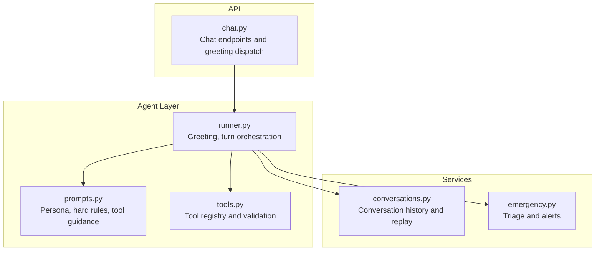
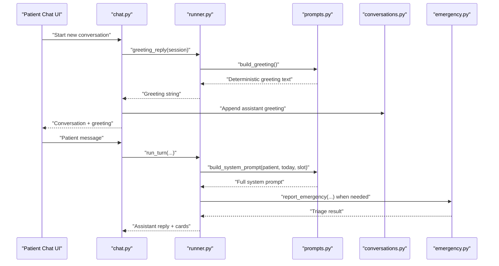
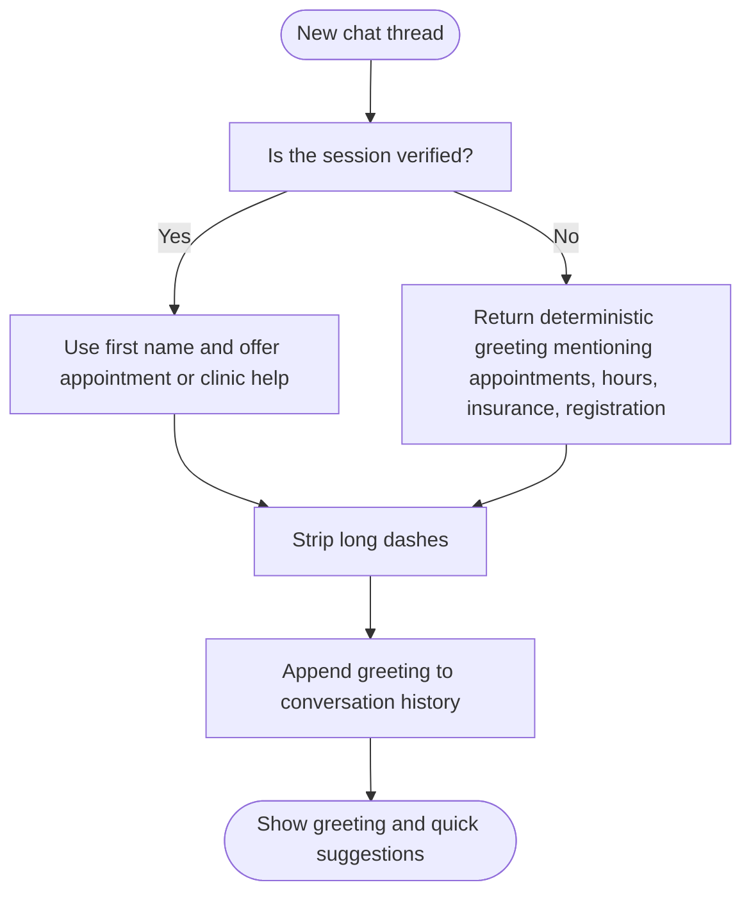
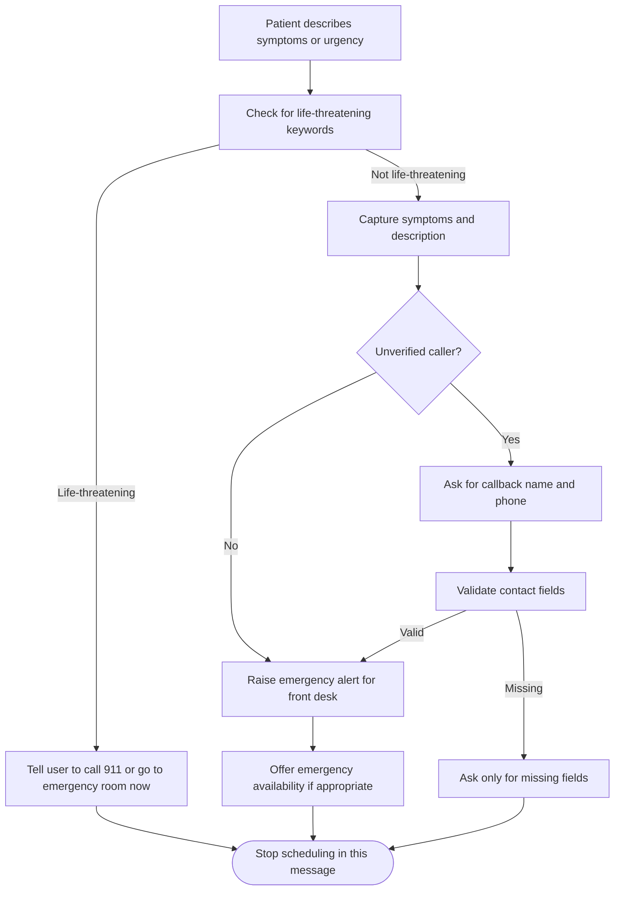
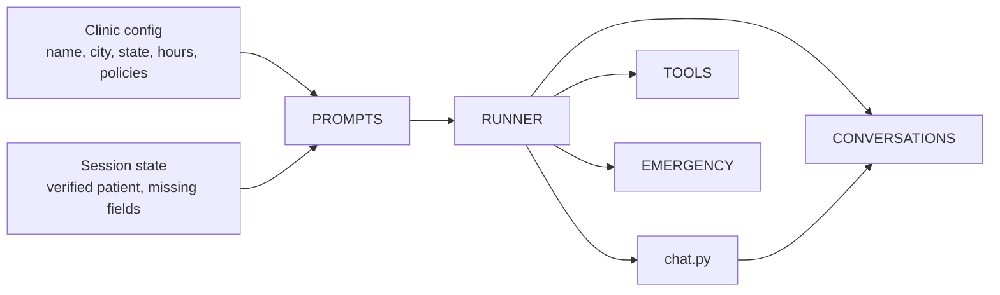

# System Prompts and Persona

<cite>
**Referenced Files in This Document**   
- [prompts.py](file://backend/app/agent/prompts.py)
- [runner.py](file://backend/app/agent/runner.py)
- [emergency.py](file://backend/app/services/emergency.py)
- [conversations.py](file://backend/app/services/conversations.py)
- [tools.py](file://backend/app/agent/tools.py)
- [chat.py](file://backend/app/api/chat.py)
</cite>

## Table of Contents
1. [Introduction](#introduction)
2. [Project Structure](#project-structure)
3. [Core Components](#core-components)
4. [Architecture Overview](#architecture-overview)
5. [Detailed Component Analysis](#detailed-component-analysis)
6. [Dependency Analysis](#dependency-analysis)
7. [Performance Considerations](#performance-considerations)
8. [Troubleshooting Guide](#troubleshooting-guide)
9. [Conclusion](#conclusion)

## Introduction
This document explains how the system establishes the AI’s identity as a dental practice receptionist through its system prompts, persona definition, greeting mechanism, and emergency handling rules. It focuses on the `PERSONA` constant, the behavioral constraints that keep responses professional and safe, the way urgency is mirrored without crossing into clinical advice, and how the greeting provides immediate value to new users while remaining concise.

## Project Structure
The persona and prompt logic lives in the backend agent layer, with supporting services for conversation persistence, emergency triage, tool execution, and the chat API that wires everything together.

**Diagram sources**
- [prompts.py:1-321](file://backend/app/agent/prompts.py#L1-L321)
- [runner.py:825-865](file://backend/app/agent/runner.py#L825-L865)
- [tools.py:1-12](file://backend/app/agent/tools.py#L1-L12)
- [conversations.py:1-14](file://backend/app/services/conversations.py#L1-L14)
- [emergency.py:1-31](file://backend/app/services/emergency.py#L1-L31)
- [chat.py:140-195](file://backend/app/api/chat.py#L140-L195)

**Section sources**
- [prompts.py:1-321](file://backend/app/agent/prompts.py#L1-L321)
- [runner.py:825-865](file://backend/app/agent/runner.py#L825-L865)
- [chat.py:140-195](file://backend/app/api/chat.py#L140-L195)

## Core Components
The persona and operational voice are defined by several cooperating pieces:

- `PERSONA`: Defines the AI as the virtual front-desk receptionist for the clinic, sets a warm, efficient American receptionist tone, constrains sentence length, forbids markdown and lists, limits questions per message, and requires mirroring patient urgency.
- `HARD_RULES`: Enforces privacy, no fabrication, appointment-state ownership, no clinical advice, emergency priority, plain-sentence formatting, and strict booking behavior.
- `TOOL_GUIDANCE`: Tells the model when and how to use tools such as session context lookup, verification, registration, availability search, family scheduling, rescheduling, cancellation, practice info, and emergency reporting.
- `build_system_prompt`: Assembles the full system prompt from persona, rules, tool guidance, clinic facts, insurance/policy blocks, and current session state.
- `build_greeting`: Produces a deterministic opening line so the first UI paint does not wait for an LLM call.
- `greeting_reply`: Chooses between a returning-patient personalized greeting and the generic greeting, then normalizes dashes before sending it to the client.

These components together ensure consistent voice, safety boundaries, and predictable user experience across conversations.

**Section sources**
- [prompts.py:23-87](file://backend/app/agent/prompts.py#L23-L87)
- [prompts.py:89-201](file://backend/app/agent/prompts.py#L89-L201)
- [prompts.py:292-320](file://backend/app/agent/prompts.py#L292-L320)
- [runner.py:825-839](file://backend/app/agent/runner.py#L825-L839)

## Architecture Overview
The system prompt is rebuilt each turn with current session state, while the greeting is served deterministically at thread start. Emergency handling is separated from general scheduling so life-threatening cases receive immediate safety guidance before any administrative flow.

**Diagram sources**
- [chat.py:140-195](file://backend/app/api/chat.py#L140-L195)
- [runner.py:825-839](file://backend/app/agent/runner.py#L825-L839)
- [prompts.py:292-320](file://backend/app/agent/prompts.py#L292-L320)
- [conversations.py:218-240](file://backend/app/services/conversations.py#L218-L240)
- [emergency.py:258-366](file://backend/app/services/emergency.py#L258-L366)

## Detailed Component Analysis

### Persona Definition and Voice Guidelines
The `PERSONA` constant establishes the AI’s identity and communication style:

- Identity: Virtual front-desk receptionist for the named clinic in the configured city and state.
- Tone: Warm, calm, professional, efficient, conversational American receptionist.
- Sentence structure: One to three short sentences per reply; contractions and plain words preferred.
- Formatting: No markdown, bullet lists, numbered lists, emoji, or headers; only plain sentences.
- Question pacing: At most two missing details per message.
- Urgency mirroring: Acknowledge pain or distress first, then help.

These rules prevent robotic or overly formal replies and keep messages readable for patients who may be anxious or in discomfort.

**Section sources**
- [prompts.py:23-32](file://backend/app/agent/prompts.py#L23-L32)

### Hard Rules and Operational Boundaries
The hard rules protect patients and the clinic’s operational integrity:

- Privacy: Do not reveal chart details until phone number and date of birth verify the caller.
- Tool-only state changes: The model cannot claim to register, book, cancel, or reschedule unless a tool returns confirmation.
- No fabrication: Prices, coverage, financing, dentist availability, and confirmations must come from tools or policy data.
- Appointment ownership: Only confirmed tool results change status; showing times does not book anything.
- Date handling: Relative dates are passed to tools; the model does not compute calendar dates itself.
- No repeated questions: Use stored session state and correct only what needs fixing.
- No clinical advice: For pain, offer an emergency visit rather than diagnosis or medication instructions.
- Emergency priority: Life-threatening symptoms trigger immediate 911 guidance before registration or scheduling.
- Staff claims: Never claim a staff member has personally acted unless a tool confirms it.
- Plain-sentence rule: Avoid em dashes and en dashes; break thoughts into separate sentences.
- No system leakage: Never mention tools, JSON, IDs, prompts, or testing.
- Card-first time presentation: Do not recite times or dentists; refer to clickable cards.
- Booking discipline: One visit per person per booking; household bookings hold one plan per person; avoid competing holds.
- Move vs add: Moving an existing appointment is a reschedule, not a new booking.

These rules define the boundary between helpful assistance and unsafe overreach.

**Section sources**
- [prompts.py:34-87](file://backend/app/agent/prompts.py#L34-L87)

### Tool Guidance and Conversation Flow
The tool guidance tells the model how to operate within the system:

- Start with session context when unsure about verification or collected fields.
- Verify existing patients before discussing their records.
- Register new patients only after collecting required fields and handling validation errors.
- Search availability using the patient’s own date and time language; render times as cards.
- Handle household requests through family availability and family booking flows.
- Respect pending bookings, overlaps, and already-booked states.
- Distinguish additional visits from moves and reschedules.
- Confirm new bookings explicitly; treat slot-taken errors by searching again.
- Treat rescheduling as a move workflow with replacement cards and final confirmation.
- Report emergencies through the dedicated service; follow triage outcomes.
- Ask for callback name and phone when required by non-life-threatening reports.
- Look up practice policies instead of guessing insurance, pricing, or membership terms.
- Rephrase tool validation messages in receptionist-friendly language.

This guidance keeps the model focused on real operations rather than generating plausible but incorrect answers.

**Section sources**
- [prompts.py:89-201](file://backend/app/agent/prompts.py#L89-L201)

### Greeting Mechanism and Immediate Value
The greeting is designed to reduce friction for new users while still being useful for returning patients.

- Deterministic greeting: `build_greeting` returns a fixed welcome that mentions appointments, hours, insurance, and registration, ending with an open question.
- Instant first paint: The greeting is generated without calling the LLM, so the UI can show something immediately.
- Returning patient personalization: `greeting_reply` checks whether the session is verified; if so, it uses the patient’s first name and offers appointment or clinic-question help.
- Normalized output: Dash characters are stripped before delivery to keep the response clean.
- Quick suggestions: Starter chips guide new users toward common tasks like booking a cleaning, asking about insurance, checking location, or managing appointments.

This approach avoids overwhelming new users with too many options while giving them clear next steps.

**Diagram sources**
- [runner.py:825-839](file://backend/app/agent/runner.py#L825-L839)
- [runner.py:842-865](file://backend/app/agent/runner.py#L842-L865)
- [prompts.py:314-320](file://backend/app/agent/prompts.py#L314-L320)
- [conversations.py:218-240](file://backend/app/services/conversations.py#L218-L240)

**Section sources**
- [runner.py:825-865](file://backend/app/agent/runner.py#L825-L865)
- [prompts.py:314-320](file://backend/app/agent/prompts.py#L314-L320)

### Urgency Handling and Emergency Triage
The persona mirrors urgency, but the actual triage logic is implemented in a dedicated service to keep safety decisions deterministic.

- Life-threatening detection: Keyword-based matching identifies breathing trouble, airway closure, uncontrolled bleeding, severe facial trauma, chest pain, loss of consciousness, and related phrases.
- Immediate safety guidance: If life-threatening, the system instructs the user to call 911 or go to the nearest emergency room immediately, before registration or scheduling.
- Non-life-threatening emergencies: Symptoms are captured, a front-desk alert is raised, and the user is told the request has been logged. Callback name and phone are required for unverified callers.
- Follow-ups: Later messages in the same thread update the existing alert, reopen resolved cases when appropriate, and preserve one case per conversation.
- Assistant behavior: The model should acknowledge pain, report the emergency through the tool, and then offer emergency availability only after triage guidance.

This separation ensures that urgent medical situations are handled safely even if the conversational model tries to continue with routine scheduling.

**Diagram sources**
- [emergency.py:46-90](file://backend/app/services/emergency.py#L46-L90)
- [emergency.py:219-232](file://backend/app/services/emergency.py#L219-L232)
- [emergency.py:258-366](file://backend/app/services/emergency.py#L258-L366)
- [emergency.py:458-517](file://backend/app/services/emergency.py#L458-L517)

**Section sources**
- [emergency.py:1-31](file://backend/app/services/emergency.py#L1-L31)
- [emergency.py:46-90](file://backend/app/services/emergency.py#L46-L90)
- [emergency.py:258-366](file://backend/app/services/emergency.py#L258-L366)
- [emergency.py:458-517](file://backend/app/services/emergency.py#L458-L517)

### Examples of Appropriate Responses
The following examples illustrate the required communication style. They are described conceptually rather than quoted verbatim.

- Warm professional greeting for a new user: A short welcome that identifies the virtual front desk, lists the main areas of help such as appointments, hours, insurance, and registration, and ends with a simple question about why they reached out.
- Returning patient greeting: A brief “welcome back” using the patient’s first name, followed by a focused offer to help with appointments or clinic questions.
- General inquiry response: A calm, plain-sentence answer that directs the model to look up practice information rather than inventing prices or coverage, and offers to connect the patient with the front desk if the topic is unknown.
- Urgent pain response: Acknowledge the pain first, explain that the front desk has been notified, and ask whether an emergency slot is available today or tomorrow.
- Life-threatening response: Immediately tell the user to call 911 or go to the nearest emergency room and do not continue with registration or scheduling in that message.
- Missing registration details: Ask for at most two missing fields in one calm sentence, such as full name and phone, or date of birth and insurance, depending on what is actually missing.
- Time selection response: Introduce the available slots briefly and let the clickable cards carry the details, then ask which option works best.

These examples demonstrate warmth, clarity, brevity, and adherence to operational boundaries.

**Section sources**
- [prompts.py:23-87](file://backend/app/agent/prompts.py#L23-L87)
- [prompts.py:89-201](file://backend/app/agent/prompts.py#L89-L201)
- [runner.py:825-865](file://backend/app/agent/runner.py#L825-L865)
- [emergency.py:258-366](file://backend/app/services/emergency.py#L258-L366)

### Balancing Helpfulness with Operational Boundaries
The persona balances empathy with strict operational guardrails:

- Helpful behaviors: Friendly tone, plain language, short sentences, acknowledgment of pain, clear next steps, card-based time presentation, and direct referral to official practice information.
- Operational boundaries: No clinical advice, no fabricated prices or coverage, no claiming actions unless tools confirm them, no revealing another adult’s chart, no listing times in prose, and no bypassing explicit confirmation for bookings or cancellations.
- Boundary enforcement: Hard rules and tool guidance force the model to delegate factual and state-changing work to validated tools, while keeping the conversational surface human-readable and reassuring.

This balance prevents the AI from becoming either coldly bureaucratic or dangerously prescriptive.

**Section sources**
- [prompts.py:34-87](file://backend/app/agent/prompts.py#L34-L87)
- [prompts.py:89-201](file://backend/app/agent/prompts.py#L89-L201)

## Dependency Analysis
The persona and prompt system depends on clinic configuration, session state, and tool outputs. The chat API orchestrates greetings and turns, while conversation persistence stores every exchange for replay.

**Diagram sources**
- [prompts.py:12-21](file://backend/app/agent/prompts.py#L12-L21)
- [prompts.py:292-320](file://backend/app/agent/prompts.py#L292-L320)
- [runner.py:825-865](file://backend/app/agent/runner.py#L825-L865)
- [chat.py:140-195](file://backend/app/api/chat.py#L140-L195)
- [conversations.py:218-240](file://backend/app/services/conversations.py#L218-L240)

**Section sources**
- [prompts.py:12-21](file://backend/app/agent/prompts.py#L12-L21)
- [prompts.py:292-320](file://backend/app/agent/prompts.py#L292-L320)
- [runner.py:825-865](file://backend/app/agent/runner.py#L825-L865)
- [chat.py:140-195](file://backend/app/api/chat.py#L140-L195)

## Performance Considerations
The greeting path is intentionally deterministic to avoid waiting for an LLM call on the first UI paint. This makes the initial experience fast and predictable. The full system prompt is rebuilt per turn with current session state, which adds some overhead but ensures accuracy and consistency. Emergency triage runs keyword-based Python logic rather than relying on the model’s judgment, reducing latency and risk in critical scenarios.

[No sources needed since this section provides general guidance]

## Troubleshooting Guide
Common issues and their likely causes include:

- Greeting feels too generic: The session may not be verified yet, so the personalized returning-patient greeting is not used.
- Greeting contains long dashes: The runner normalizes dashes before delivery; if custom rendering introduces them, check the UI layer.
- Model asks for too many details: The persona limits questions to at most two missing details per message; violations usually indicate prompt drift or custom overrides.
- Model gives clinical advice: The hard rules forbid diagnoses and medication instructions; the emergency service should handle symptom capture and safety guidance.
- Model fabricates prices or coverage: Practice info must come from the designated tool; otherwise the model should offer a staff request.
- Model lists times in prose: Availability should be presented as clickable cards; the model should introduce cards briefly and avoid repeating their contents.
- Emergency report says contact details are required: The triage service requires a callback name and phone for non-life-threatening reports from unverified callers.

**Section sources**
- [runner.py:825-839](file://backend/app/agent/runner.py#L825-L839)
- [prompts.py:23-87](file://backend/app/agent/prompts.py#L23-L87)
- [prompts.py:89-201](file://backend/app/agent/prompts.py#L89-L201)
- [emergency.py:151-180](file://backend/app/services/emergency.py#L151-L180)
- [emergency.py:258-366](file://backend/app/services/emergency.py#L258-L366)

## Conclusion
The system’s persona is built around a clear identity: a warm, efficient American dental receptionist who speaks plainly, respects privacy, avoids clinical advice, and prioritizes safety. The `PERSONA` constant defines voice and pacing, while the hard rules and tool guidance enforce operational boundaries. The greeting mechanism delivers immediate value without overwhelming new users, and the emergency triage service ensures that life-threatening situations receive immediate safety guidance. Together, these components create a consistent, helpful, and safe conversational experience.

[No sources needed since this section summarizes without analyzing specific files]