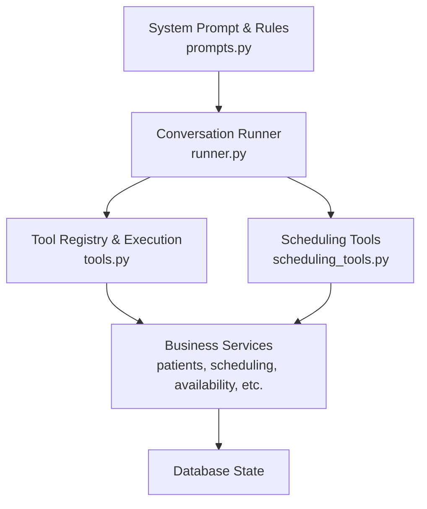
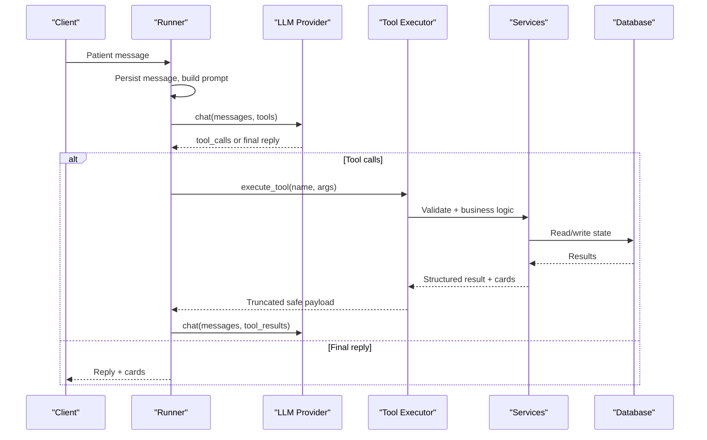
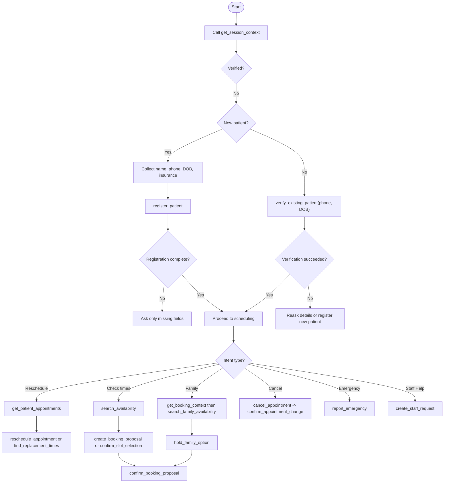
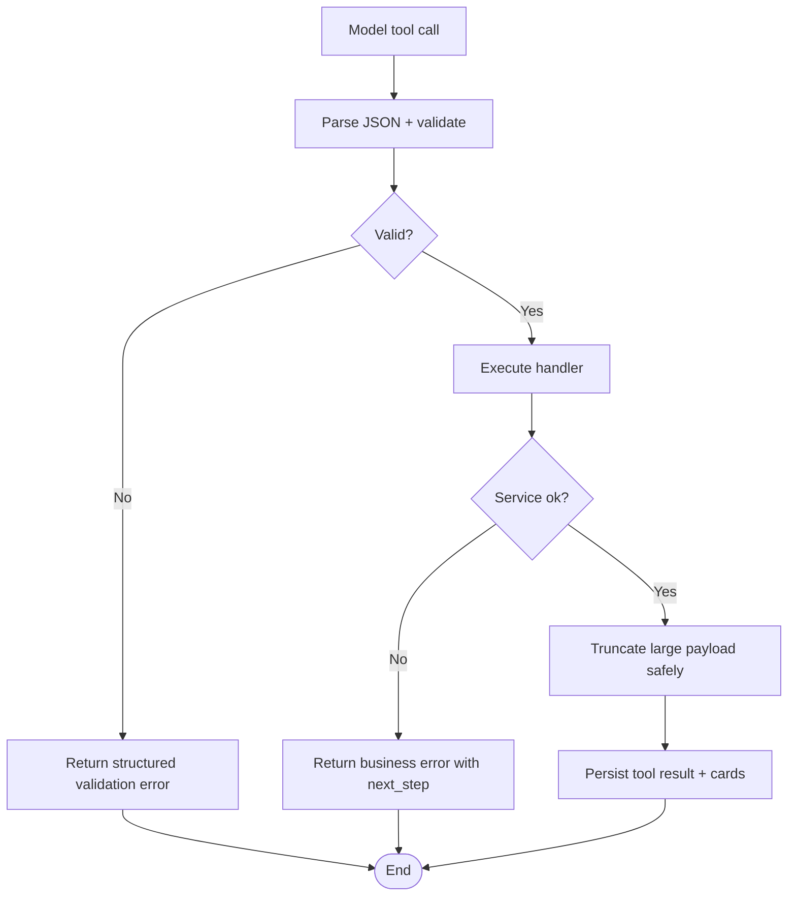
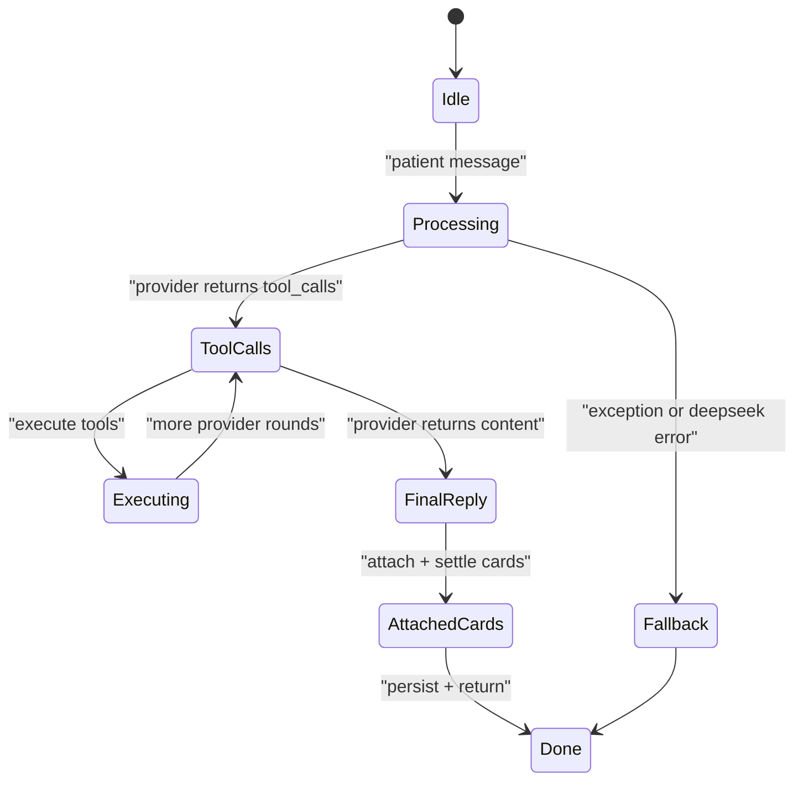
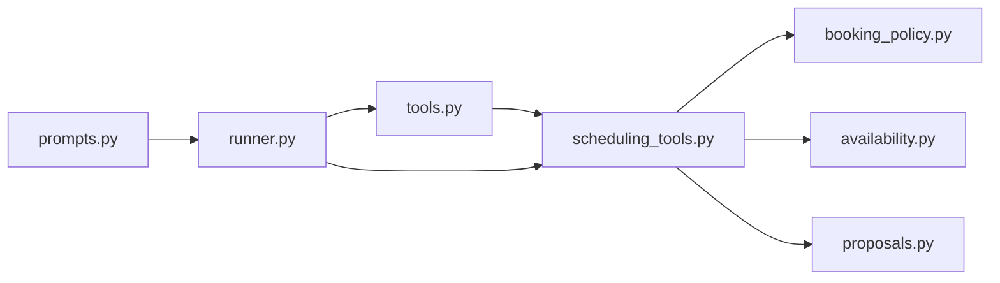

# Tool Selection and Usage Guidelines

<cite>
**Referenced Files in This Document**
- [tools.py](file://backend/app/agent/tools.py)
- [scheduling_tools.py](file://backend/app/agent/scheduling_tools.py)
- [prompts.py](file://backend/app/agent/prompts.py)
- [runner.py](file://backend/app/agent/runner.py)
- [booking_policy.py](file://backend/app/services/booking_policy.py)
- [availability.py](file://backend/app/services/availability.py)
- [proposals.py](file://backend/app/services/proposals.py)
</cite>

## Table of Contents
1. [Introduction](#introduction)
2. [Project Structure](#project-structure)
3. [Core Components](#core-components)
4. [Architecture Overview](#architecture-overview)
5. [Detailed Component Analysis](#detailed-component-analysis)
6. [Dependency Analysis](#dependency-analysis)
7. [Performance Considerations](#performance-considerations)
8. [Troubleshooting Guide](#troubleshooting-guide)
9. [Conclusion](#conclusion)

## Introduction
This document explains how the AI assistant selects and calls backend tools during a dental front-desk conversation. It focuses on:
- When to call identity, registration, availability, family coordination, booking, reschedule, cancellation, emergency, and staff-handoff tools.
- The decision tree for choosing between solo and family flows.
- How to handle validation errors, tool failures, overlapping appointments, pending bookings, and unexpected results.
- Conversation flow management, state persistence, and recovery mechanisms.

The guidance is grounded in the agent’s tool definitions, scheduling logic, system prompts, and conversation runner behavior.

## Project Structure
The relevant code lives under `backend/app`:
- Agent layer:
  - `agent/tools.py` defines identity and registration tools, argument models, context, and execution.
  - `agent/scheduling_tools.py` defines availability, proposals, appointments, family, emergencies, and staff requests.
  - `agent/prompts.py` provides persona, hard rules, and tool guidance for the model.
  - `agent/runner.py` runs the conversation loop, executes tools, persists turns/cards, and handles recovery.
- Services layer:
  - `services/booking_policy.py`, `services/availability.py`, and `services/proposals.py` enforce business rules around overlaps, pending holds, and proposal integrity.

**Diagram sources**
- [runner.py:171-406](file://backend/app/agent/runner.py#L171-L406)
- [tools.py:493-614](file://backend/app/agent/tools.py#L493-L614)
- [scheduling_tools.py:1475-1651](file://backend/app/agent/scheduling_tools.py#L1475-L1651)
- [prompts.py:23-201](file://backend/app/agent/prompts.py#L23-L201)

**Section sources**
- [runner.py:1-23](file://backend/app/agent/runner.py#L1-L23)
- [tools.py:1-31](file://backend/app/agent/tools.py#L1-L31)
- [scheduling_tools.py:1-17](file://backend/app/agent/scheduling_tools.py#L1-L17)
- [prompts.py:1-6](file://backend/app/agent/prompts.py#L1-L6)

## Core Components
- ToolContext: request-scoped state carrying the database session, patient session, and conversation id; it exposes the verified patient safely.
- ToolSpec: schema + handler wrapper used to expose tools to the model with validated arguments.
- execute_tool: central entry point that validates JSON, Pydantic arguments, invokes handlers, flushes verification writes, truncates large payloads, and never raises.
- Scheduling tools: availability search, slot selection, proposal creation, confirmation, decline, appointment listing, reschedule, cancel, family search/hold, emergency report, and staff request.
- Runner: orchestrates provider calls, tool execution, card merging, prompt refresh, and safe fallbacks.

Key responsibilities:
- Identity and registration are isolated from scheduling to keep auditability and security clear.
- Availability and booking are strictly service-driven; the model never directly creates or modifies appointments.
- Cards carry the authoritative UI state; prose must not invent times or confirmations.

**Section sources**
- [tools.py:41-53](file://backend/app/agent/tools.py#L41-L53)
- [tools.py:493-508](file://backend/app/agent/tools.py#L493-L508)
- [tools.py:703-739](file://backend/app/agent/tools.py#L703-L739)
- [scheduling_tools.py:59-360](file://backend/app/agent/scheduling_tools.py#L59-L360)
- [runner.py:171-406](file://backend/app/agent/runner.py#L171-L406)

## Architecture Overview
The conversation lifecycle:
1. Authenticate and persist the patient message.
2. Build system prompt using current session state and clinic facts.
3. Call the LLM with available tools.
4. Execute requested tools through validated services.
5. Persist assistant turn and tool results.
6. Call the LLM again with results until final text or round limit.
7. Attach cards, normalize replies, and return visible messages.

**Diagram sources**
- [runner.py:171-406](file://backend/app/agent/runner.py#L171-L406)
- [runner.py:409-557](file://backend/app/agent/runner.py#L409-L557)
- [tools.py:703-739](file://backend/app/agent/tools.py#L703-L739)

## Detailed Component Analysis

### Tool Selection Decision Tree

Use this decision tree to choose the correct tool sequence.

**Diagram sources**
- [tools.py:147-161](file://backend/app/agent/tools.py#L147-L161)
- [tools.py:192-284](file://backend/app/agent/tools.py#L192-L284)
- [scheduling_tools.py:474-552](file://backend/app/agent/scheduling_tools.py#L474-L552)
- [scheduling_tools.py:1109-1170](file://backend/app/agent/scheduling_tools.py#L1109-L1170)
- [scheduling_tools.py:788-897](file://backend/app/agent/scheduling_tools.py#L788-L897)
- [scheduling_tools.py:900-950](file://backend/app/agent/scheduling_tools.py#L900-L950)
- [scheduling_tools.py:1280-1329](file://backend/app/agent/scheduling_tools.py#L1280-L1329)
- [scheduling_tools.py:1337-1468](file://backend/app/agent/scheduling_tools.py#L1337-L1468)

#### Scenario Workflows

- New patient registration
  - Start with `get_session_context`.
  - If unverified, collect full name, phone, date of birth, and insurance (or Self-pay).
  - Call `register_patient`.
  - If validation fails, ask only for the listed field errors.
  - After successful registration, proceed to scheduling.

- Existing patient scheduling
  - Start with `get_session_context`.
  - If unverified, call `verify_existing_patient` with phone and date of birth.
  - Once verified, call `get_booking_context` when multiple visits may be involved.
  - For solo availability, call `search_availability`.
  - For household availability, call `search_family_availability` with one member per person.

- Family coordination
  - Use `get_booking_context` to determine solo vs household scope and whether a hold exists.
  - Call `search_family_availability` with all members and their visit types.
  - Call `hold_family_option` once to hold one complete same-day plan.
  - Confirm with `confirm_booking_proposal`; one confirmation books everyone or nobody.

- Emergency reporting
  - Call `report_emergency`.
  - If life-threatening, follow immediate safety guidance before any registration or scheduling.
  - If contact details are required for non-life-threatening reports, collect caller name and phone and retry.
  - For updates, call `report_emergency` with `is_update=true`.

- Staff assistance
  - Use `create_staff_request` for insurance, billing, financing, membership, or callback needs.
  - Do not invent answers; always delegate unknown policy questions.

**Section sources**
- [tools.py:147-161](file://backend/app/agent/tools.py#L147-L161)
- [tools.py:192-284](file://backend/app/agent/tools.py#L192-L284)
- [scheduling_tools.py:474-552](file://backend/app/agent/scheduling_tools.py#L474-L552)
- [scheduling_tools.py:1109-1170](file://backend/app/agent/scheduling_tools.py#L1109-L1170)
- [scheduling_tools.py:1280-1329](file://backend/app/agent/scheduling_tools.py#L1280-L1329)
- [scheduling_tools.py:1337-1468](file://backend/app/agent/scheduling_tools.py#L1337-L1468)

### Tool Invocation Sequences and Response Interpretation

- Verification and registration
  - `get_session_context` returns verification status, patient profile, missing fields, and whether availability can be shown.
  - `verify_existing_patient` marks the session verified and returns first name and completeness.
  - `register_patient` normalizes inputs, validates, creates the patient, marks verification, and returns profile plus insurance interpretation.

- Availability and proposals
  - `search_availability` returns slot cards; do not repeat times in prose.
  - `get_booking_context` tells you how many times are needed and whether a hold or booking already exists.
  - `create_booking_proposal` holds slots and returns an awaiting-confirmation card; do not say “booked” yet.
  - `confirm_booking_proposal` performs the transactional booking; if slot_taken, apologize and search again.

- Reschedule and cancel
  - Always list existing appointments with `get_patient_appointments` before changes.
  - Use `reschedule_appointment` to move an existing visit; it creates a reschedule proposal.
  - Use `find_replacement_times` while a move is pending to continue the same reschedule flow.
  - Use `cancel_appointment` followed by `confirm_appointment_change`; nothing is released until confirmed.

- Family
  - Use `search_family_availability` for multi-person plans.
  - Use `hold_family_option` to hold one combined option; one confirmation books everyone.

- Emergencies and staff
  - `report_emergency` returns triage outcome, optional 911 instruction, and handoff cards.
  - `create_staff_request` logs a human task; do not claim personal follow-up unless a tool confirms it.

**Section sources**
- [tools.py:147-161](file://backend/app/agent/tools.py#L147-L161)
- [tools.py:192-284](file://backend/app/agent/tools.py#L192-L284)
- [scheduling_tools.py:474-552](file://backend/app/agent/scheduling_tools.py#L474-L552)
- [scheduling_tools.py:555-682](file://backend/app/agent/scheduling_tools.py#L555-L682)
- [scheduling_tools.py:690-717](file://backend/app/agent/scheduling_tools.py#L690-L717)
- [scheduling_tools.py:725-897](file://backend/app/agent/scheduling_tools.py#L725-L897)
- [scheduling_tools.py:900-950](file://backend/app/agent/scheduling_tools.py#L900-L950)
- [scheduling_tools.py:1109-1170](file://backend/app/agent/scheduling_tools.py#L1109-L1170)
- [scheduling_tools.py:1280-1329](file://backend/app/agent/scheduling_tools.py#L1280-L1329)
- [scheduling_tools.py:1337-1468](file://backend/app/agent/scheduling_tools.py#L1337-L1468)

### Error Handling Strategies

- Validation errors
  - Argument parsing and Pydantic validation errors become structured tool results with `error` and `field_errors`.
  - Registration normalization returns specific field issues; ask only for those fields.

- Tool failures
  - Unknown tool names, bad JSON, invalid arguments, and unexpected exceptions are caught and returned as safe error payloads.
  - The runner also wraps tool execution to ensure no half-written turns remain.

- Business rule errors
  - Overlapping bookings and already-booked visits return explicit errors with next steps.
  - Pending moves prevent accidental additional bookings unless explicitly requested as an additional visit.
  - Wrong proposal kind errors direct the model to use the correct confirmation tool.

- Edge cases
  - Ambiguous dates and relative time phrases are passed to tools rather than computed by the model.
  - Empty but complete availability searches are terminal for the model turn; avoid repeated searches or premature callbacks.
  - Stale cards are settled or deduplicated so the patient does not see duplicate or expired options.

**Diagram sources**
- [tools.py:703-739](file://backend/app/agent/tools.py#L703-L739)
- [runner.py:721-761](file://backend/app/agent/runner.py#L721-L761)
- [booking_policy.py:442-475](file://backend/app/services/booking_policy.py#L442-L475)
- [availability.py:97-124](file://backend/app/services/availability.py#L97-L124)
- [proposals.py:327-366](file://backend/app/services/proposals.py#L327-L366)

**Section sources**
- [tools.py:123-126](file://backend/app/agent/tools.py#L123-L126)
- [tools.py:703-739](file://backend/app/agent/tools.py#L703-L739)
- [runner.py:264-292](file://backend/app/agent/runner.py#L264-L292)
- [runner.py:409-557](file://backend/app/agent/runner.py#L409-L557)
- [booking_policy.py:442-475](file://backend/app/services/booking_policy.py#L442-L475)
- [availability.py:97-124](file://backend/app/services/availability.py#L97-L124)
- [proposals.py:327-366](file://backend/app/services/proposals.py#L327-L366)

### Conversation Flow Management, State Persistence, and Recovery

- System prompt and state
  - The runner builds a system prompt including persona, hard rules, tool guidance, clinic facts, and session state.
  - Session state includes verification, missing fields, clinic today, and next open slot hints.

- Turn loop and bounds
  - The runner limits tool rounds and calls per round.
  - Each provider call is persisted; tool results are appended and re-sent to the provider.
  - If the provider emits tool calls after tools are withdrawn, the runner avoids replaying synthetic ids.

- Card handling
  - Cards come from tool results and are merged per round.
  - Offer-type cards supersede older grids; informational cards are preserved.
  - Duplicate cards are removed by identity.
  - Settled grids are marked so they are not offered again.

- Recovery mechanisms
  - DeepSeek errors produce a friendly user message and safe assistant text.
  - Unexpected exceptions roll back and return a fallback reply.
  - Time re-asks replay the most recent grid when the model did not search again.
  - Emergency notices are enforced in code if a handoff card indicates an alert.

**Diagram sources**
- [runner.py:171-406](file://backend/app/agent/runner.py#L171-L406)
- [runner.py:409-557](file://backend/app/agent/runner.py#L409-L557)
- [runner.py:567-637](file://backend/app/agent/runner.py#L567-L637)
- [runner.py:693-718](file://backend/app/agent/runner.py#L693-L718)

**Section sources**
- [prompts.py:23-201](file://backend/app/agent/prompts.py#L23-L201)
- [runner.py:171-406](file://backend/app/agent/runner.py#L171-L406)
- [runner.py:409-557](file://backend/app/agent/runner.py#L409-L557)
- [runner.py:567-637](file://backend/app/agent/runner.py#L567-L637)
- [runner.py:693-718](file://backend/app/agent/runner.py#L693-L718)

## Dependency Analysis

**Diagram sources**
- [tools.py:493-614](file://backend/app/agent/tools.py#L493-L614)
- [scheduling_tools.py:1475-1651](file://backend/app/agent/scheduling_tools.py#L1475-L1651)
- [runner.py:171-406](file://backend/app/agent/runner.py#L171-L406)
- [prompts.py:292-311](file://backend/app/agent/prompts.py#L292-L311)

Coupling and cohesion:
- `tools.py` owns identity and registration; `scheduling_tools.py` owns scheduling operations.
- Both depend on shared base classes (`ToolContext`, `ToolArguments`, `_error`) and services.
- `runner.py` is the orchestration layer and depends on both tool modules and the provider client.
- Business rules are centralized in services, reducing duplication across tools.

Potential circular dependencies:
- Scheduling tools import from `tools.py`; `tools.py` lazily imports scheduling specs to avoid circular initialization.

External integration points:
- LLM provider via `DeepSeekClient`.
- Database via SQLAlchemy sessions.
- Front desk handoff via staff handoff services.

**Section sources**
- [tools.py:493-614](file://backend/app/agent/tools.py#L493-L614)
- [scheduling_tools.py:1-17](file://backend/app/agent/scheduling_tools.py#L1-L17)
- [runner.py:35-47](file://backend/app/agent/runner.py#L35-L47)

## Performance Considerations
- Tool result truncation preserves interactive fields and cards while trimming secondary detail to fit token limits.
- The runner limits tool rounds and calls per round to bound latency.
- Card merging and deduplication reduce redundant UI elements.
- Time re-ask detection avoids unnecessary provider calls by replaying grids when appropriate.
- Emergency notice enforcement is done in code to avoid extra model reasoning.

[No sources needed since this section provides general guidance]

## Troubleshooting Guide

Common symptoms and resolutions:

- Model asks for times repeatedly without showing cards
  - Ensure the tool returned cards and the runner attached them.
  - For time re-asks, verify the grid was refreshed or replayed.

- “Slot taken” after confirmation
  - Apologize briefly, do not imply a booking, and search again.

- Overlapping or already-booked errors
  - Offer to move the existing visit or book an additional visit only if explicitly requested.

- Pending reschedule blocks new booking
  - Finish the pending move or explicitly request an additional visit with reason.

- Wrong proposal kind error
  - Use `confirm_appointment_change` for reschedules/cancellations; use `confirm_booking_proposal` for new bookings.

- No availability found
  - Retry with alternative days or providers; do not immediately create a callback unless the patient explicitly asks or the operation itself failed.

- Emergency report requires contact details
  - Collect caller name and phone for non-life-threatening reports; retry the report.

- Unexpected tool failure
  - The runner returns a friendly fallback and persists safe assistant text; check logs for tool execution events.

**Section sources**
- [tools.py:617-700](file://backend/app/agent/tools.py#L617-L700)
- [runner.py:264-292](file://backend/app/agent/runner.py#L264-L292)
- [runner.py:409-557](file://backend/app/agent/runner.py#L409-L557)
- [runner.py:567-637](file://backend/app/agent/runner.py#L567-L637)
- [scheduling_tools.py:555-682](file://backend/app/agent/scheduling_tools.py#L555-L682)
- [scheduling_tools.py:1337-1468](file://backend/app/agent/scheduling_tools.py#L1337-L1468)

## Conclusion
The tool selection strategy centers on verifying identity first, determining solo versus family scope, and following strict paths for availability, proposals, reschedules, cancellations, emergencies, and staff requests. Validation and business rules are enforced by services, while the runner ensures robust conversation state, card consistency, and safe recovery. Following these guidelines prevents hallucinated data, protects privacy, and keeps the patient experience predictable even under edge cases like overlapping appointments or pending bookings.