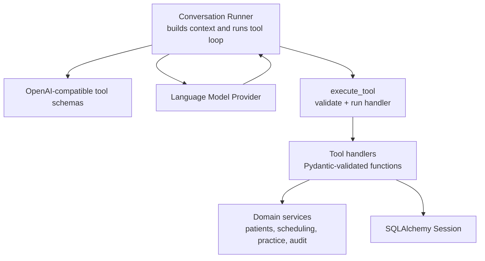
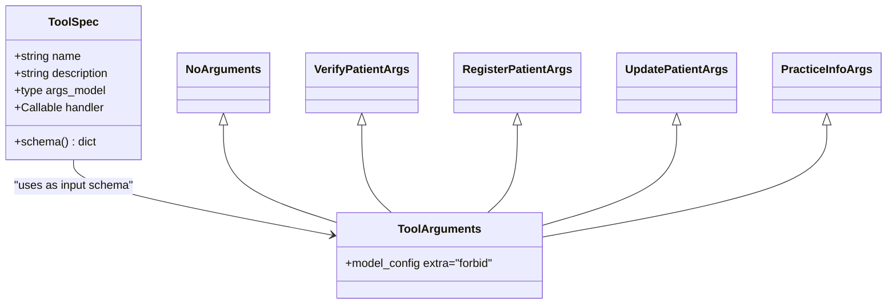
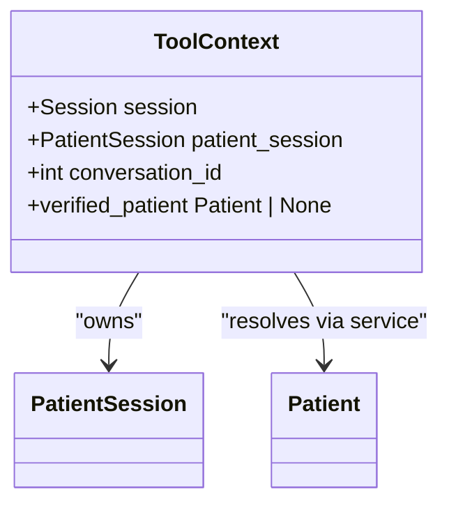
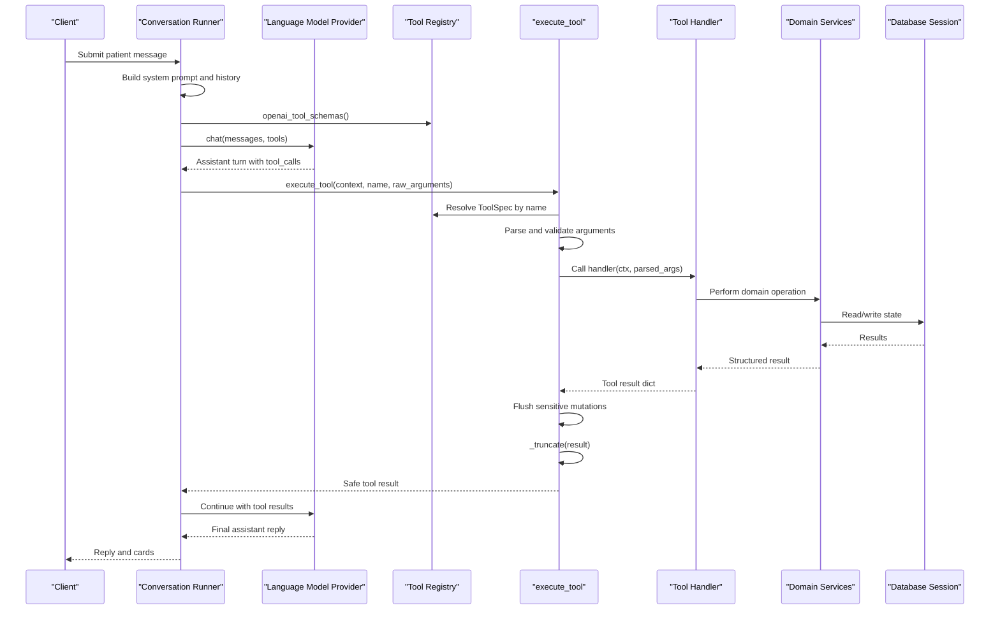
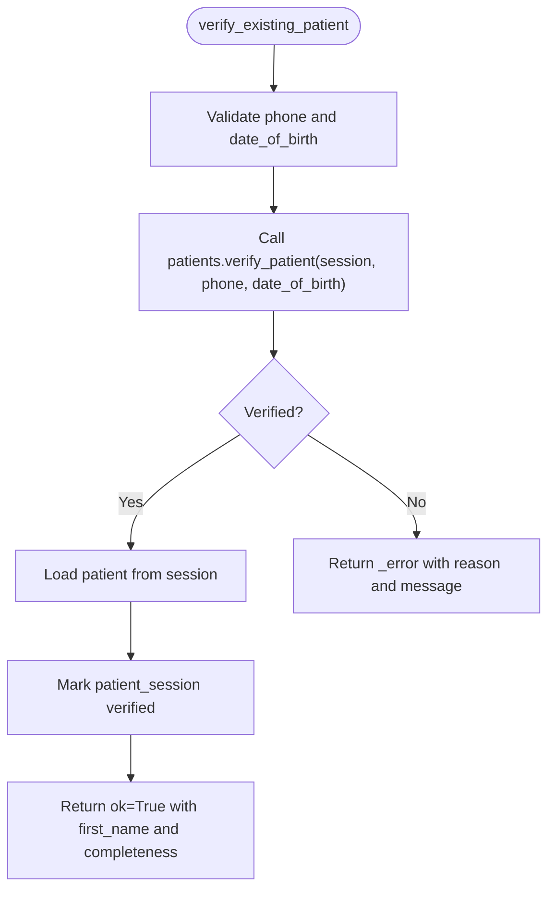
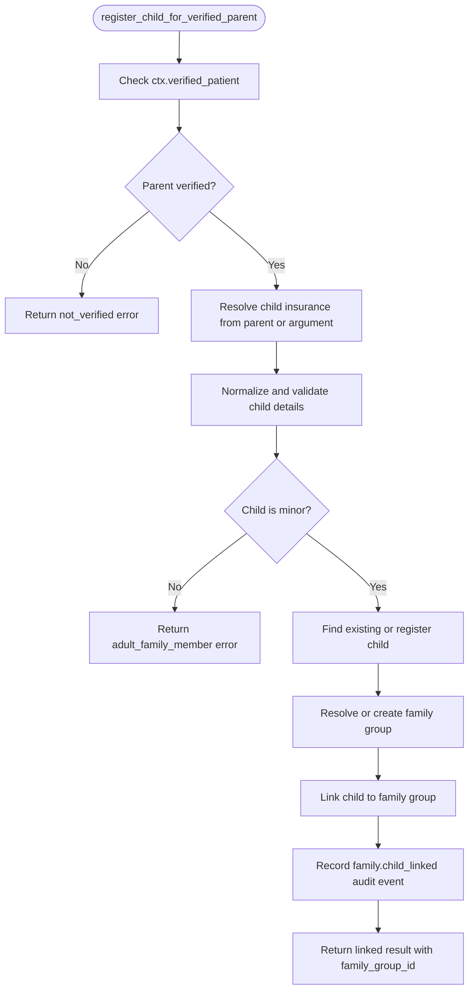
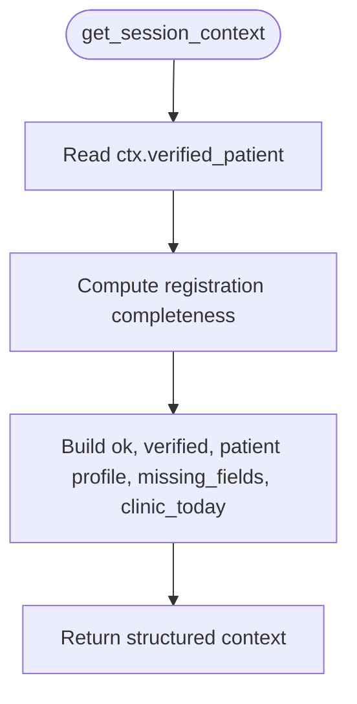
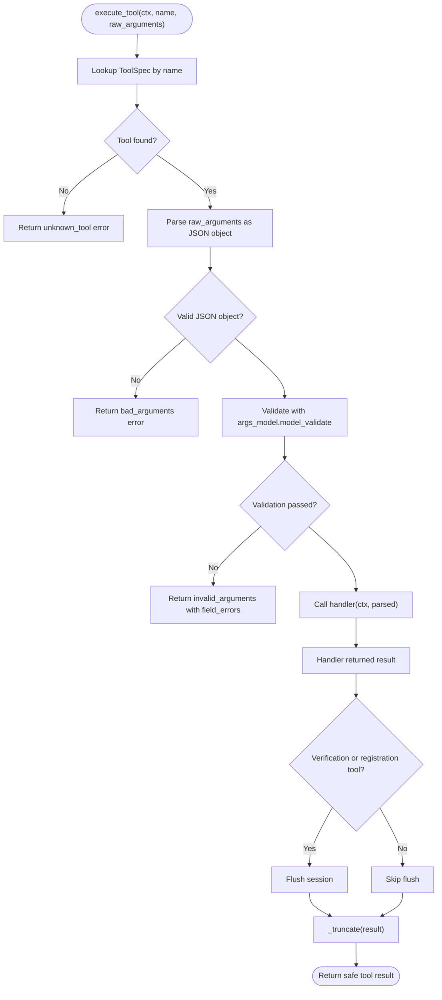
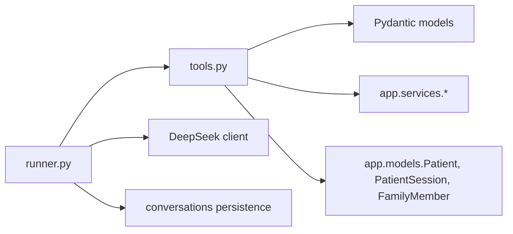

# Core Tool Concepts

<cite>
**Referenced Files in This Document**
- [tools.py](file://backend/app/agent/tools.py)
- [runner.py](file://backend/app/agent/runner.py)
</cite>

## Table of Contents
1. [Introduction](#introduction)
2. [Project Structure](#project-structure)
3. [Core Components](#core-components)
4. [Architecture Overview](#architecture-overview)
5. [Detailed Component Analysis](#detailed-component-analysis)
6. [Dependency Analysis](#dependency-analysis)
7. [Performance Considerations](#performance-considerations)
8. [Troubleshooting Guide](#troubleshooting-guide)
9. [Conclusion](#conclusion)

## Introduction
This document explains the core tool concepts that form the foundation of the AI safety architecture. It focuses on how tools are defined, validated, executed, and bounded so that a language model can perform safe, auditable actions without receiving identity or sensitive context directly from its own arguments.

The key ideas are:
- Tools are declared with clear input schemas using Pydantic models.
- Identity and request-scoped state come from `ToolContext`, built by the runner.
- All failures become structured tool results rather than unhandled exceptions.
- Tool results are truncated to prevent payload overflow while preserving interactive cards.

## Project Structure
The tool system lives under the agent layer:
- `backend/app/agent/tools.py` defines the tool data model, argument schemas, handlers, registry, execution logic, and result truncation.
- `backend/app/agent/runner.py` builds the conversation loop, constructs `ToolContext`, calls the provider with tool schemas, executes tool calls, and persists turns and cards.



**Diagram sources**
- [runner.py:171-235](file://backend/app/agent/runner.py#L171-L235)
- [runner.py:409-557](file://backend/app/agent/runner.py#L409-L557)
- [tools.py:493-515](file://backend/app/agent/tools.py#L493-L515)
- [tools.py:703-739](file://backend/app/agent/tools.py#L703-L739)

**Section sources**
- [tools.py:1-33](file://backend/app/agent/tools.py#L1-L33)
- [runner.py:1-23](file://backend/app/agent/runner.py#L1-L23)

## Core Components
This section introduces the foundational types and patterns used by every tool.

### ToolSpec
`ToolSpec` is a frozen dataclass that describes one callable tool exposed to the model. Each instance contains:
- `name`: The function name sent to the provider.
- `description`: Human-readable guidance for the model about when and how to call the tool.
- `args_model`: A Pydantic model subclass describing and validating the tool’s JSON arguments.
- `handler`: A Python callable that receives the request context and validated arguments and returns a dictionary result.

`ToolSpec.schema()` converts the Pydantic model into an OpenAI-compatible function schema, including parameters derived from field descriptions.



**Diagram sources**
- [tools.py:493-508](file://backend/app/agent/tools.py#L493-L508)
- [tools.py:54-120](file://backend/app/agent/tools.py#L54-L120)

**Section sources**
- [tools.py:493-515](file://backend/app/agent/tools.py#L493-L515)
- [tools.py:54-120](file://backend/app/agent/tools.py#L54-L120)

### ToolContext
`ToolContext` is a request-scoped container built by the runner from authenticated session state. It provides:
- `session`: The SQLAlchemy database session.
- `patient_session`: The current patient session.
- `conversation_id`: The conversation identifier.
- `verified_patient`: A property that resolves the verified patient for this session.

Tools must never accept identity fields such as patient ID, caller phone, or family membership from model arguments. Instead, they read `ctx.verified_patient` or other state through `ToolContext`. This prevents the model from impersonating another user or attaching actions to someone else’s chart.



**Diagram sources**
- [tools.py:41-52](file://backend/app/agent/tools.py#L41-L52)

**Section sources**
- [tools.py:41-52](file://backend/app/agent/tools.py#L41-L52)

### Argument Validation Pattern
Every tool uses a Pydantic model subclass of `ToolArguments`. Base configuration forbids unknown fields, which means hallucinated or unexpected keys are rejected before any business logic runs. Examples include:
- `NoArguments` for tools that take no input.
- `VerifyPatientArgs` for phone and date of birth.
- `RegisterPatientArgs` for full name, phone, date of birth, and insurance.
- `UpdatePatientArgs` for optional corrected fields.
- `PracticeInfoArgs` for an optional topic selector.

Field descriptions are intentionally written for the model, guiding it toward correct inputs.

**Section sources**
- [tools.py:54-120](file://backend/app/agent/tools.py#L54-L120)

### Error Helper
The `_error` helper creates a uniform failure payload:
- `ok`: Always `False`.
- `error`: A machine-readable error code.
- `message`: A human-friendly explanation.
- Optional extra fields such as `field_errors`, topics, or hints.

Handlers return these dictionaries instead of raising exceptions, allowing the execution layer to treat them as normal tool results.

**Section sources**
- [tools.py:123-126](file://backend/app/agent/tools.py#L123-L126)

### Result Truncation
Tool results can contain large lists such as availability grids, appointment histories, or provider catalogs. The truncation mechanism:
- Encodes the result as JSON.
- Keeps the original payload if it fits within `MAX_TOOL_RESULT_CHARS`.
- Otherwise removes secondary detail fields while preserving decision-critical fields and interactive cards.
- Limits card and appointment list sizes.
- Marks the result with `truncated: True`.
- Falls back to a minimal payload if even the slimmed result is too large.

This protects the conversation loop and UI from oversized payloads while keeping actionable information intact.

**Section sources**
- [tools.py:33-33](file://backend/app/agent/tools.py#L33-L33)
- [tools.py:617-700](file://backend/app/agent/tools.py#L617-L700)

## Architecture Overview
The runner orchestrates the interaction between the language model, tool schemas, and validated tool execution.



**Diagram sources**
- [runner.py:171-235](file://backend/app/agent/runner.py#L171-L235)
- [runner.py:409-557](file://backend/app/agent/runner.py#L409-L557)
- [runner.py:721-761](file://backend/app/agent/runner.py#L721-L761)
- [tools.py:493-515](file://backend/app/agent/tools.py#L493-L515)
- [tools.py:703-739](file://backend/app/agent/tools.py#L703-L739)

**Section sources**
- [runner.py:171-235](file://backend/app/agent/runner.py#L171-L235)
- [runner.py:409-557](file://backend/app/agent/runner.py#L409-L557)
- [runner.py:721-761](file://backend/app/agent/runner.py#L721-L761)
- [tools.py:703-739](file://backend/app/agent/tools.py#L703-L739)

## Detailed Component Analysis

### Tool Definition Example: Verify Existing Patient
This example shows how a tool definition combines a Pydantic argument model, a handler, and a `ToolSpec` entry.

Key behaviors:
- Arguments are validated against `VerifyPatientArgs`.
- The handler reads verification state only through `ctx.session` and `ctx.patient_session`.
- On success, the session is marked verified and the result includes confirmation and registration completeness.
- On failure, `_error` returns a structured response with a stable error code.



**Diagram sources**
- [tools.py:192-218](file://backend/app/agent/tools.py#L192-L218)
- [tools.py:522-530](file://backend/app/agent/tools.py#L522-L530)

**Section sources**
- [tools.py:62-65](file://backend/app/agent/tools.py#L62-L65)
- [tools.py:192-218](file://backend/app/agent/tools.py#L192-L218)
- [tools.py:522-530](file://backend/app/agent/tools.py#L522-L530)

### Tool Definition Example: Register Child for Verified Parent
This tool demonstrates security-by-design:
- It requires a verified parent through `ToolContext`; it does not accept a parent ID or phone from model arguments.
- It validates child details and enforces minor status.
- It links or creates a child patient and updates family membership safely.
- It audits the linkage action.



**Diagram sources**
- [tools.py:287-427](file://backend/app/agent/tools.py#L287-L427)
- [tools.py:549-559](file://backend/app/agent/tools.py#L549-L559)

**Section sources**
- [tools.py:84-102](file://backend/app/agent/tools.py#L84-L102)
- [tools.py:287-427](file://backend/app/agent/tools.py#L287-L427)
- [tools.py:549-559](file://backend/app/agent/tools.py#L549-L559)

### Tool Definition Example: Get Session Context
This tool shows a read-only operation that exposes only what the runner has already authorized:
- It reads the verified patient from `ToolContext`.
- It computes registration completeness.
- It returns whether availability can be shown and which fields are still missing.



**Diagram sources**
- [tools.py:147-161](file://backend/app/agent/tools.py#L147-L161)
- [tools.py:511-521](file://backend/app/agent/tools.py#L511-L521)

**Section sources**
- [tools.py:147-161](file://backend/app/agent/tools.py#L147-L161)
- [tools.py:511-521](file://backend/app/agent/tools.py#L511-L521)

### execute_tool: Safe Execution Pipeline
`execute_tool` is the central safety boundary around every tool call. Its responsibilities are:
1. Resolve the tool by name.
2. Parse raw JSON arguments.
3. Validate arguments against the tool’s Pydantic model.
4. Call the handler with `ToolContext` and validated arguments.
5. Flush sensitive mutations for verification and registration tools.
6. Truncate the result.
7. Never raise; all failures become structured tool results.



**Diagram sources**
- [tools.py:703-739](file://backend/app/agent/tools.py#L703-L739)

**Section sources**
- [tools.py:703-739](file://backend/app/agent/tools.py#L703-L739)

### Runner Integration: Building ToolContext and Running Tool Calls
The runner:
- Validates the incoming patient message length.
- Persists the patient message and refreshes conversation metadata.
- Builds the system prompt and provider messages.
- Constructs `ToolContext` from the authenticated session.
- Requests tool schemas from the registry.
- Calls the provider with those schemas.
- Executes each tool call through `_execute`, which delegates to `execute_tool`.
- Persists tool results and continues the loop until the model returns prose or the round limit is reached.

```mermaid
sequenceDiagram
participant Runner as "run_turn"
participant Loop as "_run_loop"
participant Provider as "DeepSeekClient"
participant Exec as "_execute"
participant Tools as "execute_tool"
Runner->>Runner : Validate and persist patient message
Runner->>Runner : Build system prompt and history
Runner->>Runner : Create ToolContext
Runner->>Loop : Run tool loop
Loop->>Provider : chat(messages, tools)
Provider-->>Loop : Tool calls
Loop->>Exec : Execute each call
Exec->>Tools : execute_tool(context, name, arguments)
Tools-->>Exec : Structured result
Exec-->>Loop : Persisted tool result
Loop->>Provider : Next round with tool results
Provider-->>Loop : Final reply
Loop-->>Runner : Reply and cards
```

**Diagram sources**
- [runner.py:171-235](file://backend/app/agent/runner.py#L171-L235)
- [runner.py:409-557](file://backend/app/agent/runner.py#L409-L557)
- [runner.py:721-761](file://backend/app/agent/runner.py#L721-L761)

**Section sources**
- [runner.py:171-235](file://backend/app/agent/runner.py#L171-L235)
- [runner.py:409-557](file://backend/app/agent/runner.py#L409-L557)
- [runner.py:721-761](file://backend/app/agent/runner.py#L721-L761)

## Dependency Analysis
The tool system has clear separation between interface, validation, execution, and domain logic.



**Diagram sources**
- [runner.py:35-47](file://backend/app/agent/runner.py#L35-L47)
- [tools.py:21-31](file://backend/app/agent/tools.py#L21-L31)

**Section sources**
- [runner.py:35-47](file://backend/app/agent/runner.py#L35-L47)
- [tools.py:21-31](file://backend/app/agent/tools.py#L21-L31)

## Performance Considerations
- **Argument validation**: Pydantic validation happens once per tool call before any service is invoked, preventing expensive work on malformed input.
- **Round limits**: The runner caps tool rounds and tool calls per round to avoid runaway loops.
- **Result truncation**: Large tool outputs are trimmed to keep payloads manageable while preserving interactive cards and decision fields.
- **Session flush control**: Only verification and registration tools explicitly flush the session after mutation, reducing unnecessary writes.

[No sources needed since this section provides general guidance]

## Troubleshooting Guide
Common issues and their expected behavior:

| Symptom | Expected Behavior | Likely Cause |
|---|---|---|
| Model requests an unknown tool | Returns `unknown_tool` error | Tool name mismatch or missing registration |
| JSON arguments are malformed | Returns `bad_arguments` error | Provider emitted invalid JSON |
| Required fields are missing or wrong type | Returns `invalid_arguments` with `field_errors` | Pydantic validation failed |
| Handler raises an exception | Returns `tool_failed` error | Bug in handler or downstream service |
| Result payload is too large | Returns truncated result with `truncated: True` | Exceeds character limit |
| Verification-dependent tool fails early | Returns `not_verified` error | Caller not verified in `ToolContext` |

Recommended debugging steps:
1. Inspect the tool name and registered schema.
2. Log the raw arguments only where safe; avoid logging patient details.
3. Check the Pydantic validation errors for field-level feedback.
4. Confirm that `ToolContext` was built by the runner and not supplied by the model.
5. Review truncation behavior when large availability or appointment lists are involved.

**Section sources**
- [tools.py:123-126](file://backend/app/agent/tools.py#L123-L126)
- [tools.py:617-700](file://backend/app/agent/tools.py#L617-L700)
- [tools.py:703-739](file://backend/app/agent/tools.py#L703-L739)

## Conclusion
The core tool concepts provide a secure, predictable interface between the language model and the application’s domain logic. By combining:
- `ToolSpec` for declarative tool definitions,
- Pydantic argument models for strict input validation,
- `ToolContext` for runner-built, request-scoped state,
- `_error` for structured failures,
- `_truncate` for payload safety,
- `execute_tool` for guarded execution,

the system ensures that the model can act usefully without being trusted with identity, secrets, or unchecked input. Failures remain recoverable, results remain bounded, and sensitive state remains controlled by the runner.

[No sources needed since this section summarizes without analyzing specific files]