# Domain-Specific Tools Architecture

<cite>
**Referenced Files in This Document**   
- [README.md](file://README.md)
- [backend/app/agent/tools/__init__.py](file://backend/app/agent/tools/__init__.py)
- [backend/app/agent/tools/kernel.py](file://backend/app/agent/tools/kernel.py)
- [backend/app/agent/tools/catalogue.py](file://backend/app/agent/tools/catalogue.py)
- [backend/app/agent/tools/policy.py](file://backend/app/agent/tools/policy.py)
- [backend/app/agent/tools/_helpers.py](file://backend/app/agent/tools/_helpers.py)
- [backend/app/agent/tools/domains/__init__.py](file://backend/app/agent/tools/domains/__init__.py)
- [backend/app/agent/tools/domains/appointments.py](file://backend/app/agent/tools/domains/appointments.py)
- [backend/app/agent/tools/domains/availability.py](file://backend/app/agent/tools/domains/availability.py)
- [backend/app/agent/tools/domains/booking.py](file://backend/app/agent/tools/domains/booking.py)
- [backend/app/agent/tools/domains/escalation.py](file://backend/app/agent/tools/domains/escalation.py)
- [backend/app/agent/tools/domains/family.py](file://backend/app/agent/tools/domains/family.py)
- [backend/app/agent/tools/domains/identity.py](file://backend/app/agent/tools/domains/identity.py)
- [backend/app/agent/tools/domains/practice.py](file://backend/app/agent/tools/domains/practice.py)
</cite>

## Table of Contents
1. [Introduction](#introduction)
2. [Project Structure](#project-structure)
3. [Core Components](#core-components)
4. [Architecture Overview](#architecture-overview)
5. [Detailed Component Analysis](#detailed-component-analysis)
6. [Dependency Analysis](#dependency-analysis)
7. [Performance Considerations](#performance-considerations)
8. [Troubleshooting Guide](#troubleshooting-guide)
9. [Conclusion](#conclusion)

## Introduction
This document explains the domain-specific tool architecture used by the dental receptionist agent. The system separates language interpretation from deterministic business logic: a model selects tools, but Python and SQLite own identity, scheduling, authorization, transactions, and state changes.

The tool layer is intentionally small and contract-driven. Every tool has:
- A frozen specification describing its name, description, argument schema, handler, result policy, domain, mutation flag, and verification requirement.
- Pydantic-validated arguments.
- A context object that carries authenticated session state rather than trusting model-provided identity.
- A bounded, structured result that can be safely returned to the next model round or rendered as interactive cards.

The repository’s README describes the broader patient and staff workflows, technology stack, reliability guarantees, and production scaling notes. The tool subsystem implements the boundary between conversational turns and those deterministic services.

**Section sources**
- [README.md:1-57](file://README.md#L1-L57)
- [README.md:100-184](file://README.md#L100-L184)

## Project Structure
At the top level, the backend organizes the agent under `app/agent`, with the tool package exposing one public surface through `__init__.py`. Domain handlers live under `domains/`, while shared kernel, registry, execution path, turn policy, and helpers are kept outside the domains so they do not create circular imports.

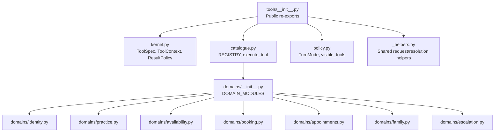

**Diagram sources**
- [backend/app/agent/tools/__init__.py:1-57](file://backend/app/agent/tools/__init__.py#L1-L57)
- [backend/app/agent/tools/kernel.py:1-225](file://backend/app/agent/tools/kernel.py#L1-L225)
- [backend/app/agent/tools/catalogue.py:1-92](file://backend/app/agent/tools/catalogue.py#L1-L92)
- [backend/app/agent/tools/policy.py:1-135](file://backend/app/agent/tools/policy.py#L1-L135)
- [backend/app/agent/tools/_helpers.py:1-241](file://backend/app/agent/tools/_helpers.py#L1-L241)
- [backend/app/agent/tools/domains/__init__.py:1-20](file://backend/app/agent/tools/domains/__init__.py#L1-L20)

**Section sources**
- [backend/app/agent/tools/__init__.py:1-57](file://backend/app/agent/tools/__init__.py#L1-L57)
- [backend/app/agent/tools/domains/__init__.py:1-20](file://backend/app/agent/tools/domains/__init__.py#L1-L20)

## Core Components
The core tool components define the contract, registry, execution pipeline, and turn policy.

| Component | Responsibility | Key Design Points |
|---|---|---|
| `ToolContext` | Carries SQLAlchemy session, patient session, conversation id, and verified patient lookup | Identity comes from the graph/session, never from model arguments |
| `ToolArguments` / `NoArguments` | Base Pydantic models for tool inputs | Extra fields are forbidden to reject hallucinated parameters |
| `ToolSpec` | Immutable tool definition | Includes name, description, args model, handler, result policy, domain, mutation flag, and verification requirement |
| `ResultPolicy` | Controls which fields survive trimming | Keeps universal decision fields plus per-tool decision fields; limits cards and lists |
| `ToolRegistry` | Name-addressable collection of specs | Fails loudly on duplicate names at import time |
| `execute_tool` | Single entry point for running tools | Validates JSON, validates arguments, enforces verification, logs mutations, catches exceptions, truncates results |
| Turn policy | Decides which tools are visible per model round | Supports default and reask modes, search exhaustion, household routing, and fuzzy availability reasks |

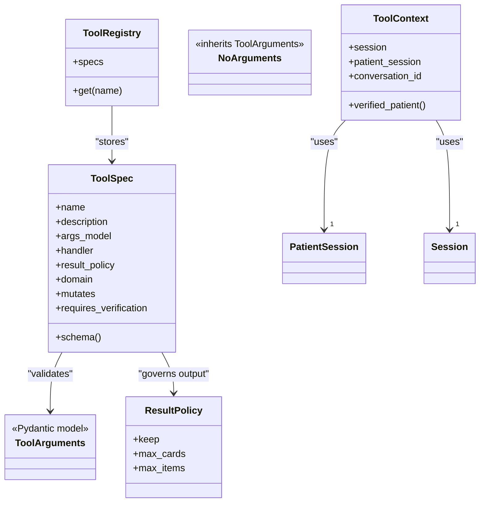

**Diagram sources**
- [backend/app/agent/tools/kernel.py:59-143](file://backend/app/agent/tools/kernel.py#L59-L143)
- [backend/app/agent/tools/kernel.py:189-209](file://backend/app/agent/tools/kernel.py#L189-L209)

**Section sources**
- [backend/app/agent/tools/kernel.py:1-225](file://backend/app/agent/tools/kernel.py#L1-L225)
- [backend/app/agent/tools/catalogue.py:1-92](file://backend/app/agent/tools/catalogue.py#L1-L92)
- [backend/app/agent/tools/policy.py:1-135](file://backend/app/agent/tools/policy.py#L1-L135)

## Architecture Overview
The end-to-end flow starts when FastAPI builds a LangGraph turn. For each turn, the graph asks the model to call one of the registered tools. The catalogue resolves the tool, validates its arguments, checks verification, runs the domain handler, and returns a bounded result.

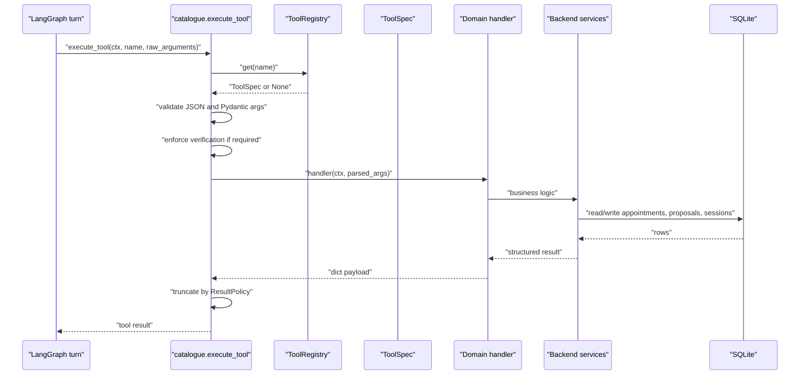

**Diagram sources**
- [backend/app/agent/tools/catalogue.py:40-88](file://backend/app/agent/tools/catalogue.py#L40-L88)
- [backend/app/agent/tools/kernel.py:110-143](file://backend/app/agent/tools/kernel.py#L110-L143)
- [backend/app/agent/tools/kernel.py:146-182](file://backend/app/agent/tools/kernel.py#L146-L182)

The turn policy adds an extra control layer before the model sees tools. It prevents loops by hiding tools after an exhausted search, restricts reasks to a safe subset, and avoids collapsing household requests into solo searches.

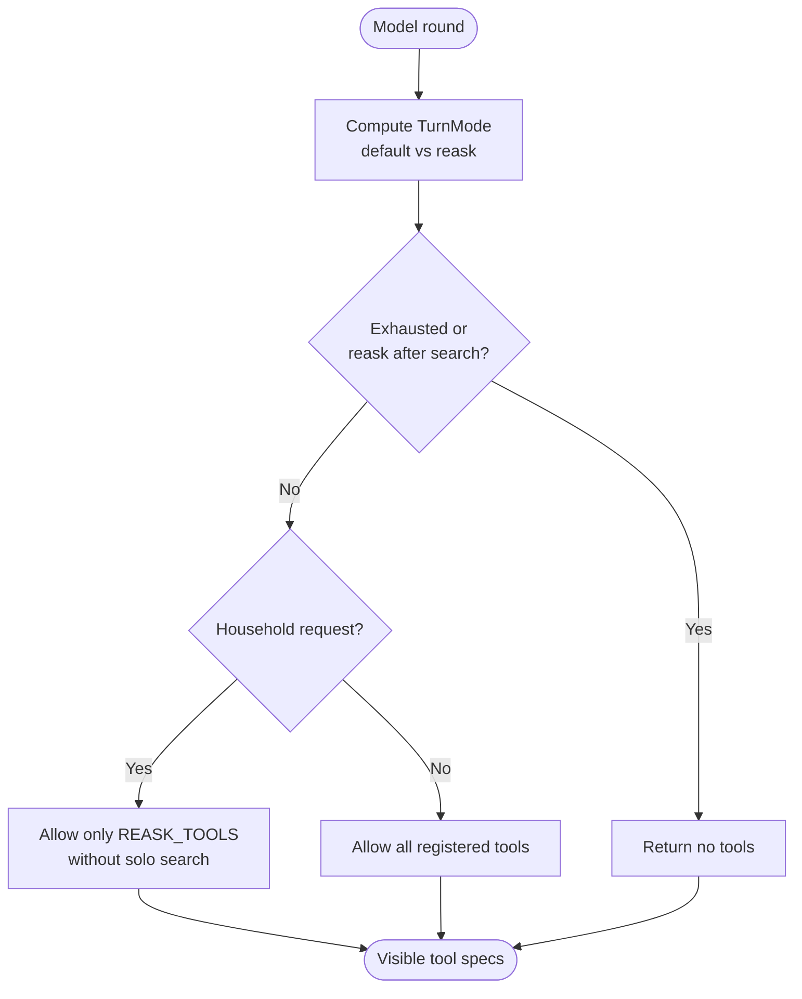

**Diagram sources**
- [backend/app/agent/tools/policy.py:26-41](file://backend/app/agent/tools/policy.py#L26-L41)
- [backend/app/agent/tools/policy.py:90-121](file://backend/app/agent/tools/policy.py#L90-L121)

**Section sources**
- [README.md:44-57](file://README.md#L44-L57)
- [backend/app/agent/tools/policy.py:1-135](file://backend/app/agent/tools/policy.py#L1-L135)
- [backend/app/agent/tools/catalogue.py:1-92](file://backend/app/agent/tools/catalogue.py#L1-L92)

## Detailed Component Analysis

### Tool Kernel and Execution Pipeline
The kernel defines the immutable contract every tool follows. Handlers receive a `ToolContext` and validated arguments, and return dictionaries that may include decision fields, messages, cards, and structured errors.

Key behaviors:
- Arguments arrive as JSON strings and are rejected early if malformed.
- Pydantic validation produces field-level errors instead of unhandled exceptions.
- Verification is enforced centrally; handlers should not bypass it.
- Mutating tools emit an observability event before running.
- Unexpected handler exceptions become structured tool failures so the graph survives bugs.
- Results are trimmed according to `ResultPolicy`, preserving interactive cards and decision fields.

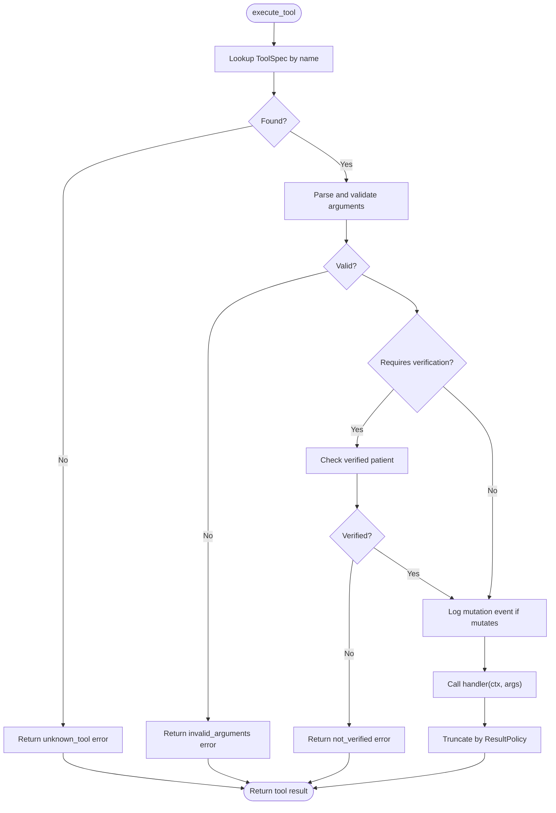

**Diagram sources**
- [backend/app/agent/tools/catalogue.py:40-88](file://backend/app/agent/tools/catalogue.py#L40-L88)
- [backend/app/agent/tools/kernel.py:80-107](file://backend/app/agent/tools/kernel.py#L80-L107)
- [backend/app/agent/tools/kernel.py:146-182](file://backend/app/agent/tools/kernel.py#L146-L182)

**Section sources**
- [backend/app/agent/tools/kernel.py:1-225](file://backend/app/agent/tools/kernel.py#L1-L225)
- [backend/app/agent/tools/catalogue.py:1-92](file://backend/app/agent/tools/catalogue.py#L1-L92)

### Identity Domain
The identity domain owns registration, verification, child linking, and chart updates. It is central to security because identity must never be inferred from model arguments.

Important responsibilities:
- `get_session_context` reports whether the session is verified, which patient it belongs to, what registration fields are missing, and whether availability can be shown.
- `verify_existing_patient` matches phone and date of birth and marks the session verified.
- `register_patient` normalizes input, creates a patient, and marks the session verified.
- `register_child_for_verified_parent` links a minor to the verified parent’s household without changing who is verified in the conversation.
- `update_patient_details` corrects existing chart data.

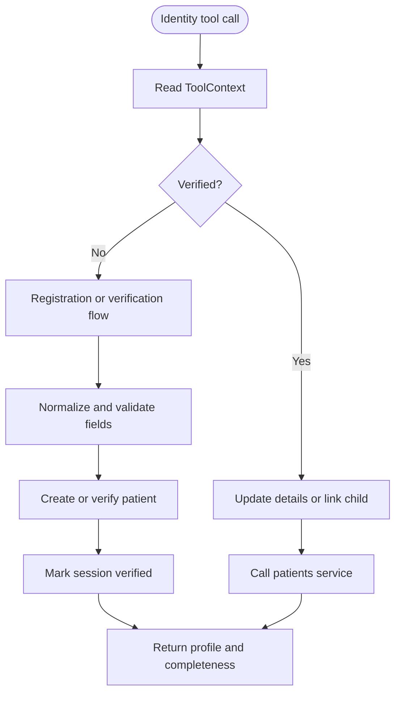

**Diagram sources**
- [backend/app/agent/tools/domains/identity.py:39-69](file://backend/app/agent/tools/domains/identity.py#L39-L69)
- [backend/app/agent/tools/domains/identity.py:71-116](file://backend/app/agent/tools/domains/identity.py#L71-L116)
- [backend/app/agent/tools/domains/identity.py:161-252](file://backend/app/agent/tools/domains/identity.py#L161-L252)
- [backend/app/agent/tools/domains/identity.py:254-429](file://backend/app/agent/tools/domains/identity.py#L254-L429)
- [backend/app/agent/tools/domains/identity.py:431-484](file://backend/app/agent/tools/domains/identity.py#L431-L484)

**Section sources**
- [backend/app/agent/tools/domains/identity.py:1-500](file://backend/app/agent/tools/domains/identity.py#L1-L500)

### Practice Domain
The practice domain provides clinic policies, hours, contact information, and insurance overview. It deliberately relays configured facts rather than letting the model invent coverage or pricing.

Key points:
- `get_practice_info` lists topics or returns a specific policy topic.
- `get_practice_summary` returns address, hours, dentists, appointment types, and insurance in one response.
- Both tools do not require verification because they expose non-sensitive practice information.

**Section sources**
- [backend/app/agent/tools/domains/practice.py:1-90](file://backend/app/agent/tools/domains/practice.py#L1-L90)

### Availability Domain
The availability domain finds open times for solo visits, family bookings, replacement times during rescheduling, and the current booking context.

Key responsibilities:
- `search_availability` performs a solo availability search, falls back to stored preferences, and refuses solo searches when the stored request covers multiple family members.
- `get_booking_context` tells the model whether this is a solo or household booking, whether a hold exists, and what the next step should be.
- `find_replacement_times` supports a pending reschedule by searching replacement slots tied to the original visit.
- `search_family_availability` coordinates multiple household members and prefers back-to-back options.

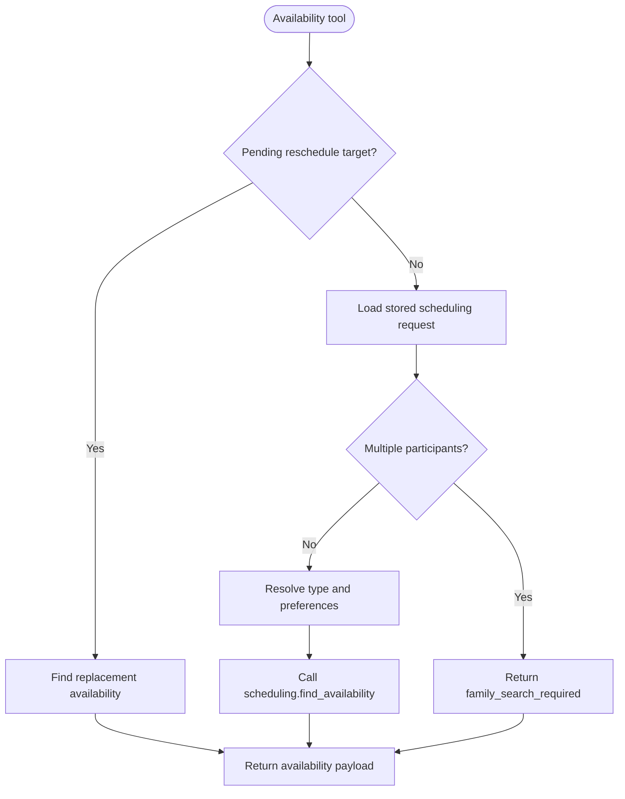

**Diagram sources**
- [backend/app/agent/tools/domains/availability.py:89-179](file://backend/app/agent/tools/domains/availability.py#L89-L179)
- [backend/app/agent/tools/domains/availability.py:187-260](file://backend/app/agent/tools/domains/availability.py#L187-L260)
- [backend/app/agent/tools/domains/availability.py:262-304](file://backend/app/agent/tools/domains/availability.py#L262-L304)
- [backend/app/agent/tools/domains/availability.py:349-388](file://backend/app/agent/tools/domains/availability.py#L349-L388)

**Section sources**
- [backend/app/agent/tools/domains/availability.py:1-402](file://backend/app/agent/tools/domains/availability.py#L1-L402)

### Booking Domain
The booking domain manages holds, confirmations, slot selection continuations, and declines. It enforces the product rule that new bookings and reschedules follow different paths.

Key rules:
- `create_booking_proposal` holds slots for a new visit. If the caller signals a reschedule or passes an appointment id, it routes to the reschedule path instead of creating a new booking proposal.
- While a reschedule is pending, a new booking is refused unless the caller explicitly requests an additional visit with a reason.
- `confirm_slot_selection` continues either a reschedule move or a new booking based on card intent and stored state.
- `confirm_booking_proposal` confirms a new-booking proposal and revalidates availability inside a transaction.
- `decline_booking_proposal` releases a held proposal without booking.

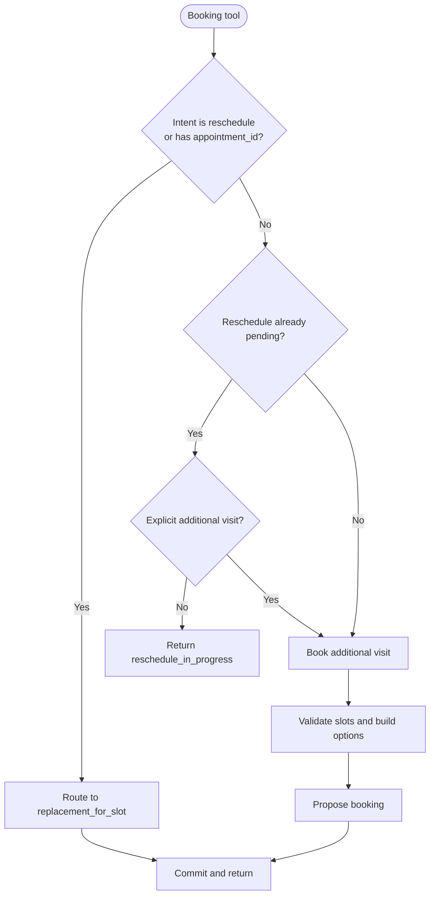

**Diagram sources**
- [backend/app/agent/tools/domains/booking.py:32-75](file://backend/app/agent/tools/domains/booking.py#L32-L75)
- [backend/app/agent/tools/domains/booking.py:76-220](file://backend/app/agent/tools/domains/booking.py#L76-L220)
- [backend/app/agent/tools/domains/booking.py:222-322](file://backend/app/agent/tools/domains/booking.py#L222-L322)
- [backend/app/agent/tools/domains/booking.py:324-384](file://backend/app/agent/tools/domains/booking.py#L324-L384)

**Section sources**
- [backend/app/agent/tools/domains/booking.py:1-398](file://backend/app/agent/tools/domains/booking.py#L1-L398)

### Appointments Domain
The appointments domain reads the verified patient’s real appointments and proposes moves or cancellations. It does not book new visits.

Key responsibilities:
- `get_patient_appointments` lists upcoming or past visits, pending proposals, and renders appointment cards.
- `reschedule_appointment` proposes moving an existing appointment. It supports both explicit slot ids and natural-language date/time hints.
- `cancel_appointment` proposes cancellation and requires explicit confirmation.
- `confirm_appointment_change` atomically confirms a reschedule or cancellation.

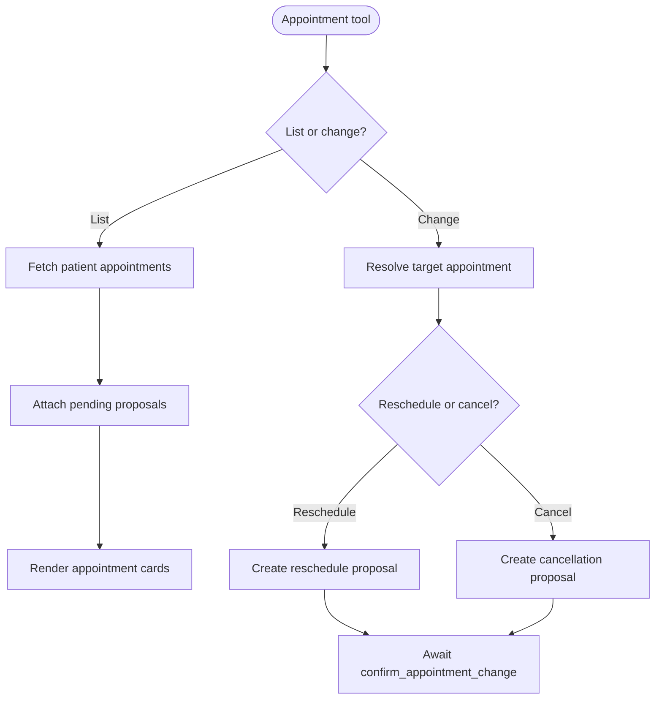

**Diagram sources**
- [backend/app/agent/tools/domains/appointments.py:33-97](file://backend/app/agent/tools/domains/appointments.py#L33-L97)
- [backend/app/agent/tools/domains/appointments.py:99-255](file://backend/app/agent/tools/domains/appointments.py#L99-L255)
- [backend/app/agent/tools/domains/appointments.py:257-338](file://backend/app/agent/tools/domains/appointments.py#L257-L338)

**Section sources**
- [backend/app/agent/tools/domains/appointments.py:1-352](file://backend/app/agent/tools/domains/appointments.py#L1-L352)

### Family Domain
The family domain holds one combined option for a household booking. Confirmation books every member together or none.

Key design points:
- `hold_family_option` resolves authorized family members, merges stored preferences, and calls the scheduling service to hold a single family proposal.
- The tool accepts either an index or a stable option identity from a clicked card.
- It refuses holding two options at once, keeping the workflow atomic.

**Section sources**
- [backend/app/agent/tools/domains/family.py:1-119](file://backend/app/agent/tools/domains/family.py#L1-L119)

### Escalation Domain
The escalation domain handles emergencies and front-desk follow-ups. It integrates with emergency triage and staff handoff.

Key behaviors:
- `report_emergency` triages symptoms, updates existing alerts for repeated reports, and flags life-threatening cases with immediate guidance.
- `create_staff_request` raises a staff request for topics such as billing, membership, clinical questions, callbacks, or rescheduling assistance.
- Callback handling includes a recovery path that retries the canonical family scheduling request before falling back to human handoff.

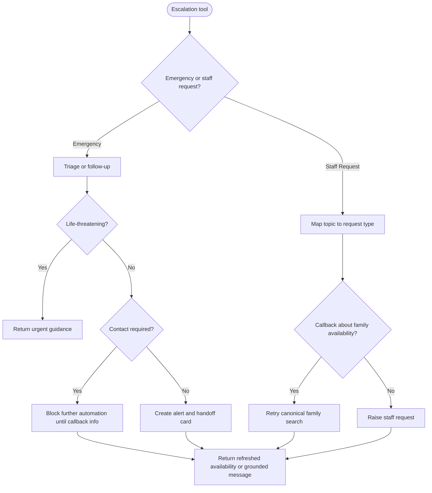

**Diagram sources**
- [backend/app/agent/tools/domains/escalation.py:36-128](file://backend/app/agent/tools/domains/escalation.py#L36-L128)
- [backend/app/agent/tools/domains/escalation.py:130-283](file://backend/app/agent/tools/domains/escalation.py#L130-L283)

**Section sources**
- [backend/app/agent/tools/domains/escalation.py:1-295](file://backend/app/agent/tools/domains/escalation.py#L1-L295)

### Shared Helpers
The helper module contains reusable logic used across domains, including requester resolution, registration gating, appointment target resolution, pending proposal summaries, household membership summaries, family member resolution, appointment type resolution, and handoff card generation.

Notable responsibilities:
- `_requester` ensures the caller is verified and attaches the conversation.
- `_registration_gate` blocks scheduling when registration is incomplete.
- `_resolve_target` resolves an existing appointment for cancellation or rescheduling.
- `_pending_proposal_summary` surfaces pending proposals so the model can confirm the right action.
- `_household_summary` derives bookable household members without exposing private history.
- `_family_member_patients` maps first names to authorized patients and handles common clarifications like “both.”

**Section sources**
- [backend/app/agent/tools/_helpers.py:1-241](file://backend/app/agent/tools/_helpers.py#L1-L241)

## Dependency Analysis
The tool package is layered to avoid circular dependencies:
- `kernel.py` defines the contract and knows nothing about domain modules.
- `catalogue.py` joins kernel and domains by importing `DOMAIN_MODULES` and building `REGISTRY`.
- `policy.py` depends on `REGISTRY` and `ToolSpec` to compute visibility.
- Domain modules depend on kernel primitives and backend services, but not on each other directly.

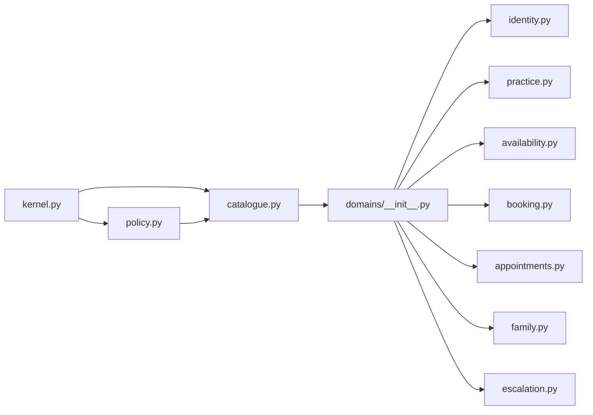

**Diagram sources**
- [backend/app/agent/tools/kernel.py:1-225](file://backend/app/agent/tools/kernel.py#L1-L225)
- [backend/app/agent/tools/catalogue.py:1-92](file://backend/app/agent/tools/catalogue.py#L1-L92)
- [backend/app/agent/tools/policy.py:1-135](file://backend/app/agent/tools/policy.py#L1-L135)
- [backend/app/agent/tools/domains/__init__.py:1-20](file://backend/app/agent/tools/domains/__init__.py#L1-L20)

Coupling and cohesion observations:
- High cohesion within each domain file: argument model, handler, and spec are grouped.
- Low coupling between domains: they share helpers and kernel primitives rather than calling each other.
- Centralized identity enforcement reduces risk of handlers bypassing verification.
- Duplicate tool names fail at import time, preventing runtime ambiguity.

**Section sources**
- [backend/app/agent/tools/__init__.py:1-57](file://backend/app/agent/tools/__init__.py#L1-L57)
- [backend/app/agent/tools/catalogue.py:31-37](file://backend/app/agent/tools/catalogue.py#L31-L37)
- [backend/app/agent/tools/kernel.py:189-209](file://backend/app/agent/tools/kernel.py#L189-L209)

## Performance Considerations
The tool layer emphasizes correctness over AI capability, but several design choices also affect performance and stability:

- **Bounded tool results**: `MAX_TOOL_RESULT_CHARS` and `ResultPolicy` prevent large payloads from overwhelming the model or UI.
- **Card limits**: Availability and family results limit displayed cards to keep interactive choices manageable.
- **Structured errors**: Validation and identity failures return structured responses instead of raising exceptions, reducing retry storms.
- **Mutation logging**: Only mutation events are logged, avoiding unnecessary PII exposure before handlers run.
- **Transaction boundaries**: Many write paths commit after proposal creation or confirmation, aligning with the repository’s emphasis on atomicity and rollback.
- **Avoiding summary loops**: Turn policy hides tools after an exhausted search or reask-after-search to prevent redundant model rounds.

[No sources needed since this section provides general guidance]

## Troubleshooting Guide
Common failure modes and their intended handling:

| Symptom | Likely Cause | Expected Behavior |
|---|---|---|
| Model requests an unknown tool | Hallucinated tool name | Returns `unknown_tool` error |
| Arguments contain unexpected fields | Model-generated payload mismatch | Pydantic rejects them; returns `invalid_arguments` with field errors |
| Unverified session tries protected tool | Missing verification | Returns `not_verified` |
| Handler raises an exception | Bug in domain logic | Logs exception and returns `tool_failed` |
| Result exceeds size limit | Large appointment list, provider catalog, or many cards | Truncates secondary detail while preserving cards and decision fields |
| Family search called incorrectly | Solo search used for multi-person request | Returns `family_search_required` |
| Slot selection conflicts with pending reschedule | Stale card or wrong intent | Routes to reschedule path or returns `reschedule_in_progress` |
| Emergency report lacks required callback info | Unverified caller reporting non-life-threatening issue | Blocks automation until callback details are provided |

Operational recommendations:
- Inspect tool result structure rather than relying on prose.
- Use `get_session_context` before offering availability to understand verification and registration state.
- Use `get_booking_context` to determine whether a solo or household booking is expected.
- Treat `truncated=True` as a signal to narrow the question or ask for more specific dates/providers.
- For family scheduling, prefer `search_family_availability` when multiple household members are involved.
- For rescheduling, use `reschedule_appointment` and `confirm_appointment_change`; do not confuse them with new-booking tools.

**Section sources**
- [backend/app/agent/tools/catalogue.py:40-88](file://backend/app/agent/tools/catalogue.py#L40-L88)
- [backend/app/agent/tools/kernel.py:146-182](file://backend/app/agent/tools/kernel.py#L146-L182)
- [backend/app/agent/tools/domains/availability.py:115-130](file://backend/app/agent/tools/domains/availability.py#L115-L130)
- [backend/app/agent/tools/domains/booking.py:127-155](file://backend/app/agent/tools/domains/booking.py#L127-L155)
- [backend/app/agent/tools/domains/escalation.py:90-114](file://backend/app/agent/tools/domains/escalation.py#L90-L114)

## Conclusion
The domain-specific tool architecture isolates conversational routing from deterministic business logic. The kernel defines a strict contract, the catalogue registers tools safely, the execution pipeline validates and protects identity, and the domains implement focused scheduling, identity, practice, escalation, and family workflows. Turn policy prevents looping and misrouting, while result policies keep outputs bounded and actionable.

For maintainers, the most important principles are:
- Never trust model-provided identity.
- Keep argument schemas minimal and explicit.
- Route reschedules and new bookings through separate tools.
- Represent complex state as structured results and cards.
- Let Python and SQLite own state transitions, not the model.

[No sources needed since this section summarizes without analyzing specific files]