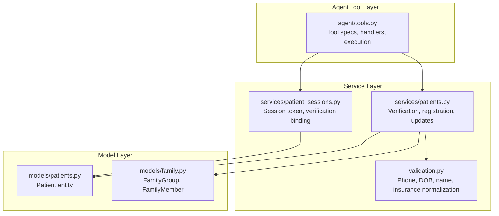
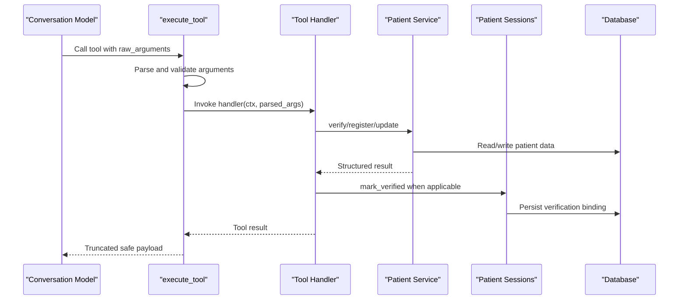
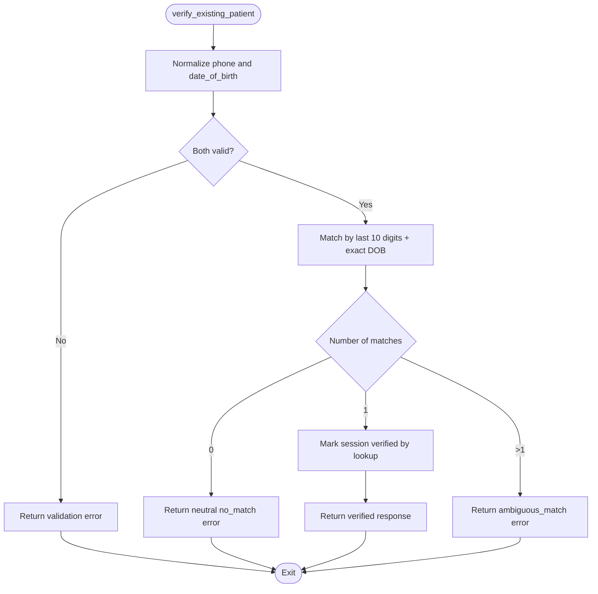
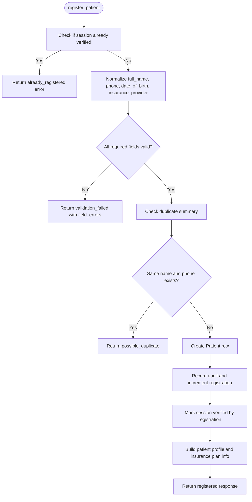
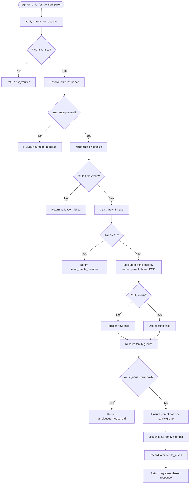
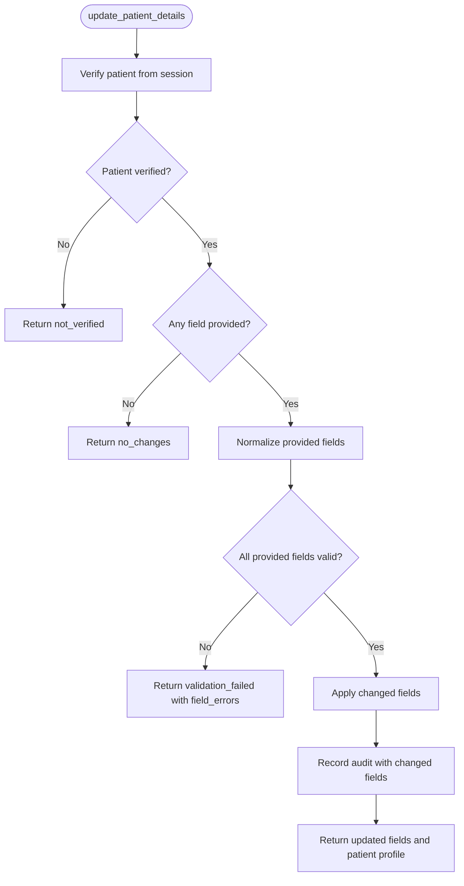
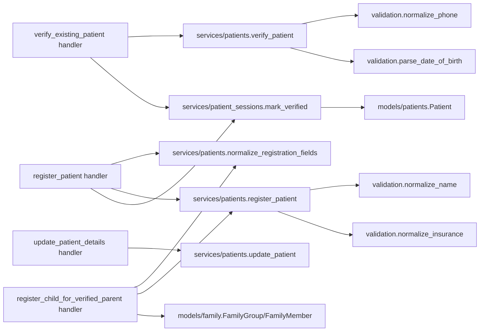

# Patient Registration Tools

<cite>
**Referenced Files in This Document**
- [tools.py](file://backend/app/agent/tools.py)
- [patients.py](file://backend/app/services/patients.py)
- [patient_sessions.py](file://backend/app/services/patient_sessions.py)
- [validation.py](file://backend/app/validation.py)
- [patients_model.py](file://backend/app/models/patients.py)
- [family_model.py](file://backend/app/models/family.py)
</cite>

## Table of Contents
1. [Introduction](#introduction)
2. [Project Structure](#project-structure)
3. [Core Components](#core-components)
4. [Architecture Overview](#architecture-overview)
5. [Detailed Component Analysis](#detailed-component-analysis)
6. [Dependency Analysis](#dependency-analysis)
7. [Performance Considerations](#performance-considerations)
8. [Troubleshooting Guide](#troubleshooting-guide)
9. [Conclusion](#conclusion)

## Introduction
This document explains the patient registration tools that handle new patient onboarding and verification workflows. It covers:

- Verifying an existing patient by phone number and date of birth, including how verification marks a session.
- Registering a new patient with full name, phone, date of birth, and insurance provider, including field normalization and validation.
- Adding minor children for a verified parent, including household linking and family group management.
- Updating existing patient details safely.
- Security constraints that prevent identity manipulation and enforce proper verification flows.
- Error responses, parameter expectations, and integration with the patient sessions system.

These tools are exposed to the conversation agent through validated argument models. The model can request actions, but it cannot directly assert verification or ownership; that state is managed by the service layer and persisted through the database session.

## Project Structure
The registration workflow spans three layers:

- Agent tool layer: defines tool schemas, validates arguments, enforces context, and returns structured results.
- Service layer: performs business logic such as verification, registration, profile updates, duplicate checks, and audit recording.
- Model layer: defines persistent entities such as patients, family groups, and family members.

**Diagram sources**
- [tools.py:1-12](file://backend/app/agent/tools.py#L1-L12)
- [tools.py:511-588](file://backend/app/agent/tools.py#L511-L588)
- [patients.py:1-11](file://backend/app/services/patients.py#L1-L11)
- [patient_sessions.py:1-36](file://backend/app/services/patient_sessions.py#L1-L36)
- [validation.py:1-6](file://backend/app/validation.py#L1-L6)
- [patients_model.py:18-46](file://backend/app/models/patients.py#L18-L46)
- [family_model.py:21-60](file://backend/app/models/family.py#L21-L60)

**Section sources**
- [tools.py:1-12](file://backend/app/agent/tools.py#L1-L12)
- [patients.py:1-11](file://backend/app/services/patients.py#L1-L11)
- [patient_sessions.py:1-36](file://backend/app/services/patient_sessions.py#L1-L36)
- [validation.py:1-6](file://backend/app/validation.py#L1-L6)
- [patients_model.py:18-46](file://backend/app/models/patients.py#L18-L46)
- [family_model.py:21-60](file://backend/app/models/family.py#L21-L60)

## Core Components
The registration tools are defined as tool specifications with Pydantic argument models and handler functions:

| Tool | Purpose | Key Parameters | Main Validation / Business Logic | Session Effect |
|---|---|---|---|---|
| `verify_existing_patient` | Authenticate an existing patient | `phone`, `date_of_birth` | Normalizes phone and DOB, matches exactly one chart, prevents probing via neutral errors | Marks the current session as verified for the matched patient |
| `register_patient` | Create a new patient record | `full_name`, `phone`, `date_of_birth`, `insurance_provider` | Normalizes all fields, detects possible duplicates, creates chart, records audit | Marks the current session as verified by registration |
| `register_child_for_verified_parent` | Add a minor child under a verified parent | `full_name`, `date_of_birth`, optional `insurance_provider`, `use_parent_insurance` | Validates child age, resolves insurance, links or creates family membership | Does not change who is verified; keeps the adult as the requester |
| `update_patient_details` | Correct existing patient information | Optional `full_name`, `phone`, `date_of_birth`, `insurance_provider` | Validates only provided fields independently, applies changes, records audit | No session verification change |

**Section sources**
- [tools.py:62-110](file://backend/app/agent/tools.py#L62-L110)
- [tools.py:192-284](file://backend/app/agent/tools.py#L192-L284)
- [tools.py:287-427](file://backend/app/agent/tools.py#L287-L427)
- [tools.py:430-462](file://backend/app/agent/tools.py#L430-L462)
- [tools.py:511-588](file://backend/app/agent/tools.py#L511-L588)

## Architecture Overview
The registration flow follows a strict separation between what the model requests and what the system allows:

1. The model calls a tool with JSON arguments.
2. The tool executor parses and validates arguments using Pydantic.
3. The handler reads request-scoped context from the runner, not from model arguments.
4. The handler delegates to services for verification, registration, or updates.
5. Services normalize inputs, enforce privacy rules, update the database, and record audits.
6. Verification operations bind the current patient session to a patient record.

**Diagram sources**
- [tools.py:703-739](file://backend/app/agent/tools.py#L703-L739)
- [tools.py:192-284](file://backend/app/agent/tools.py#L192-L284)
- [patients.py:183-305](file://backend/app/services/patients.py#L183-L305)
- [patient_sessions.py:92-115](file://backend/app/services/patient_sessions.py#L92-L115)

**Section sources**
- [tools.py:703-739](file://backend/app/agent/tools.py#L703-L739)
- [patients.py:183-305](file://backend/app/services/patients.py#L183-L305)
- [patient_sessions.py:92-115](file://backend/app/services/patient_sessions.py#L92-L115)

## Detailed Component Analysis

### verify_existing_patient
Purpose:
- Authenticate an existing patient using phone number and date of birth.
- Prevent identity probing by returning neutral failure messages.
- Mark the current session as verified so subsequent scheduling actions are allowed.

Parameters:
- `phone`: US phone number exactly as the caller gave it.
- `date_of_birth`: Date of birth, ideally MM/DD/YYYY.

Processing:
- Phone and date of birth are normalized through shared validation helpers.
- Matching uses last-10-digit phone comparison plus exact date of birth.
- A single match verifies the patient; multiple matches require front desk resolution.
- On success, the session is marked verified with method `verified_lookup`.

Error behavior:
- Invalid phone returns a phone-specific error.
- Invalid date returns a date-specific error.
- Ambiguous or no-match returns a neutral message without revealing which part was wrong.

Session integration:
- The handler loads the matched patient and calls `mark_verified` with the lookup method.
- After marking, the session can access the verified patient through `ToolContext.verified_patient`.

**Diagram sources**
- [tools.py:192-218](file://backend/app/agent/tools.py#L192-L218)
- [patients.py:183-230](file://backend/app/services/patients.py#L183-L230)
- [patient_sessions.py:92-103](file://backend/app/services/patient_sessions.py#L92-L103)

**Section sources**
- [tools.py:62-65](file://backend/app/agent/tools.py#L62-L65)
- [tools.py:192-218](file://backend/app/agent/tools.py#L192-L218)
- [patients.py:183-230](file://backend/app/services/patients.py#L183-L230)
- [patient_sessions.py:34-35](file://backend/app/services/patient_sessions.py#L34-L35)
- [patient_sessions.py:92-115](file://backend/app/services/patient_sessions.py#L92-L115)

### register_patient
Purpose:
- Create a new patient chart with full name, phone, date of birth, and insurance provider.
- Normalize and validate all fields before persisting.
- Detect possible duplicates and avoid overwriting existing charts.
- Mark the session as verified after successful registration.

Parameters:
- `full_name`: Patient's full name, first and last.
- `phone`: US phone number.
- `date_of_birth`: Date of birth, ideally MM/DD/YYYY.
- `insurance_provider`: Insurance plan name, another plan wording, or self-pay.

Processing:
- If the session is already verified for another patient, registration is blocked.
- Fields are normalized through `normalize_registration_fields`.
- Duplicate summary checks whether the same name and phone already exist.
- A new `Patient` row is created, audit is recorded, and registration count is incremented.
- The session is marked verified with method `registered`.

Validation rules:
- Name must contain letters, spaces, hyphens, apostrophes, or periods, and must include both given and family name parts.
- Phone must be a valid US NANP number without extensions.
- Date of birth must be a real past date within a reasonable age range.
- Insurance provider is mapped to accepted plans, self-pay, other plan, or stored patient wording.

Error responses:
- `already_registered`: Session already has a verified patient.
- `validation_failed`: One or more fields need clarification; includes `field_errors`.
- `possible_duplicate`: Existing chart shares name and phone.
- `registration_failed`: Unexpected creation failure.

Session integration:
- Successful registration calls `mark_verified` with `VERIFICATION_BY_REGISTRATION`.
- The returned response includes first name, date of birth, registration completeness, missing fields, and insurance classification.

**Diagram sources**
- [tools.py:221-284](file://backend/app/agent/tools.py#L221-L284)
- [patients.py:81-138](file://backend/app/services/patients.py#L81-L138)
- [patients.py:161-180](file://backend/app/services/patients.py#L161-L180)
- [patients.py:258-305](file://backend/app/services/patients.py#L258-L305)
- [patient_sessions.py:92-103](file://backend/app/services/patient_sessions.py#L92-L103)

**Section sources**
- [tools.py:72-81](file://backend/app/agent/tools.py#L72-L81)
- [tools.py:221-284](file://backend/app/agent/tools.py#L221-L284)
- [patients.py:81-138](file://backend/app/services/patients.py#L81-L138)
- [patients.py:161-180](file://backend/app/services/patients.py#L161-L180)
- [patients.py:258-305](file://backend/app/services/patients.py#L258-L305)
- [validation.py:37-79](file://backend/app/validation.py#L37-L79)
- [validation.py:154-246](file://backend/app/validation.py#L154-L246)
- [validation.py:262-292](file://backend/app/validation.py#L262-L292)
- [validation.py:333-364](file://backend/app/validation.py#L333-L364)

### register_child_for_verified_parent
Purpose:
- Register or link a minor child for the currently verified parent.
- Use the parent’s phone number and optionally the parent’s insurance plan.
- Manage household linking through family groups and family memberships.
- Prevent adding adults through this tool.

Parameters:
- `full_name`: Child's full first and last name.
- `date_of_birth`: Child's date of birth, ideally MM/DD/YYYY.
- `insurance_provider`: Optional child insurance plan.
- `use_parent_insurance`: True only after the verified parent confirms the child shares the parent’s plan.

Processing:
- Requires a verified parent; otherwise returns `not_verified`.
- Resolves child insurance from either the parent’s plan or the provided value.
- Normalizes child fields with required fields set to full name, date of birth, and insurance provider.
- Calculates child age and rejects adults.
- Looks up an existing child by full name, parent phone, and date of birth.
- Creates a new child record if needed.
- Ensures the parent belongs to exactly one family group; otherwise requires front desk review.
- Creates a family group and primary membership if none exists.
- Links the child as a non-primary family member and records an audit event.

Security constraint:
- Parent identity comes from the verified session, not from arguments. This prevents attaching a child to someone else’s chart.

Error responses:
- `not_verified`: Parent is not verified.
- `insurance_required`: Child insurance is missing.
- `validation_failed`: Child details need clarification.
- `adult_family_member`: Child is 18 or older.
- `ambiguous_household`: Parent belongs to multiple family groups.
- `registration_failed`: Child could not be registered.

Household linking:
- Uses `FamilyGroup` and `FamilyMember` to represent families.
- Parent becomes primary contact when creating a new group.
- Child is linked with relation `child` and `is_primary_contact=False`.

**Diagram sources**
- [tools.py:287-427](file://backend/app/agent/tools.py#L287-L427)
- [family_model.py:21-60](file://backend/app/models/family.py#L21-L60)

**Section sources**
- [tools.py:84-101](file://backend/app/agent/tools.py#L84-L101)
- [tools.py:287-427](file://backend/app/agent/tools.py#L287-L427)
- [family_model.py:21-60](file://backend/app/models/family.py#L21-L60)

### update_patient_details
Purpose:
- Correct one or more fields on the verified patient’s chart.
- Validate each provided field independently so one invalid field does not block other corrections.
- Record which fields changed.

Parameters:
- `full_name`: Optional corrected full name.
- `phone`: Optional corrected phone number.
- `date_of_birth`: Optional corrected date of birth.
- `insurance_provider`: Optional corrected insurance or self-pay.

Processing:
- Requires a verified patient; otherwise returns `not_verified`.
- Rejects empty updates where no field is provided.
- Normalizes only the provided fields.
- Applies changes and updates the timestamp.
- Records audit with the list of changed fields.

Error responses:
- `not_verified`: Session is not verified.
- `no_changes`: No correction fields were provided.
- `validation_failed`: Provided field(s) failed validation; includes `field_errors`.

Success response:
- Returns updated fields, refreshed patient profile, and registration completeness.

**Diagram sources**
- [tools.py:430-462](file://backend/app/agent/tools.py#L430-L462)
- [patients.py:308-364](file://backend/app/services/patients.py#L308-L364)

**Section sources**
- [tools.py:104-110](file://backend/app/agent/tools.py#L104-L110)
- [tools.py:430-462](file://backend/app/agent/tools.py#L430-L462)
- [patients.py:308-364](file://backend/app/services/patients.py#L308-L364)

## Dependency Analysis
The registration tools depend on shared validation, patient services, session management, and domain models.

**Diagram sources**
- [tools.py:192-462](file://backend/app/agent/tools.py#L192-L462)
- [patients.py:81-138](file://backend/app/services/patients.py#L81-L138)
- [patients.py:183-364](file://backend/app/services/patients.py#L183-L364)
- [patient_sessions.py:92-115](file://backend/app/services/patient_sessions.py#L92-L115)
- [validation.py:37-79](file://backend/app/validation.py#L37-L79)
- [validation.py:154-246](file://backend/app/validation.py#L154-L246)
- [validation.py:262-292](file://backend/app/validation.py#L262-L292)
- [validation.py:333-364](file://backend/app/validation.py#L333-L364)
- [patients_model.py:18-46](file://backend/app/models/patients.py#L18-L46)
- [family_model.py:21-60](file://backend/app/models/family.py#L21-L60)

**Section sources**
- [tools.py:192-462](file://backend/app/agent/tools.py#L192-L462)
- [patients.py:81-138](file://backend/app/services/patients.py#L81-L138)
- [patients.py:183-364](file://backend/app/services/patients.py#L183-L364)
- [patient_sessions.py:92-115](file://backend/app/services/patient_sessions.py#L92-L115)
- [validation.py:37-79](file://backend/app/validation.py#L37-L79)
- [validation.py:154-246](file://backend/app/validation.py#L154-L246)
- [validation.py:262-292](file://backend/app/validation.py#L262-L292)
- [validation.py:333-364](file://backend/app/validation.py#L333-L364)
- [patients_model.py:18-46](file://backend/app/models/patients.py#L18-L46)
- [family_model.py:21-60](file://backend/app/models/family.py#L21-L60)

## Performance Considerations
- Phone matching uses last-10-digit comparison rather than requiring exact stored formatting, reducing normalization overhead during lookups.
- Duplicate checks return counts and hints instead of full record payloads, avoiding unnecessary data exposure and reducing payload size.
- Tool results are truncated to a bounded character limit while preserving interactive fields and cards, preventing unbounded responses from slowing the conversation loop.
- Database writes are flushed at key points for verification and registration tools to ensure consistent state before returning results.

[No sources needed since this section provides general guidance]

## Troubleshooting Guide
Common issues and their likely causes:

| Symptom | Likely Cause | Resolution |
|---|---|---|
| `not_verified` | The session has no verified patient. | Ask for phone and date of birth to verify, or register the patient first. |
| `already_registered` | The session is already bound to a verified patient. | Use `update_patient_details` instead of registering again. |
| `validation_failed` | One or more input fields failed normalization. | Ask only for the fields listed in `field_errors`. |
| `possible_duplicate` | A chart already exists with the same name and phone. | Offer verification or clarify whether this is a different person. |
| `ambiguous_match` | Multiple charts share phone and date of birth. | Route to front desk for manual resolution. |
| `insurance_required` | Child insurance is missing. | Ask whether the child uses the parent’s plan or provide the child’s plan. |
| `adult_family_member` | The child is 18 or older. | Direct the adult to contact the clinic directly. |
| `ambiguous_household` | Parent belongs to multiple family groups. | Require front desk confirmation before linking a child. |
| `no_changes` | No correction fields were provided. | Ask which detail should be corrected. |

Security-related troubleshooting:
- If a tool appears to allow identity switching, check whether the handler reads identity from `ToolContext` rather than from arguments. Only `ToolContext.verified_patient` should determine the authenticated patient.
- If verification appears to leak information, confirm that mismatch responses are neutral and do not reveal whether a phone number exists.
- If family linking fails unexpectedly, inspect whether the parent has exactly one family group and whether the child is already linked.

**Section sources**
- [tools.py:134-144](file://backend/app/agent/tools.py#L134-L144)
- [tools.py:221-284](file://backend/app/agent/tools.py#L221-L284)
- [tools.py:287-427](file://backend/app/agent/tools.py#L287-L427)
- [tools.py:430-462](file://backend/app/agent/tools.py#L430-L462)
- [patients.py:183-230](file://backend/app/services/patients.py#L183-L230)
- [patients.py:258-305](file://backend/app/services/patients.py#L258-L305)
- [patients.py:308-364](file://backend/app/services/patients.py#L308-L364)

## Conclusion
The patient registration tools enforce a secure, auditable onboarding process:

- Existing patients are verified through phone and date of birth with neutral error handling to prevent identity probing.
- New registrations normalize and validate all fields, detect duplicates, create patient records, and mark the session as verified.
- Minor children are added only under a verified parent, with explicit age checks, insurance resolution, and family group management.
- Existing patient details can be corrected safely without re-registering or changing verification state.
- All sensitive operations are mediated by the service layer and tied to the patient sessions system, ensuring that the conversation model cannot manipulate identity or bypass verification.