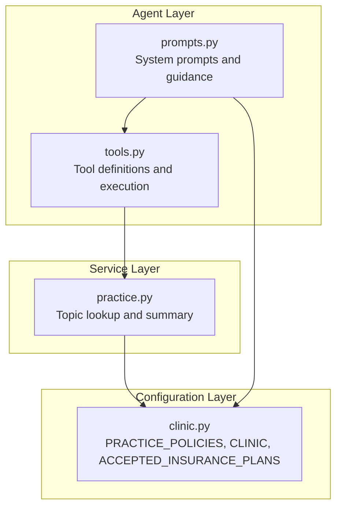
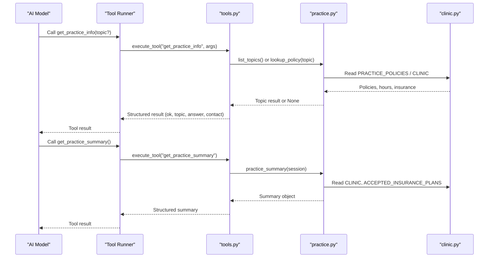
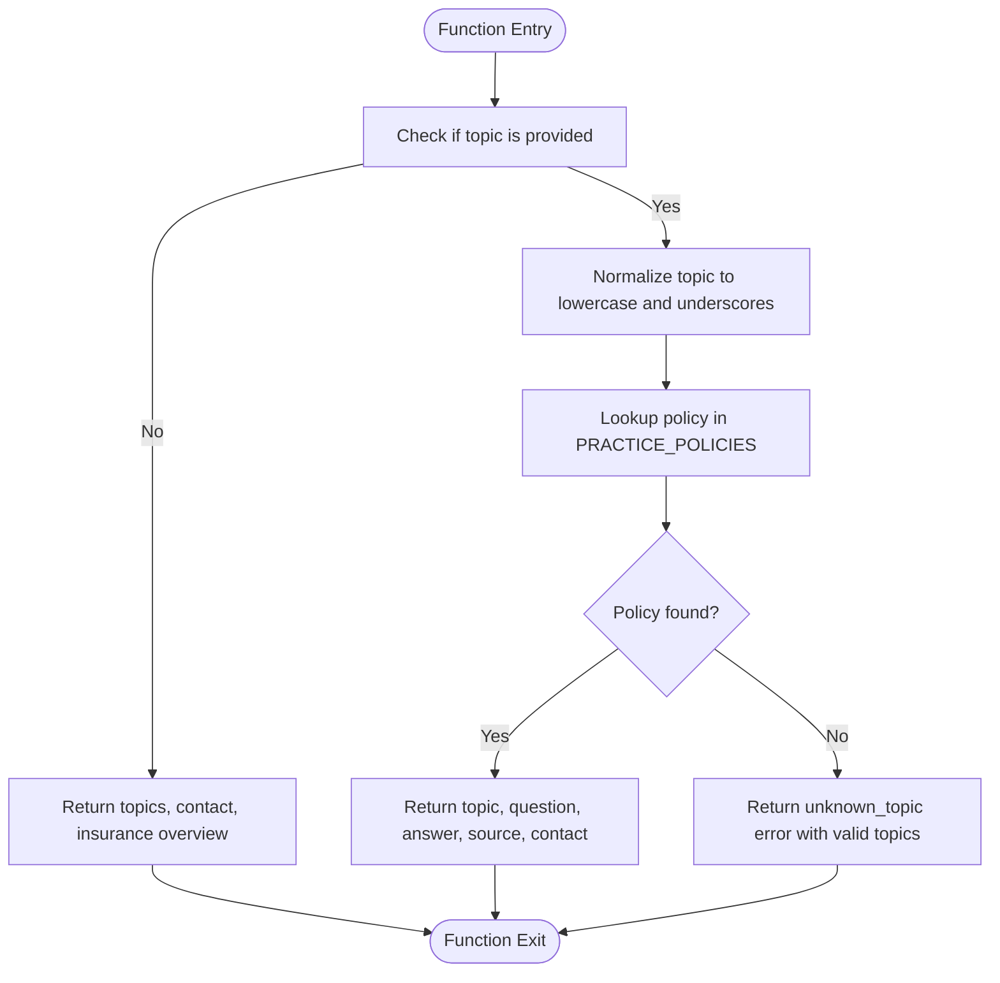
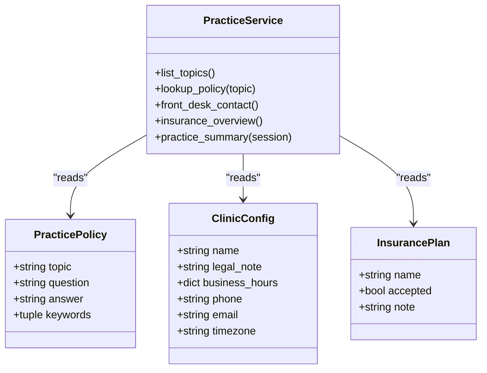
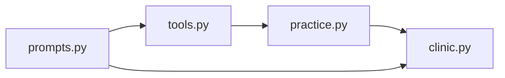

# Practice Information Tools

<cite>
**Referenced Files in This Document**
- [tools.py](file://backend/app/agent/tools.py)
- [practice.py](file://backend/app/services/practice.py)
- [clinic.py](file://backend/app/clinic.py)
- [prompts.py](file://backend/app/agent/prompts.py)
</cite>

## Table of Contents
1. [Introduction](#introduction)
2. [Project Structure](#project-structure)
3. [Core Components](#core-components)
4. [Architecture Overview](#architecture-overview)
5. [Detailed Component Analysis](#detailed-component-analysis)
6. [Dependency Analysis](#dependency-analysis)
7. [Performance Considerations](#performance-considerations)
8. [Troubleshooting Guide](#troubleshooting-guide)
9. [Conclusion](#conclusion)

## Introduction
This document explains the practice information tools that provide clinic policy and operational data to the AI agent. It focuses on:
- `get_practice_info`: a topic-based lookup for specific clinic policies such as hours, location, contact information, insurance acceptance, pricing, and cancellation policies.
- `get_practice_summary`: a comprehensive overview of clinic facts including address, hours, dentists/providers, appointment types, and insurance coverage.

These tools are designed to prevent hallucination by restricting answers to configured knowledge. The AI must relay authoritative answers rather than inventing prices, coverage, or availability.

## Project Structure
The practice information tools live in the agent tool layer and rely on service and configuration layers:
- Agent tools define function schemas, argument validation, and handlers.
- Service functions resolve topics and assemble public clinic summaries.
- Clinic configuration defines accepted insurance plans, business hours, and the authoritative policy list.
- Prompts instruct the model to use the tools and relay answers verbatim.

**Diagram sources**
- [tools.py:465-485](file://backend/app/agent/tools.py#L465-L485)
- [practice.py:23-110](file://backend/app/services/practice.py#L23-L110)
- [clinic.py:144-290](file://backend/app/clinic.py#L144-L290)
- [prompts.py:217-219](file://backend/app/agent/prompts.py#L217-L219)

**Section sources**
- [tools.py:465-485](file://backend/app/agent/tools.py#L465-L485)
- [practice.py:23-110](file://backend/app/services/practice.py#L23-L110)
- [clinic.py:144-290](file://backend/app/clinic.py#L144-L290)
- [prompts.py:217-219](file://backend/app/agent/prompts.py#L217-L219)

## Core Components
- `get_practice_info`
  - Purpose: Look up an exact clinic policy by topic. If no topic is provided, it returns available topics, front desk contact, and insurance overview.
  - Input: Optional `topic`.
  - Output: Policy answer with source metadata, contact details, and when listing topics, a catalog of supported topics plus insurance overview.
- `get_practice_summary`
  - Purpose: Retrieve comprehensive clinic facts in one call, including address, hours, providers, appointment types, insurance overview, contact, and policy topics.
  - Input: None.
  - Output: A structured summary object containing all public clinic facts.

How these tools prevent hallucination:
- Answers come from `PRACTICE_POLICIES`, which contains pre-approved text.
- The system prompt instructs the model to use `get_practice_info` and relay answers verbatim.
- Unknown topics return a controlled error with suggested topics, steering the model away from guessing.

**Section sources**
- [tools.py:113-120](file://backend/app/agent/tools.py#L113-L120)
- [tools.py:465-485](file://backend/app/agent/tools.py#L465-L485)
- [practice.py:23-42](file://backend/app/services/practice.py#L23-L42)
- [clinic.py:30-43](file://backend/app/clinic.py#L30-L43)
- [prompts.py:217-219](file://backend/app/agent/prompts.py#L217-L219)

## Architecture Overview
The flow for both tools is deterministic and bounded by configuration:

**Diagram sources**
- [tools.py:465-485](file://backend/app/agent/tools.py#L465-L485)
- [practice.py:23-110](file://backend/app/services/practice.py#L23-L110)
- [clinic.py:144-290](file://backend/app/clinic.py#L144-L290)

## Detailed Component Analysis

### get_practice_info
Behavior:
- If `topic` is omitted:
  - Returns available topics via `list_topics`.
  - Includes front desk contact via `front_desk_contact`.
  - Includes insurance overview via `insurance_overview`.
- If `topic` is provided:
  - Normalizes the topic and looks it up in `PRACTICE_POLICIES`.
  - On match, returns the policy’s topic, question, answer, and source metadata, plus contact info.
  - On unknown topic, returns an error with code `unknown_topic`, a safe message, and a list of valid topics.

Validation and safety:
- Arguments are validated through a Pydantic model; invalid JSON or missing fields produce structured errors.
- Unknown topics do not expose internal implementation details beyond a curated list of topics.

Example valid topics:
- `hours`
- `location`
- `contact`
- `insurance_accepted`
- `cleaning_cost`
- `exam_cost`
- `emergency_visit`
- `self_pay`
- `membership_plan`
- `payment_methods`
- `pediatric`
- `providers`
- `cancellation`
- `records_privacy`
- `new_patient_exam`

Response formats:
- Listing topics:
  - `ok: true`
  - `topics: [{topic, question}, ...]`
  - `contact: {phone, email, hours, timezone}`
  - `insurance: {accepted_plans, self_pay_label, note}`
- Lookup policy:
  - `ok: true`
  - `topic: string`
  - `question: string`
  - `answer: string`
  - `source: "clinic_policy"`
  - `contact: {phone, email, hours, timezone}`
- Unknown topic:
  - `ok: false`
  - `error: "unknown_topic"`
  - `message: "That policy detail isn't in our knowledge base. Offer the front desk instead."`
  - `topics: [string, ...]`

Error handling:
- Invalid arguments: structured error with field-level messages.
- Unknown topic: controlled error with suggested topics.
- Unexpected exceptions: wrapped into a generic tool failure response.

**Section sources**
- [tools.py:113-120](file://backend/app/agent/tools.py#L113-L120)
- [tools.py:465-485](file://backend/app/agent/tools.py#L465-L485)
- [tools.py:703-739](file://backend/app/agent/tools.py#L703-L739)
- [practice.py:23-42](file://backend/app/services/practice.py#L23-L42)
- [clinic.py:144-290](file://backend/app/clinic.py#L144-L290)

#### Flowchart: get_practice_info decision logic

**Diagram sources**
- [tools.py:465-485](file://backend/app/agent/tools.py#L465-L485)
- [practice.py:23-42](file://backend/app/services/practice.py#L23-L42)

### get_practice_summary
Behavior:
- Returns a comprehensive summary object containing:
  - Clinic public details (name, address, phone, email, timezone, business hours).
  - Active providers (dentists), including credentials and specialties.
  - Appointment types (codes, names, durations, emergency flags).
  - Insurance overview (accepted plans, self-pay label, notes).
  - Front desk contact.
  - Policy topics list.

Use cases:
- When the AI needs a full snapshot of clinic facts without multiple calls.
- For UI rendering of clinic information or for building context-rich responses.

Response format highlights:
- `ok: true`
- `clinic: {name, address, phone, email, timezone, business_hours, closed_days, parking_note, fictional}`
- `providers: [{name, credentials, specialties}, ...]`
- `appointment_types: [{code, name, duration_minutes, is_emergency}, ...]`
- `insurance: {accepted_plans, self_pay_label, note}`
- `contact: {phone, email, hours, timezone}`
- `policy_topics: [{topic, question}, ...]`

**Section sources**
- [tools.py:484-485](file://backend/app/agent/tools.py#L484-L485)
- [practice.py:82-110](file://backend/app/services/practice.py#L82-L110)
- [clinic.py:45-89](file://backend/app/clinic.py#L45-L89)

### Topic-Based Query System and Anti-Hallucination Controls
- Authoritative source: All policy answers originate from `PRACTICE_POLICIES`, a fixed tuple of `PracticePolicy` objects. Each entry includes a stable `topic`, a human-readable `question`, and a self-contained `answer`.
- Exact matching: Topics are normalized (lowercase, spaces/hyphens replaced with underscores) before lookup. Only exact matches succeed.
- Verbatim relaying: The system prompt instructs the model to use `get_practice_info` and relay answers verbatim, preventing paraphrasing that could alter prices or coverage promises.
- Controlled fallback: Unknown topics return a safe error with a list of valid topics, guiding the model to ask again or offer the front desk.

**Diagram sources**
- [clinic.py:23-43](file://backend/app/clinic.py#L23-L43)
- [clinic.py:45-89](file://backend/app/clinic.py#L45-L89)
- [clinic.py:124-142](file://backend/app/clinic.py#L124-L142)
- [practice.py:23-110](file://backend/app/services/practice.py#L23-L110)

**Section sources**
- [clinic.py:30-43](file://backend/app/clinic.py#L30-L43)
- [clinic.py:144-290](file://backend/app/clinic.py#L144-L290)
- [practice.py:23-42](file://backend/app/services/practice.py#L23-L42)
- [prompts.py:217-219](file://backend/app/agent/prompts.py#L217-L219)

## Dependency Analysis
- `tools.py` depends on:
  - `app.clinic.PRACTICE_POLICIES` for authoritative policy content.
  - `app.services.practice` for topic listing, policy lookup, contact, insurance overview, and summary assembly.
- `practice.py` depends on:
  - `app.clinic.CLINIC`, `ACCEPTED_INSURANCE_PLANS`, `SELF_PAY_LABEL`, and `PRACTICE_POLICIES`.
  - Database models (`Provider`, `AppointmentType`) for dynamic provider and appointment type data.
- `prompts.py` references:
  - `CLINIC`, `PRACTICE_POLICIES`, and `ACCEPTED_INSURANCE_PLANS` to build system instructions that reinforce tool usage and verbatim relaying.

**Diagram sources**
- [tools.py:465-485](file://backend/app/agent/tools.py#L465-L485)
- [practice.py:23-110](file://backend/app/services/practice.py#L23-L110)
- [clinic.py:144-290](file://backend/app/clinic.py#L144-L290)
- [prompts.py:217-219](file://backend/app/agent/prompts.py#L217-L219)

**Section sources**
- [tools.py:465-485](file://backend/app/agent/tools.py#L465-L485)
- [practice.py:23-110](file://backend/app/services/practice.py#L23-L110)
- [clinic.py:144-290](file://backend/app/clinic.py#L144-L290)
- [prompts.py:217-219](file://backend/app/agent/prompts.py#L217-L219)

## Performance Considerations
- Topic lookup is linear over the configured policy list; given the small size of `PRACTICE_POLICIES`, this is negligible.
- `practice_summary` queries active providers and appointment types from the database; results are cached per session during tool execution.
- Tool results are truncated to a maximum character limit to avoid overwhelming the model with large payloads while preserving interactive fields like cards and key decision data.

[No sources needed since this section provides general guidance]

## Troubleshooting Guide
Common issues and resolutions:
- Unknown topic:
  - Symptom: Error code `unknown_topic` with a message directing to the front desk.
  - Resolution: Use one of the returned topics or ask the patient to call the front desk.
- Invalid arguments:
  - Symptom: Validation error with field-level messages.
  - Resolution: Ask the user to restate the required fields exactly as requested.
- Unexpected tool failures:
  - Symptom: Generic tool failure response.
  - Resolution: Retry once; if persistent, escalate to staff.

Best practices:
- Always present the returned `contact` information when policy details are insufficient.
- Do not paraphrase policy answers; relay them verbatim to maintain compliance.
- Prefer `get_practice_summary` when you need a broad overview; prefer `get_practice_info` for precise policy lookups.

**Section sources**
- [tools.py:465-485](file://backend/app/agent/tools.py#L465-L485)
- [tools.py:703-739](file://backend/app/agent/tools.py#L703-L739)

## Conclusion
The practice information tools enforce accurate, policy-compliant communication by anchoring all answers to configured data. `get_practice_info` provides precise, topic-based policy retrieval with strict validation and controlled fallbacks. `get_practice_summary` offers a complete snapshot of clinic facts. Together, they ensure the AI agent never invents prices, coverage, or availability, and always directs users to the front desk when necessary.

[No sources needed since this section summarizes without analyzing specific files]