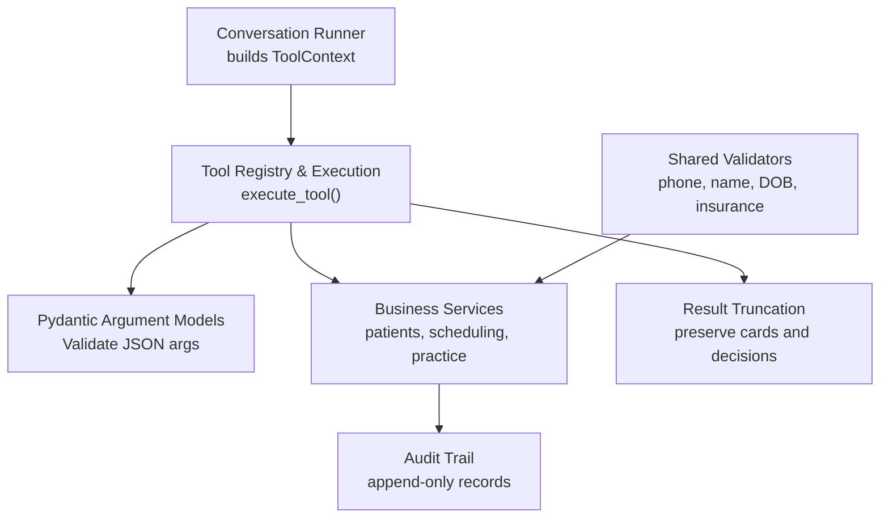
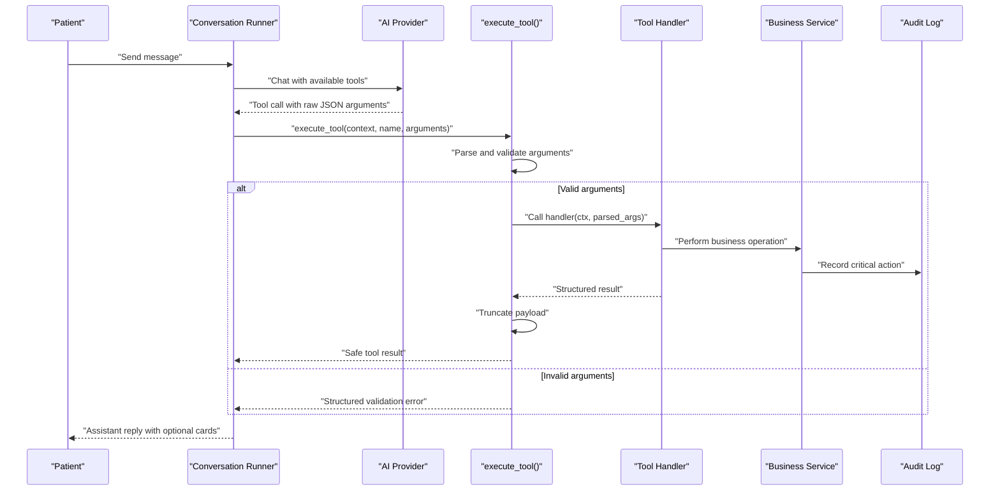
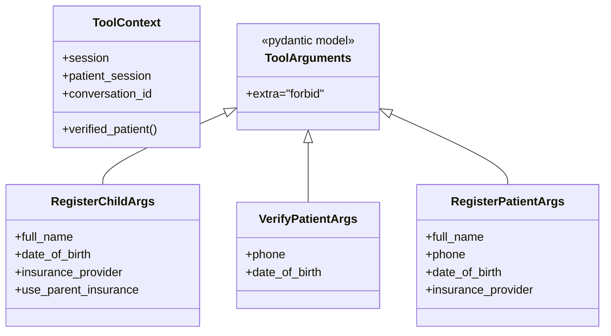
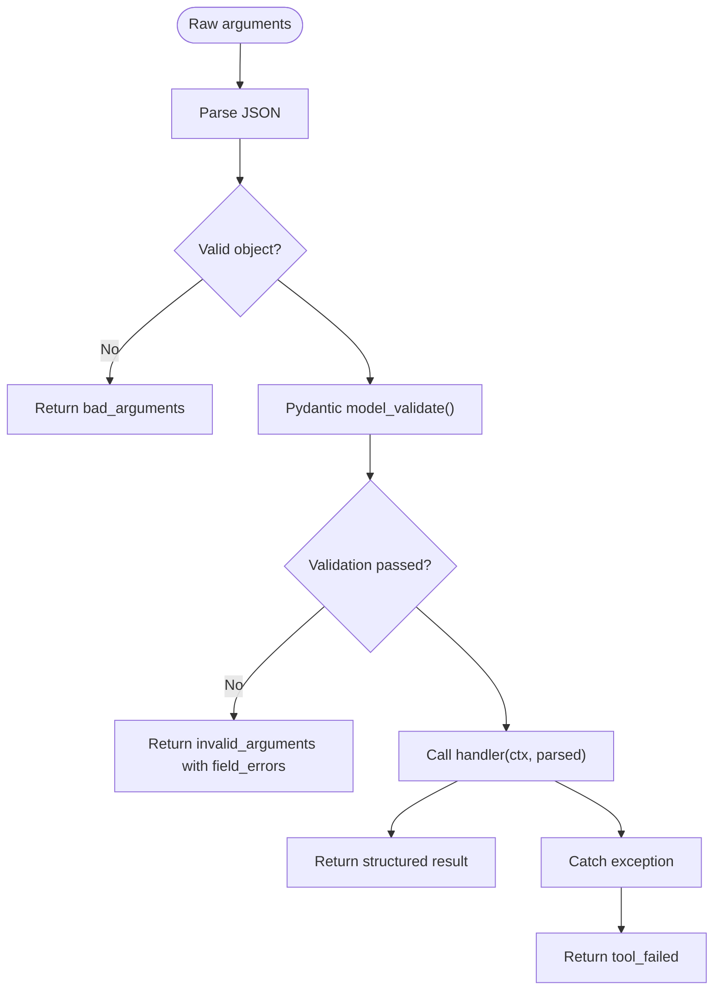
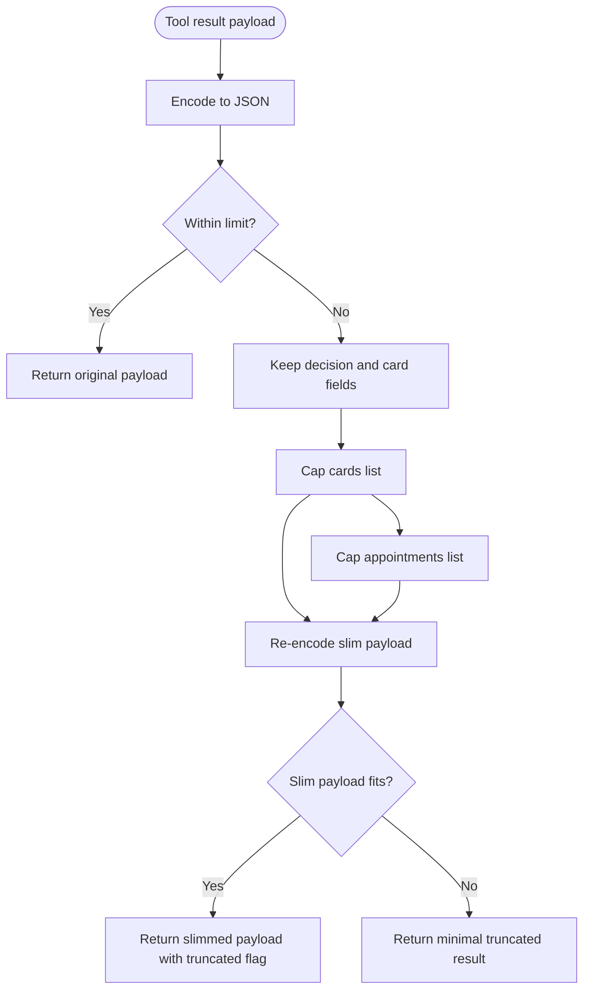
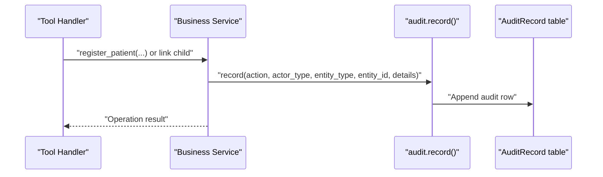
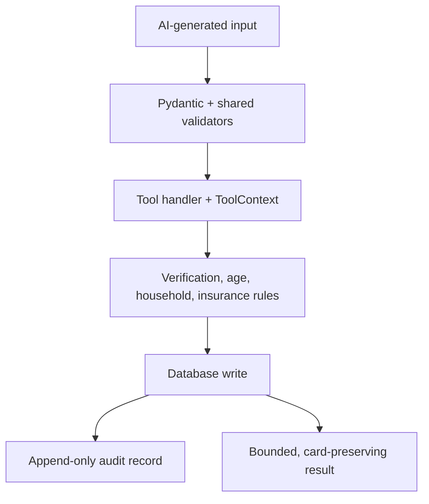
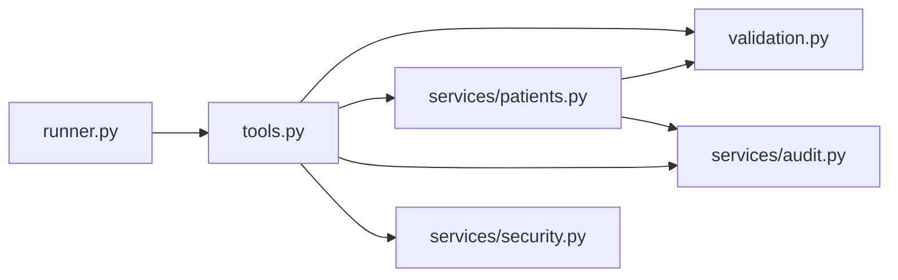

# Security and Validation Model

<cite>
**Referenced Files in This Document**
- [tools.py](file://backend/app/agent/tools.py)
- [runner.py](file://backend/app/agent/runner.py)
- [validation.py](file://backend/app/validation.py)
- [patients.py](file://backend/app/services/patients.py)
- [audit.py](file://backend/app/services/audit.py)
- [security.py](file://backend/app/services/security.py)
</cite>

## Table of Contents
1. [Introduction](#introduction)
2. [Project Structure](#project-structure)
3. [Core Components](#core-components)
4. [Architecture Overview](#architecture-overview)
5. [Detailed Component Analysis](#detailed-component-analysis)
6. [Dependency Analysis](#dependency-analysis)
7. [Performance Considerations](#performance-considerations)
8. [Troubleshooting Guide](#troubleshooting-guide)
9. [Conclusion](#conclusion)

## Introduction
This document explains the security and validation model that protects the system against AI manipulation and preserves data integrity. The design centers on four layers:

- A **ToolContext boundary** that prevents the AI from directly accessing or modifying sensitive state.
- A **Pydantic argument validation layer** that rejects malformed inputs before business logic runs.
- A **result truncation mechanism** that keeps tool responses bounded while preserving interactive cards and decision fields.
- An **audit logging integration** that records critical identity and family-linking operations.

The goal is to make every sensitive operation go through a validated, auditable tool interface, so hallucinated arguments, unexpected exceptions, or oversized payloads cannot compromise the system.

## Project Structure
The relevant security and validation logic lives primarily in the backend agent and service layers:

**Diagram sources**
- [runner.py:214-235](file://backend/app/agent/runner.py#L214-L235)
- [tools.py:493-606](file://backend/app/agent/tools.py#L493-L606)
- [tools.py:703-739](file://backend/app/agent/tools.py#L703-L739)
- [tools.py:617-700](file://backend/app/agent/tools.py#L617-L700)
- [validation.py:37-364](file://backend/app/validation.py#L37-L364)
- [audit.py:15-51](file://backend/app/services/audit.py#L15-L51)

**Section sources**
- [runner.py:1-23](file://backend/app/agent/runner.py#L1-L23)
- [tools.py:1-33](file://backend/app/agent/tools.py#L1-L33)

## Core Components
This section summarizes the main security primitives.

| Component | Responsibility | Security Role |
|---|---|---|
| `ToolContext` | Request-scoped session, patient session, and conversation identity | Prevents the model from choosing its own verified identity |
| `ToolArguments` and subclasses | Pydantic models for each tool’s input | Reject unknown fields and malformed values early |
| `execute_tool()` | Central dispatcher that validates arguments and calls handlers | Ensures uniform error handling and result truncation |
| Shared validators | Normalize phone, name, date of birth, and insurance text | Convert noisy LLM output into safe, clinic-ready values |
| Result truncation | Bound payload size without dropping interactive cards | Prevents prompt overflow while keeping UI actions usable |
| Audit helpers | Append-only audit record creation | Records critical operations such as registration and family linking |

**Section sources**
- [tools.py:41-59](file://backend/app/agent/tools.py#L41-L59)
- [tools.py:703-739](file://backend/app/agent/tools.py#L703-L739)
- [validation.py:29-364](file://backend/app/validation.py#L29-L364)
- [tools.py:617-700](file://backend/app/agent/tools.py#L617-L700)
- [audit.py:15-51](file://backend/app/services/audit.py#L15-L51)

## Architecture Overview
The security architecture enforces a strict separation between what the AI can request and what the server is allowed to do.

**Diagram sources**
- [runner.py:214-235](file://backend/app/agent/runner.py#L214-L235)
- [runner.py:486-517](file://backend/app/agent/runner.py#L486-L517)
- [runner.py:721-761](file://backend/app/agent/runner.py#L721-L761)
- [tools.py:703-739](file://backend/app/agent/tools.py#L703-L739)
- [audit.py:15-51](file://backend/app/services/audit.py#L15-L51)

## Detailed Component Analysis

### ToolContext Pattern: Identity Boundary
`ToolContext` is the only way a tool handler learns who is speaking. It contains:

- A SQLAlchemy session.
- The current `PatientSession`.
- The current conversation identifier.
- A derived `verified_patient` property that reads verification state from the session rather than from model arguments.

This design ensures that the AI can request an identity change, but it cannot assert one. For example, child registration deliberately does not accept a parent identifier; it uses the already verified caller from `ToolContext`.

**Diagram sources**
- [tools.py:41-59](file://backend/app/agent/tools.py#L41-L59)
- [tools.py:62-101](file://backend/app/agent/tools.py#L62-L101)

Security implications:

- The runner constructs `ToolContext` from the authenticated session.
- Handlers read `ctx.verified_patient`, never trust caller-supplied identity.
- Registration and child-linking flows enforce additional policy checks after validation.

**Section sources**
- [tools.py:41-59](file://backend/app/agent/tools.py#L41-L59)
- [tools.py:84-101](file://backend/app/agent/tools.py#L84-L101)
- [runner.py:214-216](file://backend/app/agent/runner.py#L214-L216)

### Pydantic Argument Validation System
Every tool declares a Pydantic argument model. Arguments arrive as a JSON string from the provider and are parsed and validated before any service is called. Unknown fields are rejected because the base model config forbids extra fields.

Key behaviors:

- Malformed JSON becomes a structured `bad_arguments` result.
- Pydantic validation errors become structured `invalid_arguments` results with per-field messages.
- Business-level validation returns structured `validation_failed` results with `field_errors`.
- Unexpected handler exceptions are caught and converted into a generic `tool_failed` result.

**Diagram sources**
- [tools.py:703-739](file://backend/app/agent/tools.py#L703-L739)

Example validation error handling paths:

- Phone normalization rejects extensions, non-US numbers, and incomplete digits.
- Name normalization enforces length, allowed characters, and multi-word names.
- Date-of-birth parsing handles numeric and textual formats, flags ambiguous dates, and rejects impossible or future ages.
- Insurance normalization maps free text to accepted plans, self-pay, or other plan labels.

These validators are reused by both API and agent tools, ensuring consistent rules regardless of whether input comes from a client or an AI.

**Section sources**
- [tools.py:54-59](file://backend/app/agent/tools.py#L54-L59)
- [tools.py:710-735](file://backend/app/agent/tools.py#L710-L735)
- [validation.py:37-79](file://backend/app/validation.py#L37-L79)
- [validation.py:154-246](file://backend/app/validation.py#L154-L246)
- [validation.py:262-301](file://backend/app/validation.py#L262-L301)
- [validation.py:333-364](file://backend/app/validation.py#L333-L364)

### Result Truncation Mechanism
Tool results can contain large lists of appointments, availability grids, or provider details. The truncation function bounds the response size without discarding interactive cards or decision fields.

Behavior:

- If the encoded payload fits within the character limit, it is returned unchanged.
- If it exceeds the limit, secondary detail fields are removed first.
- Interactive fields such as `cards`, `available_slots`, `appointment_ids`, `proposal_id`, and decision-related keys are preserved.
- Card lists are capped to a reasonable number so the UI remains actionable.
- A final fallback returns a minimal truncated result with a note indicating trimming occurred.

**Diagram sources**
- [tools.py:617-700](file://backend/app/agent/tools.py#L617-L700)

Design rationale:

- Availability cards are the patient-facing half of a search; dropping them would leave the assistant saying times are available above nothing.
- Decision fields must survive truncation so the conversation loop and UI can still act on confirmed or pending operations.
- Truncation is applied uniformly at the tool execution boundary, so even buggy handlers cannot produce unbounded responses.

**Section sources**
- [tools.py:617-700](file://backend/app/agent/tools.py#L617-L700)

### Audit Logging Integration
Critical operations are recorded using an append-only audit helper. The audit layer serializes structured details and attaches metadata such as actor type, entity type, entity identifier, conversation context, generation reset information, and visibility.

Operations that integrate audit logging include:

- Patient registration.
- Family member linking.
- Patient profile updates.
- Scheduling and proposal lifecycle events.

**Diagram sources**
- [patients.py:292-299](file://backend/app/services/patients.py#L292-L299)
- [tools.py:407-414](file://backend/app/agent/tools.py#L407-L414)
- [audit.py:15-51](file://backend/app/services/audit.py#L15-L51)

Important properties:

- Audit rows are added to the current transaction; callers commit around the full operation.
- Details are serialized deterministically when provided as dictionaries.
- The booking trailer helper supports two-phase audit patterns where a hold is written inside a transaction and a committed trailer is verified afterward.

**Section sources**
- [audit.py:15-51](file://backend/app/services/audit.py#L15-L51)
- [audit.py:54-75](file://backend/app/services/audit.py#L54-L75)
- [patients.py:292-299](file://backend/app/services/patients.py#L292-L299)
- [tools.py:407-414](file://backend/app/agent/tools.py#L407-L414)

### Security Boundary Enforcement Examples

#### Example 1: Preventing Direct State Access via ToolContext
A tool handler should never read `args.patient_id` to decide which chart to modify. Instead, it reads `ctx.verified_patient`. This prevents the AI from attaching a child to another person’s chart or updating someone else’s record.

Evidence in implementation:

- Child registration explicitly avoids accepting parent identifiers.
- Verification and registration flows mark the session verified through service methods.
- The runner builds `ToolContext` from the authenticated session.

**Section sources**
- [tools.py:84-101](file://backend/app/agent/tools.py#L84-L101)
- [tools.py:221-284](file://backend/app/agent/tools.py#L221-L284)
- [tools.py:287-427](file://backend/app/agent/tools.py#L287-L427)
- [runner.py:214-216](file://backend/app/agent/runner.py#L214-L216)

#### Example 2: Validation Error Handling
When the AI supplies malformed arguments, the system does not raise an unhandled exception. Instead, it returns a structured error with a human-readable message and, when applicable, per-field errors.

Evidence in implementation:

- JSON parsing failures return `bad_arguments`.
- Pydantic validation failures return `invalid_arguments` with mapped field errors.
- Business validation failures return `validation_failed` with `field_errors`.

**Section sources**
- [tools.py:710-726](file://backend/app/agent/tools.py#L710-L726)
- [tools.py:232-243](file://backend/app/agent/tools.py#L232-L243)
- [tools.py:308-322](file://backend/app/agent/tools.py#L308-L322)

#### Example 3: Defensive Programming Patterns
Several defensive patterns appear throughout the tool implementations:

- Unknown tool names are logged and returned as structured errors.
- Unexpected handler exceptions are caught and converted into a stable `tool_failed` result.
- Database lookups after writes include defensive checks for missing rows.
- Session flushes occur around critical identity-changing operations.
- Conversation runner limits tool rounds and calls per round.

**Section sources**
- [tools.py:705-708](file://backend/app/agent/tools.py#L705-L708)
- [tools.py:733-735](file://backend/app/agent/tools.py#L733-L735)
- [tools.py:255-257](file://backend/app/agent/tools.py#L255-L257)
- [tools.py:737-739](file://backend/app/agent/tools.py#L737-L739)
- [runner.py:51-53](file://backend/app/agent/runner.py#L51-L53)

### Conceptual Overview
At a high level, the security model treats the AI as an untrusted orchestrator:

- It can propose actions.
- It cannot bypass validation.
- It cannot choose its own identity.
- It cannot receive or send arbitrary-sized payloads.
- Its critical actions are recorded.

[No sources needed since this diagram shows conceptual workflow, not actual code structure]

## Dependency Analysis
The following diagram shows how the security components depend on each other.

**Diagram sources**
- [runner.py:35-47](file://backend/app/agent/runner.py#L35-L47)
- [tools.py:25-31](file://backend/app/agent/tools.py#L25-L31)
- [patients.py:21-31](file://backend/app/services/patients.py#L21-L31)
- [audit.py:8-12](file://backend/app/services/audit.py#L8-L12)
- [security.py:1-47](file://backend/app/services/security.py#L1-L47)

Coupling observations:

- `tools.py` is the central enforcement point for AI-facing operations.
- `validation.py` is a low-level dependency reused across services.
- `patients.py` encapsulates identity-sensitive business logic and audit recording.
- `audit.py` is a general-purpose append-only logger used by multiple domains.
- `security.py` provides password hashing utilities used elsewhere in the system, separate from the AI tool boundary.

**Section sources**
- [tools.py:25-31](file://backend/app/agent/tools.py#L25-L31)
- [patients.py:21-31](file://backend/app/services/patients.py#L21-L31)
- [audit.py:8-12](file://backend/app/services/audit.py#L8-L12)

## Performance Considerations
The security mechanisms are designed to be lightweight relative to the overall conversation flow:

- Pydantic validation happens once per tool call and fails fast on malformed input.
- Shared validators use simple regular expressions and deterministic transformations.
- Result truncation performs JSON encoding once, then optionally re-encodes a slimmed payload.
- Audit recording adds a single database row per critical operation.
- The runner limits tool rounds and tool calls per round to prevent runaway loops.

Potential optimization opportunities:

- Cache normalized values when the same tool is called repeatedly in a short-lived context.
- Avoid redundant normalization if higher-level services already guarantee normalized inputs.
- Profile truncation behavior under very large card payloads to ensure the cap thresholds remain appropriate.

[No sources needed since this section provides general guidance]

## Troubleshooting Guide

### Symptom: The AI receives a validation error instead of completing an operation
Likely causes:

- Missing required fields.
- Malformed phone number.
- Ambiguous or invalid date of birth.
- Unknown or extra fields in the tool arguments.

Recommended checks:

- Inspect the structured `field_errors` returned by the tool.
- Confirm the phone number is a US number without extensions.
- Confirm the date of birth is a past date and not today.
- Confirm the name contains letters and more than one word.

**Section sources**
- [tools.py:717-726](file://backend/app/agent/tools.py#L717-L726)
- [validation.py:37-79](file://backend/app/validation.py#L37-L79)
- [validation.py:154-246](file://backend/app/validation.py#L154-L246)
- [validation.py:262-301](file://backend/app/validation.py#L262-L301)

### Symptom: The AI cannot verify or register a patient
Likely causes:

- No matching chart exists.
- Multiple charts match the same phone and date of birth.
- The session is not verified.
- Registration fields are incomplete or invalid.

Recommended checks:

- Use duplicate lookup to understand whether the phone belongs to a household.
- Ensure verification succeeds before discussing appointments.
- Collect all required registration fields.
- Check whether the session already has a verified patient.

**Section sources**
- [patients.py:183-230](file://backend/app/services/patients.py#L183-L230)
- [patients.py:258-305](file://backend/app/services/patients.py#L258-L305)
- [tools.py:192-218](file://backend/app/agent/tools.py#L192-L218)
- [tools.py:221-284](file://backend/app/agent/tools.py#L221-L284)

### Symptom: The AI reports a generic tool failure
Likely causes:

- A handler raised an unexpected exception.
- A downstream service failed.
- A database lookup returned an unexpected state.

Recommended checks:

- Look for tool execution logs.
- Confirm the tool name is registered.
- Confirm arguments were valid before reaching the handler.
- Verify that critical writes flushed successfully.

**Section sources**
- [tools.py:705-708](file://backend/app/agent/tools.py#L705-L708)
- [tools.py:733-735](file://backend/app/agent/tools.py#L733-L735)
- [runner.py:745-761](file://backend/app/agent/runner.py#L745-L761)

### Symptom: Interactive cards disappear after a large response
Likely cause:

- The tool result exceeded the character limit and was truncated.

Recommended checks:

- Confirm the result includes the `truncated` marker.
- Verify that decision fields and cards survived truncation.
- Narrow the query to reduce payload size.

**Section sources**
- [tools.py:617-700](file://backend/app/agent/tools.py#L617-L700)

## Conclusion
The security and validation model protects the system by treating the AI as an untrusted controller with narrowly defined capabilities. `ToolContext` isolates identity, Pydantic validation rejects malformed input, shared validators normalize sensitive fields, result truncation prevents payload overflow, and audit logging records critical changes. Together, these layers ensure that the AI can guide the conversation and request actions, but cannot bypass validation, hijack identity, overwhelm the response pipeline, or perform untracked state mutations.