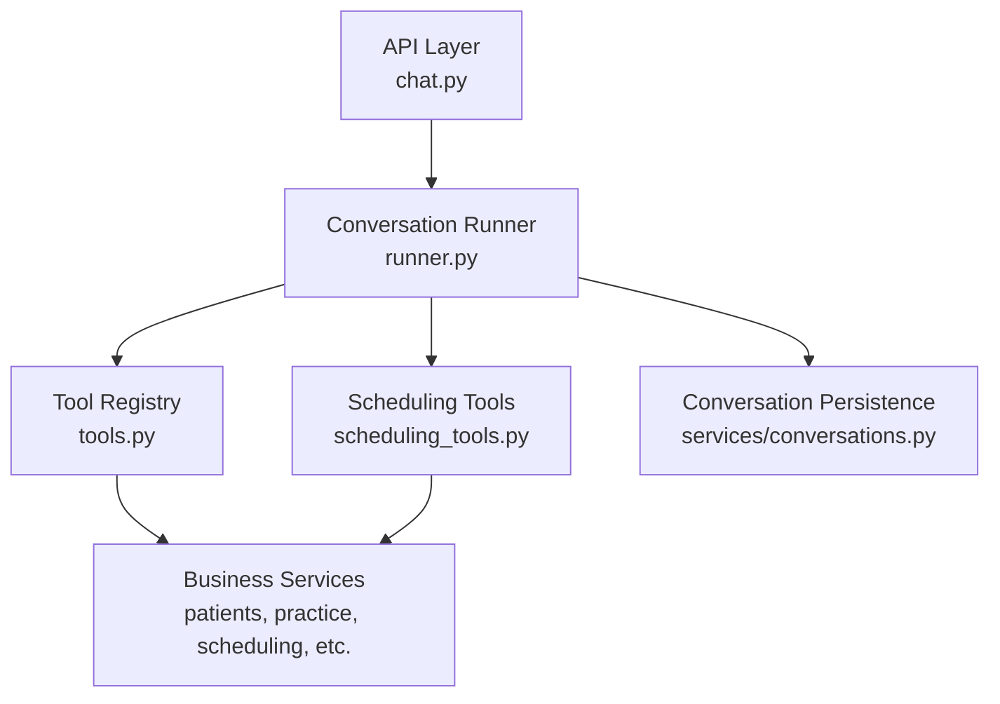
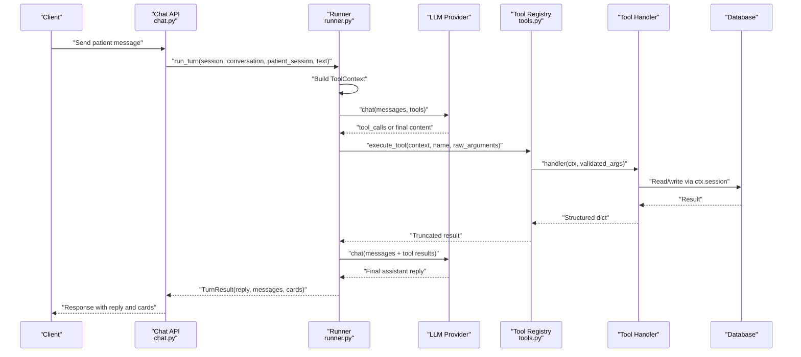
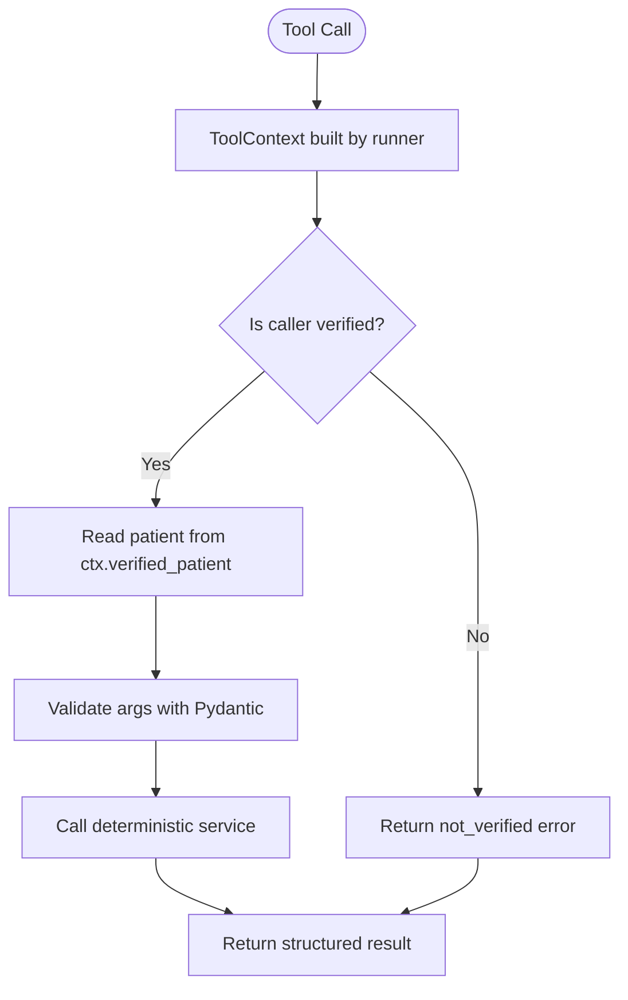
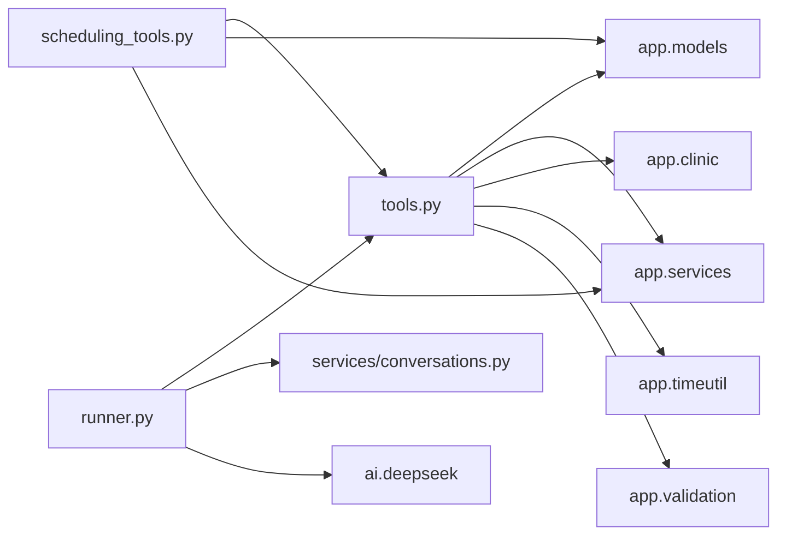

# Tool Architecture

<cite>
**Referenced Files in This Document**   
- [tools.py](file://backend/app/agent/tools.py)
- [scheduling_tools.py](file://backend/app/agent/scheduling_tools.py)
- [runner.py](file://backend/app/agent/runner.py)
- [conversations.py](file://backend/app/services/conversations.py)
- [chat.py](file://backend/app/api/chat.py)
</cite>

## Table of Contents
1. [Introduction](#introduction)
2. [Project Structure](#project-structure)
3. [Core Components](#core-components)
4. [Architecture Overview](#architecture-overview)
5. [Detailed Component Analysis](#detailed-component-analysis)
6. [Dependency Analysis](#dependency-analysis)
7. [Performance Considerations](#performance-considerations)
8. [Troubleshooting Guide](#troubleshooting-guide)
9. [Conclusion](#conclusion)

## Introduction
This document explains the tool architecture that separates AI interpretation from deterministic business logic. The system exposes a fixed set of tools to an LLM provider. Each tool has:
- A stable name and description.
- A Pydantic argument model describing allowed parameters.
- A handler function that reads request-scoped state from `ToolContext` and calls deterministic services.

The runner owns identity, session state, conversation context, and execution limits. Tools never receive identity from model arguments; they read it only from `ToolContext`, which is built by the runner after authentication.

## Project Structure
The tool layer lives under the agent package:
- `tools.py` defines the core dataclasses, base argument models, registration/patient/practice tools, the registry, validation pipeline, result truncation, and the central `execute_tool` entry point.
- `scheduling_tools.py` adds Phase 3 scheduling tools for availability, proposals, appointments, family booking, emergencies, and staff handoff.
- `runner.py` orchestrates the conversation turn, builds `ToolContext`, invokes the provider with tool schemas, executes requested tools, persists results, and formats final replies and cards.
- Supporting services handle persistence, scheduling policy, availability, patient sessions, and conversation history.

**Diagram sources**
- [chat.py:91-205](file://backend/app/api/chat.py#L91-L205)
- [runner.py:171-406](file://backend/app/agent/runner.py#L171-L406)
- [tools.py:493-614](file://backend/app/agent/tools.py#L493-L614)
- [scheduling_tools.py:1475-1599](file://backend/app/agent/scheduling_tools.py#L1475-L1599)
- [conversations.py:1-14](file://backend/app/services/conversations.py#L1-L14)

**Section sources**
- [tools.py:1-33](file://backend/app/agent/tools.py#L1-L33)
- [scheduling_tools.py:1-17](file://backend/app/agent/scheduling_tools.py#L1-L17)
- [runner.py:1-23](file://backend/app/agent/runner.py#L1-L23)

## Core Components
The core contract between AI interpretation and deterministic logic is defined by three elements:

| Component | Purpose | Key Behavior |
|---|---|---|
| `ToolSpec` | Declares one tool exposed to the model | Holds `name`, `description`, `args_model`, and `handler`; can produce a JSON schema for the provider. |
| `ToolArguments` | Base Pydantic model for all tool inputs | Forbids extra fields so unknown or hallucinated parameters are rejected early. |
| `ToolContext` | Request-scoped state provided to handlers | Contains database session, patient session, conversation ID, and a safe `verified_patient` property. |

### ToolSpec Dataclass
`ToolSpec` is the immutable declaration of a tool. It does not execute logic itself; it describes what the model may call and how its arguments should be validated. Its `schema()` method converts the associated Pydantic model into a provider-compatible function schema.

Key responsibilities:
- Provide a human-readable name and description.
- Bind a typed argument model.
- Wrap a handler callable.
- Generate a JSON schema used by the runner when exposing tools to the provider.

**Section sources**
- [tools.py:493-508](file://backend/app/agent/tools.py#L493-L508)

### ToolArguments Base Model
All tool argument models inherit from `ToolArguments`. The base model forbids extra fields, ensuring that if the model sends unexpected keys, validation fails before any service is called. This turns model hallucinations into structured errors rather than runtime exceptions.

Common subclasses include:
- `NoArguments`: for read-only or context tools.
- `VerifyPatientArgs`, `RegisterPatientArgs`, `RegisterChildArgs`, `UpdatePatientArgs`, `PracticeInfoArgs`.
- Scheduling-specific models such as `SearchAvailabilityArgs`, `CreateProposalArgs`, `RescheduleArgs`, `FamilyAvailabilityArgs`, `EmergencyArgs`, and `StaffRequestArgs`.

**Section sources**
- [tools.py:54-120](file://backend/app/agent/tools.py#L54-L120)
- [scheduling_tools.py:59-359](file://backend/app/agent/scheduling_tools.py#L59-L359)

### ToolContext Dataclass
`ToolContext` is the secure bridge between the runner and tool handlers. It contains:
- `session`: SQLAlchemy ORM session for database access.
- `patient_session`: authenticated patient session.
- `conversation_id`: current conversation identifier.
- `verified_patient`: a computed property that returns the verified patient for this session, or `None` if verification has not occurred.

Important security behavior:
- Handlers must not accept identity from model arguments.
- Identity is derived from `ctx.patient_session` and `ctx.session`.
- If a tool needs the verified patient, it should use `ctx.verified_patient` or a helper like `_get_verified_patient`.

**Section sources**
- [tools.py:41-52](file://backend/app/agent/tools.py#L41-L52)

## Architecture Overview
The runner controls the full flow:
1. Authenticate the session at the API layer.
2. Load or create the conversation.
3. Build `ToolContext` from the authenticated session.
4. Ask the provider for a reply using tool schemas.
5. Execute each requested tool through `execute_tool`.
6. Persist tool calls and results.
7. Ask the provider again with tool results.
8. Format final text and attach interactive cards.

**Diagram sources**
- [runner.py:171-406](file://backend/app/agent/runner.py#L171-L406)
- [runner.py:409-557](file://backend/app/agent/runner.py#L409-L557)
- [runner.py:721-760](file://backend/app/agent/runner.py#L721-L760)
- [tools.py:703-739](file://backend/app/agent/tools.py#L703-L739)

**Section sources**
- [runner.py:171-406](file://backend/app/agent/runner.py#L171-L406)
- [runner.py:409-557](file://backend/app/agent/runner.py#L409-L557)

## Detailed Component Analysis

### Tool Definition Pattern
Every tool follows the same pattern:
1. Define a Pydantic argument subclass of `ToolArguments`.
2. Implement a handler function with signature `(ctx: ToolContext, args: <ArgumentModel>) -> dict[str, Any]`.
3. Register the tool in `TOOL_SPECS` or `SCHEDULING_TOOL_SPECS`.
4. Let `execute_tool` validate arguments and wrap the handler call.

Example patterns:
- Registration tools in `tools.py` define `VerifyPatientArgs`, `RegisterPatientArgs`, `RegisterChildArgs`, and `UpdatePatientArgs`.
- Scheduling tools in `scheduling_tools.py` define `SearchAvailabilityArgs`, `CreateProposalArgs`, `RescheduleArgs`, `FamilyAvailabilityArgs`, and others.

Handlers return structured dictionaries containing:
- `ok`: success indicator.
- `error` and `message`: error codes and user-facing guidance.
- `cards`: optional interactive UI payloads.
- Domain-specific fields such as `registered`, `verified`, `proposal_id`, `slot_count`, `upcoming_count`, and more.

**Section sources**
- [tools.py:62-120](file://backend/app/agent/tools.py#L62-L120)
- [tools.py:511-588](file://backend/app/agent/tools.py#L511-L588)
- [scheduling_tools.py:59-359](file://backend/app/agent/scheduling_tools.py#L59-L359)
- [scheduling_tools.py:1475-1599](file://backend/app/agent/scheduling_tools.py#L1475-L1599)

### Security Model
The security model is explicit:
- Identity comes from `ToolContext`, not model arguments.
- `ToolContext` is created by the runner after authentication.
- Handlers that need the verified patient use `ctx.verified_patient` or helpers like `_get_verified_patient`.
- Some tools explicitly reject identity-like arguments to prevent misuse. For example, child registration deliberately does not accept a parent ID, phone number, or family ID.

**Diagram sources**
- [runner.py:214-216](file://backend/app/agent/runner.py#L214-L216)
- [tools.py:41-52](file://backend/app/agent/tools.py#L41-L52)
- [tools.py:134-144](file://backend/app/agent/tools.py#L134-L144)
- [tools.py:84-102](file://backend/app/agent/tools.py#L84-L102)

**Section sources**
- [tools.py:8-10](file://backend/app/agent/tools.py#L8-L10)
- [tools.py:84-102](file://backend/app/agent/tools.py#L84-L102)
- [tools.py:134-144](file://backend/app/agent/tools.py#L134-L144)
- [runner.py:214-216](file://backend/app/agent/runner.py#L214-L216)

### Available Tools

#### Registration and Identity Tools
| Tool | Arguments | Purpose |
|---|---|---|
| `verify_existing_patient` | Phone and date of birth | Verifies an existing patient and marks the session verified. |
| `register_patient` | Full name, phone, date of birth, insurance provider | Registers a new patient and marks them verified. |
| `find_registration_duplicates` | Full name and phone | Checks whether a name/phone pair already exists without exposing record details. |
| `register_child_for_verified_parent` | Child name, date of birth, optional insurance, parent-insurance flag | Registers or links a minor child to the verified parent’s household. |

Security notes:
- `register_child_for_verified_parent` does not accept parent identifiers from the model. Parent identity comes from `ctx.verified_patient`.
- Registration tools normalize and validate input before calling services.
- After successful registration or verification, the runner flushes the session so subsequent rounds see the updated state.

**Section sources**
- [tools.py:62-102](file://backend/app/agent/tools.py#L62-L102)
- [tools.py:192-284](file://backend/app/agent/tools.py#L192-L284)
- [tools.py:287-427](file://backend/app/agent/tools.py#L287-L427)
- [tools.py:522-560](file://backend/app/agent/tools.py#L522-L560)
- [tools.py:737-739](file://backend/app/agent/tools.py#L737-L739)

#### Patient Management Tools
| Tool | Arguments | Purpose |
|---|---|---|
| `update_patient_details` | Optional corrected name, phone, date of birth, insurance | Updates the verified patient’s chart without restarting registration. |

Behavior:
- Requires a verified patient.
- Returns changed fields and updated profile information.
- Uses service-level validation to report only the incorrect field.

**Section sources**
- [tools.py:104-111](file://backend/app/agent/tools.py#L104-L111)
- [tools.py:430-462](file://backend/app/agent/tools.py#L430-L462)
- [tools.py:561-569](file://backend/app/agent/tools.py#L561-L569)

#### Practice Information Tools
| Tool | Arguments | Purpose |
|---|---|---|
| `get_practice_info` | Optional topic | Lists topics or returns a specific clinic policy. |
| `get_practice_summary` | None | Returns address, hours, dentists, appointment types, and insurance overview. |

Behavior:
- `get_practice_info` returns known topics when no topic is provided.
- Unknown topics return an error with available topics.
- `get_practice_summary` aggregates practice metadata from the practice service.

**Section sources**
- [tools.py:113-120](file://backend/app/agent/tools.py#L113-L120)
- [tools.py:465-485](file://backend/app/agent/tools.py#L465-L485)
- [tools.py:570-587](file://backend/app/agent/tools.py#L570-L587)

#### Scheduling Tools
Scheduling tools are defined in `scheduling_tools.py` and added to the combined registry lazily to avoid circular imports.

| Tool | Arguments | Purpose |
|---|---|---|
| `search_availability` | Appointment type, date phrases, time windows, weekdays, provider, range, group hints | Finds open solo appointment times. |
| `get_booking_context` | Include past visits flag | Reads current booking scope: solo vs household, pending hold, completed booking. |
| `create_booking_proposal` | Slot IDs, appointment type, optional additional visit flags | Holds slots for a new appointment; requires confirmation. |
| `confirm_slot_selection` | Slot ID, intent, target appointment ID | Continues either a reschedule move or a new booking based on card context. |
| `find_replacement_times` | Same as availability search | Finds replacement times for a pending reschedule. |
| `confirm_booking_proposal` | Proposal ID, optional confirm key | Confirms a new-booking proposal in a transaction. |
| `decline_booking_proposal` | Proposal ID, optional reason | Releases a held proposal. |
| `get_patient_appointments` | Include past flag | Lists upcoming or historical appointments with pending proposal state. |
| `reschedule_appointment` | Target selection, optional slot ID, date/time hints | Proposes moving an existing appointment. |
| `cancel_appointment` | Target selection, optional reason | Proposes cancelling an existing appointment. |
| `confirm_appointment_change` | Proposal ID, optional confirm key | Confirms a reschedule or cancellation atomically. |
| `search_family_availability` | Family members, preferences | Searches availability for multiple linked household members. |
| `hold_family_option` | Family members, option index or identity, preferences | Holds one family-wide option covering all members. |
| `report_emergency` | Description, symptoms, urgency flags, caller info | Triages emergency reports and creates handoff alerts. |
| `create_staff_request` | Topic and details | Creates a front-desk request for non-scheduling issues. |

Scheduling safety rules:
- Availability searches do not book anything.
- Proposals are held first and confirmed separately.
- Reschedules and cancellations go through dedicated change confirmation.
- Family bookings require authorized household members.
- Emergency reporting produces actionable handoff cards.

**Section sources**
- [scheduling_tools.py:59-359](file://backend/app/agent/scheduling_tools.py#L59-L359)
- [scheduling_tools.py:474-552](file://backend/app/agent/scheduling_tools.py#L474-L552)
- [scheduling_tools.py:555-682](file://backend/app/agent/scheduling_tools.py#L555-L682)
- [scheduling_tools.py:690-717](file://backend/app/agent/scheduling_tools.py#L690-L717)
- [scheduling_tools.py:725-760](file://backend/app/agent/scheduling_tools.py#L725-L760)
- [scheduling_tools.py:788-897](file://backend/app/agent/scheduling_tools.py#L788-L897)
- [scheduling_tools.py:900-950](file://backend/app/agent/scheduling_tools.py#L900-L950)
- [scheduling_tools.py:953-1054](file://backend/app/agent/scheduling_tools.py#L953-L1054)
- [scheduling_tools.py:1109-1170](file://backend/app/agent/scheduling_tools.py#L1109-L1170)
- [scheduling_tools.py:1173-1234](file://backend/app/agent/scheduling_tools.py#L1173-L1234)
- [scheduling_tools.py:1280-1334](file://backend/app/agent/scheduling_tools.py#L1280-L1334)
- [scheduling_tools.py:1337-1468](file://backend/app/agent/scheduling_tools.py#L1337-L1468)
- [scheduling_tools.py:1475-1599](file://backend/app/agent/scheduling_tools.py#L1475-L1599)

### Parameter Validation
Validation happens in two stages:
1. **JSON parsing**: `execute_tool` parses the raw argument string into a dictionary.
2. **Pydantic validation**: Each tool’s `args_model.model_validate(arguments)` enforces required fields, types, ranges, and forbidden extras.

If validation fails:
- The runner receives a structured error with code `invalid_arguments`.
- Field-level errors are included so the model can ask for only the missing or invalid fields.

Examples:
- Missing phone or date of birth for verification.
- Invalid phone normalization.
- Age checks for child registration.
- Range constraints such as `range_days` between 1 and 120.
- Maximum slot counts and family member limits.

**Section sources**
- [tools.py:710-726](file://backend/app/agent/tools.py#L710-L726)
- [tools.py:164-189](file://backend/app/agent/tools.py#L164-L189)
- [tools.py:324-333](file://backend/app/agent/tools.py#L324-L333)
- [scheduling_tools.py:90-92](file://backend/app/agent/scheduling_tools.py#L90-L92)
- [scheduling_tools.py:115-120](file://backend/app/agent/scheduling_tools.py#L115-L120)
- [scheduling_tools.py:261-268](file://backend/app/agent/scheduling_tools.py#L261-L268)

### Error Handling Patterns
Errors follow a consistent shape:
- `ok: False`
- `error`: machine-readable code
- `message`: human-friendly explanation
- Optional domain fields such as `field_errors`, `missing_fields`, `appointment_unchanged`, `next_step`, `cards`, and `truncated`.

Common error categories:
- `unknown_tool`: model asked for a tool not registered.
- `bad_arguments`: malformed JSON or wrong structure.
- `invalid_arguments`: Pydantic validation failure.
- `not_verified`: tool requires a verified patient.
- `validation_failed`: service-level validation failure.
- `registration_failed`, `unexpected`, `tool_failed`: backend or unexpected failures.

The runner also wraps tool execution so unexpected exceptions become safe tool results instead of crashing the conversation loop.

**Section sources**
- [tools.py:123-126](file://backend/app/agent/tools.py#L123-L126)
- [tools.py:703-739](file://backend/app/agent/tools.py#L703-L739)
- [runner.py:721-760](file://backend/app/agent/runner.py#L721-L760)

### Result Truncation
Tool results can contain large payloads such as availability grids, appointment lists, or provider catalogs. To prevent payload overflow:
- Results are truncated to a maximum character limit.
- Important decision fields and interactive cards are preserved.
- Secondary detail fields are removed first.
- Cards are limited to a reasonable count.
- A `truncated` marker indicates that the result was trimmed.

**Diagram sources**
- [tools.py:617-700](file://backend/app/agent/tools.py#L617-L700)

**Section sources**
- [tools.py:33](file://backend/app/agent/tools.py#L33)
- [tools.py:617-700](file://backend/app/agent/tools.py#L617-L700)

## Dependency Analysis
The tool layer depends on several subsystems:

**Diagram sources**
- [tools.py:21-29](file://backend/app/agent/tools.py#L21-L29)
- [scheduling_tools.py:27-49](file://backend/app/agent/scheduling_tools.py#L27-L49)
- [runner.py:35-47](file://backend/app/agent/runner.py#L35-L47)

Coupling characteristics:
- `tools.py` is the foundation for both registration and scheduling tools.
- `scheduling_tools.py` imports shared primitives from `tools.py`, including `ToolContext`, `ToolArguments`, `NoArguments`, `ToolSpec`, `_error`, and `_get_verified_patient`.
- `runner.py` depends on `tools.py` for tool schemas and execution but avoids importing scheduling tools directly at module load to prevent circular imports.
- Conversation persistence is separate from tool logic, keeping replay and provider-message reconstruction independent from business operations.

**Section sources**
- [tools.py:21-29](file://backend/app/agent/tools.py#L21-L29)
- [scheduling_tools.py:27-49](file://backend/app/agent/scheduling_tools.py#L27-L49)
- [runner.py:35-47](file://backend/app/agent/runner.py#L35-L47)
- [runner.py:590-606](file://backend/app/agent/tools.py#L590-L606)

## Performance Considerations
- Tool round-trips are bounded by `MAX_TOOL_ROUNDS`.
- Fan-out per model turn is bounded by `MAX_TOOL_CALLS_PER_ROUND`.
- Large tool results are truncated to keep provider payloads manageable.
- Scheduling tools return compact, card-driven responses rather than unbounded prose.
- The runner deduplicates and merges cards so repeated searches do not inflate the thread.
- Lazy loading of scheduling specs prevents startup-time circular import overhead.

[No sources needed since this section provides general guidance]

## Troubleshooting Guide

### Common Issues
| Symptom | Likely Cause | Resolution |
|---|---|---|
| Model asks for an unknown tool | Tool not registered or name mismatch | Add the tool to `TOOL_SPECS` or `SCHEDULING_TOOL_SPECS`. |
| Tool fails with `invalid_arguments` | Pydantic validation failed | Check required fields, types, and descriptions in the argument model. |
| Tool fails with `not_verified` | Session lacks a verified patient | Call `verify_existing_patient` or `register_patient` first. |
| Registration fails unexpectedly | Service returned failure or patient row missing | Inspect service result and defensive patient lookup. |
| Too many or stale cards shown | Card merging or reask handling issue | Review card identity, deduplication, and reask logic in the runner. |
| Payload too large | Tool returned excessive detail | Rely on `_truncate`; ensure handlers return structured results. |

### Debugging Steps
1. Check the tool name and argument model.
2. Verify that `ToolContext` is built by the runner and passed to `execute_tool`.
3. Confirm that handlers read identity from `ctx.verified_patient`, not from arguments.
4. Inspect structured error codes and messages returned by tools.
5. Review runner logs for tool execution outcomes and card counts.
6. Use conversation history to replay provider messages and tool results.

**Section sources**
- [tools.py:703-739](file://backend/app/agent/tools.py#L703-L739)
- [runner.py:486-520](file://backend/app/agent/runner.py#L486-L520)
- [runner.py:721-760](file://backend/app/agent/runner.py#L721-L760)

## Conclusion
The tool architecture cleanly separates AI interpretation from deterministic business logic. `ToolSpec` declares allowed operations, `ToolArguments` validates inputs, and `ToolContext` safely supplies request-scoped state. The runner owns authentication, conversation state, execution limits, and persistence. Tools call deterministic services, return structured results, and rely on truncation to protect against payload overflow. This design ensures the model can only request allowed operations with properly validated parameters, while sensitive identity and session state remain controlled by the server.

[No sources needed since this section summarizes without analyzing specific files]