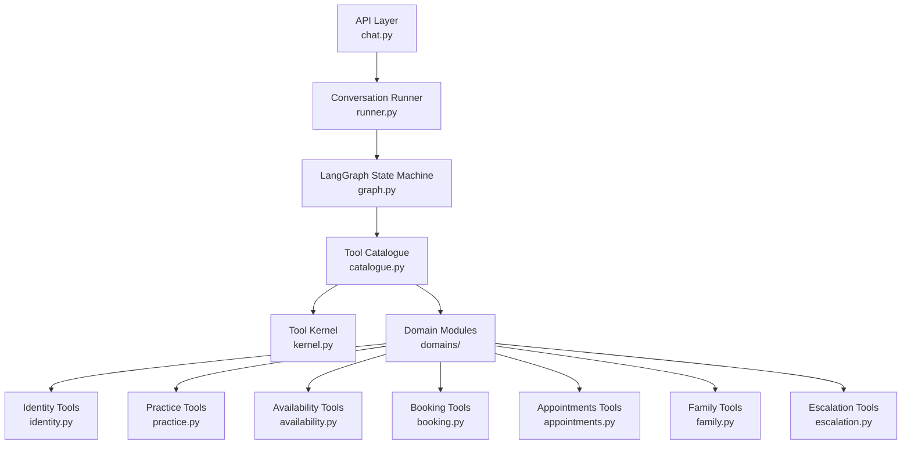
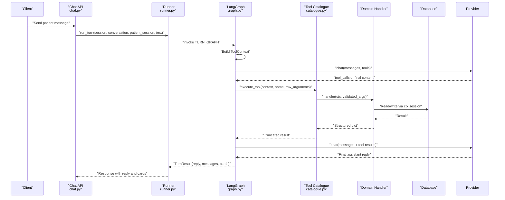
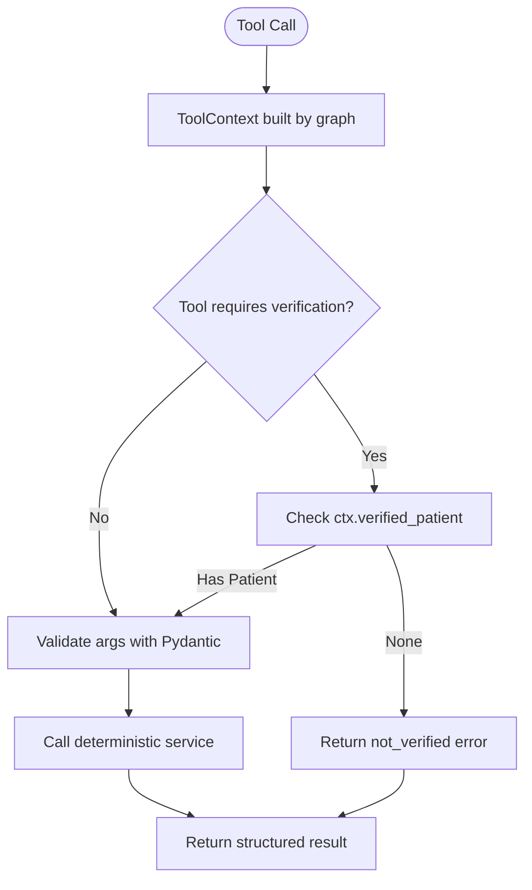
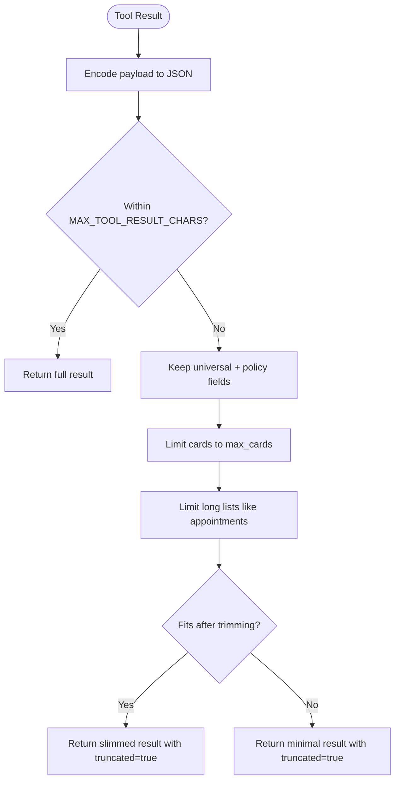
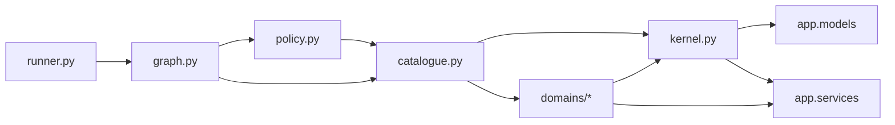

# Tool Architecture

<cite>
**Referenced Files in This Document**   
- [kernel.py](file://backend/app/agent/tools/kernel.py)
- [catalogue.py](file://backend/app/agent/tools/catalogue.py)
- [policy.py](file://backend/app/agent/tools/policy.py)
- [__init__.py](file://backend/app/agent/tools/__init__.py)
- [domains/__init__.py](file://backend/app/agent/tools/domains/__init__.py)
- [identity.py](file://backend/app/agent/tools/domains/identity.py)
- [practice.py](file://backend/app/agent/tools/domains/practice.py)
- [availability.py](file://backend/app/agent/tools/domains/availability.py)
- [runner.py](file://backend/app/agent/runner.py)
- [graph.py](file://backend/app/agent/graph.py)
</cite>

## Update Summary
**Changes Made**   
- Completely restructured tool architecture from monolithic `tools.py` to domain-specific organization
- Removed references to deleted `scheduling_tools.py` module
- Updated to reference new kernel/catalogue system with domain modules
- Replaced single-file tool definitions with organized domain-specific modules
- Updated architecture diagrams to reflect new modular structure

## Table of Contents
1. [Introduction](#introduction)
2. [Project Structure](#project-structure)
3. [Core Components](#core-components)
4. [Architecture Overview](#architecture-overview)
5. [Detailed Component Analysis](#detailed-component-analysis)
6. [Dependency Analysis](#dependency-analysis)
7. [Performance Considerations](#performance-considerations)
8. [Troubleshooting Guide](#troubleshooting-guide)
9. [Conclusion](#conclusion)

## Introduction
This document explains the tool architecture that separates AI interpretation from deterministic business logic. The system exposes a fixed set of tools to an LLM provider through a structured kernel and catalogue system. Each tool has:
- A stable name and description.
- A Pydantic argument model describing allowed parameters.
- A handler function that reads request-scoped state from `ToolContext` and calls deterministic services.

The runner owns identity, session state, conversation context, and execution limits. Tools never receive identity from model arguments; they read it only from `ToolContext`, which is built by the runner after authentication.

## Project Structure
The tool layer lives under the agent package with a new domain-specific organization:
- **Kernel**: Core dataclasses, base models, registry, validation pipeline, result truncation, and central execution entry point.
- **Catalogue**: Central registry that assembles all domain modules and provides the unified tool execution interface.
- **Policy**: Turn policy management for controlling which tools are visible based on conversation context.
- **Domains**: Business logic organized by functional area (identity, practice, availability, booking, appointments, family, escalation).
- **Runner**: Orchestrates conversation turns, builds `ToolContext`, invokes providers with tool schemas, executes requested tools, persists results, and formats final replies.

**Diagram sources**
- [runner.py:39-93](file://backend/app/agent/runner.py#L39-L93)
- [graph.py:131-187](file://backend/app/agent/graph.py#L131-L187)
- [catalogue.py:31-37](file://backend/app/agent/tools/catalogue.py#L31-L37)
- [domains/__init__.py:11-19](file://backend/app/agent/tools/domains/__init__.py#L11-L19)

**Section sources**
- [kernel.py:1-18](file://backend/app/agent/tools/kernel.py#L1-L18)
- [catalogue.py:1-10](file://backend/app/agent/tools/catalogue.py#L1-L10)
- [policy.py:1-15](file://backend/app/agent/tools/policy.py#L1-L15)
- [__init__.py:1-8](file://backend/app/agent/tools/__init__.py#L1-L8)

## Core Components
The core contract between AI interpretation and deterministic logic is defined by three elements:

| Component | Purpose | Key Behavior |
|---|---|---|
| `ToolSpec` | Declares one tool exposed to the model | Holds `name`, `description`, `args_model`, `handler`, `result_policy`, `domain`, `mutates`, and `requires_verification`; can produce a JSON schema for the provider. |
| `ToolArguments` | Base Pydantic model for all tool inputs | Forbids extra fields so unknown or hallucinated parameters are rejected early. |
| `ToolContext` | Request-scoped state provided to handlers | Contains database session, patient session, conversation ID, and a safe `verified_patient` property. |

### ToolSpec Dataclass
`ToolSpec` is the immutable declaration of a tool. It does not execute logic itself; it describes what the model may call and how its arguments should be validated. Its `schema()` method converts the associated Pydantic model into a provider-compatible function schema.

Key responsibilities:
- Provide a human-readable name and description.
- Bind a typed argument model.
- Wrap a handler callable.
- Define result policy for truncation behavior.
- Specify domain categorization and mutation flags.
- Generate a JSON schema used by the runner when exposing tools to the provider.

**Section sources**
- [kernel.py:124-143](file://backend/app/agent/tools/kernel.py#L124-L143)

### ToolArguments Base Model
All tool argument models inherit from `ToolArguments`. The base model forbids extra fields, ensuring that if the model sends unexpected keys, validation fails before any service is called. This turns model hallucinations into structured errors rather than runtime exceptions.

Common subclasses include:
- `NoArguments`: for read-only or context tools.
- Registration tools like `VerifyPatientArgs`, `RegisterPatientArgs`, `RegisterChildArgs`, `UpdatePatientArgs`.
- Practice information tools like `PracticeInfoArgs`.
- Domain-specific models such as `SearchAvailabilityArgs`, `BookingContextArgs`, and others.

**Section sources**
- [kernel.py:72-78](file://backend/app/agent/tools/kernel.py#L72-L78)
- [identity.py:71-170](file://backend/app/agent/tools/domains/identity.py#L71-L170)
- [practice.py:26-33](file://backend/app/agent/tools/domains/practice.py#L26-L33)
- [availability.py:34-87](file://backend/app/agent/tools/domains/availability.py#L34-L87)

### ToolContext Dataclass
`ToolContext` is the secure bridge between the runner and tool handlers. It contains:
- `session`: SQLAlchemy ORM session for database access.
- `patient_session`: authenticated patient session.
- `conversation_id`: current conversation identifier.
- `verified_patient`: a computed property that returns the verified patient for this session, or `None` if verification has not occurred.

Important security behavior:
- Handlers must not accept identity from model arguments.
- Identity is derived from `ctx.patient_session` and `ctx.session`.
- If a tool needs the verified patient, it should use `ctx.verified_patient` or a helper like `_get_verified_patient`.

**Section sources**
- [kernel.py:59-70](file://backend/app/agent/tools/kernel.py#L59-L70)

## Architecture Overview
The runner controls the full flow through the LangGraph state machine:
1. Authenticate the session at the API layer.
2. Load or create the conversation.
3. Build `ToolContext` from the authenticated session.
4. Ask the provider for a reply using tool schemas from the catalogue.
5. Execute each requested tool through `execute_tool`.
6. Persist tool calls and results.
7. Ask the provider again with tool results.
8. Format final text and attach interactive cards.

**Diagram sources**
- [runner.py:39-93](file://backend/app/agent/runner.py#L39-L93)
- [graph.py:190-200](file://backend/app/agent/graph.py#L190-L200)
- [catalogue.py:40-88](file://backend/app/agent/tools/catalogue.py#L40-L88)

**Section sources**
- [runner.py:39-93](file://backend/app/agent/runner.py#L39-L93)
- [graph.py:190-200](file://backend/app/agent/graph.py#L190-L200)

## Detailed Component Analysis

### Tool Definition Pattern
Every tool follows the same pattern within its domain module:
1. Define a Pydantic argument subclass of `ToolArguments`.
2. Implement a handler function with signature `(ctx: ToolContext, args: <ArgumentModel>) -> dict[str, Any]`.
3. Create a `ToolSpec` instance with metadata including domain, mutation flags, and result policy.
4. Export the spec in the domain's `SPECS` tuple.
5. The catalogue automatically includes it in the global registry.

Example patterns:
- Identity tools in `identity.py` define registration, verification, and patient management specs.
- Practice tools in `practice.py` define clinic information and policy lookup specs.
- Availability tools in `availability.py` define search and booking-related specs.

Handlers return structured dictionaries containing:
- `ok`: success indicator.
- `error` and `message`: error codes and user-facing guidance.
- `cards`: optional interactive UI payloads.
- Domain-specific fields such as `registered`, `verified`, `available`, `slot_count`, etc.

**Section sources**
- [identity.py:71-252](file://backend/app/agent/tools/domains/identity.py#L71-L252)
- [practice.py:26-84](file://backend/app/agent/tools/domains/practice.py#L26-L84)
- [availability.py:34-179](file://backend/app/agent/tools/domains/availability.py#L34-L179)

### Security Model
The security model is explicit and enforced at multiple levels:
- Identity comes from `ToolContext`, not model arguments.
- `ToolContext` is created by the graph after authentication.
- Handlers that need the verified patient use `require_verified_patient(ctx)` helper.
- Some tools explicitly reject identity-like arguments to prevent misuse. For example, child registration deliberately does not accept a parent ID, phone number, or family ID.

**Diagram sources**
- [graph.py:166-170](file://backend/app/agent/graph.py#L166-L170)
- [catalogue.py:65-70](file://backend/app/agent/tools/catalogue.py#L65-L70)
- [kernel.py:91-107](file://backend/app/agent/tools/kernel.py#L91-L107)

**Section sources**
- [kernel.py:10-17](file://backend/app/agent/tools/kernel.py#L10-L17)
- [identity.py:254-283](file://backend/app/agent/tools/domains/identity.py#L254-L283)
- [catalogue.py:65-70](file://backend/app/agent/tools/catalogue.py#L65-L70)

### Available Tools

#### Identity and Registration Tools
| Tool | Arguments | Purpose |
|---|---|---|
| `get_session_context` | None | Checks verification status, patient info, and registration completeness. |
| `verify_existing_patient` | Phone and date of birth | Verifies an existing patient and marks the session verified. |
| `find_registration_duplicates` | Full name and phone | Checks whether a name/phone pair already exists without exposing record details. |
| `register_patient` | Full name, phone, date of birth, insurance provider | Registers a new patient and marks them verified. |
| `register_child_for_verified_parent` | Child name, date of birth, optional insurance, parent-insurance flag | Registers or links a minor child to the verified parent's household. |
| `update_patient_details` | Optional corrected name, phone, date of birth, insurance | Updates the verified patient's chart without restarting registration. |

Security notes:
- `register_child_for_verified_parent` does not accept parent identifiers from the model. Parent identity comes from `ctx.verified_patient`.
- Registration tools normalize and validate input before calling services.
- After successful registration or verification, the runner flushes the session so subsequent rounds see the updated state.

**Section sources**
- [identity.py:39-69](file://backend/app/agent/tools/domains/identity.py#L39-L69)
- [identity.py:71-252](file://backend/app/agent/tools/domains/identity.py#L71-L252)
- [identity.py:254-484](file://backend/app/agent/tools/domains/identity.py#L254-L484)

#### Practice Information Tools
| Tool | Arguments | Purpose |
|---|---|---|
| `get_practice_info` | Optional topic | Lists topics or returns a specific clinic policy. |
| `get_practice_summary` | None | Returns address, hours, dentists, appointment types, and insurance overview. |

Behavior:
- `get_practice_info` returns known topics when no topic is provided.
- Unknown topics return an error with available topics.
- `get_practice_summary` aggregates practice metadata from the practice service.

**Section sources**
- [practice.py:26-84](file://backend/app/agent/tools/domains/practice.py#L26-L84)

#### Availability and Scheduling Tools
| Tool | Arguments | Purpose |
|---|---|---|
| `search_availability` | Appointment type, date phrases, time windows, weekdays, provider, range, group hints | Finds open solo appointment times. |
| `get_booking_context` | Include past visits flag | Reads current booking scope: solo vs household, pending hold, completed booking. |
| Additional scheduling tools | Various | Defined in booking.py, appointments.py, family.py domains |

Scheduling safety rules:
- Availability searches do not book anything.
- Proposals are held first and confirmed separately.
- Reschedules and cancellations go through dedicated change confirmation.
- Family bookings require authorized household members.

**Section sources**
- [availability.py:34-179](file://backend/app/agent/tools/domains/availability.py#L34-L179)

### Parameter Validation
Validation happens in two stages:
1. **JSON parsing**: `execute_tool` parses the raw argument string into a dictionary.
2. **Pydantic validation**: Each tool's `args_model.model_validate(arguments)` enforces required fields, types, ranges, and forbidden extras.

If validation fails:
- The runner receives a structured error with code `invalid_arguments`.
- Field-level errors are included so the model can ask for only the missing or invalid fields.

Examples:
- Missing phone or date of birth for verification.
- Invalid phone normalization.
- Age checks for child registration.
- Range constraints such as `range_days` between 1 and 120.

**Section sources**
- [catalogue.py:47-63](file://backend/app/agent/tools/catalogue.py#L47-L63)
- [identity.py:172-204](file://backend/app/agent/tools/domains/identity.py#L172-L204)
- [availability.py:34-87](file://backend/app/agent/tools/domains/availability.py#L34-L87)

### Error Handling Patterns
Errors follow a consistent shape:
- `ok: False`
- `error`: machine-readable code
- `message`: human-friendly explanation
- Optional domain fields such as `field_errors`, `missing_fields`, `next_step`, `cards`, and `truncated`.

Common error categories:
- `unknown_tool`: model asked for a tool not registered.
- `bad_arguments`: malformed JSON or wrong structure.
- `invalid_arguments`: Pydantic validation failure.
- `not_verified`: tool requires a verified patient.
- `validation_failed`: service-level validation failure.
- `registration_failed`, `unexpected`, `tool_failed`: backend or unexpected failures.

The runner also wraps tool execution so unexpected exceptions become safe tool results instead of crashing the conversation loop.

**Section sources**
- [catalogue.py:40-88](file://backend/app/agent/tools/catalogue.py#L40-L88)
- [kernel.py:80-83](file://backend/app/agent/tools/kernel.py#L80-L83)

### Result Truncation
Tool results can contain large payloads such as availability grids, appointment lists, or provider catalogs. To prevent payload overflow:
- Results are truncated to a maximum character limit (`MAX_TOOL_RESULT_CHARS = 6000`).
- Important decision fields and interactive cards are preserved.
- Secondary detail fields are removed first.
- Cards are limited to a reasonable count (`max_cards: 12`).
- A `truncated` marker indicates that the result was trimmed.

**Diagram sources**
- [kernel.py:146-182](file://backend/app/agent/tools/kernel.py#L146-L182)

**Section sources**
- [kernel.py:36](file://backend/app/agent/tools/kernel.py#L36)
- [kernel.py:146-182](file://backend/app/agent/tools/kernel.py#L146-L182)

## Dependency Analysis
The tool layer depends on several subsystems through the new modular architecture:

**Diagram sources**
- [kernel.py:28-32](file://backend/app/agent/tools/kernel.py#L28-L32)
- [catalogue.py:19-28](file://backend/app/agent/tools/catalogue.py#L19-L28)
- [policy.py:23-24](file://backend/app/agent/tools/policy.py#L23-L24)
- [runner.py:15-21](file://backend/app/agent/runner.py#L15-L21)
- [graph.py:42-61](file://backend/app/agent/graph.py#L42-L61)

Coupling characteristics:
- `kernel.py` is the foundation providing core contracts and utilities.
- `catalogue.py` assembles all domain modules into a unified registry.
- Domain modules import shared primitives from `kernel.py` but remain independent.
- `policy.py` manages visibility rules based on conversation context.
- `runner.py` and `graph.py` depend on the tool system but don't know about specific domains.
- Conversation persistence is separate from tool logic, keeping replay and provider-message reconstruction independent from business operations.

**Section sources**
- [kernel.py:28-32](file://backend/app/agent/tools/kernel.py#L28-L32)
- [catalogue.py:19-28](file://backend/app/agent/tools/catalogue.py#L19-L28)
- [policy.py:23-24](file://backend/app/agent/tools/policy.py#L23-L24)
- [runner.py:15-21](file://backend/app/agent/runner.py#L15-L21)
- [graph.py:42-61](file://backend/app/agent/graph.py#L42-L61)

## Performance Considerations
- Tool round-trips are bounded by `MAX_TOOL_ROUNDS = 4`.
- Fan-out per model turn is bounded by `MAX_TOOL_CALLS_PER_ROUND = 4`.
- Large tool results are truncated to keep provider payloads manageable.
- Domain-specific organization allows lazy loading and better maintainability.
- The runner deduplicates and merges cards so repeated searches do not inflate the thread.
- The catalogue is built at import time, preventing duplicate tool names at startup.

## Troubleshooting Guide

### Common Issues
| Symptom | Likely Cause | Resolution |
|---|---|---|
| Model asks for an unknown tool | Tool not registered or name mismatch | Add the tool spec to the appropriate domain module's SPECS tuple. |
| Tool fails with `invalid_arguments` | Pydantic validation failed | Check required fields, types, and descriptions in the argument model. |
| Tool fails with `not_verified` | Session lacks a verified patient | Call `verify_existing_patient` or `register_patient` first. |
| Registration fails unexpectedly | Service returned failure or patient row missing | Inspect service result and defensive patient lookup. |
| Too many or stale cards shown | Card merging or reask handling issue | Review card identity, deduplication, and reask logic in the graph. |
| Payload too large | Tool returned excessive detail | Rely on `_truncate`; ensure handlers return structured results. |

### Debugging Steps
1. Check the tool name and argument model in the domain module.
2. Verify that `ToolContext` is built by the graph and passed to `execute_tool`.
3. Confirm that handlers read identity from `ctx.verified_patient`, not from arguments.
4. Inspect structured error codes and messages returned by tools.
5. Review graph logs for tool execution outcomes and card counts.
6. Use conversation history to replay provider messages and tool results.

**Section sources**
- [catalogue.py:40-88](file://backend/app/agent/tools/catalogue.py#L40-L88)
- [graph.py:190-200](file://backend/app/agent/graph.py#L190-L200)

## Conclusion
The tool architecture cleanly separates AI interpretation from deterministic business logic through a modular kernel and catalogue system. `ToolSpec` declares allowed operations, `ToolArguments` validates inputs, and `ToolContext` safely supplies request-scoped state. The runner and graph own authentication, conversation state, execution limits, and persistence. Domain-specific modules organize business logic by functional area, while the catalogue provides a unified interface. Tools call deterministic services, return structured results, and rely on truncation to protect against payload overflow. This design ensures the model can only request allowed operations with properly validated parameters, while sensitive identity and session state remain controlled by the server.