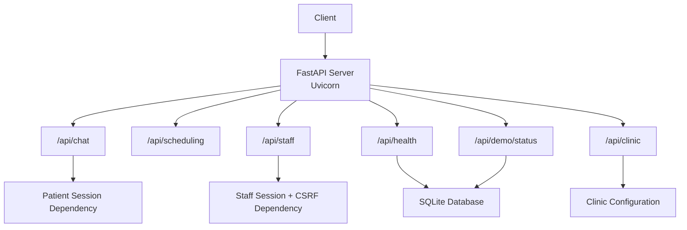
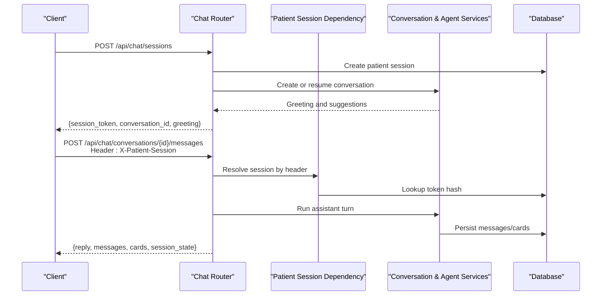
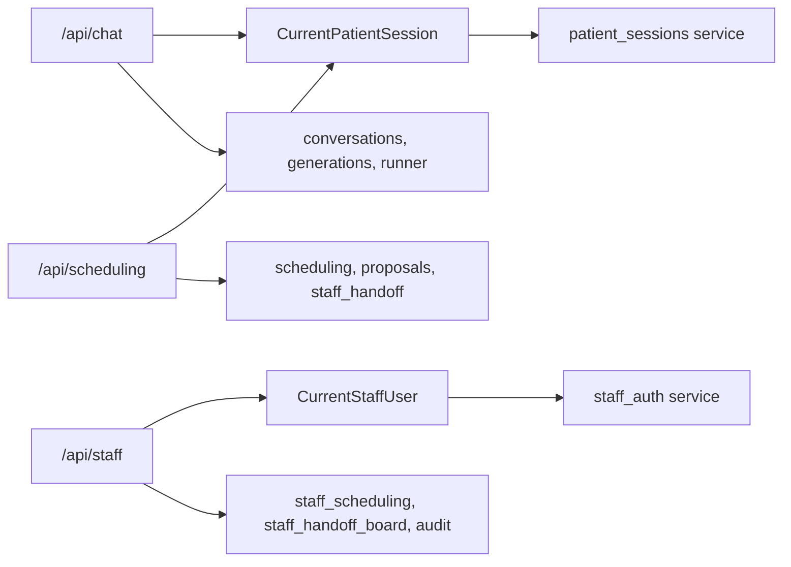

# API Reference

<cite>
**Referenced Files in This Document**
- [server.py](file://backend/server.py)
- [chat.py](file://backend/app/api/chat.py)
- [scheduling.py](file://backend/app/api/scheduling.py)
- [staff.py](file://backend/app/api/staff.py)
- [health.py](file://backend/app/api/health.py)
- [clinic.py](file://backend/app/api/clinic.py)
- [demo.py](file://backend/app/api/demo.py)
- [deps.py](file://backend/app/api/deps.py)
- [schemas.py](file://backend/app/schemas.py)
- [patient_sessions.py](file://backend/app/services/patient_sessions.py)
- [staff_auth.py](file://backend/app/services/staff_auth.py)
- [config.py](file://backend/app/config.py)
</cite>

## Table of Contents
1. [Introduction](#introduction)
2. [Project Structure](#project-structure)
3. [Core Components](#core-components)
4. [Architecture Overview](#architecture-overview)
5. [Detailed Component Analysis](#detailed-component-analysis)
6. [Dependency Analysis](#dependency-analysis)
7. [Performance Considerations](#performance-considerations)
8. [Troubleshooting Guide](#troubleshooting-guide)
9. [Conclusion](#conclusion)

## Introduction
This document describes the public REST API for the dental receptionist application. It covers:
- Patient chat endpoints for conversation lifecycle, messaging, listing, and feedback.
- Scheduling endpoints for availability checks, slot selection, proposal confirmation, decline, expiration, and appointment listing.
- Staff authentication, session management, and protected dashboard endpoints.
- Health, clinic information, and demo status endpoints.

The server is a FastAPI application served by Uvicorn. Authentication differs by audience:
- Patient routes use an opaque `X-Patient-Session` header.
- Staff routes use an HttpOnly session cookie plus a CSRF header on state-changing requests.

There is no explicit per-endpoint rate limiting implemented in the referenced files; clients should implement standard retry/backoff behavior and respect HTTP status codes.

**Section sources**
- [server.py:5-14](file://backend/server.py#L5-L14)
- [deps.py:1-48](file://backend/app/api/deps.py#L1-L48)
- [staff.py:1-30](file://backend/app/api/staff.py#L1-L30)

## Project Structure
The backend exposes several FastAPI routers under `/api`:
- `/api/chat` -- patient chat operations.
- `/api/scheduling` -- interactive scheduling operations tied to a patient conversation.
- `/api/staff` -- staff dashboard, authentication, appointments, alerts, requests, and patients.
- `/api/health` -- liveness and database probe.
- `/api/clinic` -- public clinic configuration.
- `/api/demo/status` -- aggregate fixture counts and reset generation.

**Diagram sources**
- [server.py:5-14](file://backend/server.py#L5-L14)
- [chat.py:51-51](file://backend/app/api/chat.py#L51-L51)
- [scheduling.py:32-32](file://backend/app/api/scheduling.py#L32-L32)
- [staff.py:61-61](file://backend/app/api/staff.py#L61-L61)
- [health.py:20-20](file://backend/app/api/health.py#L20-L20)
- [clinic.py:11-11](file://backend/app/api/clinic.py#L11-L11)
- [demo.py:12-12](file://backend/app/api/demo.py#L12-L12)

**Section sources**
- [chat.py:51-51](file://backend/app/api/chat.py#L51-L51)
- [scheduling.py:32-32](file://backend/app/api/scheduling.py#L32-L32)
- [staff.py:61-61](file://backend/app/api/staff.py#L61-L61)
- [health.py:20-20](file://backend/app/api/health.py#L20-L20)
- [clinic.py:11-11](file://backend/app/api/clinic.py#L11-L11)
- [demo.py:12-12](file://backend/app/api/demo.py#L12-L12)

## Core Components
- **Patient sessions**: An opaque token is issued once and must be sent as `X-Patient-Session`. The token is hashed before storage and scoped to a reset generation. A conversation ID alone does not grant access.
- **Staff sessions**: Login returns an HttpOnly session cookie and a readable CSRF cookie. State-changing staff requests require the matching `X-Staff-CSRF` header.
- **Schemas**: All public responses are explicitly modeled so sensitive fields are never leaked.
- **Configuration**: DeepSeek model settings are read from environment variables or `.env`; the key presence is exposed only as a boolean capability flag.

Key security behaviors:
- Patient tokens are 32 random bytes, URL-safe, stored as SHA-256 hashes, and invalidated after a reset generation change.
- Staff sessions expire after eight hours, can be revoked, and support brute-force protection through failed-login tracking.
- CSRF protection pairs a server-side digest with a client-readable cookie; cross-origin attackers cannot forge the required header.

**Section sources**
- [patient_sessions.py:1-14](file://backend/app/services/patient_sessions.py#L1-L14)
- [patient_sessions.py:38-85](file://backend/app/services/patient_sessions.py#L38-L85)
- [staff_auth.py:1-33](file://backend/app/services/staff_auth.py#L1-L33)
- [staff_auth.py:52-63](file://backend/app/services/staff_auth.py#L52-L63)
- [staff_auth.py:93-124](file://backend/app/services/staff_auth.py#L93-L124)
- [staff_auth.py:127-175](file://backend/app/services/staff_auth.py#L127-L175)
- [schemas.py:1-5](file://backend/app/schemas.py#L1-L5)
- [config.py:1-10](file://backend/app/config.py#L1-L10)

## Architecture Overview
The API separates concerns into routers and services:
- Routers define HTTP methods, validate request bodies, enforce authentication, and return Pydantic response models.
- Services perform business logic such as conversation history, scheduling decisions, staff handoff, and authentication.
- Dependencies centralize session resolution for both patients and staff.

**Diagram sources**
- [chat.py:111-163](file://backend/app/api/chat.py#L111-L163)
- [chat.py:233-274](file://backend/app/api/chat.py#L233-L274)
- [deps.py:27-51](file://backend/app/api/deps.py#L27-L51)
- [patient_sessions.py:50-85](file://backend/app/services/patient_sessions.py#L50-L85)

## Detailed Component Analysis

### Patient Chat Endpoints
All patient endpoints except session creation require the `X-Patient-Session` header. Conversation IDs are scoped to the authenticated session.

#### Start Patient Session
- **Method:** `POST`
- **URL:** `/api/chat/sessions`
- **Authentication:** None (only route that issues a session).
- **Request body:** Optional `ChatStartSessionRequest` with `resume_conversation_id`.
- **Response:** `ChatSessionResponse` containing `session_token`, `session` state, `reset_generation`, `conversation_id`, `greeting`, `suggestions`, and `clinic_name`.
- **Status codes:**
  - `201 Created`: Session created and conversation opened.
  - `500 Internal Server Error`: Defensive failure when session record cannot be loaded.
- **Notes:**
  - If `resume_conversation_id` is provided, the server attempts to resume only if the new session belongs to the same verified patient.
  - The first assistant message is appended automatically.

**Section sources**
- [chat.py:111-163](file://backend/app/api/chat.py#L111-L163)
- [schemas.py:164-193](file://backend/app/schemas.py#L164-L193)

#### List Conversations
- **Method:** `GET`
- **URL:** `/api/chat/conversations?limit=...`
- **Authentication:** Required (`X-Patient-Session`).
- **Query parameters:**
  - `limit`: Integer between 1 and 50; default 30.
- **Response:** `ChatConversationListResponse` with summaries and session state.
- **Status codes:**
  - `200 OK`: Successful list.
  - `401 Unauthorized`: Missing patient session.
  - `404 Not Found`: Invalid or expired patient session.

**Section sources**
- [chat.py:166-180](file://backend/app/api/chat.py#L166-L180)
- [schemas.py:223-226](file://backend/app/schemas.py#L223-L226)
- [deps.py:27-51](file://backend/app/api/deps.py#L27-L51)

#### Start New Conversation
- **Method:** `POST`
- **URL:** `/api/chat/conversations`
- **Authentication:** Required (`X-Patient-Session`).
- **Request body:** None.
- **Response:** `ChatConversationResponse` with summary, initial messages, suggestions, session state, and empty pending proposals.
- **Status codes:**
  - `201 Created`: New conversation started.
  - `401 Unauthorized`: Missing patient session.
  - `404 Not Found`: Invalid or expired patient session.

**Section sources**
- [chat.py:183-204](file://backend/app/api/chat.py#L183-L204)
- [schemas.py:206-221](file://backend/app/schemas.py#L206-L221)

#### Restore Conversation
- **Method:** `GET`
- **URL:** `/api/chat/conversations/{conversation_id}`
- **Authentication:** Required (`X-Patient-Session`).
- **Path parameters:**
  - `conversation_id`: Must belong to the current session.
- **Response:** Full transcript with cards, suggestions, session state, and currently pending proposals.
- **Status codes:**
  - `200 OK`: Conversation restored.
  - `404 Not Found`: Conversation not found in this session.
  - `401 Unauthorized`: Missing patient session.
  - `404 Not Found`: Invalid or expired patient session.

**Section sources**
- [chat.py:207-230](file://backend/app/api/chat.py#L207-L230)

#### Send Message
- **Method:** `POST`
- **URL:** `/api/chat/conversations/{conversation_id}/messages`
- **Authentication:** Required (`X-Patient-Session`).
- **Request body:** `ChatSendMessageRequest` with `message` and optional `action`.
- **Response:** `ChatSendMessageResponse` with reply, updated messages, cards, session state, and degraded flag.
- **Validation:**
  - `message` must be non-empty and at most 2000 characters.
- **Status codes:**
  - `200 OK`: Assistant turn completed.
  - `422 Unprocessable Entity`: Empty message or invalid payload.
  - `401 Unauthorized`: Missing patient session.
  - `404 Not Found`: Invalid or expired patient session.
- **Behavior:**
  - The assistant turn runs off the event loop to avoid blocking.
  - If the DeepSeek API key is not configured, the endpoint logs a warning but still processes the request.

**Section sources**
- [chat.py:233-274](file://backend/app/api/chat.py#L233-L274)
- [schemas.py:236-273](file://backend/app/schemas.py#L236-L273)
- [config.py:27-38](file://backend/app/config.py#L27-L38)

#### Submit Feedback
- **Method:** `POST`
- **URL:** `/api/chat/conversations/{conversation_id}/feedback`
- **Authentication:** Required (`X-Patient-Session`).
- **Request body:** `ChatFeedbackRequest` with `message_id`, `rating`, and optional `reason`.
- **Response:** `ChatFeedbackResponse` with `ok`, `rating`, and acknowledgment message.
- **Validation:**
  - `message_id` must refer to an assistant message in the same conversation.
  - `rating` must be `up` or `down`.
  - `reason` is truncated to 500 characters and only stored for down ratings.
- **Status codes:**
  - `200 OK`: Feedback recorded.
  - `422 Unprocessable Entity`: Invalid feedback target or payload.
  - `401 Unauthorized`: Missing patient session.
  - `404 Not Found`: Invalid or expired patient session.

**Section sources**
- [chat.py:277-322](file://backend/app/api/chat.py#L277-L322)
- [schemas.py:241-258](file://backend/app/schemas.py#L241-L258)

#### Reset Within Session
- **Method:** `POST`
- **URL:** `/api/chat/reset`
- **Authentication:** Required (`X-Patient-Session`).
- **Request body:** None.
- **Response:** `204 No Content`.
- **Behavior:** Closes active conversations in the session and updates last-seen time without invalidating the patient session.

**Section sources**
- [chat.py:325-346](file://backend/app/api/chat.py#L325-L346)

### Scheduling Endpoints
Scheduling endpoints operate on a conversation scoped to the current patient session. Many actions are idempotent through client-supplied keys.

#### Pending Proposals
- **Method:** `GET`
- **URL:** `/api/scheduling/pending?conversation_id=...`
- **Authentication:** Required (`X-Patient-Session`).
- **Query parameters:**
  - `conversation_id`: Optional; defaults to the newest conversation in the session.
- **Response:** `PendingProposalsResponse` with actionable proposals, handoff items, and conversation identifier.
- **Status codes:**
  - `200 OK`: Pending proposals returned.
  - `404 Not Found`: Conversation not found in this session.
  - `409 Conflict`: No conversation exists yet.
  - `401 Unauthorized`: Missing patient session.
  - `404 Not Found`: Invalid or expired patient session.

**Section sources**
- [scheduling.py:216-238](file://backend/app/api/scheduling.py#L216-L238)
- [scheduling.py:137-148](file://backend/app/api/scheduling.py#L137-L148)

#### Select Slot
- **Method:** `POST`
- **URL:** `/api/scheduling/slots/select`
- **Authentication:** Required (`X-Patient-Session`).
- **Request body:** `SlotSelectionRequest` with `slot_ids`, `appointment_type`, optional `conversation_id`, `intent`, `target_appointment_id`, `require_open`, `create_key`, `summary`, and `additional_visit`.
- **Response:** `SchedulingActionResponse` describing outcome, proposal, cards, and next steps.
- **Validation:**
  - `slot_ids` must contain 1 to 6 values.
  - Unknown appointment types produce an error result rather than a validation error.
- **Status codes:**
  - `201 Created`: Proposal created or action performed.
  - `403 Forbidden`: Patient not verified.
  - `404 Not Found`: Conversation not found in this session.
  - `409 Conflict`: No conversation exists yet.
  - `401 Unauthorized`: Missing patient session.
  - `404 Not Found`: Invalid or expired patient session.

**Section sources**
- [scheduling.py:40-72](file://backend/app/api/scheduling.py#L40-L72)
- [scheduling.py:256-362](file://backend/app/api/scheduling.py#L256-L362)
- [scheduling.py:155-186](file://backend/app/api/scheduling.py#L155-L186)

#### Refresh Availability
- **Method:** `POST`
- **URL:** `/api/scheduling/availability`
- **Authentication:** Required (`X-Patient-Session`).
- **Request body:** `AvailabilityRefreshRequest` with `conversation_id`, `appointment_type`, `slot_ids`, optional `patient_first_name`, `intent`, `target_appointment_id`, and `additional_visit`.
- **Response:** `AvailabilityRefreshResponse` with `ok`, `cards`, `rejected`, optional `message`, and live proposals.
- **Validation:**
  - `slot_ids` must contain 1 to 12 values.
  - Unknown appointment type returns `422 Unprocessable Entity`.
- **Status codes:**
  - `200 OK`: Availability refreshed.
  - `403 Forbidden`: Patient not verified.
  - `422 Unprocessable Entity`: Unknown appointment type.
  - `404 Not Found`: Conversation not found in this session.
  - `409 Conflict`: No conversation exists yet.
  - `401 Unauthorized`: Missing patient session.
  - `404 Not Found`: Invalid or expired patient session.

**Section sources**
- [scheduling.py:74-100](file://backend/app/api/scheduling.py#L74-L100)
- [scheduling.py:365-453](file://backend/app/api/scheduling.py#L365-L453)

#### Confirm Proposal
- **Method:** `POST`
- **URL:** `/api/scheduling/proposals/{proposal_id}/confirm`
- **Authentication:** Required (`X-Patient-Session`).
- **Request body:** `ProposalActionRequest` with optional `conversation_id` and `confirm_key`.
- **Response:** `SchedulingActionResponse` describing confirmation result, cards, and next step.
- **Status codes:**
  - `200 OK`: Confirmation processed.
  - `404 Not Found`: Unknown proposal.
  - `403 Forbidden`: Patient not verified.
  - `404 Not Found`: Conversation not found in this session.
  - `409 Conflict`: No conversation exists yet.
  - `401 Unauthorized`: Missing patient session.
  - `404 Not Found`: Invalid or expired patient session.

**Section sources**
- [scheduling.py:102-108](file://backend/app/api/scheduling.py#L102-L108)
- [scheduling.py:456-487](file://backend/app/api/scheduling.py#L456-L487)

#### Decline Proposal
- **Method:** `POST`
- **URL:** `/api/scheduling/proposals/{proposal_id}/decline`
- **Authentication:** Required (`X-Patient-Session`).
- **Request body:** `ProposalActionRequest` with optional `conversation_id` and `confirm_key`.
- **Response:** `SchedulingActionResponse` describing decline result.
- **Status codes:**
  - `200 OK`: Proposal declined.
  - `403 Forbidden`: Patient not verified.
  - `404 Not Found`: Conversation not found in this session.
  - `409 Conflict`: No conversation exists yet.
  - `401 Unauthorized`: Missing patient session.
  - `404 Not Found`: Invalid or expired patient session.

**Section sources**
- [scheduling.py:490-508](file://backend/app/api/scheduling.py#L490-L508)

#### List Appointments
- **Method:** `GET`
- **URL:** `/api/scheduling/appointments`
- **Authentication:** Required (`X-Patient-Session`).
- **Response:** `SchedulingActionResponse` with appointment cards if any exist.
- **Status codes:**
  - `200 OK`: Appointments listed.
  - `403 Forbidden`: Patient not verified.
  - `401 Unauthorized`: Missing patient session.
  - `404 Not Found`: Invalid or expired patient session.

**Section sources**
- [scheduling.py:511-528](file://backend/app/api/scheduling.py#L511-L528)

#### Expire Pending Proposals
- **Method:** `POST`
- **URL:** `/api/scheduling/proposals/expire?conversation_id=...`
- **Authentication:** Required (`X-Patient-Session`).
- **Query parameters:**
  - `conversation_id`: Optional; defaults to the newest conversation in the session.
- **Response:** `SchedulingActionResponse` indicating how many proposals were expired.
- **Status codes:**
  - `200 OK`: Expiration housekeeping completed.
  - `404 Not Found`: Conversation not found in this session.
  - `409 Conflict`: No conversation exists yet.
  - `401 Unauthorized`: Missing patient session.
  - `404 Not Found`: Invalid or expired patient session.

**Section sources**
- [scheduling.py:531-550](file://backend/app/api/scheduling.py#L531-L550)

### Staff Authentication and Protected Endpoints
Staff endpoints protect state-changing operations with an HttpOnly session cookie and CSRF header. Safe methods do not require the CSRF header.

#### Login
- **Method:** `POST`
- **URL:** `/api/staff/session`
- **Authentication:** None.
- **Request body:** `LoginRequest` with `username` and `password`.
- **Response:** `StaffSessionResponse` with `authenticated`, `user`, `csrf_token`, `expires_at`, `clinic_now`, and `demo_notice`.
- **Cookies set:**
  - `mb_staff_session`: HttpOnly, SameSite=Lax, secure when HTTPS.
  - `mb_staff_csrf`: Readable by JavaScript, SameSite=Lax, secure when HTTPS.
- **Status codes:**
  - `200 OK`: Login successful.
  - `401 Unauthorized`: Invalid credentials, disabled account, or locked out.
- **Security notes:**
  - Failure responses are intentionally uniform to prevent username enumeration.
  - Repeated failures trigger a short lockout window.

**Section sources**
- [staff.py:73-85](file://backend/app/api/staff.py#L73-L85)
- [staff.py:226-269](file://backend/app/api/staff.py#L226-L269)
- [staff_auth.py:52-63](file://backend/app/services/staff_auth.py#L52-L63)
- [staff_auth.py:93-124](file://backend/app/services/staff_auth.py#L93-L124)

#### Current Staff Session
- **Method:** `GET`
- **URL:** `/api/staff/session`
- **Authentication:** Requires a valid staff session cookie; anonymous callers receive unauthenticated metadata.
- **Response:** `StaffSessionResponse` including whether the caller is authenticated, user data when available, CSRF token echo, expiry, clinic time, and demo notice.
- **Status codes:**
  - `200 OK`: Session info returned.
  - `401 Unauthorized`: No valid staff session.

**Section sources**
- [staff.py:272-290](file://backend/app/api/staff.py#L272-L290)

#### Logout
- **Method:** `DELETE`
- **URL:** `/api/staff/session`
- **Authentication:** Requires a valid staff session cookie.
- **Request body:** None.
- **Response:** `{ok: true}`.
- **Cookies cleared:** Both session and CSRF cookies.
- **Status codes:**
  - `200 OK`: Session revoked and cookies cleared.
  - `401 Unauthorized`: No valid staff session.

**Section sources**
- [staff.py:293-311](file://backend/app/api/staff.py#L293-L311)

#### Summary
- **Method:** `GET`
- **URL:** `/api/staff/summary`
- **Authentication:** Requires authenticated staff user.
- **Response:** Counts and generated timestamp.
- **Status codes:**
  - `200 OK`: Summary returned.
  - `401 Unauthorized`: No valid staff session.

**Section sources**
- [staff.py:319-322](file://backend/app/api/staff.py#L319-L322)

#### Conversation Feedback
- **Method:** `GET`
- **URL:** `/api/staff/feedback?days=...&limit=...`
- **Authentication:** Requires authenticated staff user.
- **Query parameters:**
  - `days`: Integer between 1 and 365; default 30.
  - `limit`: Integer between 1 and 200; default 50.
- **Response:** Aggregated counts and recent feedback entries without patient identifiers.
- **Status codes:**
  - `200 OK`: Feedback returned.
  - `401 Unauthorized`: No valid staff session.

**Section sources**
- [staff.py:325-372](file://backend/app/api/staff.py#L325-L372)

#### List Appointments
- **Method:** `GET`
- **URL:** `/api/staff/appointments?day=&day_from=&day_to=&provider_id=&status=&search=&upcoming_only=&limit=`
- **Authentication:** Requires authenticated staff user.
- **Query parameters:** Filtering by day range, provider, status, search text, upcoming-only, and limit.
- **Response:** Appointments, provider options, appointment type options, and count.
- **Status codes:**
  - `200 OK`: Appointments returned.
  - `401 Unauthorized`: No valid staff session.

**Section sources**
- [staff.py:380-409](file://backend/app/api/staff.py#L380-L409)

#### Appointment Detail
- **Method:** `GET`
- **URL:** `/api/staff/appointments/{appointment_id}`
- **Authentication:** Requires authenticated staff user.
- **Path parameters:**
  - `appointment_id`: Integer.
- **Response:** Appointment object and activity history.
- **Status codes:**
  - `200 OK`: Detail returned.
  - `404 Not Found`: Appointment not found.
  - `401 Unauthorized`: No valid staff session.

**Section sources**
- [staff.py:412-418](file://backend/app/api/staff.py#L412-L418)

#### Available Slots
- **Method:** `GET`
- **URL:** `/api/staff/slots?day=&provider_id=&appointment_type=`
- **Authentication:** Requires authenticated staff user.
- **Query parameters:**
  - `day`: Required date in `YYYY-MM-DD`.
  - `provider_id`: Optional provider filter.
  - `appointment_type`: Default `checkup`.
- **Response:** Day, slots, and count.
- **Status codes:**
  - `200 OK`: Slots returned.
  - `422 Unprocessable Entity`: Missing or invalid day.
  - `401 Unauthorized`: No valid staff session.

**Section sources**
- [staff.py:421-443](file://backend/app/api/staff.py#L421-L443)

#### Create Appointment
- **Method:** `POST`
- **URL:** `/api/staff/appointments`
- **Authentication:** Requires authenticated staff user.
- **Request body:** `CreateAppointmentRequest` with `patient_id`, `provider_id`, `starts_at`, `appointment_type`, and optional `reason`.
- **Validation:**
  - `starts_at` must be a clinic-local naive ISO timestamp and not in the past.
- **Response:** Created appointment object.
- **Status codes:**
  - `201 Created`: Appointment created.
  - `422 Unprocessable Entity`: Invalid timestamp.
  - `409 Conflict` or `400 Bad Request`: Business rule conflict depending on error code.
  - `404 Not Found`: Unknown appointment-related entity.
  - `503 Service Unavailable`: Busy condition.
  - `401 Unauthorized`: No valid staff session.

**Section sources**
- [staff.py:92-98](file://backend/app/api/staff.py#L92-L98)
- [staff.py:446-464](file://backend/app/api/staff.py#L446-L464)
- [staff.py:166-187](file://backend/app/api/staff.py#L166-L187)
- [staff.py:207-218](file://backend/app/api/staff.py#L207-L218)

#### Reschedule Appointment
- **Method:** `POST`
- **URL:** `/api/staff/appointments/{appointment_id}/reschedule`
- **Authentication:** Requires authenticated staff user.
- **Request body:** `RescheduleRequest` with `starts_at`, optional `provider_id`, and optional `appointment_type`.
- **Validation:**
  - `starts_at` must be a clinic-local naive ISO timestamp and not in the past.
- **Response:** Updated appointment object.
- **Status codes:**
  - `200 OK`: Appointment rescheduled.
  - `422 Unprocessable Entity`: Invalid timestamp.
  - `409 Conflict` or `400 Bad Request`: Business rule conflict.
  - `404 Not Found`: Unknown appointment-related entity.
  - `503 Service Unavailable`: Busy condition.
  - `401 Unauthorized`: No valid staff session.

**Section sources**
- [staff.py:100-104](file://backend/app/api/staff.py#L100-L104)
- [staff.py:467-484](file://backend/app/api/staff.py#L467-L484)
- [staff.py:166-187](file://backend/app/api/staff.py#L166-L187)
- [staff.py:207-218](file://backend/app/api/staff.py#L207-L218)

#### Cancel Appointment
- **Method:** `POST`
- **URL:** `/api/staff/appointments/{appointment_id}/cancel`
- **Authentication:** Requires authenticated staff user.
- **Request body:** `CancelRequest` with optional `reason`.
- **Response:** Updated appointment object.
- **Status codes:**
  - `200 OK`: Appointment canceled.
  - `409 Conflict` or `400 Bad Request`: Business rule conflict.
  - `404 Not Found`: Unknown appointment-related entity.
  - `503 Service Unavailable`: Busy condition.
  - `401 Unauthorized`: No valid staff session.

**Section sources**
- [staff.py:106-108](file://backend/app/api/staff.py#L106-L108)
- [staff.py:487-501](file://backend/app/api/staff.py#L487-L501)
- [staff.py:207-218](file://backend/app/api/staff.py#L207-L218)

#### Complete Appointment
- **Method:** `POST`
- **URL:** `/api/staff/appointments/{appointment_id}/complete`
- **Authentication:** Requires authenticated staff user.
- **Request body:** None.
- **Response:** Updated appointment object.
- **Status codes:**
  - `200 OK`: Appointment completed.
  - `409 Conflict` or `400 Bad Request`: Business rule conflict.
  - `404 Not Found`: Unknown appointment-related entity.
  - `503 Service Unavailable`: Busy condition.
  - `401 Unauthorized`: No valid staff session.

**Section sources**
- [staff.py:504-512](file://backend/app/api/staff.py#L504-L512)
- [staff.py:207-218](file://backend/app/api/staff.py#L207-L218)

#### Alerts and Requests
These endpoints follow the same pattern:
- Require authenticated staff.
- Support filtering and pagination via query parameters.
- Return structured objects and activity histories where applicable.
- Map service-layer errors to appropriate HTTP status codes.

Relevant endpoints include:
- `GET /api/staff/alerts`
- `GET /api/staff/alerts/{alert_id}`
- `POST /api/staff/alerts/{alert_id}/status`
- `POST /api/staff/alerts/{alert_id}/severity`
- `GET /api/staff/requests`
- `GET /api/staff/requests/{request_id}`
- `POST /api/staff/requests/{request_id}/status`
- `POST /api/staff/requests/{request_id}/approve`

**Section sources**
- [staff.py:520-582](file://backend/app/api/staff.py#L520-L582)
- [staff.py:590-654](file://backend/app/api/staff.py#L590-L654)
- [staff.py:207-218](file://backend/app/api/staff.py#L207-L218)

#### Search Patients
- **Method:** `GET`
- **URL:** `/api/staff/patients/search?q=...`
- **Authentication:** Requires authenticated staff user.
- **Query parameters:**
  - `q`: Non-empty string up to 120 characters.
- **Response:** Up to 20 matching patients with name, phone, date of birth, insurance provider.
- **Status codes:**
  - `200 OK`: Patient matches returned.
  - `401 Unauthorized`: No valid staff session.

**Section sources**
- [staff.py:662-696](file://backend/app/api/staff.py#L662-L696)

#### Patient Detail
- **Method:** `GET`
- **URL:** `/api/staff/patients/{patient_id}`
- **Authentication:** Requires authenticated staff user.
- **Path parameters:**
  - `patient_id`: Integer.
- **Response:** Patient details and associated appointments.
- **Status codes:**
  - `200 OK`: Patient detail returned.
  - `404 Not Found`: Patient not found.
  - `401 Unauthorized`: No valid staff session.

**Section sources**
- [staff.py:699-716](file://backend/app/api/staff.py#L699-L716)

### Health Check Endpoint
- **Method:** `GET`
- **URL:** `/api/health`
- **Authentication:** None.
- **Response:** `HealthResponse` with status, version, timestamps, database health, schema version, reset generation, seeded flag, and clinic time.
- **Status codes:**
  - `200 OK`: Always returns 200; `status` indicates `ok` or `degraded`.
- **Behavior:**
  - Performs a lightweight database probe.
  - Logs exceptions instead of failing the health check.

**Section sources**
- [health.py:23-57](file://backend/app/api/health.py#L23-L57)
- [schemas.py:14-27](file://backend/app/schemas.py#L14-L27)

### Clinic Information Endpoint
- **Method:** `GET`
- **URL:** `/api/clinic`
- **Authentication:** None.
- **Response:** `ClinicResponse` with address, hours, timezone, slot length, policies, insurance overview, and self-pay label.
- **Status codes:**
  - `200 OK`: Clinic information returned.

**Section sources**
- [clinic.py:14-32](file://backend/app/api/clinic.py#L14-L32)
- [schemas.py:29-75](file://backend/app/schemas.py#L29-L75)

### Demo Status Endpoint
- **Method:** `GET`
- **URL:** `/api/demo/status`
- **Authentication:** None.
- **Response:** `DemoStatusResponse` with aggregate counts, reset generation, seeding state, clinic time, and fixture metadata.
- **Status codes:**
  - `200 OK`: Demo status returned.

**Section sources**
- [demo.py:15-22](file://backend/app/api/demo.py#L15-L22)
- [schemas.py:77-120](file://backend/app/schemas.py#L77-L120)

## Dependency Analysis
The dependency graph shows how routers depend on shared dependencies and services.

**Diagram sources**
- [chat.py:22-47](file://backend/app/api/chat.py#L22-L47)
- [scheduling.py:23-28](file://backend/app/api/scheduling.py#L23-L28)
- [staff.py:43-57](file://backend/app/api/staff.py#L43-L57)
- [deps.py:24-51](file://backend/app/api/deps.py#L24-L51)
- [deps.py:73-97](file://backend/app/api/deps.py#L73-L97)

**Section sources**
- [deps.py:24-51](file://backend/app/api/deps.py#L24-L51)
- [deps.py:73-97](file://backend/app/api/deps.py#L73-L97)

## Performance Considerations
- Blocking LLM calls and database writes are executed off the event loop using threadpool utilities to keep the server responsive.
- Health checks avoid raising exceptions even when the database is unavailable.
- Staff authentication touches session records at most once per minute to reduce write pressure.
- Scheduling reads refresh live proposal state and expire lapsed holds on demand.

[No sources needed since this section provides general guidance]

## Troubleshooting Guide
Common integration issues and their likely causes:

| Symptom | Likely Cause | Resolution |
|---|---|---|
| `401 Unauthorized` on patient routes | Missing `X-Patient-Session` header | Call `/api/chat/sessions` first and send the returned token. |
| `404 Not Found` on patient routes after restart | Token was invalidated by reset generation | Start a new session; do not reuse old tokens. |
| `403 Forbidden` on scheduling routes | Patient not verified | Complete verification before booking. |
| `409 Conflict` on scheduling routes | No conversation exists yet | Start a conversation before scheduling. |
| `422 Unprocessable Entity` on message send | Empty or invalid message | Ensure the message is non-empty and within limits. |
| `422 Unprocessable Entity` on staff timestamps | Timezone-aware or past clinic time | Send clinic-local naive ISO timestamps in the future. |
| `403 Forbidden` on staff mutations | Missing or mismatched `X-Staff-CSRF` header | Include the CSRF token from the readable cookie on state-changing requests. |
| `503 Service Unavailable` on staff mutations | Backend reports busy state | Retry later with backoff. |
| Health endpoint returns `degraded` | Database probe failed | Inspect database connectivity and schema version. |

**Section sources**
- [deps.py:27-51](file://backend/app/api/deps.py#L27-L51)
- [chat.py:246-251](file://backend/app/api/chat.py#L246-L251)
- [scheduling.py:155-186](file://backend/app/api/scheduling.py#L155-L186)
- [staff.py:166-187](file://backend/app/api/staff.py#L166-L187)
- [staff.py:207-218](file://backend/app/api/staff.py#L207-L218)
- [health.py:39-46](file://backend/app/api/health.py#L39-L46)

## Conclusion
This API provides a clear separation between patient-facing chat and scheduling flows and staff-facing administrative operations. Security is enforced at the dependency layer:
- Patient routes rely on an opaque session header.
- Staff routes rely on HttpOnly cookies and CSRF headers.
Clients should:
- Initialize a patient session before any chat or scheduling call.
- Respect conversation scoping and idempotency keys.
- Handle all documented status codes and error messages.
- Treat the health endpoint as a process-and-database probe rather than a strict success/failure signal.

[No sources needed since this section summarizes without analyzing specific files]