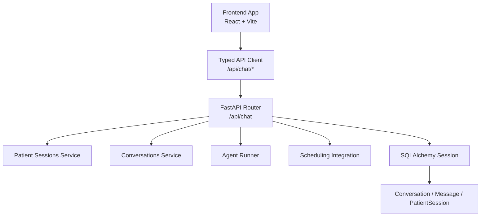
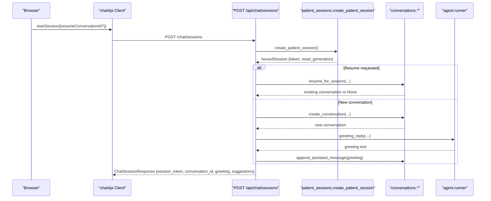
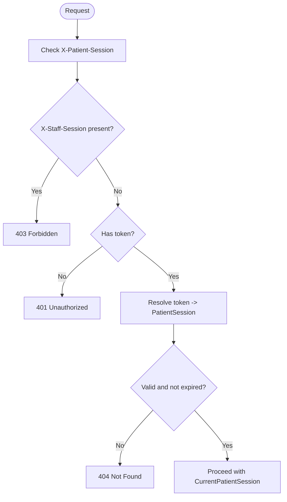
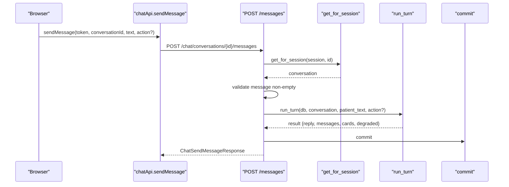
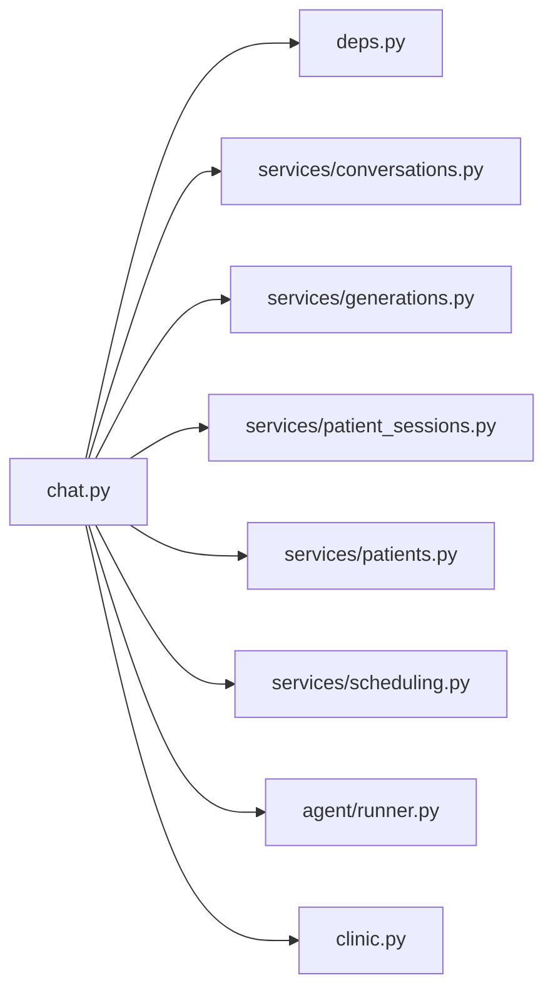

# Chat Endpoints

<cite>
**Referenced Files in This Document**
- [chat.py](file://backend/app/api/chat.py)
- [deps.py](file://backend/app/api/deps.py)
- [schemas.py](file://backend/app/schemas.py)
- [conversations.py](file://backend/app/models/conversations.py)
- [sessions.py](file://backend/app/models/sessions.py)
- [conversations_service.py](file://backend/app/services/conversations.py)
- [patient_sessions_service.py](file://backend/app/services/patient_sessions.py)
- [useChat.ts](file://frontend/src/hooks/useChat.ts)
- [client.ts](file://frontend/src/api/client.ts)
</cite>

## Table of Contents
1. [Introduction](#introduction)
2. [Project Structure](#project-structure)
3. [Core Components](#core-components)
4. [Architecture Overview](#architecture-overview)
5. [Detailed Component Analysis](#detailed-component-analysis)
6. [Dependency Analysis](#dependency-analysis)
7. [Performance Considerations](#performance-considerations)
8. [Troubleshooting Guide](#troubleshooting-guide)
9. [Conclusion](#conclusion)

## Introduction
This document describes the patient-facing chat API used by the dental receptionist application. It covers session management, conversation listing and creation, message sending with AI processing, assistant response feedback, and conversation restoration for persistence across page reloads. It also documents authentication through the `X-Patient-Session` header, error handling patterns, and practical workflows such as registration, natural-language appointment scheduling, and thread resumption after a browser refresh or server restart.

The API is implemented in FastAPI under the `/api/chat` prefix. The only unauthenticated route is session creation; all other endpoints require a valid patient session token.

## Project Structure
The chat feature spans backend routes, Pydantic schemas, data models, services, and a frontend client hook that orchestrates bootstrap, restore, send, and card-driven scheduling flows.

**Diagram sources**
- [chat.py:1-347](file://backend/app/api/chat.py#L1-L347)
- [client.ts:226-301](file://frontend/src/api/client.ts#L226-L301)
- [useChat.ts:271-546](file://frontend/src/hooks/useChat.ts#L271-L546)

**Section sources**
- [chat.py:1-51](file://backend/app/api/chat.py#L1-L51)
- [client.ts:104-131](file://frontend/src/api/client.ts#L104-L131)

## Core Components
- **Session model**: An opaque, URL-safe token is issued once per chat session. Only its SHA-256 digest is stored. Every protected endpoint resolves the token to a `PatientSession`, which scopes conversations and carries verification state.
- **Conversation model**: A thread belongs to a session. Messages are persisted turn-by-turn (patient, assistant, tool, system), including interactive cards produced during assistant turns.
- **Message model**: Stores role, content, sequence, timestamps, provider bookkeeping fields, and UI cards. Internal metadata is never serialized to clients.
- **Feedback model**: One rating per assistant message, allowing re-rating without stacking contradictory signals.

Key responsibilities:
- Session issuance and validation.
- Conversation lifecycle (create, list, resume, restore).
- Message persistence and transcript replay.
- Assistant turn execution via the agent runner.
- Feedback recording for staff review.

**Section sources**
- [sessions.py:1-76](file://backend/app/models/sessions.py#L1-L76)
- [conversations.py:1-158](file://backend/app/models/conversations.py#L1-L158)
- [patient_sessions_service.py:1-123](file://backend/app/services/patient_sessions.py#L1-L123)
- [conversations_service.py:1-391](file://backend/app/services/conversations.py#L1-L391)

## Architecture Overview
The chat API follows a layered pattern:
- Routes define REST endpoints and request/response contracts.
- Services encapsulate persistence and business logic.
- Models define database tables and relationships.
- The frontend client manages bootstrap, restore, optimistic sends, and card interactions.

**Diagram sources**
- [chat.py:111-163](file://backend/app/api/chat.py#L111-L163)
- [patient_sessions_service.py:50-68](file://backend/app/services/patient_sessions.py#L50-L68)
- [conversations_service.py:41-58](file://backend/app/services/conversations.py#L41-L58)
- [conversations_service.py:100-138](file://backend/app/services/conversations.py#L100-L138)

## Detailed Component Analysis

### Authentication and Authorization
- Header: `X-Patient-Session`.
- Only the session creation route is unauthenticated.
- Missing or invalid tokens result in 401 or 404 responses. Staff sessions are explicitly rejected on patient routes.
- Tokens are scoped to a reset generation; demo resets invalidate old tokens.

**Diagram sources**
- [deps.py:27-51](file://backend/app/api/deps.py#L27-L51)
- [patient_sessions_service.py:71-85](file://backend/app/services/patient_sessions.py#L71-L85)

**Section sources**
- [deps.py:1-51](file://backend/app/api/deps.py#L1-L51)
- [patient_sessions_service.py:1-32](file://backend/app/services/patient_sessions.py#L1-L32)

### Session Management

#### POST /api/chat/sessions
- Purpose: Create a patient session and open or resume a conversation.
- Auth: Unauthenticated.
- Request body: Optional `resume_conversation_id` to attempt resuming an existing thread when the new session is verified as the same patient.
- Response: Session token, session state, reset generation, initial conversation ID, greeting, suggestions, clinic name.

Behavior highlights:
- Issues a new token and stores its hash.
- Attempts resume if provided; otherwise creates a new conversation.
- Adds a greeting assistant message for new threads.
- Returns quick suggestions for the UI.

Error handling:
- Defensive 500 if session record cannot be loaded.

**Section sources**
- [chat.py:111-163](file://backend/app/api/chat.py#L111-L163)
- [schemas.py:164-193](file://backend/app/schemas.py#L164-L193)

### Conversation Listing and Creation

#### GET /api/chat/conversations
- Purpose: List this session’s conversations.
- Auth: Requires `X-Patient-Session`.
- Query parameters:
  - `limit`: Number of conversations to return (clamped between 1 and 50).
- Response: List of conversation summaries plus session state.

Notes:
- Summaries include title, preview, timestamps, status, and message count.
- Ordering is newest activity first.

**Section sources**
- [chat.py:166-180](file://backend/app/api/chat.py#L166-L180)
- [conversations_service.py:141-155](file://backend/app/services/conversations.py#L141-L155)
- [schemas.py:146-154](file://backend/app/schemas.py#L146-L154)
- [schemas.py:223-226](file://backend/app/schemas.py#L223-L226)

#### POST /api/chat/conversations
- Purpose: Start a new conversation within the current session.
- Auth: Requires `X-Patient-Session`.
- Response: Conversation details, full transcript (including greeting), suggestions, session state, empty pending proposals.

Behavior highlights:
- Ensures a fresh generation.
- Creates a new conversation and appends a greeting message.

**Section sources**
- [chat.py:183-204](file://backend/app/api/chat.py#L183-L204)
- [conversations_service.py:41-58](file://backend/app/services/conversations.py#L41-L58)
- [schemas.py:206-221](file://backend/app/schemas.py#L206-L221)

### Conversation Restoration

#### GET /api/chat/conversations/{conversation_id}
- Purpose: Restore one stored conversation thread.
- Auth: Requires `X-Patient-Session`.
- Path parameter: `conversation_id`.
- Response: Conversation summary, full transcript with cards, suggestions, session state, and pending proposals.

Behavior highlights:
- Loads the conversation scoped to the calling session.
- Replays visible messages (patient and assistant) with their cards.
- Reconciles proposal cards against live SQLite state so active holds remain clickable after reload.

Error handling:
- 404 if the conversation does not belong to the session.

**Section sources**
- [chat.py:207-230](file://backend/app/api/chat.py#L207-L230)
- [conversations_service.py:334-366](file://backend/app/services/conversations.py#L334-L366)
- [schemas.py:206-221](file://backend/app/schemas.py#L206-L221)

### Message Handling and AI Responses

#### POST /api/chat/conversations/{conversation_id}/messages
- Purpose: Send a patient message and run one assistant turn.
- Auth: Requires `X-Patient-Session`.
- Request body:
  - `message`: Non-empty string up to 2000 characters.
  - `action`: Optional structured action (e.g., family option click) with `option_identity` and optional `request_id`.
- Response:
  - `conversation_id`
  - `reply`: Assistant prose reply.
  - `messages`: Full updated transcript.
  - `cards`: Cards produced by this turn.
  - `session`: Session state.
  - `degraded`: Indicates assistant could not complete the turn.

Processing flow:
- Validates conversation ownership.
- Validates non-empty message.
- Runs assistant turn off the event loop to avoid blocking.
- Persists patient and assistant messages, tool calls/results, and cards.
- Returns reconciled transcript and actionable cards.

Error handling:
- 422 for empty messages.
- Logs a warning if the AI provider is not configured.

**Diagram sources**
- [chat.py:233-274](file://backend/app/api/chat.py#L233-L274)
- [conversations_service.py:61-70](file://backend/app/services/conversations.py#L61-L70)

**Section sources**
- [chat.py:233-274](file://backend/app/api/chat.py#L233-L274)
- [schemas.py:236-273](file://backend/app/schemas.py#L236-L273)

### Assistant Response Feedback

#### POST /api/chat/conversations/{conversation_id}/feedback
- Purpose: Rate one assistant turn.
- Auth: Requires `X-Patient-Session`.
- Request body:
  - `message_id`: ID of the assistant message to rate.
  - `rating`: `"up"` or `"down"`.
  - `reason`: Optional reason for down-votes (max 500 characters).
- Response: Confirmation with rating and a thank-you message.

Validation rules:
- Message must exist, belong to the session-owned conversation, and have role `"assistant"`.
- Re-rating updates the existing row rather than creating duplicates.
- Down-vote reasons are trimmed and limited; up-votes do not carry reasons.

**Section sources**
- [chat.py:277-322](file://backend/app/api/chat.py#L277-L322)
- [conversations.py:129-158](file://backend/app/models/conversations.py#L129-L158)
- [schemas.py:241-258](file://backend/app/schemas.py#L241-L258)

### Practical Workflows

#### Registration Flow
- The session includes a `verified` flag and `registration_complete` flag in `ChatSessionState`.
- The frontend uses these flags to tailor the composer and guide users through registration steps before sensitive actions.
- Verification is performed outside the chat routes; once bound, the session reflects the verified patient.

Implementation notes:
- Session state is computed from the verified patient and registration completeness.
- Greetings and suggestions can adapt based on configuration and verification.

**Section sources**
- [chat.py:54-61](file://backend/app/api/chat.py#L54-L61)
- [schemas.py:156-162](file://backend/app/schemas.py#L156-L162)

#### Appointment Scheduling Through Natural Language
- Patients describe availability or preferences in free-form messages.
- The assistant may produce interactive cards (slot grids, proposals, confirmations).
- The frontend reconciles live proposals with persisted transcripts to keep active holds clickable.
- Card actions trigger additional assistant turns or scheduling endpoints.

End-to-end flow:
- User sends a message describing intent.
- Assistant replies with text and/or cards.
- Frontend renders cards and tracks availability.
- When a slot is selected, the client calls scheduling endpoints; results feed back into the conversation.

**Section sources**
- [useChat.ts:107-175](file://frontend/src/hooks/useChat.ts#L107-L175)
- [client.ts:370-463](file://frontend/src/api/client.ts#L370-L463)
- [chat.py:72-99](file://backend/app/api/chat.py#L72-L99)

#### Conversation Persistence Across Page Reloads
- The frontend persists only two pointers: session token and active conversation ID.
- On mount, it attempts to restore the stored thread via `GET /chat/conversations/{id}`.
- If restoration fails due to session invalidation (401/404), it clears local state and starts a fresh session.
- If a stored thread exists but the token is missing, the client can pass `resumeConversationId` to attempt resuming the thread after re-verification.

Bootstrap algorithm:
1. Compare stored reset generation with server status.
2. Try restoring stored session and thread.
3. If invalid, start a fresh session, optionally offering resume hint.
4. Apply restored messages and reconcile live proposals.

**Section sources**
- [useChat.ts:271-546](file://frontend/src/hooks/useChat.ts#L271-L546)
- [client.ts:226-301](file://frontend/src/api/client.ts#L226-L301)
- [chat.py:111-163](file://backend/app/api/chat.py#L111-L163)

## Dependency Analysis
The chat router depends on:
- Dependencies for database sessions and current patient session resolution.
- Services for conversations, generations, patient sessions, patients, and scheduling.
- Agent runner for greetings, suggestions, and assistant turns.
- Clinic configuration for the clinic name.

**Diagram sources**
- [chat.py:22-47](file://backend/app/api/chat.py#L22-L47)

**Section sources**
- [chat.py:22-47](file://backend/app/api/chat.py#L22-L47)

## Performance Considerations
- Assistant turns are executed off the event loop using a thread pool to prevent blocking the async server while performing blocking HTTP calls and SQLite writes.
- Transcript replay loads visible messages and reconciles cards; avoid excessive history loading in clients.
- Conversation listing supports a bounded limit to control payload size.
- Feedback submission is lightweight and idempotent per message.

Recommendations:
- Cache conversation summaries on the client where appropriate.
- Debounce availability checks for rendered grids.
- Use the `degraded` flag to prompt retries or fallback UX.

[No sources needed since this section provides general guidance]

## Troubleshooting Guide
Common errors and resolutions:
- Missing patient session: Ensure the `X-Patient-Session` header is included on every protected request.
- Invalid or expired session: The server returns 404; clear local storage and start a new session.
- Empty message: The server returns 422; validate input before sending.
- Feedback misapplied: Ensure the `message_id` refers to an assistant message in the same conversation.
- Demo reset detected: The client compares reset generations and starts over; persist only the new token and conversation ID.

Operational tips:
- Log warnings when the AI provider is not configured.
- Inspect session state (`verified`, `registration_complete`) to diagnose registration-related issues.
- Use conversation summaries to identify stale or closed threads.

**Section sources**
- [deps.py:27-51](file://backend/app/api/deps.py#L27-L51)
- [chat.py:246-255](file://backend/app/api/chat.py#L246-L255)
- [chat.py:294-304](file://backend/app/api/chat.py#L294-L304)
- [useChat.ts:200-204](file://frontend/src/hooks/useChat.ts#L200-L204)

## Conclusion
The patient chat API provides a secure, session-scoped interface for conversational scheduling and support. It emphasizes safety by scoping all access through hashed session tokens, persisting full transcripts for fidelity, and exposing interactive cards for complex workflows like appointment scheduling. Clients should implement robust bootstrap and restore logic, handle session invalidation gracefully, and reconcile live proposals with persisted transcripts to maintain a consistent user experience across reloads and server restarts.

[No sources needed since this section summarizes without analyzing specific files]