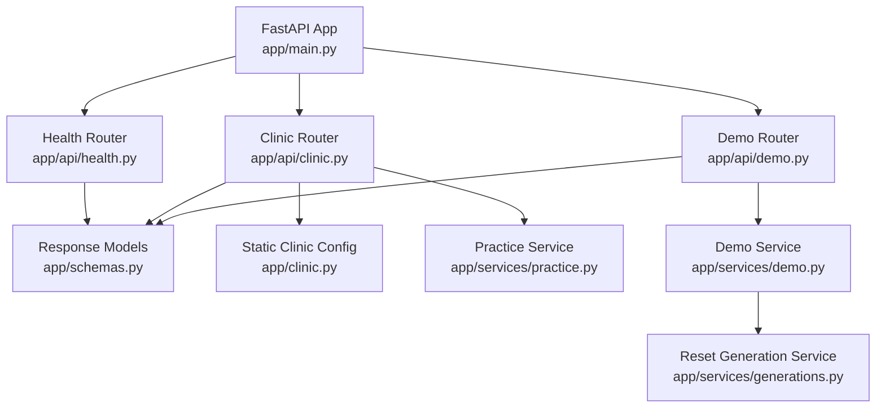
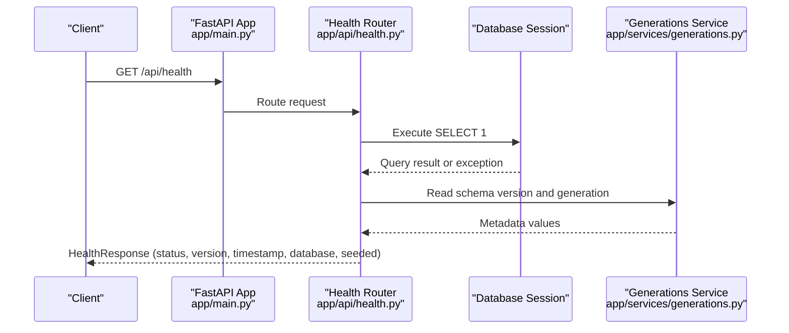
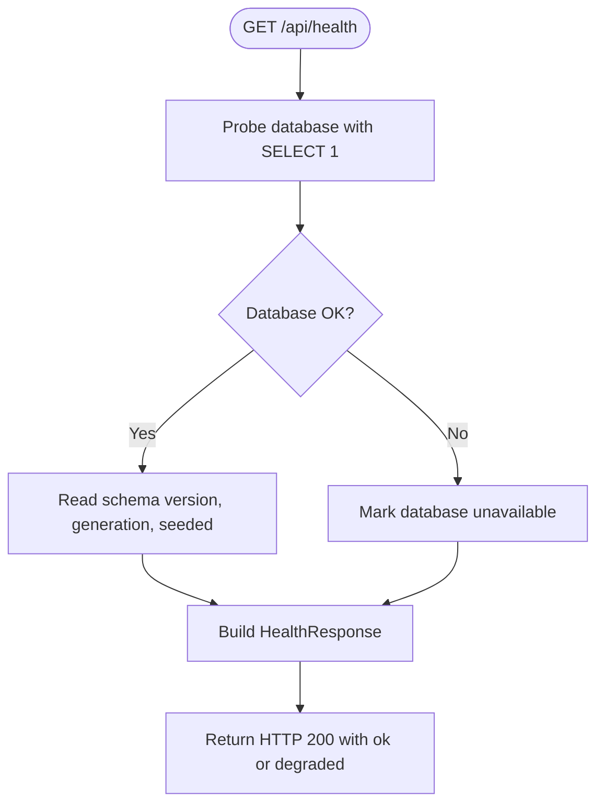
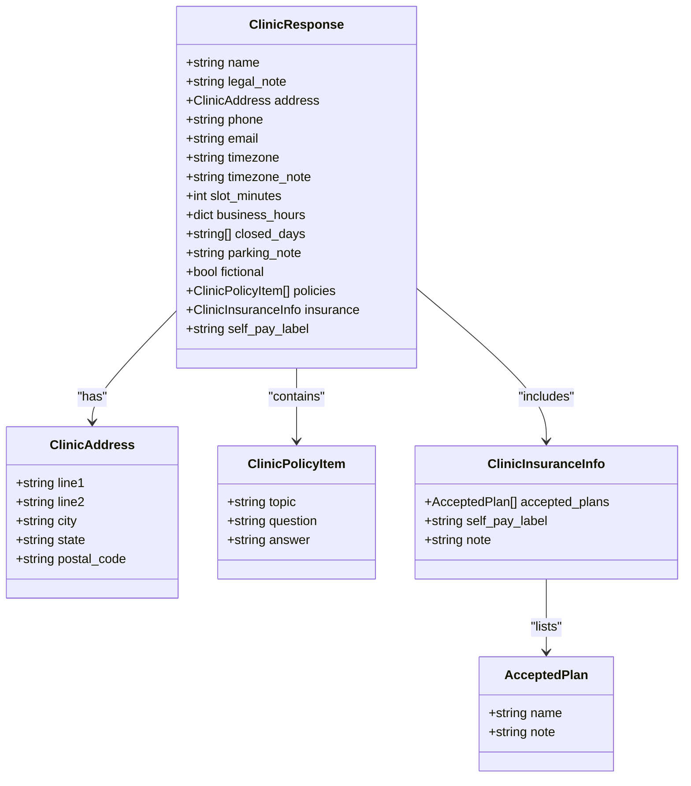
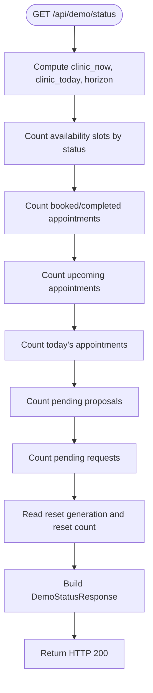
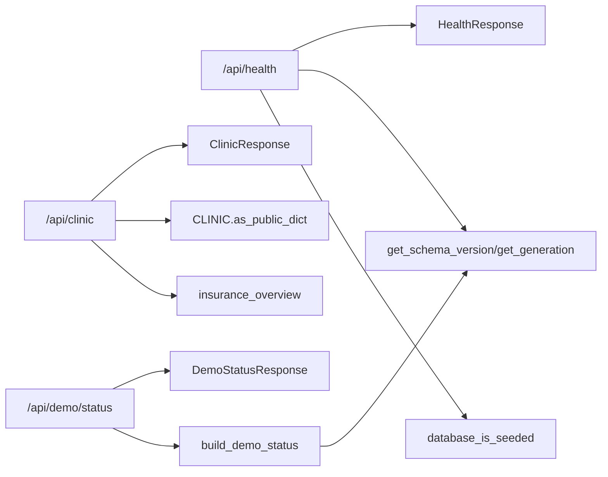
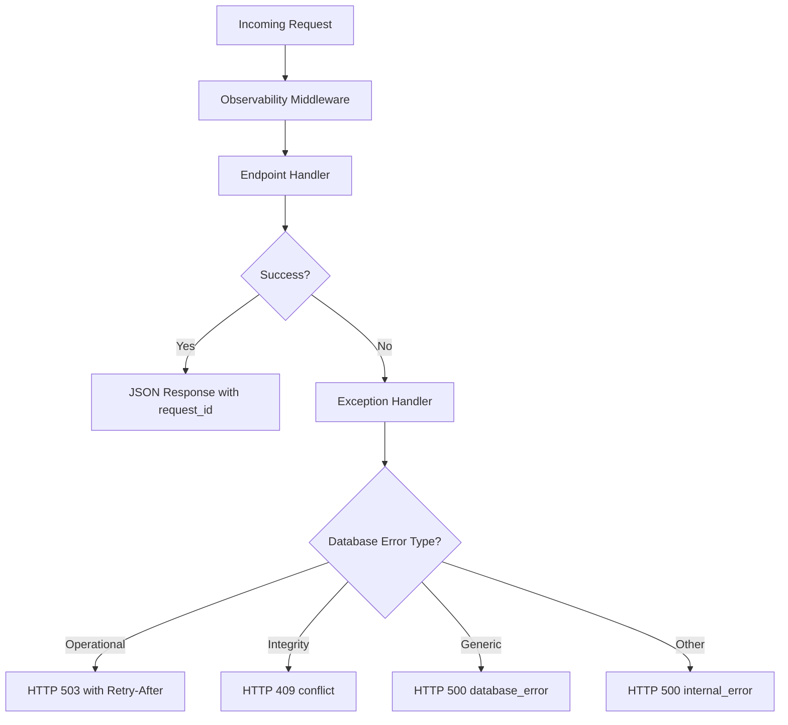

# Health & Clinic Endpoints

<cite>
**Referenced Files in This Document**
- [main.py](file://backend/app/main.py)
- [health.py](file://backend/app/api/health.py)
- [clinic.py](file://backend/app/api/clinic.py)
- [demo.py](file://backend/app/api/demo.py)
- [schemas.py](file://backend/app/schemas.py)
- [config.py](file://backend/app/config.py)
- [clinic_config.py](file://backend/app/clinic.py)
- [practice_service.py](file://backend/app/services/practice.py)
- [demo_service.py](file://backend/app/services/demo.py)
- [generations.py](file://backend/app/services/generations.py)
</cite>

## Table of Contents
1. [Introduction](#introduction)
2. [Project Structure](#project-structure)
3. [Core Components](#core-components)
4. [Architecture Overview](#architecture-overview)
5. [Detailed Component Analysis](#detailed-component-analysis)
6. [Dependency Analysis](#dependency-analysis)
7. [Performance Considerations](#performance-considerations)
8. [Troubleshooting Guide](#troubleshooting-guide)
9. [Conclusion](#conclusion)

## Introduction
This document describes the public system health, clinic information, and demo utility endpoints exposed by the backend API. It focuses on:

- Health checks for application liveness and database connectivity.
- Clinic metadata including practice details, operating hours, policies, insurance overview, and self-pay labeling.
- Demo status data used for development, testing, seeding verification, and reset tracking.
- Response schemas, error handling, observability integration, CORS configuration, and production considerations.

The API is mounted under `/api`. Public documentation is available at `/docs` and `/redoc`, and the OpenAPI schema is served at `/openapi.json`.

## Project Structure
The relevant backend modules are organized as follows:

- FastAPI application factory and middleware live in `app/main.py`.
- Endpoint routers are split by feature: `app/api/health.py`, `app/api/clinic.py`, and `app/api/demo.py`.
- Pydantic response models are centralized in `app/schemas.py`.
- Static clinic configuration lives in `app/clinic.py`.
- Service helpers provide practice metadata, demo statistics, and reset-generation tracking.

**Diagram sources**
- [main.py:202-252](file://backend/app/main.py#L202-L252)
- [health.py:20-57](file://backend/app/api/health.py#L20-L57)
- [clinic.py:11-32](file://backend/app/api/clinic.py#L11-L32)
- [demo.py:12-22](file://backend/app/api/demo.py#L12-L22)
- [schemas.py:14-119](file://backend/app/schemas.py#L14-L119)
- [clinic_config.py:45-121](file://backend/app/clinic.py#L45-L121)
- [practice_service.py:54-64](file://backend/app/services/practice.py#L54-L64)
- [demo_service.py:64-160](file://backend/app/services/demo.py#L64-L160)
- [generations.py:50-79](file://backend/app/services/generations.py#L50-L79)

**Section sources**
- [main.py:32-252](file://backend/app/main.py#L32-L252)
- [health.py:20-57](file://backend/app/api/health.py#L20-L57)
- [clinic.py:11-32](file://backend/app/api/clinic.py#L11-L32)
- [demo.py:12-22](file://backend/app/api/demo.py#L12-L22)

## Core Components
This section summarizes the three endpoint groups covered by this document.

### Health Check Endpoint
- Path: `GET /api/health`
- Purpose: Application liveness plus a lightweight database probe.
- Behavior:
  - Returns HTTP 200 even when degraded so orchestrators can distinguish process availability from database issues.
  - Reports database status, schema version, reset generation, seeding state, timestamps, and service version.
- Response model: `HealthResponse`.

**Section sources**
- [health.py:23-57](file://backend/app/api/health.py#L23-L57)
- [schemas.py:14-26](file://backend/app/schemas.py#L14-L26)

### Clinic Information Endpoint
- Path: `GET /api/clinic`
- Purpose: Provide fictional clinic configuration for UI rendering and assistant context.
- Behavior:
  - Returns clinic name, address, phone, email, timezone, slot length, business hours, closed days, parking note, and a fictional flag.
  - Includes practice policies as topic/question/answer entries.
  - Includes insurance overview and self-pay label.
- Response model: `ClinicResponse`.

**Section sources**
- [clinic.py:14-32](file://backend/app/api/clinic.py#L14-L32)
- [schemas.py:29-75](file://backend/app/schemas.py#L29-L75)
- [clinic_config.py:69-121](file://backend/app/clinic.py#L69-L121)
- [practice_service.py:54-64](file://backend/app/services/practice.py#L54-L64)

### Demo Status Endpoint
- Path: `GET /api/demo/status`
- Purpose: Safe fixture counts and reset generation for development and testing.
- Behavior:
  - Aggregates non-sensitive counts such as providers, patients, appointments, slots, staff users, conversations, messages, proposals, requests, and audit records.
  - Exposes reset generation, reset count, last reset time, last seed time, seeding state, database emptiness, clinic time context, horizon days, slot minutes, fixtures metadata, and next available slot.
  - Never returns patient identifiers or sensitive content.
- Response model: `DemoStatusResponse`.

**Section sources**
- [demo.py:15-22](file://backend/app/api/demo.py#L15-L22)
- [schemas.py:77-119](file://backend/app/schemas.py#L77-L119)
- [demo_service.py:64-160](file://backend/app/services/demo.py#L64-L160)
- [generations.py:50-79](file://backend/app/services/generations.py#L50-L79)

## Architecture Overview
The FastAPI application wires routers, adds CORS middleware, installs request observability, and mounts the public routes under `/api`.

**Diagram sources**
- [main.py:202-252](file://backend/app/main.py#L202-L252)
- [health.py:23-57](file://backend/app/api/health.py#L23-L57)
- [generations.py:50-79](file://backend/app/services/generations.py#L50-L79)

## Detailed Component Analysis

### Health Endpoint Implementation
The health endpoint performs a minimal database query and collects metadata without raising exceptions to the caller. If the database probe fails, it logs the issue and marks the database as unavailable while still returning HTTP 200 with a degraded status.

Key responsibilities:
- Liveness check via application startup.
- Database connectivity check via a simple query.
- Schema version retrieval.
- Reset generation retrieval.
- Seeding status determination.
- Timestamps for local time and clinic-local time with offset.

**Diagram sources**
- [health.py:23-57](file://backend/app/api/health.py#L23-L57)

**Section sources**
- [health.py:23-57](file://backend/app/api/health.py#L23-L57)
- [schemas.py:14-26](file://backend/app/schemas.py#L14-L26)

### Clinic Endpoint Implementation
The clinic endpoint composes a public-facing clinic object from static configuration and practice services. It includes:
- Clinic identity and contact details.
- Address and timezone.
- Business hours per weekday and closed days.
- Practice policies as structured Q&A entries.
- Insurance overview including accepted plans and self-pay label.

**Diagram sources**
- [schemas.py:29-75](file://backend/app/schemas.py#L29-L75)

**Section sources**
- [clinic.py:14-32](file://backend/app/api/clinic.py#L14-L32)
- [schemas.py:29-75](file://backend/app/schemas.py#L29-L75)
- [clinic_config.py:69-121](file://backend/app/clinic.py#L69-L121)
- [practice_service.py:54-64](file://backend/app/services/practice.py#L54-L64)

### Demo Status Endpoint Implementation
The demo status endpoint aggregates safe, non-sensitive metrics and reset-generation metadata. It computes:
- Current clinic date and time context.
- Appointment and slot counts grouped by status.
- Upcoming and today appointment counts within configured horizons.
- Pending proposal and pending request counts.
- Fixture set and fixture version metadata.
- Next available slot timestamp if present.

**Diagram sources**
- [demo_service.py:64-160](file://backend/app/services/demo.py#L64-L160)

**Section sources**
- [demo.py:15-22](file://backend/app/api/demo.py#L15-L22)
- [schemas.py:77-119](file://backend/app/schemas.py#L77-L119)
- [demo_service.py:64-160](file://backend/app/services/demo.py#L64-L160)
- [generations.py:50-79](file://backend/app/services/generations.py#L50-L79)

## Dependency Analysis
The following diagram shows how the routers depend on shared schemas, configuration, and services.

**Diagram sources**
- [health.py:23-57](file://backend/app/api/health.py#L23-L57)
- [clinic.py:14-32](file://backend/app/api/clinic.py#L14-L32)
- [demo.py:15-22](file://backend/app/api/demo.py#L15-L22)
- [schemas.py:14-119](file://backend/app/schemas.py#L14-L119)
- [practice_service.py:54-64](file://backend/app/services/practice.py#L54-L64)
- [demo_service.py:64-160](file://backend/app/services/demo.py#L64-L160)
- [generations.py:50-79](file://backend/app/services/generations.py#L50-L79)

**Section sources**
- [main.py:239-244](file://backend/app/main.py#L239-L244)
- [health.py:23-57](file://backend/app/api/health.py#L23-L57)
- [clinic.py:14-32](file://backend/app/api/clinic.py#L14-L32)
- [demo.py:15-22](file://backend/app/api/demo.py#L15-L22)

## Performance Considerations
- Health checks use a minimal database probe and avoid heavy operations to keep monitoring fast.
- Demo status queries aggregate counts using SQL grouping and scalar functions; they do not return large payloads or sensitive fields.
- The application uses SQLAlchemy sessions provided through dependency injection, which helps isolate database connections per request.
- Observability middleware measures request duration and logs failures without leaking SQL text.

[No sources needed since this section provides general guidance]

## Troubleshooting Guide

### Health Check Integration Patterns
- Use `GET /api/health` for liveness probes.
- Treat `status=degraded` as an indication that the process is up but the database may be unavailable or degraded.
- Inspect `database` field:
  - `ok`: database reachable and probe succeeded.
  - `unavailable`: database probe failed; health still returns 200.
- Monitor `schema_version` and `reset_generation` to detect migrations or resets that require client cache invalidation.
- Use `seeded` to determine whether demo fixtures have been loaded.

**Section sources**
- [health.py:23-57](file://backend/app/api/health.py#L23-L57)
- [schemas.py:14-26](file://backend/app/schemas.py#L14-L26)

### Error Handling and Observability
- All HTTP errors are normalized to include `detail`, `error`, and `request_id`.
- Database operational errors return HTTP 503 with a user-friendly message and a `Retry-After` header.
- Integrity constraint violations return HTTP 409 with a conflict code.
- Generic database errors return HTTP 500 with a stable error code.
- Unhandled exceptions return HTTP 500 with internal error code and log the full exception.
- Every response includes a `X-Request-Id` header for tracing.

**Diagram sources**
- [main.py:45-179](file://backend/app/main.py#L45-L179)

**Section sources**
- [main.py:45-179](file://backend/app/main.py#L45-L179)

### Rate Limiting Policies
- No explicit rate limiter is implemented in the analyzed files.
- The error mapping includes a `rate_limited` code for HTTP 429, indicating readiness for future rate-limiting integration.
- For production deployments, add a reverse proxy or middleware-based rate limiter before the FastAPI app.

**Section sources**
- [main.py:189-199](file://backend/app/main.py#L189-L199)

### Access Controls for Administrative Endpoints
- The analyzed health, clinic, and demo endpoints are public and do not enforce authentication.
- Staff-related endpoints exist elsewhere in the router set but are not part of this document’s scope.
- For administrative or sensitive operations, implement authentication and authorization explicitly.

**Section sources**
- [main.py:239-244](file://backend/app/main.py#L239-L244)

### Monitoring Integration Patterns
- Use `X-Request-Id` headers for distributed tracing across clients and backends.
- Log events include endpoint labels, method, status, and duration.
- Health responses expose service version, timestamps, database status, schema version, reset generation, and seeding state.

**Section sources**
- [main.py:45-108](file://backend/app/main.py#L45-L108)
- [health.py:23-57](file://backend/app/api/health.py#L23-L57)

### Environment-Specific Configuration and Production Considerations
- Settings are loaded from environment variables and an optional `.env` file.
- Supported settings include DeepSeek API key, model, base URL, and database path.
- The default SQLite database path resolves to a Docker volume in containers and to `backend/data/clinic.db` on the host.
- CORS is configured for development origins and exposes required headers.
- In production:
  - Replace SQLite with a managed database and adjust `database_path` accordingly.
  - Restrict CORS origins to trusted domains.
  - Enable TLS termination at the reverse proxy.
  - Add rate limiting and access controls where appropriate.
  - Rotate secrets and avoid logging sensitive values.

**Section sources**
- [config.py:1-90](file://backend/app/config.py#L1-L90)
- [main.py:222-237](file://backend/app/main.py#L222-L237)

## Conclusion
The health, clinic, and demo endpoints provide essential operational visibility and configuration data for the Dental AI Receptionist API. Health checks support orchestration and monitoring, the clinic endpoint supplies public practice metadata, and the demo endpoint offers safe fixture statistics for development and testing. Robust error handling, request tracing, and clear response schemas make these endpoints suitable for deployment automation and automated testing workflows. For production, apply environment-specific configuration, restrict CORS, enable TLS, and add rate limiting and access controls as needed.