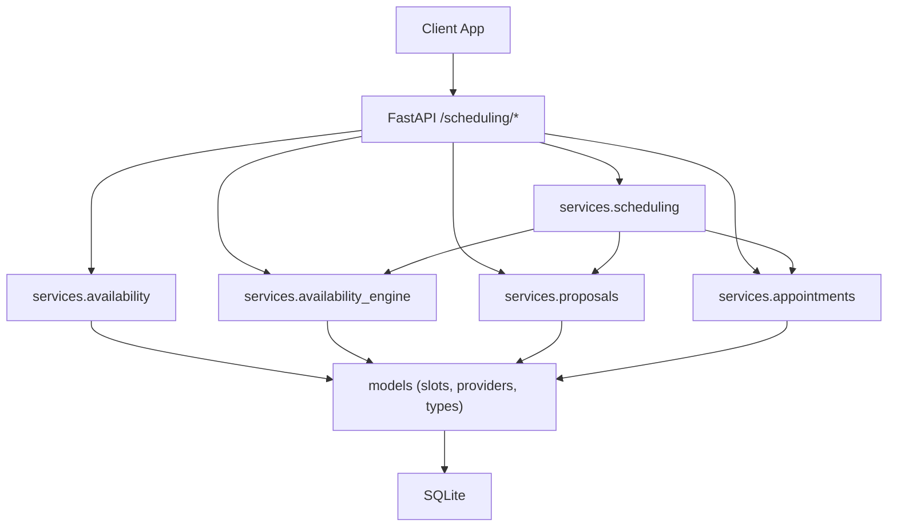
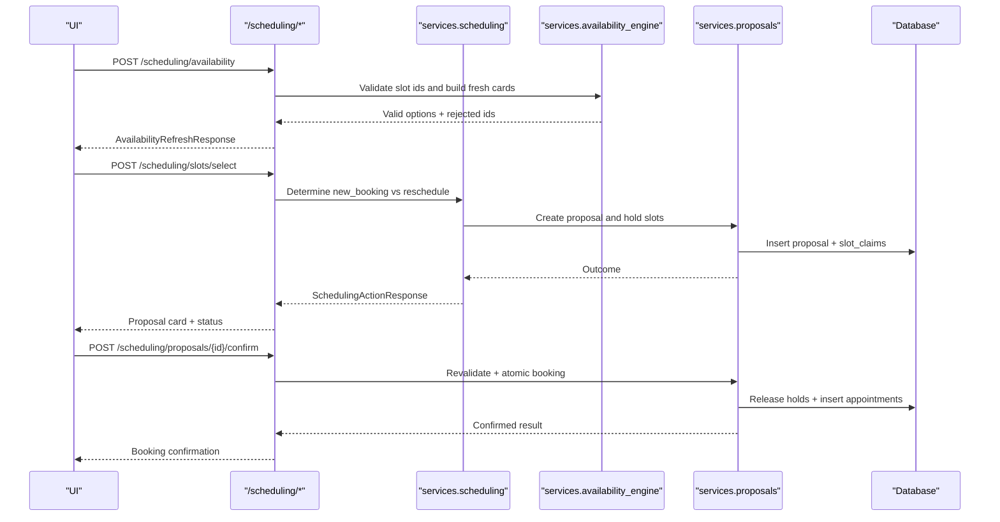

# Scheduling Endpoints

<cite>
**Referenced Files in This Document**   
- [scheduling.py](file://backend/app/api/scheduling.py)
- [availability.py](file://backend/app/services/availability.py)
- [availability_engine.py](file://backend/app/services/availability_engine.py)
- [proposals.py](file://backend/app/services/proposals.py)
- [appointments.py](file://backend/app/services/appointments.py)
- [scheduling_service.py](file://backend/app/services/scheduling.py)
- [scheduling_models.py](file://backend/app/models/scheduling.py)
- [proposals_models.py](file://backend/app/models/proposals.py)
- [base_models.py](file://backend/app/models/base.py)
</cite>

## Table of Contents
1. [Introduction](#introduction)
2. [Project Structure](#project-structure)
3. [Core Components](#core-components)
4. [Architecture Overview](#architecture-overview)
5. [Detailed Component Analysis](#detailed-component-analysis)
6. [Dependency Analysis](#dependency-analysis)
7. [Performance Considerations](#performance-considerations)
8. [Troubleshooting Guide](#troubleshooting-guide)
9. [Conclusion](#conclusion)

## Introduction
This document describes the scheduling API surface for checking provider availability, generating appointment proposals, confirming bookings atomically, cancelling or rescheduling existing appointments, and managing pending proposal holds. It also documents family coordination, constraint validation, conflict resolution, hold/release semantics, concurrent booking protection, and examples for complex family and emergency scenarios.

The endpoints are deterministic UI-backed actions that avoid LLM round-trips for clicks, confirmations, and cancellations. Every route resolves a patient session and conversation, and every write is idempotent through client-supplied keys where applicable.

## Project Structure
The scheduling feature spans FastAPI routes, service orchestration, read-only availability queries, proposal persistence with holds, and database models for slots, claims, proposals, and appointments.



**Diagram sources**
- [scheduling.py:1-554](file://backend/app/api/scheduling.py#L1-L554)
- [availability.py:1-279](file://backend/app/services/availability.py#L1-L279)
- [availability_engine.py:1-800](file://backend/app/services/availability_engine.py#L1-L800)
- [proposals.py:1-800](file://backend/app/services/proposals.py#L1-L800)
- [appointments.py:1-456](file://backend/app/services/appointments.py#L1-L456)
- [scheduling_models.py:1-239](file://backend/app/models/scheduling.py#L1-L239)
- [proposals_models.py:1-236](file://backend/app/models/proposals.py#L1-L236)

**Section sources**
- [scheduling.py:1-554](file://backend/app/api/scheduling.py#L1-L554)
- [availability.py:1-279](file://backend/app/services/availability.py#L1-L279)
- [availability_engine.py:1-800](file://backend/app/services/availability_engine.py#L1-L800)
- [proposals.py:1-800](file://backend/app/services/proposals.py#L1-L800)
- [appointments.py:1-456](file://backend/app/services/appointments.py#L1-L456)
- [scheduling_models.py:1-239](file://backend/app/models/scheduling.py#L1-L239)
- [proposals_models.py:1-236](file://backend/app/models/proposals.py#L1-L236)

## Core Components
- Availability query endpoints return grids and slot options based on provider schedules, business hours, appointment type duration, and patient constraints.
- Proposal creation endpoints generate pending proposals that hold selected intervals while awaiting confirmation.
- Confirmation endpoints revalidate intervals and book one or more appointments atomically within a single transaction.
- Cancellation and reschedule endpoints create proposals that move or release existing appointments; actual changes occur only on confirmation.
- Pending proposal management exposes actionable cards and releases expired holds.

Key request/response concepts:
- Slot selection requests carry stable slot identifiers, intent, target appointment context, and idempotency keys.
- Availability refresh requests validate previously rendered slot ids against live state and return updated cards plus rejected ids.
- Proposal action requests use optional client-generated confirmation keys to make repeated confirmations safe.
- Responses include outcome flags, error codes, messages, proposal metadata, released appointment ids, and card payloads.

**Section sources**
- [scheduling.py:35-149](file://backend/app/api/scheduling.py#L35-L149)
- [proposals.py:95-124](file://backend/app/services/proposals.py#L95-L124)
- [scheduling_service.py:238-295](file://backend/app/services/scheduling.py#L238-L295)

## Architecture Overview
The scheduling API follows a layered design:
- API layer validates inputs, resolves sessions/conversations, and maps results to response schemas.
- Service layer orchestrates availability search, proposal lifecycle, and appointment operations.
- Data layer enforces invariants via SQLAlchemy models and unique/partial indexes.



**Diagram sources**
- [scheduling.py:256-362](file://backend/app/api/scheduling.py#L256-L362)
- [scheduling.py:365-453](file://backend/app/api/scheduling.py#L365-L453)
- [scheduling.py:456-487](file://backend/app/api/scheduling.py#L456-L487)
- [proposals.py:282-529](file://backend/app/services/proposals.py#L282-L529)
- [availability_engine.py:238-354](file://backend/app/services/availability_engine.py#L238-L354)

## Detailed Component Analysis

### Availability Query Endpoints
- GET `/scheduling/appointments` returns the verified patient’s real upcoming and past appointments.
- POST `/scheduling/availability` re-checks a rendered grid by validating each provided slot id against live data, returning updated cards and any rejected ids.
- The underlying availability engine computes contiguous runs of 30-minute intervals per provider, filters by appointment type duration, provider eligibility, patient conflicts, and preferences.

Request parameters:
- `conversation_id`: Optional conversation context.
- `appointment_type`: Normalized code such as cleaning, checkup, or emergency.
- `slot_ids`: Stable slot identifiers from a rendered card.
- `patient_first_name`: Optional display name used when rendering cards.
- `intent` and `target_appointment_id`: Preserve reschedule context during refresh.
- `additional_visit`: Preserves explicit additional visit behavior.

Response schema:
- `ok`: Boolean success flag.
- `cards`: Updated slot cards for still-open times.
- `rejected`: Slot ids no longer open.
- `message`: Human-readable note when no times remain.
- `proposals`: Live pending proposals for reconciliation.

Availability grid details:
- Grid block includes slot minutes, open/close times, days, and closed days.
- Options include start/end times, provider info, specialties, and duration.
- Existing visits are returned to avoid offering overlapping times.

Complexity considerations:
- Read-only queries group slots by provider and assemble contiguous runs.
- Results are trimmed per day and capped to limit output size.
- Patient conflicts are checked before emitting options.

**Section sources**
- [scheduling.py:365-453](file://backend/app/api/scheduling.py#L365-L453)
- [availability.py:63-235](file://backend/app/services/availability.py#L63-L235)
- [availability_engine.py:238-354](file://backend/app/services/availability_engine.py#L238-L354)
- [scheduling_service.py:393-716](file://backend/app/services/scheduling.py#L393-L716)

### Proposal Creation Endpoints
- POST `/scheduling/slots/select` creates a pending proposal and holds selected intervals. It does not book immediately.
- Intent routing distinguishes new bookings from reschedules:
  - If the card indicates reschedule or targets an existing appointment, it continues a replacement flow.
  - Otherwise, it validates the appointment type and builds options for the selected slots.
- Idempotency: A client-supplied `create_key` replays the same proposal rather than creating duplicates.

Request parameters:
- `slot_ids`: One to six stable slot identifiers.
- `appointment_type`: Code normalized to a supported type.
- `conversation_id`: Optional conversation context.
- `intent`: Card meaning, e.g., reschedule.
- `target_appointment_id`: Appointment being replaced.
- `require_open`: Indicates the card came from a fresh search.
- `create_key`: Client-generated idempotency key.
- `summary`: Optional summary for the proposal.
- `additional_visit`: Explicitly requested additional visit.

Response schema:
- `ok`, `error`, `message`: Standard outcome fields.
- `proposal_id`: Public id of the created proposal.
- `kind`, `intent`, `target_appointment_id`: Action semantics.
- `released_appointment_ids`: For moves/cancellations.
- `cards`: Proposal or slot cards.
- `proposal_stale`: True if the proposal can never succeed as-is.
- `pending_proposal_id`: When another proposal already blocks the time.
- `next_step`: Guidance for the client.

Validation and constraints:
- Registration completeness is enforced before holding.
- Unknown appointment types return a clear error.
- Unavailable slots return a message prompting a refresh.

Hold semantics:
- Holds expire after a short window; lapsed holds are released on reads and housekeeping endpoints.
- Supersession clears older pending proposals when the patient changes their mind.

**Section sources**
- [scheduling.py:40-72](file://backend/app/api/scheduling.py#L40-L72)
- [scheduling.py:256-362](file://backend/app/api/scheduling.py#L256-L362)
- [proposals.py:282-529](file://backend/app/services/proposals.py#L282-L529)
- [proposals.py:668-740](file://backend/app/services/proposals.py#L668-L740)

### Confirmation Endpoints
- POST `/scheduling/proposals/{proposal_id}/confirm` revalidates intervals and books everything atomically.
- Supports new bookings, reschedules, and cancellations through the same endpoint; the service refuses the wrong kind for a given proposal.
- Idempotent confirmation via `confirm_key`; retries return the original committed result.

Request parameters:
- `conversation_id`: Optional conversation context.
- `confirm_key`: Client-generated idempotency key.

Response schema:
- `ok`, `error`, `message`: Outcome and diagnostics.
- `proposal_id`: Public id of the proposal.
- `kind`, `intent`, `target_appointment_id`: Action semantics.
- `confirmed`: Whether the action resulted in a confirmed change.
- `replayed`: Whether this was a replay of a prior successful confirmation.
- `released_appointment_ids`: Original appointments retired by a reschedule or cancellation.
- `cards`: Updated cards reflecting the new state.
- `proposal`: Full proposal card when available.
- `session`: Current session state for the client.
- `proposal_stale`: True if the proposal cannot be applied.
- `pending_proposal_id`: Another proposal blocking the time.
- `next_step`: Guidance for the client.

Atomic transaction handling:
- Confirmation re-reads the proposal under a write lock.
- Revalidation ensures intervals are still free and eligible.
- For reschedules, the original is marked rescheduled and linked to the replacement; both happen in one transaction.
- For cancellations, the target appointment is released.
- Family bookings commit all members together; partial failures roll back entirely.

Conflict resolution:
- If a slot is taken during confirmation, the response indicates a conflict and suggests refreshing options.
- Duplicate confirmations are handled by idempotency records and unique booking groups.

**Section sources**
- [scheduling.py:456-487](file://backend/app/api/scheduling.py#L456-L487)
- [proposals.py:762-800](file://backend/app/services/proposals.py#L762-L800)
- [proposals_models.py:202-236](file://backend/app/models/proposals.py#L202-L236)

### Cancellation Endpoints
- POST `/scheduling/proposals/{proposal_id}/decline` releases a pending proposal without booking.
- Cancellation proposals are created through the appointment service and must be confirmed to actually cancel the appointment.

Request parameters:
- `conversation_id`: Optional conversation context.
- `confirm_key`: Optional idempotency key for confirmation flows.

Response schema:
- Same as general scheduling action response, including `ok`, `error`, `message`, `proposal_id`, `cards`, and related metadata.

Cancellation workflow:
- `propose_cancellation` supersedes older pending cancellation proposals for the same visit.
- It creates a cancellation proposal referencing the existing appointment.
- Actual cancellation occurs only on confirmation.

**Section sources**
- [scheduling.py:490-508](file://backend/app/api/scheduling.py#L490-L508)
- [appointments.py:235-274](file://backend/app/services/appointments.py#L235-L274)

### Rescheduling Endpoints
Rescheduling is modeled as a special proposal kind. The API supports rescheduling through:
- Slot selection with intent indicating a replacement time.
- Declining or confirming reschedule proposals.
- Listing appointments and selecting which one to move.

Key behaviors:
- Reschedule proposals reference the exact appointment being moved.
- Confirmation retires the original and creates a replacement in one transaction.
- Ownership checks prevent moving another patient’s appointment.
- Supersession prevents stale reschedule or cancellation cards from conflicting with newer choices.

Request parameters:
- For slot selection: `intent="reschedule"` and `target_appointment_id`.
- For proposal actions: standard proposal action payload.

Response schema:
- Includes `target_appointment_id`, `released_appointment_ids`, and cards showing the move.

**Section sources**
- [scheduling.py:256-362](file://backend/app/api/scheduling.py#L256-L362)
- [appointments.py:277-359](file://backend/app/services/appointments.py#L277-L359)
- [appointments.py:377-432](file://backend/app/services/appointments.py#L377-L432)

### Pending Proposal Management
- GET `/scheduling/pending` returns actionable pending proposals and staff handoffs for the session.
- It also expires lapsed holds so stale cards do not remain clickable.
- POST `/scheduling/proposals/expire` explicitly expires stale pending proposals for a conversation.

Response schema:
- `proposals`: Full proposal cards that are still actionable.
- `handoff`: Staff handoff status entries.
- `conversation_id`: Conversation identifier.

Hold lifecycle:
- Holds are short-lived and audited.
- Expiration releases held intervals but keeps the proposal confirmable.
- Supersession releases holds when a newer choice replaces an older one.

**Section sources**
- [scheduling.py:137-149](file://backend/app/api/scheduling.py#L137-L149)
- [scheduling.py:216-253](file://backend/app/api/scheduling.py#L216-L253)
- [scheduling.py:531-550](file://backend/app/api/scheduling.py#L531-L550)
- [proposals.py:200-274](file://backend/app/services/proposals.py#L200-L274)

### Family Coordination and Complex Scenarios
Family bookings coordinate multiple patients in one atomic confirmation:
- Availability search produces complete plans where each member has a valid run of intervals on the same day.
- Plans are scored by proximity and non-overlap; partial plans are excluded.
- Confirmation books all members together; failure rolls back the entire family booking.

Request parameters:
- Family member inputs include patient identifiers, preferred appointment types, and optional provider names.
- Preferences include date ranges, time windows, weekdays, and provider filters.

Response schema:
- Family option cards contain per-member slot cards, identity markers, and metadata like back-to-back grouping.
- Confirmation responses include all booked appointments and family group linkage.

Emergency handling:
- Emergency appointment types are recognized and prioritized in availability searches.
- Urgent slots may be surfaced separately in availability responses.
- Emergency triage updates alerts and can influence scheduling recommendations.

**Section sources**
- [availability_engine.py:548-770](file://backend/app/services/availability_engine.py#L548-L770)
- [scheduling_service.py:341-390](file://backend/app/services/scheduling.py#L341-L390)
- [scheduling_service.py:719-792](file://backend/app/services/scheduling.py#L719-L792)
- [availability.py:74-235](file://backend/app/services/availability.py#L74-L235)

## Dependency Analysis
The scheduling subsystem depends on:
- FastAPI router for HTTP endpoints.
- Services for availability, proposals, appointments, and orchestration.
- Models for slots, claims, proposals, appointments, and base enums.

```mermaid
classDiagram
class SchedulingRouter {
+GET "/scheduling/pending"
+POST "/scheduling/slots/select"
+POST "/scheduling/availability"
+POST "/scheduling/proposals/{id}/confirm"
+POST "/scheduling/proposals/{id}/decline"
+GET "/scheduling/appointments"
+POST "/scheduling/proposals/expire"
}
class SchedulingService {
+find_availability()
+family_option_cards()
+slot_card()
}
class AvailabilityEngine {
+search_availability()
+is_interval_bookable()
+search_family_availability()
}
class ProposalsService {
+create_proposal()
+confirm_proposal()
+reject_proposal()
+release_expired_holds()
}
class AppointmentsService {
+propose_reschedule()
+propose_cancellation()
+list_for_patient()
}
class Models {
<<tables>>
}
SchedulingRouter --> SchedulingService : "orchestrates"
SchedulingService --> AvailabilityEngine : "reads availability"
SchedulingService --> ProposalsService : "creates/confirms proposals"
SchedulingService --> AppointmentsService : "reschedule/cancel"
AvailabilityEngine --> Models : "queries slots/providers/types"
ProposalsService --> Models : "persists proposals/claims"
AppointmentsService --> Models : "reads/writes appointments"
```

**Diagram sources**
- [scheduling.py:1-554](file://backend/app/api/scheduling.py#L1-L554)
- [scheduling_service.py:1-800](file://backend/app/services/scheduling.py#L1-L800)
- [availability_engine.py:1-800](file://backend/app/services/availability_engine.py#L1-L800)
- [proposals.py:1-800](file://backend/app/services/proposals.py#L1-L800)
- [appointments.py:1-456](file://backend/app/services/appointments.py#L1-L456)
- [scheduling_models.py:1-239](file://backend/app/models/scheduling.py#L1-L239)
- [proposals_models.py:1-236](file://backend/app/models/proposals.py#L1-L236)

**Section sources**
- [scheduling.py:1-554](file://backend/app/api/scheduling.py#L1-L554)
- [scheduling_service.py:1-800](file://backend/app/services/scheduling.py#L1-L800)
- [availability_engine.py:1-800](file://backend/app/services/availability_engine.py#L1-L800)
- [proposals.py:1-800](file://backend/app/services/proposals.py#L1-L800)
- [appointments.py:1-456](file://backend/app/services/appointments.py#L1-L456)
- [scheduling_models.py:1-239](file://backend/app/models/scheduling.py#L1-L239)
- [proposals_models.py:1-236](file://backend/app/models/proposals.py#L1-L236)

## Performance Considerations
- Availability queries are read-only and grouped by provider to minimize joins and enable efficient range scans.
- Options are trimmed per day and capped to reduce payload size.
- Hold windows are short to avoid long-blocking reservations.
- Concurrency is protected by database-level unique constraints on active slot claims and partial indexes.
- Confirmation uses a write transaction to ensure atomicity and consistency across multiple appointments.

[No sources needed since this section provides general guidance]

## Troubleshooting Guide
Common issues and resolutions:
- Unknown appointment type: Normalize codes or use supported aliases.
- Slot unavailable: Refresh availability to get current options.
- Registration incomplete: Complete registration before booking.
- Proposal stale or superseded: The client should retire stale cards and show the latest pending proposal.
- Conflict during confirmation: Another party took the slot; refresh and pick another time.
- Expired hold: Holds expire quickly; the proposal remains confirmable but must revalidate at confirmation time.

Error response patterns:
- `ok=false` with `error` and `message` for validation and business errors.
- `proposal_stale=true` when a proposal cannot succeed as-is.
- `pending_proposal_id` when another proposal already blocks the selected time.
- `released_appointment_ids` for moves/cancellations indicating which appointments were retired.

**Section sources**
- [scheduling.py:277-362](file://backend/app/api/scheduling.py#L277-L362)
- [scheduling.py:387-453](file://backend/app/api/scheduling.py#L387-L453)
- [proposals.py:490-529](file://backend/app/services/proposals.py#L490-L529)
- [proposals.py:638-740](file://backend/app/services/proposals.py#L638-L740)

## Conclusion
The scheduling API provides a robust, atomic, and user-friendly workflow for availability discovery, proposal generation, confirmation, cancellation, and rescheduling. It enforces strong invariants through database constraints, short-lived holds, and idempotent operations. Family coordination and emergency handling are integrated into the availability and proposal layers, ensuring consistent behavior across complex scenarios. Clients should rely on stable slot identifiers, handle rejection lists, reconcile pending proposals, and treat confirmation as the authoritative point of booking.

[No sources needed since this section summarizes without analyzing specific files]