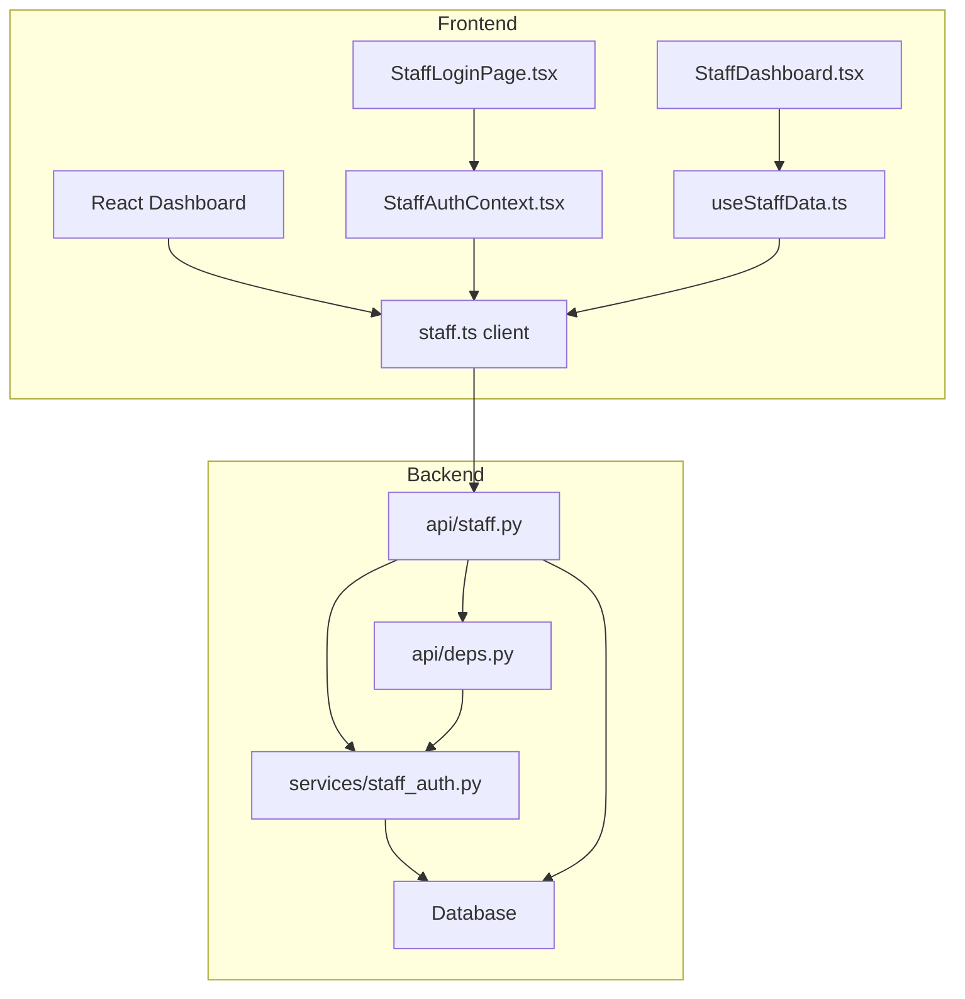
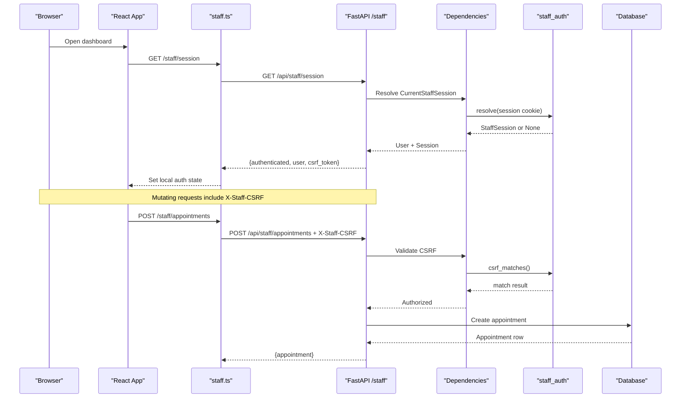
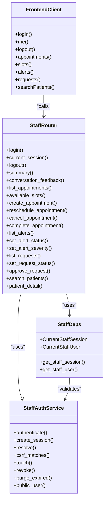

# Staff Endpoints

<cite>
**Referenced Files in This Document**
- [staff.py](file://backend/app/api/staff.py)
- [deps.py](file://backend/app/api/deps.py)
- [staff_auth.py](file://backend/app/services/staff_auth.py)
- [staff.ts](file://frontend/src/api/staff.ts)
- [StaffAuthContext.tsx](file://frontend/src/pages/staff/StaffAuthContext.tsx)
- [StaffLoginPage.tsx](file://frontend/src/pages/staff/StaffLoginPage.tsx)
- [StaffDashboard.tsx](file://frontend/src/pages/staff/StaffDashboard.tsx)
- [useStaffData.ts](file://frontend/src/pages/staff/useStaffData.ts)
</cite>

## Table of Contents
1. [Introduction](#introduction)
2. [Project Structure](#project-structure)
3. [Core Components](#core-components)
4. [Architecture Overview](#architecture-overview)
5. [Detailed Component Analysis](#detailed-component-analysis)
6. [Dependency Analysis](#dependency-analysis)
7. [Performance Considerations](#performance-considerations)
8. [Troubleshooting Guide](#troubleshooting-guide)
9. [Security Considerations](#security-considerations)
10. [Conclusion](#conclusion)

## Introduction
This document describes the staff dashboard API surface, authentication flow, CSRF protection, session management, and protected resource endpoints. It is intended for developers integrating with the staff dashboard or extending its functionality. The backend is a FastAPI application; the frontend is a React dashboard that maintains an HttpOnly session cookie and echoes a CSRF token on mutating requests.

The staff endpoints cover:
- Authentication: login, current session check, logout.
- Protected resources: summary counts, conversation feedback, appointments, slots, alerts, pending requests, and patient lookup.
- Manual appointment operations: create, reschedule, cancel, and complete.
- Error handling: authentication failures, unauthorized access, validation errors, conflict states, and service availability issues.
- Security: CSRF protection, session expiry, brute-force mitigation, and safe handling of sensitive data.

## Project Structure
The staff dashboard spans both backend and frontend code:

**Diagram sources**
- [staff.py:1-717](file://backend/app/api/staff.py#L1-L717)
- [deps.py:54-98](file://backend/app/api/deps.py#L54-L98)
- [staff_auth.py:1-265](file://backend/app/services/staff_auth.py#L1-L265)
- [staff.ts:1-405](file://frontend/src/api/staff.ts#L1-L405)
- [StaffAuthContext.tsx:1-132](file://frontend/src/pages/staff/StaffAuthContext.tsx#L1-L132)
- [StaffLoginPage.tsx:1-99](file://frontend/src/pages/staff/StaffLoginPage.tsx#L1-L99)
- [StaffDashboard.tsx:1-213](file://frontend/src/pages/staff/StaffDashboard.tsx#L1-L213)
- [useStaffData.ts:1-231](file://frontend/src/pages/staff/useStaffData.ts#L1-L231)

**Section sources**
- [staff.py:1-717](file://backend/app/api/staff.py#L1-L717)
- [staff.ts:1-405](file://frontend/src/api/staff.ts#L1-L405)

## Core Components
- Backend router: `/staff/*` endpoints define authentication, dashboard data, appointments, alerts, requests, and patient search.
- Dependencies: `CurrentStaffSession` and `CurrentStaffUser` enforce session resolution and CSRF checks.
- Authentication service: password verification, session creation, CSRF matching, session revocation, and brute-force lockout.
- Frontend client: typed API methods, CSRF header injection, and error mapping.
- Frontend auth context: login/logout state, session refresh, and UI gating.
- Dashboard sync: polling, focus-based reload, and mutation-driven refresh.

**Section sources**
- [staff.py:61-127](file://backend/app/api/staff.py#L61-L127)
- [deps.py:67-98](file://backend/app/api/deps.py#L67-L98)
- [staff_auth.py:51-78](file://backend/app/services/staff_auth.py#L51-L78)
- [staff.ts:213-267](file://frontend/src/api/staff.ts#L213-L267)
- [StaffAuthContext.tsx:42-122](file://frontend/src/pages/staff/StaffAuthContext.tsx#L42-L122)
- [useStaffData.ts:31-118](file://frontend/src/pages/staff/useStaffData.ts#L31-L118)

## Architecture Overview
The staff dashboard uses cookie-based sessions with CSRF protection:

**Diagram sources**
- [staff.py:226-311](file://backend/app/api/staff.py#L226-L311)
- [staff.py:446-512](file://backend/app/api/staff.py#L446-L512)
- [deps.py:73-93](file://backend/app/api/deps.py#L73-L93)
- [staff_auth.py:127-175](file://backend/app/services/staff_auth.py#L127-L175)
- [staff.ts:229-267](file://frontend/src/api/staff.ts#L229-L267)

## Detailed Component Analysis

### Authentication Endpoints

#### POST /api/staff/session (Login)
- Purpose: Authenticate staff credentials and issue session cookies.
- Request body:
  - `username`: string, required, length 1–64.
  - `password`: string, required, length 1–256.
- Response:
  - `authenticated`: boolean, always true on success.
  - `user`: public staff profile object.
  - `csrf_token`: server-issued CSRF token echoed to the client.
  - `expires_at`: ISO timestamp of session expiry.
  - `clinic_now`: clinic-local time used by the dashboard.
  - `demo_notice`: demonstration notice when applicable.
- Cookies set:
  - `mb_staff_session`: HttpOnly, SameSite=Lax, secure when HTTPS.
  - `mb_staff_csrf`: readable by JavaScript, SameSite=Lax, secure when HTTPS.
- Behavior:
  - Unknown usernames, wrong passwords, and disabled accounts return the same generic failure message to prevent enumeration.
  - Failed attempts increment a counter; repeated failures lock the account temporarily.
  - Successful login records audit information and purges expired sessions.

**Section sources**
- [staff.py:73-85](file://backend/app/api/staff.py#L73-L85)
- [staff.py:133-158](file://backend/app/api/staff.py#L133-L158)
- [staff.py:226-269](file://backend/app/api/staff.py#L226-L269)
- [staff_auth.py:93-150](file://backend/app/services/staff_auth.py#L93-L150)

#### GET /api/staff/session (Current Session)
- Purpose: Determine whether the browser has a valid session and obtain the current CSRF token.
- Response:
  - `authenticated`: boolean indicating active session.
  - `user`: public staff profile if authenticated.
  - `csrf_token`: existing CSRF token if still valid; otherwise null.
  - `expires_at`: session expiry.
  - `clinic_now`: clinic-local time.
  - `demo_notice`: demonstration notice when applicable.
- Behavior:
  - Anonymous callers receive `authenticated: false` without leaking user data.
  - Used by the frontend to decide between login screen and dashboard.

**Section sources**
- [staff.py:272-290](file://backend/app/api/staff.py#L272-L290)

#### DELETE /api/staff/session (Logout)
- Purpose: Revoke the server-side session and clear cookies.
- Response: `{ ok: true }`.
- Behavior:
  - Marks the session revoked.
  - Records logout audit entry.
  - Deletes both session and CSRF cookies.

**Section sources**
- [staff.py:293-311](file://backend/app/api/staff.py#L293-L311)
- [staff_auth.py:186-188](file://backend/app/services/staff_auth.py#L186-L188)

### CSRF Protection and Session Middleware

#### Dependency Enforcement
- All protected routes depend on `CurrentStaffSession` and `CurrentStaffUser`.
- Session resolution:
  - Reads `mb_staff_session` cookie.
  - Rejects unknown, expired, revoked, or reset-generation mismatched sessions.
- CSRF enforcement:
  - State-changing methods require `X-Staff-CSRF`.
  - Safe methods (`GET`, `HEAD`, `OPTIONS`) do not require CSRF.
- Activity tracking:
  - Touches last-seen timestamp at most once per minute.

**Section sources**
- [deps.py:67-93](file://backend/app/api/deps.py#L67-L93)
- [staff_auth.py:153-184](file://backend/app/services/staff_auth.py#L153-L184)

#### Frontend CSRF Handling
- The client reads the readable `mb_staff_csrf` cookie.
- Every mutating request sets `X-Staff-CSRF`.
- Non-mutating requests do not send the CSRF header.

**Section sources**
- [staff.ts:213-235](file://frontend/src/api/staff.ts#L213-L235)
- [staff.ts:229-267](file://frontend/src/api/staff.ts#L229-L267)

### Protected Resource Endpoints

#### GET /api/staff/summary
- Purpose: Dashboard summary counts.
- Response:
  - `counts`: summary metrics such as appointments today, upcoming, open alerts, urgent alerts, pending requests, approvals required.
  - `generated_at`: ISO timestamp.
- Authorization: Requires authenticated staff.

**Section sources**
- [staff.py:319-323](file://backend/app/api/staff.py#L319-L323)

#### GET /api/staff/feedback
- Purpose: Conversation feedback review.
- Query parameters:
  - `days`: integer, default 30, range 1–365.
  - `limit`: integer, default 50, range 1–200.
- Response:
  - `counts.up`, `counts.down`, `counts.total`.
  - `window_days`.
  - `feedback`: list of feedback rows including rating, reason, created time, conversation title, and excerpt.
- Privacy: No session token or patient identity is included.

**Section sources**
- [staff.py:325-372](file://backend/app/api/staff.py#L325-L372)

#### GET /api/staff/appointments
- Purpose: List appointments with filters.
- Query parameters:
  - `day`: optional date string.
  - `day_from`, `day_to`: optional date range.
  - `provider_id`: optional provider filter.
  - `status`: optional status filter.
  - `search`: optional text search.
  - `upcoming_only`: boolean flag.
  - `limit`: integer, default from scheduling service, range 1–200.
- Response:
  - `appointments`: array of appointment objects.
  - `providers`: provider options.
  - `appointment_types`: appointment type options.
  - `count`: number of returned items.

**Section sources**
- [staff.py:380-409](file://backend/app/api/staff.py#L380-L409)

#### GET /api/staff/appointments/{appointment_id}
- Purpose: Appointment detail and history.
- Response:
  - `appointment`: appointment object.
  - `history`: audit entries.

**Section sources**
- [staff.py:412-418](file://backend/app/api/staff.py#L412-L418)

#### GET /api/staff/slots
- Purpose: Available start times for manual booking.
- Query parameters:
  - `day`: required date string.
  - `provider_id`: optional provider filter.
  - `appointment_type`: optional appointment type code.
- Response:
  - `day`: requested date.
  - `slots`: available slot options.
  - `count`: number of slots.

**Section sources**
- [staff.py:421-443](file://backend/app/api/staff.py#L421-L443)

#### GET /api/staff/alerts
- Purpose: Emergency alert listing.
- Query parameters:
  - `status`: optional status filter.
  - `kind`: optional kind filter.
  - `severity`: optional severity filter.
  - `search`: optional text search.
  - `limit`: integer, default from handoff board, range 1–200.
- Response:
  - `alerts`: array of alert objects.
  - `count`: number of returned items.

**Section sources**
- [staff.py:520-534](file://backend/app/api/staff.py#L520-L534)

#### GET /api/staff/alerts/{alert_id}
- Purpose: Alert detail and activity log.
- Response:
  - `alert`: alert object.
  - `activity`: audit entries.

**Section sources**
- [staff.py:537-543](file://backend/app/api/staff.py#L537-L543)

#### GET /api/staff/requests
- Purpose: Pending request queue listing.
- Query parameters:
  - `status`: optional status filter.
  - `request_type`: optional request type filter.
  - `search`: optional text search.
  - `limit`: integer, default from handoff board, range 1–200.
- Response:
  - `requests`: array of request objects.
  - `count`: number of returned items.

**Section sources**
- [staff.py:590-606](file://backend/app/api/staff.py#L590-L606)

#### GET /api/staff/requests/{request_id}
- Purpose: Request detail and activity log.
- Response:
  - `request`: request object.
  - `activity`: audit entries.

**Section sources**
- [staff.py:609-615](file://backend/app/api/staff.py#L609-L615)

#### GET /api/staff/patients/search
- Purpose: Patient lookup for booking and patient drawer.
- Query parameters:
  - `q`: required search string, length 1–120.
- Response:
  - `patients`: array of minimal patient references.

**Section sources**
- [staff.py:662-696](file://backend/app/api/staff.py#L662-L696)

#### GET /api/staff/patients/{patient_id}
- Purpose: Patient detail and recent appointments.
- Response:
  - `patient`: detailed patient object.
  - `appointments`: appointment list for the patient.

**Section sources**
- [staff.py:699-716](file://backend/app/api/staff.py#L699-L716)

### Manual Appointment Operation Endpoints

#### POST /api/staff/appointments
- Purpose: Staff-initiated scheduling.
- Request body:
  - `patient_id`: integer.
  - `provider_id`: integer.
  - `starts_at`: clinic-local naive ISO timestamp.
  - `appointment_type`: string, default `"checkup"`.
  - `reason`: optional string, max length 500.
- Response:
  - `appointment`: newly created appointment object.
- Validation:
  - Rejects timezone-aware timestamps.
  - Rejects past times within a small grace window.

**Section sources**
- [staff.py:92-98](file://backend/app/api/staff.py#L92-L98)
- [staff.py:166-187](file://backend/app/api/staff.py#L166-L187)
- [staff.py:446-464](file://backend/app/api/staff.py#L446-L464)

#### POST /api/staff/appointments/{appointment_id}/reschedule
- Purpose: Reschedule an existing appointment.
- Request body:
  - `starts_at`: clinic-local naive ISO timestamp.
  - `provider_id`: optional new provider.
  - `appointment_type`: optional new type.
- Response:
  - `appointment`: updated appointment object.

**Section sources**
- [staff.py:467-484](file://backend/app/api/staff.py#L467-L484)

#### POST /api/staff/appointments/{appointment_id}/cancel
- Purpose: Cancel an appointment.
- Request body:
  - `reason`: optional string, max length 500.
- Response:
  - `appointment`: cancelled appointment object.

**Section sources**
- [staff.py:487-501](file://backend/app/api/staff.py#L487-L501)

#### POST /api/staff/appointments/{appointment_id}/complete
- Purpose: Mark an appointment completed.
- Response:
  - `appointment`: completed appointment object.

**Section sources**
- [staff.py:504-512](file://backend/app/api/staff.py#L504-L512)

### Alert and Request Mutation Endpoints

#### POST /api/staff/alerts/{alert_id}/status
- Purpose: Update alert status.
- Request body:
  - `status`: one of `open`, `acknowledged`, `resolved`.
  - `note`: optional note, max length 500.
- Response:
  - `alert`: updated alert object.

**Section sources**
- [staff.py:546-565](file://backend/app/api/staff.py#L546-L565)

#### POST /api/staff/alerts/{alert_id}/severity
- Purpose: Update alert severity.
- Request body:
  - `severity`: one of `low`, `normal`, `high`, `urgent`.
- Response:
  - `alert`: updated alert object.

**Section sources**
- [staff.py:568-582](file://backend/app/api/staff.py#L568-L582)

#### POST /api/staff/requests/{request_id}/status
- Purpose: Update request status.
- Request body:
  - `status`: one of `pending`, `in_progress`, `resolved`.
  - `note`: optional note, max length 500.
- Response:
  - `request`: updated request object.

**Section sources**
- [staff.py:618-637](file://backend/app/api/staff.py#L618-L637)

#### POST /api/staff/requests/{request_id}/approve
- Purpose: Approve a request requiring approval.
- Request body:
  - `note`: optional note, max length 500.
- Response:
  - `request`: approved request object.

**Section sources**
- [staff.py:640-654](file://backend/app/api/staff.py#L640-L654)

### Frontend Integration Patterns

#### Login Flow
- The login page submits username and password to `POST /staff/session`.
- On success, the dashboard redirects to the main staff view.
- On failure, the form displays a generic error message.

**Section sources**
- [StaffLoginPage.tsx:30-36](file://frontend/src/pages/staff/StaffLoginPage.tsx#L30-L36)
- [staff.ts:287-293](file://frontend/src/api/staff.ts#L287-L293)

#### Session Management
- The auth context calls `GET /staff/session` on mount and on tab focus.
- If authenticated, it stores user and session metadata.
- Logout calls `DELETE /staff/session` and clears local state.

**Section sources**
- [StaffAuthContext.tsx:48-106](file://frontend/src/pages/staff/StaffAuthContext.tsx#L48-L106)
- [staff.ts:295-297](file://frontend/src/api/staff.ts#L295-L297)

#### Real-Time Dashboard Updates
- The dashboard uses three mechanisms:
  - Mutation coordination: successful writes notify all mounted queries to reload.
  - Focus events: reloading when the tab regains focus.
  - Polling: periodic reload while the tab is visible.
- Only the active view polls, minimizing load.

**Section sources**
- [useStaffData.ts:9-24](file://frontend/src/pages/staff/useStaffData.ts#L9-L24)
- [useStaffData.ts:82-118](file://frontend/src/pages/staff/useStaffData.ts#L82-L118)
- [StaffDashboard.tsx:73-83](file://frontend/src/pages/staff/StaffDashboard.tsx#L73-L83)

## Dependency Analysis

**Diagram sources**
- [staff.py:61-717](file://backend/app/api/staff.py#L61-L717)
- [deps.py:73-98](file://backend/app/api/deps.py#L73-L98)
- [staff_auth.py:93-238](file://backend/app/services/staff_auth.py#L93-L238)
- [staff.ts:287-404](file://frontend/src/api/staff.ts#L287-L404)

**Section sources**
- [staff.py:61-717](file://backend/app/api/staff.py#L61-L717)
- [deps.py:73-98](file://backend/app/api/deps.py#L73-L98)
- [staff_auth.py:93-238](file://backend/app/services/staff_auth.py#L93-L238)
- [staff.ts:287-404](file://frontend/src/api/staff.ts#L287-L404)

## Performance Considerations
- Background execution: Many database-heavy operations are executed in a thread pool to avoid blocking the event loop.
- Bounded queries: Lists use limits and pagination-friendly parameters.
- Efficient session touch: Last-seen updates are throttled to once per minute.
- Frontend polling cadence: A 20-second interval is used only for the active view while the tab is visible.
- Avoiding unnecessary work: Hidden tabs do not poll; mutations trigger targeted reloads.

**Section sources**
- [staff.py:43-44](file://backend/app/api/staff.py#L43-L44)
- [staff.py:380-409](file://backend/app/api/staff.py#L380-L409)
- [staff_auth.py:178-184](file://backend/app/services/staff_auth.py#L178-L184)
- [useStaffData.ts:31-32](file://frontend/src/pages/staff/useStaffData.ts#L31-L32)
- [useStaffData.ts:82-118](file://frontend/src/pages/staff/useStaffData.ts#L82-L118)

## Troubleshooting Guide

### Common Errors

| Scenario | Backend Status | Typical Detail | Frontend Behavior |
|---|---:|---|---|
| Invalid credentials | 401 Unauthorized | Generic invalid credential message | Displays sign-in error |
| Expired or revoked session | 401 Unauthorized | Sign-in required message | Redirects to login |
| Missing CSRF on mutating request | 403 Forbidden | CSRF verification failed message | Shows authorization error |
| Unknown appointment/alert/request | 404 Not Found | Entity not found message | Shows not found state |
| Slot unavailable or conflicting appointment | 409 Conflict | Conflict message | Shows conflict details |
| Service busy | 503 Service Unavailable | Busy message | Indicates temporary unavailability |
| Invalid input format | 422 Unprocessable Entity | Validation message | Highlights field error |

**Section sources**
- [staff.py:207-218](file://backend/app/api/staff.py#L207-L218)
- [staff.py:226-269](file://backend/app/api/staff.py#L226-L269)
- [staff.py:446-512](file://backend/app/api/staff.py#L446-L512)
- [staff.py:546-654](file://backend/app/api/staff.py#L546-L654)
- [useStaffData.ts:185-195](file://frontend/src/pages/staff/useStaffData.ts#L185-L195)

### Debugging Steps
- Verify session cookie presence: Ensure `mb_staff_session` is present after login.
- Verify CSRF header presence: Ensure `X-Staff-CSRF` is sent on mutating requests.
- Check session expiry: Compare `expires_at` with current time.
- Inspect audit logs: Review action, actor, entity, and details for mutations.
- Validate input formats: Confirm dates are clinic-local and timestamps lack timezone offsets.

**Section sources**
- [staff.py:133-158](file://backend/app/api/staff.py#L133-L158)
- [staff.py:166-187](file://backend/app/api/staff.py#L166-L187)
- [staff.ts:213-235](file://frontend/src/api/staff.ts#L213-L235)

## Security Considerations

### CSRF Protection
- The session cookie is HttpOnly and SameSite=Lax, preventing JavaScript access and cross-site form submission abuse.
- The CSRF token is issued alongside the session and delivered in a readable cookie.
- The frontend echoes the CSRF token in `X-Staff-CSRF` for all mutating requests.
- The server compares the presented CSRF token against a stored hash using constant-time comparison.

**Section sources**
- [staff.py:12-23](file://backend/app/api/staff.py#L12-L23)
- [staff.py:133-158](file://backend/app/api/staff.py#L133-L158)
- [staff_auth.py:171-175](file://backend/app/services/staff_auth.py#L171-L175)
- [staff.ts:213-235](file://frontend/src/api/staff.ts#L213-L235)

### Session Security
- Session tokens are hashed before storage; raw tokens are never persisted.
- Sessions expire absolutely and can be revoked individually.
- Demo resets invalidate sessions based on generation numbers.
- Brute-force protection locks accounts after repeated failures.

**Section sources**
- [staff_auth.py:10-32](file://backend/app/services/staff_auth.py#L10-L32)
- [staff_auth.py:93-150](file://backend/app/services/staff_auth.py#L93-L150)
- [staff_auth.py:153-175](file://backend/app/services/staff_auth.py#L153-L175)
- [staff_auth.py:186-227](file://backend/app/services/staff_auth.py#L186-L227)

### Sensitive Data Handling
- Audit logging avoids recording credentials, tokens, or patient details.
- Public user projections exclude sensitive fields.
- Feedback endpoints omit session tokens and patient identities.
- Patient search returns minimal identifiers suitable for front-desk workflows.

**Section sources**
- [staff.py:25-29](file://backend/app/api/staff.py#L25-L29)
- [staff.py:325-372](file://backend/app/api/staff.py#L325-L372)
- [staff_auth.py:230-238](file://backend/app/services/staff_auth.py#L230-L238)

## Conclusion
The staff dashboard API provides a secure, session-based interface for managing appointments, alerts, requests, and patient data. Authentication relies on HttpOnly cookies and CSRF headers, with robust protections against common threats. The frontend integrates tightly with the backend through typed API methods, real-time polling, and mutation-driven refreshes. For integrators, the key responsibilities are maintaining the session cookie, echoing the CSRF token on mutations, handling standardized error responses, and respecting clinic-local time semantics.