# Conversation and Messaging Models

<cite>
**Referenced Files in This Document**
- [conversations.py](file://backend/app/models/conversations.py)
- [sessions.py](file://backend/app/models/sessions.py)
- [patients.py](file://backend/app/models/patients.py)
- [base.py](file://backend/app/models/base.py)
- [conversations_service.py](file://backend/app/services/conversations.py)
- [patient_sessions_service.py](file://backend/app/services/patient_sessions.py)
- [chat_api.py](file://backend/app/api/chat.py)
- [runner.py](file://backend/app/agent/runner.py)
- [operations.py](file://backend/app/models/operations.py)
- [audit_service.py](file://backend/app/services/audit.py)
</cite>

## Table of Contents
1. [Introduction](#introduction)
2. [Project Structure](#project-structure)
3. [Core Components](#core-components)
4. [Architecture Overview](#architecture-overview)
5. [Detailed Component Analysis](#detailed-component-analysis)
6. [Dependency Analysis](#dependency-analysis)
7. [Performance Considerations](#performance-considerations)
8. [Troubleshooting Guide](#troubleshooting-guide)
9. [Conclusion](#conclusion)
10. [Appendices](#appendices)

## Introduction
This document describes the data model and processing logic for conversations and messaging in the dental receptionist system. It focuses on:

- The **Conversation** entity, including status tracking, session ownership, patient association, scheduling intent, and lifecycle management.
- The **Message** entity, including role-based message types, content storage, sequence ordering, tool-call pairing, and interactive card attachment.
- The relationship between conversations and **PatientSession** and **Patient** entities.
- Message persistence patterns, conversation state transitions, and audit trail requirements.
- Example conversation flows from greeting through appointment scheduling to follow-up interactions.
- Retention, archival, and performance considerations for large conversation histories.

The goal is to make these models understandable for both technical readers and non-technical stakeholders who need to reason about how conversations are stored, replayed, and used across the application.

## Project Structure
The conversation and messaging domain spans several backend layers:

- **Models**: Define database tables and relationships for conversations, messages, sessions, patients, and audit records.
- **Services**: Implement persistence helpers, session issuance, conversation history, provider message reconstruction, and feedback handling.
- **API**: Expose endpoints for starting sessions, listing conversations, restoring threads, sending messages, submitting feedback, and resetting within a session.
- **Agent Runner**: Orchestrates one turn of conversation, including tool execution, assistant replies, card handling, and error recovery.
- **Audit Model and Service**: Provide append-only audit trails for important state changes.

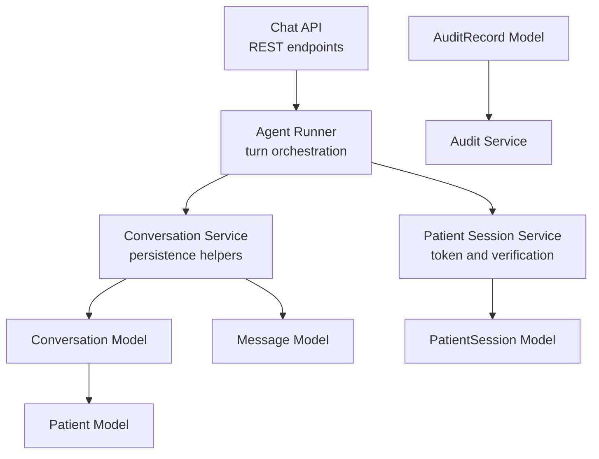

**Diagram sources**
- [chat_api.py:1-347](file://backend/app/api/chat.py#L1-L347)
- [runner.py:1-800](file://backend/app/agent/runner.py#L1-L800)
- [conversations_service.py:1-391](file://backend/app/services/conversations.py#L1-L391)
- [patient_sessions_service.py:1-123](file://backend/app/services/patient_sessions.py#L1-L123)
- [conversations.py:1-158](file://backend/app/models/conversations.py#L1-L158)
- [sessions.py:1-76](file://backend/app/models/sessions.py#L1-L76)
- [patients.py:1-109](file://backend/app/models/patients.py#L1-L109)
- [operations.py:56-80](file://backend/app/models/operations.py#L56-L80)
- [audit_service.py:1-55](file://backend/app/services/audit.py#L1-L55)

**Section sources**
- [chat_api.py:1-347](file://backend/app/api/chat.py#L1-L347)
- [runner.py:1-800](file://backend/app/agent/runner.py#L1-L800)
- [conversations_service.py:1-391](file://backend/app/services/conversations.py#L1-L391)
- [patient_sessions_service.py:1-123](file://backend/app/services/patient_sessions.py#L1-L123)
- [conversations.py:1-158](file://backend/app/models/conversations.py#L1-L158)
- [sessions.py:1-76](file://backend/app/models/sessions.py#L1-L76)
- [patients.py:1-109](file://backend/app/models/patients.py#L1-L109)
- [operations.py:56-80](file://backend/app/models/operations.py#L56-L80)
- [audit_service.py:1-55](file://backend/app/services/audit.py#L1-L55)

## Core Components
This section documents the primary data entities and their responsibilities.

### Conversation
A conversation represents one chat thread. It tracks:

- A server-generated public identifier used by clients.
- Ownership by a patient session.
- Optional association with a verified patient.
- Status, title, caller phone, and timestamps.
- A canonical scheduling request that captures structured booking intent separate from conversational context.
- Relationships to messages and booking proposals.

Key behaviors include:

- Creating a new conversation under a patient session and reset generation.
- Resuming an existing conversation when a verified session claims it.
- Listing conversations scoped to a session.
- Updating last activity time and title heuristics.

**Section sources**
- [conversations.py:39-84](file://backend/app/models/conversations.py#L39-L84)
- [conversations_service.py:41-98](file://backend/app/services/conversations.py#L41-L98)
- [conversations_service.py:100-155](file://backend/app/services/conversations.py#L100-L155)

### Message
A message represents one turn in a conversation. It supports:

- Role-based types: patient, assistant, staff, system.
- Text content, even when assistant turns only issue tool calls.
- Sequence numbers for strict ordering.
- Tool-call metadata and tool result linkage.
- Interactive UI cards attached to assistant turns.
- Timestamps for creation and completion.

Key behaviors include:

- Appending patient messages and assistant messages.
- Appending tool-result messages paired with assistant tool calls.
- Reconstructing provider-compatible message sequences.
- Producing client-safe projections that exclude internal tool payloads.

**Section sources**
- [conversations.py:87-127](file://backend/app/models/conversations.py#L87-L127)
- [conversations_service.py:158-262](file://backend/app/services/conversations.py#L158-L262)
- [conversations_service.py:285-366](file://backend/app/services/conversations.py#L285-L366)

### PatientSession
A patient session is the credential boundary for a browser tab or device. It stores:

- A hashed token digest rather than the raw token.
- Reset generation binding for invalidation.
- Verified patient identity after registration or lookup.
- Contact details for unverified callers when required.
- Expiration and last-seen timestamps.
- Relationships to conversations.

Key behaviors include:

- Issuing opaque tokens and creating sessions.
- Resolving tokens safely and rejecting expired or stale sessions.
- Marking sessions as verified.
- Listing conversation IDs owned by a session.

**Section sources**
- [sessions.py:1-76](file://backend/app/models/sessions.py#L1-L76)
- [patient_sessions_service.py:38-85](file://backend/app/services/patient_sessions.py#L38-L85)
- [patient_sessions_service.py:92-123](file://backend/app/services/patient_sessions.py#L92-L123)

### Patient
A patient record represents a person in the practice. It includes:

- Identity fields such as name, phone, date of birth, and insurance information.
- Relationships to appointments and family memberships.

Conversations may optionally reference a patient once verification binds the session to a real record.

**Section sources**
- [patients.py:18-46](file://backend/app/models/patients.py#L18-L46)

### Base Enums and Types
Shared enums define stable values for:

- Conversation status: active, closed.
- Message roles: patient, assistant, staff, system.
- Other domain states such as slot, appointment, proposal, alert, and request statuses.

These enums ensure consistent storage and comparison across models and services.

**Section sources**
- [base.py:77-87](file://backend/app/models/base.py#L77-L87)

## Architecture Overview
The conversation architecture separates authentication, conversation persistence, AI orchestration, and client-facing APIs.

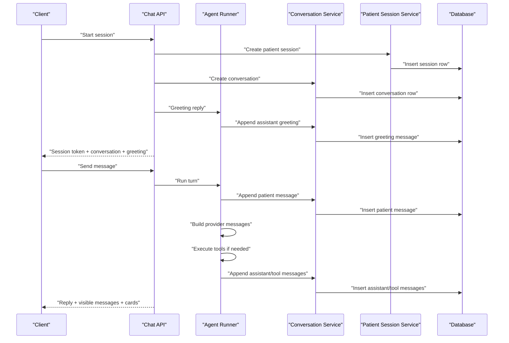

**Diagram sources**
- [chat_api.py:111-163](file://backend/app/api/chat.py#L111-L163)
- [chat_api.py:233-274](file://backend/app/api/chat.py#L233-L274)
- [runner.py:171-406](file://backend/app/agent/runner.py#L171-L406)
- [conversations_service.py:41-58](file://backend/app/services/conversations.py#L41-L58)
- [conversations_service.py:165-183](file://backend/app/services/conversations.py#L165-L183)
- [conversations_service.py:218-262](file://backend/app/services/conversations.py#L218-L262)

## Detailed Component Analysis

### Conversation Data Model
The conversation model is the central thread container. It links to a patient session, optionally to a patient, and owns ordered messages and proposals.

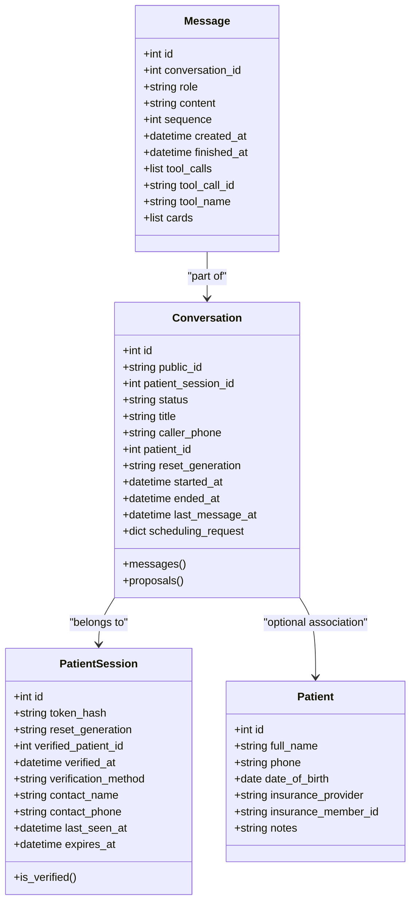

**Diagram sources**
- [conversations.py:39-84](file://backend/app/models/conversations.py#L39-L84)
- [conversations.py:87-127](file://backend/app/models/conversations.py#L87-L127)
- [sessions.py:35-76](file://backend/app/models/sessions.py#L35-L76)
- [patients.py:18-46](file://backend/app/models/patients.py#L18-L46)

#### Conversation Lifecycle and State Transitions
Conversations begin as active and can be closed by the client’s “reset within session” action. Closing marks the end timestamp and updates status; the thread remains in the database for historical and staff review purposes.

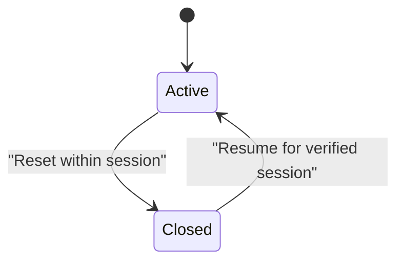

**Diagram sources**
- [chat_api.py:325-346](file://backend/app/api/chat.py#L325-L346)
- [conversations_service.py:100-138](file://backend/app/services/conversations.py#L100-L138)
- [base.py:77-80](file://backend/app/models/base.py#L77-L80)

**Section sources**
- [conversations.py:39-84](file://backend/app/models/conversations.py#L39-L84)
- [chat_api.py:325-346](file://backend/app/api/chat.py#L325-L346)
- [conversations_service.py:100-138](file://backend/app/services/conversations.py#L100-L138)
- [base.py:77-80](file://backend/app/models/base.py#L77-L80)

### Message Data Model and Threading
Messages are ordered by sequence within a conversation. Roles distinguish who produced the message:

- **patient**: text typed by the visitor.
- **assistant**: model reply, optionally with tool calls.
- **tool**: tool result linked to an assistant tool call.
- **system** and **staff**: notices used internally; they are not sent to the provider during replay.

Threading is preserved by storing every turn shape so the full thread can be replayed exactly. Assistant turns that only issue tool calls store empty content and are followed by corresponding tool messages.

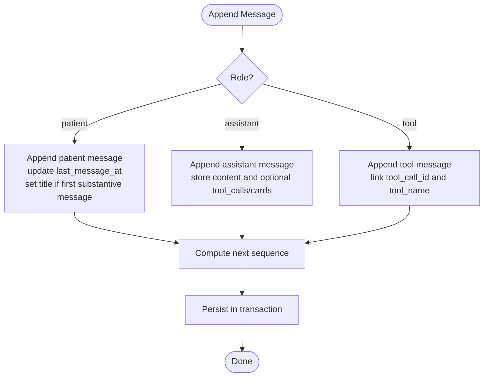

**Diagram sources**
- [conversations_service.py:158-183](file://backend/app/services/conversations.py#L158-L183)
- [conversations_service.py:218-262](file://backend/app/services/conversations.py#L218-L262)
- [conversations.py:87-127](file://backend/app/models/conversations.py#L87-L127)

**Section sources**
- [conversations.py:87-127](file://backend/app/models/conversations.py#L87-L127)
- [conversations_service.py:158-262](file://backend/app/services/conversations.py#L158-L262)

### Relationship Between Conversations and Patient Sessions
A patient session is the authorization boundary. Every conversation belongs to one session at a time. A session may span multiple conversations, representing multiple calls or threads for the same verified patient.

Important rules:

- Access to a conversation requires a valid session token.
- A conversation ID alone does not grant access.
- Unverified sessions cannot resume another session’s conversation.
- Verified sessions can claim a conversation belonging to the same patient and reset generation.
- When resuming a closed conversation, the system reopens it for the current session.

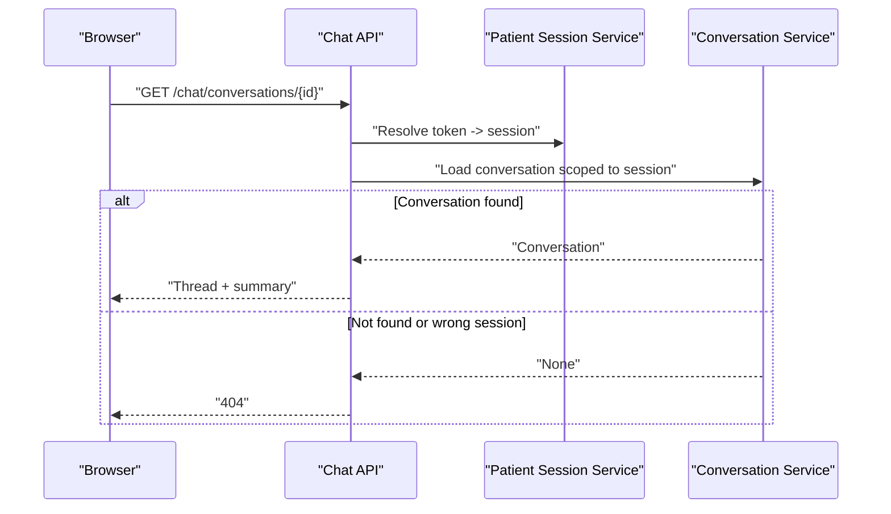

**Diagram sources**
- [chat_api.py:101-108](file://backend/app/api/chat.py#L101-L108)
- [chat_api.py:207-230](file://backend/app/api/chat.py#L207-L230)
- [conversations_service.py:61-70](file://backend/app/services/conversations.py#L61-L70)
- [patient_sessions_service.py:71-85](file://backend/app/services/patient_sessions.py#L71-L85)

**Section sources**
- [sessions.py:1-18](file://backend/app/models/sessions.py#L1-L18)
- [sessions.py:35-76](file://backend/app/models/sessions.py#L35-L76)
- [patient_sessions_service.py:1-14](file://backend/app/services/patient_sessions.py#L1-L14)
- [patient_sessions_service.py:71-85](file://backend/app/services/patient_sessions.py#L71-L85)
- [conversations_service.py:61-70](file://backend/app/services/conversations.py#L61-L70)
- [chat_api.py:101-108](file://backend/app/api/chat.py#L101-L108)
- [chat_api.py:207-230](file://backend/app/api/chat.py#L207-L230)

### Message Persistence Patterns
Persistence follows a strict turn pattern:

1. Persist the incoming patient message.
2. Load the full thread.
3. Build system prompt and provider messages.
4. Call the AI model with tools.
5. Execute requested tools.
6. Persist assistant tool-call turn and each tool result.
7. Call the AI model again with results.
8. Persist final assistant text.
9. Attach interactive cards to the correct assistant turn.
10. Return visible messages to the client.

Provider-facing tool payloads are stored but never serialized to clients. Internal identifiers and tool arguments are kept out of public responses.

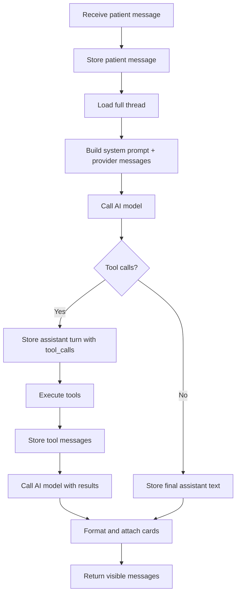

**Diagram sources**
- [runner.py:171-406](file://backend/app/agent/runner.py#L171-L406)
- [runner.py:409-557](file://backend/app/agent/runner.py#L409-L557)
- [conversations_service.py:285-366](file://backend/app/services/conversations.py#L285-L366)

**Section sources**
- [runner.py:1-23](file://backend/app/agent/runner.py#L1-L23)
- [runner.py:171-406](file://backend/app/agent/runner.py#L171-L406)
- [runner.py:409-557](file://backend/app/agent/runner.py#L409-L557)
- [conversations_service.py:285-366](file://backend/app/services/conversations.py#L285-L366)

### Conversation State Transitions
Conversations transition between active and closed states:

- **Active**: default when created; indicates an open thread.
- **Closed**: set when the client resets within the session; preserves history.
- **Reopened**: when a verified session resumes a closed conversation, the system sets it back to active and clears the end timestamp.

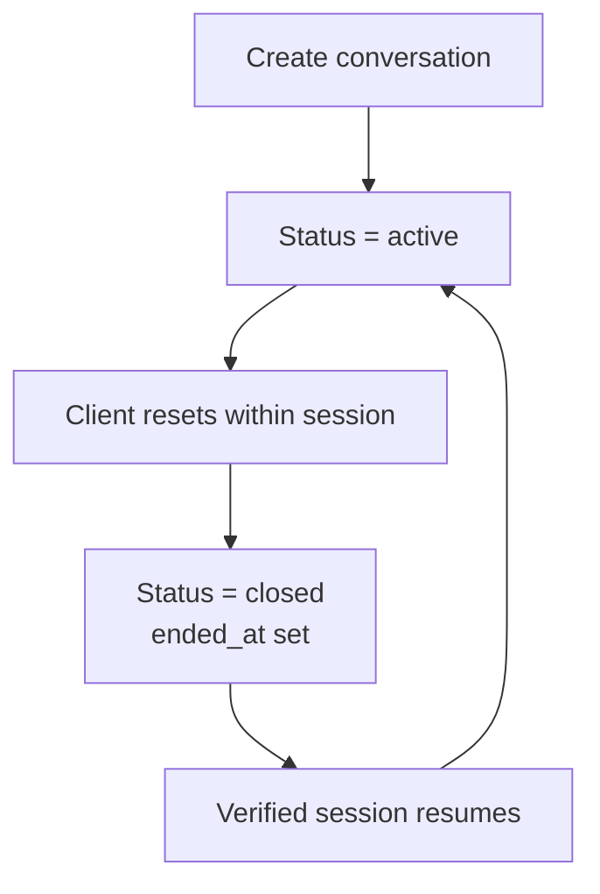

**Diagram sources**
- [chat_api.py:325-346](file://backend/app/api/chat.py#L325-L346)
- [conversations_service.py:100-138](file://backend/app/services/conversations.py#L100-L138)
- [base.py:77-80](file://backend/app/models/base.py#L77-L80)

**Section sources**
- [chat_api.py:325-346](file://backend/app/api/chat.py#L325-L346)
- [conversations_service.py:100-138](file://backend/app/services/conversations.py#L100-L138)
- [base.py:77-80](file://backend/app/models/base.py#L77-L80)

### Audit Trail Requirements
Audit records provide an append-only log of important state changes. They include:

- Occurrence timestamp.
- Actor type and identifier.
- Action name.
- Entity type and identifier.
- Visibility marker to support two-phase booking audits.
- Optional conversation association.
- Serialized details.
- Reset generation for data isolation.

The audit service writes rows inside transactions and supports trailer rows that confirm committed side effects.

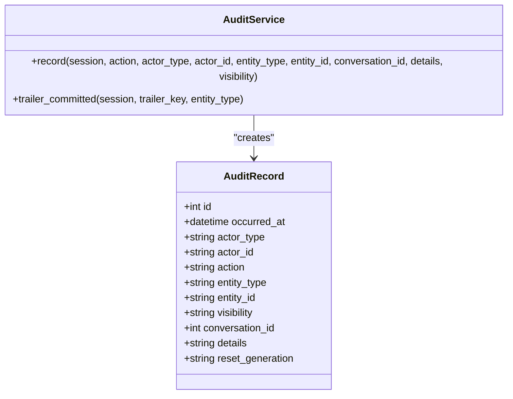

**Diagram sources**
- [operations.py:56-80](file://backend/app/models/operations.py#L56-L80)
- [audit_service.py:15-51](file://backend/app/services/audit.py#L15-L51)

**Section sources**
- [operations.py:56-80](file://backend/app/models/operations.py#L56-L80)
- [audit_service.py:1-55](file://backend/app/services/audit.py#L1-L55)

### Example Conversation Flows

#### Initial Greeting Flow
1. Client starts a session.
2. Server issues a patient session and creates a conversation.
3. Agent runner produces a greeting and appends it as an assistant message.
4. Client receives session token, conversation ID, greeting, and suggestions.

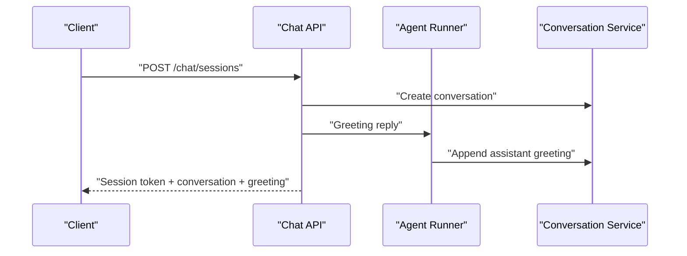

**Diagram sources**
- [chat_api.py:111-163](file://backend/app/api/chat.py#L111-L163)
- [conversations_service.py:41-58](file://backend/app/services/conversations.py#L41-L58)

#### Appointment Scheduling Flow
1. Patient sends a scheduling request.
2. Runner persists the patient message and loads history.
3. Runner calls availability tools and persists assistant tool-call turns.
4. Tool results produce slot or family-option cards.
5. Runner formats reply and attaches cards to the correct assistant turn.
6. Client sees updated messages and actionable cards.

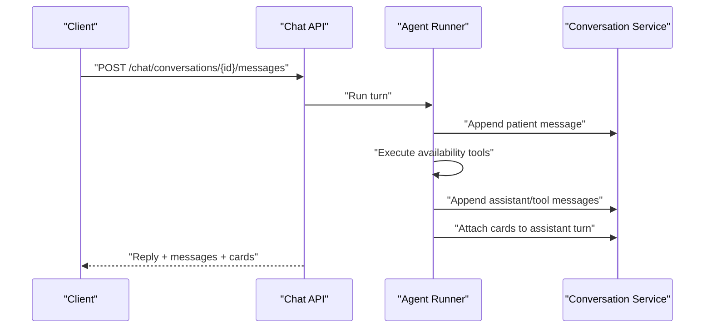

**Diagram sources**
- [chat_api.py:233-274](file://backend/app/api/chat.py#L233-L274)
- [runner.py:171-406](file://backend/app/agent/runner.py#L171-L406)
- [runner.py:409-557](file://backend/app/agent/runner.py#L409-L557)
- [conversations_service.py:218-262](file://backend/app/services/conversations.py#L218-L262)

#### Follow-Up Interaction Flow
1. Patient asks to see available times again.
2. Runner detects a time re-ask and may replay earlier slot cards.
3. If no fresh search occurs, the system ensures the latest grid is shown.
4. Cards are reconciled with live proposals so held or booked slots are not offered again.

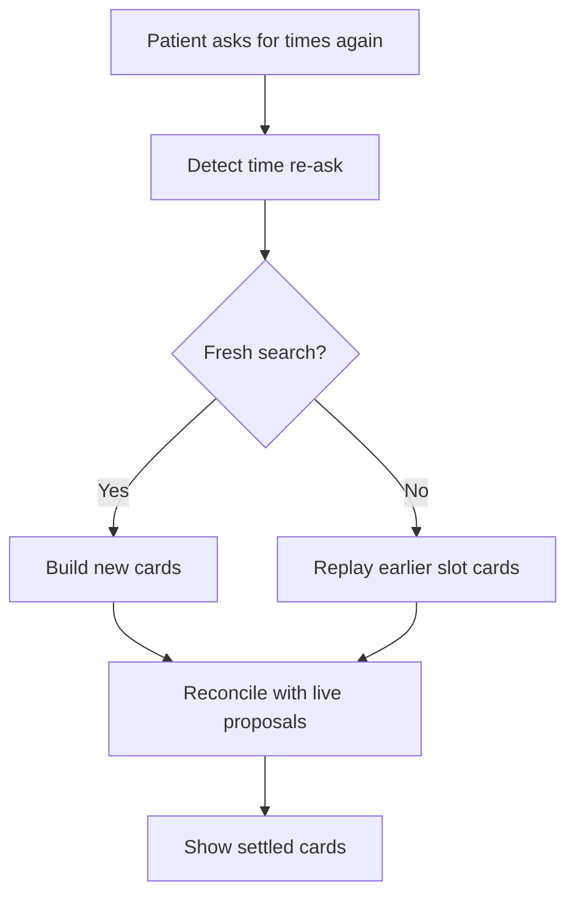

**Diagram sources**
- [runner.py:76-84](file://backend/app/agent/runner.py#L76-L84)
- [runner.py:337-351](file://backend/app/agent/runner.py#L337-L351)
- [runner.py:664-690](file://backend/app/agent/runner.py#L664-L690)

**Section sources**
- [chat_api.py:111-163](file://backend/app/api/chat.py#L111-L163)
- [chat_api.py:233-274](file://backend/app/api/chat.py#L233-L274)
- [runner.py:76-84](file://backend/app/agent/runner.py#L76-L84)
- [runner.py:337-351](file://backend/app/agent/runner.py#L337-L351)
- [runner.py:664-690](file://backend/app/agent/runner.py#L664-L690)
- [conversations_service.py:218-262](file://backend/app/services/conversations.py#L218-L262)

## Dependency Analysis
The conversation and messaging subsystem has clear dependency boundaries:

- **API depends on services**: endpoints delegate session resolution, conversation loading, and message persistence to services.
- **Runner depends on services and models**: orchestration uses conversation and session services and reads/writes models.
- **Services depend on models**: persistence helpers operate on SQLAlchemy models.
- **Models depend on base enums**: stable string values are defined centrally.
- **Audit model is independent but referenced by services**: audit records are appended alongside business operations.

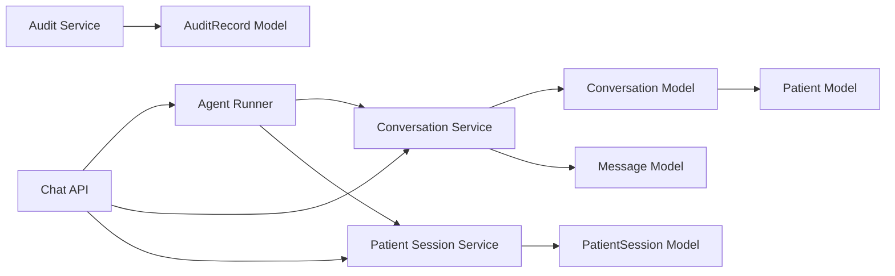

**Diagram sources**
- [chat_api.py:1-347](file://backend/app/api/chat.py#L1-L347)
- [runner.py:1-800](file://backend/app/agent/runner.py#L1-L800)
- [conversations_service.py:1-391](file://backend/app/services/conversations.py#L1-L391)
- [patient_sessions_service.py:1-123](file://backend/app/services/patient_sessions.py#L1-L123)
- [conversations.py:1-158](file://backend/app/models/conversations.py#L1-L158)
- [sessions.py:1-76](file://backend/app/models/sessions.py#L1-L76)
- [patients.py:1-109](file://backend/app/models/patients.py#L1-L109)
- [operations.py:56-80](file://backend/app/models/operations.py#L56-L80)
- [audit_service.py:1-55](file://backend/app/services/audit.py#L1-L55)

**Section sources**
- [chat_api.py:1-347](file://backend/app/api/chat.py#L1-L347)
- [runner.py:1-800](file://backend/app/agent/runner.py#L1-L800)
- [conversations_service.py:1-391](file://backend/app/services/conversations.py#L1-L391)
- [patient_sessions_service.py:1-123](file://backend/app/services/patient_sessions.py#L1-L123)
- [conversations.py:1-158](file://backend/app/models/conversations.py#L1-L158)
- [sessions.py:1-76](file://backend/app/models/sessions.py#L1-L76)
- [patients.py:1-109](file://backend/app/models/patients.py#L1-L109)
- [operations.py:56-80](file://backend/app/models/operations.py#L56-L80)
- [audit_service.py:1-55](file://backend/app/services/audit.py#L1-L55)

## Performance Considerations
Large conversation histories require careful attention to query patterns, serialization, and replay cost.

Key considerations:

- **Full-thread replay**: The system replays the complete thread to the model on every turn. This improves fidelity but increases payload size and latency as conversations grow.
- **Sequence indexing**: Messages are ordered by sequence per conversation, enabling efficient chronological retrieval.
- **Role and tool-call indexes**: Indexes on role and tool_call_id support filtering and pairing tool results.
- **Conversation indexes**: Indexes on session, phone, generation, and status+started_at support common queries.
- **Visible message projection**: Only patient and assistant messages are returned to clients, reducing payload size compared to internal tool/system rows.
- **Card deduplication and settlement**: Card merging and settlement avoid duplicate or stale offers, improving UI responsiveness.
- **Tool round limits**: Limits on tool rounds and calls prevent runaway loops and excessive external calls.
- **Session scoping**: Queries always scope conversations to the current session, avoiding unnecessary joins and improving security.

Recommended practices:

- Monitor message count and conversation length metrics.
- Paginate or limit conversation lists where appropriate.
- Avoid exposing internal tool payloads in logs or analytics.
- Use indexes already defined on conversation and message tables.
- Consider archival strategies for long-lived conversations (see Appendix).

[No sources needed since this section provides general guidance]

## Troubleshooting Guide

### Common Issues

- **Empty message submission**: The API rejects empty messages with a validation error.
- **Unconfigured AI provider**: A warning is logged when a message arrives without a configured provider, but the endpoint still proceeds.
- **Conversation not found**: Accessing a conversation outside the current session returns a 404.
- **Feedback validation**: Feedback must target an assistant message in the same conversation.
- **Tool failures**: Tool errors are captured and converted into safe assistant messages; history avoids dangling tool calls.
- **Unexpected failures**: The runner rolls back partial writes and persists a fallback message so history remains consistent.

**Section sources**
- [chat_api.py:233-274](file://backend/app/api/chat.py#L233-L274)
- [chat_api.py:277-322](file://backend/app/api/chat.py#L277-L322)
- [runner.py:264-292](file://backend/app/agent/runner.py#L264-L292)

### Debugging Conversation Threads
To debug a thread:

1. Retrieve the conversation via the session-scoped endpoint.
2. Inspect visible messages to understand what the client saw.
3. Check assistant messages for tool_calls and cards.
4. Verify tool messages for tool_call_id and tool_name.
5. Review conversation status and timestamps.
6. Correlate with audit records if a booking or handoff was involved.

**Section sources**
- [chat_api.py:207-230](file://backend/app/api/chat.py#L207-L230)
- [conversations_service.py:265-282](file://backend/app/services/conversations.py#L265-L282)
- [conversations_service.py:334-366](file://backend/app/services/conversations.py#L334-L366)
- [operations.py:56-80](file://backend/app/models/operations.py#L56-L80)

## Conclusion
The conversation and messaging models provide a robust foundation for patient-facing chat in a dental practice setting. Conversations track state, ownership, and scheduling intent, while messages preserve the full turn history needed for faithful AI replay. Patient sessions enforce secure access, and audit records capture important operational events. The design balances fidelity, security, and usability, with clear paths for extending retention, archival, and performance tuning as conversation volumes grow.

[No sources needed since this section summarizes without analyzing specific files]

## Appendices

### Retention and Archival Strategies
Current implementation retains conversations and messages for historical and staff review purposes. Recommended strategies include:

- **Retention policy**: Define how long active and closed conversations remain searchable.
- **Archival strategy**: Move older conversations to cold storage while keeping lightweight summaries in the hot database.
- **Purge policy**: Remove expired sessions and associated conversations according to privacy requirements.
- **Index maintenance**: Ensure indexes remain efficient after archival or purge operations.
- **Audit retention**: Keep audit records longer than conversation transcripts for compliance.

[No sources needed since this section provides general guidance]

### Message Retention Policies
Consider:

- Keeping all messages for auditability.
- Redacting sensitive tool payloads before exporting or analyzing transcripts.
- Limiting client-side message cache size to improve UI performance.
- Using sequence-based pagination for very long threads.

[No sources needed since this section provides general guidance]