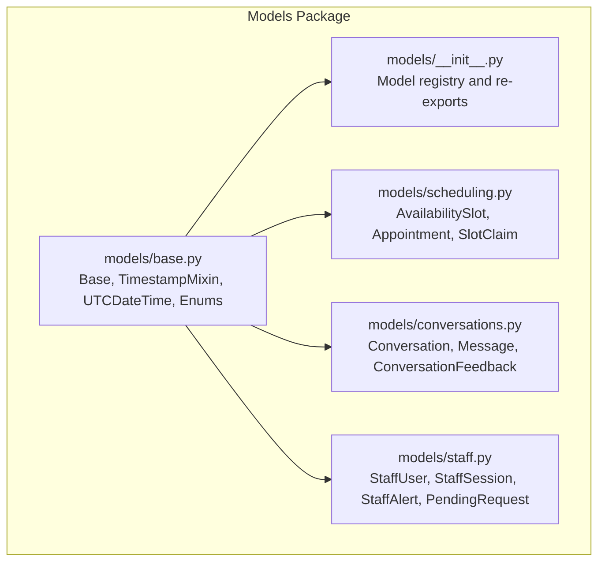
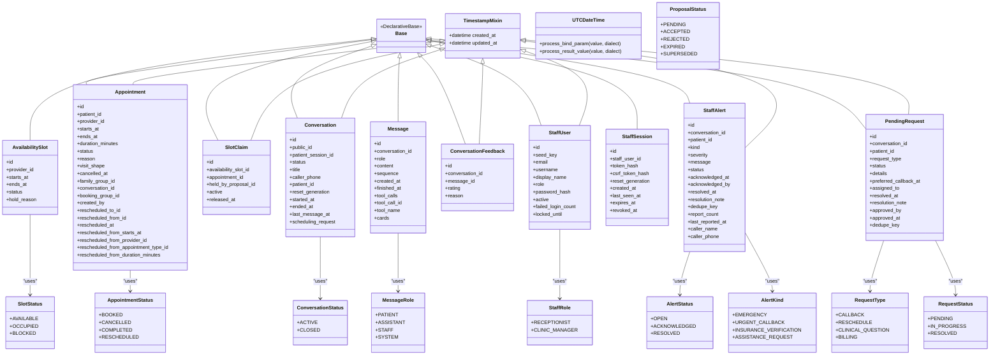
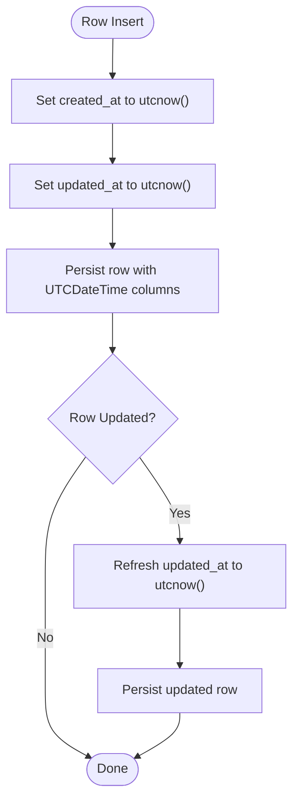
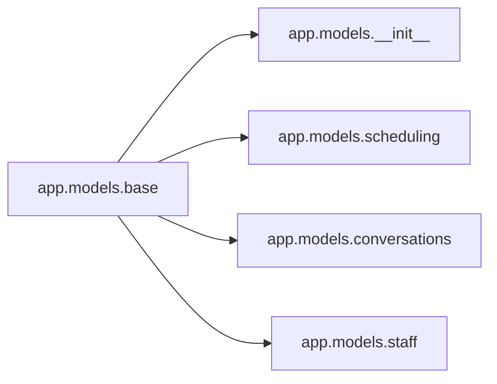

# Core Models and Base Classes

<cite>
**Referenced Files in This Document**
- [base.py](file://backend/app/models/base.py)
- [__init__.py](file://backend/app/models/__init__.py)
- [scheduling.py](file://backend/app/models/scheduling.py)
- [conversations.py](file://backend/app/models/conversations.py)
- [staff.py](file://backend/app/models/staff.py)
</cite>

## Table of Contents
1. [Introduction](#introduction)
2. [Project Structure](#project-structure)
3. [Core Components](#core-components)
4. [Architecture Overview](#architecture-overview)
5. [Detailed Component Analysis](#detailed-component-analysis)
6. [Dependency Analysis](#dependency-analysis)
7. [Performance Considerations](#performance-considerations)
8. [Troubleshooting Guide](#troubleshooting-guide)
9. [Conclusion](#conclusion)

## Introduction
This document explains the foundational SQLAlchemy data model components that provide consistent timestamping, timezone-aware datetime handling, and standardized state management across the application’s domain models. It focuses on:

- The declarative `Base` class used by all tables.
- The `TimestampMixin` mixin that adds `created_at` and `updated_at`.
- The `UTCDateTime` type decorator for safe UTC datetime persistence.
- All shared state enums, including slot, appointment, proposal, conversation, message, staff, alert, request types, and request statuses.

These building blocks ensure that every domain table inherits uniform lifecycle timestamps, stores datetimes consistently in UTC, and represents business states through stable string-backed enumerations.

## Project Structure
The core base classes and enums live under the backend models package. Domain-specific modules import these shared primitives to define tables such as scheduling entities, conversations, and staff-related records.

**Diagram sources**
- [base.py:1-120](file://backend/app/models/base.py#L1-L120)
- [__init__.py:1-76](file://backend/app/models/__init__.py#L1-L76)
- [scheduling.py:1-239](file://backend/app/models/scheduling.py#L1-L239)
- [conversations.py:1-158](file://backend/app/models/conversations.py#L1-L158)
- [staff.py:1-186](file://backend/app/models/staff.py#L1-L186)

**Section sources**
- [base.py:1-120](file://backend/app/models/base.py#L1-L120)
- [__init__.py:1-76](file://backend/app/models/__init__.py#L1-L76)

## Core Components
This section documents the foundational pieces that every domain model relies on.

### Declarative Base Class
- `Base` is a SQLAlchemy declarative base. All domain tables inherit from it so their metadata is registered together for schema creation and migrations.

**Section sources**
- [base.py:39-40](file://backend/app/models/base.py#L39-L40)

### Timezone-Aware Datetime Type
- `UTCDateTime` is a SQLAlchemy `TypeDecorator` wrapping `DateTime`.
- On write, aware datetimes are converted to UTC; naive datetimes are passed through unchanged.
- On read, values without timezone info are given UTC timezone info.
- A helper `utcnow()` returns the current time in UTC and is used as the default for timestamps.

Behavior summary:
- Ensures stored datetimes round-trip with explicit UTC offsets where possible.
- Normalizes naive datetimes to UTC when loaded.
- Provides a consistent source of “now” for created/updated fields.

**Section sources**
- [base.py:13-36](file://backend/app/models/base.py#L13-L36)

### Timestamp Mixin
- `TimestampMixin` adds two columns:
  - `created_at`: non-null, defaults to `utcnow()`.
  - `updated_at`: non-null, defaults to `utcnow()` and updates automatically on row changes.
- Both columns use `UTCDateTime`, ensuring consistent timezone behavior.

Usage pattern:
- Domain models that need lifecycle tracking inherit `TimestampMixin`.
- Examples include `Appointment`, `SlotClaim`, `Conversation`, `ConversationFeedback`, `StaffUser`, `StaffAlert`, and `PendingRequest`.

**Section sources**
- [base.py:43-47](file://backend/app/models/base.py#L43-L47)
- [scheduling.py:81-81](file://backend/app/models/scheduling.py#L81-L81)
- [scheduling.py:175-175](file://backend/app/models/scheduling.py#L175-L175)
- [conversations.py:39-39](file://backend/app/models/conversations.py#L39-L39)
- [conversations.py:129-129](file://backend/app/models/conversations.py#L129-L129)
- [staff.py:25-25](file://backend/app/models/staff.py#L25-L25)
- [staff.py:87-87](file://backend/app/models/staff.py#L87-L87)
- [staff.py:139-139](file://backend/app/models/staff.py#L139-L139)

### Shared State Enums
All enums are Python `StrEnum` subclasses whose values are stable strings persisted to the database. They are re-exported from the models package registry so consumers can import them from a single place.

| Enum | Values | Purpose |
|---|---|---|
| `SlotStatus` | `available`, `occupied`, `blocked` | Represents the availability state of a provider’s time interval. |
| `AppointmentStatus` | `booked`, `cancelled`, `completed`, `rescheduled` | Represents the lifecycle of an appointment, including reschedule history semantics. |
| `ProposalStatus` | `pending`, `accepted`, `rejected`, `expired`, `superseded` | Represents the lifecycle of booking proposals, distinguishing updates from rejections. |
| `ConversationStatus` | `active`, `closed` | Represents whether a chat thread is still open. |
| `MessageRole` | `patient`, `assistant`, `staff`, `system` | Identifies who or what produced a message turn. |
| `StaffRole` | `receptionist`, `clinic_manager` | Identifies the role of a staff user. |
| `AlertStatus` | `open`, `acknowledged`, `resolved` | Tracks the workflow state of an escalation alert. |
| `AlertKind` | `emergency`, `urgent_callback`, `insurance_verification`, `assistance_request` | Categorizes the kind of alert raised by the system. |
| `RequestType` | `callback`, `reschedule`, `clinical_question`, `billing` | Categorizes pending work items generated by the assistant. |
| `RequestStatus` | `pending`, `in_progress`, `resolved` | Tracks the processing state of a pending request. |

These enums are used both as column defaults and as database check constraints, providing strong validation at the ORM and database layers.

**Section sources**
- [base.py:50-120](file://backend/app/models/base.py#L50-L120)
- [__init__.py:8-22](file://backend/app/models/__init__.py#L8-L22)
- [__init__.py:37-75](file://backend/app/models/__init__.py#L37-L75)

## Architecture Overview
The base layer provides reusable infrastructure that domain models compose into concrete tables.

**Diagram sources**
- [base.py:13-120](file://backend/app/models/base.py#L13-L120)
- [scheduling.py:37-239](file://backend/app/models/scheduling.py#L37-L239)
- [conversations.py:39-158](file://backend/app/models/conversations.py#L39-L158)
- [staff.py:25-186](file://backend/app/models/staff.py#L25-L186)

## Detailed Component Analysis

### Base Declarative Class
- `Base` extends SQLAlchemy’s `DeclarativeBase`.
- It centralizes metadata registration so that importing the models package registers all tables.
- Domain models should inherit from `Base` rather than creating separate bases.

Design implications:
- Single source of truth for table definitions.
- Enables schema generation tools and tests to discover all models via `Base.metadata`.

**Section sources**
- [base.py:39-40](file://backend/app/models/base.py#L39-L40)
- [__init__.py:1-6](file://backend/app/models/__init__.py#L1-L6)

### UTCDateTime Type Decorator
- Wraps SQLAlchemy’s `DateTime` while enforcing UTC semantics.
- Write path: converts aware datetimes to UTC before binding.
- Read path: attaches UTC timezone to naive datetimes returned from the database.
- Designed to preserve offset information where available and normalize otherwise.

When to use:
- For any datetime field that must be compared or sorted reliably across timezones.
- For audit-style timestamps like `created_at`, `updated_at`, `started_at`, `ended_at`, and session expiry fields.

**Section sources**
- [base.py:13-36](file://backend/app/models/base.py#L13-L36)
- [conversations.py:61-63](file://backend/app/models/conversations.py#L61-L63)
- [conversations.py:103-104](file://backend/app/models/conversations.py#L103-L104)
- [staff.py:47-47](file://backend/app/models/staff.py#L47-L47)
- [staff.py:74-77](file://backend/app/models/staff.py#L74-L77)
- [staff.py:103-108](file://backend/app/models/staff.py#L103-L108)
- [staff.py:156-167](file://backend/app/models/staff.py#L156-L167)

### TimestampMixin Lifecycle
- Adds `created_at` and `updated_at` using `UTCDateTime`.
- `created_at` is set once when a row is inserted.
- `updated_at` is set on insert and refreshed on update.
- Domain models that inherit this mixin get consistent audit timestamps without repeating column definitions.

Examples in the codebase:
- `Appointment` and `SlotClaim` use timestamps for booking lifecycle tracking.
- `Conversation`, `ConversationFeedback`, `StaffUser`, `StaffAlert`, and `PendingRequest` use timestamps for operational visibility.

**Diagram sources**
- [base.py:35-47](file://backend/app/models/base.py#L35-L47)

**Section sources**
- [base.py:43-47](file://backend/app/models/base.py#L43-L47)
- [scheduling.py:81-81](file://backend/app/models/scheduling.py#L81-L81)
- [scheduling.py:175-175](file://backend/app/models/scheduling.py#L175-L175)
- [conversations.py:39-39](file://backend/app/models/conversations.py#L39-L39)
- [conversations.py:129-129](file://backend/app/models/conversations.py#L129-L129)
- [staff.py:25-25](file://backend/app/models/staff.py#L25-L25)
- [staff.py:87-87](file://backend/app/models/staff.py#L87-L87)
- [staff.py:139-139](file://backend/app/models/staff.py#L139-L139)

### SlotStatus
- Values: `available`, `occupied`, `blocked`.
- Used by `AvailabilitySlot.status` to represent whether a provider’s 30-minute interval is bookable, already booked, or blocked by staff operations.
- Database-level constraint enforces allowed values.

Operational meaning:
- `available`: offered to patients.
- `occupied`: reserved by an active appointment claim.
- `blocked`: intentionally unavailable due to schedule holds.

**Section sources**
- [base.py:50-53](file://backend/app/models/base.py#L50-L53)
- [scheduling.py:48-62](file://backend/app/models/scheduling.py#L48-L62)

### AppointmentStatus
- Values: `booked`, `cancelled`, `completed`, `rescheduled`.
- Used by `Appointment.status`.
- `rescheduled` indicates that the original appointment was moved to a replacement appointment; the original row remains for history.

Reschedule semantics:
- Original appointment is marked `rescheduled`.
- Replacement appointment tracks the original via foreign keys.
- Replacement appointments are not double-counted as upcoming visits.

**Section sources**
- [base.py:56-63](file://backend/app/models/base.py#L56-L63)
- [scheduling.py:98-100](file://backend/app/models/scheduling.py#L98-L100)
- [scheduling.py:120-160](file://backend/app/models/scheduling.py#L120-L160)
- [scheduling.py:162-172](file://backend/app/models/scheduling.py#L162-L172)

### ProposalStatus
- Values: `pending`, `accepted`, `rejected`, `expired`, `superseded`.
- Used by booking proposals to distinguish between rejection and being replaced by a newer proposal.
- `superseded` allows UIs to show “updated” instead of “declined” when a patient changes their mind.

**Section sources**
- [base.py:66-74](file://backend/app/models/base.py#L66-L74)

### ConversationStatus
- Values: `active`, `closed`.
- Used by `Conversation.status` to indicate whether a chat thread is still open.

**Section sources**
- [base.py:77-79](file://backend/app/models/base.py#L77-L79)
- [conversations.py:54-56](file://backend/app/models/conversations.py#L54-L56)

### MessageRole
- Values: `patient`, `assistant`, `staff`, `system`.
- Used by `Message.role` to identify the sender of a message turn.
- Includes a runtime validation helper that checks whether a stored role belongs to the enum set.

**Section sources**
- [base.py:82-86](file://backend/app/models/base.py#L82-L86)
- [conversations.py:100-100](file://backend/app/models/conversations.py#L100-L100)
- [conversations.py:125-126](file://backend/app/models/conversations.py#L125-L126)

### StaffRole
- Values: `receptionist`, `clinic_manager`.
- Used by `StaffUser.role`.
- Enforced by a database check constraint.

**Section sources**
- [base.py:89-91](file://backend/app/models/base.py#L89-L91)
- [staff.py:36-38](file://backend/app/models/staff.py#L36-L38)
- [staff.py:53-55](file://backend/app/models/staff.py#L53-L55)

### AlertStatus
- Values: `open`, `acknowledged`, `resolved`.
- Used by `StaffAlert.status` to track alert workflow.
- Enforced by a database check constraint.

**Section sources**
- [base.py:94-97](file://backend/app/models/base.py#L94-L97)
- [staff.py:100-100](file://backend/app/models/staff.py#L100-L100)
- [staff.py:128-136](file://backend/app/models/staff.py#L128-L136)

### AlertKind
- Values: `emergency`, `urgent_callback`, `insurance_verification`, `assistance_request`.
- Used by `StaffAlert.kind` to categorize alerts.
- Stable stored values are emphasized because they persist in the database.

**Section sources**
- [base.py:100-106](file://backend/app/models/base.py#L100-L106)
- [staff.py:97-97](file://backend/app/models/staff.py#L97-L97)

### RequestType
- Values: `callback`, `reschedule`, `clinical_question`, `billing`.
- Used by `PendingRequest.request_type` to classify assistant-generated work items.
- Enforced by a database check constraint.

**Section sources**
- [base.py:109-113](file://backend/app/models/base.py#L109-L113)
- [staff.py:149-151](file://backend/app/models/staff.py#L149-L151)
- [staff.py:175-185](file://backend/app/models/staff.py#L175-L185)

### RequestStatus
- Values: `pending`, `in_progress`, `resolved`.
- Used by `PendingRequest.status` to track processing progress.
- Enforced by a database check constraint.

**Section sources**
- [base.py:116-119](file://backend/app/models/base.py#L116-L119)
- [staff.py:152-154](file://backend/app/models/staff.py#L152-L154)
- [staff.py:175-185](file://backend/app/models/staff.py#L175-L185)

## Dependency Analysis
The models package centralizes imports and re-exports of shared base components. Domain modules depend on `base.py` for `Base`, `TimestampMixin`, `UTCDateTime`, and the shared enums.

**Diagram sources**
- [base.py:1-120](file://backend/app/models/base.py#L1-L120)
- [__init__.py:8-35](file://backend/app/models/__init__.py#L8-L35)
- [scheduling.py:31-31](file://backend/app/models/scheduling.py#L31-L31)
- [conversations.py:26-32](file://backend/app/models/conversations.py#L26-L32)
- [staff.py:11-19](file://backend/app/models/staff.py#L11-L19)

**Section sources**
- [__init__.py:1-35](file://backend/app/models/__init__.py#L1-L35)
- [scheduling.py:31-31](file://backend/app/models/scheduling.py#L31-L31)
- [conversations.py:26-32](file://backend/app/models/conversations.py#L26-L32)
- [staff.py:11-19](file://backend/app/models/staff.py#L11-L19)

## Performance Considerations
- Using `UTCDateTime` avoids ambiguous local-time comparisons and reduces cross-timezone bugs.
- Storing timestamps as UTC simplifies indexing and querying by time ranges.
- Enums are stored as short strings, which keeps indexes compact and queries fast.
- Check constraints enforce valid states at the database level, reducing invalid-state errors in application logic.

[No sources needed since this section provides general guidance]

## Troubleshooting Guide
Common issues and how the base components help diagnose them:

- Naive datetimes causing inconsistent ordering:
  - Use `UTCDateTime` for all persistent datetime fields.
  - Prefer `utcnow()` for defaults.
- Invalid state values:
  - Rely on enum-backed string columns and database check constraints.
  - If a constraint violation occurs, inspect the relevant enum and the column’s default value.
- Missing timestamps:
  - Ensure the model inherits `TimestampMixin`.
  - Verify that inserts and updates go through SQLAlchemy ORM sessions so `updated_at` refreshes.
- Role or status mismatches:
  - Validate against the corresponding enum values.
  - For messages, use the provided role validation helper to detect invalid roles.

**Section sources**
- [base.py:13-47](file://backend/app/models/base.py#L13-L47)
- [base.py:50-119](file://backend/app/models/base.py#L50-L119)
- [conversations.py:125-126](file://backend/app/models/conversations.py#L125-L126)

## Conclusion
The core model foundation in this project centers on three ideas:

1. A single declarative `Base` for consistent table registration.
2. A `TimestampMixin` plus `UTCDateTime` for reliable, timezone-safe lifecycle tracking.
3. Stable string-backed enums for all domain states, enforced at both the ORM and database levels.

Together, these components make domain models easier to reason about, safer to evolve, and simpler to query and maintain across scheduling, conversations, and staff workflows.

[No sources needed since this section summarizes without analyzing specific files]