# Data Models

<cite>
**Referenced Files in This Document**
- [base.py](file://backend/app/models/base.py)
- [patients.py](file://backend/app/models/patients.py)
- [scheduling.py](file://backend/app/models/scheduling.py)
- [conversations.py](file://backend/app/models/conversations.py)
- [proposals.py](file://backend/app/models/proposals.py)
- [family.py](file://backend/app/models/family.py)
- [staff.py](file://backend/app/models/staff.py)
- [sessions.py](file://backend/app/models/sessions.py)
- [operations.py](file://backend/app/models/operations.py)
- [db.py](file://backend/app/db.py)
- [migrations.py](file://backend/app/migrations.py)
- [bootstrap.py](file://backend/app/bootstrap.py)
</cite>

## Table of Contents
1. [Introduction](#introduction)
2. [Project Structure](#project-structure)
3. [Core Components](#core-components)
4. [Architecture Overview](#architecture-overview)
5. [Detailed Component Analysis](#detailed-component-analysis)
6. [Dependency Analysis](#dependency-analysis)
7. [Performance Considerations](#performance-considerations)
8. [Data Lifecycle and Migration Strategy](#data-lifecycle-and-migration-strategy)
9. [Validation Rules](#validation-rules)
10. [Troubleshooting Guide](#troubleshooting-guide)
11. [Conclusion](#conclusion)

## Introduction
This document describes the SQLAlchemy ORM data model for the dental scheduling system. It covers entity relationships, field definitions, primary and foreign keys, indexes, database constraints, state enums, validation rules, lifecycle management, and performance considerations. The model supports patients, providers, appointment types, availability slots, slot claims, appointments, proposals, conversations, messages, alerts, staff users, patient sessions, family groups, and audit records.

## Project Structure
The ORM layer lives under `backend/app/models`. Each domain area is split into its own file:

- Shared base, enums, and timestamp utilities: `base.py`
- People and catalogue: `patients.py`
- Scheduling grid and bookings: `scheduling.py`
- Conversations and messages: `conversations.py`
- Proposals and booking groups: `proposals.py`
- Family groups and memberships: `family.py`
- Staff users, sessions, alerts, and pending requests: `staff.py`
- Patient-facing chat sessions: `sessions.py`
- Operational tables such as idempotency, audit, and metadata: `operations.py`

```mermaid
graph TB
Base["Base + TimestampMixin<br/>Enums"] --> Patients["Patients"]
Base --> Providers["Providers"]
Base --> AppointmentTypes["Appointment Types"]
Base --> AvailabilitySlots["Availability Slots"]
Base --> Appointments["Appointments"]
Base --> SlotClaims["Slot Claims"]
Base --> Conversations["Conversations"]
Base --> Messages["Messages"]
Base --> Proposals["Booking Proposals"]
Base --> ProposalItems["Proposal Items"]
Base --> BookingGroups["Booking Groups"]
Base --> FamilyGroups["Family Groups"]
Base --> FamilyMembers["Family Members"]
Base --> StaffUsers["Staff Users"]
Base --> StaffSessions["Staff Sessions"]
Base --> StaffAlerts["Staff Alerts"]
Base --> PendingRequests["Pending Requests"]
Base --> PatientSessions["Patient Sessions"]
Base --> AuditRecords["Audit Records"]
Base --> IdempotencyRecords["Idempotency Records"]
```

**Diagram sources**
- [base.py:39-120](file://backend/app/models/base.py#L39-L120)
- [patients.py:18-109](file://backend/app/models/patients.py#L18-L109)
- [scheduling.py:37-239](file://backend/app/models/scheduling.py#L37-L239)
- [conversations.py:39-158](file://backend/app/models/conversations.py#L39-L158)
- [proposals.py:35-236](file://backend/app/models/proposals.py#L35-L236)
- [family.py:21-61](file://backend/app/models/family.py#L21-L61)
- [staff.py:25-186](file://backend/app/models/staff.py#L25-L186)
- [sessions.py:35-76](file://backend/app/models/sessions.py#L35-L76)
- [operations.py:23-126](file://backend/app/models/operations.py#L23-L126)

**Section sources**
- [base.py:1-120](file://backend/app/models/base.py#L1-L120)
- [patients.py:1-109](file://backend/app/models/patients.py#L1-L109)
- [scheduling.py:1-239](file://backend/app/models/scheduling.py#L1-L239)
- [conversations.py:1-158](file://backend/app/models/conversations.py#L1-L158)
- [proposals.py:1-236](file://backend/app/models/proposals.py#L1-L236)
- [family.py:1-61](file://backend/app/models/family.py#L1-L61)
- [staff.py:1-186](file://backend/app/models/staff.py#L1-L186)
- [sessions.py:1-76](file://backend/app/models/sessions.py#L1-L76)
- [operations.py:1-126](file://backend/app/models/operations.py#L1-L126)

## Core Components
This section summarizes the main entities and their responsibilities.

| Entity | Purpose | Primary Key | Important Foreign Keys | Notes |
|---|---|---:|---|---|
| Patient | Person receiving care | `id` | None | Phone is not unique; family members may share a number. |
| Provider | Clinician or staff provider | `id` | None | Has specialties, availability slots, and appointments. |
| ProviderSpecialty | One specialty per provider row | `id` | `providers.id` | Unique constraint on `(provider_id, specialty)`. |
| AppointmentType | Catalogue of visit kinds | `id` | None | Stable code used by assistant workflows. |
| AvailabilitySlot | 30-minute provider interval | `id` | `providers.id` | Status constrained to available/occupied/blocked. |
| Appointment | Confirmed visit | `id` | `patients.id`, `providers.id`, `appointment_types.id`, optional conversation and group IDs | Tracks reschedule history and family/group links. |
| SlotClaim | Interval reservation | `id` | `availability_slots.id`, optional `appointments.id`, optional `booking_proposals.id` | Partial unique index enforces one active claim per slot. |
| Conversation | Chat thread | `id` | Optional `patient_sessions.id`, `patients.id` | Holds structured scheduling request and messages. |
| Message | Turn in a conversation | `id` | `conversations.id` | Stores role, content, sequence, and internal tool metadata. |
| ConversationFeedback | Rating of a message turn | `id` | `conversations.id`, `messages.id` | One feedback row per message. |
| BookingProposal | Awaiting confirmation | `id` | `conversations.id`, optional `staff_users.id`, `family_groups.id`, `booking_groups.id` | Tracks kind, intent, holds, idempotency keys, and outcomes. |
| ProposalItem | One proposed patient-slot row | `id` | `booking_proposals.id`, optional `patients.id`, `providers.id`, `appointment_types.id`, `availability_slots.id` | Snapshot fields preserve what the UI showed. |
| BookingGroup | Bookings confirmed together | `id` | Optional `conversations.id`, `booking_proposals.id`, `patient_sessions.id`, `family_groups.id` | Confirmation key is unique for idempotent confirmations. |
| FamilyGroup | Household grouping | `id` | None | Optional wrapper around patients. |
| FamilyMember | Patient-to-family link | `id` | `family_groups.id`, `patients.id` | Unique per family and patient. |
| StaffUser | Clinic employee | `id` | None | Role constrained to receptionist or clinic manager. |
| StaffSession | Server-side staff session token | `id` | `staff_users.id` | Token hash is unique; tracks expiry and CSRF token hash. |
| StaffAlert | Escalation raised by assistant | `id` | Optional `conversations.id`, `patients.id`, `staff_users.id` | Deduplication key avoids duplicate paging. |
| PendingRequest | Callback or unresolved item | `id` | Optional `conversations.id`, `patients.id`, `staff_users.id` | Request type and status are constrained. |
| PatientSession | Browser credential for patient chat | `id` | Optional `patients.id` | Token hash is unique; ties to reset generation. |
| IdempotencyRecord | Side-effect deduplication | `id` | None | Unique on `(scope, key)`; state constrained. |
| AuditRecord | Append-only change log | `id` | Optional `conversations.id` | Visibility distinguishes committed vs uncommitted trailers. |
| AppMetadata | Application-level key/value store | `key` | None | Small operational configuration table. |
| SeedManifest | Fixture application record | `id` | None | Tracks fixture set, version, checksum, and applied time. |

**Section sources**
- [patients.py:18-109](file://backend/app/models/patients.py#L18-L109)
- [scheduling.py:37-239](file://backend/app/models/scheduling.py#L37-L239)
- [conversations.py:39-158](file://backend/app/models/conversations.py#L39-L158)
- [proposals.py:35-236](file://backend/app/models/proposals.py#L35-L236)
- [family.py:21-61](file://backend/app/models/family.py#L21-L61)
- [staff.py:25-186](file://backend/app/models/staff.py#L25-L186)
- [sessions.py:35-76](file://backend/app/models/sessions.py#L35-L76)
- [operations.py:23-126](file://backend/app/models/operations.py#L23-L126)

## Architecture Overview
The data model separates identity, scheduling, conversation, proposal, family, staff, session, and operational concerns while linking them through well-defined foreign keys.

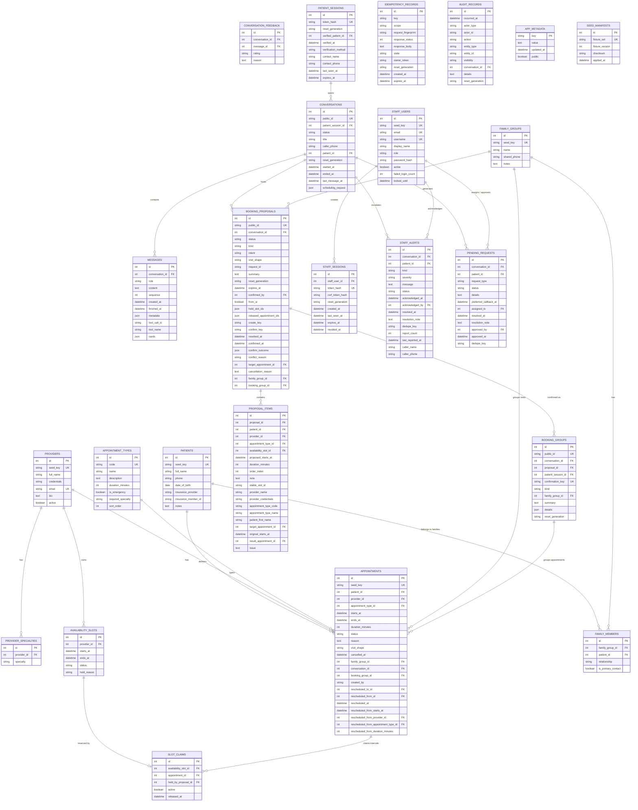

**Diagram sources**
- [patients.py:18-109](file://backend/app/models/patients.py#L18-L109)
- [scheduling.py:37-239](file://backend/app/models/scheduling.py#L37-L239)
- [conversations.py:39-158](file://backend/app/models/conversations.py#L39-L158)
- [proposals.py:35-236](file://backend/app/models/proposals.py#L35-L236)
- [family.py:21-61](file://backend/app/models/family.py#L21-L61)
- [staff.py:25-186](file://backend/app/models/staff.py#L25-L186)
- [sessions.py:35-76](file://backend/app/models/sessions.py#L35-L76)
- [operations.py:23-126](file://backend/app/models/operations.py#L23-L126)

## Detailed Component Analysis

### Patients, Providers, and Appointment Types
- **Patient**: Identifies a person with name, phone, date of birth, optional insurance fields, and notes. Phone is indexed but not unique because households share numbers. Relationships include appointments and family memberships.
- **Provider**: Identifies a clinician with name, credentials, unique email, optional bio, and an active flag. Relationships include specialties, availability slots, and appointments.
- **ProviderSpecialty**: Many-to-many style linkage where each provider can have multiple specialties. Enforced by a unique constraint on `(provider_id, specialty)` and an index on `specialty`.
- **AppointmentType**: Catalogue entry with a stable code, name, description, duration, emergency flag, optional required specialty, and sort order.

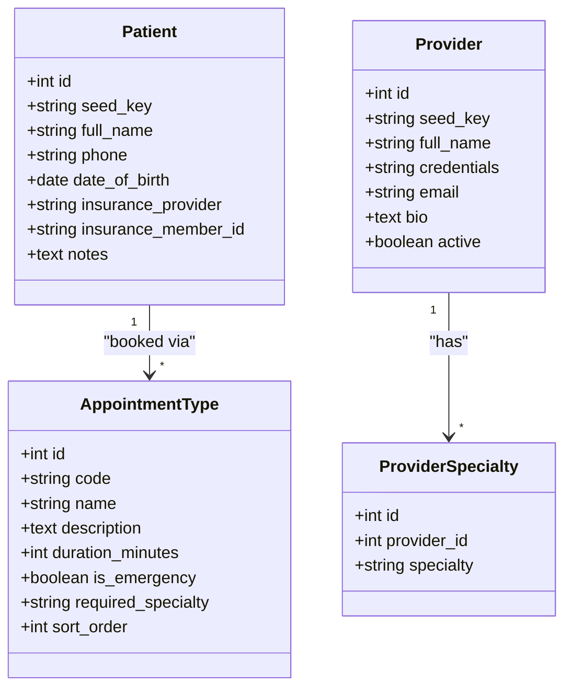

**Diagram sources**
- [patients.py:18-109](file://backend/app/models/patients.py#L18-L109)

**Section sources**
- [patients.py:18-109](file://backend/app/models/patients.py#L18-L109)

### Availability Slots, Slot Claims, and Appointments
- **AvailabilitySlot**: Represents a 30-minute interval owned by a provider. Includes start/end times, status, and optional schedule hold reason. Uniqueness on `(provider_id, starts_at)` prevents duplicate intervals. Check constraints enforce positive duration and allowed statuses. Indexes support queries by start time and provider/status/start combinations.
- **SlotClaim**: Reserves one slot for either an appointment or a proposal. Uses partial unique indexes so only one active claim exists per slot, preventing overlapping bookings at the database level. Also maintains an active-per-appointment-slot uniqueness for historical tracking.
- **Appointment**: Confirmed visit with patient, provider, appointment type, time range, duration, status, optional reason, visit shape, cancellation timestamp, and links to family and booking groups. Includes reschedule history fields that keep the original row intact and point to replacement rows.

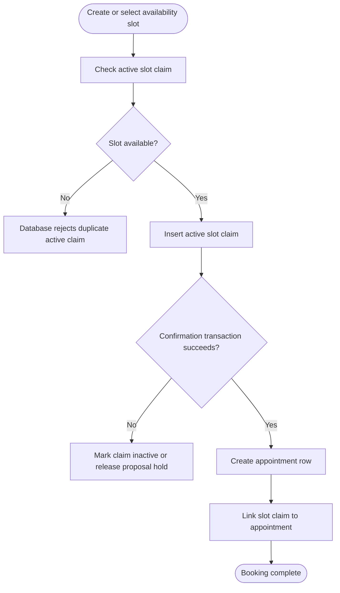

**Diagram sources**
- [scheduling.py:37-239](file://backend/app/models/scheduling.py#L37-L239)

**Section sources**
- [scheduling.py:37-239](file://backend/app/models/scheduling.py#L37-L239)

### Conversations, Messages, and Feedback
- **Conversation**: Represents a chat thread tied to a patient session and optionally a verified patient. Stores structured scheduling request data, timestamps, status, and indexes for session, phone, generation, and status/time queries.
- **Message**: Stores each turn with role, content, sequence, timestamps, and internal tool metadata. Sequence is unique per conversation. Indexes support ordering, role filtering, and tool call lookups.
- **ConversationFeedback**: One row per message with rating and optional reason. Unique per message to avoid stacked contradictory signals.

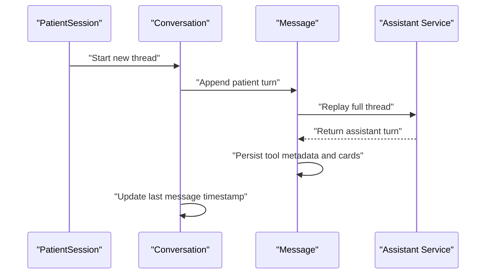

**Diagram sources**
- [conversations.py:39-158](file://backend/app/models/conversations.py#L39-L158)
- [sessions.py:35-76](file://backend/app/models/sessions.py#L35-L76)

**Section sources**
- [conversations.py:39-158](file://backend/app/models/conversations.py#L39-L158)
- [sessions.py:35-76](file://backend/app/models/sessions.py#L35-L76)

### Proposals, Proposal Items, and Booking Groups
- **BookingProposal**: Captures what a patient is about to book, including kind (booking/reschedule/cancellation), intent, visit shape, structured request binding, expiration, idempotency keys, held slot IDs, released appointment IDs, confirmation outcome, and conflict reasons. Links to conversation, staff user who confirmed, family group, and resulting booking group.
- **ProposalItem**: One row per patient/timetable option inside a proposal. Snapshots live provider, slot, appointment type, and patient information so the UI renders exactly what was shown. Also tracks reschedule/cancellation targets and result appointment ID.
- **BookingGroup**: Groups everything confirmed together. Confirmation key is unique to prevent duplicate groups on retries.

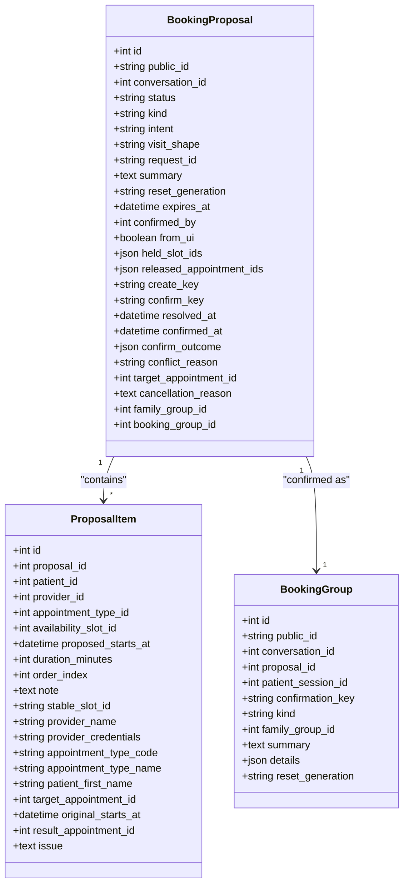

**Diagram sources**
- [proposals.py:35-236](file://backend/app/models/proposals.py#L35-L236)

**Section sources**
- [proposals.py:35-236](file://backend/app/models/proposals.py#L35-L236)

### Family Groups and Memberships
- **FamilyGroup**: Optional household wrapper with name, optional shared phone, and notes. Indexed by shared phone for matching callers.
- **FamilyMember**: Links a patient to a family group with relation label and primary contact flag. Unique per family and patient.

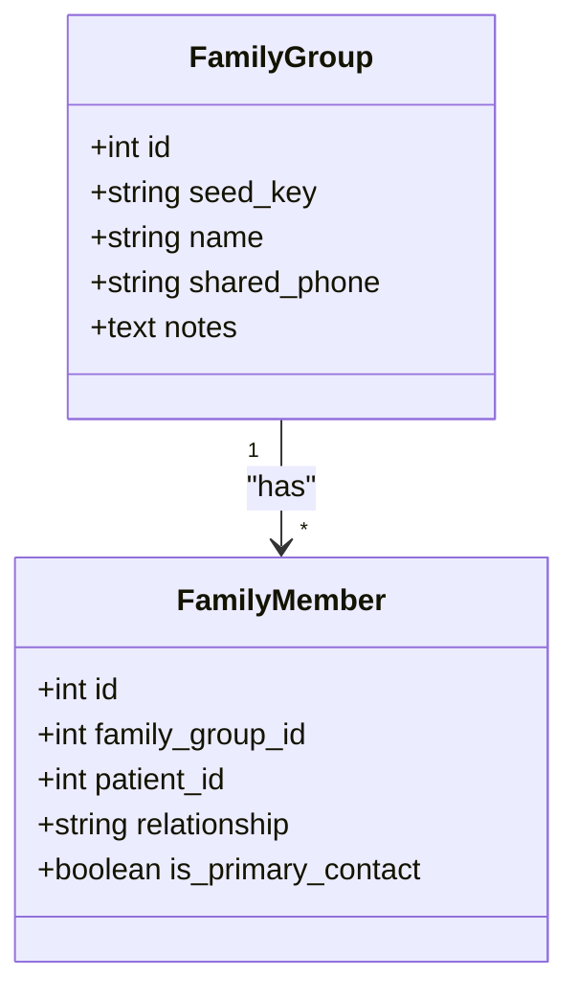

**Diagram sources**
- [family.py:21-61](file://backend/app/models/family.py#L21-L61)

**Section sources**
- [family.py:21-61](file://backend/app/models/family.py#L21-L61)

### Staff Users, Sessions, Alerts, and Pending Requests
- **StaffUser**: Employee account with email, optional username, display name, role, password hash, active flag, login failure counter, and lockout timestamp. Role is constrained to receptionist or clinic manager.
- **StaffSession**: Server-side session token with hashed token, CSRF token hash, reset generation, creation/last seen/expiry/revocation timestamps.
- **StaffAlert**: Escalation with kind, severity, message, status, acknowledgement/resolution metadata, deduplication key, report count, and caller contact info.
- **PendingRequest**: Callback or unresolved item with request type, status, details, preferred callback time, assignment, resolution, approval metadata, and deduplication key.

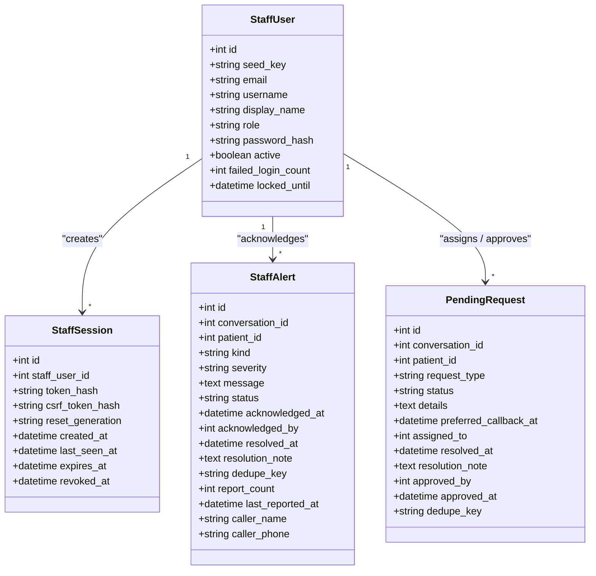

**Diagram sources**
- [staff.py:25-186](file://backend/app/models/staff.py#L25-L186)

**Section sources**
- [staff.py:25-186](file://backend/app/models/staff.py#L25-L186)

### Patient Sessions
- **PatientSession**: Browser credential holding a hashed token, reset generation, optional verified patient, verification metadata, unverified caller contact info, last seen time, and expiry. Ties to conversations and verified patient.

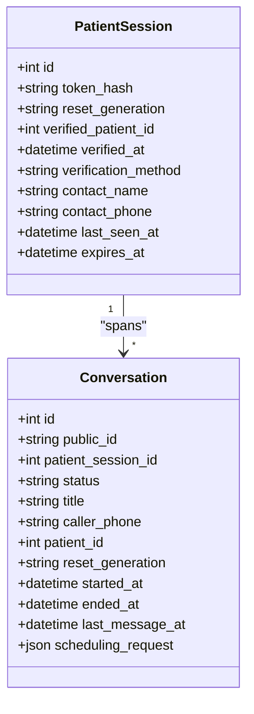

**Diagram sources**
- [sessions.py:35-76](file://backend/app/models/sessions.py#L35-L76)
- [conversations.py:39-158](file://backend/app/models/conversations.py#L39-L158)

**Section sources**
- [sessions.py:35-76](file://backend/app/models/sessions.py#L35-L76)
- [conversations.py:39-158](file://backend/app/models/conversations.py#L39-L158)

### Operational Tables: Idempotency, Audit, Metadata, and Seed Manifest
- **IdempotencyRecord**: Deduplicates side-effecting requests using `(scope, key)`. Tracks request fingerprint, response status/body, state, owner token, reset generation, and expiry.
- **AuditRecord**: Append-only change log with occurrence time, actor type/id, action, entity type/id, visibility, conversation link, details, and reset generation.
- **AppMetadata**: Key/value store for application state, including public flags.
- **SeedManifest**: Records which fixtures were applied, with fixture set, version, checksum, and applied time.

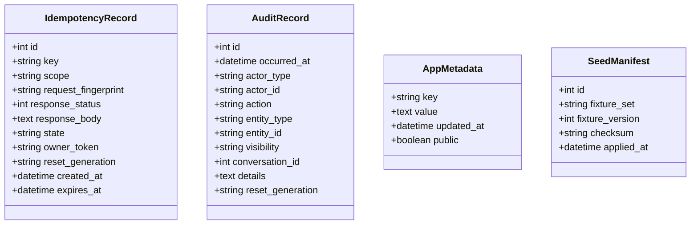

**Diagram sources**
- [operations.py:23-126](file://backend/app/models/operations.py#L23-L126)

**Section sources**
- [operations.py:23-126](file://backend/app/models/operations.py#L23-L126)

## Dependency Analysis
Key dependency patterns:

- **Patients relate to appointments and family memberships.**
- **Providers own availability slots and deliver appointments.**
- **Availability slots are reserved by slot claims, which belong to either appointments or proposals.**
- **Conversations host messages, proposals, and can escalate alerts or generate pending requests.**
- **Proposals contain items and can be confirmed into booking groups.**
- **Family groups wrap patients and coordinate family bookings across proposals and appointments.**
- **Staff users manage sessions, acknowledge alerts, and assign/approve pending requests.**
- **Patient sessions authorize conversations and may be linked to verified patients.**
- **Operational tables provide idempotency, audit trails, metadata, and seeding records.**

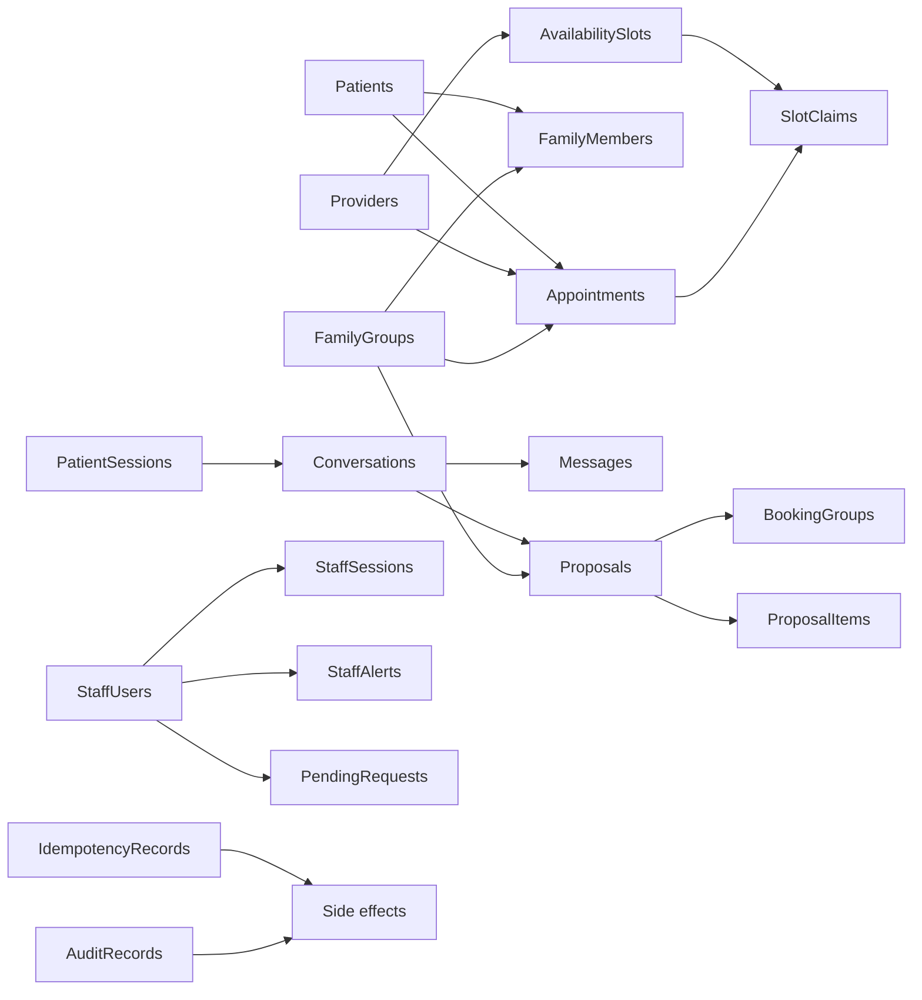

**Diagram sources**
- [patients.py:18-109](file://backend/app/models/patients.py#L18-L109)
- [scheduling.py:37-239](file://backend/app/models/scheduling.py#L37-L239)
- [conversations.py:39-158](file://backend/app/models/conversations.py#L39-L158)
- [proposals.py:35-236](file://backend/app/models/proposals.py#L35-L236)
- [family.py:21-61](file://backend/app/models/family.py#L21-L61)
- [staff.py:25-186](file://backend/app/models/staff.py#L25-L186)
- [sessions.py:35-76](file://backend/app/models/sessions.py#L35-L76)
- [operations.py:23-126](file://backend/app/models/operations.py#L23-L126)

**Section sources**
- [patients.py:18-109](file://backend/app/models/patients.py#L18-L109)
- [scheduling.py:37-239](file://backend/app/models/scheduling.py#L37-L239)
- [conversations.py:39-158](file://backend/app/models/conversations.py#L39-L158)
- [proposals.py:35-236](file://backend/app/models/proposals.py#L35-L236)
- [family.py:21-61](file://backend/app/models/family.py#L21-L61)
- [staff.py:25-186](file://backend/app/models/staff.py#L25-L186)
- [sessions.py:35-76](file://backend/app/models/sessions.py#L35-L76)
- [operations.py:23-126](file://backend/app/models/operations.py#L23-L126)

## Performance Considerations
- **Indexing strategy:**
  - Patients: indexes on phone and full name for lookup and search.
  - Availability slots: indexes on start time and composite index on provider/status/start for grid queries.
  - Appointments: composite indexes on provider/start and patient/start, plus status index for dashboards.
  - Conversations: indexes on session, caller phone, reset generation, and status/start for thread listing.
  - Messages: unique sequence per conversation, role index, and tool call index.
  - Proposals: indexes on status, conversation, reset generation, and confirmation key.
  - Staff alerts and pending requests: status/created indexes and deduplication indexes.
  - Patient sessions and staff sessions: expiry and generation indexes for cleanup and invalidation.
  - Audit records: indexes on occurrence time, action, and entity type/id for timeline queries.
  - Idempotency records: unique scope/key index and expiry index.

- **Query patterns:**
  - Provider grid queries use provider/status/start indexes.
  - Upcoming appointment lists use provider/start and patient/start indexes.
  - Conversation replay uses conversation_id and sequence ordering.
  - Alert and request dashboards filter by status and created time.
  - Audit trail queries filter by entity type/id and occurrence time.

- **Caching approaches:**
  - The model itself does not implement caching, but the design supports it:
    - Stable identifiers like `public_id`, `seed_key`, and `stable_slot_id` enable cache keys independent of surrogate IDs.
    - Reset generation values allow cache invalidation after demo resets.
    - JSON columns (`scheduling_request`, `held_slot_ids`, `confirm_outcome`, etc.) should be treated as mutable payloads and invalidated when changed.

- **SQLite-specific considerations:**
  - WAL mode and foreign key enforcement are enabled per connection.
  - Busy timeout reduces write contention.
  - Additive migrations rebuild tables only when CHECK constraints change.

**Section sources**
- [patients.py:43-46](file://backend/app/models/patients.py#L43-L46)
- [scheduling.py:59-65](file://backend/app/models/scheduling.py#L59-L65)
- [scheduling.py:162-172](file://backend/app/models/scheduling.py#L162-L172)
- [conversations.py:79-84](file://backend/app/models/conversations.py#L79-L84)
- [conversations.py:119-123](file://backend/app/models/conversations.py#L119-L123)
- [proposals.py:129-141](file://backend/app/models/proposals.py#L129-L141)
- [staff.py:53-55](file://backend/app/models/staff.py#L53-L55)
- [staff.py:81-84](file://backend/app/models/staff.py#L81-L84)
- [staff.py:128-136](file://backend/app/models/staff.py#L128-L136)
- [staff.py:175-185](file://backend/app/models/staff.py#L175-L185)
- [sessions.py:67-71](file://backend/app/models/sessions.py#L67-L71)
- [operations.py:49-53](file://backend/app/models/operations.py#L49-L53)
- [operations.py:82-86](file://backend/app/models/operations.py#L82-L86)
- [db.py:40-49](file://backend/app/db.py#L40-L49)

## Data Lifecycle and Migration Strategy

### State Enums
- **SlotStatus**: available, occupied, blocked.
- **AppointmentStatus**: booked, cancelled, completed, rescheduled.
- **ProposalStatus**: pending, accepted, rejected, expired, superseded.
- **ConversationStatus**: active, closed.
- **MessageRole**: patient, assistant, staff, system.
- **StaffRole**: receptionist, clinic_manager.
- **AlertStatus**: open, acknowledged, resolved.
- **AlertKind**: emergency, urgent_callback, insurance_verification, assistance_request.
- **RequestType**: callback, reschedule, clinical_question, billing.
- **RequestStatus**: pending, in_progress, resolved.

These enums are stored as strings and enforced by check constraints where applicable.

**Section sources**
- [base.py:50-120](file://backend/app/models/base.py#L50-L120)
- [scheduling.py:59-65](file://backend/app/models/scheduling.py#L59-L65)
- [scheduling.py:162-172](file://backend/app/models/scheduling.py#L162-L172)
- [proposals.py:129-141](file://backend/app/models/proposals.py#L129-L141)
- [staff.py:53-55](file://backend/app/models/staff.py#L53-L55)
- [staff.py:128-136](file://backend/app/models/staff.py#L128-L136)
- [staff.py:175-185](file://backend/app/models/staff.py#L175-L185)

### Retention Policies and Archival Strategies
- **Audit records** are append-only and never updated or deleted at runtime. They provide a durable trail but require archival strategies outside the model, such as periodic export or partitioning by time.
- **Conversations and messages** grow over time; retention should consider storage costs and privacy requirements.
- **Patient sessions and staff sessions** expire and can be cleaned up using expiry indexes.
- **Slot claims** retain historical cancelled claims for auditability; only active claims are unique per slot.
- **App metadata and seed manifests** are small operational tables suitable for long-term retention.

[No sources needed since this section provides general guidance]

### Migration Procedures
- Schema creation uses SQLAlchemy’s declarative base to create missing tables.
- Additive migrations handle missing columns and some CHECK constraint changes by rebuilding tables safely.
- Bootstrap ensures schema versioning and seeds empty databases.
- Migration checks validate that expected columns and indexes exist after upgrades.

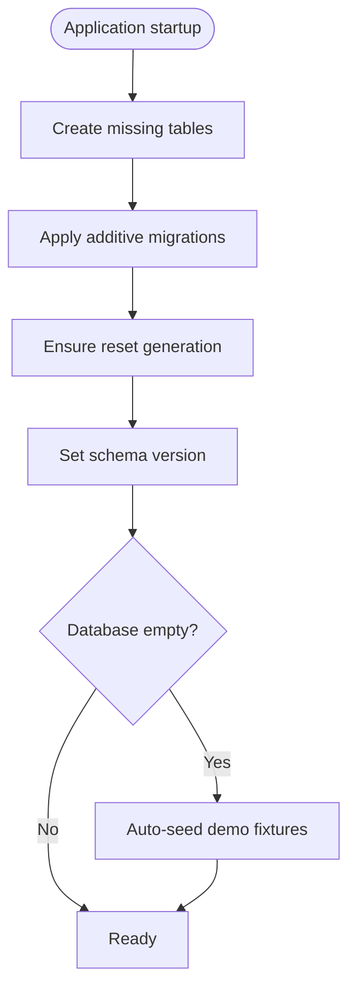

**Diagram sources**
- [bootstrap.py:33-65](file://backend/app/bootstrap.py#L33-L65)
- [migrations.py:1-23](file://backend/app/migrations.py#L1-L23)

**Section sources**
- [bootstrap.py:33-65](file://backend/app/bootstrap.py#L33-L65)
- [migrations.py:1-23](file://backend/app/migrations.py#L1-L23)

## Validation Rules

### Database-Level Constraints
- **Uniqueness constraints:**
  - `patients.seed_key`
  - `providers.seed_key`
  - `providers.email`
  - `appointment_types.code`
  - `provider_specialties(provider_id, specialty)`
  - `availability_slots(provider_id, starts_at)`
  - `slot_claims.availability_slot_id` (partial unique for active claims)
  - `slot_claims(appointment_id, availability_slot_id)` (partial unique for active claims)
  - `conversations.public_id`
  - `messages.conversation_id.sequence`
  - `conversation_feedback.message_id`
  - `booking_proposals.public_id`
  - `booking_groups.confirmation_key`
  - `family_members(family_group_id, patient_id)`
  - `staff_users.email`
  - `staff_users.username`
  - `staff_sessions.token_hash`
  - `idempotency_records(scope, key)`
  - `app_metadata.key`
  - `seed_manifests.fixture_set`

- **Check constraints:**
  - `availability_slots.status IN ('available', 'occupied', 'blocked')`
  - `availability_slots.ends_at > starts_at`
  - `appointments.status IN ('booked', 'cancelled', 'completed', 'rescheduled')`
  - `appointments.ends_at > starts_at`
  - `appointments.duration_minutes > 0`
  - `booking_proposals.status IN ('pending', 'accepted', 'rejected', 'expired', 'superseded')`
  - `booking_proposals.kind IN ('booking', 'reschedule', 'cancellation')`
  - `staff_users.role IN ('receptionist', 'clinic_manager')`
  - `staff_alerts.severity IN ('low', 'normal', 'high', 'urgent')`
  - `staff_alerts.status IN ('open', 'acknowledged', 'resolved')`
  - `pending_requests.request_type IN ('callback', 'reschedule', 'clinical_question', 'billing')`
  - `pending_requests.status IN ('pending', 'in_progress', 'resolved')`
  - `idempotency_records.state IN ('in_flight', 'complete')`

- **Foreign key relationships:**
  - Most foreign keys use `RESTRICT`, `CASCADE`, or `SET NULL` depending on whether deletion should fail, cascade deletes, or detach references.
  - Examples:
    - `availability_slots.provider_id` → `providers.id` with CASCADE.
    - `appointments.patient_id/provider_id/appointment_type_id` with RESTRICT.
    - `slot_claims.availability_slot_id` with CASCADE.
    - `conversations.patient_session_id` with CASCADE.
    - `messages.conversation_id` with CASCADE.
    - `booking_proposals.conversation_id` with CASCADE.
    - `proposal_items.proposal_id` with CASCADE.
    - `booking_groups.conversation_id/proposal_id/patient_session_id/family_group_id` with SET NULL.
    - `staff_alerts.conversation_id/patient_id/acknowledged_by` with SET NULL.
    - `pending_requests.conversation_id/patient_id/assigned_to/approved_by` with SET NULL.
    - `patient_sessions.verified_patient_id` with SET NULL.

**Section sources**
- [patients.py:43-93](file://backend/app/models/patients.py#L43-L93)
- [scheduling.py:59-65](file://backend/app/models/scheduling.py#L59-L65)
- [scheduling.py:162-172](file://backend/app/models/scheduling.py#L162-L172)
- [scheduling.py:223-238](file://backend/app/models/scheduling.py#L223-L238)
- [conversations.py:79-84](file://backend/app/models/conversations.py#L79-L84)
- [conversations.py:119-123](file://backend/app/models/conversations.py#L119-L123)
- [conversations.py:153-157](file://backend/app/models/conversations.py#L153-L157)
- [proposals.py:129-141](file://backend/app/models/proposals.py#L129-L141)
- [family.py:57-60](file://backend/app/models/family.py#L57-L60)
- [staff.py:53-55](file://backend/app/models/staff.py#L53-L55)
- [staff.py:128-136](file://backend/app/models/staff.py#L128-L136)
- [staff.py:175-185](file://backend/app/models/staff.py#L175-L185)
- [operations.py:49-53](file://backend/app/models/operations.py#L49-L53)

### Application-Level Validation
- **Message role validation:** The message model includes a helper method to validate roles against the enum set.
- **Visit shape and intent:** Fields like `visit_shape` and `intent` are validated by services before persistence to ensure consistent semantics for solo vs household bookings and proposal kinds.
- **Token hashing and security:** Patient and staff sessions store hashed tokens rather than raw secrets.
- **Deduplication keys:** Alerts and pending requests use deduplication keys to avoid duplicate filings.
- **Reset generation:** Many tables include reset generation to invalidate stale browser state after demo resets.

**Section sources**
- [conversations.py:125-127](file://backend/app/models/conversations.py#L125-L127)
- [sessions.py:3-18](file://backend/app/models/sessions.py#L3-L18)
- [staff.py:43-47](file://backend/app/models/staff.py#L43-L47)
- [staff.py:110-117](file://backend/app/models/staff.py#L110-L117)
- [staff.py:169-171](file://backend/app/models/staff.py#L169-L171)

## Troubleshooting Guide
- **Overlapping bookings:** If two patients pick the same slot, the partial unique index on active slot claims will reject the second insert. Services should catch this and present a fresh grid.
- **Constraint violations:** Check constraints on status, kind, severity, and request type will raise errors if invalid values are inserted. Verify enum mappings and service-layer validation.
- **Foreign key failures:** Deletion attempts may fail due to RESTRICT behavior on core entities like patients, providers, and appointment types. Use appropriate cascades or update dependent rows first.
- **Migration issues:** If columns or indexes are missing after upgrade, run migration checks and review additive migration logic. Rebuilding tables for CHECK constraint changes is handled by the migration layer.
- **Session invalidation:** After a demo reset, patient sessions tied to old reset generations become invalid. Clear browser state and re-authenticate.
- **Audit trail gaps:** Audit records written during rolled-back transactions may appear as uncommitted trailers; readers should filter by visibility.

**Section sources**
- [scheduling.py:175-239](file://backend/app/models/scheduling.py#L175-L239)
- [operations.py:56-86](file://backend/app/models/operations.py#L56-L86)
- [bootstrap.py:33-65](file://backend/app/bootstrap.py#L33-L65)
- [migrations.py:1-23](file://backend/app/migrations.py#L1-L23)

## Conclusion
The data model provides a robust foundation for dental scheduling, conversation-driven intake, family bookings, staff operations, and auditability. Database-level constraints enforce critical invariants such as non-overlapping slots and valid states, while application-level validation handles business rules and security. Indexing and additive migration strategies support performance and evolution. For production deployments, consider archival policies for audit logs and conversation transcripts, explicit retention for sessions, and careful handling of sensitive JSON metadata.