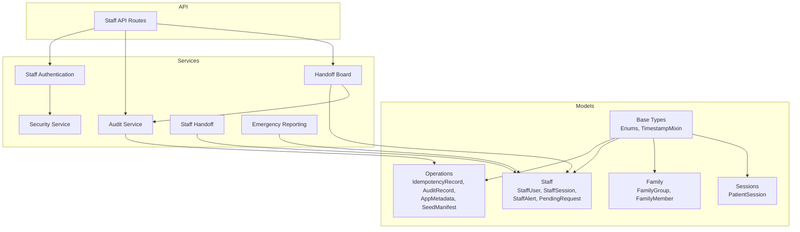
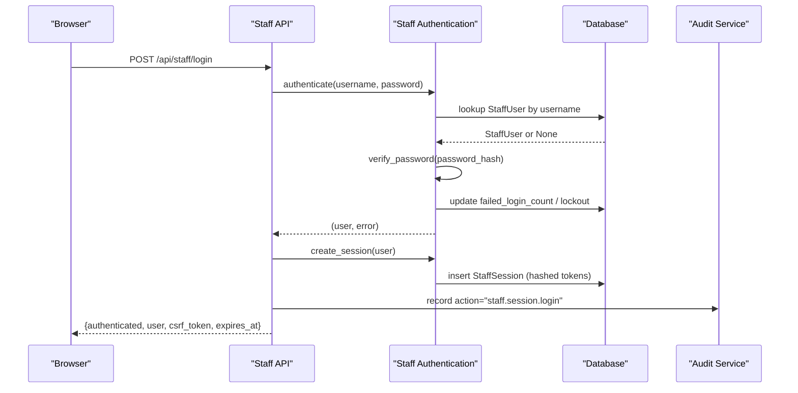
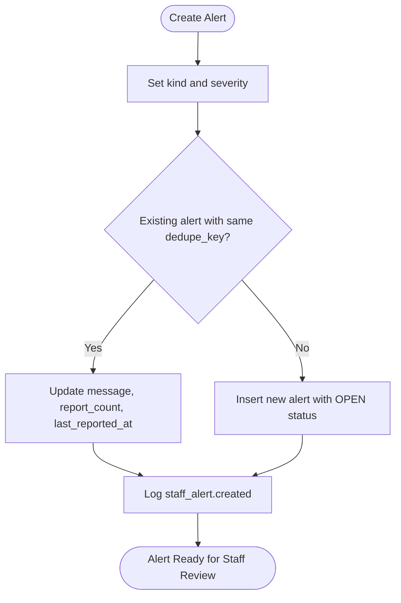
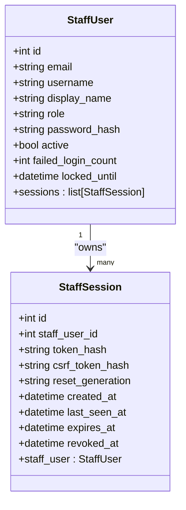
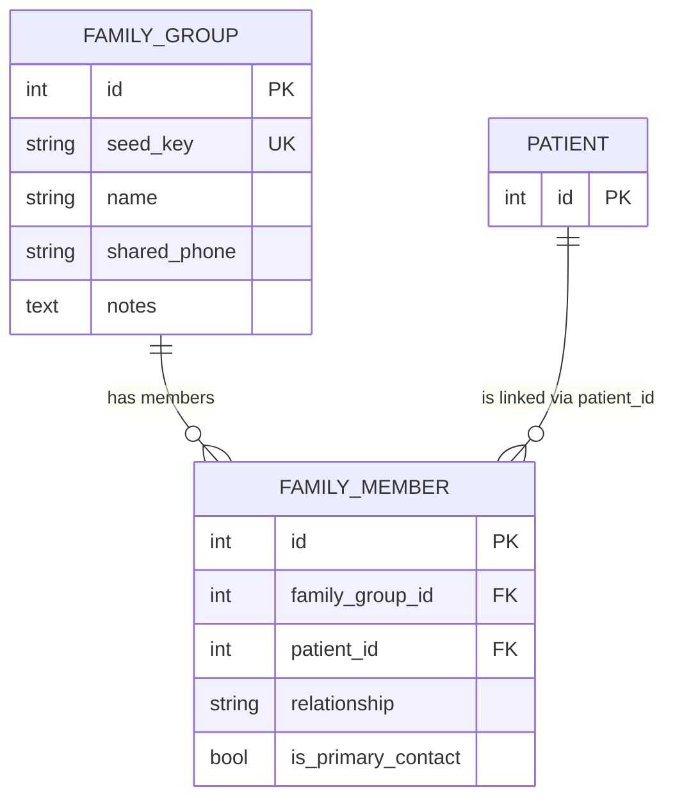
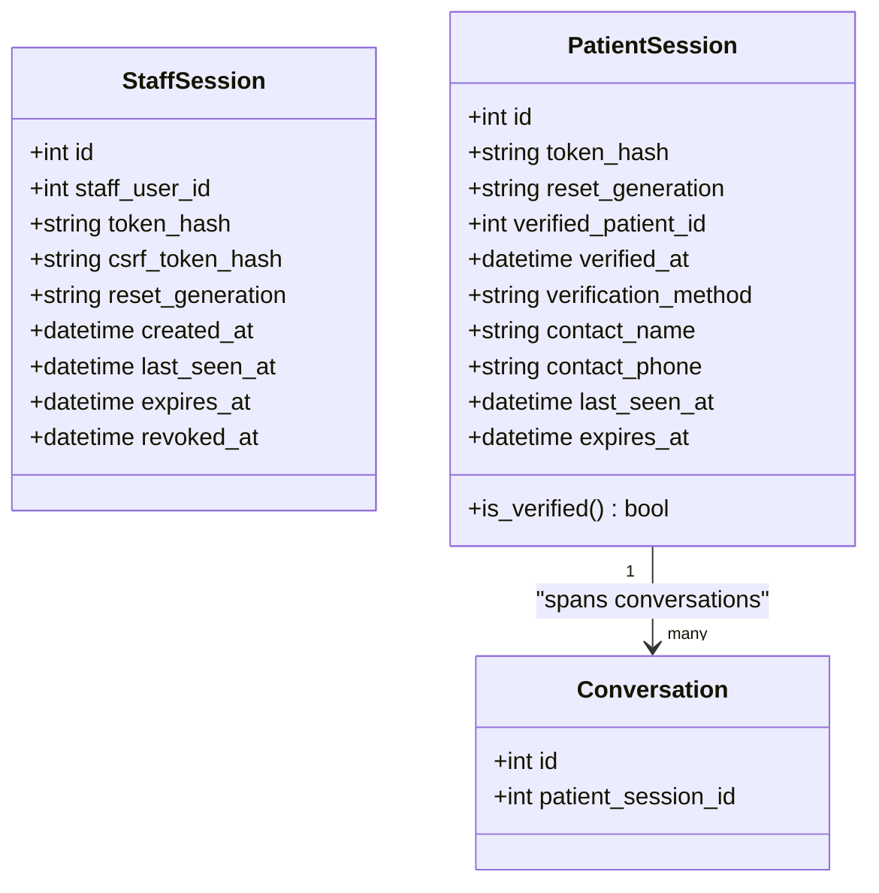
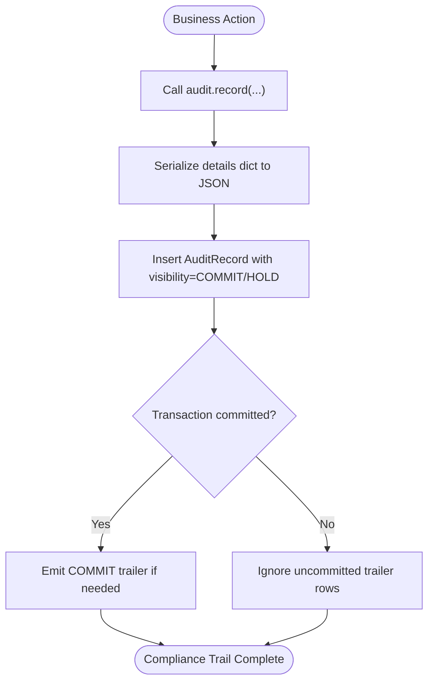
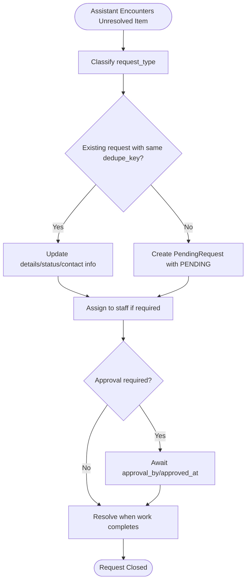
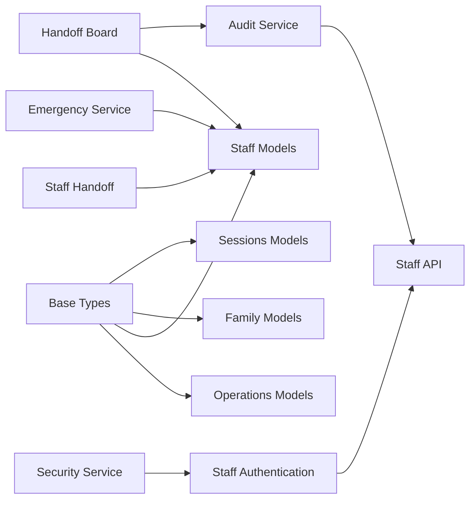

# Operations and Audit Models

<cite>
**Referenced Files in This Document**
- [operations.py](file://backend/app/models/operations.py)
- [staff.py](file://backend/app/models/staff.py)
- [family.py](file://backend/app/models/family.py)
- [sessions.py](file://backend/app/models/sessions.py)
- [base.py](file://backend/app/models/base.py)
- [audit.py](file://backend/app/services/audit.py)
- [security.py](file://backend/app/services/security.py)
- [staff_auth.py](file://backend/app/services/staff_auth.py)
- [staff_handoff.py](file://backend/app/services/staff_handoff.py)
- [emergency.py](file://backend/app/services/emergency.py)
- [staff_handoff_board.py](file://backend/app/services/staff_handoff_board.py)
- [staff.py](file://backend/app/api/staff.py)
</cite>

## Table of Contents
1. [Introduction](#introduction)
2. [Project Structure](#project-structure)
3. [Core Components](#core-components)
4. [Architecture Overview](#architecture-overview)
5. [Detailed Component Analysis](#detailed-component-analysis)
6. [Dependency Analysis](#dependency-analysis)
7. [Performance Considerations](#performance-considerations)
8. [Troubleshooting Guide](#troubleshooting-guide)
9. [Conclusion](#conclusion)

## Introduction
This document describes the operational and administrative data models that support alert handling, staff authentication, family membership, patient sessions, audit logging, and request management. It focuses on:
- Alert categories, severity levels, escalation workflows, and acknowledgment/resolution tracking.
- Staff user accounts with role-based access control, password hashing, brute-force protection, and session lifecycle management.
- Family group membership for grouping patients and identifying primary contacts.
- Patient-facing chat sessions and their verification state.
- Append-only audit records used for compliance tracking and change logging.
- Request management for callbacks, rescheduling, clinical questions, and billing.
- Security considerations including password hashing, session token storage, CSRF protection, and audit trail integrity.

## Project Structure
The relevant models live under `backend/app/models`, with supporting services under `backend/app/services` and API routes under `backend/app/api`. The key files are:
- Operational tables: idempotency, audit, application metadata, seed manifest.
- Staff-related tables: staff users, staff sessions, alerts, pending requests.
- Family tables: family groups and family member relationships.
- Patient session table: patient-facing chat sessions.
- Shared base types: enums for roles, statuses, kinds, and timestamps.
- Services: audit helpers, security primitives, staff authentication, handoff logic, emergency reporting, and board operations.

**Diagram sources**
- [operations.py:23-126](file://backend/app/models/operations.py#L23-L126)
- [staff.py:25-186](file://backend/app/models/staff.py#L25-L186)
- [family.py:21-61](file://backend/app/models/family.py#L21-L61)
- [sessions.py:35-76](file://backend/app/models/sessions.py#L35-L76)
- [base.py:39-120](file://backend/app/models/base.py#L39-L120)
- [audit.py:15-76](file://backend/app/services/audit.py#L15-L76)
- [security.py:18-47](file://backend/app/services/security.py#L18-L47)
- [staff_auth.py:93-176](file://backend/app/services/staff_auth.py#L93-L176)
- [staff_handoff.py:163-200](file://backend/app/services/staff_handoff.py#L163-L200)
- [emergency.py:434-455](file://backend/app/services/emergency.py#L434-L455)
- [staff_handoff_board.py:77-87](file://backend/app/services/staff_handoff_board.py#L77-L87)
- [staff.py:231-304](file://backend/app/api/staff.py#L231-L304)

**Section sources**
- [operations.py:1-126](file://backend/app/models/operations.py#L1-L126)
- [staff.py:1-186](file://backend/app/models/staff.py#L1-L186)
- [family.py:1-61](file://backend/app/models/family.py#L1-L61)
- [sessions.py:1-76](file://backend/app/models/sessions.py#L1-L76)
- [base.py:1-120](file://backend/app/models/base.py#L1-L120)

## Core Components
This section summarizes the core entities and their responsibilities:
- IdempotencyRecord: deduplicates side-effecting operations using scoped keys and states.
- AuditRecord: append-only compliance log with visibility controls and conversation linkage.
- AppMetadata: small key/value store for application-level state such as reset generation.
- SeedManifest: reproducible seeding summary for demo fixtures.
- StaffUser: clinic employee account with role, credentials, activity flags, and lockout state.
- StaffSession: server-side session with hashed tokens, CSRF protection, expiry, and revocation.
- StaffAlert: escalation record with category, severity, status workflow, caller contact, and deduplication.
- PendingRequest: callback, reschedule, clinical question, or billing item with assignment and approval fields.
- FamilyGroup and FamilyMember: optional grouping of patients with relationship metadata and primary contact flag.
- PatientSession: patient-facing chat credential with verification state and contact details for unverified callers.

**Section sources**
- [operations.py:23-126](file://backend/app/models/operations.py#L23-L126)
- [staff.py:25-186](file://backend/app/models/staff.py#L25-L186)
- [family.py:21-61](file://backend/app/models/family.py#L21-L61)
- [sessions.py:35-76](file://backend/app/models/sessions.py#L35-L76)

## Architecture Overview
The system separates concerns across models, services, and API routes:
- Models define persistent structures and constraints.
- Services implement business logic, security, and audit recording.
- API routes orchestrate requests, enforce authorization, and return safe responses.

**Diagram sources**
- [staff.py:231-304](file://backend/app/api/staff.py#L231-L304)
- [staff_auth.py:93-150](file://backend/app/services/staff_auth.py#L93-L150)
- [audit.py:15-51](file://backend/app/services/audit.py#L15-L51)

## Detailed Component Analysis

### Alert Model and Escalation Workflow
The alert model captures escalations raised by the assistant, including emergencies and low-confidence matches. Key aspects:
- Categories: emergency, urgent_callback, insurance_verification, assistance_request.
- Severity levels: low, normal, high, urgent.
- Status workflow: open → acknowledged → resolved, with transitions enforced by the handoff board.
- Deduplication: a stable key prevents duplicate paging for the same situation; repeated reports increment report count and refresh message/timestamps.
- Caller contact: name and phone are stored when filing before identity is confirmed, separate from verified patient linkage.

**Diagram sources**
- [staff_handoff.py:163-200](file://backend/app/services/staff_handoff.py#L163-L200)
- [emergency.py:434-455](file://backend/app/services/emergency.py#L434-L455)

**Section sources**
- [staff.py:87-137](file://backend/app/models/staff.py#L87-L137)
- [base.py:94-107](file://backend/app/models/base.py#L94-L107)
- [staff_handoff_board.py:77-87](file://backend/app/services/staff_handoff_board.py#L77-L87)
- [staff_handoff.py:163-200](file://backend/app/services/staff_handoff.py#L163-L200)
- [emergency.py:434-455](file://backend/app/services/emergency.py#L434-L455)

### StaffUser Model: Role-Based Access Control and Credentials
The staff user model represents clinic employees who can review proposals and handle requests. Important attributes:
- Role: receptionist or clinic_manager, enforced by a check constraint.
- Credentials: email, optional username, display name, and password hash.
- Activity controls: active flag, failed login counter, and time-based lockout window.
- Relationships: one-to-many to staff sessions.

**Diagram sources**
- [staff.py:25-85](file://backend/app/models/staff.py#L25-L85)

**Section sources**
- [staff.py:25-85](file://backend/app/models/staff.py#L25-L85)
- [base.py:89-92](file://backend/app/models/base.py#L89-L92)

### FamilyMember Model: Patient Relationships and Dependency Tracking
Family membership links patients to a family group and identifies relationships:
- FamilyGroup: optional wrapper with shared phone and notes.
- FamilyMember: maps a patient to a family group, stores relationship label and primary contact flag.
- Constraints: unique per group/patient pair; indexes for efficient lookups.

**Diagram sources**
- [family.py:21-61](file://backend/app/models/family.py#L21-L61)

**Section sources**
- [family.py:21-61](file://backend/app/models/family.py#L21-L61)

### Session Models: Staff Authentication and Patient Chat Sessions
Two distinct session models exist:
- StaffSession: server-side session for staff dashboard access, with hashed tokens, CSRF protection, expiry, and revocation.
- PatientSession: patient-facing chat credential with verification state and optional contact details for unverified callers.

**Diagram sources**
- [staff.py:58-85](file://backend/app/models/staff.py#L58-L85)
- [sessions.py:35-76](file://backend/app/models/sessions.py#L35-L76)

**Section sources**
- [staff.py:58-85](file://backend/app/models/staff.py#L58-L85)
- [sessions.py:35-76](file://backend/app/models/sessions.py#L35-L76)

### AuditRecord Model: Compliance Tracking and Change Logging
Audit records provide an append-only trail of important actions:
- Fields include actor type/id, action, entity type/id, conversation linkage, details JSON, reset generation, and visibility.
- Visibility supports HOLD/COMMIT pairing for transaction-safe booking audits.
- Indexes optimize queries by occurrence time, action, and entity.

**Diagram sources**
- [audit.py:15-76](file://backend/app/services/audit.py#L15-L76)
- [operations.py:56-86](file://backend/app/models/operations.py#L56-L86)

**Section sources**
- [operations.py:56-86](file://backend/app/models/operations.py#L56-L86)
- [audit.py:15-76](file://backend/app/services/audit.py#L15-L76)

### Request Management Models: Callbacks, Reschedules, Clinical Questions
Pending requests capture items the assistant could not resolve:
- Types: callback, reschedule, clinical_question, billing.
- States: pending, in_progress, resolved.
- Assignment and approval: assigned_to, approved_by, approved_at for governance-gated items.
- Deduplication: dedupe_key updates existing requests rather than creating duplicates.

**Diagram sources**
- [staff.py:139-186](file://backend/app/models/staff.py#L139-L186)
- [base.py:109-120](file://backend/app/models/base.py#L109-L120)

**Section sources**
- [staff.py:139-186](file://backend/app/models/staff.py#L139-L186)
- [base.py:109-120](file://backend/app/models/base.py#L109-L120)

## Dependency Analysis
Key dependencies between components:
- Staff authentication depends on security primitives for password hashing and token hashing.
- Audit service depends on base utilities for UTC timestamps and generation tracking.
- Handoff and emergency services depend on staff models for alert/request creation and updates.
- API routes depend on authentication and audit services to enforce authorization and log actions.

**Diagram sources**
- [security.py:18-47](file://backend/app/services/security.py#L18-L47)
- [staff_auth.py:93-176](file://backend/app/services/staff_auth.py#L93-L176)
- [audit.py:15-76](file://backend/app/services/audit.py#L15-L76)
- [staff_handoff.py:163-200](file://backend/app/services/staff_handoff.py#L163-L200)
- [emergency.py:434-455](file://backend/app/services/emergency.py#L434-L455)
- [staff_handoff_board.py:77-87](file://backend/app/services/staff_handoff_board.py#L77-L87)
- [staff.py:231-304](file://backend/app/api/staff.py#L231-L304)

**Section sources**
- [security.py:18-47](file://backend/app/services/security.py#L18-L47)
- [staff_auth.py:93-176](file://backend/app/services/staff_auth.py#L93-L176)
- [audit.py:15-76](file://backend/app/services/audit.py#L15-L76)
- [staff_handoff.py:163-200](file://backend/app/services/staff_handoff.py#L163-L200)
- [emergency.py:434-455](file://backend/app/services/emergency.py#L434-L455)
- [staff_handoff_board.py:77-87](file://backend/app/services/staff_handoff_board.py#L77-L87)
- [staff.py:231-304](file://backend/app/api/staff.py#L231-L304)

## Performance Considerations
- Timezone-aware UTC timestamps ensure consistent ordering and avoid naive datetime comparison issues.
- Indexes on frequently queried columns (e.g., expires_at, status, occurred_at, entity_type/entity_id) improve performance for session cleanup, alert listing, and audit queries.
- Session touch operations are rate-limited to once per minute to reduce write amplification.
- Audit details are serialized deterministically (sorted keys) to keep logs predictable and comparable.

[No sources needed since this section provides general guidance]

## Troubleshooting Guide
Common issues and mitigations:
- Authentication failures: generic messages prevent enumeration; failed login counters and lockouts protect against brute force.
- Expired or revoked sessions: resolve returns None for unknown, expired, revoked, or pre-reset tokens; purge_expired cleans dead rows safely.
- CSRF mismatches: constant-time comparison ensures secure validation; missing or mismatched headers block state-changing requests.
- Audit trail gaps: HOLD/COMMIT pairing ensures only committed transactions appear as valid bookings; trailer_committed checks confirm successful commits.

**Section sources**
- [staff_auth.py:93-176](file://backend/app/services/staff_auth.py#L93-L176)
- [staff_auth.py:178-227](file://backend/app/services/staff_auth.py#L178-L227)
- [audit.py:54-76](file://backend/app/services/audit.py#L54-L76)

## Conclusion
The operational and administrative data models provide a robust foundation for alert handling, staff authentication, family membership, patient sessions, audit logging, and request management. Security measures such as password hashing, session token hashing, CSRF protection, and append-only audit trails ensure compliance and resilience. The design emphasizes clear state transitions, deduplication, and indexed queries to maintain performance and reliability in production-like scenarios.

[No sources needed since this section summarizes without analyzing specific files]