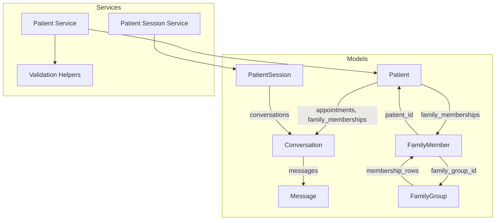
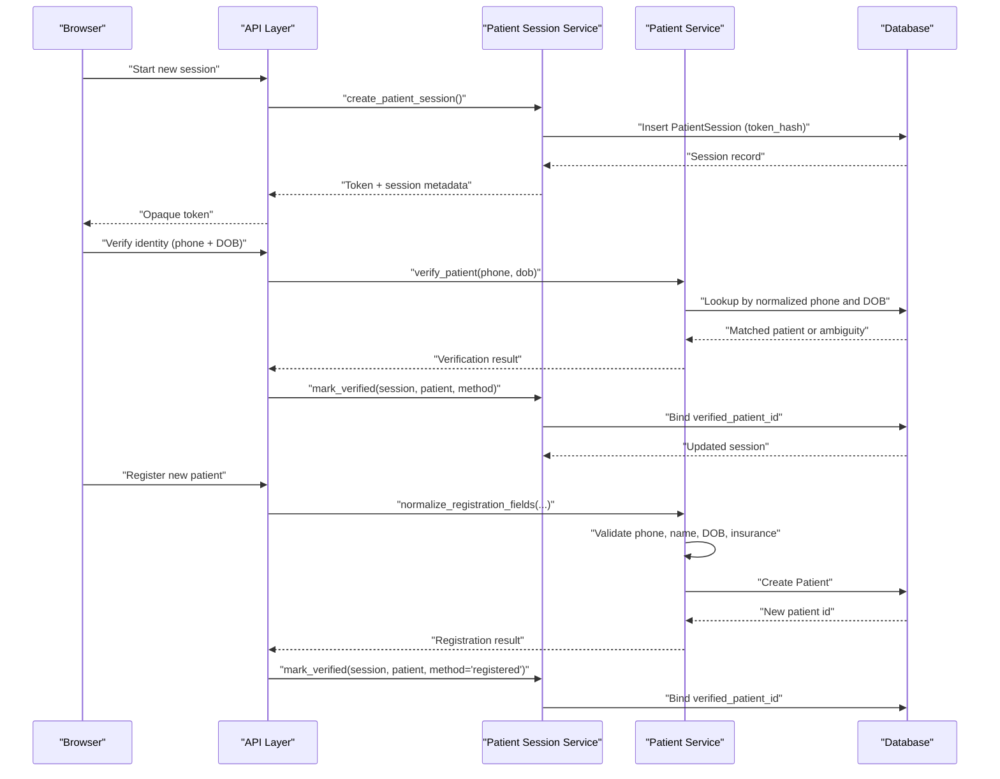
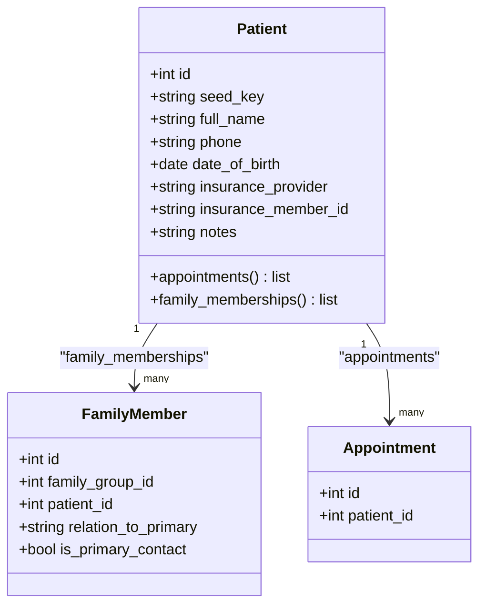
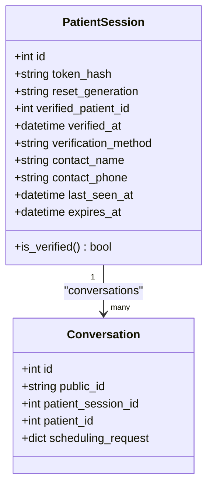
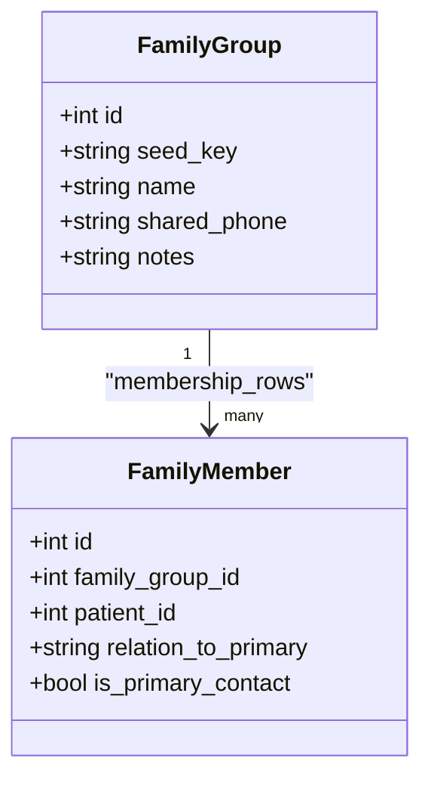
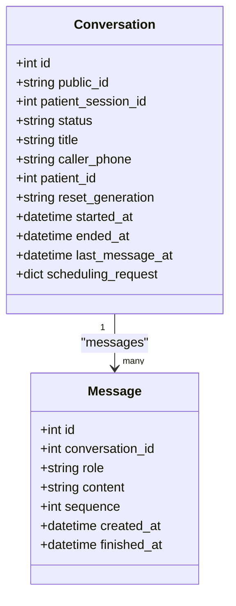
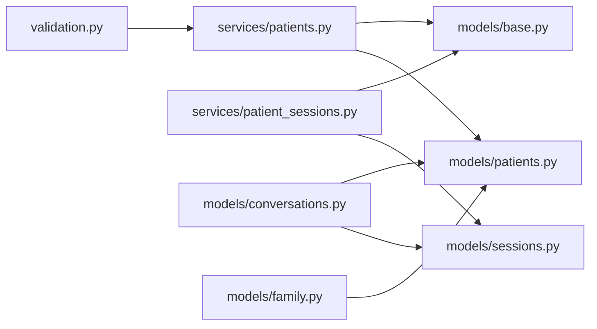

# Patient Management Models

<cite>
**Referenced Files in This Document**
- [patients.py](file://backend/app/models/patients.py)
- [sessions.py](file://backend/app/models/sessions.py)
- [family.py](file://backend/app/models/family.py)
- [conversations.py](file://backend/app/models/conversations.py)
- [base.py](file://backend/app/models/base.py)
- [patient_sessions.py](file://backend/app/services/patient_sessions.py)
- [patients.py](file://backend/app/services/patients.py)
- [validation.py](file://backend/app/validation.py)
- [tools.py](file://backend/app/agent/tools.py)
- [test_family_scheduling_request.py](file://backend/tests/test_family_scheduling_request.py)
- [test_reschedule_workflow.py](file://backend/tests/test_reschedule_workflow.py)
</cite>

## Table of Contents
1. [Introduction](#introduction)
2. [Project Structure](#project-structure)
3. [Core Components](#core-components)
4. [Architecture Overview](#architecture-overview)
5. [Detailed Component Analysis](#detailed-component-analysis)
6. [Dependency Analysis](#dependency-analysis)
7. [Performance Considerations](#performance-considerations)
8. [Troubleshooting Guide](#troubleshooting-guide)
9. [Conclusion](#conclusion)

## Introduction
This document describes the patient-related data models and their supporting services in the dental reception system. It focuses on:
- The `Patient` model for personal information, contact details, insurance fields, and relationships to appointments and family memberships.
- The `PatientSession` model for browser-scoped authentication state, verification linkage, emergency contact capture, privacy boundaries, and conversation ownership.
- Relationships between patients, conversations, appointments, and family members.
- Validation rules for phone numbers, dates of birth, names, and insurance input.
- Registration, identity verification, and family booking coordination workflows.
- Data privacy controls, consent implications, and HIPAA-aligned considerations derived from the implementation.

## Project Structure
The patient domain is implemented primarily under `backend/app/models`, with business logic in `backend/app/services` and shared validation in `backend/app/validation.py`. Key files:
- `models/patients.py`: Patient, Provider, AppointmentType, and related tables.
- `models/sessions.py`: Patient-facing session model and its security semantics.
- `models/family.py`: Family groups and member membership rows.
- `models/conversations.py`: Conversation threads, messages, and feedback.
- `services/patients.py`: Registration, verification, profile normalization, and update logic.
- `services/patient_sessions.py`: Token issuance, resolution, verification binding, and session scoping.
- `validation.py`: Phone, name, date-of-birth, and insurance normalization/validation.

**Diagram sources**
- [patients.py:18-46](file://backend/app/models/patients.py#L18-L46)
- [sessions.py:35-75](file://backend/app/models/sessions.py#L35-L75)
- [family.py:21-60](file://backend/app/models/family.py#L21-L60)
- [conversations.py:39-84](file://backend/app/models/conversations.py#L39-L84)
- [patient_sessions.py:38-122](file://backend/app/services/patient_sessions.py#L38-L122)
- [patients.py:81-364](file://backend/app/services/patients.py#L81-L364)
- [validation.py:37-364](file://backend/app/validation.py#L37-L364)

**Section sources**
- [patients.py:18-46](file://backend/app/models/patients.py#L18-L46)
- [sessions.py:35-75](file://backend/app/models/sessions.py#L35-L75)
- [family.py:21-60](file://backend/app/models/family.py#L21-L60)
- [conversations.py:39-84](file://backend/app/models/conversations.py#L39-L84)

## Core Components
This section summarizes the primary entities and their responsibilities.

### Patient
- Purpose: Represents a person’s chart.
- Personal and contact fields:
  - Full name, phone number, date of birth.
  - Insurance provider and optional member ID.
  - Optional notes for clinical or administrative context.
- Relationships:
  - One-to-many appointments.
  - One-to-many family memberships (as a child row).
- Indexing:
  - Indexed by phone and full name for lookup performance.
- Design note:
  - Phone is intentionally not unique because multiple family members may share one household number; matching uses name and DOB conversationally.

**Section sources**
- [patients.py:18-46](file://backend/app/models/patients.py#L18-L46)

### PatientSession
- Purpose: Browser-scoped credential used to talk to the receptionist.
- Security properties:
  - Stores only the SHA-256 digest of a random URL-safe token.
  - Tied to a reset generation so demo resets invalidate old sessions.
  - Has an expiration timestamp and last-seen timestamp.
- Verification state:
  - After successful registration or verification, binds to a verified patient.
  - Records verification method and timestamp.
- Emergency contact capture:
  - Separate fields for unverified caller name and phone, explicitly separated from verified identity to prevent unauthorized access.
- Conversations:
  - A session can own multiple conversations over time.

**Section sources**
- [sessions.py:1-75](file://backend/app/models/sessions.py#L1-L75)
- [patient_sessions.py:1-122](file://backend/app/services/patient_sessions.py#L1-L122)

### FamilyGroup and FamilyMember
- FamilyGroup:
  - Optional grouping wrapper for household scheduling.
  - Holds group name, optional shared phone, and notes.
- FamilyMember:
  - Links a patient to a family group.
  - Captures relationship label relative to the primary contact.
  - Marks whether this member is the primary contact.
  - Enforces uniqueness per family group and patient.

**Section sources**
- [family.py:21-60](file://backend/app/models/family.py#L21-L60)

### Conversation and Message
- Conversation:
  - Represents one chat thread within a patient session.
  - Tracks status, title, caller phone, linked patient, reset generation, timestamps, and structured scheduling request.
  - Owns messages and booking proposals.
- Message:
  - Stores each turn, including role, content, sequence, timing, and internal tool metadata.
  - Supports interactive UI cards persisted per assistant turn.

**Section sources**
- [conversations.py:39-127](file://backend/app/models/conversations.py#L39-L127)

## Architecture Overview
The patient management architecture separates identity, session security, conversation history, and family scheduling into distinct layers.

**Diagram sources**
- [patient_sessions.py:38-122](file://backend/app/services/patient_sessions.py#L38-L122)
- [patients.py:81-364](file://backend/app/services/patients.py#L81-L364)
- [validation.py:37-364](file://backend/app/validation.py#L37-L364)

## Detailed Component Analysis

### Patient Model
- Fields:
  - Primary key, optional seed key.
  - Full name (required), phone (required), date of birth (required).
  - Insurance provider and member ID (optional).
  - Notes (optional free text).
- Relationships:
  - Appointments: one-to-many via back-populated relationship.
  - Family memberships: one-to-many through `FamilyMember.patient_id`.
- Indexes:
  - Phone index supports loose matching across formatting differences.
  - Full name index supports quick lookups.

**Diagram sources**
- [patients.py:18-46](file://backend/app/models/patients.py#L18-L46)
- [family.py:37-60](file://backend/app/models/family.py#L37-L60)

**Section sources**
- [patients.py:18-46](file://backend/app/models/patients.py#L18-L46)

### PatientSession Model
- Authentication state:
  - `token_hash`: stores only the hash of the raw token.
  - `reset_generation`: ties session validity to a reset generation.
  - `expires_at`: hard expiry for inactive sessions.
  - `last_seen_at`: activity tracking.
- Verification linkage:
  - `verified_patient_id`: foreign key to `Patient`, set only by registration/verification services.
  - `verified_at` and `verification_method`: audit trail for how verification occurred.
- Privacy boundary:
  - `contact_name` and `contact_phone` are for unverified callers filing emergency reports; they do not authorize chart access or bookings.
- Conversations:
  - One session owns many conversations; routes resolve access through the session, not conversation IDs alone.

**Diagram sources**
- [sessions.py:35-75](file://backend/app/models/sessions.py#L35-L75)
- [conversations.py:39-84](file://backend/app/models/conversations.py#L39-L84)

**Section sources**
- [sessions.py:1-75](file://backend/app/models/sessions.py#L1-L75)
- [patient_sessions.py:1-122](file://backend/app/services/patient_sessions.py#L1-L122)

### Family Group and Member Model
- FamilyGroup:
  - Optional container for household scheduling.
  - Shared phone field enables matching callers who share a number.
- FamilyMember:
  - Links a patient to a family group.
  - Relationship label indicates relation to the primary contact.
  - Primary contact flag identifies the main coordinator.
  - Unique constraint prevents duplicate membership per group and patient.

**Diagram sources**
- [family.py:21-60](file://backend/app/models/family.py#L21-L60)

**Section sources**
- [family.py:21-60](file://backend/app/models/family.py#L21-L60)

### Conversation and Message Model
- Conversation:
  - Scoped to a patient session.
  - Tracks caller phone and linked patient when available.
  - Maintains structured scheduling request separate from conversational history.
- Message:
  - Stores every turn with role, content, sequence, and timing.
  - Internal tool metadata is stored but never serialized to clients.
  - Cards persist interactive UI elements produced during assistant turns.

**Diagram sources**
- [conversations.py:39-127](file://backend/app/models/conversations.py#L39-L127)

**Section sources**
- [conversations.py:39-127](file://backend/app/models/conversations.py#L39-L127)

## Dependency Analysis
The following diagram shows how services depend on models and validation helpers.

**Diagram sources**
- [validation.py:37-364](file://backend/app/validation.py#L37-L364)
- [patients.py:81-364](file://backend/app/services/patients.py#L81-L364)
- [patient_sessions.py:38-122](file://backend/app/services/patient_sessions.py#L38-L122)
- [patients.py:18-46](file://backend/app/models/patients.py#L18-L46)
- [sessions.py:35-75](file://backend/app/models/sessions.py#L35-L75)
- [conversations.py:39-84](file://backend/app/models/conversations.py#L39-L84)
- [family.py:21-60](file://backend/app/models/family.py#L21-L60)
- [base.py:13-47](file://backend/app/models/base.py#L13-L47)

**Section sources**
- [validation.py:37-364](file://backend/app/validation.py#L37-L364)
- [patients.py:81-364](file://backend/app/services/patients.py#L81-L364)
- [patient_sessions.py:38-122](file://backend/app/services/patient_sessions.py#L38-L122)

## Performance Considerations
- Lookup efficiency:
  - Patient phone and full name indexes support fast matching even with non-unique phone values.
  - Family member patient index supports efficient queries by patient.
- Session resolution:
  - Token hashing avoids storing secrets and allows indexed lookups by hash.
  - Expiration and reset generation checks prevent stale access without scanning large datasets.
- Conversation replay:
  - Messages are persisted with sequence ordering to support faithful replays without summarization.
- Family scheduling:
  - Family group and membership structures enable batch availability checks and coordinated holds for multiple patients.

[No sources needed since this section provides general guidance]

## Troubleshooting Guide

### Phone Number Validation Failures
- Symptoms:
  - Errors indicating missing, incomplete, non-US, or invalid area/prefix patterns.
- Causes:
  - Extensions included, short codes, non-NANP country codes, or malformed digits.
- Resolution:
  - Ask for a plain 10-digit US number without extensions.
  - Normalize input using the shared phone normalization helper.

**Section sources**
- [validation.py:37-87](file://backend/app/validation.py#L37-L87)

### Date of Birth Validation Failures
- Symptoms:
  - Ambiguous month/day formats, future dates, today’s date, impossible calendar dates, or overly old ages.
- Causes:
  - Unrecognized format, ambiguous numeric order, or unrealistic age range.
- Resolution:
  - Request MM/DD/YYYY or explicit month names.
  - Confirm ambiguous cases before proceeding with identity matching.

**Section sources**
- [validation.py:154-246](file://backend/app/validation.py#L154-L246)

### Identity Verification Ambiguity
- Symptoms:
  - “More than one chart matches” or “no match.”
- Causes:
  - Multiple charts sharing phone and DOB, or mismatched inputs.
- Resolution:
  - Route to front desk for manual disambiguation.
  - Offer registration if no match exists.

**Section sources**
- [patients.py:183-230](file://backend/app/services/patients.py#L183-L230)

### Registration Duplicate Handling
- Symptoms:
  - Possible duplicate detected when same name and phone exist.
- Causes:
  - Existing chart likely belongs to the caller.
- Resolution:
  - Offer verification instead of creating a new chart.

**Section sources**
- [patients.py:258-305](file://backend/app/services/patients.py#L258-L305)

### Family Booking Coordination Issues
- Symptoms:
  - Child slot mislabeled as taken, or family option not holding all members.
- Causes:
  - Incorrect interpretation of solo vs household visit shapes.
- Resolution:
  - Ensure family search returns options with slots for all members.
  - Confirm that hold and confirmation apply to all linked family members.

**Section sources**
- [test_family_scheduling_request.py:208-256](file://backend/tests/test_family_scheduling_request.py#L208-L256)

### Parent Registering a Minor for Family Booking
- Behavior:
  - Verified parent can register a minor and link them into the family group.
  - Adults cannot be added via the child registration path.
- Validation:
  - Age check rejects adult entries for child registration.

**Section sources**
- [test_reschedule_workflow.py:834-946](file://backend/tests/test_reschedule_workflow.py#L834-L946)

## Conclusion
The patient management models implement a secure, privacy-aware foundation for a dental reception workflow:
- `Patient` captures essential demographic and insurance data while supporting family and appointment relationships.
- `PatientSession` enforces strict authentication boundaries, separating unverified contact capture from verified identity.
- `FamilyGroup` and `FamilyMember` provide flexible household scheduling with clear authorization constraints.
- Validation helpers ensure robust handling of phone numbers, names, dates of birth, and insurance input.
- Workflows for registration, verification, and family booking coordination are enforced by services and validated by tests.

For HIPAA-aligned operations, the system:
- Avoids exposing sensitive identifiers in client payloads.
- Limits access to patient details until verification is established.
- Uses hashed tokens and reset generations to minimize exposure and control session lifetimes.
- Keeps internal tool metadata out of API responses.
- Audits critical actions such as registration and updates.

These design choices collectively reduce the risk of unauthorized access and support compliant handling of protected health information.