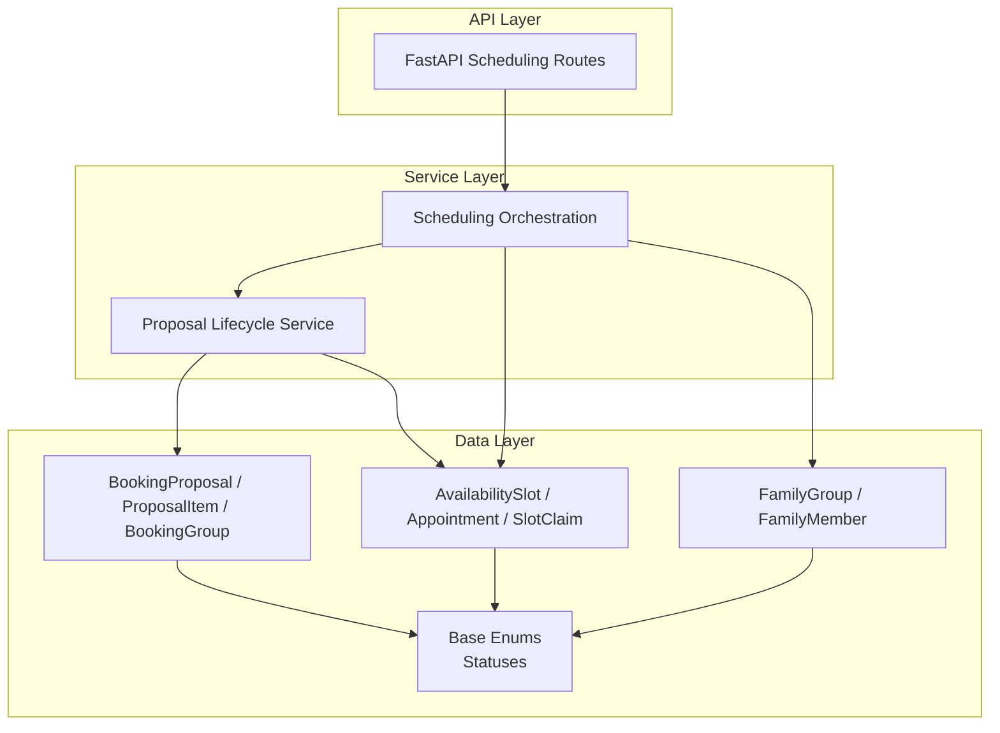
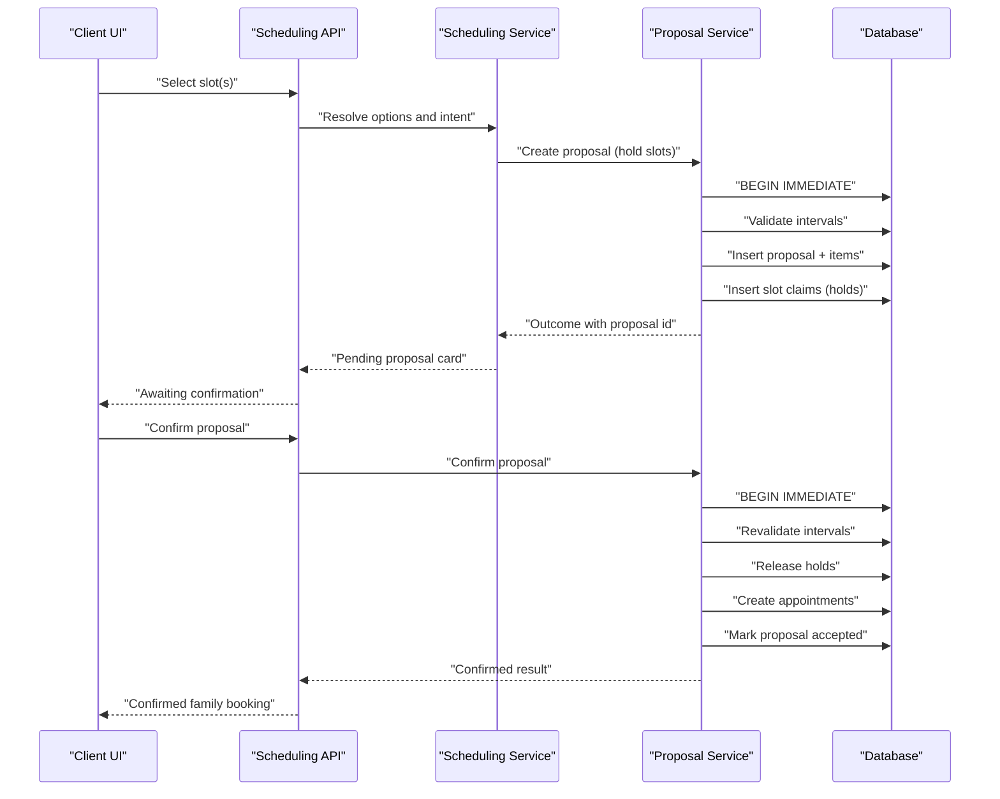
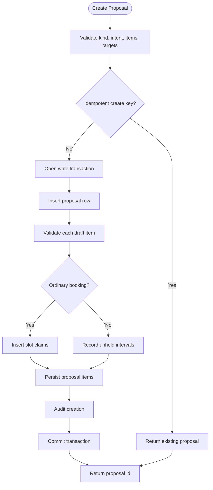
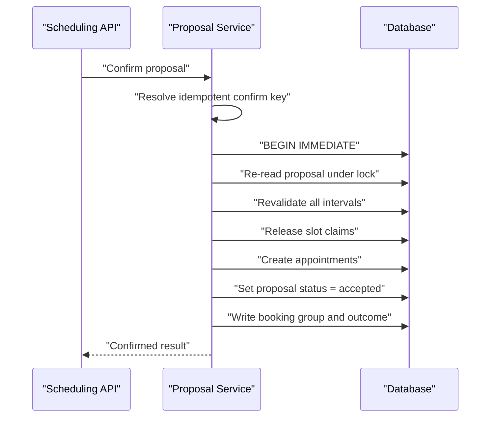
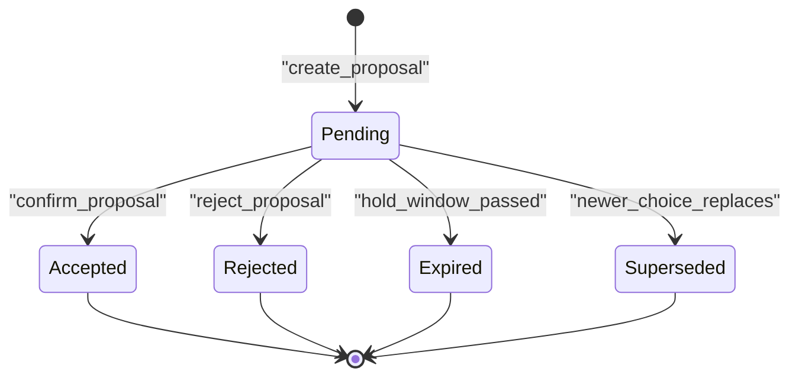
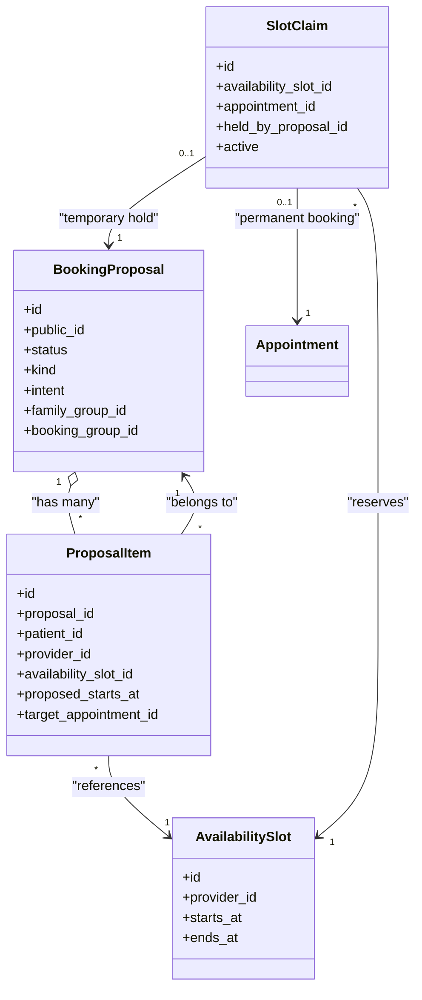
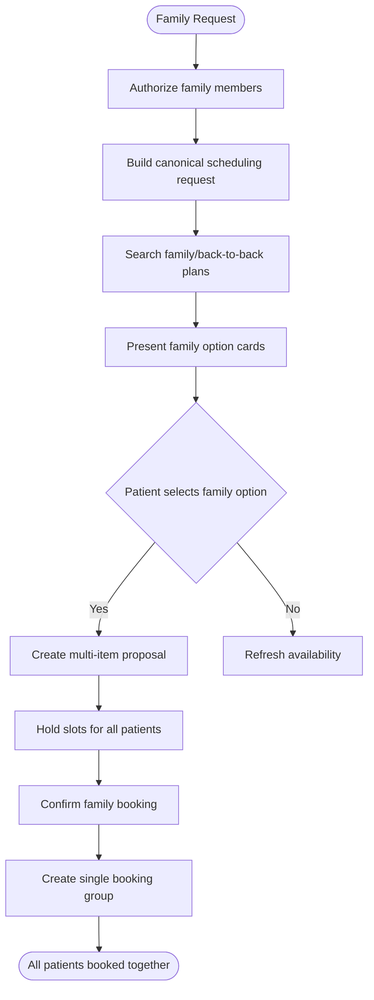
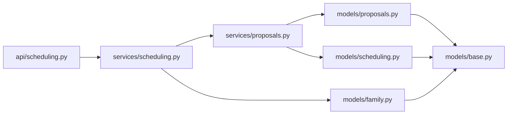

# Proposal and Coordination Models

<cite>
**Referenced Files in This Document**   
- [proposals.py](file://backend/app/models/proposals.py)
- [scheduling.py](file://backend/app/models/scheduling.py)
- [base.py](file://backend/app/models/base.py)
- [family.py](file://backend/app/models/family.py)
- [proposals_service.py](file://backend/app/services/proposals.py)
- [scheduling_service.py](file://backend/app/services/scheduling.py)
- [api_scheduling.py](file://backend/app/api/scheduling.py)
</cite>

## Table of Contents
1. [Introduction](#introduction)
2. [Project Structure](#project-structure)
3. [Core Components](#core-components)
4. [Architecture Overview](#architecture-overview)
5. [Detailed Component Analysis](#detailed-component-analysis)
6. [Dependency Analysis](#dependency-analysis)
7. [Performance Considerations](#performance-considerations)
8. [Troubleshooting Guide](#troubleshooting-guide)
9. [Conclusion](#conclusion)

## Introduction
This document explains the data model and workflow behind proposal-based scheduling, with a focus on multi-patient family bookings, temporary slot holds, conflict detection, and atomic confirmation. A proposal represents an intention to book, move, or cancel one or more appointments before final confirmation. It is the boundary between read-only availability exploration and durable appointment creation.

Key responsibilities:
- Represent a patient-facing suggestion for one or more visits.
- Coordinate multiple patients, providers, and time intervals.
- Temporarily hold slots while the patient decides.
- Validate options under a write lock.
- Confirm all items atomically or fail cleanly without partial state.
- Track lifecycle states from pending through acceptance, rejection, expiration, and supersession.

## Project Structure
The relevant implementation lives in three layers:

- Data models define tables, constraints, relationships, and status enums.
- Services implement creation, holding, validation, rejection, supersession, and atomic confirmation.
- API routes expose deterministic actions for slot selection, availability refresh, proposal confirmation, decline, and expiration.

**Diagram sources**
- [api_scheduling.py:1-150](file://backend/app/api/scheduling.py#L1-L150)
- [scheduling_service.py:1-65](file://backend/app/services/scheduling.py#L1-L65)
- [proposals_service.py:1-46](file://backend/app/services/proposals.py#L1-L46)
- [proposals.py:35-141](file://backend/app/models/proposals.py#L35-L141)
- [scheduling.py:37-79](file://backend/app/models/scheduling.py#L37-L79)
- [family.py:21-61](file://backend/app/models/family.py#L21-L61)
- [base.py:50-75](file://backend/app/models/base.py#L50-L75)

**Section sources**
- [api_scheduling.py:1-150](file://backend/app/api/scheduling.py#L1-L150)
- [scheduling_service.py:1-65](file://backend/app/services/scheduling.py#L1-L65)
- [proposals_service.py:1-46](file://backend/app/services/proposals.py#L1-L46)
- [proposals.py:35-141](file://backend/app/models/proposals.py#L35-L141)
- [scheduling.py:37-79](file://backend/app/models/scheduling.py#L37-L79)
- [family.py:21-61](file://backend/app/models/family.py#L21-L61)
- [base.py:50-75](file://backend/app/models/base.py#L50-L75)

## Core Components
This section documents the primary entities that implement proposal and coordination semantics.

### Proposal Model
A `BookingProposal` captures what the assistant proposed and what confirming it would do. It supports:
- Multi-item proposals through `ProposalItem`.
- Kinds: new booking, reschedule, cancellation.
- Intent recorded at creation so code can distinguish a reschedule from a normal booking.
- Temporary holds via `slot_claims` during the short decision window.
- Family linkage through `family_group_id`.
- Idempotent creation and confirmation keys.
- Snapshot fields per item so UI rendering remains stable even if live slots change.

Important columns include public identifiers, conversation binding, status, kind, intent, visit shape, request linkage, summary, generation tag, expiry, author, UI origin, held slot identifiers, released appointment identifiers, idempotency keys, resolution timestamps, confirmed outcome, conflict reason, target appointment, cancellation reason, family group, and resulting booking group.

**Section sources**
- [proposals.py:35-141](file://backend/app/models/proposals.py#L35-L141)

### Proposal Item
Each `ProposalItem` represents one row in a multi-patient proposal:
- Patient, provider, appointment type, and availability slot references.
- Proposed start time and duration.
- Order index and optional note.
- Stable snapshot fields such as stable slot identifier, provider name/credentials, appointment type code/name, and patient first name.
- Reschedule/cancellation target appointment and original start time snapshots.
- Per-item issue capture when validation fails.

This design lets the UI show exactly what was presented while allowing live revalidation at confirmation.

**Section sources**
- [proposals.py:144-199](file://backend/app/models/proposals.py#L144-L199)

### Booking Group
A `BookingGroup` records everything confirmed together. It provides:
- Public identifiers and conversation linkage.
- Link back to the originating proposal.
- Patient session linkage.
- Unique confirmation key for idempotent replay.
- Kind, family group linkage, summary, details, and generation tag.

It ensures a family booking cannot be created twice by the same confirmation attempt.

**Section sources**
- [proposals.py:202-236](file://backend/app/models/proposals.py#L202-L236)

### Availability Slots, Appointments, and Slot Claims
`AvailabilitySlot` represents a provider’s 30-minute interval. `Appointment` represents a booked visit and carries reschedule history links. `SlotClaim` joins slots to either an appointment or a proposal:
- Booked claim: `appointment_id` set, `held_by_proposal_id` null.
- Proposal hold: both foreign keys null, `held_by_proposal_id` set.
- Released claim: active false with release timestamp.

Partial unique indexes enforce one active claim per slot regardless of whether it belongs to an appointment or a proposal. This is the database-level guarantee against overlapping bookings.

**Section sources**
- [scheduling.py:37-79](file://backend/app/models/scheduling.py#L37-L79)
- [scheduling.py:81-172](file://backend/app/models/scheduling.py#L81-L172)
- [scheduling.py:175-239](file://backend/app/models/scheduling.py#L175-L239)

### Family Groups and Members
`FamilyGroup` groups linked patients, typically by shared phone number. `FamilyMember` maps patients into a family with relationship metadata and primary contact flags. Proposals and confirmed bookings can reference a family group so staff can reason about coordinated runs and re-verify authorization at confirmation.

**Section sources**
- [family.py:21-61](file://backend/app/models/family.py#L21-L61)

### Status Enumerations
Proposal statuses are explicitly constrained:
- Pending: awaiting confirmation.
- Accepted: appointments exist and claims were transferred.
- Rejected: patient declined; holds released.
- Expired: timed out or reset.
- Superseded: replaced by a newer choice.

These values are enforced by check constraints and used throughout services to control transitions.

**Section sources**
- [base.py:66-75](file://backend/app/models/base.py#L66-L75)
- [proposals.py:129-141](file://backend/app/models/proposals.py#L129-L141)

## Architecture Overview
The system separates read-heavy availability discovery from write-heavy confirmation.

**Diagram sources**
- [api_scheduling.py:256-362](file://backend/app/api/scheduling.py#L256-L362)
- [api_scheduling.py:456-487](file://backend/app/api/scheduling.py#L456-L487)
- [proposals_service.py:282-529](file://backend/app/services/proposals.py#L282-L529)
- [proposals_service.py:762-800](file://backend/app/services/proposals.py#L762-L800)

## Detailed Component Analysis

### Proposal Creation and Temporary Holds
Creation validates inputs, computes a fingerprint, optionally replays an idempotent create key, opens a write transaction, inserts the proposal, validates each draft item, creates slot claims for ordinary bookings, and records historical information such as original start times for reschedules.

Key behaviors:
- Empty proposals and unsupported kinds are rejected early.
- Reschedule and cancellation require a single target appointment.
- New bookings reject duplicate patients within one proposal.
- Ordinary bookings insert slot claims; reschedule/cancellation may record existing intervals without creating new claims.
- A short hold window bounds how long a clicked time blocks others.
- Conflicts raise structured errors rather than silently producing stale proposals.

**Diagram sources**
- [proposals_service.py:282-529](file://backend/app/services/proposals.py#L282-L529)

**Section sources**
- [proposals_service.py:85-93](file://backend/app/services/proposals.py#L85-L93)
- [proposals_service.py:282-529](file://backend/app/services/proposals.py#L282-L529)

### Proposal Validation Rules
Validation occurs both before opening a write transaction and inside it:

- Kind/intent consistency prevents treating a reschedule as a booking or vice versa.
- Single-target constraint for reschedule and cancellation.
- No duplicate patients in a new booking proposal.
- Maximum six items per proposal.
- Interval bookability checked through the availability engine.
- Internal duplicate slot reservation detection within one proposal.
- For reschedule/cancellation targeting the current time, existing appointment claims are treated as already reserved, avoiding self-conflict.

Conflict detection uses:
- The availability engine to determine whether a provider interval is free.
- Partial unique indexes on active slot claims to prevent two active reservations.
- Structured error types carrying stable slot identifiers for UI feedback.

**Section sources**
- [proposals_service.py:308-366](file://backend/app/services/proposals.py#L308-L366)
- [proposals_service.py:548-630](file://backend/app/services/proposals.py#L548-L630)
- [scheduling.py:175-239](file://backend/app/models/scheduling.py#L175-L239)

### Atomic Confirmation Workflow
Confirmation revalidates the proposal under a write lock, releases holds, writes one appointment per item, records the committed outcome, and marks the proposal accepted. It is idempotent through a confirmation key and a unique booking group.

Important guarantees:
- Re-read the proposal inside the transaction to detect concurrent resolution.
- Revalidate every interval again before committing.
- Release holds only after replacement validation passes.
- Create appointments atomically with the proposal state update.
- Record `confirm_outcome` so repeated confirmations return the original result.
- Set `conflict_reason` when a slot is taken during confirmation.

**Diagram sources**
- [proposals_service.py:762-800](file://backend/app/services/proposals.py#L762-L800)
- [proposals_service.py:1040-1055](file://backend/app/services/proposals.py#L1040-L1055)

**Section sources**
- [proposals_service.py:762-800](file://backend/app/services/proposals.py#L762-L800)
- [proposals_service.py:1040-1055](file://backend/app/services/proposals.py#L1040-L1055)

### Proposal Lifecycle States
The lifecycle is explicit and constrained:

- Pending: shown as awaiting confirmation; holds may still be active.
- Accepted: appointments exist; claims transferred; proposal resolved.
- Rejected: patient declined; holds released; proposal resolved.
- Expired: timed out or reset; holds released but choice remains recoverable until superseded or accepted.
- Superseded: replaced by a newer proposal; holds released; not reported as rejected.

Transitions:
- Creation sets pending.
- Rejection moves to rejected.
- Expiration releases holds without changing status unless handled elsewhere.
- Supersession moves to superseded.
- Confirmation moves to accepted.

**Diagram sources**
- [base.py:66-75](file://backend/app/models/base.py#L66-L75)
- [proposals_service.py:216-228](file://backend/app/services/proposals.py#L216-L228)
- [proposals_service.py:638-665](file://backend/app/services/proposals.py#L638-L665)
- [proposals_service.py:668-740](file://backend/app/services/proposals.py#L668-L740)

**Section sources**
- [base.py:66-75](file://backend/app/models/base.py#L66-L75)
- [proposals_service.py:216-228](file://backend/app/services/proposals.py#L216-L228)
- [proposals_service.py:638-665](file://backend/app/services/proposals.py#L638-L665)
- [proposals_service.py:668-740](file://backend/app/services/proposals.py#L668-L740)

### Relationship Between Proposals and Slot Claims
Slot claims are the bridge between temporary holds and permanent bookings:

- During creation, ordinary booking items insert active claims with `held_by_proposal_id`.
- Reschedule/cancellation proposals may record existing intervals without inserting new claims because the target appointment already owns them.
- On confirmation, claims are transferred to newly created appointments.
- On rejection or expiration, claims are deactivated and released.
- The partial unique index on active slot claims prevents two active reservations across both appointments and proposals.

**Diagram sources**
- [proposals.py:35-199](file://backend/app/models/proposals.py#L35-L199)
- [scheduling.py:37-79](file://backend/app/models/scheduling.py#L37-L79)
- [scheduling.py:175-239](file://backend/app/models/scheduling.py#L175-L239)

**Section sources**
- [proposals_service.py:200-228](file://backend/app/services/proposals.py#L200-L228)
- [proposals_service.py:548-630](file://backend/app/services/proposals.py#L548-L630)
- [scheduling.py:175-239](file://backend/app/models/scheduling.py#L175-L239)

### Family Booking Scenarios
Family booking coordinates multiple patients in one proposal:

- A family request persists participants, preferences, and coordination flags.
- Authorization checks ensure the requester can book allowed family members.
- The maximum number of family members is enforced.
- Back-to-back or nearby plans can be searched for coordinated scheduling.
- A family proposal contains multiple `ProposalItem` rows, one per patient.
- A single `BookingGroup` records the confirmed run.
- The family group link allows re-verification at confirmation time.

Example scenarios:
- Parent books themselves and two children for the same provider on the same day.
- Spouse and child receive back-to-back slots to minimize clinic visits.
- A household search returns a family option; selecting it creates one family proposal instead of separate solo proposals.

**Diagram sources**
- [scheduling_service.py:137-191](file://backend/app/services/scheduling.py#L137-L191)
- [scheduling_service.py:2622-2640](file://backend/app/services/scheduling.py#L2622-L2640)
- [scheduling_service.py:2780-2814](file://backend/app/services/scheduling.py#L2780-L2814)
- [proposals.py:112-127](file://backend/app/models/proposals.py#L112-L127)
- [proposals.py:202-236](file://backend/app/models/proposals.py#L202-L236)

**Section sources**
- [scheduling_service.py:137-191](file://backend/app/services/scheduling.py#L137-L191)
- [scheduling_service.py:2622-2640](file://backend/app/services/scheduling.py#L2622-L2640)
- [scheduling_service.py:2780-2814](file://backend/app/services/scheduling.py#L2780-L2814)
- [proposals.py:112-127](file://backend/app/models/proposals.py#L112-L127)
- [proposals.py:202-236](file://backend/app/models/proposals.py#L202-L236)

### API Integration Points
The scheduling API exposes deterministic endpoints:

- `/scheduling/pending`: lists actionable proposals and expires lapsed holds.
- `/scheduling/slots/select`: creates a proposal and holds slots.
- `/scheduling/availability`: refreshes grid freshness without booking.
- `/scheduling/proposals/{id}/confirm`: confirms atomically.
- `/scheduling/proposals/{id}/decline`: declines and releases holds.
- `/scheduling/proposals/expire`: housekeeping for stale pending proposals.

Every route resolves the conversation through the patient session, verifies the patient, and uses client-supplied idempotency keys where appropriate.

**Section sources**
- [api_scheduling.py:216-238](file://backend/app/api/scheduling.py#L216-L238)
- [api_scheduling.py:256-362](file://backend/app/api/scheduling.py#L256-L362)
- [api_scheduling.py:365-453](file://backend/app/api/scheduling.py#L365-L453)
- [api_scheduling.py:456-550](file://backend/app/api/scheduling.py#L456-L550)

## Dependency Analysis
The following diagram shows how components depend on each other:

**Diagram sources**
- [api_scheduling.py:1-32](file://backend/app/api/scheduling.py#L1-L32)
- [scheduling_service.py:25-62](file://backend/app/services/scheduling.py#L25-L62)
- [proposals_service.py:62-81](file://backend/app/services/proposals.py#L62-L81)
- [proposals.py:26-33](file://backend/app/models/proposals.py#L26-L33)
- [scheduling.py:19-31](file://backend/app/models/scheduling.py#L19-L31)
- [family.py:12-15](file://backend/app/models/family.py#L12-L15)
- [base.py:1-10](file://backend/app/models/base.py#L1-L10)

**Section sources**
- [api_scheduling.py:1-32](file://backend/app/api/scheduling.py#L1-L32)
- [scheduling_service.py:25-62](file://backend/app/services/scheduling.py#L25-L62)
- [proposals_service.py:62-81](file://backend/app/services/proposals.py#L62-L81)
- [proposals.py:26-33](file://backend/app/models/proposals.py#L26-L33)
- [scheduling.py:19-31](file://backend/app/models/scheduling.py#L19-L31)
- [family.py:12-15](file://backend/app/models/family.py#L12-L15)
- [base.py:1-10](file://backend/app/models/base.py#L1-L10)

## Performance Considerations
- Read phase avoids locks: availability search and card rendering do not block writers.
- Claim phase uses immediate transactions to validate and reserve intervals quickly.
- Confirmation phase performs full revalidation under a write lock to avoid race conditions.
- Short hold windows reduce calendar blocking for abandoned selections.
- Partial unique indexes provide strong concurrency safety for slot claims.
- Idempotency keys prevent duplicate proposals and duplicate confirmed groups.
- Snapshot fields on proposal items reduce join complexity for UI rendering.

[No sources needed since this section provides general guidance]

## Troubleshooting Guide
Common issues and their handling:

- Slot taken during creation:
  - Cause: another request claimed the interval.
  - Behavior: structured conflict response with stable slot identifiers.
  - Resolution: refresh availability and offer alternatives.

- Busy write conflict:
  - Cause: concurrent write transaction failure.
  - Behavior: retry-friendly error.
  - Resolution: retry with backoff or ask the client to refresh.

- Stale proposal:
  - Cause: proposal already accepted, rejected, expired, or superseded.
  - Behavior: non-actionable card; UI should not offer it.
  - Resolution: reconcile with pending proposals endpoint.

- Lapsed hold:
  - Cause: hold window passed without confirmation.
  - Behavior: holds released; proposal remains pending but time must be revalidated.
  - Resolution: refresh availability; confirmation will succeed if slot is still open.

- Duplicate family member in booking:
  - Cause: same patient appears more than once in a new booking proposal.
  - Behavior: validation error.
  - Resolution: remove duplicates; each person needs one visit per booking proposal.

- Invalid reschedule target:
  - Cause: reschedule covers more than one item or mismatches target.
  - Behavior: validation error.
  - Resolution: ensure exactly one target appointment.

**Section sources**
- [proposals_service.py:308-366](file://backend/app/services/proposals.py#L308-L366)
- [proposals_service.py:490-511](file://backend/app/services/proposals.py#L490-L511)
- [proposals_service.py:638-665](file://backend/app/services/proposals.py#L638-L665)
- [proposals_service.py:743-754](file://backend/app/services/proposals.py#L743-L754)
- [api_scheduling.py:241-253](file://backend/app/api/scheduling.py#L241-L253)

## Conclusion
The proposal model provides a robust foundation for safe, auditable, and user-friendly scheduling. It separates exploration from commitment, supports multi-patient family coordination, enforces conflict detection through both service logic and database constraints, and guarantees atomic outcomes. The combination of short-lived holds, idempotent keys, explicit lifecycle states, and snapshot fields makes the system resilient to concurrency, retries, and evolving UI state while keeping the data model clear and explainable.

[No sources needed since this section summarizes without analyzing specific files]