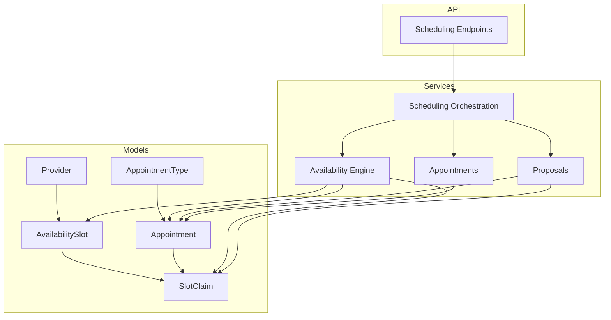
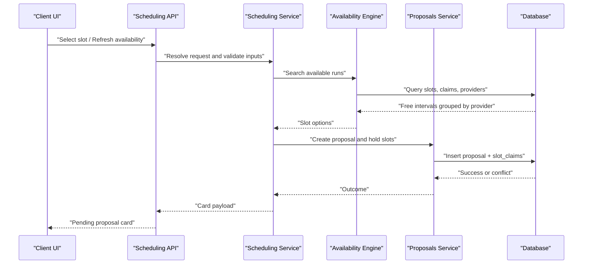
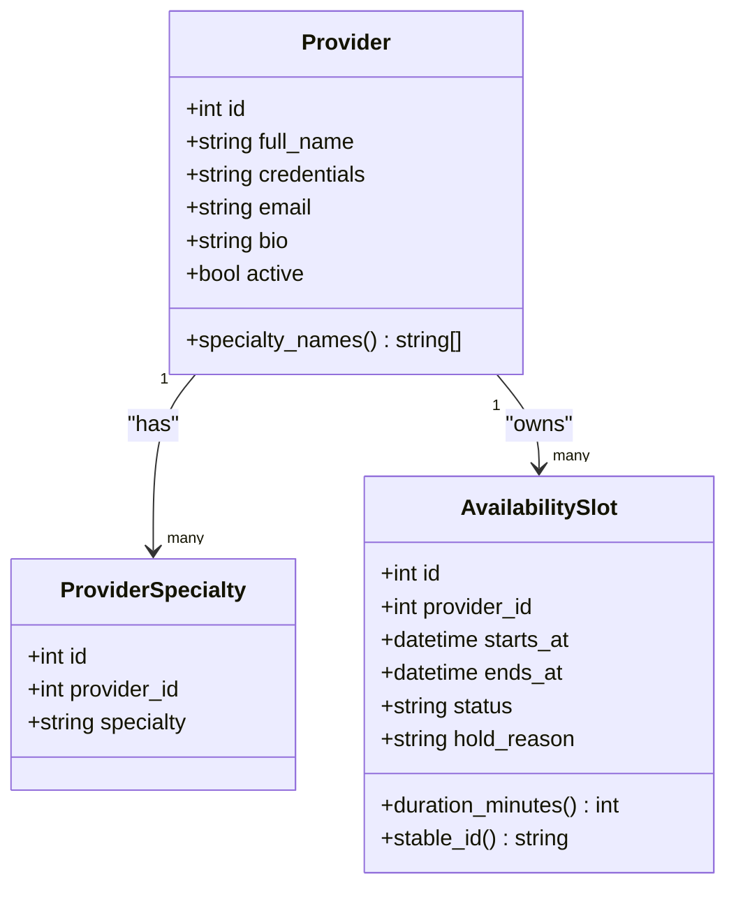
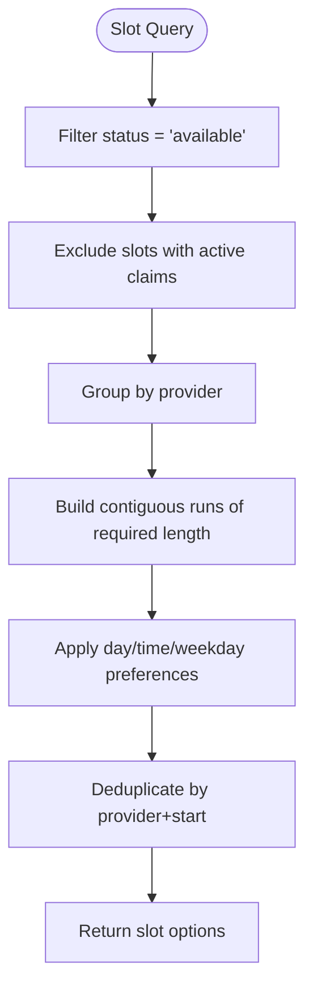
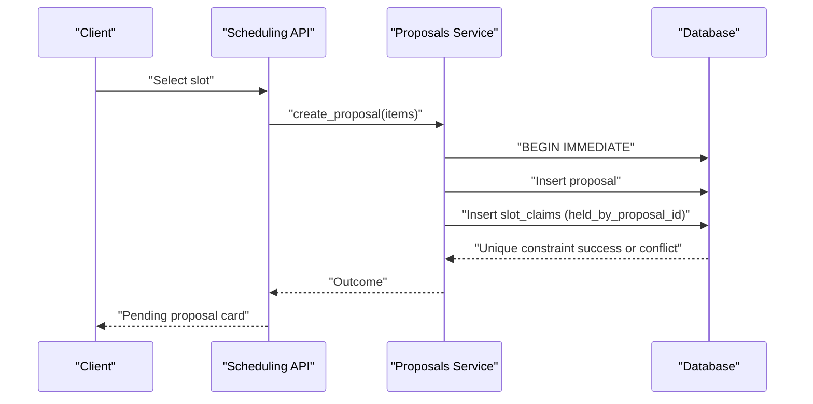
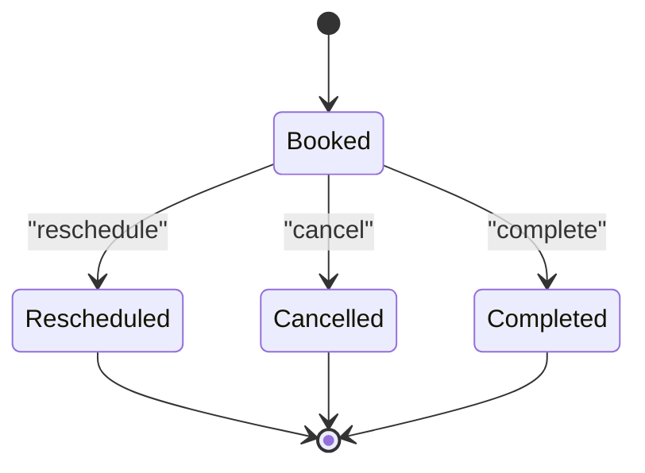
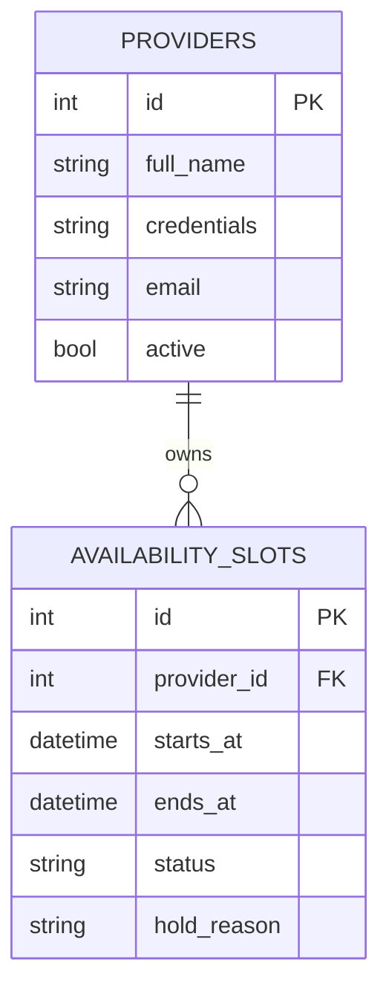
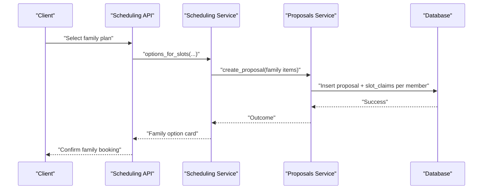
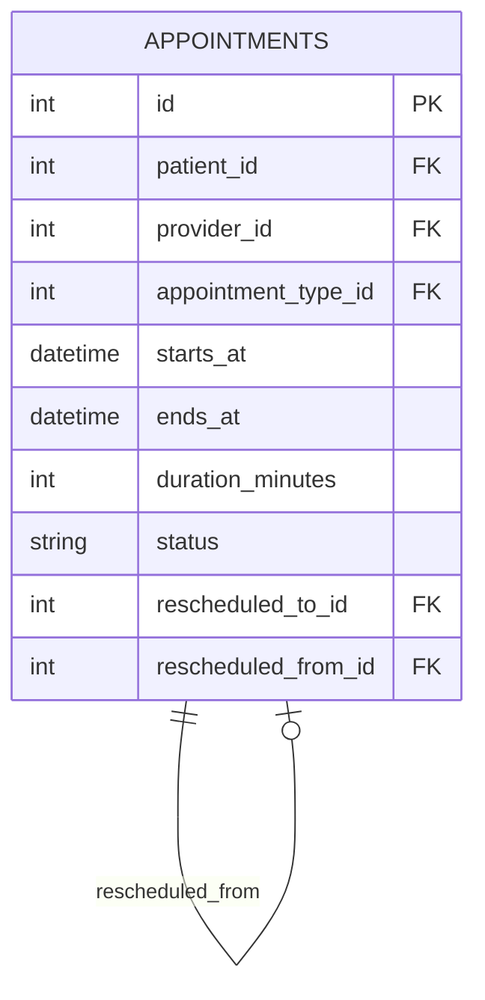
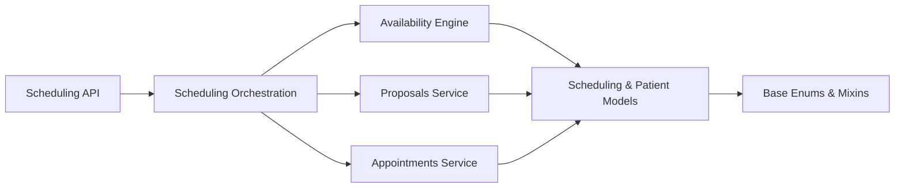

# Scheduling and Availability Models

<cite>
**Referenced Files in This Document**
- [scheduling.py](file://backend/app/models/scheduling.py)
- [patients.py](file://backend/app/models/patients.py)
- [base.py](file://backend/app/models/base.py)
- [availability_engine.py](file://backend/app/services/availability_engine.py)
- [availability.py](file://backend/app/services/availability.py)
- [appointments.py](file://backend/app/services/appointments.py)
- [proposals.py](file://backend/app/services/proposals.py)
- [scheduling.py](file://backend/app/services/scheduling.py)
- [scheduling.py](file://backend/app/api/scheduling.py)
</cite>

## Table of Contents
1. [Introduction](#introduction)
2. [Project Structure](#project-structure)
3. [Core Components](#core-components)
4. [Architecture Overview](#architecture-overview)
5. [Detailed Component Analysis](#detailed-component-analysis)
6. [Dependency Analysis](#dependency-analysis)
7. [Performance Considerations](#performance-considerations)
8. [Troubleshooting Guide](#troubleshooting-guide)
9. [Conclusion](#conclusion)

## Introduction
This document describes the scheduling and availability data model for a dental clinic system. It focuses on how providers, appointment types, availability slots, slot claims, and appointments relate to each other, and how the system supports:
- Provider specialization and practice associations
- Appointment type duration and category classification
- 30-minute availability intervals with status tracking
- Temporary booking holds through slot claims
- Full appointment lifecycle including rescheduling and replacement tracking
- Concurrency control, conflict resolution, and high-volume query performance

The documentation is organized so that both technical readers and non-technical users can understand the entities, their relationships, and the operational flows behind them.

## Project Structure
The scheduling domain spans models, services, and API endpoints:
- Models define the persistent schema for slots, appointments, claims, providers, and appointment types.
- Services implement read-only availability queries, proposal creation and confirmation, and appointment history/rescheduling.
- The API exposes deterministic scheduling actions such as selecting a slot, refreshing availability, confirming or declining proposals, and listing appointments.

**Diagram sources**
- [scheduling.py:37-239](file://backend/app/models/scheduling.py#L37-L239)
- [patients.py:49-109](file://backend/app/models/patients.py#L49-L109)
- [availability_engine.py:238-354](file://backend/app/services/availability_engine.py#L238-L354)
- [proposals.py:282-529](file://backend/app/services/proposals.py#L282-L529)
- [appointments.py:125-154](file://backend/app/services/appointments.py#L125-L154)
- [scheduling.py:393-716](file://backend/app/services/scheduling.py#L393-L716)
- [scheduling.py:256-554](file://backend/app/api/scheduling.py#L256-L554)

**Section sources**
- [scheduling.py:1-239](file://backend/app/models/scheduling.py#L1-L239)
- [patients.py:18-109](file://backend/app/models/patients.py#L18-L109)
- [availability_engine.py:1-45](file://backend/app/services/availability_engine.py#L1-L45)
- [proposals.py:1-46](file://backend/app/services/proposals.py#L1-L46)
- [scheduling.py:1-12](file://backend/app/services/scheduling.py#L1-L12)
- [scheduling.py:1-13](file://backend/app/api/scheduling.py#L1-L13)

## Core Components
This section documents the primary scheduling entities and their responsibilities.

### Provider and Specialization Areas
- Providers represent clinicians with identity, credentials, email, bio, and active state.
- Providers have many-to-many-like specialization via `ProviderSpecialty`, allowing multiple specialties per provider.
- Providers are associated with availability slots and appointments.

Key attributes and relationships:
- `Provider.id`: primary key
- `Provider.full_name`, `credentials`, `email`, `bio`, `active`
- `Provider.specialties`: list of `ProviderSpecialty`
- `Provider.availability_slots`: one-to-many relationship to `AvailabilitySlot`
- `Provider.appointments`: one-to-many relationship to `Appointment`

Specialization constraints:
- Unique constraint on `(provider_id, specialty)` prevents duplicate specialty entries.
- Indexes support lookup by specialty and provider.

**Section sources**
- [patients.py:49-93](file://backend/app/models/patients.py#L49-L93)

### AppointmentTypes
- `AppointmentType` defines bookable visit kinds such as checkups, cleanings, and emergencies.
- Attributes include stable code, display name, description, duration, emergency flag, required specialty, and sort order.

Important fields:
- `code`: unique slug used by assistants and APIs
- `duration_minutes`: determines how many 30-minute intervals an appointment consumes
- `required_specialty`: optional filter to restrict which providers can perform the visit
- `is_emergency`: flags urgent visits

**Section sources**
- [patients.py:96-109](file://backend/app/models/patients.py#L96-L109)

### AvailabilitySlots
- `AvailabilitySlot` represents a 30-minute interval in local clinic wall-clock time.
- Each slot belongs to exactly one provider and has a start/end time.
- Status values are `available`, `occupied`, or `blocked`.
- Slots may be held by staff (e.g., lunch, maintenance) using `hold_reason`; this is distinct from patient booking holds.

Constraints and indexes:
- Unique constraint on `(provider_id, starts_at)` ensures no duplicate intervals per provider.
- Check constraints enforce positive duration and valid status.
- Indexes optimize queries by start time and by provider/status/start combinations.

Derived properties:
- `duration_minutes`: computed from start/end times
- `stable_id`: deterministic identifier derived from provider and start time, safe for UI use

Relationships:
- One-to-one optional claim via `SlotClaim`
- Many-to-one provider

**Section sources**
- [scheduling.py:37-79](file://backend/app/models/scheduling.py#L37-L79)

### SlotClaims
- `SlotClaim` temporarily reserves one availability slot for either an existing appointment or a pending proposal.
- Active claims prevent other bookings; historical cancelled claims remain for auditability.
- Partial unique indexes allow only one active claim per slot while permitting multiple historical rows.

Key fields:
- `availability_slot_id`: foreign key to `AvailabilitySlot`
- `appointment_id`: set when the claim belongs to a confirmed appointment
- `held_by_proposal_id`: set when the claim belongs to a pending proposal
- `active`: boolean indicating whether the claim is still holding the slot
- `released_at`: timestamp when the hold was released

Behavioral notes:
- A slot can only ever carry one active claim of either kind (appointment or proposal), making races database-level conflicts.
- Reschedule/cancellation proposals may rely on the target appointment’s own claims without creating additional holds; those slot ids are recorded in the proposal metadata.

Relationships:
- Many-to-one `AvailabilitySlot`
- Optional many-to-one `Appointment`
- Optional many-to-one `BookingProposal` (referenced indirectly via `held_by_proposal_id`)

**Section sources**
- [scheduling.py:175-239](file://backend/app/models/scheduling.py#L175-L239)
- [proposals.py:200-228](file://backend/app/services/proposals.py#L200-L228)

### Appointments
- `Appointment` represents a confirmed visit linking a patient, provider, and appointment type.
- Lifecycle states include booked, cancelled, completed, and rescheduled.
- Rescheduling preserves history: the original row is marked rescheduled and points to its replacement; the replacement points back to the original and stores snapshot fields for the moved time/provider/type/duration.

Important fields:
- `patient_id`, `provider_id`, `appointment_type_id`
- `starts_at`, `ends_at`, `duration_minutes`
- `status`, `reason`, `visit_shape` (`solo` or `household`)
- `cancelled_at`, `family_group_id`, `conversation_id`, `booking_group_id`
- Reschedule links: `rescheduled_to_id`, `rescheduled_from_id`, plus snapshot columns

Relationships:
- Many-to-one `Patient`
- Many-to-one `Provider`
- Many-to-one `AppointmentType`
- One-to-many `SlotClaim` (via cascade delete-orphan)

Derived behavior:
- `is_reschedule_replacement`: identifies replacement rows so they are not double-counted in upcoming lists.

**Section sources**
- [scheduling.py:81-172](file://backend/app/models/scheduling.py#L81-L172)

## Architecture Overview
The scheduling architecture separates read-only availability discovery from write-heavy booking operations.

**Diagram sources**
- [scheduling.py:256-362](file://backend/app/api/scheduling.py#L256-L362)
- [scheduling.py:393-716](file://backend/app/services/scheduling.py#L393-L716)
- [availability_engine.py:238-354](file://backend/app/services/availability_engine.py#L238-L354)
- [proposals.py:282-529](file://backend/app/services/proposals.py#L282-L529)

## Detailed Component Analysis

### Provider Model: Practice Associations, Working Hours, Specializations
- Practice associations are modeled through provider identities and their active state.
- Working hours are represented by generated `AvailabilitySlot` intervals per provider.
- Specializations are stored as separate rows linked to providers, enabling multi-specialty support.

**Diagram sources**
- [patients.py:49-93](file://backend/app/models/patients.py#L49-L93)
- [scheduling.py:37-79](file://backend/app/models/scheduling.py#L37-L79)

**Section sources**
- [patients.py:49-93](file://backend/app/models/patients.py#L49-L93)
- [scheduling.py:37-79](file://backend/app/models/scheduling.py#L37-L79)

### AppointmentTypes: Duration, Preparation Time, Category Classifications
- `AppointmentType.code` is the canonical identifier used across tools and APIs.
- `duration_minutes` drives how many 30-minute intervals are consumed.
- `required_specialty` enforces provider eligibility for certain visit types.
- `is_emergency` categorizes urgent visits.

Preparation time is not explicitly modeled as a separate field; instead, preparation is implicitly part of the appointment duration and scheduling logic. If future requirements need explicit buffer time, it should be added as a dedicated column and integrated into slot run calculations.

**Section sources**
- [patients.py:96-109](file://backend/app/models/patients.py#L96-L109)
- [availability_engine.py:112-140](file://backend/app/services/availability_engine.py#L112-L140)

### AvailabilitySlots: Time Slots, Provider Assignments, Status Tracking
- Slots are 30-minute intervals with strict ordering and uniqueness per provider.
- Status transitions:
  - `available`: open for booking
  - `occupied`: taken by a confirmed appointment
  - `blocked`: reserved by staff or system reasons
- `hold_reason` tracks schedule-level holds (not patient booking holds).

**Diagram sources**
- [availability_engine.py:143-189](file://backend/app/services/availability_engine.py#L143-L189)
- [availability_engine.py:238-354](file://backend/app/services/availability_engine.py#L238-L354)

**Section sources**
- [scheduling.py:37-79](file://backend/app/models/scheduling.py#L37-L79)
- [availability_engine.py:143-189](file://backend/app/services/availability_engine.py#L143-L189)
- [availability_engine.py:238-354](file://backend/app/services/availability_engine.py#L238-L354)

### SlotClaims: Temporary Holds, Atomic Claim/Release
- Claims coordinate temporary reservations during booking transactions.
- Two modes:
  - Proposal holds: `held_by_proposal_id` set, `appointment_id` NULL
  - Appointment holds: `appointment_id` set, `held_by_proposal_id` NULL
- Release semantics:
  - Declining or superseding a proposal sets `active=False` and records `released_at`.
  - Expiration clears lapsed holds without changing proposal status.

Concurrency control:
- Partial unique index on `slot_claims(availability_slot_id)` where `active=True` ensures only one active claim per slot.
- Conflicts raise `SlotConflictError` and return user-friendly messages.

**Diagram sources**
- [proposals.py:282-529](file://backend/app/services/proposals.py#L282-L529)
- [scheduling.py:256-362](file://backend/app/api/scheduling.py#L256-L362)

**Section sources**
- [scheduling.py:175-239](file://backend/app/models/scheduling.py#L175-L239)
- [proposals.py:200-228](file://backend/app/services/proposals.py#L200-L228)
- [proposals.py:282-529](file://backend/app/services/proposals.py#L282-L529)

### Appointments: Lifecycle Management, Rescheduling, Replacement Tracking
- Appointments maintain a complete history even after rescheduling.
- Rescheduling workflow:
  - Original appointment is marked `rescheduled` and points to replacement via `rescheduled_to_id`.
  - Replacement appointment points back via `rescheduled_from_id` and stores snapshot fields.
- Upcoming lists exclude retired originals to avoid showing two visits for one move.

**Diagram sources**
- [base.py:56-64](file://backend/app/models/base.py#L56-L64)
- [scheduling.py:81-172](file://backend/app/models/scheduling.py#L81-L172)
- [appointments.py:56-106](file://backend/app/services/appointments.py#L56-L106)

**Section sources**
- [scheduling.py:81-172](file://backend/app/models/scheduling.py#L81-L172)
- [appointments.py:56-106](file://backend/app/services/appointments.py#L56-L106)
- [base.py:56-64](file://backend/app/models/base.py#L56-L64)

### Relationship Diagrams

#### Providers to Availability Slots

**Diagram sources**
- [patients.py:49-70](file://backend/app/models/patients.py#L49-L70)
- [scheduling.py:37-65](file://backend/app/models/scheduling.py#L37-L65)

#### Slot Claims Coordinate Family Bookings
Family bookings create one proposal covering multiple members; each member’s slot is held via `slot_claims`. Confirmation atomically books all members or fails entirely.

**Diagram sources**
- [scheduling.py:341-390](file://backend/app/services/scheduling.py#L341-L390)
- [proposals.py:282-529](file://backend/app/services/proposals.py#L282-L529)

#### Appointments Maintain Historical Records Through Rescheduling

**Diagram sources**
- [scheduling.py:81-172](file://backend/app/models/scheduling.py#L81-L172)

## Dependency Analysis
The scheduling subsystem depends on several layers:

**Diagram sources**
- [scheduling.py:256-554](file://backend/app/api/scheduling.py#L256-L554)
- [scheduling.py:393-716](file://backend/app/services/scheduling.py#L393-L716)
- [availability_engine.py:238-354](file://backend/app/services/availability_engine.py#L238-L354)
- [proposals.py:282-529](file://backend/app/services/proposals.py#L282-L529)
- [appointments.py:125-154](file://backend/app/services/appointments.py#L125-L154)
- [scheduling.py:37-239](file://backend/app/models/scheduling.py#L37-L239)
- [patients.py:49-109](file://backend/app/models/patients.py#L49-L109)
- [base.py:50-74](file://backend/app/models/base.py#L50-L74)

**Section sources**
- [scheduling.py:256-554](file://backend/app/api/scheduling.py#L256-L554)
- [scheduling.py:393-716](file://backend/app/services/scheduling.py#L393-L716)
- [availability_engine.py:238-354](file://backend/app/services/availability_engine.py#L238-L354)
- [proposals.py:282-529](file://backend/app/services/proposals.py#L282-L529)
- [appointments.py:125-154](file://backend/app/services/appointments.py#L125-L154)
- [scheduling.py:37-239](file://backend/app/models/scheduling.py#L37-L239)
- [patients.py:49-109](file://backend/app/models/patients.py#L49-L109)
- [base.py:50-74](file://backend/app/models/base.py#L50-L74)

## Performance Considerations
- **Indexing**:
  - `availability_slots` uses indexes on `starts_at` and composite `(provider_id, status, starts_at)` to accelerate range scans and filtering.
  - `slot_claims` uses partial unique indexes on active claims to enforce concurrency efficiently.
  - `appointments` indexes on `(provider_id, starts_at)`, `(patient_id, starts_at)`, and `status` support common queries for provider schedules and patient histories.
- **Read Path Optimization**:
  - Availability search groups free intervals by provider and builds contiguous runs, limiting candidate sets before applying preferences.
  - Results are trimmed per day and capped at a maximum number of options to reduce UI load.
- **Write Path Safety**:
  - Booking operations use short-lived write transactions with immediate locking to minimize contention.
  - Proposal creation validates and holds slots inside the transaction, failing fast on conflicts.
- **High-Volume Queries**:
  - Read-only availability queries avoid blocking writers.
  - Family plan searches limit candidates per member and cap total plans returned.

[No sources needed since this section provides general guidance]

## Troubleshooting Guide
Common issues and resolutions:

- **Slot Taken During Selection**:
  - Cause: Another client claimed the same slot between selection and confirmation.
  - Resolution: Show current options; do not retry silently.
  - Evidence: Conflict handling returns `slot_taken` with conflicting slot identifiers.

- **Expired Hold**:
  - Cause: The hold window passed without confirmation.
  - Resolution: Release expired holds; keep proposal confirmable but revalidate on confirmation.
  - Evidence: Expired hold release function updates active claims and audits the event.

- **Reschedule Target Not Movable**:
  - Cause: Appointment already moved, cancelled, or not owned by the patient.
  - Resolution: Return clear error and ask for clarification if multiple appointments exist.
  - Evidence: Reschedule validation checks status and ownership before proposing.

- **Family Plan Unavailable**:
  - Cause: No complete set of open times for all members within preferences.
  - Resolution: Offer alternative dates, providers, or separate visits.
  - Evidence: Family availability search returns structured unavailability with context.

**Section sources**
- [proposals.py:490-511](file://backend/app/services/proposals.py#L490-L511)
- [proposals.py:231-274](file://backend/app/services/proposals.py#L231-L274)
- [appointments.py:377-432](file://backend/app/services/appointments.py#L377-L432)
- [scheduling.py:719-792](file://backend/app/services/scheduling.py#L719-L792)

## Conclusion
The scheduling and availability model provides a robust foundation for managing provider schedules, appointment types, time slots, temporary holds, and appointment lifecycles. Its design emphasizes:
- Clear entity boundaries and relationships
- Database-level concurrency guarantees through partial unique indexes
- Safe, explainable error handling for conflicts and expired holds
- Efficient read paths for high-volume availability queries
- Historical integrity for reschedules and cancellations

Future enhancements could include explicit preparation time modeling, richer provider practice groupings, and expanded family coordination rules, provided they preserve the core invariants around slot uniqueness and atomicity.