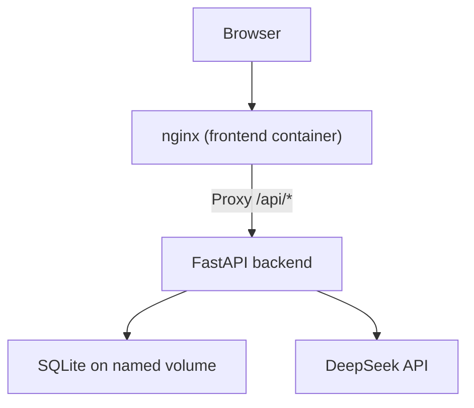
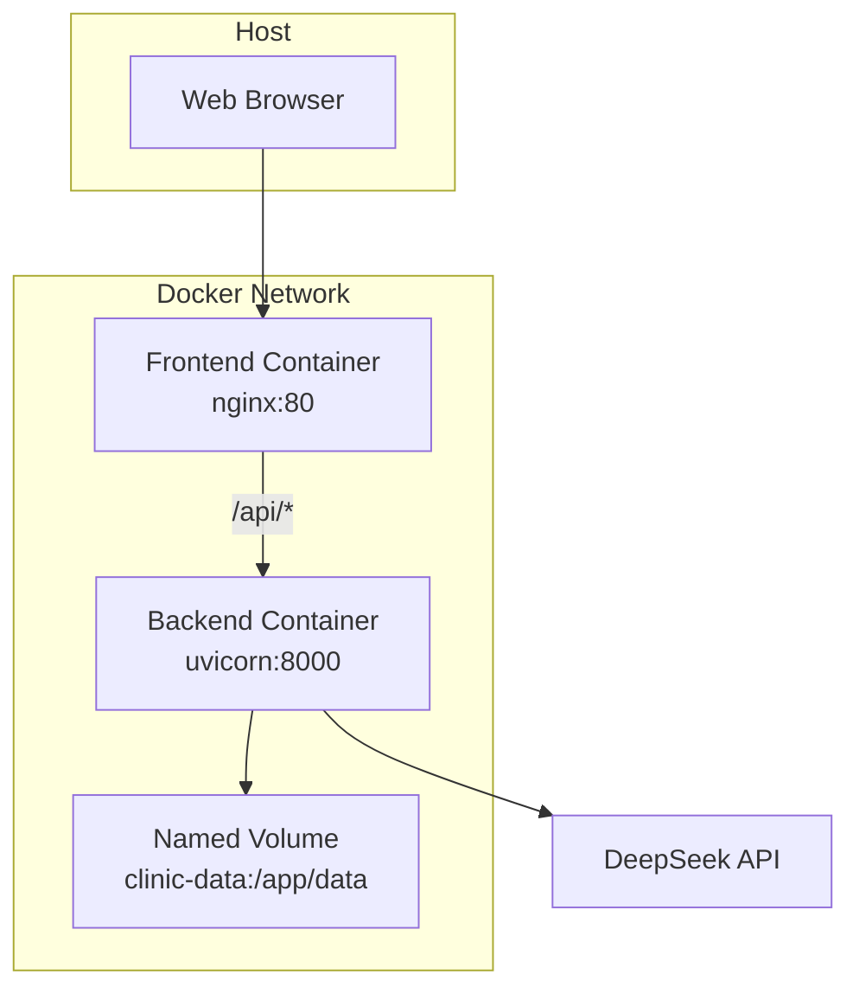
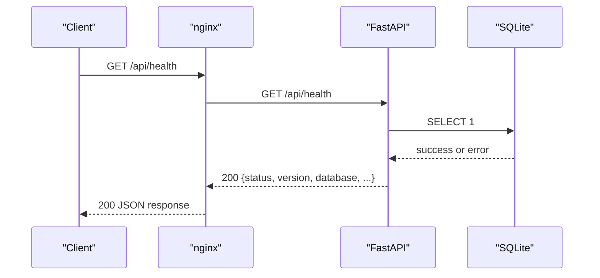
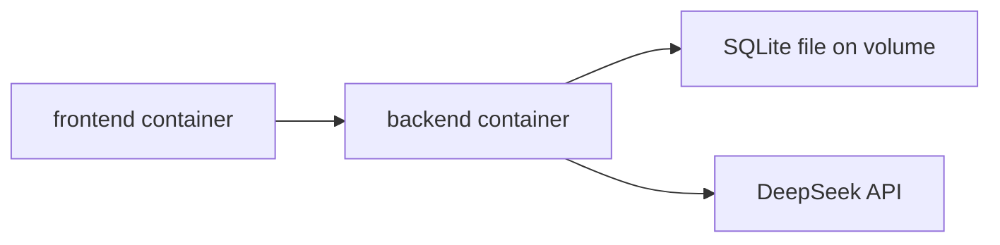

# Deployment and Operations

<cite>
**Referenced Files in This Document**
- [README.md](file://README.md)
- [docker-compose.yml](file://docker-compose.yml)
- [docker-compose.dev.yml](file://docker-compose.dev.yml)
- [Makefile](file://Makefile)
- [backend/Dockerfile](file://backend/Dockerfile)
- [frontend/Dockerfile](file://frontend/Dockerfile)
- [frontend/nginx.conf](file://frontend/nginx.conf)
- [backend/server.py](file://backend/server.py)
- [backend/app/main.py](file://backend/app/main.py)
- [backend/app/config.py](file://backend/app/config.py)
- [backend/app/db.py](file://backend/app/db.py)
- [backend/app/bootstrap.py](file://backend/app/bootstrap.py)
- [backend/app/observability.py](file://backend/app/observability.py)
- [backend/app/api/health.py](file://backend/app/api/health.py)
</cite>

## Table of Contents
1. [Introduction](#introduction)
2. [Project Structure](#project-structure)
3. [Core Components](#core-components)
4. [Architecture Overview](#architecture-overview)
5. [Detailed Component Analysis](#detailed-component-analysis)
6. [Dependency Analysis](#dependency-analysis)
7. [Performance Considerations](#performance-considerations)
8. [Troubleshooting Guide](#troubleshooting-guide)
9. [Conclusion](#conclusion)
10. [Appendices](#appendices)

## Introduction
This document provides deployment and operations guidance for the Dental AI Receptionist application. The system runs as separate Docker containers: a FastAPI backend, a React frontend served by nginx, and an nginx reverse proxy that exposes patient chat, staff dashboard, and API documentation. Data is persisted to SQLite inside a named Docker volume. Environment configuration is intentionally minimal: only DeepSeek API settings are required at runtime; database location and bootstrap behavior use safe defaults.

The repository supports both production-style builds and development hot reload through Docker Compose overlays. Operational concerns include structured JSON logging, request tracing, health checks, graceful error responses, and documented maintenance procedures for seeding, resetting demo data, and inspecting logs.

## Project Structure
At deployment time, the project consists of:
- Backend container: Python 3.12, FastAPI, SQLAlchemy with SQLite, uvicorn server.
- Frontend container: Vite-built static assets served by nginx.
- Shared data volume: `clinic-data`, mapped to `/app/data` inside the backend container.
- Compose files: production topology and development overlay.
- Makefile: lifecycle, diagnostics, and maintenance commands.

**Diagram sources**
- [docker-compose.yml:12-46](file://docker-compose.yml#L12-L46)
- [frontend/nginx.conf:14-22](file://frontend/nginx.conf#L14-L22)
- [backend/server.py:8-14](file://backend/server.py#L8-L14)
- [backend/app/config.py:27-41](file://backend/app/config.py#L27-L41)

**Section sources**
- [README.md:40-50](file://README.md#L40-L50)
- [docker-compose.yml:1-51](file://docker-compose.yml#L1-L51)
- [Makefile:1-25](file://Makefile#L1-L25)

## Core Components
- Backend service: FastAPI application factory, startup bootstrap, CORS, observability middleware, route registration, and uvicorn entry point.
- Frontend service: Two-stage build producing static assets, then nginx serving those assets and proxying API routes.
- Configuration: Settings loader reading environment variables and `.env`, exposing DeepSeek model configuration and SQLite path.
- Database layer: Engine creation, session management, SQLite pragmas, sidecar file handling, and reset helpers.
- Health endpoint: Liveness plus lightweight database probe returning status, version, timestamps, schema version, generation, and seed state.
- Observability: Structured JSON logging, request ID propagation, sensitive-field scrubbing, and domain event helpers.

**Section sources**
- [backend/app/main.py:202-256](file://backend/app/main.py#L202-L256)
- [backend/server.py:1-15](file://backend/server.py#L1-L15)
- [backend/app/config.py:1-90](file://backend/app/config.py#L1-L90)
- [backend/app/db.py:1-134](file://backend/app/db.py#L1-L134)
- [backend/app/api/health.py:1-58](file://backend/app/api/health.py#L1-L58)
- [backend/app/observability.py:1-241](file://backend/app/observability.py#L1-L241)

## Architecture Overview
The deployment uses three logical services:
- Patient and staff React UIs built into static assets.
- nginx proxy serving static content and forwarding API calls to the backend.
- FastAPI backend providing APIs, scheduling logic, conversation persistence, and integration with DeepSeek.

**Diagram sources**
- [docker-compose.yml:12-46](file://docker-compose.yml#L12-L46)
- [frontend/nginx.conf:1-51](file://frontend/nginx.conf#L1-L51)
- [backend/Dockerfile:16-23](file://backend/Dockerfile#L16-L23)

## Detailed Component Analysis

### Docker Build and Runtime
- Backend image:
  - Base: Python 3.12 slim.
  - Installs dependencies from requirements.txt.
  - Copies application code and server entry point.
  - Creates `/app/data` and declares it as a volume.
  - Exposes port 8000 and runs `server.py`.
- Frontend image:
  - Build stage installs Node.js and npm, copies package manifests, installs dependencies, and builds static assets.
  - Runtime stage uses nginx Alpine image.
  - Copies generated `dist` assets and custom `nginx.conf`.
  - Exposes port 80.

Operational implications:
- Backend source changes require rebuilding or using the development overlay.
- Frontend assets are immutable once built; rebuild when dependencies change.
- Data persists across restarts because SQLite lives on the named volume.

**Section sources**
- [backend/Dockerfile:1-24](file://backend/Dockerfile#L1-L24)
- [frontend/Dockerfile:1-25](file://frontend/Dockerfile#L1-L25)

### Service Orchestration with Docker Compose
Production compose defines:
- `backend`:
  - Builds from `./backend`.
  - Loads `.env`.
  - Mounts `clinic-data` to `/app/data`.
  - Publishes port 8000.
  - Healthcheck calls `/api/health`.
  - Restarts unless stopped.
- `frontend`:
  - Builds from `./frontend`.
  - Depends on healthy backend.
  - Publishes port 8080.
  - Restarts unless stopped.
- Named volume `clinic-data` ensures persistent SQLite storage.

Development compose overlay:
- Replaces backend command with uvicorn reload over bind-mounted source directories.
- Replaces frontend with Vite dev server on port 5173, proxying `/api` to backend.
- Uses polling for reliable hot reload on macOS bind mounts.
- Overrides published ports so development and production do not conflict.

**Section sources**
- [docker-compose.yml:1-51](file://docker-compose.yml#L1-L51)
- [docker-compose.dev.yml:1-84](file://docker-compose.dev.yml#L1-L84)

### Environment Configuration
Required runtime variables:
- `DEEPSEEK_API_KEY`: DeepSeek provider key. Read only by the backend process. Never sent to the browser or written to logs.
- `DEEPSEEK_MODEL`: Model name, defaulting to `deepseek-flash`.
- `DEEPSEEK_BASE_URL`: Provider base URL, defaulting to the official DeepSeek endpoint.

Database configuration:
- SQLite path defaults to `/app/data/clinic.db` inside the container.
- On the host, this maps to `backend/data/clinic.db` when running outside Docker.
- No extra database connection variables are required; the application uses safe defaults.

Configuration loading order:
1. Process environment variables.
2. `.env` file values.
3. Code defaults.

Security note:
- The settings object exposes presence flags and derived URLs but never returns the API key value.
- Logs record whether the key is configured, not its contents.

**Section sources**
- [backend/app/config.py:1-90](file://backend/app/config.py#L1-L90)
- [README.md:71-93](file://README.md#L71-L93)

### Application Startup and Bootstrap
Startup sequence:
1. Uvicorn starts and imports the FastAPI app.
2. Logging is configured with structured JSON output.
3. Request middleware injects request IDs, measures duration, and standardizes error responses.
4. CORS is configured for development origins.
5. Routers are mounted under `/api`.
6. On startup, the application logs configuration presence and bootstraps the database.

Bootstrap responsibilities:
- Create missing tables.
- Apply additive migrations.
- Ensure reset generation and schema version metadata.
- Seed demo fixtures only when the database is empty.

**Section sources**
- [backend/server.py:1-15](file://backend/server.py#L1-L15)
- [backend/app/main.py:202-256](file://backend/app/main.py#L202-L256)
- [backend/app/bootstrap.py:1-67](file://backend/app/bootstrap.py#L1-L67)

### API Proxy and Frontend Routing
nginx behavior:
- Serves static SPA assets from `/usr/share/nginx/html`.
- Proxies `/api/*` requests to the backend container on port 8000.
- Proxies `/docs`, `/redoc`, and `/openapi.json` to backend Swagger/OpenAPI endpoints.
- Enables gzip compression for common asset types.
- Caches hashed assets aggressively.
- Provides SPA fallback to `index.html`.

Operational notes:
- Clients should call `/api/*` through the frontend proxy on port 8080 in production.
- Direct backend access on port 8000 is available locally for debugging and tooling.

**Section sources**
- [frontend/nginx.conf:1-51](file://frontend/nginx.conf#L1-L51)
- [docker-compose.yml:36-46](file://docker-compose.yml#L36-L46)

### Health Checks and Observability
Health endpoint:
- Returns HTTP 200 with a status indicating `ok` or `degraded`.
- Includes application version, local timestamp, clinic timezone-aware timestamp, database status, schema version, reset generation, and seed flag.
- Does not raise exceptions even if the database probe fails.

Compose healthcheck:
- Calls `/api/health` every 10 seconds with timeout and retry parameters.
- Marks the backend healthy after successful responses.

Structured logging:
- One JSON line per log record.
- Includes timestamp, level, logger name, event, optional request ID, endpoint, method, status, duration, and scrubbed fields.
- Scrubs sensitive keys, phone numbers, and ISO dates from structured payloads.
- Integrates uvicorn loggers so access logs share request context.

Request tracing:
- Reads incoming `X-Request-ID` header or generates one.
- Adds `X-Request-ID` to responses.
- Makes request ID available to all log lines via context variables.

Error handling:
- Standardizes HTTP errors with stable error codes and request IDs.
- Maps SQLite operational errors to 503 with retry guidance.
- Maps integrity constraint violations to 409 conflicts.
- Captures unhandled exceptions without leaking stack traces.

**Diagram sources**
- [backend/app/api/health.py:23-58](file://backend/app/api/health.py#L23-L58)
- [frontend/nginx.conf:14-22](file://frontend/nginx.conf#L14-L22)
- [docker-compose.yml:24-33](file://docker-compose.yml#L24-L33)

**Section sources**
- [backend/app/api/health.py:1-58](file://backend/app/api/health.py#L1-L58)
- [backend/app/observability.py:1-241](file://backend/app/observability.py#L1-L241)
- [backend/app/main.py:45-180](file://backend/app/main.py#L45-L180)
- [docker-compose.yml:24-33](file://docker-compose.yml#L24-L33)

### Build and Service Startup Procedures
Recommended production workflow:
1. Prepare `.env` with DeepSeek variables.
2. Build and start services: `make up`.
3. Verify frontend availability at `http://localhost:8080`.
4. Verify backend health at `http://localhost:8000/api/health`.
5. Open API docs at `http://localhost:8000/docs` or `http://localhost:8080/docs`.

Development workflow:
1. Run `make dev`.
2. Access the Vite dev server at `http://localhost:5173`.
3. Edit Python or TypeScript files for hot reload.
4. Rebuild only when dependency files change.

Service control:
- `make down` stops services while preserving data.
- `make logs` follows combined logs.
- `make ps` shows container status.
- `make backend-logs` and `make frontend-logs` filter by service.

**Section sources**
- [README.md:71-111](file://README.md#L71-L111)
- [Makefile:33-57](file://Makefile#L33-L57)
- [docker-compose.dev.yml:1-20](file://docker-compose.dev.yml#L1-L20)

### Maintenance Procedures

#### Database Backups
Current design stores SQLite on a named Docker volume. For backup:
- Stop writers before copying files to avoid partial WAL/SHM snapshots.
- Copy the main database file and its WAL and SHM sidecars.
- Alternatively, use the provided shell helper to inspect the database directly.

Operational recommendations:
- Schedule backups during low-traffic windows.
- Test restore procedures regularly.
- For production-scale deployments, migrate to a managed relational database with native backup tools.

**Section sources**
- [backend/app/db.py:108-119](file://backend/app/db.py#L108-L119)
- [Makefile:83-84](file://Makefile#L83-L84)

#### Log Rotation and Retention
Logs are emitted as JSON lines to stdout/stderr. In production:
- Configure your container runtime or orchestrator to rotate and retain logs.
- Use a centralized logging pipeline to parse structured fields.
- Avoid retaining raw logs containing sensitive data longer than necessary.

**Section sources**
- [backend/app/observability.py:109-171](file://backend/app/observability.py#L109-L171)

#### Certificate Management
The current deployment does not terminate TLS internally. In production:
- Place the application behind a reverse proxy or ingress controller that manages certificates.
- Ensure the proxy forwards correct headers so the backend can trust client IPs and schemes.
- Rotate certificates according to organizational policy and test reload behavior.

**Section sources**
- [frontend/nginx.conf:14-22](file://frontend/nginx.conf#L14-L22)

#### System Updates
Update procedure:
1. Build new images: `make rebuild`.
2. Start updated services: `make up`.
3. Verify health and smoke-test critical flows.
4. If data migration is needed, rely on additive schema creation and migration logic.
5. Roll back by redeploying the previous known-good image and ensuring the database remains compatible.

Data reset procedure:
- Use `make reset-demo` to stop writers, recreate the database, reseed fixtures, and restart services.
- Understand that this invalidates prior conversation IDs, sessions, proposals, and idempotency records.

**Section sources**
- [Makefile:70-81](file://Makefile#L70-L81)
- [backend/app/bootstrap.py:34-67](file://backend/app/bootstrap.py#L34-L67)

### Scaling Considerations
Current deployment is single-writer SQLite. At higher scale:
- Move transactional data to PostgreSQL while preserving slot claim uniqueness, idempotency, and tenant ownership constraints.
- Run stateless backend replicas behind a load balancer.
- Add background jobs for retries, alerts, reconciliation, and dead-letter handling.
- Introduce metrics, distributed tracing, centralized structured logs, latency monitoring, and on-call runbooks.
- Apply rate limits, concurrency budgets, request size limits, and cost controls for the AI provider.

These are proposed production changes rather than capabilities claimed by the current repository.

**Section sources**
- [README.md:271-291](file://README.md#L271-L291)

### Production Hardening and Security Best Practices
- Keep DeepSeek credentials out of frontend bundles and logs.
- Restrict CORS origins to trusted domains in production.
- Disable Swagger and OpenAPI endpoints in public-facing environments or protect them with authentication.
- Enforce TLS termination at the edge proxy.
- Use least-privilege container runtime settings.
- Scan images and dependencies regularly.
- Store secrets through a secrets manager instead of plain `.env` files.
- Audit session handling and CSRF protection for staff routes.
- Implement retention policies for conversations, audit records, and logs.

**Section sources**
- [backend/app/main.py:220-237](file://backend/app/main.py#L220-L237)
- [backend/app/config.py:1-10](file://backend/app/config.py#L1-L10)

### Disaster Recovery Procedures
- Identify recovery objectives: which data must be restored and how recent it must be.
- Preserve failed volumes or snapshots before attempting repairs.
- Use `make reset-demo` only when intentional reset is required.
- Restore from backups and verify schema version and seed state through the health endpoint.
- Validate critical workflows: registration, verification, booking, rescheduling, cancellation, and emergency alert visibility.
- Practice disaster recovery drills regularly.

**Section sources**
- [backend/app/api/health.py:28-58](file://backend/app/api/health.py#L28-L58)
- [Makefile:70-81](file://Makefile#L70-L81)

## Dependency Analysis
High-level runtime dependencies:
- Frontend depends on backend for API routes and documentation endpoints.
- Backend depends on SQLite for persistence and DeepSeek for conversational interpretation.
- Compose enforces backend health before starting the frontend.

**Diagram sources**
- [docker-compose.yml:12-46](file://docker-compose.yml#L12-L46)
- [frontend/nginx.conf:14-22](file://frontend/nginx.conf#L14-L22)
- [backend/app/config.py:27-41](file://backend/app/config.py#L27-L41)

**Section sources**
- [docker-compose.yml:1-51](file://docker-compose.yml#L1-L51)

## Performance Considerations
- Enable gzip compression for static assets and API responses where appropriate.
- Cache immutable frontend assets aggressively through nginx.
- Tune SQLite pragmas already applied: WAL mode, foreign keys, busy timeout, and synchronous mode.
- Monitor request duration and error rates through structured logs.
- Limit conversation history size in future releases to reduce provider payload and latency.
- Add application-level metrics for request counts, latency percentiles, hold-to-confirm conversion, conflict rates, and handoff volume.

[No sources needed since this section provides general guidance]

## Troubleshooting Guide

Common issues and resolutions:
- Frontend cannot reach backend:
  - Confirm nginx proxies `/api/*` to the backend service.
  - Check network connectivity between containers.
  - Verify backend is healthy via `/api/health`.
- Backend reports database unavailable:
  - Inspect SQLite file permissions and volume mount.
  - Check for lock contention; transient busy errors return 503 with retry guidance.
- Booking conflicts:
  - Integrity constraint violations return 409; refresh state and retry safely.
- DeepSeek failures:
  - Bounded retries and degraded fallbacks prevent false success responses.
  - Observe structured events for provider status.
- Hot reload not working in development:
  - Use `make dev` and ensure Vite polling is enabled.
  - Rebuild only when dependency files change.

Runbook steps:
1. Check service status: `make ps`.
2. Follow logs: `make logs`, `make backend-logs`, `make frontend-logs`.
3. Validate health: `make backend-status`.
4. Inspect database: `make shell-db`.
5. Reset demo data when necessary: `make reset-demo`.

**Section sources**
- [frontend/nginx.conf:14-22](file://frontend/nginx.conf#L14-L22)
- [backend/app/main.py:124-167](file://backend/app/main.py#L124-L167)
- [Makefile:86-105](file://Makefile#L86-L105)

## Conclusion
The application deploys cleanly as separate backend and frontend containers with nginx proxying API traffic. Configuration is intentionally minimal, focusing on DeepSeek settings while keeping database and bootstrap behavior predictable. Structured logging, request tracing, and health checks provide a solid foundation for operations. For production, extend security, scaling, observability, and disaster recovery according to the guidelines above, and treat the current SQLite-based prototype as a stepping stone toward a multi-location, multi-tenant architecture.

[No sources needed since this section summarizes without analyzing specific files]

## Appendices

### Operational Commands Reference
- Start production services: `make up`
- Start development services: `make dev`
- Stop services: `make down`
- Follow logs: `make logs`
- View service status: `make ps`
- Seed fixtures: `make seed`
- Reset demo database: `make reset-demo`
- Show demo status: `make demo-status`
- Open database shell: `make shell-db`
- Rebuild images: `make rebuild`
- Clean volumes: `make clean-volumes`

**Section sources**
- [Makefile:33-105](file://Makefile#L33-L105)