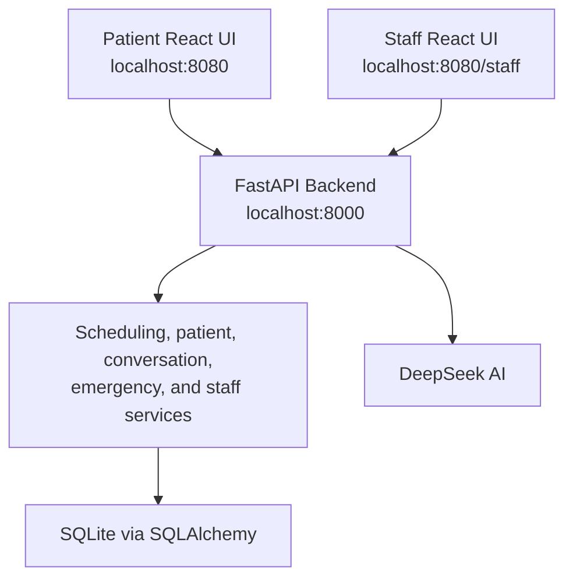
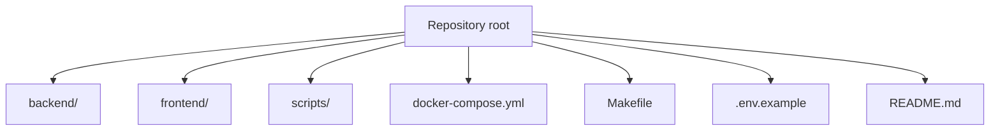
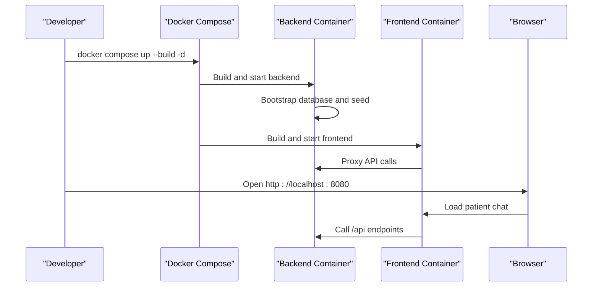
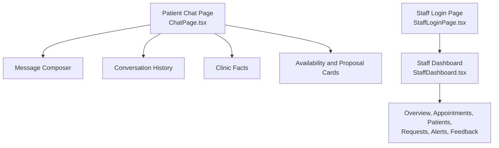
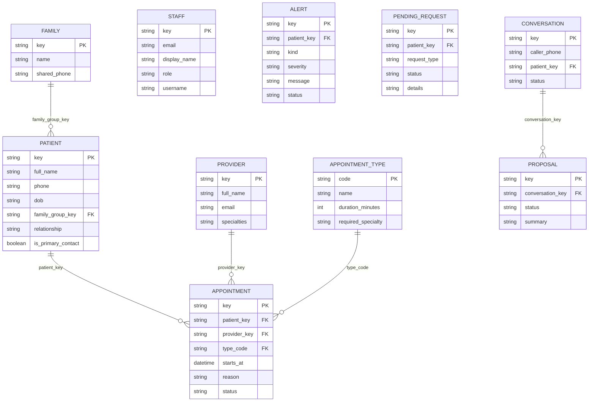
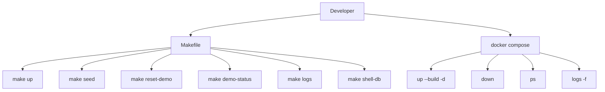

# Getting Started

<cite>
**Referenced Files in This Document**   
- [README.md](file://README.md)
- [Makefile](file://Makefile)
- [docker-compose.yml](file://docker-compose.yml)
- [.env.example](file://.env.example)
- [backend/app/main.py](file://backend/app/main.py)
- [backend/app/cli.py](file://backend/app/cli.py)
- [backend/app/seed_fixtures.py](file://backend/app/seed_fixtures.py)
- [frontend/src/pages/ChatPage.tsx](file://frontend/src/pages/ChatPage.tsx)
- [frontend/src/pages/staff/StaffLoginPage.tsx](file://frontend/src/pages/staff/StaffLoginPage.tsx)
- [frontend/src/pages/staff/StaffDashboard.tsx](file://frontend/src/pages/staff/StaffDashboard.tsx)
</cite>

## Table of Contents
1. [Introduction](#introduction)
2. [Project Structure](#project-structure)
3. [Prerequisites](#prerequisites)
4. [Installation and First Run](#installation-and-first-run)
5. [What You Will See](#what-you-will-see)
6. [Demo Credentials and Seeded Data](#demo-credentials-and-seeded-data)
7. [Common Development Commands](#common-development-commands)
8. [Troubleshooting](#troubleshooting)
9. [Next Steps](#next-steps)

## Introduction
This project is a conversational dental practice receptionist for Oral-B Dental Care. Patients use a React chat interface to register, verify their identity, ask clinic questions, and request cleaning, checkup, or emergency appointments. The backend owns validation, authorization, scheduling, family coordination, emergency triage, and staff operations. Staff access a separate dashboard to manage appointments, patients, pending requests, alerts, and conversation feedback.

The system combines:
- A React and TypeScript frontend served by nginx.
- A Python FastAPI backend with Pydantic models.
- DeepSeek AI integration through an OpenAI-compatible chat interface.
- SQLite persistence through SQLAlchemy.
- Docker Compose as the runtime.

**Diagram sources**
- [README.md:52-69](file://README.md#L52-L69)
- [docker-compose.yml:12-46](file://docker-compose.yml#L12-L46)
- [backend/app/main.py:202-252](file://backend/app/main.py#L202-L252)

**Section sources**
- [README.md:1-50](file://README.md#L1-L50)

## Project Structure
At a high level, the repository contains:
- `backend/`: FastAPI application, CLI utilities, tests, Dockerfile, and dependencies.
- `frontend/`: React application, Vite configuration, Dockerfile, and nginx configuration.
- `scripts/`: Git hook installation and pre-push checks.
- Root-level `Makefile`, `docker-compose.yml`, `.env.example`, and this README.

**Diagram sources**
- [README.md:305-337](file://README.md#L305-L337)
- [docker-compose.yml:1-10](file://docker-compose.yml#L1-L10)
- [Makefile:1-23](file://Makefile#L1-L23)

**Section sources**
- [README.md:305-337](file://README.md#L305-L337)

## Prerequisites
You need:
- Docker and Docker Compose installed on your machine.
- A DeepSeek API key configured in the environment file before starting the backend container.

The frontend and backend run inside containers, so you do not need a host Python or Node installation to start the demo. Local testing and linting commands may require Python 3.12, ruff, and pytest if you run them outside Docker.

**Section sources**
- [README.md:173-190](file://README.md#L173-L190)
- [Makefile:1-9](file://Makefile#L1-L9)

## Installation and First Run
Follow these steps to install and start the system:

1. Clone the repository.
2. Change into the cloned directory.
3. Copy the example environment file.
4. Add your DeepSeek credentials to the `.env` file.
5. Start both services with Docker Compose.
6. Open the patient chat at `http://localhost:8080`.
7. Open the staff dashboard at `http://localhost:8080/staff`.

The backend runs directly at `http://localhost:8000`. Swagger UI is available at `http://localhost:8000/docs` and also through the frontend proxy at `http://localhost:8080/docs`. The health endpoint is at `http://localhost:8000/api/health`.

**Diagram sources**
- [README.md:71-93](file://README.md#L71-L93)
- [docker-compose.yml:12-46](file://docker-compose.yml#L12-L46)
- [backend/app/main.py:202-252](file://backend/app/main.py#L202-L252)

**Section sources**
- [README.md:71-93](file://README.md#L71-L93)
- [.env.example:1-4](file://.env.example#L1-L4)
- [docker-compose.yml:1-10](file://docker-compose.yml#L1-L10)

## What You Will See
After startup, two interfaces are available:

| Interface | URL | Purpose |
|---|---|---|
| Patient chat | `http://localhost:8080` | Conversational registration, verification, scheduling, and clinic questions |
| Staff dashboard | `http://localhost:8080/staff` | Appointment, patient, request, alert, and feedback management |
| Backend API | `http://localhost:8000` | FastAPI server used by the frontend |
| Swagger UI | `http://localhost:8000/docs` or `http://localhost:8080/docs` | Interactive API documentation |
| Health check | `http://localhost:8000/api/health` | Backend readiness probe |

The patient chat page shows the clinic name, status, hours, location, phone number, accepted insurance, quick prompts, message history, and a composer. It supports new conversations, retrying failed messages, and feedback on assistant replies.

The staff login screen asks for a username and password. After successful authentication, the dashboard displays overview, appointments, patients, requests, alerts, and feedback sections.

**Diagram sources**
- [frontend/src/pages/ChatPage.tsx:57-68](file://frontend/src/pages/ChatPage.tsx#L57-L68)
- [frontend/src/pages/ChatPage.tsx:140-332](file://frontend/src/pages/ChatPage.tsx#L140-L332)
- [frontend/src/pages/staff/StaffLoginPage.tsx:16-36](file://frontend/src/pages/staff/StaffLoginPage.tsx#L16-L36)
- [frontend/src/pages/staff/StaffDashboard.tsx:35-50](file://frontend/src/pages/staff/StaffDashboard.tsx#L35-L50)
- [frontend/src/pages/staff/StaffDashboard.tsx:66-124](file://frontend/src/pages/staff/StaffDashboard.tsx#L66-L124)

**Section sources**
- [frontend/src/pages/ChatPage.tsx:57-68](file://frontend/src/pages/ChatPage.tsx#L57-L68)
- [frontend/src/pages/ChatPage.tsx:140-332](file://frontend/src/pages/ChatPage.tsx#L140-L332)
- [frontend/src/pages/staff/StaffLoginPage.tsx:16-36](file://frontend/src/pages/staff/StaffLoginPage.tsx#L16-L36)
- [frontend/src/pages/staff/StaffDashboard.tsx:35-50](file://frontend/src/pages/staff/StaffDashboard.tsx#L35-L50)
- [frontend/src/pages/staff/StaffDashboard.tsx:66-124](file://frontend/src/pages/staff/StaffDashboard.tsx#L66-L124)

## Demo Credentials and Seeded Data
### Demo login
The seeded demo staff account uses:
- Username: `root`
- Password: `root`

This is demonstration-only and intentionally trivial. Do not treat it as production identity configuration.

### Seeded data structure
On startup, the backend creates the schema and seeds an empty database. The fixtures include:

| Fixture type | Description |
|---|---|
| Providers | Three fictional dentists with specialties and preferred slots |
| Families | Two household groups with shared contact information |
| Patients | Eight patients across the two families plus individual patients |
| Appointment types | Cleaning, general checkup, and emergency visit |
| Availability | Sixty days of 30-minute provider availability |
| Appointments | Six upcoming confirmed visits and three past completed visits |
| Staff | Demo administrator account |
| Alerts | Open and acknowledged operational alerts |
| Pending requests | Callback and billing requests |
| Conversations | Active and closed conversation records |
| Proposals | Pending family booking proposal |
| Audit and idempotency rows | Operational records for deterministic workflows |

The fixture definitions are reproducible relative to the clinic-local date at seed time, so the demo always has past and upcoming appointments regardless of when it is opened.

**Diagram sources**
- [backend/app/seed_fixtures.py:27-131](file://backend/app/seed_fixtures.py#L27-L131)
- [backend/app/seed_fixtures.py:133-478](file://backend/app/seed_fixtures.py#L133-L478)

**Section sources**
- [README.md:95-111](file://README.md#L95-L111)
- [backend/app/seed_fixtures.py:1-13](file://backend/app/seed_fixtures.py#L1-L13)
- [backend/app/seed_fixtures.py:133-478](file://backend/app/seed_fixtures.py#L133-L478)
- [backend/app/seed_fixtures.py:541-554](file://backend/app/seed_fixtures.py#L541-L554)

## Common Development Commands
Use the Makefile for routine development tasks. Most commands run inside containers so they do not require local Python or Node installations.

| Command | Behavior |
|---|---|
| `make up` | Builds and starts both services; seeds an empty database |
| `make dev` | Starts development mode with hot reload for Python and TSX |
| `make down` | Stops both services while preserving the data volume |
| `make logs` | Follows backend and frontend logs |
| `make ps` | Shows container status |
| `make seed` | Inserts missing fixtures without deleting existing records |
| `make reset-demo` | Stops writers, recreates the demo database, reseeds, and restarts services |
| `make demo-status` | Prints the safe fixture summary as JSON |
| `make shell-db` | Opens a sqlite3 prompt against the clinic database |
| `make backend-status` | Checks backend health using curl |
| `make api-docs` | Prints API documentation URLs |
| `make backend-logs` | Follows only backend logs |
| `make frontend-logs` | Follows only frontend logs |
| `make rebuild` | Rebuilds images without cache |
| `make clean-volumes` | Destroys containers and the clinic data volume |
| `make hooks` | Installs the pre-push git hook |
| `make check` | Runs lint auto-fix and pytest |
| `make lint` | Auto-fixes and reports backend lint issues |
| `make test` | Runs backend tests |

For direct Docker Compose usage:
- `docker compose up --build -d` builds and starts both services.
- `docker compose logs -f` follows both services.
- `docker compose ps` shows service status.
- `docker compose down` stops services and preserves the named volume.
- `docker compose down -v` removes the volume.

The backend CLI also exposes equivalent commands:
- `python -m app.cli init`
- `python -m app.cli seed`
- `python -m app.cli reset-demo`
- `python -m app.cli demo-status`

**Diagram sources**
- [Makefile:23-123](file://Makefile#L23-L123)
- [backend/app/cli.py:70-113](file://backend/app/cli.py#L70-L113)

**Section sources**
- [README.md:95-111](file://README.md#L95-L111)
- [Makefile:23-123](file://Makefile#L23-L123)
- [backend/app/cli.py:1-12](file://backend/app/cli.py#L1-L12)
- [backend/app/cli.py:70-113](file://backend/app/cli.py#L70-L113)

## Troubleshooting
### The DeepSeek model is not working
If the AI assistant does not respond normally, confirm that `DEEPSEEK_API_KEY` is set in the `.env` file. The backend reads the key from the environment but never logs its value. If the assistant is not configured, the patient chat still allows leaving details, but normal conversational scheduling depends on the configured model.

Check the backend configuration log line that reports whether the model is configured. Also inspect backend logs with `make backend-logs` or `make logs`.

### The backend is unreachable
Verify that the backend container is healthy. Use `make backend-status` or open `http://localhost:8000/api/health`. The Docker Compose healthcheck polls this endpoint during startup.

### The database is busy or locked
SQLite can return transient lock errors under load. The backend maps database operational errors to a 503 response with a short retry hint. Wait briefly and retry, or investigate concurrent writes if the issue persists.

### Changes are not visible after editing source files
`make up` builds a snapshot of the source into the images. Edit changes therefore require another `make up`. For live development, use `make dev`, which bind-mounts the working tree and enables hot reload for Python and TSX.

### The demo data needs to be reset
Use `make reset-demo` to stop writers, recreate the database, reseed, and restart services. This invalidates prior conversation IDs, patient sessions, staff sessions, pending proposals, and idempotency records.

To remove all persisted data including the named volume, use `docker compose down -v`.

### The frontend cannot reach the API
The frontend is served at port 8080 and proxies API calls to the backend. Confirm that both containers are running with `make ps`. Check CORS configuration in the backend if you are running the frontend locally outside Docker; the backend allows localhost:5173 and localhost:8080.

### Swagger UI is not loading
Swagger UI is exposed at `http://localhost:8000/docs` and also at `http://localhost:8080/docs`. Ensure the backend is running and reachable.

**Section sources**
- [README.md:71-93](file://README.md#L71-L93)
- [README.md:161-171](file://README.md#L161-L171)
- [backend/app/main.py:35-42](file://backend/app/main.py#L35-L42)
- [backend/app/main.py:124-179](file://backend/app/main.py#L124-L179)
- [backend/app/main.py:222-237](file://backend/app/main.py#L222-L237)
- [docker-compose.yml:24-34](file://docker-compose.yml#L24-L34)
- [Makefile:35-48](file://Makefile#L35-L48)
- [Makefile:70-81](file://Makefile#L70-L81)

## Next Steps
After the system is running, explore:

1. Open the patient chat at `http://localhost:8080` and try a quick prompt such as booking a cleaning or asking about insurance.
2. Verify an existing patient flow by registering and then verifying identity fields.
3. Explore the staff dashboard at `http://localhost:8080/staff` using `root` / `root`.
4. Inspect the appointment, patient, request, alert, and feedback views.
5. Review the interactive API documentation at `http://localhost:8000/docs`.
6. Run the backend tests with `make test` or `cd backend && pytest`.
7. Use `make demo-status` to inspect the current fixture summary.
8. Use `make shell-db` to inspect the SQLite database directly.

When ready to extend the system, begin with the core areas documented in the repository: conversation management, scheduling reliability, identity verification, family coordination, emergency escalation, and staff handoff.

**Section sources**
- [README.md:113-171](file://README.md#L113-L171)
- [README.md:173-211](file://README.md#L173-L211)
- [frontend/src/pages/ChatPage.tsx:26-31](file://frontend/src/pages/ChatPage.tsx#L26-L31)
- [frontend/src/pages/staff/StaffDashboard.tsx:43-50](file://frontend/src/pages/staff/StaffDashboard.tsx#L43-L50)