# Conversation Management

<cite>
**Referenced Files in This Document**
- [runner.py](file://backend/app/agent/runner.py)
- [graph.py](file://backend/app/agent/graph.py)
- [tools.py](file://backend/app/agent/tools.py)
- [scheduling_tools.py](file://backend/app/agent/scheduling_tools.py)
- [deepseek.py](file://backend/app/ai/deepseek.py)
- [conversations.py](file://backend/app/services/conversations.py)
- [conversations_model.py](file://backend/app/models/conversations.py)
- [sessions_model.py](file://backend/app/models/sessions.py)
- [patient_sessions.py](file://backend/app/services/patient_sessions.py)
- [chat_api.py](file://backend/app/api/chat.py)
- [staff_api.py](file://backend/app/api/staff.py)
- [reply_format.py](file://backend/app/agent/reply_format.py)
- [emergency.py](file://backend/app/services/emergency.py)
- [generations.py](file://backend/app/services/generations.py)
- [schemas.py](file://backend/app/schemas.py)
- [cards.ts](file://frontend/src/lib/cards.ts)
- [MessageBubble.tsx](file://frontend/src/components/chat/MessageBubble.tsx)
- [useChat.ts](file://frontend/src/hooks/useChat.ts)
- [client.ts](file://frontend/src/api/client.ts)
- [staff.ts](file://frontend/src/api/staff.ts)
- [FeedbackSection.tsx](file://frontend/src/pages/staff/sections/FeedbackSection.tsx)
</cite>

## Update Summary
**Changes Made**
- Updated architecture overview to reflect new LangGraph-based conversation state management
- Revised runner component documentation to show simplified orchestration role
- Added comprehensive LangGraph state machine documentation
- Updated conversation persistence section to clarify separation of concerns
- Enhanced tool execution flow to show graph-based coordination
- Updated error handling documentation to reflect new failure paths

## Table of Contents
1. [Introduction](#introduction)
2. [Project Structure](#project-structure)
3. [Core Components](#core-components)
4. [Architecture Overview](#architecture-overview)
5. [Detailed Component Analysis](#detailed-component-analysis)
6. [Patient Feedback System](#patient-feedback-system)
7. [Dependency Analysis](#dependency-analysis)
8. [Performance Considerations](#performance-considerations)
9. [Troubleshooting Guide](#troubleshooting-guide)
10. [Conclusion](#conclusion)
11. [Appendices](#appendices)

## Introduction
This document explains the conversation management system that turns patient natural-language messages into safe, auditable assistant replies and interactive scheduling cards. The system now uses a LangGraph-based state machine for conversation orchestration, with the runner serving as a thin entry point that handles input validation and error recovery. It covers the full lifecycle from message receipt through AI processing, tool execution, response formatting, persistence, replay, error handling, and integration with scheduling and emergency systems. The system includes a comprehensive patient feedback mechanism allowing patients to rate assistant responses with thumbs-up/thumbs-down ratings and optional reasons, providing valuable quality signals for front desk staff.

## Project Structure
The system is split between a FastAPI backend and a React frontend:

- Backend layers
  - API layer exposes chat endpoints, session management, and feedback submission.
  - Agent layer orchestrates the AI agent using LangGraph state machines, tool loop, and reply formatting.
  - Services layer implements scheduling, availability, emergencies, audit, and persistence helpers.
  - Models define conversations, messages, sessions, and conversation feedback entities.
  - AI client wraps DeepSeek-compatible provider calls.
- Frontend layer
  - Chat hook manages bootstrap, restore, send, retry, card actions, and feedback submission.
  - Message bubble renders text, interactive cards, and feedback controls.
  - Card type definitions describe slot grids, proposals, confirmations, handoffs, and more.
  - Staff dashboard includes feedback monitoring and analysis.

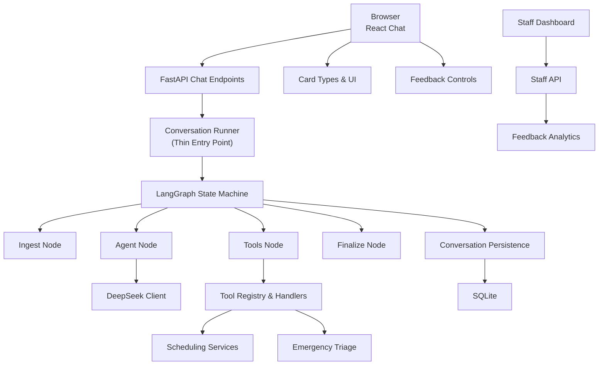

**Diagram sources**
- [chat_api.py:111-163](file://backend/app/api/chat.py#L111-L163)
- [runner.py:39-93](file://backend/app/agent/runner.py#L39-L93)
- [graph.py:466-490](file://backend/app/agent/graph.py#L466-L490)
- [tools.py:511-614](file://backend/app/agent/tools.py#L511-L614)
- [scheduling_tools.py:474-552](file://backend/app/agent/scheduling_tools.py#L474-L552)
- [conversations.py:218-331](file://backend/app/services/conversations.py#L218-L331)
- [deepseek.py:178-329](file://backend/app/ai/deepseek.py#L178-L329)
- [cards.ts:9-188](file://frontend/src/lib/cards.ts#L9-L188)

**Section sources**
- [chat_api.py:1-47](file://backend/app/api/chat.py#L1-L47)
- [runner.py:1-23](file://backend/app/agent/runner.py#L1-L23)
- [graph.py:1-29](file://backend/app/agent/graph.py#L1-L29)
- [conversations_model.py:1-16](file://backend/app/models/conversations.py#L1-L16)
- [sessions_model.py:1-18](file://backend/app/models/sessions.py#L1-L18)
- [cards.ts:1-8](file://frontend/src/lib/cards.ts#L1-L8)

## Core Components
- **Conversation runner**: Thin entry point that validates input, assembles dependencies, and delegates orchestration to the LangGraph state machine. Handles error recovery and degraded responses.
- **LangGraph state machine**: Manages the complete conversation lifecycle through four nodes: ingest, agent, tools, and finalize. Maintains request-scoped state including tool execution context, message history, and card state.
- **Tool registry**: Declares validated tools for identity, registration, practice info, scheduling, family booking, and emergencies.
- **Scheduling tools**: Availability search, proposal creation, confirmation, reschedule, cancellation, appointment listing, and family option handling.
- **Conversation persistence**: Stores every turn (patient, assistant, tool), reconstructs provider messages, and projects visible transcript.
- **Session management**: Issues secure tokens, binds verified patients, scopes conversations per session, and supports reset generation invalidation.
- **Reply formatter**: Ensures prose never duplicates or contradicts structured cards; normalizes style and replaces questions with card-derived prompts.
- **Emergency triage**: Classifies life-threatening symptoms, captures contact details, raises staff alerts, and integrates with handoff.
- **Patient feedback system**: Allows patients to rate assistant responses with thumbs-up/thumbs-down ratings and optional reasons, stored for staff review.
- **Frontend chat hook**: Bootstraps sessions, restores threads, sends messages, reconciles live proposals, drives card interactions, and submits feedback.
- **Card types**: Strongly typed payloads for slots, proposals, family options, confirmations, appointments, and handoffs.

**Section sources**
- [runner.py:39-93](file://backend/app/agent/runner.py#L39-L93)
- [graph.py:97-124](file://backend/app/agent/graph.py#L97-L124)
- [tools.py:511-614](file://backend/app/agent/tools.py#L511-L614)
- [scheduling_tools.py:474-800](file://backend/app/agent/scheduling_tools.py#L474-L800)
- [conversations.py:218-331](file://backend/app/services/conversations.py#L218-L331)
- [patient_sessions.py:38-123](file://backend/app/services/patient_sessions.py#L38-L123)
- [reply_format.py:295-428](file://backend/app/agent/reply_format.py#L295-L428)
- [emergency.py:258-366](file://backend/app/services/emergency.py#L258-L366)
- [useChat.ts:271-749](file://frontend/src/hooks/useChat.ts#L271-L749)
- [cards.ts:9-188](file://frontend/src/lib/cards.ts#L9-L188)

## Architecture Overview
The conversation lifecycle now follows a LangGraph state machine pattern: the runner validates input and creates TurnDeps, then invokes the compiled graph which flows through ingest → agent → tools → finalize. Each node maintains shared state in the AgentState TypedDict, with SQLite as the single source of truth for conversation data. Patients can provide feedback on assistant responses, which is stored and made available to staff for quality monitoring.

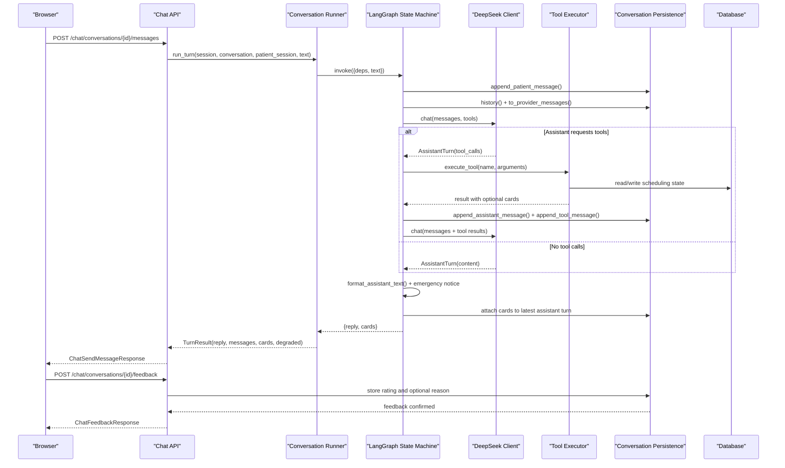

**Diagram sources**
- [chat_api.py:233-274](file://backend/app/api/chat.py#L233-L274)
- [runner.py:39-93](file://backend/app/agent/runner.py#L39-L93)
- [graph.py:466-490](file://backend/app/agent/graph.py#L466-L490)
- [deepseek.py:205-329](file://backend/app/ai/deepseek.py#L205-L329)
- [tools.py:703-739](file://backend/app/agent/tools.py#L703-L739)
- [conversations.py:218-331](file://backend/app/services/conversations.py#L218-L331)

## Detailed Component Analysis

### Conversation Runner
The runner is now a thin entry point that handles input validation, dependency assembly, and error recovery. It delegates the actual conversation orchestration to the LangGraph state machine, focusing only on what the HTTP layer needs: validating message length, checking session ownership, and managing failure paths that must never leave a half-written turn in the transcript.

Key responsibilities:
- Validate input length and ownership.
- Assemble TurnDeps with request-scoped objects.
- Invoke the compiled LangGraph state machine.
- Handle DeepSeekError and unexpected exceptions gracefully.
- Return TurnResult with visible messages and degradation status.

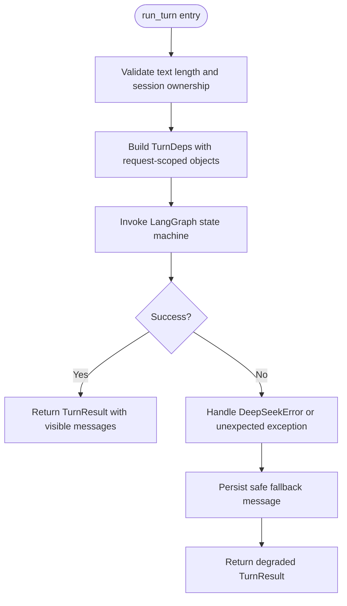

**Diagram sources**
- [runner.py:39-93](file://backend/app/agent/runner.py#L39-L93)
- [runner.py:139-147](file://backend/app/agent/runner.py#L139-L147)

**Section sources**
- [runner.py:39-93](file://backend/app/agent/runner.py#L39-L93)
- [runner.py:139-147](file://backend/app/agent/runner.py#L139-L147)

### LangGraph State Machine
The LangGraph state machine manages the complete conversation lifecycle through four coordinated nodes. The AgentState TypedDict holds everything one turn accumulates, including request-scoped dependencies, tool execution context, message history, card state, and control flow variables.

Node responsibilities:
- **ingest**: Validates the turn, persists the patient message, builds provider messages, and initializes turn state.
- **agent**: Calls the model with visible tools, handles tool call routing, and manages round limits.
- **tools**: Executes tool calls, persists results, merges cards, and refreshes system prompts.
- **finalize**: Applies card and prose rules, ensures emergency notices, and returns the final reply.

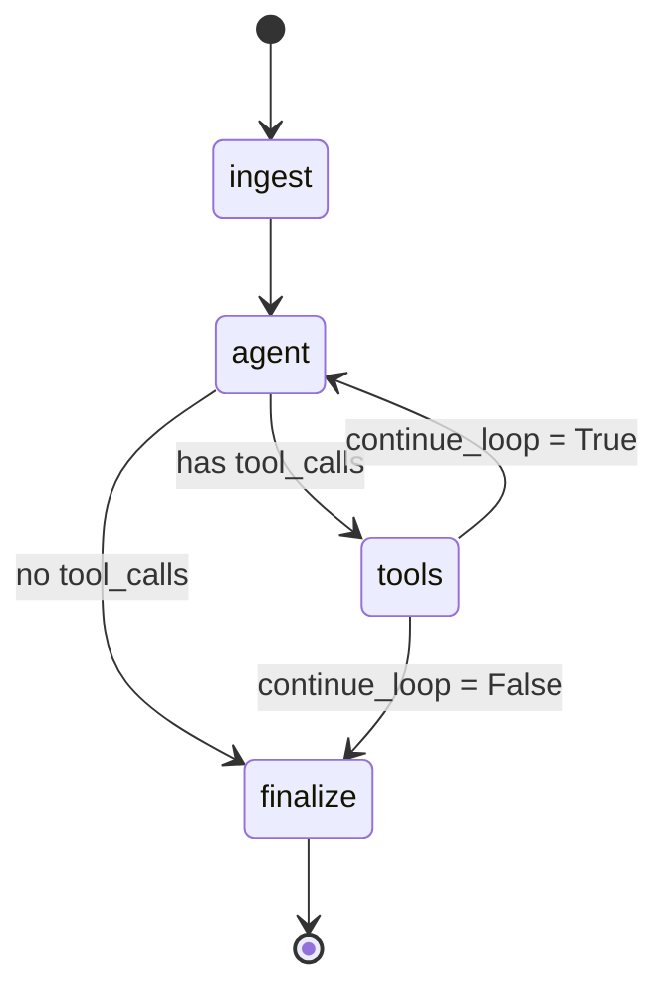

**Diagram sources**
- [graph.py:466-490](file://backend/app/agent/graph.py#L466-L490)
- [graph.py:131-187](file://backend/app/agent/graph.py#L131-L187)
- [graph.py:190-238](file://backend/app/agent/graph.py#L190-L238)
- [graph.py:241-324](file://backend/app/agent/graph.py#L241-L324)
- [graph.py:327-450](file://backend/app/agent/graph.py#L327-L450)

**Section sources**
- [graph.py:97-124](file://backend/app/agent/graph.py#L97-L124)
- [graph.py:131-187](file://backend/app/agent/graph.py#L131-L187)
- [graph.py:190-238](file://backend/app/agent/graph.py#L190-L238)
- [graph.py:241-324](file://backend/app/agent/graph.py#L241-L324)
- [graph.py:327-450](file://backend/app/agent/graph.py#L327-L450)
- [graph.py:466-490](file://backend/app/agent/graph.py#L466-L490)

### Tool Execution and Scheduling Tools
Tools are declared with Pydantic argument models and executed through a single executor that validates inputs, routes to handlers, truncates large results, and converts exceptions into structured tool results. The graph's tools node coordinates tool execution, persists results, and manages card merging across rounds.

Important behaviors:
- Unknown or malformed tool calls become recoverable errors.
- Availability searches can be restricted during re-asks to avoid stale offers.
- Family option clicks are authorized by an opaque identity supplied by the UI, not by model-extracted indices.
- Proposals are created only after explicit selection and are confirmed through dedicated endpoints.
- Reschedules route through a move path that retires the original and books the replacement atomically.

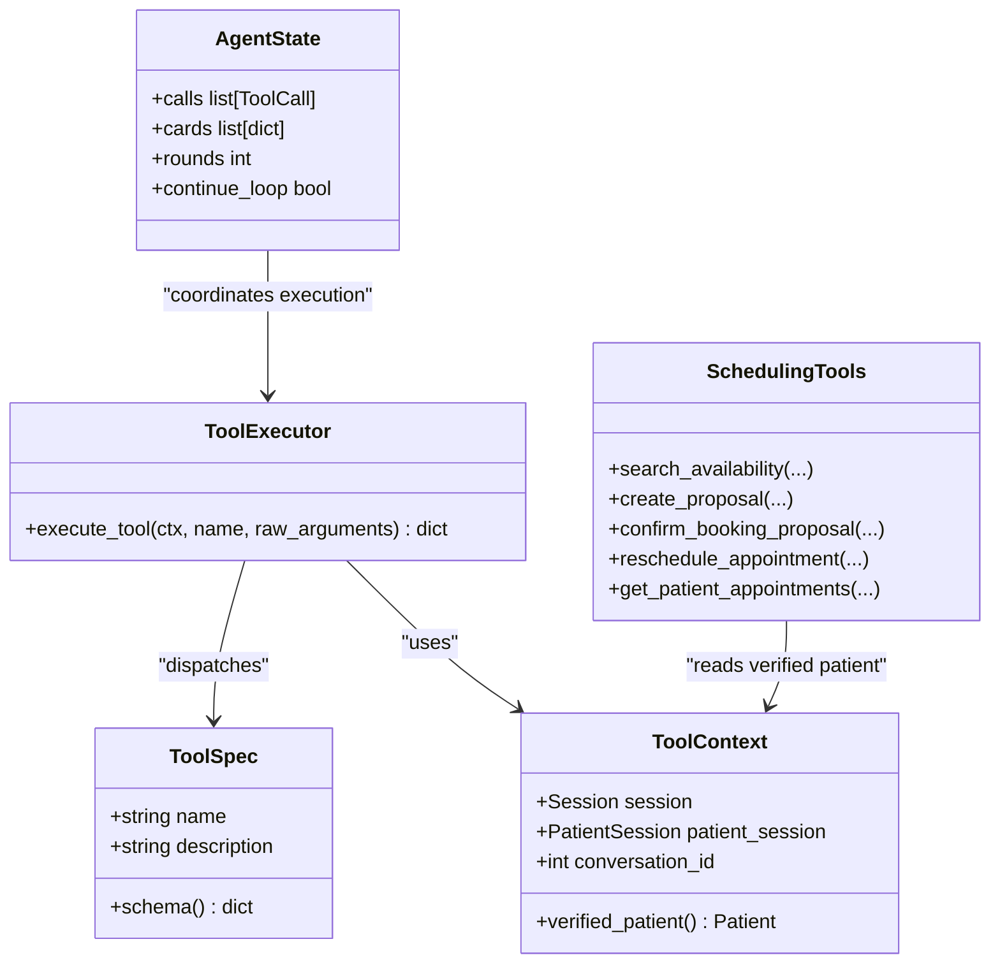

**Diagram sources**
- [tools.py:41-58](file://backend/app/agent/tools.py#L41-L58)
- [tools.py:493-614](file://backend/app/agent/tools.py#L493-L614)
- [tools.py:703-739](file://backend/app/agent/tools.py#L703-L739)
- [scheduling_tools.py:474-800](file://backend/app/agent/scheduling_tools.py#L474-L800)
- [graph.py:241-324](file://backend/app/agent/graph.py#L241-L324)

**Section sources**
- [tools.py:1-11](file://backend/app/agent/tools.py#L1-L11)
- [tools.py:493-614](file://backend/app/agent/tools.py#L493-L614)
- [tools.py:703-739](file://backend/app/agent/tools.py#L703-L739)
- [scheduling_tools.py:474-800](file://backend/app/agent/scheduling_tools.py#L474-L800)
- [graph.py:241-324](file://backend/app/agent/graph.py#L241-L324)

### Conversation Persistence and Replay
Every turn is persisted so the exact thread can be replayed to the provider. The persistence layer stores patient messages, assistant messages (with optional tool calls and cards), and tool results linked by tool call identifiers. It reconstructs provider-compatible messages and projects a client-safe transcript that excludes internal tool payloads.

Key properties:
- Full audit trail: patient, assistant, tool rows with timestamps and sequences.
- Provider replay shape: assistant content plus ordered tool results.
- Visible transcript: only patient and assistant turns, with cards included where present.
- Title backfilling based on substantive first messages.
- Public ID scoping and session-scoped retrieval.

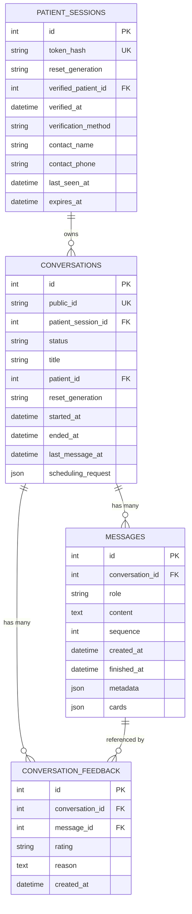

**Diagram sources**
- [conversations_model.py:39-123](file://backend/app/models/conversations.py#L39-L123)
- [conversations_model.py:130-158](file://backend/app/models/conversations.py#L130-L158)
- [sessions_model.py:35-76](file://backend/app/models/sessions.py#L35-L76)
- [conversations.py:218-331](file://backend/app/services/conversations.py#L218-L331)

**Section sources**
- [conversations_model.py:1-16](file://backend/app/models/conversations.py#L1-L16)
- [conversations_model.py:39-123](file://backend/app/models/conversations.py#L39-L123)
- [conversations_model.py:130-158](file://backend/app/models/conversations.py#L130-L158)
- [conversations.py:218-331](file://backend/app/services/conversations.py#L218-L331)
- [conversations.py:334-391](file://backend/app/services/conversations.py#L334-L391)

### Session State and Relationship to Conversations
A patient session is the credential the browser holds. Only its hash is stored, and every request resolves the session before accessing any conversation. A session may span multiple conversations, while each conversation belongs to exactly one session. Reset generations invalidate old sessions and threads when demo data is recreated.

Important rules:
- Token possession authorizes access; conversation IDs alone do not.
- Verified patient binding happens only through registration or lookup tools.
- Resume logic allows a verified session to claim its own thread under a new session handle.
- Reset generation prevents stale threads from being adopted across resets.

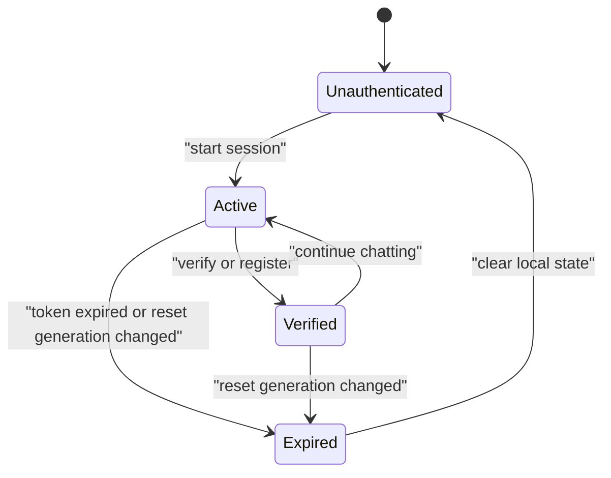

**Diagram sources**
- [patient_sessions.py:3-14](file://backend/app/services/patient_sessions.py#L3-L14)
- [patient_sessions.py:38-123](file://backend/app/services/patient_sessions.py#L38-L123)
- [conversations.py:100-138](file://backend/app/services/conversations.py#L100-L138)
- [generations.py:1-129](file://backend/app/services/generations.py#L1-L129)

**Section sources**
- [patient_sessions.py:3-14](file://backend/app/services/patient_sessions.py#L3-L14)
- [patient_sessions.py:38-123](file://backend/app/services/patient_sessions.py#L38-L123)
- [conversations.py:100-138](file://backend/app/services/conversations.py#L100-L138)
- [generations.py:1-129](file://backend/app/services/generations.py#L1-L129)

### Message Formatting System
The formatter guarantees that prose and cards tell the same story. When slot cards are present, it removes time lists, replaces conflicting introductions, and derives a concise intro and question from the cards. For non-card turns, it normalizes dashes and preserves natural language.

Behaviors:
- Time echoes and list-style time lines are removed when cards already show times.
- A card-derived intro is used when the model's intro is empty, contradictory, or redundant.
- Questions about "which works" are standardized so there is only one question per turn.
- Settled grids produce statements explaining that times are no longer offers.
- Dashes are normalized to plain sentences.

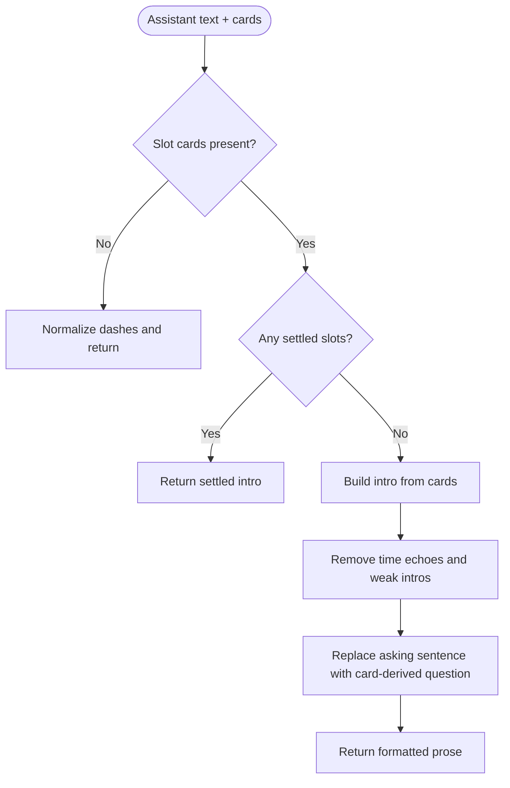

**Diagram sources**
- [reply_format.py:295-428](file://backend/app/agent/reply_format.py#L295-L428)
- [reply_format.py:118-171](file://backend/app/agent/reply_format.py#L118-L171)
- [reply_format.py:201-223](file://backend/app/agent/reply_format.py#L201-L223)

**Section sources**
- [reply_format.py:1-16](file://backend/app/agent/reply_format.py#L1-L16)
- [reply_format.py:295-428](file://backend/app/agent/reply_format.py#L295-L428)

### Error Handling and Fallback Behaviors
Errors are handled at multiple layers:
- The runner catches DeepSeekError and unexpected exceptions, persisting friendly fallback messages.
- The graph handles provider failures within individual nodes and continues with bounded retries.
- Tool execution failures are converted into structured results rather than unhandled exceptions.
- Frontend marks failed messages, offers retry, and recovers from session invalidation.

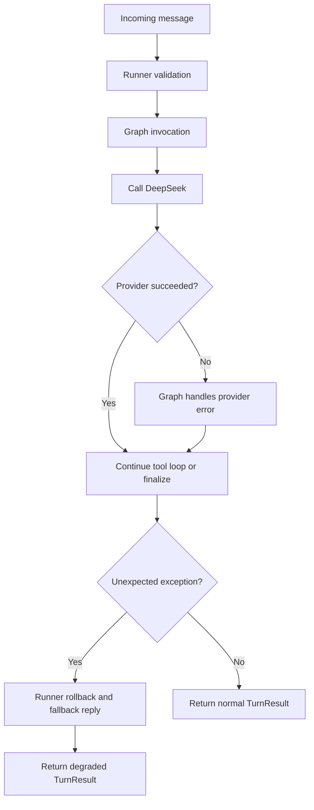

**Diagram sources**
- [runner.py:71-87](file://backend/app/agent/runner.py#L71-L87)
- [runner.py:139-147](file://backend/app/agent/runner.py#L139-L147)
- [deepseek.py:38-65](file://backend/app/ai/deepseek.py#L38-L65)
- [deepseek.py:205-249](file://backend/app/ai/deepseek.py#L205-L249)
- [tools.py:703-739](file://backend/app/agent/tools.py#L703-L739)
- [useChat.ts:548-623](file://frontend/src/hooks/useChat.ts#L548-L623)

**Section sources**
- [runner.py:71-87](file://backend/app/agent/runner.py#L71-L87)
- [runner.py:139-147](file://backend/app/agent/runner.py#L139-L147)
- [deepseek.py:38-65](file://backend/app/ai/deepseek.py#L38-L65)
- [deepseek.py:205-249](file://backend/app/ai/deepseek.py#L205-L249)
- [tools.py:703-739](file://backend/app/agent/tools.py#L703-L739)
- [useChat.ts:548-623](file://frontend/src/hooks/useChat.ts#L548-L623)

### Conversation Replay Capabilities
Replay is supported both server-side and client-side:
- Server reconstructs provider messages from stored rows, pairing assistant tool calls with their tool results.
- Client restores the stored thread, reconciles live proposals, and repairs missing cards for active holds.
- Refresh paths ensure that slot grids and proposals remain actionable only while they are still pending.

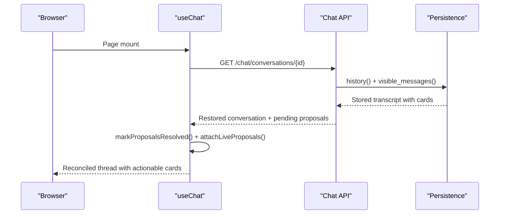

**Diagram sources**
- [useChat.ts:356-384](file://frontend/src/hooks/useChat.ts#L356-L384)
- [useChat.ts:107-175](file://frontend/src/hooks/useChat.ts#L107-L175)
- [conversations.py:285-331](file://backend/app/services/conversations.py#L285-L331)
- [chat_api.py:207-230](file://backend/app/api/chat.py#L207-L230)

**Section sources**
- [useChat.ts:107-175](file://frontend/src/hooks/useChat.ts#L107-L175)
- [useChat.ts:356-384](file://frontend/src/hooks/useChat.ts#L356-L384)
- [conversations.py:285-331](file://backend/app/services/conversations.py#L285-L331)
- [chat_api.py:207-230](file://backend/app/api/chat.py#L207-L230)

### Integration Points with Scheduling and Emergency Systems
- Scheduling: Tools call availability services, create proposals, confirm bookings, reschedule existing visits, and list appointments. The graph restricts tool sets during re-asks and settles superseded grids so the UI shows current state.
- Emergency: Triage determines whether a report is life-threatening, captures contact details, raises staff alerts, and ensures the assistant explicitly mentions front desk notification when handoff cards include urgent alerts.

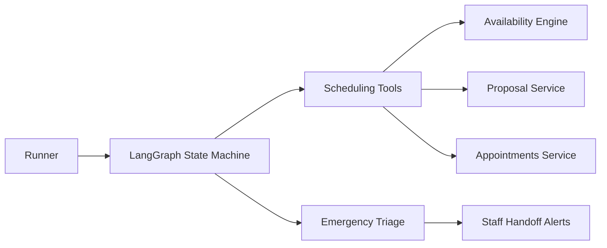

**Diagram sources**
- [scheduling_tools.py:474-800](file://backend/app/agent/scheduling_tools.py#L474-L800)
- [graph.py:594-621](file://backend/app/agent/graph.py#L594-L621)
- [emergency.py:258-366](file://backend/app/services/emergency.py#L258-L366)

**Section sources**
- [scheduling_tools.py:474-800](file://backend/app/agent/scheduling_tools.py#L474-L800)
- [graph.py:594-621](file://backend/app/agent/graph.py#L594-L621)
- [emergency.py:258-366](file://backend/app/services/emergency.py#L258-L366)

## Patient Feedback System

The patient feedback system provides a comprehensive mechanism for patients to rate assistant responses and for staff to monitor conversation quality. This system captures thumbs-up/thumbs-down ratings with optional reasons, creating valuable quality signals for front desk operations.

### Feedback Data Model
The `ConversationFeedback` model stores patient ratings for assistant messages with the following key characteristics:

- **One row per message**: Re-rating updates the existing row instead of stacking contradictory signals
- **Rating field**: Accepts "up" or "down" values representing helpfulness
- **Optional reason**: Up to 500 characters for thumbs-down feedback, completely optional for thumbs-up
- **Audit fields**: Timestamps and foreign keys linking to conversations and messages
- **Indexes**: Optimized for conversation-scoped queries and time-based filtering

### Backend Implementation
The feedback submission endpoint (`POST /chat/conversations/{conversation_id}/feedback`) validates that:
- The message exists and belongs to the session-owned conversation
- The message is an assistant turn (not patient or tool messages)
- The rating is either "up" or "down"
- Reasons are trimmed and limited to 500 characters for down votes only

The implementation automatically clears stale reasons when patients change their rating from down to up, preventing misleading feedback data.

### Frontend Feedback Interface
The MessageBubble component provides intuitive feedback controls:

- **Quick rating buttons**: Thumbs-up and thumbs-down icons below each assistant message
- **Optional reason collection**: When selecting thumbs-down, patients can optionally provide feedback
- **Form validation**: Reason field has character limit and placeholder guidance
- **State management**: Tracks sending state, feedback success/failure, and displays appropriate UI states
- **Graceful error handling**: Failed feedback submissions show warnings but don't interrupt conversation flow

### Staff Feedback Dashboard
The staff dashboard includes a dedicated feedback section that displays:

- **Time-windowed analytics**: Configurable lookback periods (7, 30, or 90 days)
- **Rating counts**: Aggregated statistics showing helpful vs. not helpful ratios
- **Recent feedback list**: Newest feedback entries with conversation titles and message excerpts
- **Reason display**: Optional patient comments displayed prominently for negative feedback
- **Visual indicators**: Color-coded badges and icons distinguishing positive/negative feedback

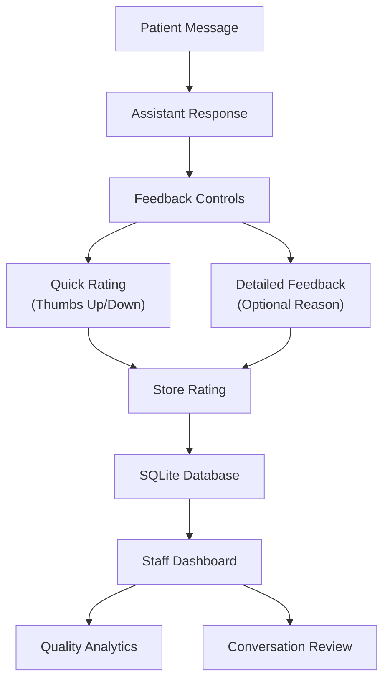

**Diagram sources**
- [MessageBubble.tsx:92-197](file://frontend/src/components/chat/MessageBubble.tsx#L92-L197)
- [chat_api.py:278-322](file://backend/app/api/chat.py#L278-L322)
- [conversations_model.py:130-158](file://backend/app/models/conversations.py#L130-L158)
- [FeedbackSection.tsx:28-139](file://frontend/src/pages/staff/sections/FeedbackSection.tsx#L28-L139)

**Section sources**
- [conversations_model.py:130-158](file://backend/app/models/conversations.py#L130-L158)
- [chat_api.py:278-322](file://backend/app/api/chat.py#L278-L322)
- [schemas.py:241-258](file://backend/app/schemas.py#L241-L258)
- [MessageBubble.tsx:92-197](file://frontend/src/components/chat/MessageBubble.tsx#L92-L197)
- [useChat.ts:707-729](file://frontend/src/hooks/useChat.ts#L707-L729)
- [client.ts:281-300](file://frontend/src/api/client.ts#L281-L300)
- [staff_api.py:325-372](file://backend/app/api/staff.py#L325-L372)
- [FeedbackSection.tsx:28-139](file://frontend/src/pages/staff/sections/FeedbackSection.tsx#L28-L139)

### Typical Conversation Flows
- New patient asks for a cleaning
  - Session starts, greeting is persisted.
  - Model verifies or registers the patient via tools.
  - Availability search returns slot cards.
  - Patient selects a slot; proposal card appears.
  - Confirmation books the visit and returns a confirmation card.
  - Patient rates the assistant response as helpful or not helpful.
- Existing patient asks to change an appointment
  - Appointment listing returns upcoming visits.
  - Reschedule tool proposes replacement times.
  - Replacement slot card carries intent "reschedule".
  - Confirmation retires the original and books the replacement.
  - Patient provides feedback on the rescheduling assistance.
- Family wants two visits
  - Family member registration links the child.
  - Family availability search returns family option cards.
  - UI click supplies opaque option identity to prevent mis-selection.
  - Proposal confirms the combined plan.
  - Patient rates the family booking experience.
- Urgent dental pain
  - Emergency triage detects urgent symptoms.
  - Contact details are captured if unverified.
  - Staff alert is raised and assistant mentions front desk notification.
  - Optional emergency slot check is offered.
  - Patient may provide feedback on emergency handling.

[No sources needed since this section summarizes workflows without quoting code]

## Dependency Analysis
The runner depends on the LangGraph state machine, which in turn depends on the AI client, tool registry, conversation persistence, and scheduling services. The frontend depends on the chat API, card action hooks, and feedback submission capabilities.

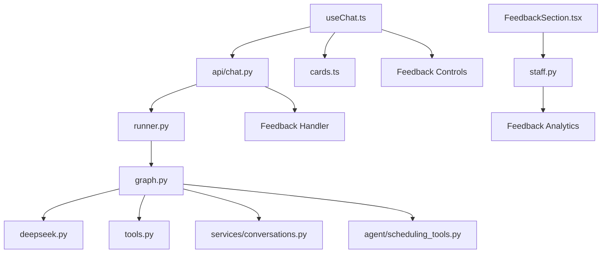

**Diagram sources**
- [runner.py:39-93](file://backend/app/agent/runner.py#L39-L93)
- [graph.py:466-490](file://backend/app/agent/graph.py#L466-L490)
- [chat_api.py:22-47](file://backend/app/api/chat.py#L22-L47)
- [chat_api.py:278-322](file://backend/app/api/chat.py#L278-L322)
- [useChat.ts:24-39](file://frontend/src/hooks/useChat.ts#L24-L39)
- [cards.ts:9-188](file://frontend/src/lib/cards.ts#L9-L188)

**Section sources**
- [runner.py:39-93](file://backend/app/agent/runner.py#L39-L93)
- [graph.py:466-490](file://backend/app/agent/graph.py#L466-L490)
- [chat_api.py:22-47](file://backend/app/api/chat.py#L22-L47)
- [chat_api.py:278-322](file://backend/app/api/chat.py#L278-L322)
- [useChat.ts:24-39](file://frontend/src/hooks/useChat.ts#L24-L39)

## Performance Considerations
- Bounded tool loops: `MAX_TOOL_ROUNDS` and `MAX_TOOL_CALLS_PER_ROUND` limit provider round-trips and fan-out.
- Threadpool execution: Blocking AI and database writes are offloaded from the event loop.
- Result truncation: Large tool results are trimmed while preserving decision fields and cards.
- Efficient replay: History is loaded once per turn and reconstructed into provider messages.
- Frontend reconciliation: Live proposals are reconciled once per restore to avoid repeated network calls.
- Feedback query optimization: Indexed columns enable efficient time-windowed feedback queries for staff dashboards.
- Graph compilation: The LangGraph state machine is compiled once at import and reused for all turns.

[No sources needed since this section provides general guidance]

## Troubleshooting Guide
Common issues and resolutions:
- Empty or too-long patient messages: The runner trims long messages and rejects empty ones at the API layer.
- Provider unavailable or rate-limited: Typed exceptions surface friendly messages; the runner persists a fallback reply and marks the turn degraded.
- Tool validation failure: Malformed or invalid arguments return structured errors guiding the model to ask for clarification.
- Stale slot grid on refresh: The graph settles superseded grids and replays earlier slot cards when appropriate.
- Missing proposal card after crash: The frontend re-attaches live proposals to the newest assistant turn.
- Session expired or reset: The frontend clears local state and bootstraps a fresh session, optionally resuming the same thread when allowed.
- Feedback submission failures: Failed feedback attempts show warning messages but don't interrupt conversation flow; patients can retry later.
- Missing feedback in staff dashboard: Verify the feedback window settings and ensure the conversation falls within the selected time range.
- Graph state inconsistencies: Check that the AgentState TypedDict fields are properly initialized in the ingest node.

**Section sources**
- [chat_api.py:233-274](file://backend/app/api/chat.py#L233-L274)
- [runner.py:49-57](file://backend/app/agent/runner.py#L49-L57)
- [runner.py:71-87](file://backend/app/agent/runner.py#L71-L87)
- [tools.py:703-739](file://backend/app/agent/tools.py#L703-L739)
- [graph.py:327-450](file://backend/app/agent/graph.py#L327-L450)
- [useChat.ts:548-623](file://frontend/src/hooks/useChat.ts#L548-L623)
- [useChat.ts:707-729](file://frontend/src/hooks/useChat.ts#L707-L729)

## Conclusion
The conversation management system now combines a thin runner entry point, a LangGraph-based state machine for orchestration, validated tools, full-audit persistence, structured card UI, and comprehensive patient feedback mechanisms to deliver safe, reliable patient interactions. The graph-based approach centralizes conversation state management, making the system more maintainable and testable. It protects against provider failures, stale offers, and inconsistent prose, while integrating tightly with scheduling and emergency workflows. The patient feedback system provides valuable quality signals that help front desk staff identify conversations requiring attention and improve overall service quality. The frontend maintains a resilient state machine that restores threads, reconciles live proposals, guides users through complex flows such as family bookings and appointment changes, and seamlessly integrates feedback collection into the conversation experience.

[No sources needed since this section summarizes without analyzing specific files]

## Appendices

### API Entry Points for Conversation Management
- Start session: creates a patient session and opens or resumes a conversation.
- List conversations: returns summaries scoped to the current session.
- Start conversation: creates a new thread within the session.
- Restore conversation: replays stored messages and pending proposals.
- Send message: runs one assistant turn and returns reply, messages, cards, and degradation flag.
- Submit feedback: records thumbs up/down for assistant turns with optional reasons.
- Reset within session: closes active threads and keeps the session.

**Section sources**
- [chat_api.py:111-163](file://backend/app/api/chat.py#L111-L163)
- [chat_api.py:166-204](file://backend/app/api/chat.py#L166-L204)
- [chat_api.py:207-230](file://backend/app/api/chat.py#L207-L230)
- [chat_api.py:233-274](file://backend/app/api/chat.py#L233-L274)
- [chat_api.py:277-322](file://backend/app/api/chat.py#L277-L322)
- [chat_api.py:325-347](file://backend/app/api/chat.py#L325-L347)

### Staff API Endpoints for Feedback Monitoring
- Get feedback summary: retrieves aggregated feedback counts and recent feedback entries within a configurable time window.
- Parameters: days (1-365), limit (1-200) for controlling the feedback dataset size.
- Returns: counts (up/down/total), window_days, and detailed feedback list with conversation context.

**Section sources**
- [staff_api.py:325-372](file://backend/app/api/staff.py#L325-L372)
- [staff.ts:301-302](file://frontend/src/api/staff.ts#L301-L302)