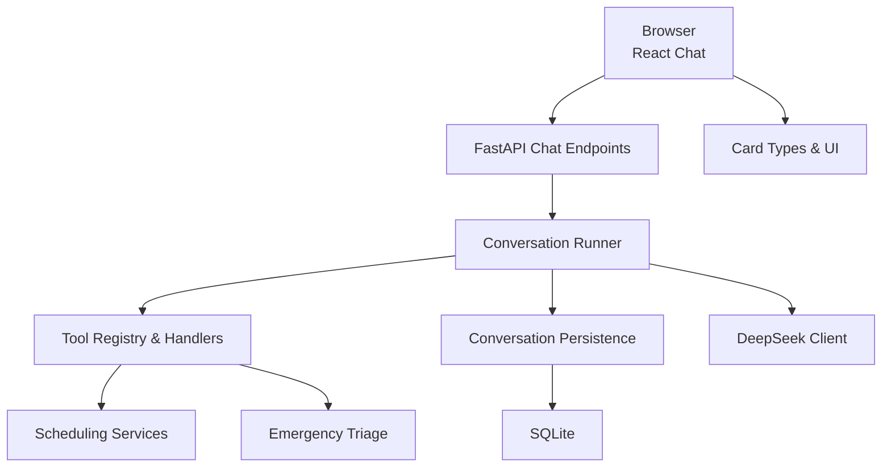
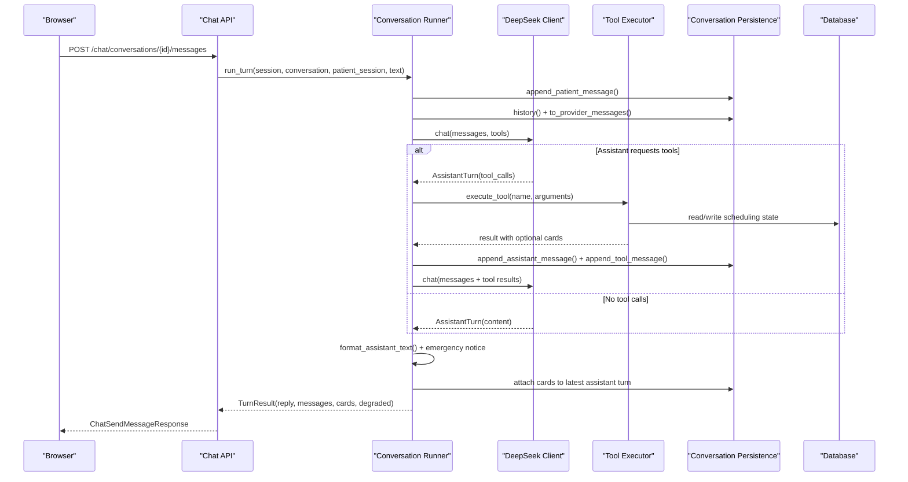
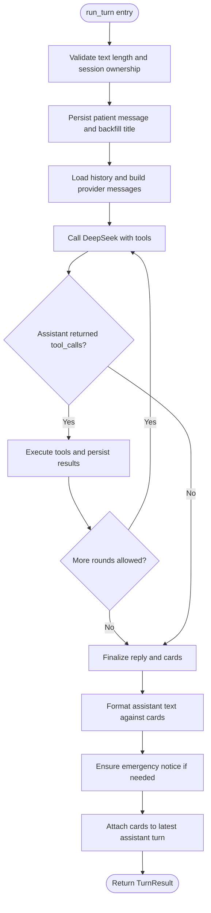
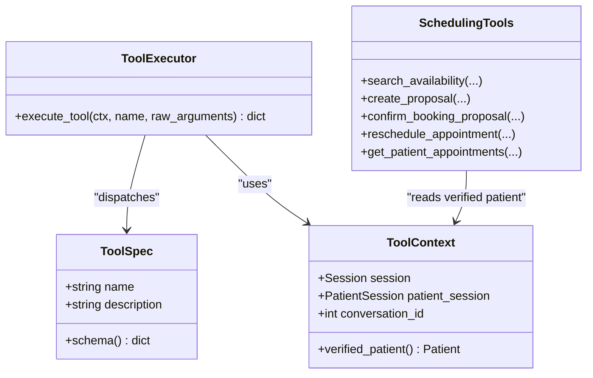
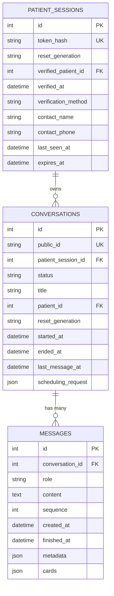
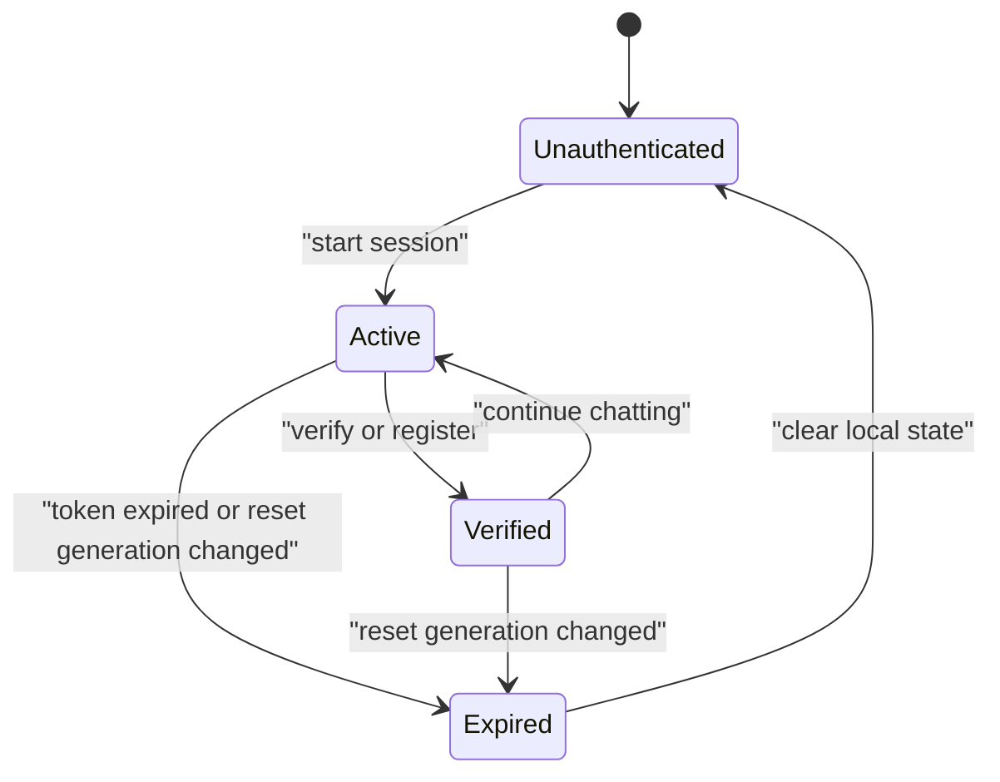
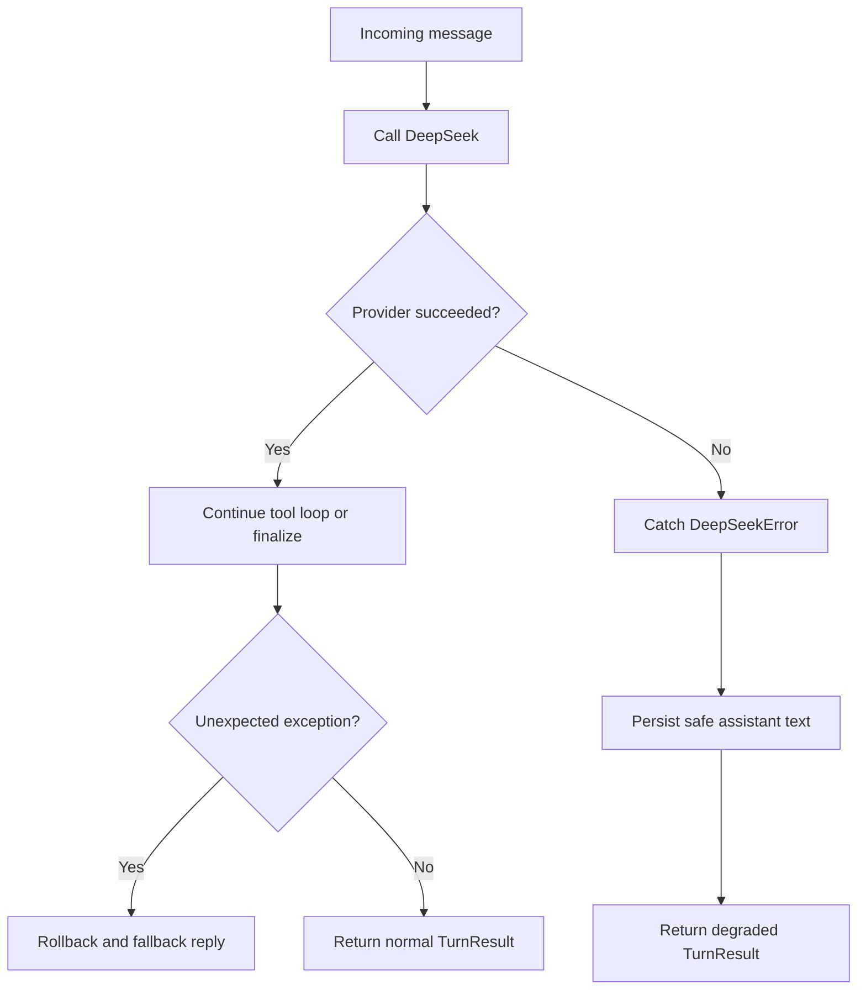
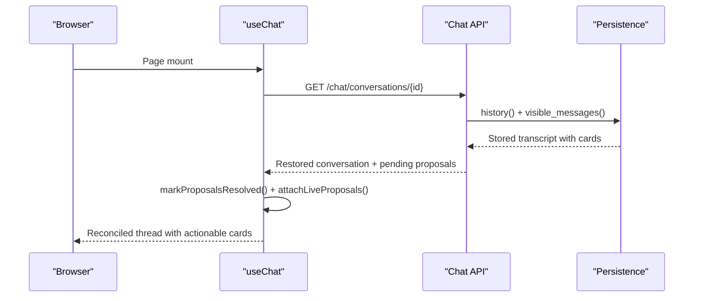
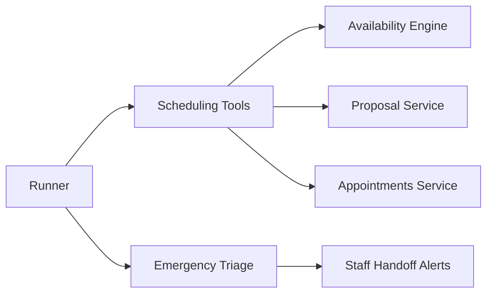
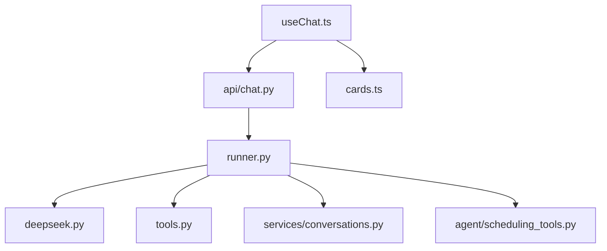

# Conversation Management

<cite>
**Referenced Files in This Document**
- [runner.py](file://backend/app/agent/runner.py)
- [tools.py](file://backend/app/agent/tools.py)
- [scheduling_tools.py](file://backend/app/agent/scheduling_tools.py)
- [deepseek.py](file://backend/app/ai/deepseek.py)
- [conversations.py](file://backend/app/services/conversations.py)
- [conversations_model.py](file://backend/app/models/conversations.py)
- [sessions_model.py](file://backend/app/models/sessions.py)
- [patient_sessions.py](file://backend/app/services/patient_sessions.py)
- [chat_api.py](file://backend/app/api/chat.py)
- [reply_format.py](file://backend/app/agent/reply_format.py)
- [emergency.py](file://backend/app/services/emergency.py)
- [generations.py](file://backend/app/services/generations.py)
- [cards.ts](file://frontend/src/lib/cards.ts)
- [MessageBubble.tsx](file://frontend/src/components/chat/MessageBubble.tsx)
- [useChat.ts](file://frontend/src/hooks/useChat.ts)
</cite>

## Table of Contents
1. [Introduction](#introduction)
2. [Project Structure](#project-structure)
3. [Core Components](#core-components)
4. [Architecture Overview](#architecture-overview)
5. [Detailed Component Analysis](#detailed-component-analysis)
6. [Dependency Analysis](#dependency-analysis)
7. [Performance Considerations](#performance-considerations)
8. [Troubleshooting Guide](#troubleshooting-guide)
9. [Conclusion](#conclusion)
10. [Appendices](#appendices)

## Introduction
This document explains the conversation management system that turns patient natural-language messages into safe, auditable assistant replies and interactive scheduling cards. It covers the full lifecycle from message receipt through AI processing, tool execution, response formatting, persistence, replay, error handling, and integration with scheduling and emergency systems. It also documents how conversations relate to patient sessions, how state is persisted, and how the frontend renders structured card-based UI components.

## Project Structure
The system is split between a FastAPI backend and a React frontend:

- Backend layers
  - API layer exposes chat endpoints and session management.
  - Agent layer orchestrates the AI agent, tool loop, and reply formatting.
  - Services layer implements scheduling, availability, emergencies, audit, and persistence helpers.
  - Models define conversations, messages, sessions, and related entities.
  - AI client wraps DeepSeek-compatible provider calls.
- Frontend layer
  - Chat hook manages bootstrap, restore, send, retry, and card actions.
  - Message bubble renders text and interactive cards.
  - Card type definitions describe slot grids, proposals, confirmations, handoffs, and more.

**Diagram sources**
- [chat_api.py:111-163](file://backend/app/api/chat.py#L111-L163)
- [runner.py:171-406](file://backend/app/agent/runner.py#L171-L406)
- [tools.py:511-614](file://backend/app/agent/tools.py#L511-L614)
- [scheduling_tools.py:474-552](file://backend/app/agent/scheduling_tools.py#L474-L552)
- [conversations.py:218-331](file://backend/app/services/conversations.py#L218-L331)
- [deepseek.py:178-329](file://backend/app/ai/deepseek.py#L178-L329)
- [cards.ts:9-188](file://frontend/src/lib/cards.ts#L9-L188)

**Section sources**
- [chat_api.py:1-47](file://backend/app/api/chat.py#L1-L47)
- [runner.py:1-23](file://backend/app/agent/runner.py#L1-L23)
- [conversations_model.py:1-16](file://backend/app/models/conversations.py#L1-L16)
- [sessions_model.py:1-18](file://backend/app/models/sessions.py#L1-L18)
- [cards.ts:1-8](file://frontend/src/lib/cards.ts#L1-L8)

## Core Components
- Conversation runner: Executes one patient message end-to-end, including history loading, provider call, tool loop, fallback behavior, and final formatting.
- Tool registry: Declares validated tools for identity, registration, practice info, scheduling, family booking, and emergencies.
- Scheduling tools: Availability search, proposal creation, confirmation, reschedule, cancellation, appointment listing, and family option handling.
- Conversation persistence: Stores every turn (patient, assistant, tool), reconstructs provider messages, and projects visible transcript.
- Session management: Issues secure tokens, binds verified patients, scopes conversations per session, and supports reset generation invalidation.
- Reply formatter: Ensures prose never duplicates or contradicts structured cards; normalizes style and replaces questions with card-derived prompts.
- Emergency triage: Classifies life-threatening symptoms, captures contact details, raises staff alerts, and integrates with handoff.
- Frontend chat hook: Bootstraps sessions, restores threads, sends messages, reconciles live proposals, and drives card interactions.
- Card types: Strongly typed payloads for slots, proposals, family options, confirmations, appointments, and handoffs.

**Section sources**
- [runner.py:171-406](file://backend/app/agent/runner.py#L171-L406)
- [tools.py:511-614](file://backend/app/agent/tools.py#L511-L614)
- [scheduling_tools.py:474-800](file://backend/app/agent/scheduling_tools.py#L474-L800)
- [conversations.py:218-331](file://backend/app/services/conversations.py#L218-L331)
- [patient_sessions.py:38-123](file://backend/app/services/patient_sessions.py#L38-L123)
- [reply_format.py:295-428](file://backend/app/agent/reply_format.py#L295-L428)
- [emergency.py:258-366](file://backend/app/services/emergency.py#L258-L366)
- [useChat.ts:271-749](file://frontend/src/hooks/useChat.ts#L271-L749)
- [cards.ts:9-188](file://frontend/src/lib/cards.ts#L9-L188)

## Architecture Overview
The conversation lifecycle follows a strict sequence: authenticate session, persist patient message, load thread, build system prompt, call the AI provider, execute requested tools, persist assistant and tool results, call the provider again if needed, format the final reply, attach cards, and return the visible transcript.

**Diagram sources**
- [chat_api.py:233-274](file://backend/app/api/chat.py#L233-L274)
- [runner.py:171-406](file://backend/app/agent/runner.py#L171-L406)
- [deepseek.py:205-329](file://backend/app/ai/deepseek.py#L205-L329)
- [tools.py:703-739](file://backend/app/agent/tools.py#L703-L739)
- [conversations.py:218-331](file://backend/app/services/conversations.py#L218-L331)

## Detailed Component Analysis

### Conversation Runner
The runner is the central orchestrator for each patient message. It enforces bounds on tool rounds and fan-out, persists every step, handles fallbacks when the provider fails, and ensures the final reply is consistent with the attached cards.

Key responsibilities:
- Validate input length and ownership.
- Append the patient message and update conversation metadata.
- Build system prompt and provider messages from stored history.
- Run the tool loop with bounded retries and round limits.
- Execute tools safely and log outcomes without sensitive payloads.
- Attach cards to the correct assistant turn and deduplicate them.
- Enforce emergency notices when handoff cards include urgent alerts.
- Format prose so it does not duplicate or contradict cards.

**Diagram sources**
- [runner.py:171-406](file://backend/app/agent/runner.py#L171-L406)
- [runner.py:409-557](file://backend/app/agent/runner.py#L409-L557)
- [runner.py:560-761](file://backend/app/agent/runner.py#L560-L761)

**Section sources**
- [runner.py:171-406](file://backend/app/agent/runner.py#L171-L406)
- [runner.py:409-557](file://backend/app/agent/runner.py#L409-L557)
- [runner.py:560-761](file://backend/app/agent/runner.py#L560-L761)
- [runner.py:802-880](file://backend/app/agent/runner.py#L802-L880)

### Tool Execution and Scheduling Tools
Tools are declared with Pydantic argument models and executed through a single executor that validates inputs, routes to handlers, truncates large results, and converts exceptions into structured tool results. Scheduling tools implement availability searches, proposal creation, confirmations, reschedules, cancellations, appointment listings, and family option handling. They always resolve the patient from the authenticated context, never from model arguments.

Important behaviors:
- Unknown or malformed tool calls become recoverable errors.
- Availability searches can be restricted during re-asks to avoid stale offers.
- Family option clicks are authorized by an opaque identity supplied by the UI, not by model-extracted indices.
- Proposals are created only after explicit selection and are confirmed through dedicated endpoints.
- Reschedules route through a move path that retires the original and books the replacement atomically.

**Diagram sources**
- [tools.py:41-58](file://backend/app/agent/tools.py#L41-L58)
- [tools.py:493-614](file://backend/app/agent/tools.py#L493-L614)
- [tools.py:703-739](file://backend/app/agent/tools.py#L703-L739)
- [scheduling_tools.py:474-800](file://backend/app/agent/scheduling_tools.py#L474-L800)

**Section sources**
- [tools.py:1-11](file://backend/app/agent/tools.py#L1-L11)
- [tools.py:493-614](file://backend/app/agent/tools.py#L493-L614)
- [tools.py:703-739](file://backend/app/agent/tools.py#L703-L739)
- [scheduling_tools.py:474-800](file://backend/app/agent/scheduling_tools.py#L474-L800)

### Conversation Persistence and Replay
Every turn is persisted so the exact thread can be replayed to the provider. The persistence layer stores patient messages, assistant messages (with optional tool calls and cards), and tool results linked by tool call identifiers. It reconstructs provider-compatible messages and projects a client-safe transcript that excludes internal tool payloads.

Key properties:
- Full audit trail: patient, assistant, tool rows with timestamps and sequences.
- Provider replay shape: assistant content plus ordered tool results.
- Visible transcript: only patient and assistant turns, with cards included where present.
- Title backfilling based on substantive first messages.
- Public ID scoping and session-scoped retrieval.

**Diagram sources**
- [conversations_model.py:39-123](file://backend/app/models/conversations.py#L39-L123)
- [sessions_model.py:35-76](file://backend/app/models/sessions.py#L35-L76)
- [conversations.py:218-331](file://backend/app/services/conversations.py#L218-L331)

**Section sources**
- [conversations_model.py:1-16](file://backend/app/models/conversations.py#L1-L16)
- [conversations_model.py:39-123](file://backend/app/models/conversations.py#L39-L123)
- [conversations.py:218-331](file://backend/app/services/conversations.py#L218-L331)
- [conversations.py:334-391](file://backend/app/services/conversations.py#L334-L391)

### Session State and Relationship to Conversations
A patient session is the credential the browser holds. Only its hash is stored, and every request resolves the session before accessing any conversation. A session may span multiple conversations, while each conversation belongs to exactly one session. Reset generations invalidate old sessions and threads when demo data is recreated.

Important rules:
- Token possession authorizes access; conversation IDs alone do not.
- Verified patient binding happens only through registration or lookup tools.
- Resume logic allows a verified session to claim its own thread under a new session handle.
- Reset generation prevents stale threads from being adopted across resets.

**Diagram sources**
- [patient_sessions.py:3-14](file://backend/app/services/patient_sessions.py#L3-L14)
- [patient_sessions.py:38-123](file://backend/app/services/patient_sessions.py#L38-L123)
- [conversations.py:100-138](file://backend/app/services/conversations.py#L100-L138)
- [generations.py:1-129](file://backend/app/services/generations.py#L1-L129)

**Section sources**
- [patient_sessions.py:3-14](file://backend/app/services/patient_sessions.py#L3-L14)
- [patient_sessions.py:38-123](file://backend/app/services/patient_sessions.py#L38-L123)
- [conversations.py:100-138](file://backend/app/services/conversations.py#L100-L138)
- [generations.py:1-129](file://backend/app/services/generations.py#L1-L129)

### Message Formatting System
The formatter guarantees that prose and cards tell the same story. When slot cards are present, it removes time lists, replaces conflicting introductions, and derives a concise intro and question from the cards. For non-card turns, it normalizes dashes and preserves natural language.

Behaviors:
- Time echoes and list-style time lines are removed when cards already show times.
- A card-derived intro is used when the model’s intro is empty, contradictory, or redundant.
- Questions about “which works” are standardized so there is only one question per turn.
- Settled grids produce statements explaining that times are no longer offers.
- Dashes are normalized to plain sentences.

**Diagram sources**
- [reply_format.py:295-428](file://backend/app/agent/reply_format.py#L295-L428)
- [reply_format.py:118-171](file://backend/app/agent/reply_format.py#L118-L171)
- [reply_format.py:201-223](file://backend/app/agent/reply_format.py#L201-L223)

**Section sources**
- [reply_format.py:1-16](file://backend/app/agent/reply_format.py#L1-L16)
- [reply_format.py:295-428](file://backend/app/agent/reply_format.py#L295-L428)

### Error Handling and Fallback Behaviors
Errors are handled at multiple layers:
- Provider failures raise typed exceptions with user-facing messages.
- The runner catches provider errors and persists a short friendly assistant message.
- Unexpected exceptions trigger a rollback and a generic fallback reply.
- Tool execution failures are converted into structured results rather than unhandled exceptions.
- Frontend marks failed messages, offers retry, and recovers from session invalidation.

**Diagram sources**
- [runner.py:264-292](file://backend/app/agent/runner.py#L264-L292)
- [deepseek.py:38-65](file://backend/app/ai/deepseek.py#L38-L65)
- [deepseek.py:205-249](file://backend/app/ai/deepseek.py#L205-L249)
- [tools.py:703-739](file://backend/app/agent/tools.py#L703-L739)
- [useChat.ts:548-623](file://frontend/src/hooks/useChat.ts#L548-L623)

**Section sources**
- [runner.py:264-292](file://backend/app/agent/runner.py#L264-L292)
- [deepseek.py:38-65](file://backend/app/ai/deepseek.py#L38-L65)
- [deepseek.py:205-249](file://backend/app/ai/deepseek.py#L205-L249)
- [tools.py:703-739](file://backend/app/agent/tools.py#L703-L739)
- [useChat.ts:548-623](file://frontend/src/hooks/useChat.ts#L548-L623)

### Conversation Replay Capabilities
Replay is supported both server-side and client-side:
- Server reconstructs provider messages from stored rows, pairing assistant tool calls with their tool results.
- Client restores the stored thread, reconciles live proposals, and repairs missing cards for active holds.
- Refresh paths ensure that slot grids and proposals remain actionable only while they are still pending.

**Diagram sources**
- [useChat.ts:356-384](file://frontend/src/hooks/useChat.ts#L356-L384)
- [useChat.ts:107-175](file://frontend/src/hooks/useChat.ts#L107-L175)
- [conversations.py:285-331](file://backend/app/services/conversations.py#L285-L331)
- [chat_api.py:207-230](file://backend/app/api/chat.py#L207-L230)

**Section sources**
- [useChat.ts:107-175](file://frontend/src/hooks/useChat.ts#L107-L175)
- [useChat.ts:356-384](file://frontend/src/hooks/useChat.ts#L356-L384)
- [conversations.py:285-331](file://backend/app/services/conversations.py#L285-L331)
- [chat_api.py:207-230](file://backend/app/api/chat.py#L207-L230)

### Integration Points with Scheduling and Emergency Systems
- Scheduling: Tools call availability services, create proposals, confirm bookings, reschedule existing visits, and list appointments. The runner restricts tool sets during re-asks and settles superseded grids so the UI shows current state.
- Emergency: Triage determines whether a report is life-threatening, captures contact details, raises staff alerts, and ensures the assistant explicitly mentions front desk notification when handoff cards include urgent alerts.

**Diagram sources**
- [scheduling_tools.py:474-800](file://backend/app/agent/scheduling_tools.py#L474-L800)
- [runner.py:236-263](file://backend/app/agent/runner.py#L236-L263)
- [emergency.py:258-366](file://backend/app/services/emergency.py#L258-L366)

**Section sources**
- [scheduling_tools.py:474-800](file://backend/app/agent/scheduling_tools.py#L474-L800)
- [runner.py:236-263](file://backend/app/agent/runner.py#L236-L263)
- [emergency.py:258-366](file://backend/app/services/emergency.py#L258-L366)

### Typical Conversation Flows
- New patient asks for a cleaning
  - Session starts, greeting is persisted.
  - Model verifies or registers the patient via tools.
  - Availability search returns slot cards.
  - Patient selects a slot; proposal card appears.
  - Confirmation books the visit and returns a confirmation card.
- Existing patient asks to change an appointment
  - Appointment listing returns upcoming visits.
  - Reschedule tool proposes replacement times.
  - Replacement slot card carries intent “reschedule”.
  - Confirmation retires the original and books the replacement.
- Family wants two visits
  - Family member registration links the child.
  - Family availability search returns family option cards.
  - UI click supplies opaque option identity to prevent mis-selection.
  - Proposal confirms the combined plan.
- Urgent dental pain
  - Emergency triage detects urgent symptoms.
  - Contact details are captured if unverified.
  - Staff alert is raised and assistant mentions front desk notification.
  - Optional emergency slot check is offered.

[No sources needed since this section summarizes workflows without quoting code]

## Dependency Analysis
The runner depends on the AI client, tool registry, conversation persistence, and scheduling services. The frontend depends on the chat API and card action hooks.

**Diagram sources**
- [runner.py:35-47](file://backend/app/agent/runner.py#L35-L47)
- [chat_api.py:22-47](file://backend/app/api/chat.py#L22-L47)
- [useChat.ts:24-39](file://frontend/src/hooks/useChat.ts#L24-L39)
- [cards.ts:9-188](file://frontend/src/lib/cards.ts#L9-L188)

**Section sources**
- [runner.py:35-47](file://backend/app/agent/runner.py#L35-L47)
- [chat_api.py:22-47](file://backend/app/api/chat.py#L22-L47)
- [useChat.ts:24-39](file://frontend/src/hooks/useChat.ts#L24-L39)

## Performance Considerations
- Bounded tool loops: `MAX_TOOL_ROUNDS` and `MAX_TOOL_CALLS_PER_ROUND` limit provider round-trips and fan-out.
- Threadpool execution: Blocking AI and database writes are offloaded from the event loop.
- Result truncation: Large tool results are trimmed while preserving decision fields and cards.
- Efficient replay: History is loaded once per turn and reconstructed into provider messages.
- Frontend reconciliation: Live proposals are reconciled once per restore to avoid repeated network calls.

[No sources needed since this section provides general guidance]

## Troubleshooting Guide
Common issues and resolutions:
- Empty or too-long patient messages: The runner trims long messages and rejects empty ones at the API layer.
- Provider unavailable or rate-limited: Typed exceptions surface friendly messages; the runner persists a fallback reply and marks the turn degraded.
- Tool validation failure: Malformed or invalid arguments return structured errors guiding the model to ask for clarification.
- Stale slot grid on refresh: The runner settles superseded grids and replays earlier slot cards when appropriate.
- Missing proposal card after crash: The frontend re-attaches live proposals to the newest assistant turn.
- Session expired or reset: The frontend clears local state and bootstraps a fresh session, optionally resuming the same thread when allowed.

**Section sources**
- [chat_api.py:233-274](file://backend/app/api/chat.py#L233-L274)
- [runner.py:181-189](file://backend/app/agent/runner.py#L181-L189)
- [runner.py:264-292](file://backend/app/agent/runner.py#L264-L292)
- [tools.py:703-739](file://backend/app/agent/tools.py#L703-L739)
- [runner.py:323-351](file://backend/app/agent/runner.py#L323-L351)
- [useChat.ts:548-623](file://frontend/src/hooks/useChat.ts#L548-L623)

## Conclusion
The conversation management system combines a deterministic runner, validated tools, full-audit persistence, and a structured card UI to deliver safe, reliable patient interactions. It protects against provider failures, stale offers, and inconsistent prose, while integrating tightly with scheduling and emergency workflows. The frontend maintains a resilient state machine that restores threads, reconciles live proposals, and guides users through complex flows such as family bookings and appointment changes.

[No sources needed since this section summarizes without analyzing specific files]

## Appendices

### API Entry Points for Conversation Management
- Start session: creates a patient session and opens or resumes a conversation.
- List conversations: returns summaries scoped to the current session.
- Start conversation: creates a new thread within the session.
- Restore conversation: replays stored messages and pending proposals.
- Send message: runs one assistant turn and returns reply, messages, cards, and degradation flag.
- Submit feedback: records thumbs up/down for assistant turns.
- Reset within session: closes active threads and keeps the session.

**Section sources**
- [chat_api.py:111-163](file://backend/app/api/chat.py#L111-L163)
- [chat_api.py:166-204](file://backend/app/api/chat.py#L166-L204)
- [chat_api.py:207-230](file://backend/app/api/chat.py#L207-L230)
- [chat_api.py:233-274](file://backend/app/api/chat.py#L233-L274)
- [chat_api.py:277-322](file://backend/app/api/chat.py#L277-L322)
- [chat_api.py:325-347](file://backend/app/api/chat.py#L325-L347)