# Conversation Persistence

<cite>
**Referenced Files in This Document**
- [conversations.py](file://backend/app/models/conversations.py)
- [base.py](file://backend/app/models/base.py)
- [conversations_service.py](file://backend/app/services/conversations.py)
- [chat_api.py](file://backend/app/api/chat.py)
- [schemas.py](file://backend/app/schemas.py)
- [runner.py](file://backend/app/agent/runner.py)
- [audit.py](file://backend/app/services/audit.py)
</cite>

## Table of Contents
1. [Introduction](#introduction)
2. [Project Structure](#project-structure)
3. [Core Components](#core-components)
4. [Architecture Overview](#architecture-overview)
5. [Detailed Component Analysis](#detailed-component-analysis)
6. [Dependency Analysis](#dependency-analysis)
7. [Performance Considerations](#performance-considerations)
8. [Troubleshooting Guide](#troubleshooting-guide)
9. [Conclusion](#conclusion)

## Introduction
This document explains the conversation persistence layer that stores and retrieves patient chat history for a dental receptionist system. It covers:

- The `Conversation` and `Message` data models and their relationships.
- How complete conversation history is persisted, including tool calls and state transitions.
- Message sequence management and conversation status tracking.
- Conversion from internal message rows to OpenAI-compatible provider messages.
- Security boundaries between public and internal access methods.
- Scoping conversations to patient sessions.
- Data retention and reset semantics.
- Practical examples of creating conversations, appending messages, and retrieving history.

The design prioritizes replay fidelity: every turn is stored so the full thread can be replayed to the model exactly as it happened, including assistant tool calls and their matching results.

## Project Structure
The persistence logic spans four layers:

| Layer | Responsibility | Key Files |
|---|---|---|
| Models | Database schema, enums, relationships | [conversations.py](file://backend/app/models/conversations.py), [base.py](file://backend/app/models/base.py) |
| Services | Persistence operations, provider conversion, scoping helpers | [conversations_service.py](file://backend/app/services/conversations.py) |
| API | HTTP endpoints, session-scoped access, response shaping | [chat_api.py](file://backend/app/api/chat.py), [schemas.py](file://backend/app/schemas.py) |
| Runner | End-to-end turn execution, tool loop, audit-style persistence | [runner.py](file://backend/app/agent/runner.py) |
| Audit | Append-only audit trail utilities | [audit.py](file://backend/app/services/audit.py) |

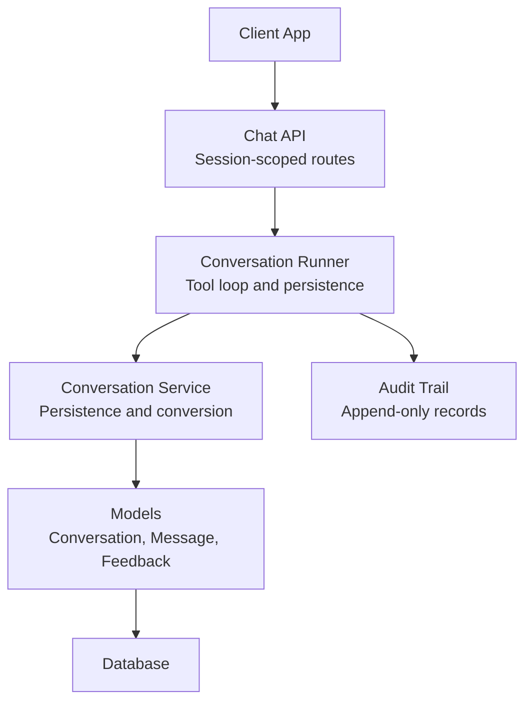

**Diagram sources**
- [chat_api.py:111-204](file://backend/app/api/chat.py#L111-L204)
- [runner.py:171-406](file://backend/app/agent/runner.py#L171-L406)
- [conversations_service.py:41-391](file://backend/app/services/conversations.py#L41-L391)
- [conversations.py:39-158](file://backend/app/models/conversations.py#L39-L158)
- [audit.py:15-51](file://backend/app/services/audit.py#L15-L51)

**Section sources**
- [chat_api.py:1-49](file://backend/app/api/chat.py#L1-L49)
- [conversations.py:1-17](file://backend/app/models/conversations.py#L1-L17)

## Core Components
The core persistence components are:

- **Conversation**: Represents one chat thread, its ownership, lifecycle, and scheduling intent.
- **Message**: Represents one turn in the thread, including patient input, assistant replies, tool calls, and tool results.
- **ConversationFeedback**: Records per-turn patient feedback for triage and improvement.
- **ConversationService functions**: Create, scope, append, list, convert, and summarize conversations and messages.
- **Runner**: Executes one end-to-end turn, persisting the full audit-like transcript.

Key responsibilities:

| Component | Responsibilities |
|---|---|
| `Conversation` | Thread identity, session binding, status, timestamps, title, scheduling request, relationships to messages and proposals. |
| `Message` | Turn role, content, sequence, timestamps, provider metadata (`tool_calls`, `tool_call_id`, `tool_name`), interactive cards. |
| `ConversationFeedback` | One row per assistant message with rating and optional reason. |
| Conversation service | Session-scoped lookup, creation, message appending, history retrieval, provider message conversion, visible-message projection. |
| Runner | Patient message persistence, full-thread replay, tool call loop, result persistence, card attachment, error recovery. |
| Audit service | Append-only audit record creation with actor, entity, conversation linkage, reset generation, and visibility control. |

**Section sources**
- [conversations.py:39-158](file://backend/app/models/conversations.py#L39-L158)
- [conversations_service.py:41-391](file://backend/app/services/conversations.py#L41-L391)
- [runner.py:171-406](file://backend/app/agent/runner.py#L171-L406)
- [audit.py:15-51](file://backend/app/services/audit.py#L15-L51)

## Architecture Overview
The conversation persistence architecture follows a layered flow:

1. The client calls a session-scoped chat endpoint.
2. The API validates the current patient session and loads the conversation by public ID.
3. The runner persists the patient message, builds the full thread, and calls the AI provider with tools.
4. Tool calls are executed, results are persisted as `tool` messages, and the final assistant reply is persisted.
5. The API returns a client-safe transcript and interactive cards.

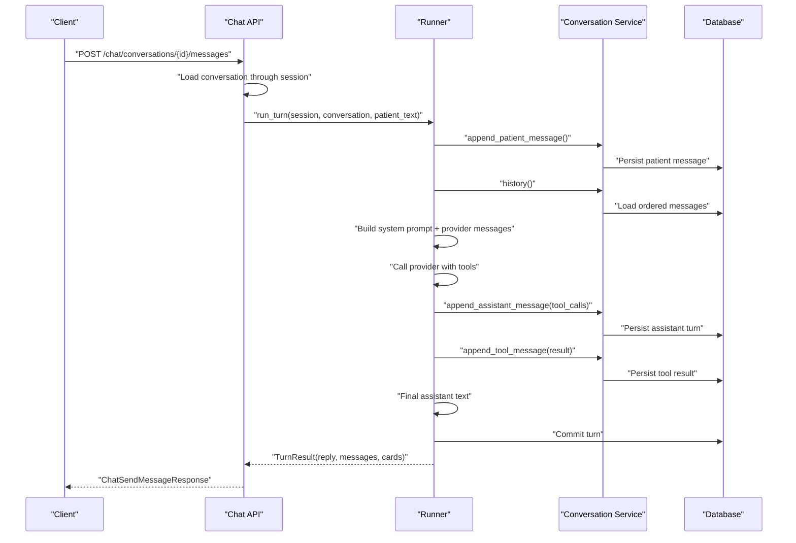

**Diagram sources**
- [chat_api.py:233-274](file://backend/app/api/chat.py#L233-L274)
- [runner.py:171-406](file://backend/app/agent/runner.py#L171-L406)
- [conversations_service.py:165-262](file://backend/app/services/conversations.py#L165-L262)

## Detailed Component Analysis

### Data Models: Conversation, Message, Feedback
The database schema centers on two main entities:

- `Conversation`:
  - Primary key `id`.
  - Public identifier `public_id` used by clients; not a credential.
  - Foreign key to `patient_sessions.id` for scoping.
  - Status field using `ConversationStatus`.
  - Optional title, caller phone, patient link, reset generation, timestamps, and JSON scheduling request.
  - Relationships to `Message` and `BookingProposal`.

- `Message`:
  - Primary key `id`.
  - Foreign key to `conversations.id`.
  - Role field using `MessageRole`.
  - Content text, sequence number, created timestamp, optional finished timestamp.
  - Provider-facing metadata stored in JSON or string columns: `tool_calls`, `tool_call_id`, `tool_name`.
  - Interactive `cards` JSON column for UI state.

- `ConversationFeedback`:
  - Links a rating to a specific assistant message within a conversation.
  - One row per message; re-rating updates the existing row.

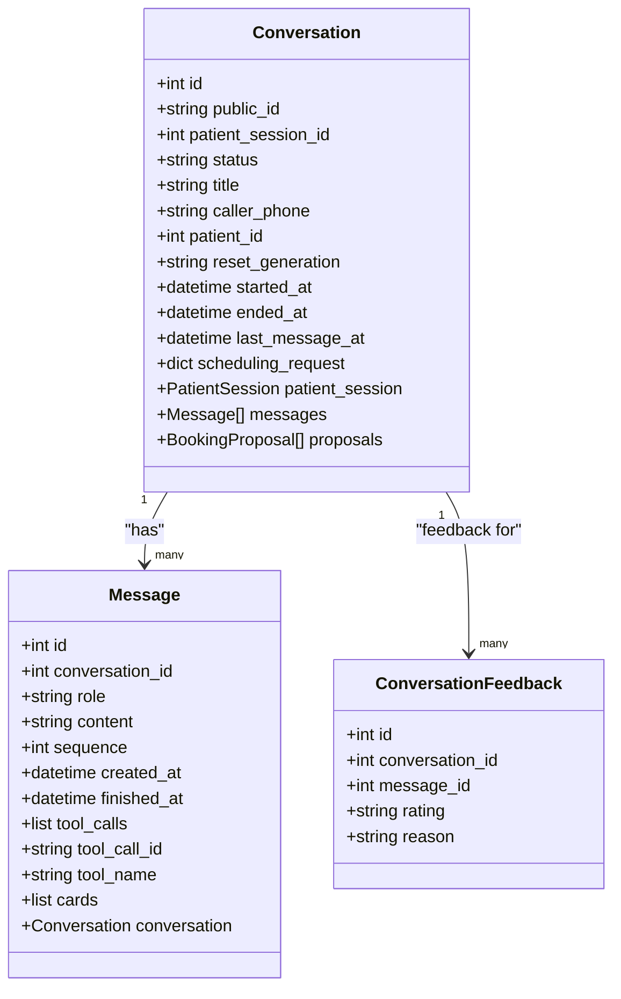

**Diagram sources**
- [conversations.py:39-158](file://backend/app/models/conversations.py#L39-L158)

**Section sources**
- [conversations.py:39-158](file://backend/app/models/conversations.py#L39-L158)
- [base.py:77-87](file://backend/app/models/base.py#L77-L87)

### Message Sequence Management
Message ordering is critical because the model replays the entire thread. The system uses:

- A monotonically increasing `sequence` integer per conversation.
- `_next_sequence` computes the next value based on the maximum existing sequence.
- A unique index on `(conversation_id, sequence)` prevents duplicate ordering.
- History queries order by `sequence` to reconstruct chronological turns.

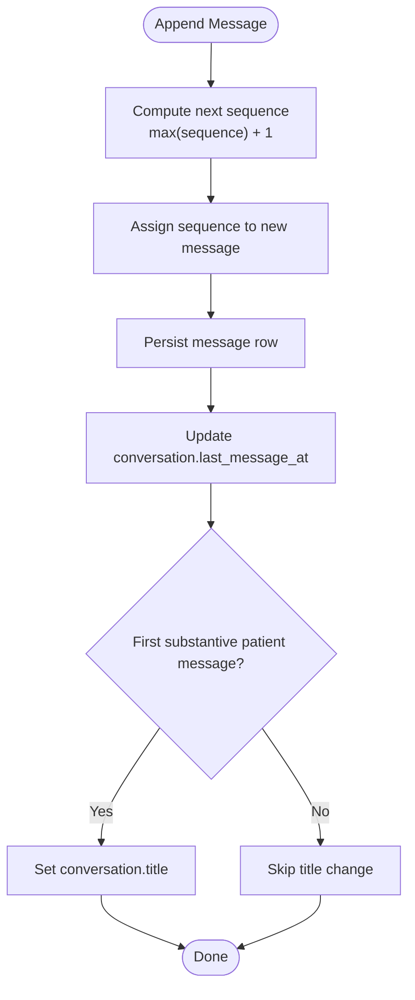

**Diagram sources**
- [conversations_service.py:158-183](file://backend/app/services/conversations.py#L158-L183)

**Section sources**
- [conversations_service.py:158-183](file://backend/app/services/conversations.py#L158-L183)
- [conversations.py:119-123](file://backend/app/models/conversations.py#L119-L123)

### Conversation Status Tracking
Conversations have two explicit statuses:

- `active`: The thread is open and may receive new messages.
- `closed`: The thread is closed but retains its history.

Lifecycle behavior:

- New conversations start as `active`.
- Resetting within a session closes active threads and sets `ended_at`.
- Resuming an existing thread under a verified session can reopen a closed thread and clear `ended_at`.

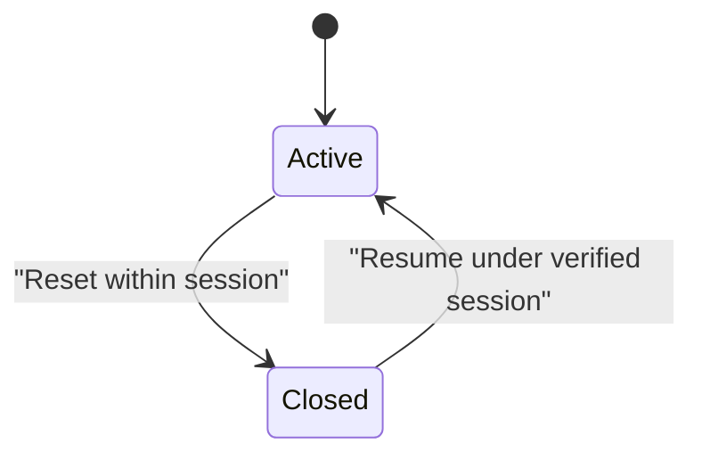

**Diagram sources**
- [chat_api.py:325-346](file://backend/app/api/chat.py#L325-L346)
- [conversations_service.py:100-138](file://backend/app/services/conversations.py#L100-L138)
- [base.py:77-80](file://backend/app/models/base.py#L77-L80)

**Section sources**
- [chat_api.py:325-346](file://backend/app/api/chat.py#L325-L346)
- [conversations_service.py:100-138](file://backend/app/services/conversations.py#L100-L138)
- [base.py:77-80](file://backend/app/models/base.py#L77-L80)

### Provider Message Format Conversion
Internal message rows must be converted into the provider’s expected format:

- `patient` becomes `user`.
- `assistant` becomes `assistant`; if it has `tool_calls`, those are included.
- `tool` rows are attached to the corresponding assistant turn via `tool_call_id`.
- Orphaned tool rows without a matching assistant turn are dropped or replaced with a safe error payload.
- `system` and `staff` rows are intentionally omitted because the system prompt is rebuilt per turn.

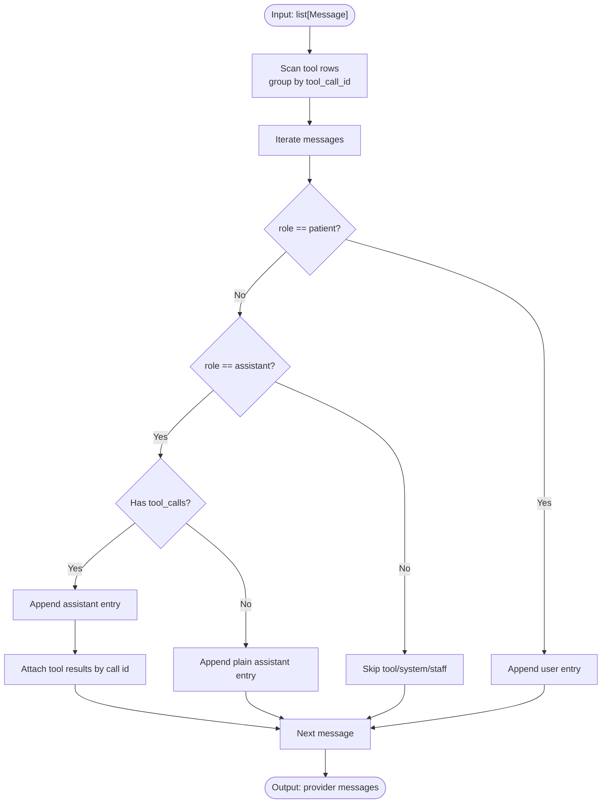

**Diagram sources**
- [conversations_service.py:285-331](file://backend/app/services/conversations.py#L285-L331)

**Section sources**
- [conversations_service.py:285-331](file://backend/app/services/conversations.py#L285-L331)

### Security Boundaries: Public vs Internal Access
Security is enforced at multiple levels:

- **Public API routes** require `X-Patient-Session` and resolve conversations through the current session.
- **Session-scoped lookup** `get_for_session` ensures a conversation belongs to the calling session.
- **Internal-only lookup** `get_by_public_id` exists only for server-side decisions and is not exposed directly to clients.
- **Resume path** `resume_for_session` only transfers ownership when the new session is verified as the same patient and matches the reset generation.
- **Provider payloads** never include internal fields like `tool_calls`, `tool_call_id`, or `tool_name`.
- **Client-safe projection** `public_message` strips implementation details such as family option identities from patient messages.

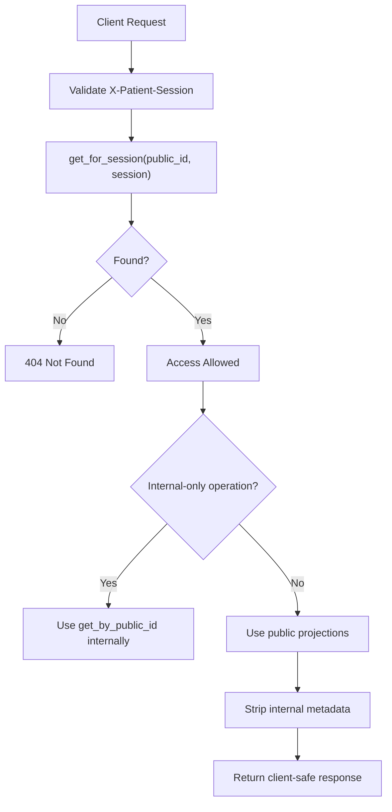

**Diagram sources**
- [chat_api.py:101-108](file://backend/app/api/chat.py#L101-L108)
- [conversations_service.py:61-79](file://backend/app/services/conversations.py#L61-L79)
- [conversations_service.py:100-138](file://backend/app/services/conversations.py#L100-L138)
- [conversations_service.py:334-351](file://backend/app/services/conversations.py#L334-L351)

**Section sources**
- [chat_api.py:1-12](file://backend/app/api/chat.py#L1-L12)
- [chat_api.py:101-108](file://backend/app/api/chat.py#L101-L108)
- [conversations_service.py:61-79](file://backend/app/services/conversations.py#L61-L79)
- [conversations_service.py:100-138](file://backend/app/services/conversations.py#L100-L138)
- [conversations_service.py:334-351](file://backend/app/services/conversations.py#L334-L351)

### Conversation Scoping to Patient Sessions
Conversations are scoped to `PatientSession`:

- Every read/write goes through the patient session token.
- `create_conversation` binds the conversation to the issuing session.
- `list_for_session` returns only conversations owned by the session.
- `resume_for_session` moves ownership to a verified session under strict checks.
- Indexes on `patient_session_id` support efficient scoping queries.

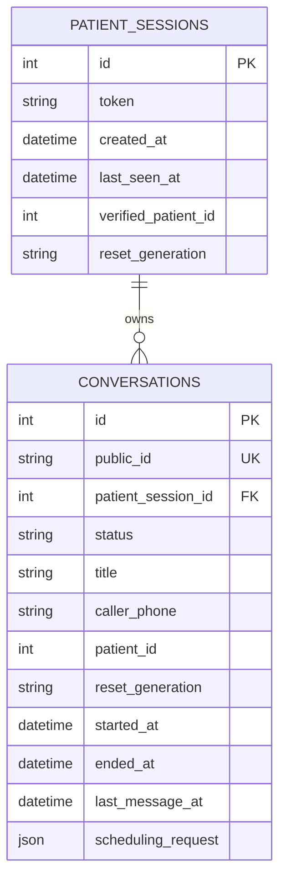

**Diagram sources**
- [conversations.py:49-84](file://backend/app/models/conversations.py#L49-L84)
- [conversations_service.py:41-58](file://backend/app/services/conversations.py#L41-L58)
- [conversations_service.py:141-155](file://backend/app/services/conversations.py#L141-L155)
- [conversations_service.py:100-138](file://backend/app/services/conversations.py#L100-L138)

**Section sources**
- [conversations.py:49-84](file://backend/app/models/conversations.py#L49-L84)
- [conversations_service.py:41-58](file://backend/app/services/conversations.py#L41-L58)
- [conversations_service.py:141-155](file://backend/app/services/conversations.py#L141-L155)
- [conversations_service.py:100-138](file://backend/app/services/conversations.py#L100-L138)

### Data Retention and Reset Policies
Retention and reset behavior:

- Conversations are not deleted by normal reset; they are marked `closed` with `ended_at`.
- A demo data reset is separate from the in-app reset and operates at the session level.
- `reset_generation` ties conversations to a data reset epoch; resuming requires matching generations.
- Expired handles and threads from earlier reset generations are refused during resume.
- Feedback rows remain linked to conversations and messages for staff review.

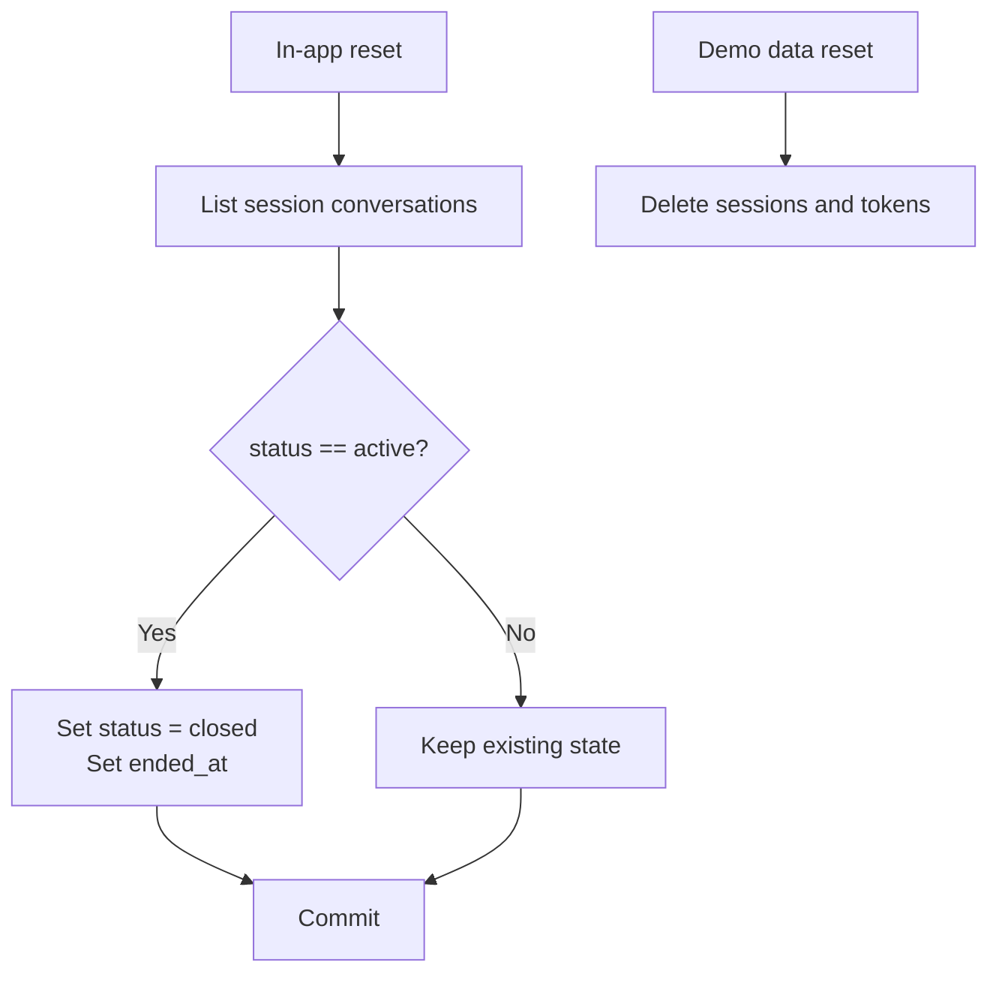

**Diagram sources**
- [chat_api.py:325-346](file://backend/app/api/chat.py#L325-L346)
- [conversations_service.py:100-138](file://backend/app/services/conversations.py#L100-L138)

**Section sources**
- [chat_api.py:325-346](file://backend/app/api/chat.py#L325-L346)
- [conversations_service.py:100-138](file://backend/app/services/conversations.py#L100-L138)

### Examples

#### Creating a Conversation
A new conversation is created when:

- Starting a session without resuming an existing thread.
- Explicitly starting a new conversation in the current session.

Steps:

1. Ensure the current reset generation.
2. Create a conversation bound to the patient session.
3. Persist the assistant greeting.
4. Return the conversation summary and initial messages.

**Section sources**
- [chat_api.py:111-163](file://backend/app/api/chat.py#L111-L163)
- [chat_api.py:183-204](file://backend/app/api/chat.py#L183-L204)
- [conversations_service.py:41-58](file://backend/app/services/conversations.py#L41-L58)

#### Appending a Patient Message and Running a Turn
When a patient sends a message:

1. Load the conversation through the current session.
2. Validate the message content.
3. Run the turn in a thread pool to avoid blocking the event loop.
4. Persist the patient message.
5. Replay the full thread to the provider with tools.
6. Persist assistant tool-call turns and tool results.
7. Persist the final assistant reply.
8. Return the reply, visible messages, and cards.

**Section sources**
- [chat_api.py:233-274](file://backend/app/api/chat.py#L233-L274)
- [runner.py:171-406](file://backend/app/agent/runner.py#L171-L406)
- [conversations_service.py:165-262](file://backend/app/services/conversations.py#L165-L262)

#### Retrieving Conversation History
History retrieval supports:

- Listing conversations for the current session.
- Restoring a single conversation with its full transcript.
- Returning only visible messages to the patient.
- Reconciling interactive cards with live proposal state.

**Section sources**
- [chat_api.py:166-180](file://backend/app/api/chat.py#L166-L180)
- [chat_api.py:207-230](file://backend/app/api/chat.py#L207-L230)
- [conversations_service.py:265-282](file://backend/app/services/conversations.py#L265-L282)
- [conversations_service.py:354-366](file://backend/app/services/conversations.py#L354-L366)

### Audit Trail System
While conversation transcripts provide operational history, the audit trail captures administrative and business actions:

- Each audit record includes occurrence time, actor type and ID, action, entity type and ID, conversation linkage, serialized details, reset generation, and visibility.
- The audit helper serializes details deterministically and attaches the current reset generation.
- Booking workflows use paired audit entries: a hold inside the transaction and a committed trailer after successful commit.

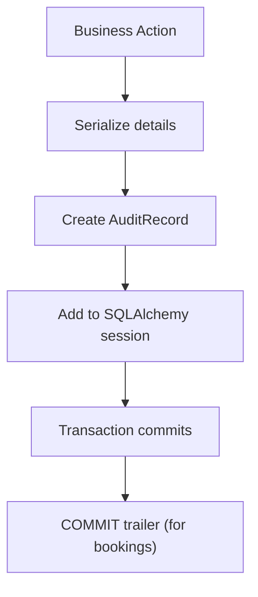

**Diagram sources**
- [audit.py:15-51](file://backend/app/services/audit.py#L15-L51)

**Section sources**
- [audit.py:15-51](file://backend/app/services/audit.py#L15-L51)

## Dependency Analysis
The persistence layer depends on several modules:

- Models depend on base enums and mixins.
- Services depend on models and SQLAlchemy session utilities.
- API depends on services, runner, schemas, and dependencies.
- Runner depends on services, agent tools, AI client, and observability.

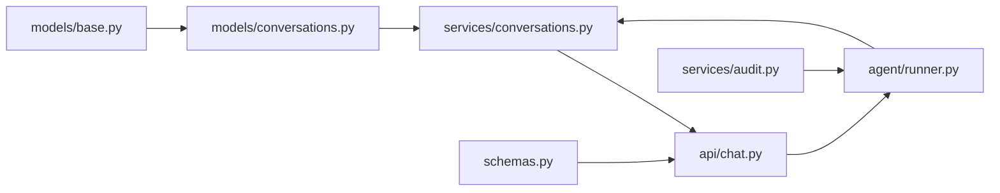

**Diagram sources**
- [base.py:39-87](file://backend/app/models/base.py#L39-L87)
- [conversations.py:39-158](file://backend/app/models/conversations.py#L39-L158)
- [conversations_service.py:27-391](file://backend/app/services/conversations.py#L27-L391)
- [chat_api.py:22-47](file://backend/app/api/chat.py#L22-L47)
- [runner.py:35-47](file://backend/app/agent/runner.py#L35-L47)
- [schemas.py:131-273](file://backend/app/schemas.py#L131-L273)
- [audit.py:15-51](file://backend/app/services/audit.py#L15-L51)

**Section sources**
- [base.py:39-87](file://backend/app/models/base.py#L39-L87)
- [conversations.py:39-158](file://backend/app/models/conversations.py#L39-L158)
- [conversations_service.py:27-391](file://backend/app/services/conversations.py#L27-L391)
- [chat_api.py:22-47](file://backend/app/api/chat.py#L22-L47)
- [runner.py:35-47](file://backend/app/agent/runner.py#L35-L47)
- [schemas.py:131-273](file://backend/app/schemas.py#L131-L273)
- [audit.py:15-51](file://backend/app/services/audit.py#L15-L51)

## Performance Considerations
- Full-thread replay means each turn loads all prior messages; keep conversation length reasonable.
- Sequence computation uses a max query per conversation; indexes on `conversation_id` and `sequence` help.
- Provider calls are offloaded to a thread pool to avoid blocking the async event loop.
- Tool round limits and call fan-out limits prevent runaway loops.
- Visible message projection filters out internal roles and metadata before sending responses.
- Card reconciliation avoids redundant UI state by deduplication and settlement logic.

[No sources needed since this section provides general guidance]

## Troubleshooting Guide
Common issues and diagnostics:

- **Conversation not found in session**: Occurs when the public ID does not belong to the current session. Verify session scoping and resume semantics.
- **Empty message**: Validation rejects blank messages.
- **Missing tool result**: If an assistant turn references a tool call without a matching result, the provider conversion inserts a safe error payload.
- **Degraded turn**: Provider failures or unexpected exceptions return a friendly fallback and mark the response as degraded.
- **Stale cards**: Interactive cards are reconciled with live proposal state; refresh paths restore actionable cards where appropriate.
- **Feedback mismatch**: Feedback applies only to assistant messages within the same conversation; invalid combinations raise validation errors.

**Section sources**
- [chat_api.py:101-108](file://backend/app/api/chat.py#L101-L108)
- [chat_api.py:246-251](file://backend/app/api/chat.py#L246-L251)
- [conversations_service.py:285-331](file://backend/app/services/conversations.py#L285-L331)
- [runner.py:264-292](file://backend/app/agent/runner.py#L264-L292)
- [chat_api.py:294-304](file://backend/app/api/chat.py#L294-L304)

## Conclusion
The conversation persistence layer provides a secure, session-scoped, and fully auditable transcript of patient interactions. It stores every turn, including tool calls and results, enabling faithful replay to the AI provider while exposing only safe, client-visible data. Conversation status, message sequencing, provider conversion, and reset semantics together ensure consistent behavior across retries, refreshes, and data resets. For long-term reliability, monitor conversation growth, provider availability, and audit trail volume, and tune limits and retention policies according to clinic needs.

[No sources needed since this section summarizes without analyzing specific files]