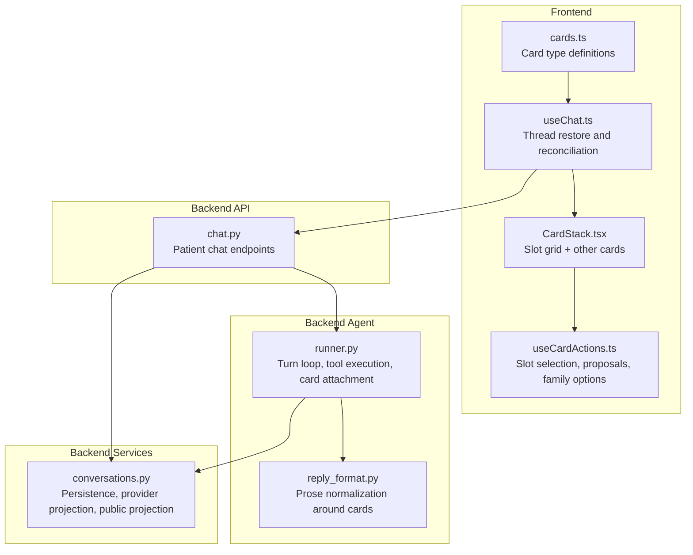
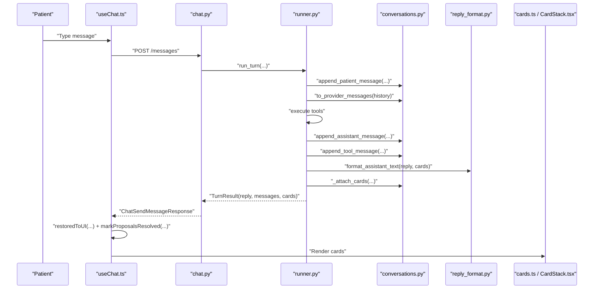
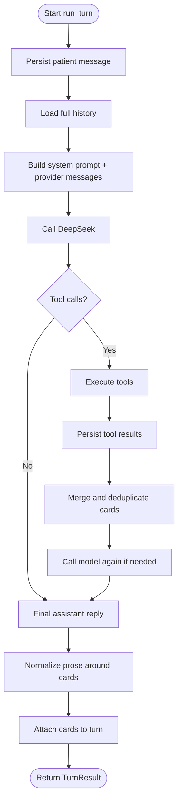
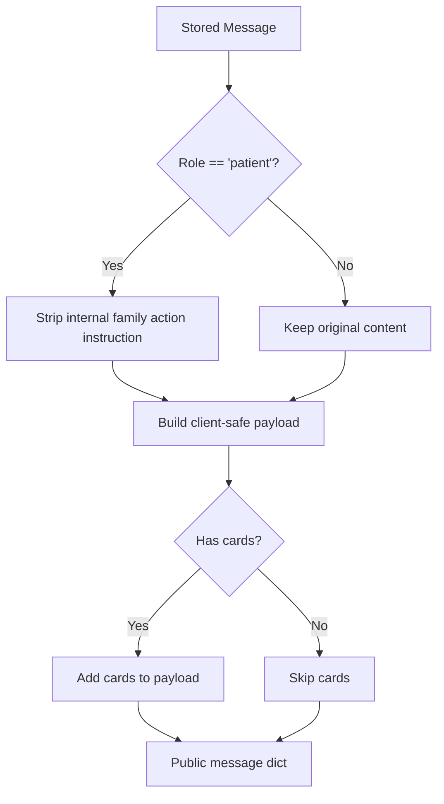
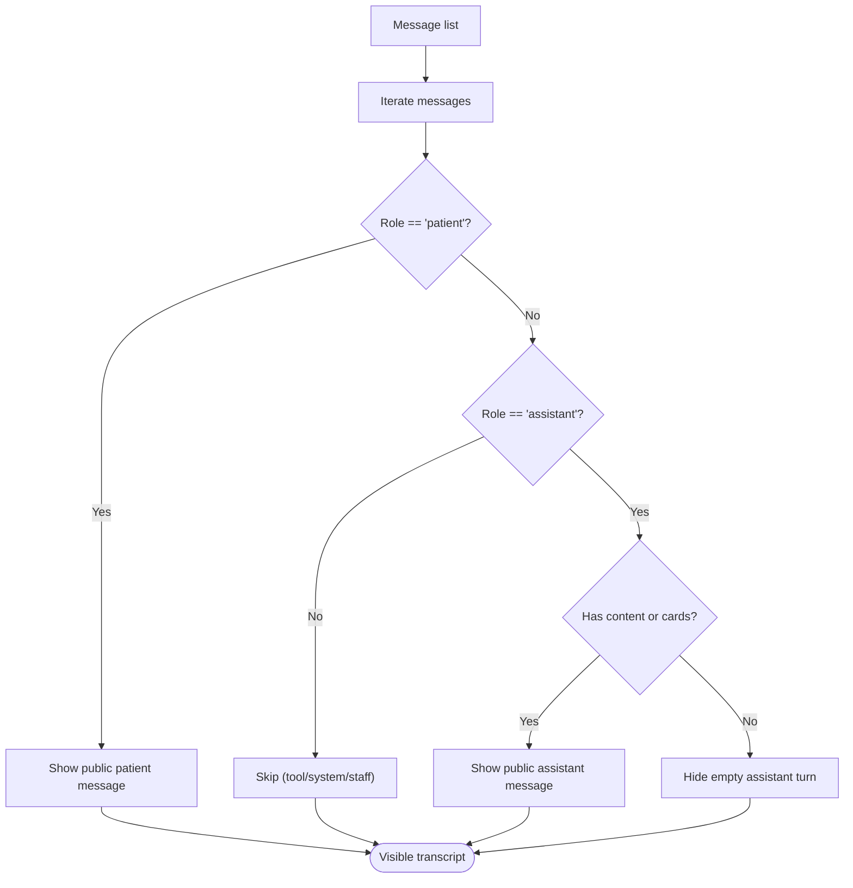
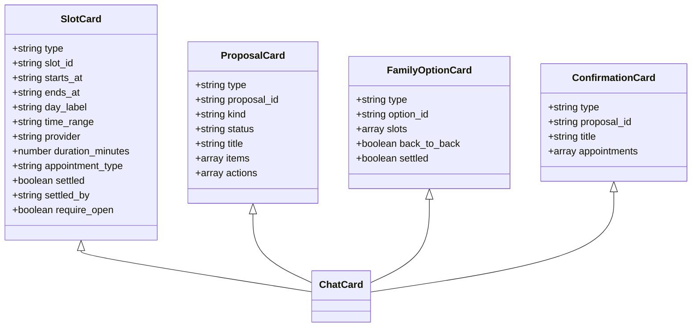
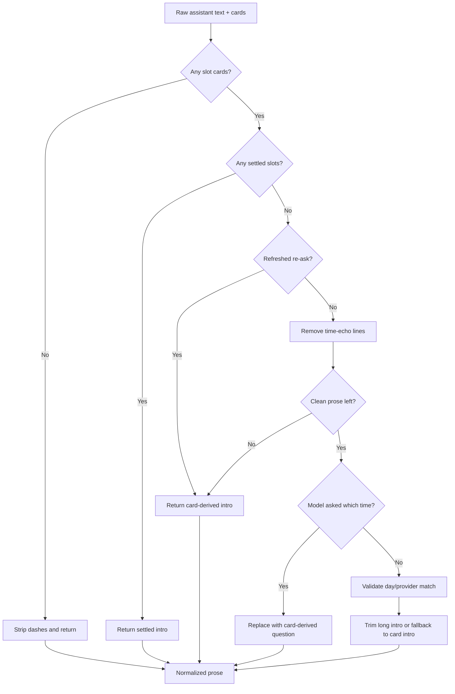
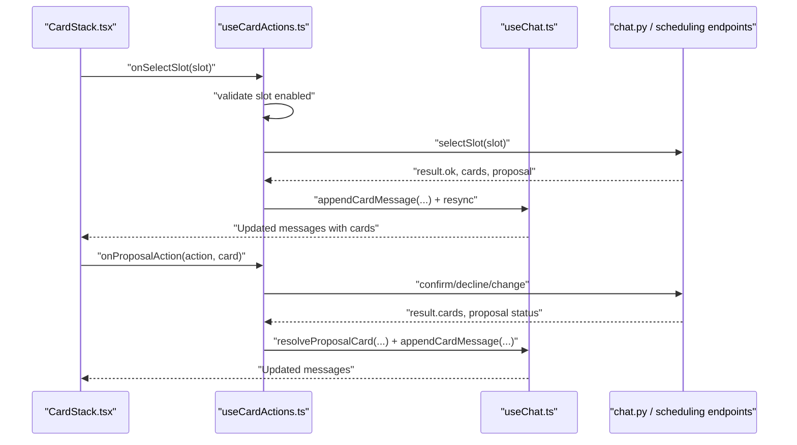
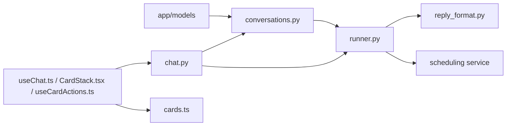

# Message Formatting

<cite>
**Referenced Files in This Document**
- [conversations.py](file://backend/app/services/conversations.py)
- [runner.py](file://backend/app/agent/runner.py)
- [reply_format.py](file://backend/app/agent/reply_format.py)
- [chat.py](file://backend/app/api/chat.py)
- [cards.ts](file://frontend/src/lib/cards.ts)
- [useChat.ts](file://frontend/src/hooks/useChat.ts)
- [CardStack.tsx](file://frontend/src/components/cards/CardStack.tsx)
- [useCardActions.ts](file://frontend/src/hooks/useCardActions.ts)
</cite>

## Table of Contents
1. [Introduction](#introduction)
2. [Project Structure](#project-structure)
3. [Core Components](#core-components)
4. [Architecture Overview](#architecture-overview)
5. [Detailed Component Analysis](#detailed-component-analysis)
6. [Dependency Analysis](#dependency-analysis)
7. [Performance Considerations](#performance-considerations)
8. [Troubleshooting Guide](#troubleshooting-guide)
9. [Conclusion](#conclusion)

## Introduction
This document explains how the system transforms AI assistant responses into structured, card-based UI components for patients. It covers:

- How assistant messages are processed to extract cards, text content, and tool call results.
- The public message projection that sanitizes sensitive data before sending to clients.
- The visible message filtering that determines what patients see versus what is stored internally.
- The card attachment system that enables rich interactions such as slot selection, family option holding, and proposal display.
- Examples of message transformation from raw AI output to client-ready formats.

The design separates three concerns:

| Concern | Responsibility |
|---|---|
| Storage and replay | Persist patient messages, assistant turns, tool calls, tool results, and cards so the thread can be replayed exactly. |
| Provider formatting | Convert stored rows into an OpenAI-compatible message sequence for the AI provider. |
| Client formatting | Project a safe, readable transcript with sanitized content and rendered cards. |

## Project Structure
The message formatting pipeline spans backend services, the conversation runner, API endpoints, and frontend state and rendering layers.

**Diagram sources**
- [cards.ts:1-188](file://frontend/src/lib/cards.ts#L1-L188)
- [useChat.ts:50-175](file://frontend/src/hooks/useChat.ts#L50-L175)
- [CardStack.tsx:1-108](file://frontend/src/components/cards/CardStack.tsx#L1-L108)
- [useCardActions.ts:144-763](file://frontend/src/hooks/useCardActions.ts#L144-L763)
- [chat.py:72-99](file://backend/app/api/chat.py#L72-L99)
- [runner.py:171-406](file://backend/app/agent/runner.py#L171-L406)
- [reply_format.py:295-428](file://backend/app/agent/reply_format.py#L295-L428)
- [conversations.py:285-366](file://backend/app/services/conversations.py#L285-L366)

**Section sources**
- [conversations.py:1-14](file://backend/app/services/conversations.py#L1-L14)
- [runner.py:1-23](file://backend/app/agent/runner.py#L1-L23)
- [chat.py:1-12](file://backend/app/api/chat.py#L1-L12)

## Core Components
The message formatting system has five core responsibilities:

| Component | Role | Key Behavior |
|---|---|---|
| Conversation persistence | Stores every turn, including tool calls and results. | Maintains exact replay order for the AI provider. |
| Provider message projection | Builds OpenAI-compatible messages. | Attaches tool results to assistant turns; drops internal roles. |
| Public message projection | Creates client-safe payloads. | Removes internal family action instructions and tool payloads. |
| Visible message filtering | Chooses what patients see. | Shows patient messages and assistant turns with prose or cards. |
| Card attachment and formatting | Turns tool results into UI cards and cleans prose. | Deduplicates cards, attaches them to the correct turn, and normalizes text. |

**Section sources**
- [conversations.py:165-262](file://backend/app/services/conversations.py#L165-L262)
- [conversations.py:285-366](file://backend/app/services/conversations.py#L285-L366)
- [runner.py:409-557](file://backend/app/agent/runner.py#L409-L557)
- [runner.py:597-718](file://backend/app/agent/runner.py#L597-L718)
- [reply_format.py:295-428](file://backend/app/agent/reply_format.py#L295-L428)

## Architecture Overview
The end-to-end flow starts when a patient sends a message and ends when the frontend renders a sanitized transcript with interactive cards.

**Diagram sources**
- [chat.py:233-274](file://backend/app/api/chat.py#L233-L274)
- [runner.py:171-406](file://backend/app/agent/runner.py#L171-L406)
- [conversations.py:285-366](file://backend/app/services/conversations.py#L285-L366)
- [reply_format.py:295-428](file://backend/app/agent/reply_format.py#L295-L428)
- [useChat.ts:548-623](file://frontend/src/hooks/useChat.ts#L548-L623)
- [CardStack.tsx:36-108](file://frontend/src/components/cards/CardStack.tsx#L36-L108)

## Detailed Component Analysis

### Assistant Turn Processing and Tool Call Results
The runner owns one patient message in and one assistant reply out. It persists the incoming message, loads the full thread, builds provider messages, calls the AI model, executes requested tools, persists assistant tool-call turns and tool results, calls the model again if needed, and finally persists the assistant text.

Key behaviors:

- Tool rounds are bounded by `MAX_TOOL_ROUNDS` and `MAX_TOOL_CALLS_PER_ROUND`.
- Tool results may contain cards built from real database state.
- Only the latest round’s cards survive within a single turn because they supersede earlier searches.
- Tool outcomes are logged without arguments to avoid exposing patient details.

**Diagram sources**
- [runner.py:171-406](file://backend/app/agent/runner.py#L171-L406)
- [runner.py:409-557](file://backend/app/agent/runner.py#L409-L557)
- [runner.py:560-637](file://backend/app/agent/runner.py#L560-L637)

**Section sources**
- [runner.py:1-23](file://backend/app/agent/runner.py#L1-L23)
- [runner.py:171-406](file://backend/app/agent/runner.py#L171-L406)
- [runner.py:409-557](file://backend/app/agent/runner.py#L409-L557)
- [runner.py:721-761](file://backend/app/agent/runner.py#L721-L761)

### Public Message Projection and Sensitive Data Sanitization
The public message projection is the boundary between internal storage and the client. It never includes tool payloads or arguments.

Important sanitization rules:

- Internal family action instructions embedded in older patient messages are removed before the browser sees them.
- Tool messages are not included in the public payload.
- Cards are attached only when present on the stored message.
- The returned payload contains id, role, content, sequence, created_at, and optional cards.

**Diagram sources**
- [conversations.py:30-34](file://backend/app/services/conversations.py#L30-L34)
- [conversations.py:334-351](file://backend/app/services/conversations.py#L334-L351)

**Section sources**
- [conversations.py:30-34](file://backend/app/services/conversations.py#L30-L34)
- [conversations.py:334-351](file://backend/app/services/conversations.py#L334-L351)

### Visible Message Filtering
Visible message filtering decides what patients see. It shows:

- All patient messages.
- Assistant messages that have either prose content or cards.

Assistant-only tool turns and tool result rows are intentionally hidden from the patient transcript. An assistant turn that produced only cards is still visible so that a clicked slot’s proposal survives a refresh even if the model said nothing.

**Diagram sources**
- [conversations.py:354-366](file://backend/app/services/conversations.py#L354-L366)

**Section sources**
- [conversations.py:354-366](file://backend/app/services/conversations.py#L354-L366)

### Card Attachment System
Cards come from tool results and represent real scheduling state. The runner extracts cards from tool results, merges competing grids, deduplicates them, enriches them with live proposal status, settles already-booked or held grids, and attaches them to the correct assistant turn.

Card types include:

| Card Type | Meaning |
|---|---|
| `slot` | A selectable appointment time. |
| `family_option` | A grouped family availability option. |
| `proposal` or `family_proposal` | A pending booking, reschedule, or cancellation. |
| `confirmation` | A successful booking confirmation. |
| `cancellation_confirmation` | A successful cancellation confirmation. |
| `appointments` | A summary of appointments. |
| `handoff` | A staff handoff or alert. |

**Diagram sources**
- [cards.ts:9-59](file://frontend/src/lib/cards.ts#L9-L59)
- [cards.ts:74-100](file://frontend/src/lib/cards.ts#L74-L100)
- [cards.ts:119-129](file://frontend/src/lib/cards.ts#L119-L129)
- [cards.ts:180-188](file://frontend/src/lib/cards.ts#L180-L188)

**Section sources**
- [runner.py:560-637](file://backend/app/agent/runner.py#L560-L637)
- [runner.py:640-718](file://backend/app/agent/runner.py#L640-L718)
- [cards.ts:1-188](file://frontend/src/lib/cards.ts#L1-L188)

### Prose Normalization Around Cards
When a turn returns structured slot cards, the prose formatter removes lines that merely echo times already shown in the cards and replaces weak intros with deterministic card-derived introductions. It also:

- Replaces duplicate questions with one card-derived question.
- Removes sentences that point at times already rendered.
- Rejects intros that name days or providers not present in the card grid.
- Normalizes em and en dashes into plain clinic-style prose.

**Diagram sources**
- [reply_format.py:295-428](file://backend/app/agent/reply_format.py#L295-L428)
- [reply_format.py:118-171](file://backend/app/agent/reply_format.py#L118-L171)
- [reply_format.py:201-222](file://backend/app/agent/reply_format.py#L201-L222)
- [reply_format.py:261-292](file://backend/app/agent/reply_format.py#L261-L292)

**Section sources**
- [reply_format.py:1-16](file://backend/app/agent/reply_format.py#L1-L16)
- [reply_format.py:118-171](file://backend/app/agent/reply_format.py#L118-L171)
- [reply_format.py:201-222](file://backend/app/agent/reply_format.py#L201-L222)
- [reply_format.py:295-428](file://backend/app/agent/reply_format.py#L295-L428)

### Frontend Card Rendering and Interaction
The frontend receives sanitized messages and cards, then renders:

- A coalesced slot grid.
- Individual proposal, confirmation, cancellation, appointment, family option, and handoff cards.
- Disabled states for historical or expired cards.

Interactive behavior is handled by `useCardActions`:

- Slot selection posts a hold request and updates the UI based on server response.
- Proposal actions confirm, change, or decline pending proposals.
- Family option holding posts a controlled action with opaque identifiers.
- Availability is reconciled against `/scheduling/pending` and `/scheduling/availability`.

**Diagram sources**
- [CardStack.tsx:36-108](file://frontend/src/components/cards/CardStack.tsx#L36-L108)
- [useCardActions.ts:482-560](file://frontend/src/hooks/useCardActions.ts#L482-L560)
- [useCardActions.ts:562-694](file://frontend/src/hooks/useCardActions.ts#L562-L694)
- [useCardActions.ts:696-714](file://frontend/src/hooks/useCardActions.ts#L696-L714)
- [useChat.ts:548-623](file://frontend/src/hooks/useChat.ts#L548-L623)

**Section sources**
- [CardStack.tsx:1-108](file://frontend/src/components/cards/CardStack.tsx#L1-L108)
- [useCardActions.ts:144-763](file://frontend/src/hooks/useCardActions.ts#L144-L763)
- [useChat.ts:50-175](file://frontend/src/hooks/useChat.ts#L50-L175)

### Example Transformations

#### Raw AI Output to Client-Ready Transcript
A raw assistant turn may contain:

- Prose generated by the model.
- Tool calls requesting availability or scheduling operations.
- Tool results containing cards.
- A final assistant message with cleaned prose and attached cards.

Transformation steps:

1. Store the patient message.
2. Build provider messages from stored history.
3. Run the tool loop and persist tool calls and results.
4. Extract cards from tool results.
5. Normalize prose using `format_assistant_text`.
6. Attach cards to the assistant turn.
7. Project visible messages for the client.
8. Reconcile proposal lifecycle status on the API layer.
9. Render cards in the frontend.

**Section sources**
- [runner.py:171-406](file://backend/app/agent/runner.py#L171-L406)
- [runner.py:409-557](file://backend/app/agent/runner.py#L409-L557)
- [runner.py:597-718](file://backend/app/agent/runner.py#L597-L718)
- [chat.py:72-99](file://backend/app/api/chat.py#L72-L99)
- [useChat.ts:548-623](file://frontend/src/hooks/useChat.ts#L548-L623)

#### Sensitive Data Removal
Before a patient message reaches the browser:

- Internal family action instructions are stripped from the content.
- Tool payloads and arguments are excluded.
- Only id, role, content, sequence, created_at, and cards are sent.

This ensures that implementation details such as opaque family option identities are not replayed to the client.

**Section sources**
- [conversations.py:30-34](file://backend/app/services/conversations.py#L30-L34)
- [conversations.py:334-351](file://backend/app/services/conversations.py#L334-L351)

#### Slot Selection Flow
When a patient selects a slot:

1. The frontend validates that the slot is enabled.
2. It posts a slot selection request with intent and target context.
3. The backend holds the time and returns cards and possibly a pending proposal.
4. The frontend appends a card message, marks live proposals, and triggers a resync.
5. Stale grids and rejected slots are disabled without removing history.

**Section sources**
- [useCardActions.ts:482-560](file://frontend/src/hooks/useCardActions.ts#L482-L560)
- [useCardActions.ts:291-386](file://frontend/src/hooks/useCardActions.ts#L291-L386)

#### Family Option Holding Flow
When a patient holds a family option:

1. The frontend posts a simple text message plus a controlled action carrying the opaque `option_identity` and `request_id`.
2. The runner injects those identifiers into the provider system prompt so the model knows which card was clicked.
3. The tool execution uses the browser-provided identity rather than trusting model-extracted names.
4. The client never reconstructs the selection from formatted chat text.

**Section sources**
- [useCardActions.ts:696-714](file://frontend/src/hooks/useCardActions.ts#L696-L714)
- [runner.py:153-168](file://backend/app/agent/runner.py#L153-L168)
- [runner.py:721-761](file://backend/app/agent/runner.py#L721-L761)

## Dependency Analysis
The message formatting system has clear boundaries between storage, provider-facing formatting, client-facing projection, and UI interaction.

**Diagram sources**
- [conversations.py:24-27](file://backend/app/services/conversations.py#L24-L27)
- [runner.py:35-47](file://backend/app/agent/runner.py#L35-L47)
- [chat.py:22-47](file://backend/app/api/chat.py#L22-L47)
- [cards.ts:1-188](file://frontend/src/lib/cards.ts#L1-L188)

**Section sources**
- [conversations.py:285-366](file://backend/app/services/conversations.py#L285-L366)
- [runner.py:171-406](file://backend/app/agent/runner.py#L171-L406)
- [chat.py:72-99](file://backend/app/api/chat.py#L72-L99)

## Performance Considerations
- Tool rounds are limited to prevent excessive AI round-trips per patient message.
- Tool calls per round are limited to prevent fan-out storms.
- Card merging and deduplication avoid redundant UI elements.
- Frontend availability checks are debounced and de-duplicated to reduce network pressure.
- The transcript is restored from SQLite rather than rebuilt from React state alone, improving reliability after refresh.

[No sources needed since this section provides general guidance]

## Troubleshooting Guide

### Patient Sees Duplicate Times or Conflicting Grids
Likely causes:

- Multiple availability searches ran in one turn and cards were not merged correctly.
- A stale grid was not marked as settled after a booking or hold.
- The model echoed times instead of relying on the card grid.

Checks:

- Verify card deduplication by identity.
- Confirm that newer grids supersede older grids.
- Ensure prose formatting removes time echoes when cards are present.

**Section sources**
- [runner.py:597-637](file://backend/app/agent/runner.py#L597-L637)
- [runner.py:609-637](file://backend/app/agent/runner.py#L609-L637)
- [reply_format.py:225-243](file://backend/app/agent/reply_format.py#L225-L243)

### Proposal Card Disappears After Refresh
Likely causes:

- The transcript was persisted before cards were attached.
- The live proposal set was not reconciled.
- The proposal is no longer pending.

Checks:

- Use `attachLiveProposals` to repair missing cards on the newest assistant turn.
- Use `markProposalsResolved` to disable non-pending proposals.
- Compare stored cards with `/scheduling/pending`.

**Section sources**
- [useChat.ts:107-175](file://frontend/src/hooks/useChat.ts#L107-L175)
- [useChat.ts:356-385](file://frontend/src/hooks/useChat.ts#L356-L385)

### Family Option Click Selects Wrong Historical Option
Likely causes:

- The selection was reconstructed from formatted chat text.
- The opaque `option_identity` was not passed through the action.
- The runner did not override the model’s arguments with the browser authority.

Checks:

- Ensure the frontend posts `action.type === "family_option_click"` with `option_identity` and `request_id`.
- Ensure the runner injects those values into the tool call.
- Avoid embedding internal identifiers in displayed text.

**Section sources**
- [useCardActions.ts:696-714](file://frontend/src/hooks/useCardActions.ts#L696-L714)
- [runner.py:153-168](file://backend/app/agent/runner.py#L153-L168)
- [runner.py:721-761](file://backend/app/agent/runner.py#L721-L761)

### Prose Contradicts Cards
Likely causes:

- The model wrote a time list while cards were present.
- The intro named a day or provider not in the grid.
- The model asked “which time?” twice.

Checks:

- Run `format_assistant_text` on assistant turns with slot cards.
- Verify that settled grids replace prose with the correct settled intro.
- Confirm that dash normalization does not introduce new formatting issues.

**Section sources**
- [reply_format.py:295-428](file://backend/app/agent/reply_format.py#L295-L428)
- [reply_format.py:201-222](file://backend/app/agent/reply_format.py#L201-L222)
- [reply_format.py:261-292](file://backend/app/agent/reply_format.py#L261-L292)

## Conclusion
The message formatting system is designed around safety, clarity, and consistency:

- Internal tool payloads and family action instructions are never exposed to clients.
- Visible messages show only what patients should see, while the full thread remains available for provider replay.
- Cards are derived from real database state and are deduplicated, enriched, and attached to the correct turn.
- Prose is normalized so it does not duplicate or contradict the structured UI.
- The frontend treats the server as the source of truth, reconciling restored transcripts with live proposal and availability state.

This separation allows the AI model to focus on reasoning while deterministic code handles security, presentation, and scheduling integrity.