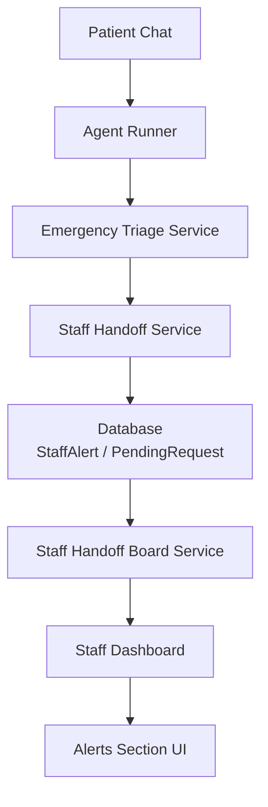
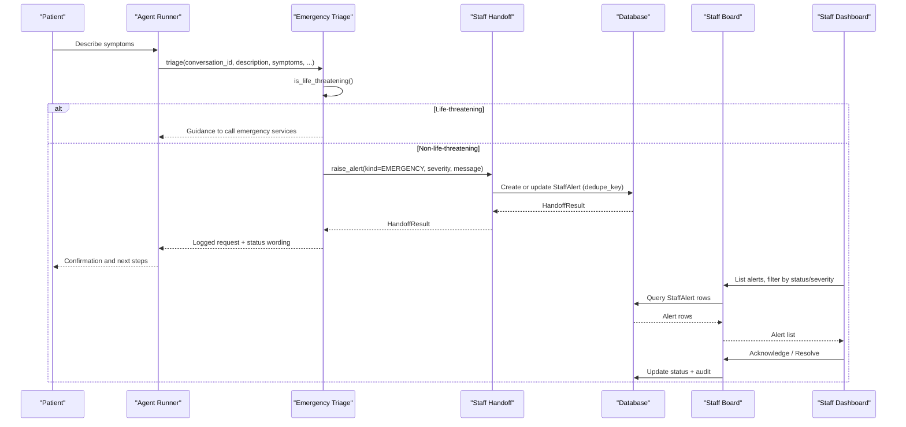
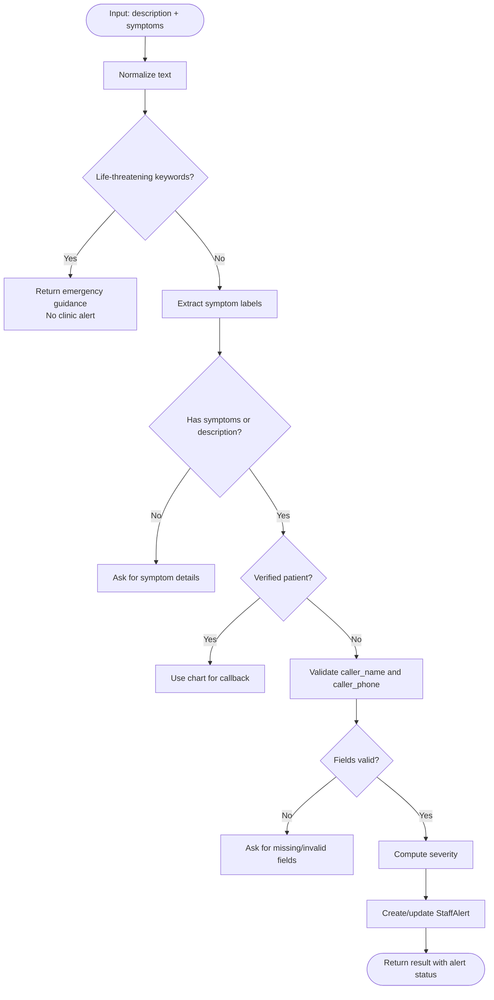
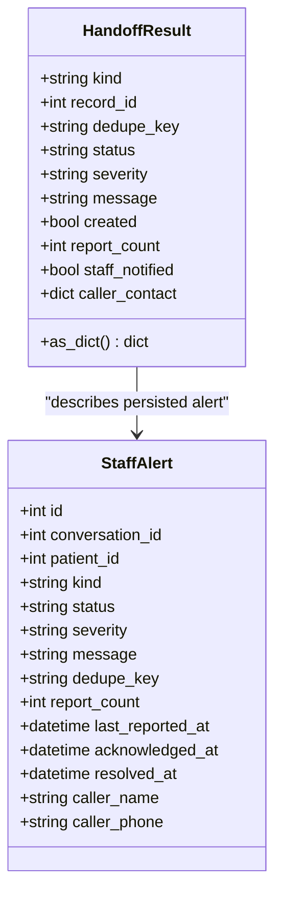
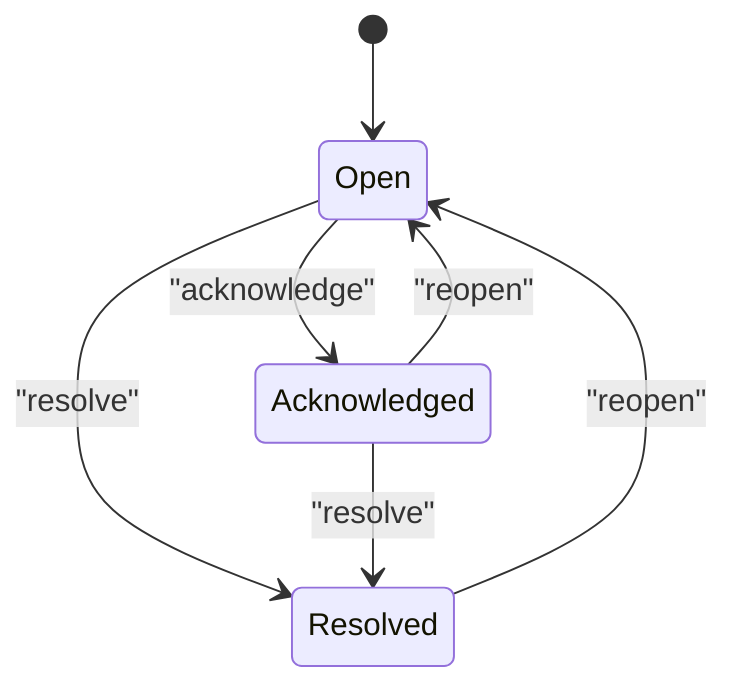
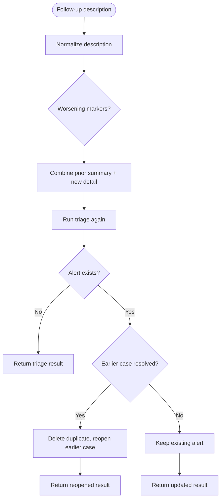
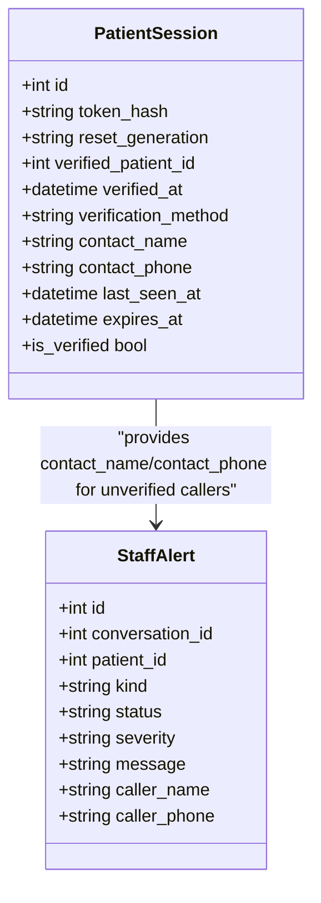
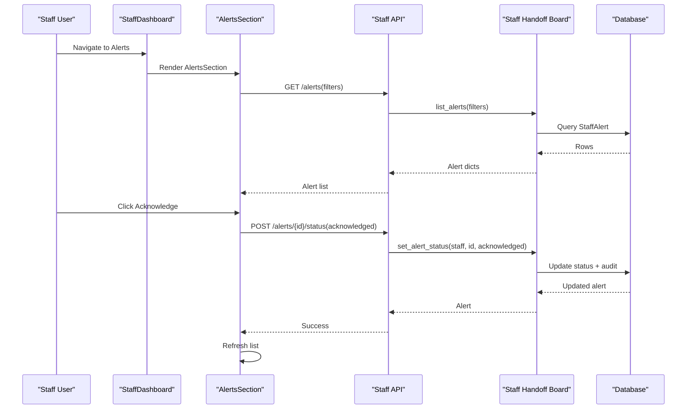
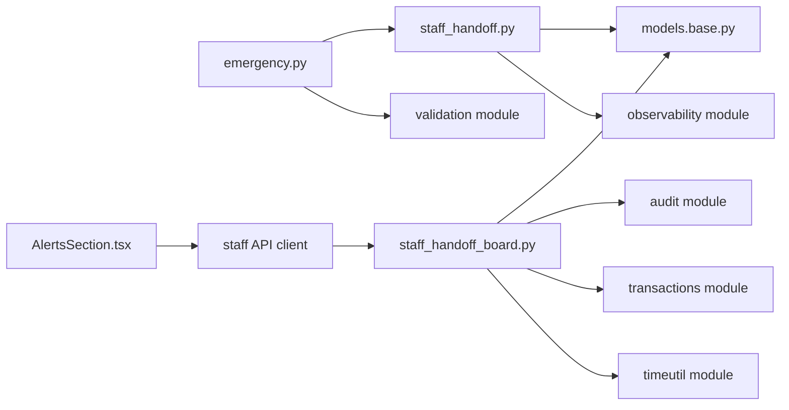

# Emergency Triage System

<cite>
**Referenced Files in This Document**
- [emergency.py](file://backend/app/services/emergency.py)
- [staff_handoff.py](file://backend/app/services/staff_handoff.py)
- [staff_handoff_board.py](file://backend/app/services/staff_handoff_board.py)
- [base.py](file://backend/app/models/base.py)
- [sessions.py](file://backend/app/models/sessions.py)
- [smoke_phase3.py](file://backend/scripts/smoke_phase3.py)
- [test_emergency_contact.py](file://backend/tests/test_emergency_contact.py)
- [StaffDashboard.tsx](file://frontend/src/pages/staff/StaffDashboard.tsx)
- [AlertsSection.tsx](file://frontend/src/pages/staff/sections/AlertsSection.tsx)
</cite>

## Table of Contents
1. [Introduction](#introduction)
2. [Project Structure](#project-structure)
3. [Core Components](#core-components)
4. [Architecture Overview](#architecture-overview)
5. [Detailed Component Analysis](#detailed-component-analysis)
6. [Dependency Analysis](#dependency-analysis)
7. [Performance Considerations](#performance-considerations)
8. [Troubleshooting Guide](#troubleshooting-guide)
9. [Conclusion](#conclusion)

## Introduction
This document explains the emergency triage system that analyzes patient-reported symptoms, determines urgency, triggers staff alerts, and coordinates handoff between automated triage and human operators. It covers symptom classification, escalation rules, alert persistence, dashboard integration, and the end-to-end workflow from symptom capture to resolution.

The system is intentionally conservative: life-threatening symptoms bypass clinic workflows and direct callers to emergency services immediately. Non-life-threatening emergencies are captured as actionable alerts for the front desk, with strict validation of caller contact details when identity is not already known.

## Project Structure
The emergency triage capability spans backend services, data models, tests, smoke scripts, and a staff dashboard frontend:

- Backend triage logic lives in a dedicated service module.
- Staff handoff persists alerts and requests and exposes idempotent operations.
- The staff board manages alert lifecycle transitions and approval-gated requests.
- Data models define alert categories, statuses, and session-scoped contact fields.
- Frontend provides a real-time alert board for staff monitoring and response.

**Diagram sources**
- [emergency.py:258-366](file://backend/app/services/emergency.py#L258-L366)
- [staff_handoff.py:98-200](file://backend/app/services/staff_handoff.py#L98-L200)
- [staff_handoff_board.py:380-457](file://backend/app/services/staff_handoff_board.py#L380-L457)
- [AlertsSection.tsx:39-188](file://frontend/src/pages/staff/sections/AlertsSection.tsx#L39-L188)

**Section sources**
- [emergency.py:1-31](file://backend/app/services/emergency.py#L1-L31)
- [staff_handoff.py:1-16](file://backend/app/services/staff_handoff.py#L1-L16)
- [staff_handoff_board.py:1-34](file://backend/app/services/staff_handoff_board.py#L1-L34)

## Core Components
- Symptom classifier and triage orchestrator: detects life-threatening conditions, extracts symptom labels, builds summaries, and decides whether to escalate to staff or emergency services.
- Staff handoff layer: creates or updates alerts and pending requests with deduplication, severity management, and audit logging.
- Staff board: enforces state transitions, computes approval requirements, tracks activity, and exposes queries for the dashboard.
- Session model: stores verified identity separately from unverified caller contact details used only for callbacks.
- Dashboard UI: displays urgent banners, filters, search, and action drawers for acknowledging and resolving alerts.

**Section sources**
- [emergency.py:117-148](file://backend/app/services/emergency.py#L117-L148)
- [staff_handoff.py:53-80](file://backend/app/services/staff_handoff.py#L53-L80)
- [staff_handoff_board.py:97-129](file://backend/app/services/staff_handoff_board.py#L97-L129)
- [sessions.py:35-76](file://backend/app/models/sessions.py#L35-L76)
- [AlertsSection.tsx:39-188](file://frontend/src/pages/staff/sections/AlertsSection.tsx#L39-L188)

## Architecture Overview
The triage pipeline separates safety-critical decisions from operational handoff:

1. The agent runner invokes triage when symptoms or urgency are detected.
2. Triage normalizes input, classifies life-threatening symptoms, and extracts symptom labels.
3. If life-threatening, immediate emergency guidance is returned without creating a clinic alert.
4. Otherwise, contact details are validated for unverified callers; verified patients use chart information.
5. A staff alert is created or updated with idempotency and severity rules.
6. The staff dashboard surfaces alerts, allows acknowledgment and resolution, and records audit events.

**Diagram sources**
- [emergency.py:219-232](file://backend/app/services/emergency.py#L219-L232)
- [emergency.py:258-366](file://backend/app/services/emergency.py#L258-L366)
- [staff_handoff.py:98-200](file://backend/app/services/staff_handoff.py#L98-L200)
- [staff_handoff_board.py:230-257](file://backend/app/services/staff_handoff_board.py#L230-L257)
- [staff_handoff_board.py:380-457](file://backend/app/services/staff_handoff_board.py#L380-L457)
- [AlertsSection.tsx:39-188](file://frontend/src/pages/staff/sections/AlertsSection.tsx#L39-L188)

## Detailed Component Analysis

### Symptom Classification and Escalation Rules
The triage service uses deterministic keyword matching rather than LLM judgment for critical branches:

- Life-threatening detection checks normalized text against a curated phrase set covering airway compromise, severe bleeding, trauma, anaphylaxis, seizures, and loss of consciousness.
- Symptom extraction maps phrases to standardized labels such as facial swelling, severe pain, possible abscess, dental trauma, bleeding, possible infection, fever, pain on chewing, toothache, and urgent request.
- Severity mapping assigns “urgent” for life-threatening cases, “high” for specific high-risk symptoms, and “normal” otherwise.
- Contact validation ensures non-life-threatening reports include a name and a complete US phone number unless the caller is a verified patient.

**Diagram sources**
- [emergency.py:213-232](file://backend/app/services/emergency.py#L213-L232)
- [emergency.py:248-255](file://backend/app/services/emergency.py#L248-L255)
- [emergency.py:258-366](file://backend/app/services/emergency.py#L258-L366)

**Section sources**
- [emergency.py:46-90](file://backend/app/services/emergency.py#L46-L90)
- [emergency.py:92-114](file://backend/app/services/emergency.py#L92-L114)
- [emergency.py:151-180](file://backend/app/services/emergency.py#L151-L180)
- [emergency.py:219-255](file://backend/app/services/emergency.py#L219-L255)

### Alert Persistence and Idempotency
The handoff service guarantees that repeated reports do not create duplicate cases:

- Each alert carries a deduplication key scoped to conversation and subject.
- Existing open or acknowledged alerts are updated with new messages and report counts.
- Caller contact details fill in without overwriting existing values.
- New alerts are created with initial status and timestamps, then logged for observability.

**Diagram sources**
- [staff_handoff.py:53-80](file://backend/app/services/staff_handoff.py#L53-L80)
- [staff_handoff.py:98-200](file://backend/app/services/staff_handoff.py#L98-L200)

**Section sources**
- [staff_handoff.py:83-96](file://backend/app/services/staff_handoff.py#L83-L96)
- [staff_handoff.py:98-200](file://backend/app/services/staff_handoff.py#L98-L200)

### Staff Board State Machine and Approval Rules
The staff board defines explicit state transitions and approval gating:

- Alerts transition among open, acknowledged, and resolved states.
- Requests transition among pending, in_progress, and resolved states.
- Approval is derived from request type; billing and reschedule require explicit approval, while routine items do not.
- All mutations are audited with actor identity and safe details.

**Diagram sources**
- [staff_handoff_board.py:77-87](file://backend/app/services/staff_handoff_board.py#L77-L87)
- [staff_handoff_board.py:380-457](file://backend/app/services/staff_handoff_board.py#L380-L457)

**Section sources**
- [staff_handoff_board.py:68-87](file://backend/app/services/staff_handoff_board.py#L68-L87)
- [staff_handoff_board.py:119-129](file://backend/app/services/staff_handoff_board.py#L119-L129)
- [staff_handoff_board.py:380-457](file://backend/app/services/staff_handoff_board.py#L380-L457)

### Follow-ups and Case Reopening
Follow-up messages in the same conversation update the existing alert and can reopen a previously resolved case:

- Worsening indicators trigger special handling so staff see one consolidated case.
- If a prior case was resolved, the follow-up reopens it and increments the report count.
- The assistant’s guidance reflects whether the case was reopened.

**Diagram sources**
- [emergency.py:377-455](file://backend/app/services/emergency.py#L377-L455)
- [emergency.py:458-517](file://backend/app/services/emergency.py#L458-L517)

**Section sources**
- [emergency.py:377-455](file://backend/app/services/emergency.py#L377-L455)
- [emergency.py:458-517](file://backend/app/services/emergency.py#L458-L517)

### Session Identity vs Callback Contact
The session model separates verified identity from callback contact information:

- Verified identity authorizes access and links alerts to patient charts.
- Unverified caller contact details are stored only for callbacks and never grant chart access.
- Triage uses verified identity when available; otherwise it validates and stores caller name and phone before filing an alert.

**Diagram sources**
- [sessions.py:35-76](file://backend/app/models/sessions.py#L35-L76)
- [emergency.py:183-210](file://backend/app/services/emergency.py#L183-L210)
- [staff_handoff.py:163-177](file://backend/app/services/staff_handoff.py#L163-L177)

**Section sources**
- [sessions.py:35-76](file://backend/app/models/sessions.py#L35-L76)
- [emergency.py:183-210](file://backend/app/services/emergency.py#L183-L210)
- [staff_handoff.py:163-177](file://backend/app/services/staff_handoff.py#L163-L177)

### Staff Dashboard Integration
The staff dashboard provides real-time monitoring and response:

- The dashboard shell renders sections including alerts, appointments, patients, requests, and feedback.
- The alerts section lists alerts, highlights urgent concerns, supports filtering and search, and opens a drawer for actions.
- Actions like acknowledge and resolve call the board service, which persists transitions and audit entries.

**Diagram sources**
- [StaffDashboard.tsx:66-124](file://frontend/src/pages/staff/StaffDashboard.tsx#L66-L124)
- [AlertsSection.tsx:39-188](file://frontend/src/pages/staff/sections/AlertsSection.tsx#L39-L188)
- [staff_handoff_board.py:380-457](file://backend/app/services/staff_handoff_board.py#L380-L457)

**Section sources**
- [StaffDashboard.tsx:66-124](file://frontend/src/pages/staff/StaffDashboard.tsx#L66-L124)
- [AlertsSection.tsx:39-188](file://frontend/src/pages/staff/sections/AlertsSection.tsx#L39-L188)

## Dependency Analysis
Key dependencies and relationships:

- Triage depends on handoff for alert creation and on validation utilities for name and phone normalization.
- Handoff depends on models for alert/request entities and observability for event logging.
- Board depends on models, audit service, transaction helpers, and time utilities.
- Frontend depends on staff API types and hooks for querying and mutating alert state.

**Diagram sources**
- [emergency.py:33-44](file://backend/app/services/emergency.py#L33-L44)
- [staff_handoff.py:24-37](file://backend/app/services/staff_handoff.py#L24-L37)
- [staff_handoff_board.py:43-61](file://backend/app/services/staff_handoff_board.py#L43-L61)
- [AlertsSection.tsx:12-28](file://frontend/src/pages/staff/sections/AlertsSection.tsx#L12-L28)

**Section sources**
- [emergency.py:33-44](file://backend/app/services/emergency.py#L33-L44)
- [staff_handoff.py:24-37](file://backend/app/services/staff_handoff.py#L24-L37)
- [staff_handoff_board.py:43-61](file://backend/app/services/staff_handoff_board.py#L43-L61)

## Performance Considerations
- Keyword-based triage avoids expensive LLM calls for critical branching, ensuring fast responses for urgent scenarios.
- Deduplication keys prevent redundant database writes and keep alert lists concise.
- Dashboard queries limit results and sort efficiently to prioritize unresolved and urgent items.
- Summary construction trims long descriptions to keep logs and UI readable.

[No sources needed since this section provides general guidance]

## Troubleshooting Guide
Common issues and diagnostics:

- Missing or invalid contact details:
  - Symptoms are present but no name or phone is provided for unverified callers.
  - The triage result indicates contact details are required and returns field-specific errors.
  - Action: Collect the missing fields and retry the report.

- Duplicate alerts:
  - Repeated reports should reuse the same alert row and increment report count.
  - If duplicates appear, verify dedupe_key usage and conversation scoping.

- Life-threatening reports:
  - These must return emergency guidance and must not create a clinic alert.
  - Tests assert that life-threatening reports skip alert creation.

- Follow-up reopening:
  - A follow-up after resolution should reopen the original case instead of creating a second case.
  - Verify that the earlier case is marked open and report count increases.

- Dashboard actions:
  - Acknowledge and resolve transitions must be persisted and audited.
  - If transitions fail, check for invalid state transitions and concurrency errors.

**Section sources**
- [emergency.py:151-180](file://backend/app/services/emergency.py#L151-L180)
- [emergency.py:258-366](file://backend/app/services/emergency.py#L258-L366)
- [emergency.py:390-455](file://backend/app/services/emergency.py#L390-L455)
- [test_emergency_contact.py:152-189](file://backend/tests/test_emergency_contact.py#L152-L189)
- [smoke_phase3.py:150-170](file://backend/scripts/smoke_phase3.py#L150-L170)
- [staff_handoff_board.py:380-457](file://backend/app/services/staff_handoff_board.py#L380-L457)

## Conclusion
The emergency triage system combines deterministic symptom analysis with robust staff handoff and a clear dashboard workflow. Life-threatening cases are handled safely by directing callers to emergency services immediately. Non-life-threatening emergencies are captured as actionable alerts with validated contact information, deduplicated across conversations, and surfaced to staff for acknowledgment and resolution. The design prioritizes safety, clarity, and auditability while keeping the user experience calm and informative.

[No sources needed since this section summarizes without analyzing specific files]