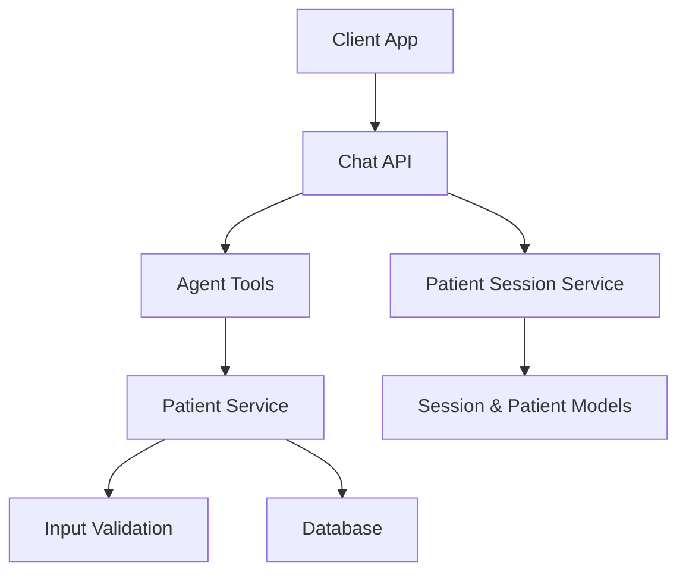
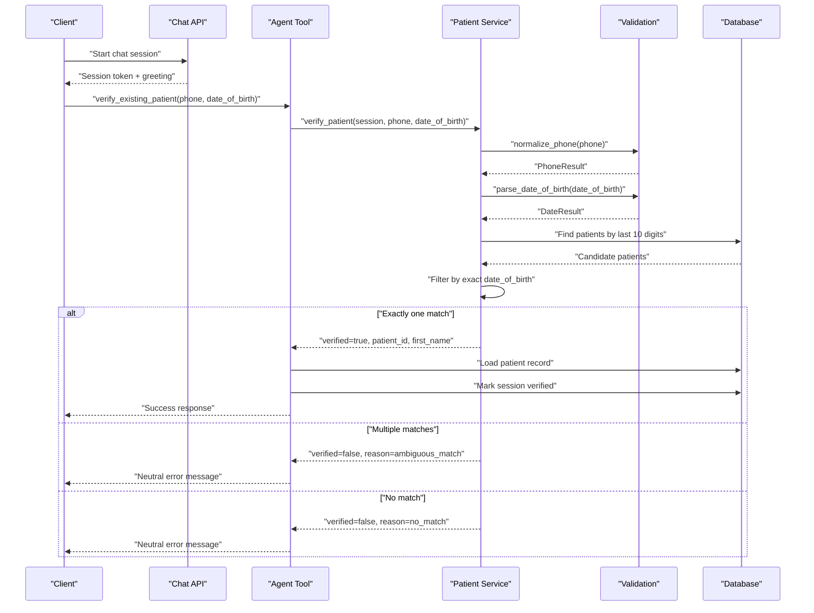
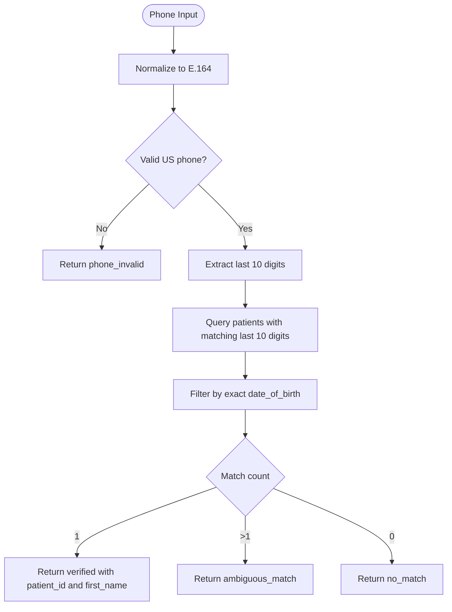
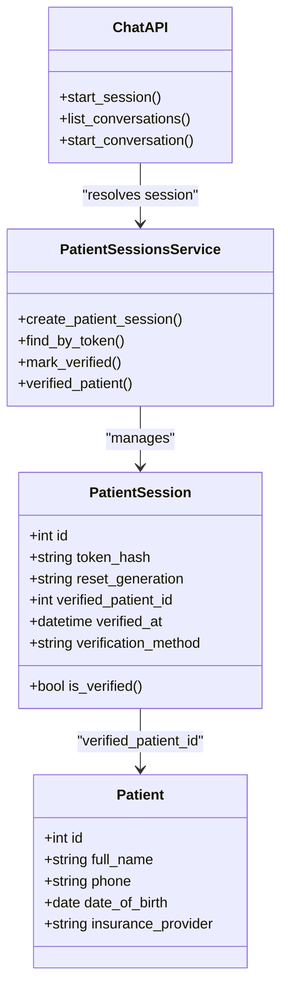
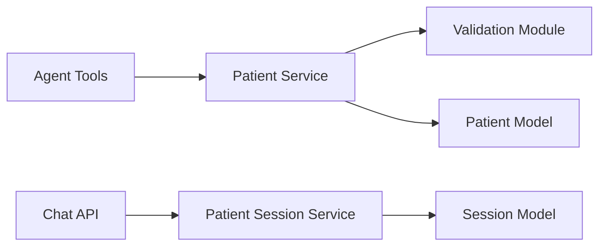

# Identity Verification

<cite>
**Referenced Files in This Document**
- [patients.py](file://backend/app/services/patients.py)
- [tools.py](file://backend/app/agent/tools.py)
- [validation.py](file://backend/app/validation.py)
- [sessions.py](file://backend/app/models/sessions.py)
- [patient_sessions.py](file://backend/app/services/patient_sessions.py)
- [chat.py](file://backend/app/api/chat.py)
- [deps.py](file://backend/app/api/deps.py)
</cite>

## Table of Contents
1. [Introduction](#introduction)
2. [Project Structure](#project-structure)
3. [Core Components](#core-components)
4. [Architecture Overview](#architecture-overview)
5. [Detailed Component Analysis](#detailed-component-analysis)
6. [Dependency Analysis](#dependency-analysis)
7. [Performance Considerations](#performance-considerations)
8. [Troubleshooting Guide](#troubleshooting-guide)
9. [Conclusion](#conclusion)

## Introduction
This document explains the identity verification system used to authenticate existing patients before they can discuss their records. The core flow asks for a phone number and date of birth, validates both inputs, matches them against stored charts, and returns a neutral failure when credentials do not match so attackers cannot probe whether a phone number exists. When multiple charts share the same phone and date of birth, the system refuses to guess and requires manual front desk intervention.

The system also supports new patient registration, which creates a chart and verifies the caller through registration rather than lookup. Throughout the process, privacy controls ensure that only verified sessions can access patient-specific data.

## Project Structure
The identity verification logic spans several layers:

- **Agent tools**: expose `verify_existing_patient` to the conversation agent.
- **Patient service**: implements `verify_patient`, phone matching, duplicate detection, and profile helpers.
- **Validation module**: normalizes phone numbers and parses dates of birth.
- **Session models and services**: manage tokens, session ownership, and verification state.
- **API layer**: starts patient sessions and enforces token-based access.

**Diagram sources**
- [chat.py:111-163](file://backend/app/api/chat.py#L111-L163)
- [tools.py:192-218](file://backend/app/agent/tools.py#L192-L218)
- [patients.py:183-230](file://backend/app/services/patients.py#L183-L230)
- [validation.py:37-86](file://backend/app/validation.py#L37-L86)
- [patient_sessions.py:50-115](file://backend/app/services/patient_sessions.py#L50-L115)
- [sessions.py:35-75](file://backend/app/models/sessions.py#L35-L75)

**Section sources**
- [chat.py:1-12](file://backend/app/api/chat.py#L1-L12)
- [tools.py:192-218](file://backend/app/agent/tools.py#L192-L218)
- [patients.py:1-11](file://backend/app/services/patients.py#L1-L11)
- [patient_sessions.py:1-14](file://backend/app/services/patient_sessions.py#L1-L14)

## Core Components
- **`verify_patient`**: Matches an existing chart by phone and date of birth. It normalizes inputs, queries candidates by last 10 digits, filters by exact date of birth, and returns structured results with success or neutral failure reasons.
- **Phone normalization and matching**: US phone numbers are normalized to E.164 for validation, while database lookups compare the last 10 digits to tolerate formatting differences such as parentheses, dashes, spaces, dots, plus signs, and country codes.
- **Date-of-birth parsing**: Accepts multiple formats, rejects impossible or future dates, flags ambiguous month/day input, and stores clinic-local calendar dates.
- **Verification result structure**: Success includes `verified`, `patient_id`, and `first_name`. Failure includes `verified: false` and one of `phone_invalid`, `date_invalid`, `no_match`, or `ambiguous_match`.
- **Ambiguous match handling**: If more than one chart matches the same phone and DOB, the system returns `ambiguous_match` and routes to front desk staff instead of guessing.
- **Session verification binding**: After successful verification, the patient session is bound to the matched patient using a secure method identifier.

**Section sources**
- [patients.py:183-230](file://backend/app/services/patients.py#L183-L230)
- [validation.py:37-86](file://backend/app/validation.py#L37-L86)
- [validation.py:154-246](file://backend/app/validation.py#L154-L246)
- [tools.py:192-218](file://backend/app/agent/tools.py#L192-L218)
- [patient_sessions.py:92-115](file://backend/app/services/patient_sessions.py#L92-L115)

## Architecture Overview
The verification workflow connects the client, API, agent tool, patient service, validation utilities, and database.

**Diagram sources**
- [chat.py:111-163](file://backend/app/api/chat.py#L111-L163)
- [tools.py:192-218](file://backend/app/agent/tools.py#L192-L218)
- [patients.py:183-230](file://backend/app/services/patients.py#L183-L230)
- [validation.py:37-86](file://backend/app/validation.py#L37-L86)
- [validation.py:154-246](file://backend/app/validation.py#L154-L246)
- [patient_sessions.py:92-115](file://backend/app/services/patient_sessions.py#L92-L115)

## Detailed Component Analysis

### Phone Number Matching Logic
The system uses two complementary strategies:

1. **Strict normalization for validation**: `normalize_phone` converts user input into a strict E.164 format, rejecting extensions, non-US country codes, short codes, and malformed lengths. This ensures the input is a valid US phone number before any lookup occurs.
2. **Loose matching for database lookup**: `_patients_with_phone` extracts the last 10 digits from both the normalized target and stored patient phones. It strips common formatting characters during SQL comparison and then performs a final Python-level check to ensure the candidate’s digit count matches exactly.

This design accommodates different storage formats while preventing accidental matches due to extra digits or missing area codes.

**Diagram sources**
- [validation.py:37-86](file://backend/app/validation.py#L37-L86)
- [patients.py:141-158](file://backend/app/services/patients.py#L141-L158)
- [patients.py:183-230](file://backend/app/services/patients.py#L183-L230)

**Section sources**
- [validation.py:37-86](file://backend/app/validation.py#L37-L86)
- [patients.py:141-158](file://backend/app/services/patients.py#L141-L158)

### Date-of-Birth Parsing and Ambiguity Handling
Date parsing supports ISO-style year-first formats, US-style month/day/year formats, numeric patterns with separators, and textual month names. It:

- Rejects missing, empty, future, too-old, and today-like dates.
- Flags ambiguous month/day interpretations so the assistant can confirm with the caller.
- Returns a structured result with `ok`, `value`, `iso`, `error`, `code`, and `ambiguous`.

For identity verification, the parsed date must be valid; ambiguity does not prevent matching but may prompt confirmation elsewhere in the flow.

**Section sources**
- [validation.py:154-246](file://backend/app/validation.py#L154-L246)

### Verification Result Structure
The verification function returns a consistent dictionary:

- **Success**:
  - `verified`: `true`
  - `patient_id`: integer ID of the matched patient
  - `first_name`: derived from the full name
  - `message`: friendly confirmation text
- **Failure**:
  - `verified`: `false`
  - `reason`: one of:
    - `phone_invalid`: phone normalization failed
    - `date_invalid`: date parsing failed
    - `no_match`: no chart matched both phone and DOB
    - `ambiguous_match`: multiple charts matched phone and DOB
  - `message`: neutral, non-leaky explanation

The agent tool wraps this result into a standardized tool response, mapping failures to error payloads and marking the session verified on success.

**Section sources**
- [patients.py:183-230](file://backend/app/services/patients.py#L183-L230)
- [tools.py:192-218](file://backend/app/agent/tools.py#L192-L218)

### Security Measures Against Probing Attacks
The verification endpoint intentionally avoids leaking which credential was wrong:

- Invalid phone or invalid date return early with specific reasons, but these are input-validation failures, not existence probes.
- A mismatch between phone and DOB returns `no_match`, never revealing whether the phone exists or whether the DOB is correct.
- Multiple matches return `ambiguous_match`, never listing other patients or confirming partial matches.
- Only after successful verification does the system load the patient record and bind the session.

This prevents an attacker from enumerating valid phone numbers by observing different error messages.

**Section sources**
- [patients.py:183-230](file://backend/app/services/patients.py#L183-L230)

### Ambiguous Matches and Front Desk Intervention
When two or more charts share the same phone and date of birth, the system treats this as a high-risk ambiguity. Instead of guessing, it:

- Returns `ambiguous_match`.
- Provides a neutral message indicating front desk involvement.
- Does not disclose additional identifying information.

This protects twins or similar cases where upstream data entry errors could create overlapping records.

**Section sources**
- [patients.py:211-221](file://backend/app/services/patients.py#L211-L221)

### Privacy Controls and Ownership Enforcement
Privacy is enforced at multiple layers:

- **Session tokens**: The browser receives a random URL-safe token once; only its hash is stored. Possession of a conversation ID alone does not grant access.
- **Token resolution**: Every protected route resolves the token to a session record and checks expiration and reset generation.
- **Verification binding**: Only registration or verification services can set `verified_patient_id`; the model cannot assert verification itself.
- **Data exposure**: Patient details are returned only after the session is verified for that patient.
- **Family scope limits**: Verified patients can book for linked household members, but detailed history and insurance for another adult require that adult’s own verification.

**Diagram sources**
- [sessions.py:35-75](file://backend/app/models/sessions.py#L35-L75)
- [patient_sessions.py:50-115](file://backend/app/services/patient_sessions.py#L50-L115)
- [chat.py:111-163](file://backend/app/api/chat.py#L111-L163)

**Section sources**
- [patient_sessions.py:1-14](file://backend/app/services/patient_sessions.py#L1-L14)
- [patient_sessions.py:50-115](file://backend/app/services/patient_sessions.py#L50-L115)
- [deps.py:27-48](file://backend/app/api/deps.py#L27-L48)
- [chat.py:111-163](file://backend/app/api/chat.py#L111-L163)

### Verification Flow Examples

#### Existing Patient Verification
1. Client starts a chat session and receives a token.
2. Client calls `verify_existing_patient` with phone and date of birth.
3. Backend normalizes and validates both fields.
4. Backend finds candidates by last 10 digits and filters by exact DOB.
5. If exactly one match exists, backend marks the session verified and returns success with `patient_id` and `first_name`.
6. Client can now discuss appointments and availability for that patient.

#### New Patient Registration
1. Client starts a chat session.
2. Client provides full name, phone, date of birth, and insurance provider.
3. Backend normalizes and validates fields.
4. Backend detects possible duplicates by name and phone summary without exposing record contents.
5. Backend creates the patient chart and marks the session verified via registration.
6. Client receives registration confirmation and can ask about availability.

#### Error Handling Patterns
- **Invalid phone**: Returns `phone_invalid` with a patient-friendly message.
- **Invalid date**: Returns `date_invalid` with guidance to re-enter the date.
- **No match**: Returns `no_match` and suggests double-checking both values or registering if new.
- **Ambiguous match**: Returns `ambiguous_match` and routes to front desk.
- **Unexpected database state**: Defensive errors are returned when a patient record cannot be loaded after verification.

**Section sources**
- [tools.py:192-218](file://backend/app/agent/tools.py#L192-L218)
- [patients.py:183-230](file://backend/app/services/patients.py#L183-L230)
- [patients.py:258-305](file://backend/app/services/patients.py#L258-L305)

## Dependency Analysis
The verification system has clear boundaries:

- **Agent tools depend on patient service**: The tool delegates all matching logic to `patients.verify_patient`.
- **Patient service depends on validation**: Phone and date parsing are centralized to avoid inconsistent rules.
- **Patient service depends on database models**: Queries use SQLAlchemy against the `patients` table.
- **API depends on session service**: All protected endpoints resolve the patient session token before processing requests.
- **Session service depends on security hashing**: Tokens are hashed before storage to prevent reconstruction from database reads.

**Diagram sources**
- [tools.py:192-218](file://backend/app/agent/tools.py#L192-L218)
- [patients.py:183-230](file://backend/app/services/patients.py#L183-L230)
- [validation.py:37-86](file://backend/app/validation.py#L37-L86)
- [chat.py:111-163](file://backend/app/api/chat.py#L111-L163)
- [patient_sessions.py:50-115](file://backend/app/services/patient_sessions.py#L50-L115)

**Section sources**
- [tools.py:192-218](file://backend/app/agent/tools.py#L192-L218)
- [patients.py:183-230](file://backend/app/services/patients.py#L183-L230)
- [chat.py:111-163](file://backend/app/api/chat.py#L111-L163)
- [patient_sessions.py:50-115](file://backend/app/services/patient_sessions.py#L50-L115)

## Performance Considerations
- **Phone lookup uses substring matching on cleaned digits**: The query strips common formatting characters and compares the last 10 digits. This is efficient enough for typical clinic datasets but should be monitored as the patient table grows.
- **Final Python filter ensures exact digit length**: After SQL filtering, the code confirms the candidate’s digit count matches the target, avoiding false positives from longer numbers.
- **Index usage**: The patient model defines indexes on phone and full name, helping lookup performance.
- **Minimal data exposure**: Verification returns only necessary identifiers and first name, reducing payload size and limiting sensitive data leakage.

[No sources needed since this section provides general guidance]

## Troubleshooting Guide
Common issues and how the system responds:

- **Phone number rejected**:
  - Cause: Missing, incomplete, extension included, non-US country code, or invalid area/prefix.
  - Response: `phone_invalid` with a patient-friendly message.
  - Action: Ask the caller to provide a complete 10-digit US phone number without extensions.
- **Date of birth rejected**:
  - Cause: Missing, unparsable, future date, too old, today-like, or ambiguous month/day.
  - Response: `date_invalid` with guidance to re-enter the date.
  - Action: Clarify the format and confirm ambiguous dates when prompted.
- **No match found**:
  - Cause: Phone and DOB combination does not exist in the database.
  - Response: `no_match` with a neutral message.
  - Action: Double-check both values or offer registration for new patients.
- **Ambiguous match**:
  - Cause: Multiple charts share the same phone and DOB.
  - Response: `ambiguous_match` with a neutral message.
  - Action: Escalate to front desk staff for manual resolution.
- **Session not verified**:
  - Cause: The current session has no verified patient bound.
  - Response: Tool returns `not_verified` and prompts for verification or registration.
  - Action: Call verification or registration before discussing appointments.

**Section sources**
- [validation.py:37-86](file://backend/app/validation.py#L37-L86)
- [validation.py:154-246](file://backend/app/validation.py#L154-L246)
- [patients.py:183-230](file://backend/app/services/patients.py#L183-L230)
- [tools.py:134-143](file://backend/app/agent/tools.py#L134-L143)

## Conclusion
The identity verification system provides a secure, privacy-preserving way to authenticate existing patients using phone number and date of birth. It normalizes inputs, matches safely against stored records, and returns neutral failure messages to prevent probing attacks. Ambiguous matches are explicitly handled by routing to front desk staff rather than guessing. Successful verification binds the session to the patient, enabling controlled access to appointments and availability while maintaining strict ownership and privacy boundaries. New patients can register securely, after which the session is verified through registration instead of lookup.

[No sources needed since this section summarizes without analyzing specific files]