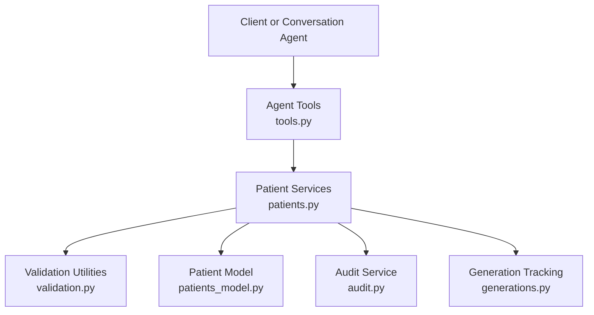
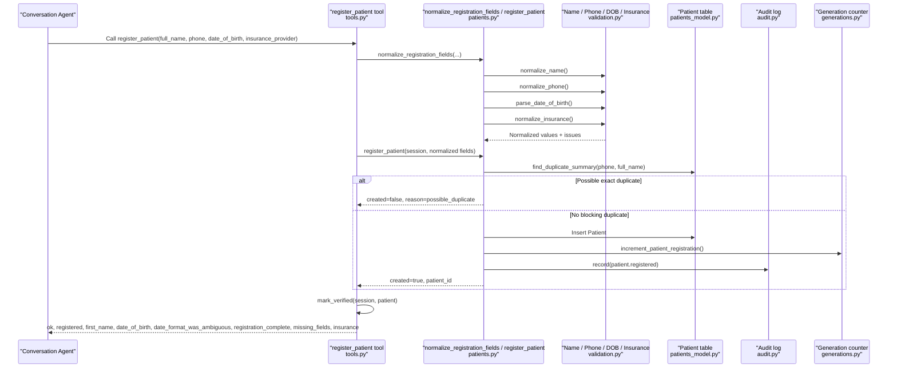
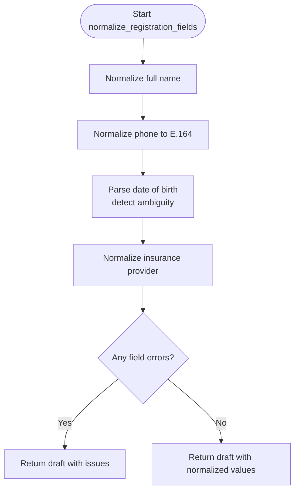
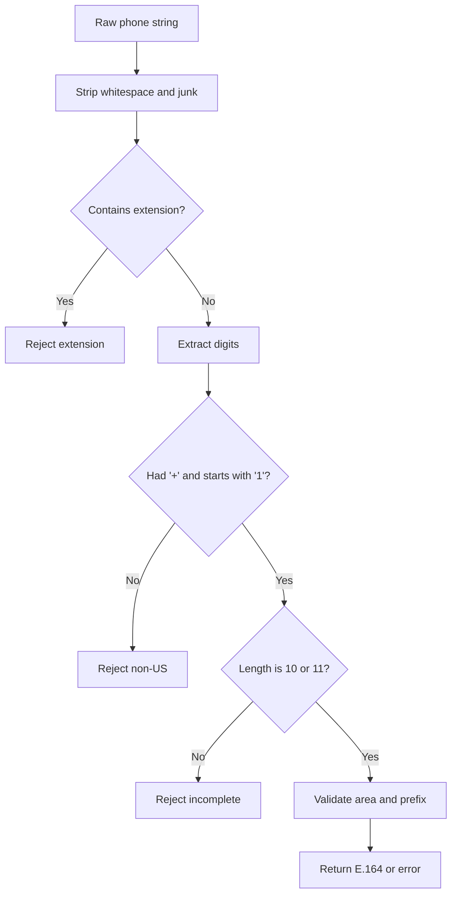
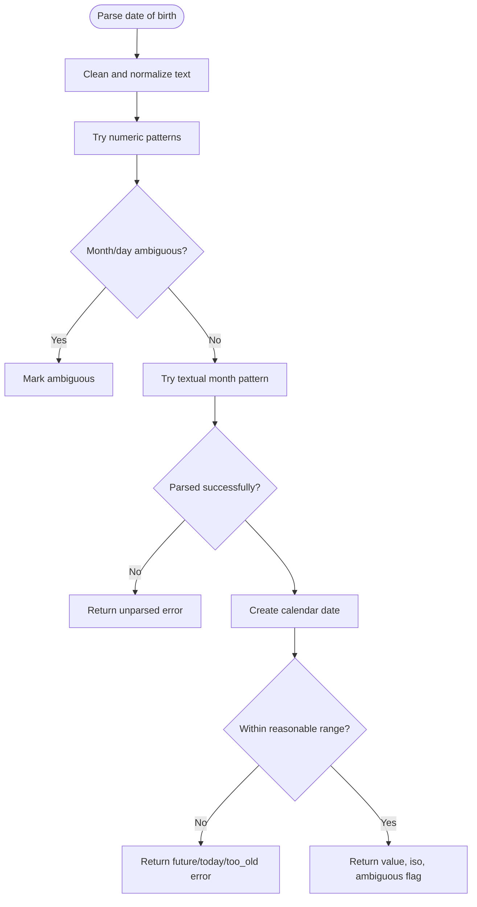
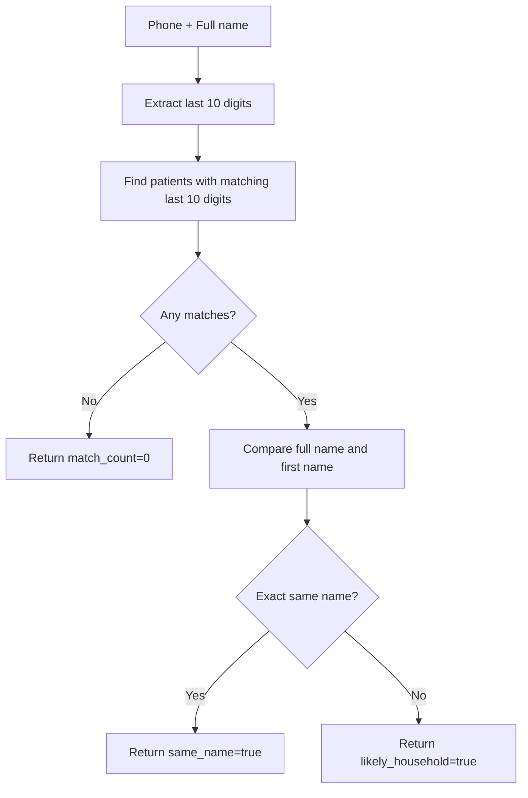
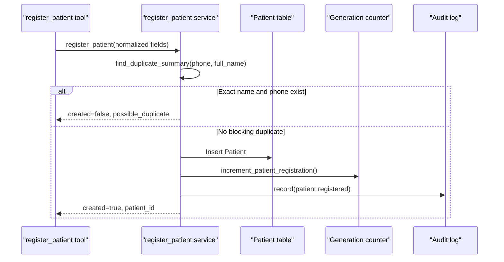
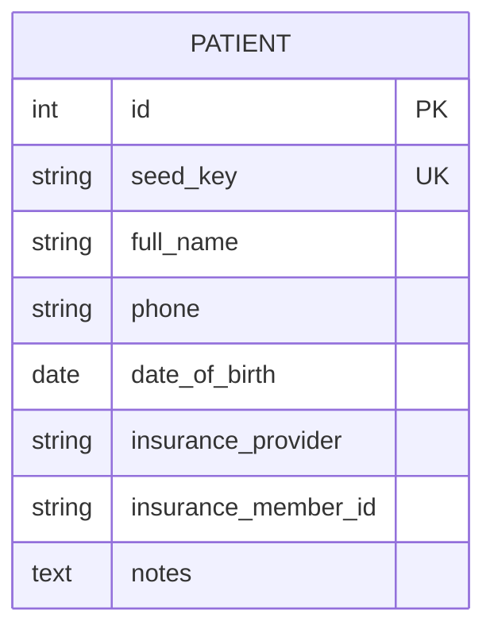
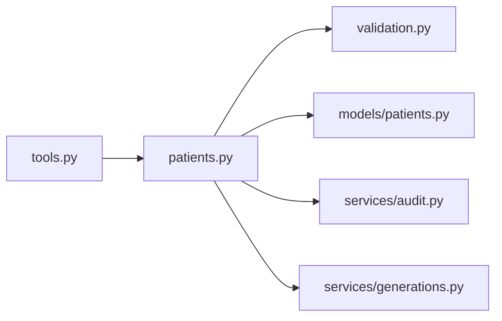

# Patient Registration

<cite>
**Referenced Files in This Document**
- [patients.py](file://backend/app/services/patients.py)
- [validation.py](file://backend/app/validation.py)
- [tools.py](file://backend/app/agent/tools.py)
- [audit.py](file://backend/app/services/audit.py)
- [generations.py](file://backend/app/services/generations.py)
- [patients_model.py](file://backend/app/models/patients.py)
</cite>

## Table of Contents
1. [Introduction](#introduction)
2. [Project Structure](#project-structure)
3. [Core Components](#core-components)
4. [Architecture Overview](#architecture-overview)
5. [Detailed Component Analysis](#detailed-component-analysis)
6. [Dependency Analysis](#dependency-analysis)
7. [Performance Considerations](#performance-considerations)
8. [Troubleshooting Guide](#troubleshooting-guide)
9. [Conclusion](#conclusion)

## Introduction
This document explains the patient registration workflow end-to-end. It covers how new patients are onboarded, how input is collected and validated, how phone numbers and dates are normalized, how insurance providers are interpreted, how duplicates are detected without leaking private data, how drafts collect fields independently before creating a record, how audit logs track registration events, and how the system integrates with generation tracking.

The design intentionally keeps validation separate from conversation logic: the model can request actions, but only validated tool handlers and service functions perform normalization, duplicate checks, persistence, auditing, and generation updates.

## Project Structure
The registration workflow spans several layers:

- Agent tools expose user-facing operations such as checking for duplicates, verifying an existing patient, registering a new patient, and updating details.
- Service functions implement business rules: field normalization, duplicate detection, verification, profile construction, and chart creation.
- Validation utilities provide strict parsing and normalization for names, phone numbers, dates of birth, and insurance provider text.
- Models define the persistent patient schema.
- Audit and generation services record events and update counters.

**Diagram sources**
- [tools.py:221-284](file://backend/app/agent/tools.py#L221-L284)
- [patients.py:81-138](file://backend/app/services/patients.py#L81-L138)
- [validation.py:37-87](file://backend/app/validation.py#L37-L87)
- [patients_model.py:18-46](file://backend/app/models/patients.py#L18-L46)
- [audit.py:15-51](file://backend/app/services/audit.py#L15-L51)
- [generations.py:122-128](file://backend/app/services/generations.py#L122-L128)

**Section sources**
- [tools.py:1-12](file://backend/app/agent/tools.py#L1-L12)
- [patients.py:1-11](file://backend/app/services/patients.py#L1-L11)
- [validation.py:1-6](file://backend/app/validation.py#L1-L6)

## Core Components
- **Registration draft**: Collects and validates full name, phone number, date of birth, and insurance provider independently, returning normalized values and per-field issues.
- **Field validators**: Normalize names to allowed characters, standardize US phone numbers to E.164, parse dates with ambiguity detection, and map insurance provider text to accepted plans or self-pay.
- **Duplicate detection**: Returns neutral counts and hints based on shared phone numbers and name matches without exposing record contents.
- **Verification**: Matches an existing chart by phone and date of birth while avoiding information leakage about which part failed.
- **Registration creation**: Creates a patient record after validation, increments generation tracking, and records an audit event.
- **Profile and completeness**: Builds a safe profile payload and reports missing fields.

**Section sources**
- [patients.py:60-138](file://backend/app/services/patients.py#L60-L138)
- [validation.py:29-87](file://backend/app/validation.py#L29-L87)
- [validation.py:137-246](file://backend/app/validation.py#L137-L246)
- [validation.py:254-364](file://backend/app/validation.py#L254-L364)
- [patients.py:141-180](file://backend/app/services/patients.py#L141-L180)
- [patients.py:183-230](file://backend/app/services/patients.py#L183-L230)
- [patients.py:233-305](file://backend/app/services/patients.py#L233-L305)

## Architecture Overview
The registration flow begins when the agent calls the registration tool. The tool validates arguments, builds a registration draft, performs duplicate checks, creates the patient if appropriate, marks the session verified, and returns a structured result.

**Diagram sources**
- [tools.py:221-284](file://backend/app/agent/tools.py#L221-L284)
- [patients.py:81-138](file://backend/app/services/patients.py#L81-L138)
- [patients.py:258-305](file://backend/app/services/patients.py#L258-L305)
- [validation.py:37-87](file://backend/app/validation.py#L37-L87)
- [validation.py:154-246](file://backend/app/validation.py#L154-L246)
- [validation.py:333-364](file://backend/app/validation.py#L333-L364)
- [audit.py:15-51](file://backend/app/services/audit.py#L15-L51)
- [generations.py:122-128](file://backend/app/services/generations.py#L122-L128)

## Detailed Component Analysis

### Registration Draft System
The registration draft collects four fields independently:

- Full name: normalized to allowed characters, length-checked, required to contain at least two words, and capitalized carefully.
- Phone number: stripped of formatting, validated as a US NANP number, and converted to E.164.
- Date of birth: parsed from numeric or textual formats, checked against clinic-local today, age-bounded, and flagged when month/day order is ambiguous.
- Insurance provider: mapped to an accepted plan, self-pay label, other plan, or stored under the patient’s own wording so registration is not blocked by unfamiliar plans.

The draft returns normalized values plus per-field error messages. Required fields can be enforced during initial registration, while optional updates allow correcting one field without failing others.

**Diagram sources**
- [patients.py:81-138](file://backend/app/services/patients.py#L81-L138)
- [validation.py:262-301](file://backend/app/validation.py#L262-L301)
- [validation.py:37-87](file://backend/app/validation.py#L37-L87)
- [validation.py:154-246](file://backend/app/validation.py#L154-L246)
- [validation.py:333-364](file://backend/app/validation.py#L333-L364)

**Section sources**
- [patients.py:60-138](file://backend/app/services/patients.py#L60-L138)
- [validation.py:262-301](file://backend/app/validation.py#L262-L301)
- [validation.py:333-364](file://backend/app/validation.py#L333-L364)

### Field Validation and Normalization

#### Name Normalization
Names must include letters, may include spaces, hyphens, apostrophes, and periods, must not exceed the configured length, must contain at least one letter, and must include more than one word so the system can distinguish given and family components. Capitalization preserves hyphenated parts and common apostrophe styles.

- Allowed characters and length limits prevent malformed or excessively long names.
- Single-word inputs are rejected because they do not reliably represent a full name.
- Placeholder-like single words are treated specially when extracting a greeting name.

**Section sources**
- [validation.py:262-301](file://backend/app/validation.py#L262-L301)
- [patients.py:40-56](file://backend/app/services/patients.py#L40-L56)

#### Phone Number Standardization to E164
Phone normalization accepts various US formats, rejects extensions, short codes, non-NANP country codes, invalid area/prefix patterns, and incomplete digits. Valid inputs are returned as E.164 strings starting with `+1`, along with a national format representation.

Key behaviors:
- Extensions such as “ext”, “x”, or “extension” followed by digits are rejected.
- Leading `+` is accepted only for US numbers starting with `+1`.
- Eleven-digit inputs must start with `1`; otherwise they are rejected.
- Ten-digit inputs are required after stripping formatting.
- Area code and prefix cannot start with `0` or `1`.
- Loose matching uses the last ten digits so stored formatting differences do not block lookup.

**Diagram sources**
- [validation.py:37-87](file://backend/app/validation.py#L37-L87)

**Section sources**
- [validation.py:37-87](file://backend/app/validation.py#L37-L87)

#### Date Parsing with Ambiguity Detection
Date-of-birth parsing supports ISO-style year-first formats, US-style month/day/year formats, and textual month forms. It expands two-digit years using a dental-clinic convention where recent years belong to the 2000s and older years to the 1900s.

Ambiguity handling:
- If both month and day are valid numbers less than or equal to 12 and differ, the parser chooses the US month/day reading but flags the result as ambiguous.
- If the first component cannot be a month but the second can, it interprets the input as day/month and flags ambiguity.
- Future dates, today’s date, and overly old dates are rejected.
- Invalid calendar dates are rejected.

**Diagram sources**
- [validation.py:154-246](file://backend/app/validation.py#L154-L246)

**Section sources**
- [validation.py:154-246](file://backend/app/validation.py#L154-L246)

#### Insurance Provider Normalization
Insurance input is mapped to:
- An accepted plan name when the input matches a known plan exactly or shares distinctive words.
- A self-pay label when the input indicates no insurance.
- An “Other plan” label when the input suggests another plan.
- The patient’s own wording up to a safe length when the plan is unknown.

This approach avoids blocking registration for unfamiliar plans; coverage verification remains a front-desk responsibility.

**Section sources**
- [validation.py:333-364](file://backend/app/validation.py#L333-L364)

### Duplicate Detection and Privacy
Duplicate detection is designed to avoid leaking private data. Instead of returning matching records, it returns:
- A match count based on shared phone numbers.
- Whether the exact same name exists among those matches.
- Whether the first name appears to belong to a different person sharing the phone.
- A likely-household hint when multiple people share the phone but the name does not match exactly.

Verification by phone and date of birth also returns neutral failure messages. It does not reveal whether the phone exists, whether the date is wrong, or which record matched.

**Diagram sources**
- [patients.py:141-180](file://backend/app/services/patients.py#L141-L180)

**Section sources**
- [patients.py:141-180](file://backend/app/services/patients.py#L141-L180)
- [patients.py:183-230](file://backend/app/services/patients.py#L183-L230)
- [tools.py:164-189](file://backend/app/agent/tools.py#L164-L189)

### Registration Creation Flow
When registration proceeds:
1. The tool checks that the current session is not already verified as a patient.
2. The service normalizes all fields through the draft system.
3. Duplicate summary is checked; an exact name-and-phone match blocks creation and suggests verification instead.
4. A new patient row is inserted.
5. Generation tracking is incremented.
6. An audit event is recorded.
7. The session is marked verified by registration.
8. A structured result is returned, including whether registration is complete and which fields are still missing.

**Diagram sources**
- [patients.py:258-305](file://backend/app/services/patients.py#L258-L305)
- [generations.py:122-128](file://backend/app/services/generations.py#L122-L128)
- [audit.py:15-51](file://backend/app/services/audit.py#L15-L51)

**Section sources**
- [tools.py:221-284](file://backend/app/agent/tools.py#L221-L284)
- [patients.py:258-305](file://backend/app/services/patients.py#L258-L305)

### Data Model
The patient model stores:
- Full name
- Phone number (non-unique to support families)
- Date of birth
- Insurance provider
- Optional member identifier and notes

Indexes are provided for phone and full name to support lookup and duplicate detection.

**Diagram sources**
- [patients_model.py:18-46](file://backend/app/models/patients.py#L18-L46)

**Section sources**
- [patients_model.py:18-46](file://backend/app/models/patients.py#L18-L46)

## Dependency Analysis
The registration workflow has clear layering:

- Agent tools depend on service functions for business logic.
- Service functions depend on validation utilities for parsing and normalization.
- Service functions depend on models for persistence.
- Service functions depend on audit and generation services for side effects.

**Diagram sources**
- [tools.py:221-284](file://backend/app/agent/tools.py#L221-L284)
- [patients.py:23-31](file://backend/app/services/patients.py#L23-L31)
- [patients.py:291-299](file://backend/app/services/patients.py#L291-L299)

**Section sources**
- [tools.py:221-284](file://backend/app/agent/tools.py#L221-L284)
- [patients.py:23-31](file://backend/app/services/patients.py#L23-L31)

## Performance Considerations
- Phone matching uses the last ten digits and SQL-level replacement to tolerate formatting differences. This is efficient but relies on indexes on phone and full name.
- Duplicate detection queries all rows sharing the last ten digits and then filters in Python by exact digit equality and name comparison. For very large datasets, consider database-side normalization or additional indexing strategies.
- Date parsing and insurance normalization are lightweight string operations and should remain fast.
- Audit logging writes JSON-serialized details; keep details concise to avoid large audit payloads.

[No sources needed since this section provides general guidance]

## Troubleshooting Guide

### Common Registration Scenarios

#### Self-Pay Patients
- When a patient indicates no insurance, insurance normalization maps the input to the self-pay label.
- Registration proceeds normally, and the resulting profile marks the patient as self-pay.
- Front desk verification handles coverage questions later.

**Section sources**
- [validation.py:333-364](file://backend/app/validation.py#L333-L364)
- [patients.py:242-255](file://backend/app/services/patients.py#L242-L255)

#### Family Members Sharing Phone Numbers
- Phone numbers are intentionally non-unique.
- Duplicate detection returns a likely-household hint when multiple records share the phone but the name differs.
- Registration is not blocked by shared phones; identity resolution happens conversationally through name and date of birth.

**Section sources**
- [patients_model.py:18-46](file://backend/app/models/patients.py#L18-L46)
- [patients.py:141-180](file://backend/app/services/patients.py#L141-L180)
- [tools.py:164-189](file://backend/app/agent/tools.py#L164-L189)

#### Invalid or Incomplete Data
- Missing phone: the validator returns a friendly message asking for a phone number.
- Extension included: the validator rejects extensions and asks for the base number.
- Non-US number: the validator rejects non-NANP country codes.
- Invalid area or prefix: the validator rejects invalid US patterns.
- Ambiguous date: the draft flags ambiguity so the assistant can confirm the intended month/day order.
- Future or impossible date: the validator rejects the input and asks for correction.
- Unknown insurance plan: the system stores the patient’s wording rather than blocking registration.

**Section sources**
- [validation.py:37-87](file://backend/app/validation.py#L37-L87)
- [validation.py:154-246](file://backend/app/validation.py#L154-L246)
- [validation.py:262-301](file://backend/app/validation.py#L262-L301)
- [validation.py:333-364](file://backend/app/validation.py#L333-L364)
- [patients.py:81-138](file://backend/app/services/patients.py#L81-L138)

### Error Handling Patterns
- Tool execution wraps handler calls in exception handling so unexpected failures become recoverable tool results.
- Validation failures return structured field errors that the assistant can relay to the patient.
- Verification failures return neutral reasons and messages without revealing which part was incorrect.
- Registration duplication returns a possible-duplicate reason and suggests verification instead of forcing a new chart.

**Section sources**
- [tools.py:703-739](file://backend/app/agent/tools.py#L703-L739)
- [patients.py:183-230](file://backend/app/services/patients.py#L183-L230)
- [patients.py:258-277](file://backend/app/services/patients.py#L258-L277)

## Conclusion
The patient registration workflow combines strict input normalization, privacy-preserving duplicate detection, and clear audit and generation tracking. Names, phone numbers, dates, and insurance providers are validated independently so partial corrections are possible. Shared phone numbers are supported for families, while identity is resolved through neutral hints and verification flows. The system avoids leaking private data by returning counts and neutral messages rather than record contents. Registration events are audited and counted internally, keeping operational visibility without exposing sensitive information.

[No sources needed since this section summarizes without analyzing specific files]