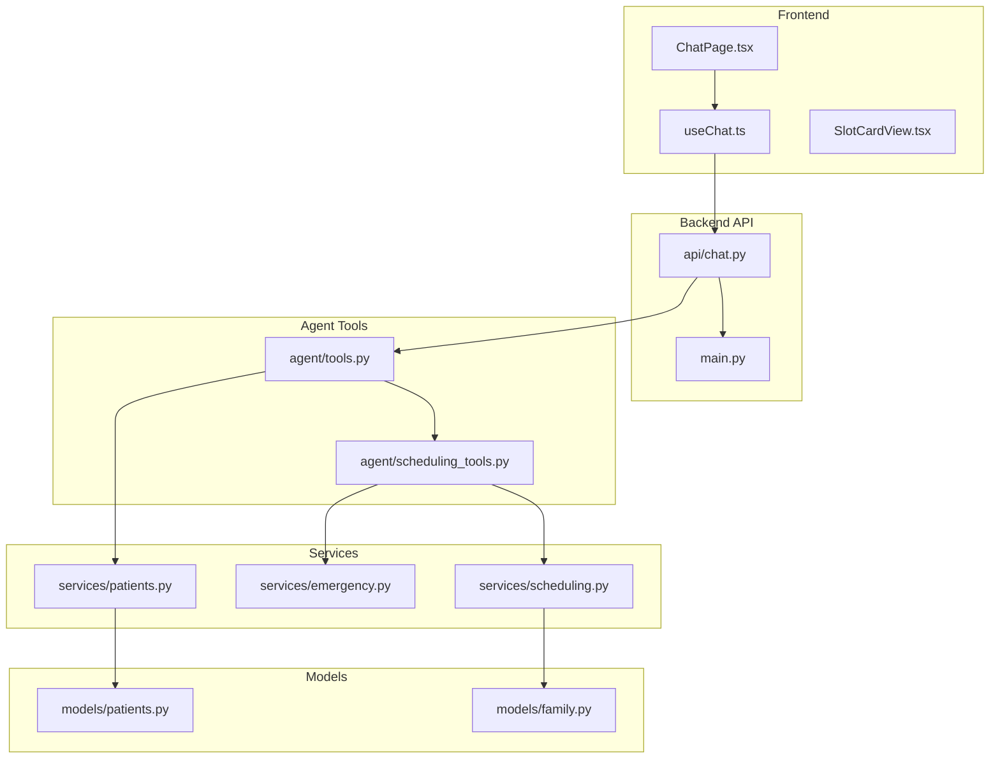
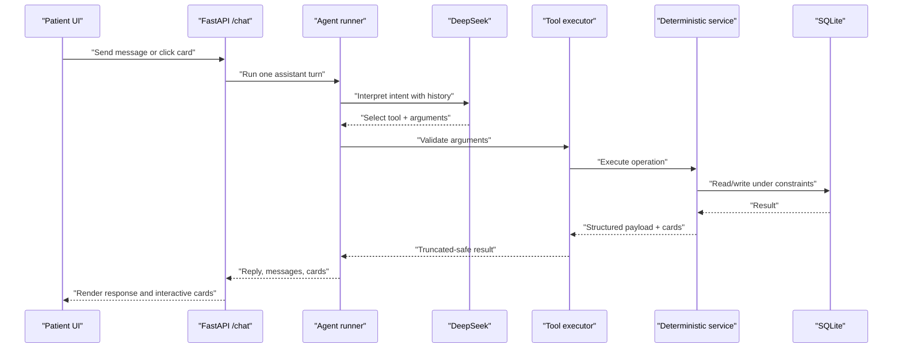
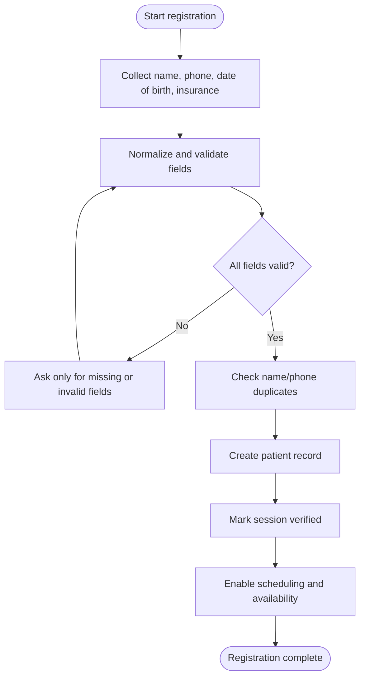
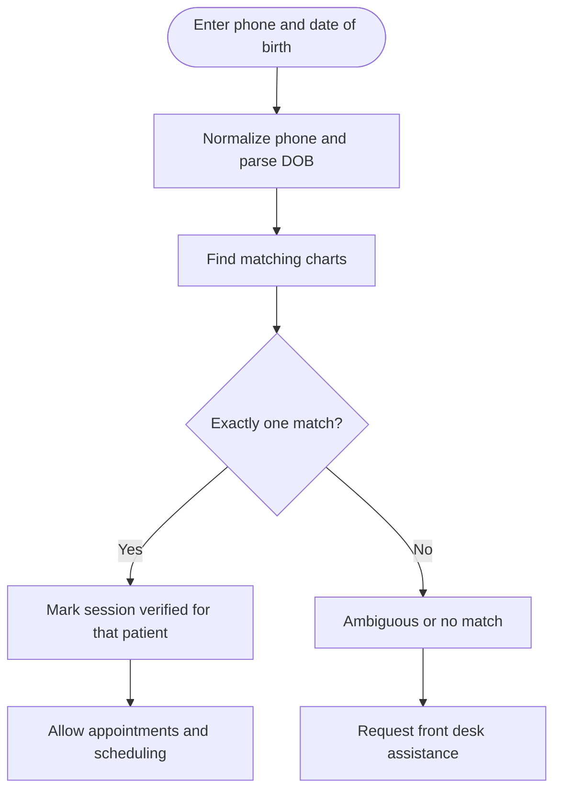
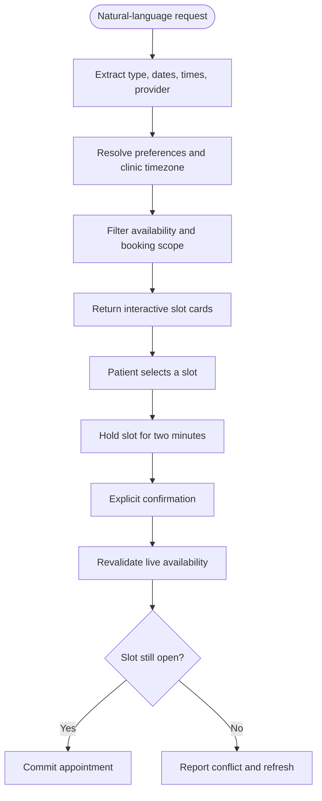
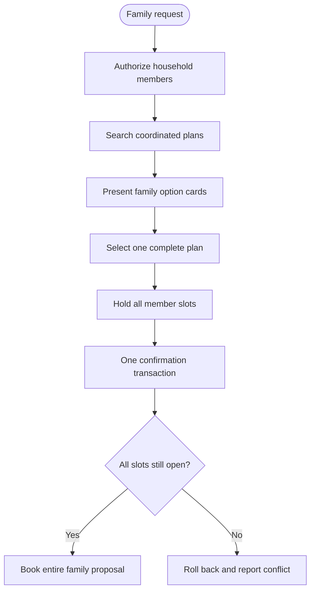
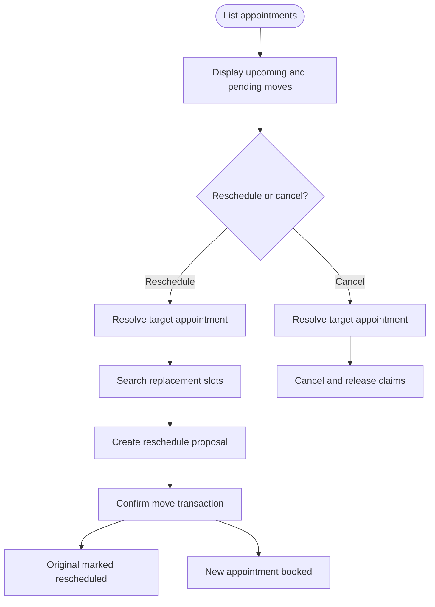
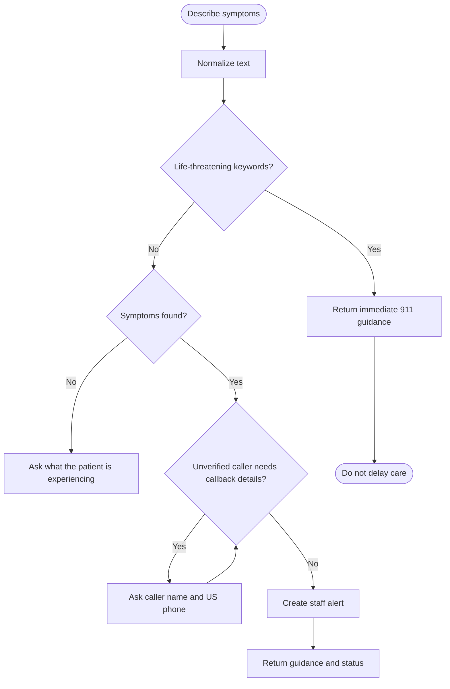
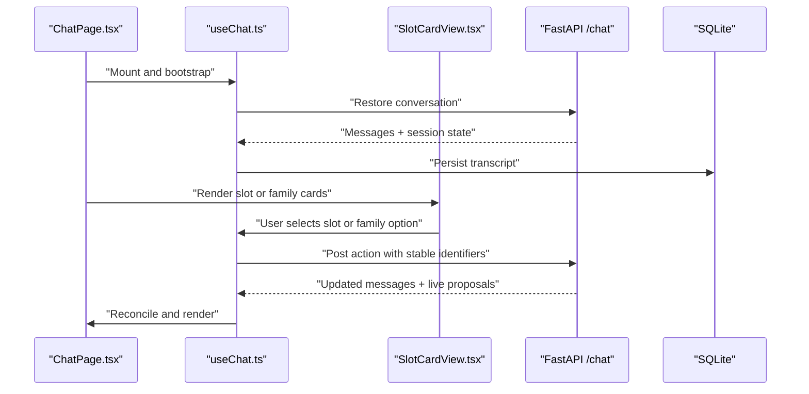
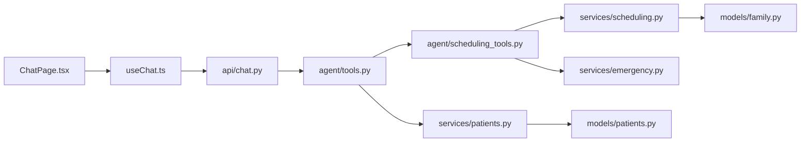

# Patient Workflows

<cite>
**Referenced Files in This Document**
- [README.md](file://README.md)
- [main.py](file://backend/app/main.py)
- [chat.py](file://backend/app/api/chat.py)
- [tools.py](file://backend/app/agent/tools.py)
- [scheduling_tools.py](file://backend/app/agent/scheduling_tools.py)
- [emergency.py](file://backend/app/services/emergency.py)
- [patients.py](file://backend/app/services/patients.py)
- [scheduling.py](file://backend/app/services/scheduling.py)
- [patients_model.py](file://backend/app/models/patients.py)
- [family_model.py](file://backend/app/models/family.py)
- [ChatPage.tsx](file://frontend/src/pages/ChatPage.tsx)
- [useChat.ts](file://frontend/src/hooks/useChat.ts)
- [SlotCardView.tsx](file://frontend/src/components/cards/SlotCardView.tsx)
</cite>

## Table of Contents
1. [Introduction](#introduction)
2. [Project Structure](#project-structure)
3. [Core Components](#core-components)
4. [Architecture Overview](#architecture-overview)
5. [Detailed Component Analysis](#detailed-component-analysis)
6. [Dependency Analysis](#dependency-analysis)
7. [Performance Considerations](#performance-considerations)
8. [Troubleshooting Guide](#troubleshooting-guide)
9. [Conclusion](#conclusion)

## Introduction
This document describes the patient-facing workflows for the dental receptionist system. It covers the complete journey from first contact through appointment completion, including new-patient registration, identity verification, natural-language scheduling, family booking coordination, post-booking management, and emergency triage. The system separates AI interpretation from deterministic operations: the conversation agent interprets intent and selects tools, while Python services enforce validation, authorization, scheduling rules, transactions, and privacy. Results are presented as interactive cards that the UI renders and posts back to secure endpoints.

The repository is a fictional Oral-B Dental Care demo with SQLite persistence, FastAPI backend, React frontend, and DeepSeek-powered conversation processing.

**Section sources**
- [README.md:1-67](file://README.md#L1-L67)

## Project Structure
The patient experience is implemented across three layers:

- Frontend chat page and state machine manage session restoration, message sending, card interactions, and error recovery.
- Backend API routes own session lifecycle, conversation persistence, and assistant turn execution.
- Agent tool layer exposes validated functions for registration, verification, practice information, availability search, proposals, rescheduling, cancellation, family coordination, and emergencies. Services implement deterministic business logic and data integrity.



**Diagram sources**
- [ChatPage.tsx:1-333](file://frontend/src/pages/ChatPage.tsx#L1-L333)
- [useChat.ts:1-750](file://frontend/src/hooks/useChat.ts#L1-L750)
- [main.py:202-256](file://backend/app/main.py#L202-L256)
- [chat.py:1-347](file://backend/app/api/chat.py#L1-L347)
- [tools.py:1-740](file://backend/app/agent/tools.py#L1-L740)
- [scheduling_tools.py:1-800](file://backend/app/agent/scheduling_tools.py#L1-L800)
- [emergency.py:1-548](file://backend/app/services/emergency.py#L1-L548)
- [patients.py:1-365](file://backend/app/services/patients.py#L1-L365)
- [scheduling.py:1-800](file://backend/app/services/scheduling.py#L1-L800)
- [patients_model.py:1-109](file://backend/app/models/patients.py#L1-L109)
- [family_model.py:1-61](file://backend/app/models/family.py#L1-L61)

**Section sources**
- [README.md:52-70](file://README.md#L52-L70)
- [main.py:202-256](file://backend/app/main.py#L202-L256)
- [chat.py:1-48](file://backend/app/api/chat.py#L1-L48)

## Core Components
- Patient chat session and conversation lifecycle: opaque session tokens, conversation IDs, greeting generation, suggestion prompts, feedback submission, and reset handling.
- Tool registry and execution: Pydantic-validated arguments, safe tool dispatch, result truncation, and structured error responses.
- Registration and verification: name, phone, date of birth, insurance normalization; duplicate detection; existing-patient verification by phone and DOB.
- Availability and proposals: natural-language date/time parsing, provider filtering, slot holds, proposal creation, explicit confirmation, idempotency, and stale-card reconciliation.
- Rescheduling and cancellation: move-only semantics, target resolution, original appointment preservation, and transactional updates.
- Family booking: authorized household members, per-member type/provider constraints, coordinated plans, one-transaction confirmation, and privacy boundaries.
- Emergency triage: immediate life-threatening guidance, symptom classification, callback collection, staff alert creation, and follow-up handling.
- Frontend state machine: bootstrap, restore, optimistic messages, card actions, live proposal reconciliation, retry, and degraded-assistant fallback.

**Section sources**
- [chat.py:111-274](file://backend/app/api/chat.py#L111-L274)
- [tools.py:511-740](file://backend/app/agent/tools.py#L511-L740)
- [patients.py:81-365](file://backend/app/services/patients.py#L81-L365)
- [scheduling.py:393-800](file://backend/app/services/scheduling.py#L393-L800)
- [scheduling_tools.py:59-360](file://backend/app/agent/scheduling_tools.py#L59-L360)
- [emergency.py:1-367](file://backend/app/services/emergency.py#L1-L367)
- [useChat.ts:271-750](file://frontend/src/hooks/useChat.ts#L271-L750)

## Architecture Overview
The patient workflow follows a bounded loop:

1. The React UI sends a natural-language message or clicks an interactive card.
2. FastAPI resolves the patient session, loads the conversation, and runs one assistant turn off the event loop.
3. The agent builds full chronological history and asks DeepSeek to interpret intent.
4. DeepSeek may request a tool; arguments are validated by Pydantic before any service call.
5. Deterministic services perform identity checks, availability queries, proposal writes, or emergency alerts.
6. Tool results return to the conversation loop; the final reply and structured cards are persisted and rendered.
7. Direct card actions bypass the model and call deterministic scheduling endpoints.



**Diagram sources**
- [README.md:52-70](file://README.md#L52-L70)
- [chat.py:233-274](file://backend/app/api/chat.py#L233-L274)
- [tools.py:703-740](file://backend/app/agent/tools.py#L703-L740)
- [scheduling.py:1-12](file://backend/app/services/scheduling.py#L1-L12)

## Detailed Component Analysis

### New-Patient Registration and Insurance Collection
A new patient provides name, US phone number, date of birth, and insurance choice or self-pay. The backend normalizes names and phones, rejects malformed or ambiguous dates, and accepts configured plans or self-pay. A patient record is created only after required fields are valid. Registration completeness gates scheduling until all required fields are present.

Key behaviors:
- Name normalization prevents placeholder values and preserves single-word names safely.
- Phone normalization supports shared household numbers while still validating format.
- Date-of-birth parsing flags ambiguity and rejects past or invalid dates.
- Duplicate detection returns counts and neutral hints without exposing chart contents.
- Successful registration marks the session verified and enables scheduling.



**Diagram sources**
- [patients.py:81-138](file://backend/app/services/patients.py#L81-L138)
- [patients.py:161-305](file://backend/app/services/patients.py#L161-L305)
- [tools.py:221-284](file://backend/app/agent/tools.py#L221-L284)

**Section sources**
- [README.md:115-118](file://README.md#L115-L118)
- [patients.py:81-138](file://backend/app/services/patients.py#L81-L138)
- [patients.py:161-305](file://backend/app/services/patients.py#L161-L305)
- [tools.py:221-284](file://backend/app/agent/tools.py#L221-L284)

### Identity Verification Using Phone Number and Date of Birth
Existing patients verify using the same identity fields used at registration. Verification matches normalized phone and exact date of birth. Ambiguous matches route to staff rather than guessing between charts. Verification grants access to that patient’s appointments and scheduling context but does not expose unrelated records.

Important privacy controls:
- Mismatch responses do not reveal whether the phone exists.
- Multiple matching charts require human review.
- Only the verified patient’s profile and appointments are exposed.
- Household membership allows booking for linked family members without granting read access to their private records.



**Diagram sources**
- [patients.py:183-230](file://backend/app/services/patients.py#L183-L230)
- [tools.py:192-218](file://backend/app/agent/tools.py#L192-L218)

**Section sources**
- [README.md:125-128](file://README.md#L125-L128)
- [patients.py:183-230](file://backend/app/services/patients.py#L183-L230)
- [tools.py:192-218](file://backend/app/agent/tools.py#L192-L218)

### Natural-Language Appointment Requests
Patients can ask for cleanings, checkups, and emergencies using natural language. The agent extracts appointment type, date phrases, time windows, weekdays, provider preferences, and additional-visit intent. Availability filters business hours, provider eligibility, duration, existing appointments, staff blocks, and active claims.

Common conversation patterns:
- “I’d like to book a cleaning.”
- “Can I get a checkup next week?”
- “Any morning slots this Friday?”
- “I need another visit because my tooth hurts again.”
- “Who do you have available?”

The UI displays real slots as clickable cards. Selecting a card creates a pending proposal and holds the time for two minutes. Confirmation rechecks availability and commits only if the slot is still open.



**Diagram sources**
- [scheduling_tools.py:59-113](file://backend/app/agent/scheduling_tools.py#L59-L113)
- [scheduling.py:393-716](file://backend/app/services/scheduling.py#L393-L716)
- [SlotCardView.tsx:1-136](file://frontend/src/components/cards/SlotCardView.tsx#L1-L136)

**Section sources**
- [README.md:119-124](file://README.md#L119-L124)
- [scheduling_tools.py:474-552](file://backend/app/agent/scheduling_tools.py#L474-L552)
- [scheduling.py:393-716](file://backend/app/services/scheduling.py#L393-L716)
- [ChatPage.tsx:26-31](file://frontend/src/pages/ChatPage.tsx#L26-L31)

### Family Booking Coordination
Family bookings coordinate multiple participants, each with its own patient, appointment type, duration, and provider eligibility. The verified caller may book for themselves and other household members such as a spouse, partner, or child. Each person’s details remain private unless they independently verify.

Key rules:
- One family option card contains all visits for the requested shape.
- Back-to-back or nearby plans are preferred when possible.
- Confirmation books the complete family proposal atomically.
- A conflict rolls back the whole group.
- An explicitly requested additional visit does not cancel an existing appointment.



**Diagram sources**
- [scheduling_tools.py:246-313](file://backend/app/agent/scheduling_tools.py#L246-L313)
- [scheduling.py:719-792](file://backend/app/services/scheduling.py#L719-L792)
- [family_model.py:21-61](file://backend/app/models/family.py#L21-L61)

**Section sources**
- [README.md:23-29](file://README.md#L23-L29)
- [README.md:129-131](file://README.md#L129-L131)
- [scheduling_tools.py:417-466](file://backend/app/agent/scheduling_tools.py#L417-L466)
- [scheduling.py:719-792](file://backend/app/services/scheduling.py#L719-L792)
- [family_model.py:21-61](file://backend/app/models/family.py#L21-L61)

### Post-Booking Management: View, Reschedule, Cancel
After verification, patients can list upcoming appointments, request a reschedule, or request cancellation. Rescheduling is distinct from a new booking: it names the existing appointment being moved, preserves historical time and provider, and creates a new booked row linked to the original. Cancellation removes the target appointment after ownership is confirmed.

Conversation patterns:
- “Show my upcoming appointments.”
- “Move my cleaning to Thursday afternoon.”
- “Cancel my checkup on November fifth.”
- “I want a separate visit instead of moving it.”



**Diagram sources**
- [scheduling_tools.py:725-800](file://backend/app/agent/scheduling_tools.py#L725-L800)
- [scheduling.py:238-295](file://backend/app/services/scheduling.py#L238-L295)

**Section sources**
- [README.md:127-128](file://README.md#L127-L128)
- [README.md:149-151](file://README.md#L149-L151)
- [scheduling_tools.py:725-800](file://backend/app/agent/scheduling_tools.py#L725-L800)

### Emergency Triage System
Emergency triage uses Python keyword-driven checks, not LLM judgment, to classify symptoms. Life-threatening indicators receive immediate 911 guidance before registration, verification, or availability search. Other urgent reports require a callback name and valid US phone number, then create a staff alert. Alerts are stored for staff review; no external notification is implemented.

Triage behavior:
- Immediate escalation for airway, severe bleeding, unconsciousness, chest pain, facial trauma, and similar red flags.
- Symptom extraction produces labels for staff summaries.
- Non-life-threatening reports require contact details for unverified callers.
- Follow-ups update or reopen cases consistently.



**Diagram sources**
- [emergency.py:1-31](file://backend/app/services/emergency.py#L1-L31)
- [emergency.py:46-114](file://backend/app/services/emergency.py#L46-L114)
- [emergency.py:219-367](file://backend/app/services/emergency.py#L219-L367)

**Section sources**
- [README.md:133-136](file://README.md#L133-L136)
- [emergency.py:1-31](file://backend/app/services/emergency.py#L1-L31)
- [emergency.py:219-367](file://backend/app/services/emergency.py#L219-L367)

### Privacy Controls
Privacy is enforced by session-scoped lookup, verification requirements, and household authorization:

- Opaque patient sessions prevent access by guessing conversation IDs.
- Existing-patient verification is required before accessing appointments or scheduling.
- Registration duplicate checks return counts and neutral hints, never chart contents.
- Family membership allows booking for linked members but does not grant read access to their private records.
- Emergency callback details are contact information, not identity proof, and are attached only to alerts.

```mermaid
classDiagram
class PatientSession {
+token
+contact_name
+contact_phone
+verified_patient()
}
class Conversation {
+id
+public_id
+patient_session
}
class Patient {
+id
+full_name
+phone
+date_of_birth
+insurance_provider
}
class FamilyGroup {
+id
+name
+shared_phone
}
class FamilyMember {
+family_group_id
+patient_id
+relation_to_primary
+is_primary_contact
}
PatientSession --> Conversation : "owns"
FamilyGroup ||--o{ FamilyMember : "contains"
FamilyMember --> Patient : "links"
```

**Diagram sources**
- [chat.py:1-12](file://backend/app/api/chat.py#L1-L12)
- [patients.py:1-11](file://backend/app/services/patients.py#L1-L11)
- [family_model.py:21-61](file://backend/app/models/family.py#L21-L61)
- [patients_model.py:18-46](file://backend/app/models/patients.py#L18-L46)

**Section sources**
- [README.md:157-158](file://README.md#L157-L158)
- [README.md:265-266](file://README.md#L265-L266)
- [chat.py:101-108](file://backend/app/api/chat.py#L101-L108)
- [patients.py:1-11](file://backend/app/services/patients.py#L1-L11)
- [family_model.py:21-61](file://backend/app/models/family.py#L21-L61)

### Conversation Flow and Interactive Cards
The frontend maintains a persistent transcript and reconciles server-side state with client-side cards:

- Bootstrap restores the stored session and thread when possible.
- Messages are sent optimistically and replaced by server replies.
- Slot cards show real times, providers, durations, and hold status.
- Family option cards present complete coordinated plans.
- Pending proposals are attached or retired based on live database state.
- Degraded assistant responses display a warning and allow retry.



**Diagram sources**
- [ChatPage.tsx:69-116](file://frontend/src/pages/ChatPage.tsx#L69-L116)
- [useChat.ts:271-750](file://frontend/src/hooks/useChat.ts#L271-L750)
- [SlotCardView.tsx:1-136](file://frontend/src/components/cards/SlotCardView.tsx#L1-L136)

**Section sources**
- [README.md:153-159](file://README.md#L153-L159)
- [useChat.ts:1-23](file://frontend/src/hooks/useChat.ts#L1-L23)
- [useChat.ts:356-385](file://frontend/src/hooks/useChat.ts#L356-L385)
- [SlotCardView.tsx:1-17](file://frontend/src/components/cards/SlotCardView.tsx#L1-L17)

## Dependency Analysis
The patient workflow depends on layered modules with clear responsibilities:

- API routes depend on agent runners, conversation services, and scheduling endpoints.
- Agent tools depend on patient, scheduling, and emergency services.
- Scheduling tools depend on availability engines, proposal services, and transaction helpers.
- Models define patients, providers, appointment types, families, and scheduling entities.
- Frontend components depend on typed API clients and card utilities.



**Diagram sources**
- [ChatPage.tsx:1-333](file://frontend/src/pages/ChatPage.tsx#L1-L333)
- [useChat.ts:1-750](file://frontend/src/hooks/useChat.ts#L1-L750)
- [chat.py:1-347](file://backend/app/api/chat.py#L1-L347)
- [tools.py:1-740](file://backend/app/agent/tools.py#L1-L740)
- [scheduling_tools.py:1-800](file://backend/app/agent/scheduling_tools.py#L1-L800)
- [scheduling.py:1-800](file://backend/app/services/scheduling.py#L1-L800)
- [emergency.py:1-548](file://backend/app/services/emergency.py#L1-L548)
- [patients.py:1-365](file://backend/app/services/patients.py#L1-L365)
- [patients_model.py:1-109](file://backend/app/models/patients.py#L1-L109)
- [family_model.py:1-61](file://backend/app/models/family.py#L1-L61)

**Section sources**
- [README.md:305-337](file://README.md#L305-L337)

## Performance Considerations
- Assistant turns run off the event loop to avoid blocking HTTP requests.
- Conversation history is sent in full to the model; summarization is intentionally omitted for correctness.
- Tool results are truncated to keep interactive cards while trimming secondary detail.
- Availability searches filter provider eligibility, duration, existing appointments, and active claims.
- Holds expire after two minutes, releasing slots earlier when the patient changes their mind.
- Frontend avoids unnecessary re-renders by reconciling live proposals and disabling stale cards.

[No sources needed since this section provides general guidance]

## Troubleshooting Guide
Common issues and expected behaviors:

- Empty messages return a validation error and require clarification.
- Invalid registration fields return field-specific errors without creating partial records.
- Unavailable, conflicting, expired, or stale scheduling actions return safe errors and require a fresh action.
- Duplicate card clicks and confirmation retries use idempotency keys.
- DeepSeek timeouts and transient failures use bounded retries and return degraded fallbacks without claiming success.
- Database busy states return a retryable response with a short retry-after hint.
- Integrity constraint violations return a conflict response so the client refetches state.
- Expired or reset-invalid sessions require a new session; the frontend detects reset-generation mismatches and starts over.
- Life-threatening symptoms receive immediate emergency guidance; other alerts require valid callback details.

**Section sources**
- [main.py:124-179](file://backend/app/main.py#L124-L179)
- [chat.py:246-251](file://backend/app/api/chat.py#L246-L251)
- [README.md:161-171](file://README.md#L161-L171)
- [useChat.ts:586-623](file://frontend/src/hooks/useChat.ts#L586-L623)

## Conclusion
The patient workflows prioritize safety, correctness, and clarity. Natural language makes the interface approachable, while deterministic tools, services, and database constraints ensure that identity, privacy, scheduling, and emergencies are handled reliably. Interactive cards give patients control over availability, proposals, reschedules, and cancellations. Emergency triage separates immediate medical escalation from operational handoff. When AI processing fails, the system degrades gracefully and keeps the patient path recoverable through retries, refreshed state, and staff-visible exceptions.

[No sources needed since this section summarizes without analyzing specific files]