# Profile Management

<cite>
**Referenced Files in This Document**
- [patients.py](file://backend/app/models/patients.py)
- [family.py](file://backend/app/models/family.py)
- [sessions.py](file://backend/app/models/sessions.py)
- [patients_service.py](file://backend/app/services/patients.py)
- [patient_sessions_service.py](file://backend/app/services/patient_sessions.py)
- [audit_service.py](file://backend/app/services/audit.py)
- [validation.py](file://backend/app/validation.py)
- [chat_api.py](file://backend/app/api/chat.py)
- [scheduling_api.py](file://backend/app/api/scheduling.py)
- [deps.py](file://backend/app/api/deps.py)
- [tools.py](file://backend/app/agent/tools.py)
- [scheduling_tools.py](file://backend/app/agent/scheduling_tools.py)
</cite>

## Table of Contents
1. [Introduction](#introduction)
2. [Project Structure](#project-structure)
3. [Core Components](#core-components)
4. [Architecture Overview](#architecture-overview)
5. [Detailed Component Analysis](#detailed-component-analysis)
6. [Dependency Analysis](#dependency-analysis)
7. [Performance Considerations](#performance-considerations)
8. [Troubleshooting Guide](#troubleshooting-guide)
9. [Conclusion](#conclusion)

## Introduction
This document explains the patient profile management system that supports viewing and updating patient information, verifying identity, checking registration completeness, enforcing privacy for self and verified family members, validating updates, tracking changes, and auditing all modifications. It also documents how profile data integrates with registration, appointment scheduling, and the broader chat and agent workflow.

The system is designed so that:
- A patient can only access their own profile unless they are verified as a member of the same family group.
- Profile retrieval requires an active session bound to a verified patient.
- Registration completeness is computed from required fields.
- Updates validate each field independently and record which fields changed.
- All profile writes are audit-logged.
- Scheduling endpoints require verification and block booking when registration is incomplete.

## Project Structure
The profile management logic spans models, services, validation helpers, API routes, and agent tools:

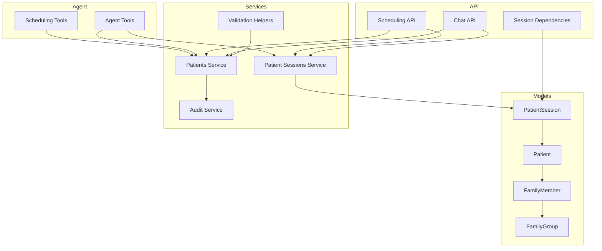

**Diagram sources**
- [patients.py:18-46](file://backend/app/models/patients.py#L18-L46)
- [family.py:21-60](file://backend/app/models/family.py#L21-L60)
- [sessions.py:35-75](file://backend/app/models/sessions.py#L35-L75)
- [patients_service.py:1-365](file://backend/app/services/patients.py#L1-L365)
- [patient_sessions_service.py:92-122](file://backend/app/services/patient_sessions.py#L92-L122)
- [audit_service.py:15-51](file://backend/app/services/audit.py#L15-L51)
- [validation.py:37-86](file://backend/app/validation.py#L37-L86)
- [chat_api.py:54-61](file://backend/app/api/chat.py#L54-L61)
- [scheduling_api.py:179-186](file://backend/app/api/scheduling.py#L179-L186)
- [deps.py:27-51](file://backend/app/api/deps.py#L27-L51)
- [tools.py:192-218](file://backend/app/agent/tools.py#L192-L218)
- [scheduling_tools.py:1242-1272](file://backend/app/agent/scheduling_tools.py#L1242-L1272)

**Section sources**
- [patients.py:18-46](file://backend/app/models/patients.py#L18-L46)
- [family.py:21-60](file://backend/app/models/family.py#L21-L60)
- [sessions.py:35-75](file://backend/app/models/sessions.py#L35-L75)
- [patients_service.py:1-365](file://backend/app/services/patients.py#L1-L365)
- [patient_sessions_service.py:92-122](file://backend/app/services/patient_sessions.py#L92-L122)
- [audit_service.py:15-51](file://backend/app/services/audit.py#L15-L51)
- [validation.py:37-86](file://backend/app/validation.py#L37-L86)
- [chat_api.py:54-61](file://backend/app/api/chat.py#L54-L61)
- [scheduling_api.py:179-186](file://backend/app/api/scheduling.py#L179-L186)
- [deps.py:27-51](file://backend/app/api/deps.py#L27-L51)
- [tools.py:192-218](file://backend/app/agent/tools.py#L192-L218)
- [scheduling_tools.py:1242-1272](file://backend/app/agent/scheduling_tools.py#L1242-L1272)

## Core Components
- Patient model: stores core chart fields such as name, phone, date of birth, insurance provider, and optional notes. It links to appointments and family memberships.
- Family membership model: links patients into family groups and records relationship metadata.
- Patient session model: holds the authenticated browser session and the verified patient binding.
- Patients service: implements verification, registration completeness checks, profile retrieval, registration, and independent-field update logic.
- Validation helpers: normalize and validate names, phones, dates of birth, and insurance inputs.
- Audit service: records append-only audit entries for profile actions.
- API layer: exposes chat and scheduling endpoints; enforces session-based authorization and verification requirements.
- Agent tools: expose verification and update operations through the conversational agent while preserving privacy rules.

Key responsibilities:
- Verification binds a session to exactly one patient using phone and date of birth.
- Profile retrieval returns full details only after verification.
- Registration completeness is derived from required fields.
- Updates validate each field independently and log changes.
- Privacy restricts profile access to the verified patient and, where applicable, verified family members.

**Section sources**
- [patients.py:18-46](file://backend/app/models/patients.py#L18-L46)
- [family.py:37-60](file://backend/app/models/family.py#L37-L60)
- [sessions.py:35-75](file://backend/app/models/sessions.py#L35-L75)
- [patients_service.py:183-255](file://backend/app/services/patients.py#L183-L255)
- [patients_service.py:233-255](file://backend/app/services/patients.py#L233-L255)
- [patients_service.py:308-364](file://backend/app/services/patients.py#L308-L364)
- [validation.py:37-86](file://backend/app/validation.py#L37-L86)
- [validation.py:154-246](file://backend/app/validation.py#L154-L246)
- [validation.py:262-301](file://backend/app/validation.py#L262-L301)
- [validation.py:333-364](file://backend/app/validation.py#L333-L364)
- [audit_service.py:15-51](file://backend/app/services/audit.py#L15-L51)

## Architecture Overview
The profile management flow combines session authentication, verification, service-layer business logic, and audit logging.

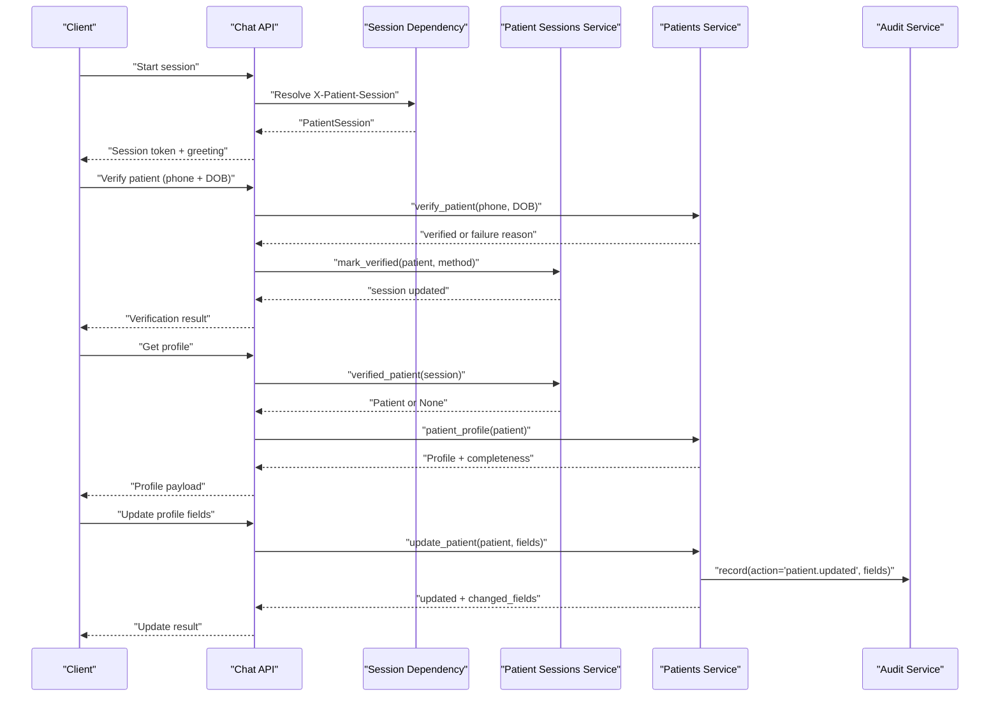

**Diagram sources**
- [deps.py:27-51](file://backend/app/api/deps.py#L27-L51)
- [chat_api.py:111-163](file://backend/app/api/chat.py#L111-L163)
- [tools.py:192-218](file://backend/app/agent/tools.py#L192-L218)
- [patient_sessions_service.py:92-122](file://backend/app/services/patient_sessions.py#L92-L122)
- [patients_service.py:183-255](file://backend/app/services/patients.py#L183-L255)
- [patients_service.py:308-364](file://backend/app/services/patients.py#L308-L364)
- [audit_service.py:15-51](file://backend/app/services/audit.py#L15-L51)

## Detailed Component Analysis

### Identity Verification and Session Binding
Verification ensures that a caller is who they claim to be before any sensitive profile data is exposed. The process:
- Normalizes phone and parses date of birth.
- Matches against stored patients by last-10-digit phone equivalence and exact date of birth.
- Returns neutral failures to avoid probing whether a phone exists.
- Marks the session verified only through the dedicated service function.

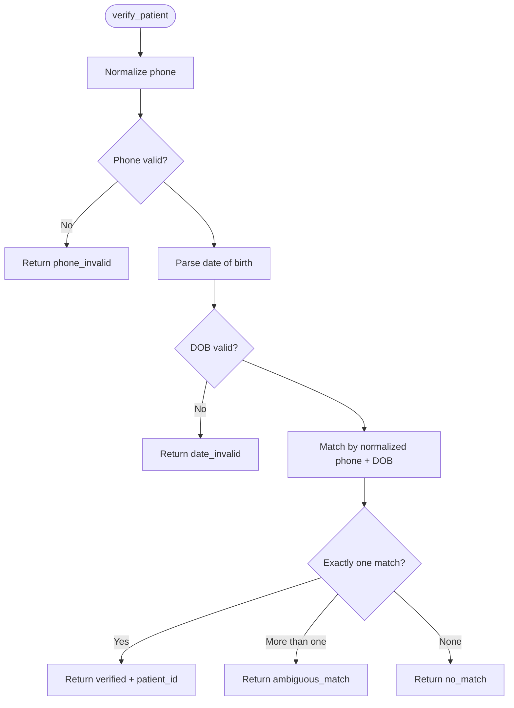

**Diagram sources**
- [patients_service.py:183-230](file://backend/app/services/patients.py#L183-L230)
- [validation.py:37-86](file://backend/app/validation.py#L37-L86)
- [validation.py:154-246](file://backend/app/validation.py#L154-L246)

**Section sources**
- [patients_service.py:183-230](file://backend/app/services/patients.py#L183-L230)
- [tools.py:192-218](file://backend/app/agent/tools.py#L192-L218)
- [patient_sessions_service.py:92-122](file://backend/app/services/patient_sessions.py#L92-L122)

### Profile Retrieval and Data Completeness
After verification, the profile endpoint returns the patient’s chart details and registration completeness. Completeness is computed from required fields: full name, phone, date of birth, and insurance provider.

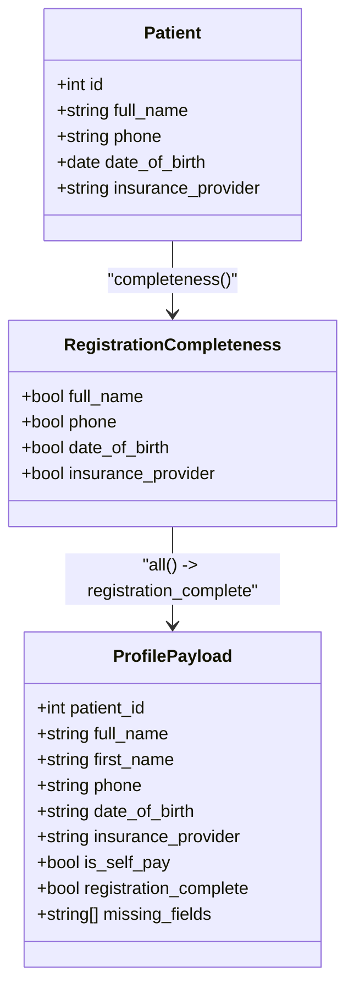

**Diagram sources**
- [patients.py:18-46](file://backend/app/models/patients.py#L18-L46)
- [patients_service.py:233-255](file://backend/app/services/patients.py#L233-L255)

**Section sources**
- [patients_service.py:233-255](file://backend/app/services/patients.py#L233-L255)

### Update Workflow with Independent Field Corrections
Updates allow correcting individual fields without requiring all fields to be correct at once. Each field is validated independently, and only changed fields are recorded.

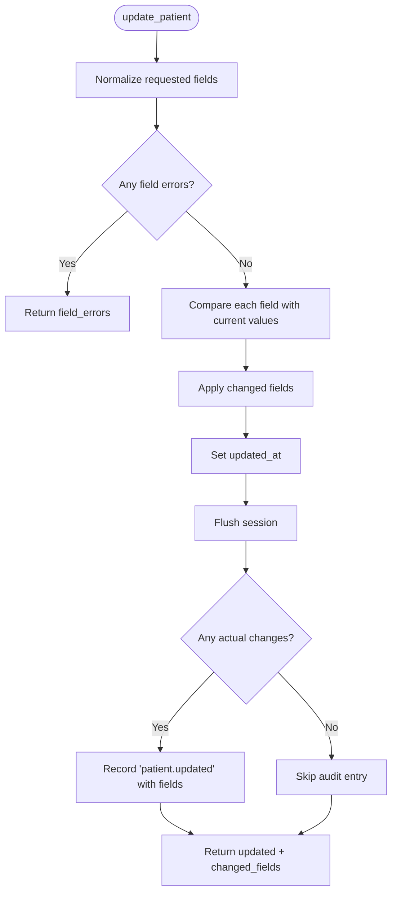

**Diagram sources**
- [patients_service.py:308-364](file://backend/app/services/patients.py#L308-L364)
- [audit_service.py:15-51](file://backend/app/services/audit.py#L15-L51)

**Section sources**
- [patients_service.py:308-364](file://backend/app/services/patients.py#L308-L364)

### Privacy Controls: Self and Verified Family Members
Privacy is enforced at multiple layers:
- Only a verified session can access profile details.
- A verified patient may book for themselves and other linked household members, but this grants booking context only; it does not disclose another adult’s private chart details without their own verification.
- Family membership is modeled explicitly, linking patients within a family group.

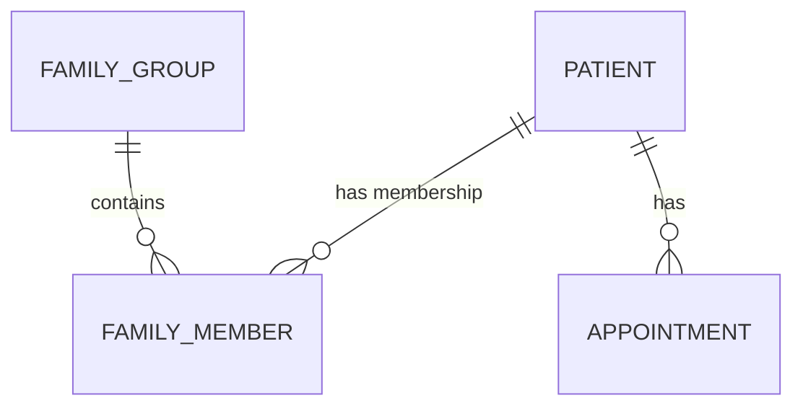

**Diagram sources**
- [patients.py:18-46](file://backend/app/models/patients.py#L18-L46)
- [family.py:21-60](file://backend/app/models/family.py#L21-L60)

**Section sources**
- [sessions.py:35-75](file://backend/app/models/sessions.py#L35-L75)
- [family.py:37-60](file://backend/app/models/family.py#L37-L60)
- [scheduling_api.py:179-186](file://backend/app/api/scheduling.py#L179-L186)
- [scheduling_tools.py:1242-1272](file://backend/app/agent/scheduling_tools.py#L1242-L1272)

### Field Validation for Updates
All user-supplied profile fields pass through shared validators:
- Names are normalized and constrained to allowed characters and length.
- Phones are normalized to E.164 and validated for NANP format.
- Dates of birth are parsed with clinic-local rules, including ambiguity handling.
- Insurance providers are mapped to accepted plans or labeled as self-pay or other plan.

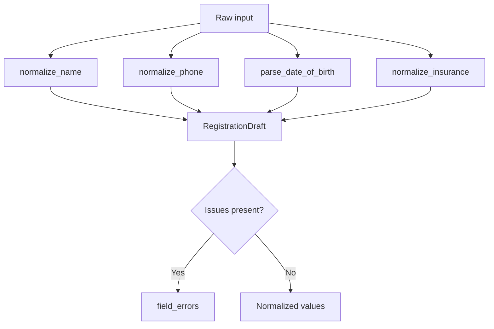

**Diagram sources**
- [validation.py:37-86](file://backend/app/validation.py#L37-L86)
- [validation.py:154-246](file://backend/app/validation.py#L154-L246)
- [validation.py:262-301](file://backend/app/validation.py#L262-L301)
- [validation.py:333-364](file://backend/app/validation.py#L333-L364)
- [patients_service.py:81-138](file://backend/app/services/patients.py#L81-L138)

**Section sources**
- [validation.py:37-86](file://backend/app/validation.py#L37-L86)
- [validation.py:154-246](file://backend/app/validation.py#L154-L246)
- [validation.py:262-301](file://backend/app/validation.py#L262-L301)
- [validation.py:333-364](file://backend/app/validation.py#L333-L364)
- [patients_service.py:81-138](file://backend/app/services/patients.py#L81-L138)

### Change Tracking and Audit Logging
Every profile write is tracked:
- Registration creates an audit entry indicating whether the phone was already shared.
- Updates record the specific fields changed.
- Audit entries include actor type, entity type, entity ID, conversation context, and structured details.

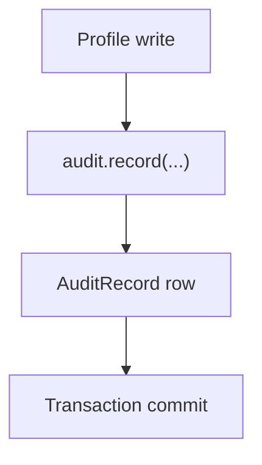

**Diagram sources**
- [patients_service.py:258-305](file://backend/app/services/patients.py#L258-L305)
- [patients_service.py:308-364](file://backend/app/services/patients.py#L308-L364)
- [audit_service.py:15-51](file://backend/app/services/audit.py#L15-L51)

**Section sources**
- [patients_service.py:258-305](file://backend/app/services/patients.py#L258-L305)
- [patients_service.py:308-364](file://backend/app/services/patients.py#L308-L364)
- [audit_service.py:15-51](file://backend/app/services/audit.py#L15-L51)

### Integration with Registration System
Registration normalizes and validates required fields, detects possible duplicates by name and phone, creates the patient record, increments generation counters, and logs the registration event.

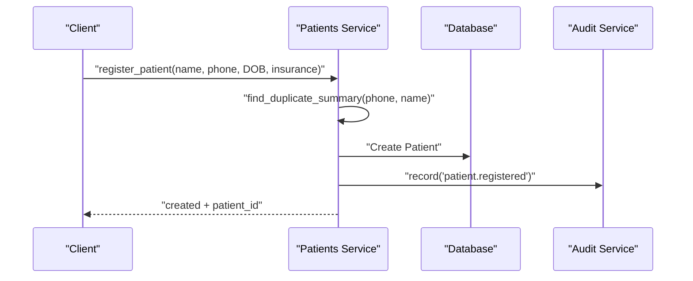

**Diagram sources**
- [patients_service.py:161-180](file://backend/app/services/patients.py#L161-L180)
- [patients_service.py:258-305](file://backend/app/services/patients.py#L258-L305)
- [audit_service.py:15-51](file://backend/app/services/audit.py#L15-L51)

**Section sources**
- [patients_service.py:161-180](file://backend/app/services/patients.py#L161-L180)
- [patients_service.py:258-305](file://backend/app/services/patients.py#L258-L305)

### Relationship Between Profile Data and Appointment Scheduling
Scheduling endpoints enforce verification and block booking when registration is incomplete:
- Every scheduling route resolves the conversation through the patient session.
- The requester helper retrieves the verified patient; if none, it returns forbidden.
- Slot selection checks registration completeness before proposing a booking.
- Availability refresh and proposal confirmation also require verification.

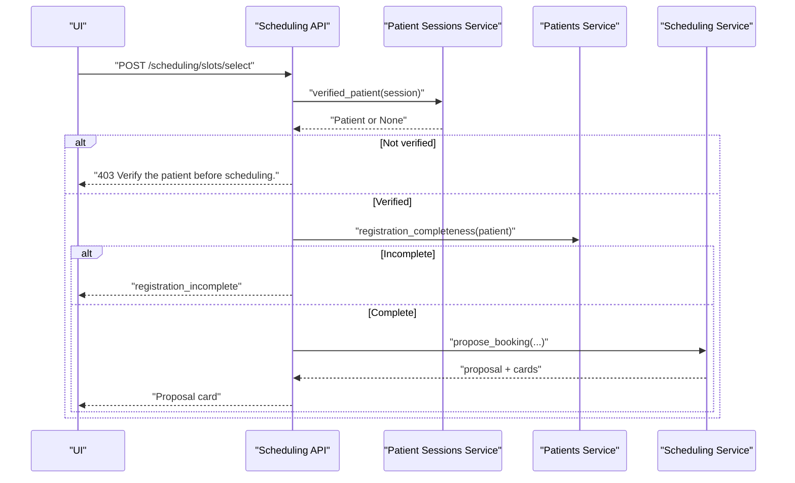

**Diagram sources**
- [scheduling_api.py:179-186](file://backend/app/api/scheduling.py#L179-L186)
- [scheduling_api.py:256-362](file://backend/app/api/scheduling.py#L256-L362)
- [patients_service.py:233-255](file://backend/app/services/patients.py#L233-L255)

**Section sources**
- [scheduling_api.py:179-186](file://backend/app/api/scheduling.py#L179-L186)
- [scheduling_api.py:256-362](file://backend/app/api/scheduling.py#L256-L362)
- [patients_service.py:233-255](file://backend/app/services/patients.py#L233-L255)

## Dependency Analysis
The following diagram shows how components depend on each other for profile management:

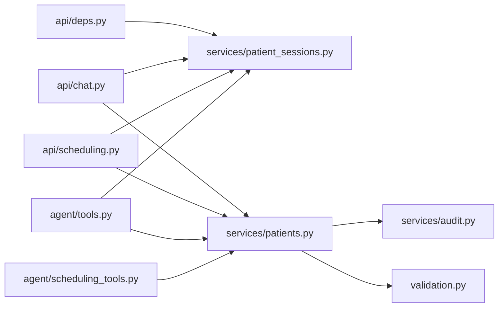

**Diagram sources**
- [deps.py:27-51](file://backend/app/api/deps.py#L27-L51)
- [chat_api.py:54-61](file://backend/app/api/chat.py#L54-L61)
- [scheduling_api.py:179-186](file://backend/app/api/scheduling.py#L179-L186)
- [patients_service.py:1-365](file://backend/app/services/patients.py#L1-L365)
- [patient_sessions_service.py:92-122](file://backend/app/services/patient_sessions.py#L92-L122)
- [audit_service.py:15-51](file://backend/app/services/audit.py#L15-L51)
- [validation.py:37-86](file://backend/app/validation.py#L37-L86)
- [tools.py:192-218](file://backend/app/agent/tools.py#L192-L218)
- [scheduling_tools.py:1242-1272](file://backend/app/agent/scheduling_tools.py#L1242-L1272)

**Section sources**
- [deps.py:27-51](file://backend/app/api/deps.py#L27-L51)
- [chat_api.py:54-61](file://backend/app/api/chat.py#L54-L61)
- [scheduling_api.py:179-186](file://backend/app/api/scheduling.py#L179-L186)
- [patients_service.py:1-365](file://backend/app/services/patients.py#L1-L365)
- [patient_sessions_service.py:92-122](file://backend/app/services/patient_sessions.py#L92-L122)
- [audit_service.py:15-51](file://backend/app/services/audit.py#L15-L51)
- [validation.py:37-86](file://backend/app/validation.py#L37-L86)
- [tools.py:192-218](file://backend/app/agent/tools.py#L192-L218)
- [scheduling_tools.py:1242-1272](file://backend/app/agent/scheduling_tools.py#L1242-L1272)

## Performance Considerations
- Phone matching uses last-10-digit normalization to tolerate formatting differences while avoiding uniqueness assumptions due to shared household numbers.
- Validation functions return structured results to minimize repeated parsing and error handling overhead.
- Audit entries are appended within the same transaction as profile writes, ensuring consistency without extra round-trips.
- Scheduling endpoints perform read-heavy availability checks separately from write-heavy booking confirmations, reducing contention.

[No sources needed since this section provides general guidance]

## Troubleshooting Guide
Common issues and their likely causes:
- “This session isn’t verified”: The session has no verified patient bound. Ensure verification succeeds via phone and date of birth before accessing profile or scheduling.
- “Complete registration before booking”: Required fields are missing. Use profile updates to correct missing or invalid fields.
- “Unknown appointment type”: The selected appointment type code is not recognized. Validate the type before calling scheduling endpoints.
- “Conversation not found in this session”: The conversation ID does not belong to the current patient session. Re-resolve conversations through the session.
- “Missing patient session”: The request lacks the required patient session header. Start a new chat session.

**Section sources**
- [scheduling_api.py:179-186](file://backend/app/api/scheduling.py#L179-L186)
- [scheduling_api.py:256-362](file://backend/app/api/scheduling.py#L256-L362)
- [chat_api.py:101-108](file://backend/app/api/chat.py#L101-L108)
- [deps.py:27-51](file://backend/app/api/deps.py#L27-L51)

## Conclusion
The profile management system enforces strong privacy and integrity guarantees:
- Identity verification binds sessions to patients securely.
- Profile retrieval is gated behind verification.
- Registration completeness is computed from required fields.
- Updates validate each field independently and record only changed fields.
- All profile modifications are audit-logged.
- Scheduling depends on verification and complete registration.
- Family membership enables controlled booking contexts without exposing unrelated private data.

These design choices ensure that patients can manage their own profiles safely, correct information incrementally, and schedule appointments only when appropriate, while maintaining clear audit trails and robust privacy controls.