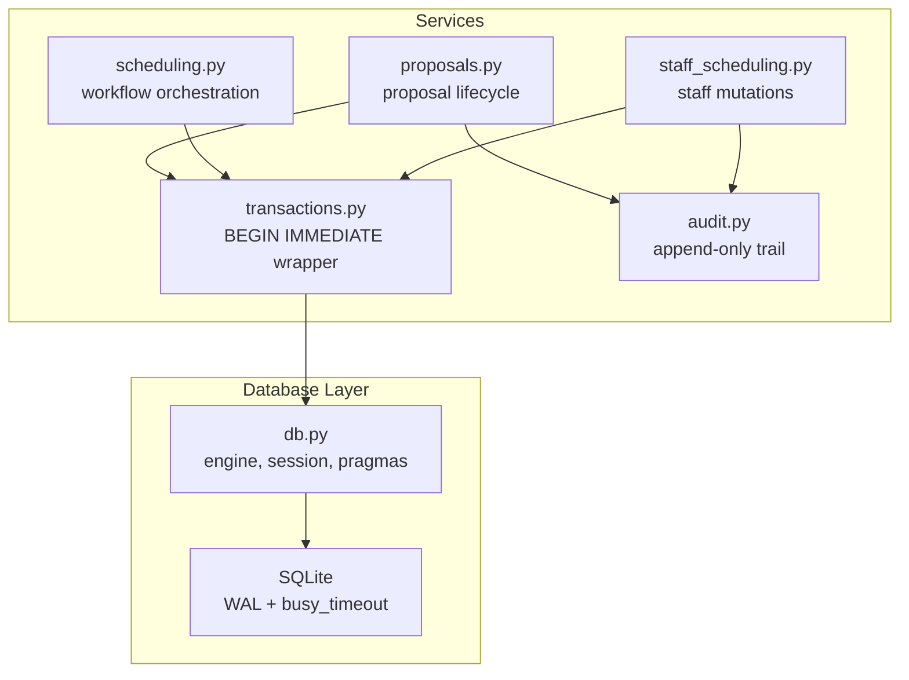
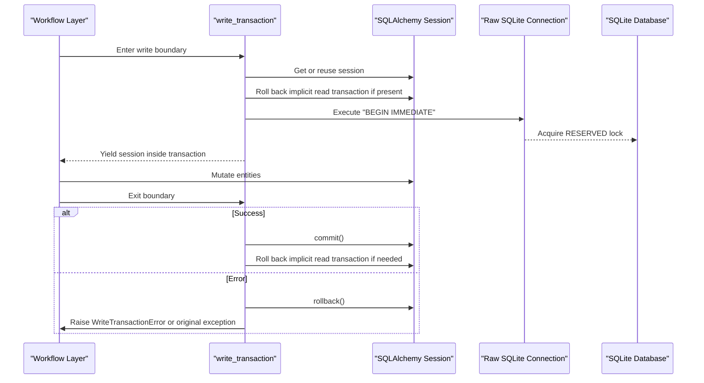
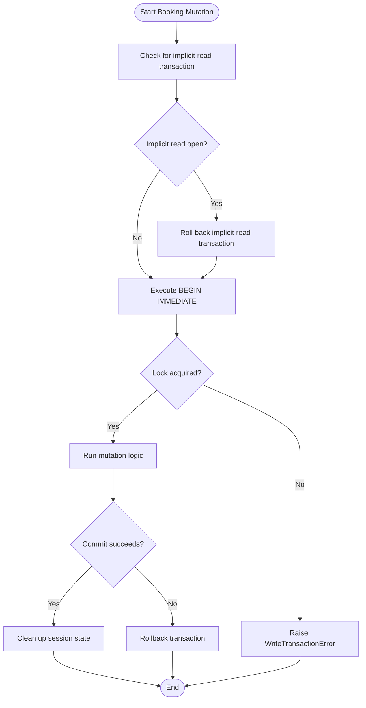
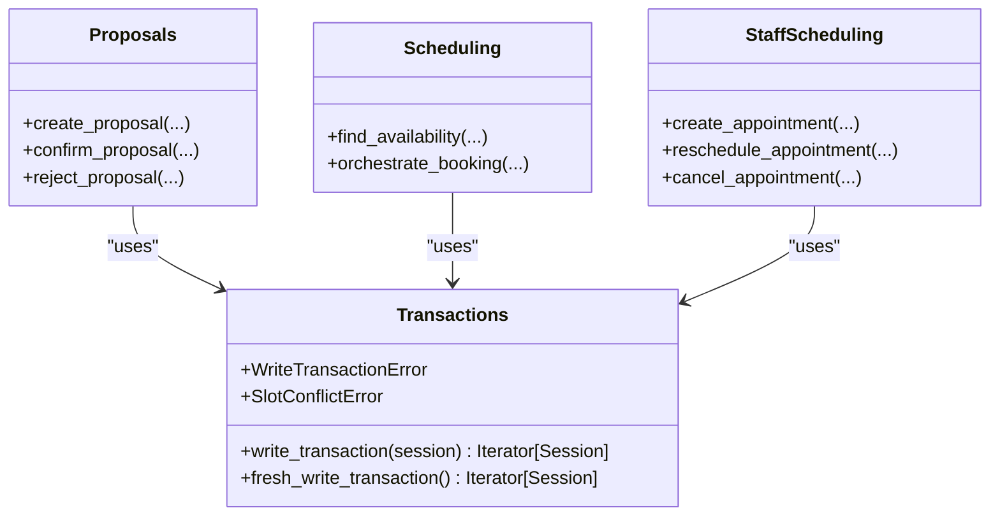
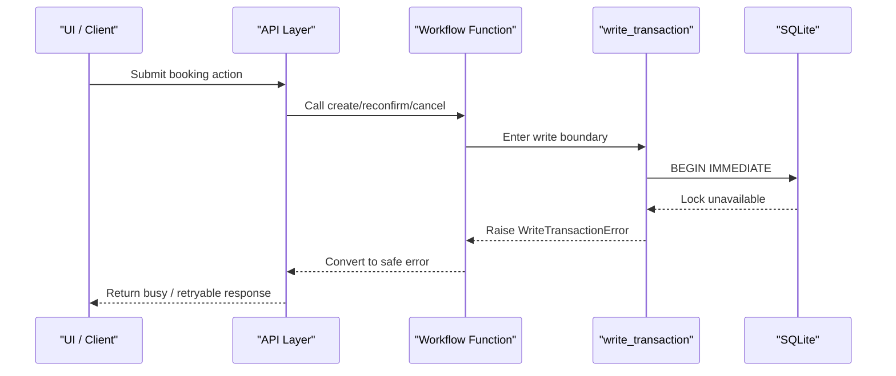
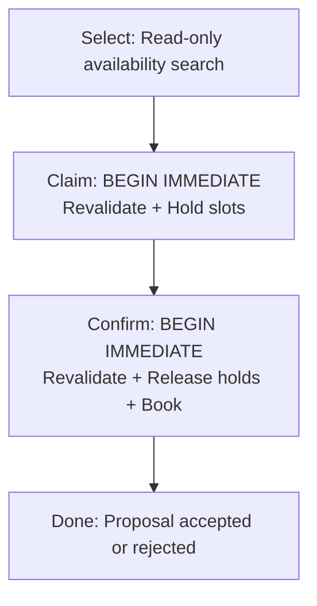
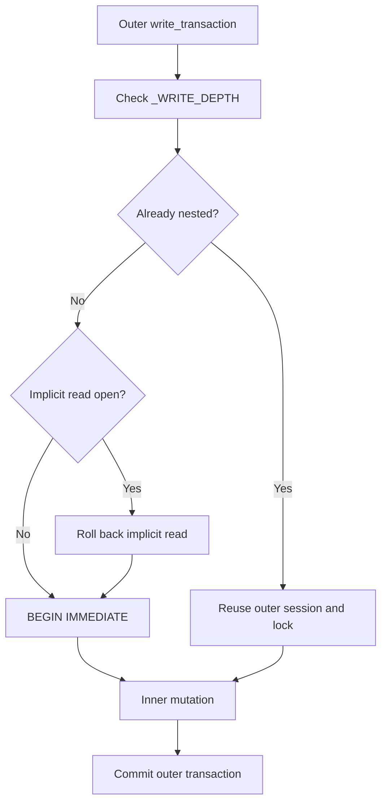
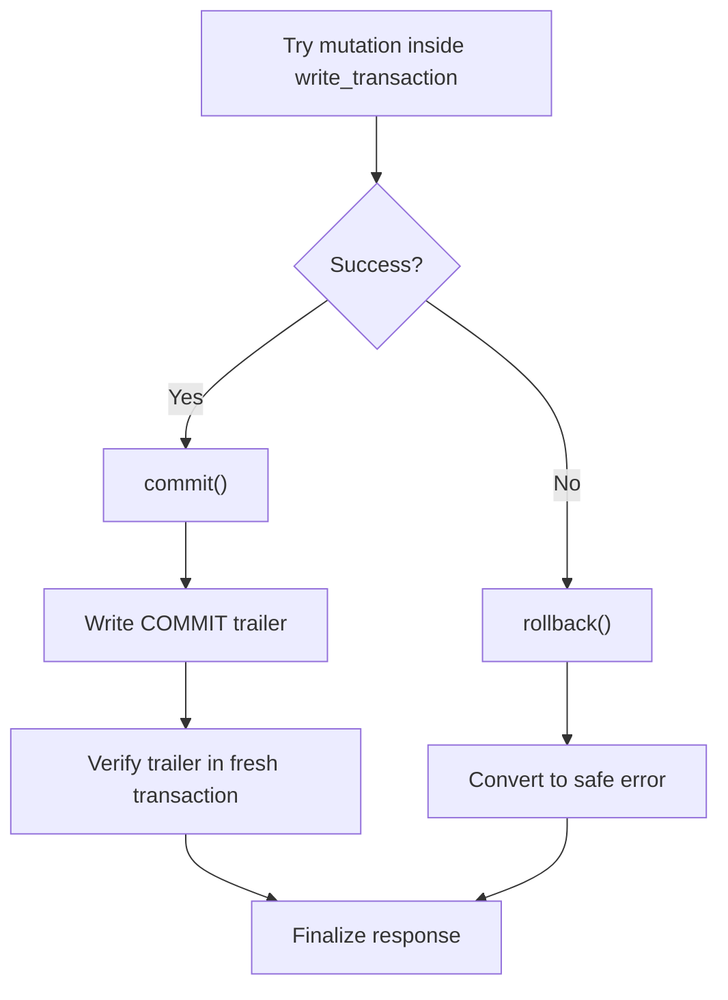
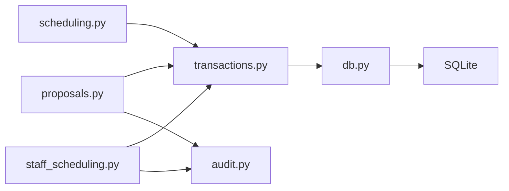

# Atomic Transaction System

<cite>
**Referenced Files in This Document**   
- [transactions.py](file://backend/app/services/transactions.py)
- [db.py](file://backend/app/db.py)
- [proposals.py](file://backend/app/services/proposals.py)
- [scheduling.py](file://backend/app/services/scheduling.py)
- [staff_scheduling.py](file://backend/app/services/staff_scheduling.py)
- [audit.py](file://backend/app/services/audit.py)
</cite>

## Table of Contents
1. [Introduction](#introduction)
2. [Project Structure](#project-structure)
3. [Core Components](#core-components)
4. [Architecture Overview](#architecture-overview)
5. [Detailed Component Analysis](#detailed-component-analysis)
6. [Dependency Analysis](#dependency-analysis)
7. [Performance Considerations](#performance-considerations)
8. [Troubleshooting Guide](#troubleshooting-guide)
9. [Conclusion](#conclusion)

## Introduction
This document explains the atomic transaction system that protects booking operations from concurrent modification while still allowing normal reads. It focuses on:

- The use of `BEGIN IMMEDIATE` to acquire SQLite’s RESERVED lock before any read inside a write path.
- The `write_transaction` decorator pattern that wraps database mutations in transactions with automatic rollback on errors.
- The `WriteTransactionError` exception and how it propagates through scheduling, proposal, and staff workflows.
- Transaction boundaries, nested operation patterns, and error recovery mechanisms.
- Common issues such as lock timeouts, deadlocks, and partial failures, along with their solutions.

The system is built around SQLite with SQLAlchemy sessions, explicit transaction control, and an audit trail that distinguishes between tentative holds and confirmed commits.

## Project Structure
The atomic transaction logic lives primarily in the backend services layer:

- `app/services/transactions.py`: Core transaction primitives, including `write_transaction`, `fresh_write_transaction`, and domain exceptions.
- `app/db.py`: Engine setup, session factory, connection-scoped pragmas (WAL mode, foreign keys, busy timeout), and request-scoped session helpers.
- `app/services/proposals.py`: Patient-facing proposal lifecycle: select, claim, confirm, reject, supersede.
- `app/services/scheduling.py`: Scheduling orchestration that composes availability, proposals, and appointment mutations.
- `app/services/staff_scheduling.py`: Staff-side mutation paths for creating, rescheduling, cancelling, and completing appointments.
- `app/services/audit.py`: Append-only audit recording and trailer-commission verification.

**Diagram sources**
- [transactions.py:1-32](file://backend/app/services/transactions.py#L1-L32)
- [db.py:40-64](file://backend/app/db.py#L40-L64)
- [proposals.py:1-46](file://backend/app/services/proposals.py#L1-L46)
- [scheduling.py:1-12](file://backend/app/services/scheduling.py#L1-L12)
- [staff_scheduling.py:1-31](file://backend/app/services/staff_scheduling.py#L1-L31)
- [audit.py:1-33](file://backend/app/services/audit.py#L1-L33)

**Section sources**
- [transactions.py:1-32](file://backend/app/services/transactions.py#L1-L32)
- [db.py:40-64](file://backend/app/db.py#L40-L64)
- [proposals.py:1-46](file://backend/app/services/proposals.py#L1-L46)
- [scheduling.py:1-12](file://backend/app/services/scheduling.py#L1-L12)
- [staff_scheduling.py:1-31](file://backend/app/services/staff_scheduling.py#L1-L31)
- [audit.py:1-33](file://backend/app/services/audit.py#L1-L33)

## Core Components
This section documents the key building blocks of the atomic transaction system.

### Write Transaction Primitives
- `write_transaction(session=None)`: A context manager that yields a SQLAlchemy `Session` inside an exclusive `BEGIN IMMEDIATE` transaction. It handles:
  - Reusing the caller’s session when appropriate.
  - Detecting and rolling back implicit read transactions so they do not block writers.
  - Tracking nesting depth per session to allow genuine nested writes without opening multiple locks.
  - Automatic rollback on exceptions and commit on success.
  - Closing or cleaning up sessions depending on ownership.
- `fresh_write_transaction()`: A standalone writer that creates its own session and transaction, used for bookkeeping like commit trailers that must survive teardown of the caller’s transaction.

Key behaviors:
- `BEGIN IMMEDIATE` is executed against the raw SQLite connection to obtain a RESERVED lock before any read inside the write block.
- If acquiring the lock fails, a domain-level `WriteTransactionError` is raised instead of exposing low-level driver details.
- After committing, if the session was borrowed from the caller, an implicit read transaction is rolled back to avoid leaving a SHARED lock that would stall subsequent writers.

**Section sources**
- [transactions.py:49-133](file://backend/app/services/transactions.py#L49-L133)
- [transactions.py:136-154](file://backend/app/services/transactions.py#L136-L154)

### Domain Exceptions
- `WriteTransactionError`: Indicates that the write transaction could not be started or committed. It is raised by `write_transaction` when `BEGIN IMMEDIATE` fails.
- `SlotConflictError`: Indicates that a requested interval stopped being free before it could be claimed. It carries structured metadata such as stable slot IDs and a reason code.

These exceptions are caught at workflow boundaries and converted into user-safe outcomes or higher-level action errors.

**Section sources**
- [transactions.py:50-66](file://backend/app/services/transactions.py#L50-L66)
- [transactions.py:112-114](file://backend/app/services/transactions.py#L112-L114)

### Database Configuration and Locking
- WAL mode is enabled per connection.
- Foreign keys are enforced.
- `busy_timeout` is set to 5000 milliseconds, controlling how long SQLite waits for a lock before failing.
- `NullPool` is used for SQLite to make connection handling predictable during reset operations.

These settings directly influence lock contention behavior and timeout characteristics.

**Section sources**
- [db.py:40-49](file://backend/app/db.py#L40-L49)
- [db.py:52-64](file://backend/app/db.py#L52-L64)
- [db.py:81-82](file://backend/app/db.py#L81-L82)

### Audit Trail and Commit Verification
- Audit records are append-only and written inside the same transaction as business data.
- For bookings, a `HOLD` row is written inside the write transaction; a `COMMIT` trailer is recorded after the transaction is known to have committed.
- `trailer_committed` checks whether a matching `COMMIT` trailer exists in a fresh transaction, making absence a reliable negative even if the driver does not always report commit failures.

This two-phase observation model prevents uncommitted work from masquerading as successful.

**Section sources**
- [audit.py:15-51](file://backend/app/services/audit.py#L15-L51)
- [audit.py:54-75](file://backend/app/services/audit.py#L54-L75)
- [operations.py:68-75](file://backend/app/models/operations.py#L68-L75)

## Architecture Overview
The transaction architecture ensures that every booking mutation is atomic and serializable under SQLite’s locking model.

**Diagram sources**
- [transactions.py:85-133](file://backend/app/services/transactions.py#L85-L133)
- [db.py:40-49](file://backend/app/db.py#L40-L49)

## Detailed Component Analysis

### BEGIN IMMEDIATE Usage and Concurrency Model
`BEGIN IMMEDIATE` is central to preventing race conditions:

- It acquires SQLite’s RESERVED lock before any read inside the write block.
- A second writer waits up to `busy_timeout` rather than both reading the same free slot and one failing later.
- It avoids the deferred transaction window where SQLAlchemy might upgrade to a write lock only after the first write executes.

**Diagram sources**
- [transactions.py:85-133](file://backend/app/services/transactions.py#L85-L133)
- [db.py:40-49](file://backend/app/db.py#L40-L49)

**Section sources**
- [transactions.py:1-32](file://backend/app/services/transactions.py#L1-L32)
- [transactions.py:85-133](file://backend/app/services/transactions.py#L85-L133)
- [db.py:40-49](file://backend/app/db.py#L40-L49)

### Write Transaction Decorator Pattern
The `write_transaction` context manager implements a consistent transaction boundary across the application:

- It accepts an optional session to reuse the request’s session.
- It tracks `_WRITE_DEPTH` per session to distinguish genuine nesting from incidental read transactions.
- It raises `WriteTransactionError` when the RESERVED lock cannot be obtained.
- It rolls back on any exception and commits on success.
- It cleans up implicit read transactions to prevent lingering SHARED locks.

**Diagram sources**
- [transactions.py:49-162](file://backend/app/services/transactions.py#L49-L162)
- [proposals.py:79-81](file://backend/app/services/proposals.py#L79-L81)
- [scheduling.py:50-62](file://backend/app/services/scheduling.py#L50-L62)
- [staff_scheduling.py:55-62](file://backend/app/services/staff_scheduling.py#L55-L62)

**Section sources**
- [transactions.py:49-162](file://backend/app/services/transactions.py#L49-L162)

### WriteTransactionError Exception Handling and Propagation
`WriteTransactionError` is the domain signal that the database could not accept the write lock or commit. It propagates upward and is transformed into safe responses:

- In proposal creation and confirmation, it becomes a busy outcome with a user-friendly message.
- In staff scheduling, it is wrapped into `StaffActionError("busy", ...)` so the dashboard can display a retryable failure.
- In scheduling orchestration, it is caught and returned as a failed response.

**Diagram sources**
- [transactions.py:112-114](file://backend/app/services/transactions.py#L112-L114)
- [proposals.py:497-498](file://backend/app/services/proposals.py#L497-L498)
- [staff_scheduling.py:523-524](file://backend/app/services/staff_scheduling.py#L523-L524)
- [scheduling.py:1146-1200](file://backend/app/services/scheduling.py#L1146-L1200)

**Section sources**
- [transactions.py:112-114](file://backend/app/services/transactions.py#L112-L114)
- [proposals.py:490-511](file://backend/app/services/proposals.py#L490-L511)
- [staff_scheduling.py:519-524](file://backend/app/services/staff_scheduling.py#L519-L524)
- [scheduling.py:1140-1200](file://backend/app/services/scheduling.py#L1140-L1200)

### Transaction Boundaries in Booking Workflows
Booking operations are split into clear phases with explicit transaction boundaries:

- Select phase: Read-only search; no lock held.
- Claim phase: `BEGIN IMMEDIATE`; revalidate intervals, insert proposal, hold slots via `slot_claims`.
- Confirm phase: Another `BEGIN IMMEDIATE`; revalidate again, release holds, create appointments, mark proposal accepted.

**Diagram sources**
- [proposals.py:1-15](file://backend/app/services/proposals.py#L1-L15)
- [proposals.py:397-529](file://backend/app/services/proposals.py#L397-L529)
- [proposals.py:762-800](file://backend/app/services/proposals.py#L762-L800)

**Section sources**
- [proposals.py:1-46](file://backend/app/services/proposals.py#L1-L46)
- [proposals.py:397-529](file://backend/app/services/proposals.py#L397-L529)
- [proposals.py:762-800](file://backend/app/services/proposals.py#L762-L800)

### Nested Operation Patterns
Nested writes are supported safely:

- `_WRITE_DEPTH` tracks nesting per session.
- A genuine nested call reuses the outer transaction and its lock.
- An implicit read transaction is not treated as a write block; it is rolled back and replaced with a real write lock.

**Diagram sources**
- [transactions.py:69-82](file://backend/app/services/transactions.py#L69-L82)
- [transactions.py:94-133](file://backend/app/services/transactions.py#L94-L133)

**Section sources**
- [transactions.py:69-82](file://backend/app/services/transactions.py#L69-L82)
- [transactions.py:94-133](file://backend/app/services/transactions.py#L94-L133)

### Error Recovery Mechanisms
- Automatic rollback: Any exception inside `write_transaction` triggers a rollback, ensuring no partial state remains.
- Safe error conversion: Workflows convert low-level errors into domain outcomes or action errors.
- Idempotency and replay: Confirmation uses idempotency keys and can replay previously committed results.
- Trailer verification: Commit trailers provide observable proof that a transaction truly committed.

**Diagram sources**
- [transactions.py:117-133](file://backend/app/services/transactions.py#L117-L133)
- [audit.py:54-75](file://backend/app/services/audit.py#L54-L75)
- [proposals.py:762-800](file://backend/app/services/proposals.py#L762-L800)

**Section sources**
- [transactions.py:117-133](file://backend/app/services/transactions.py#L117-L133)
- [audit.py:54-75](file://backend/app/services/audit.py#L54-L75)
- [proposals.py:762-800](file://backend/app/services/proposals.py#L762-L800)

## Dependency Analysis
The transaction system has clear dependencies:

- Services depend on `transactions.py` for atomic boundaries.
- `transactions.py` depends on `db.py` for session creation and engine configuration.
- `db.py` configures SQLite pragmas that affect concurrency and locking.
- Audit utilities depend on models and sessions to record immutable history.

**Diagram sources**
- [transactions.py:41-43](file://backend/app/services/transactions.py#L41-L43)
- [db.py:52-64](file://backend/app/db.py#L52-L64)
- [proposals.py:79-81](file://backend/app/services/proposals.py#L79-L81)
- [scheduling.py:50-62](file://backend/app/services/scheduling.py#L50-L62)
- [staff_scheduling.py:55-62](file://backend/app/services/staff_scheduling.py#L55-L62)
- [audit.py:1-12](file://backend/app/services/audit.py#L1-L12)

**Section sources**
- [transactions.py:41-43](file://backend/app/services/transactions.py#L41-L43)
- [db.py:52-64](file://backend/app/db.py#L52-L64)
- [proposals.py:79-81](file://backend/app/services/proposals.py#L79-L81)
- [scheduling.py:50-62](file://backend/app/services/scheduling.py#L50-L62)
- [staff_scheduling.py:55-62](file://backend/app/services/staff_scheduling.py#L55-L62)
- [audit.py:1-12](file://backend/app/services/audit.py#L1-L12)

## Performance Considerations
- `BEGIN IMMEDIATE` reduces the race window but increases lock contention under high concurrency.
- `busy_timeout=5000ms` provides a bounded wait before failing; tune this based on expected workload and latency requirements.
- WAL mode improves read concurrency and reduces blocking for readers, but writers still serialize access.
- Avoid long-running transactions: keep mutation logic minimal inside `write_transaction` to reduce lock hold time.
- Use `fresh_write_transaction` only for small, independent bookkeeping tasks like commit trailers.
- Prefer read-only queries outside write boundaries to minimize contention.

[No sources needed since this section provides general guidance]

## Troubleshooting Guide

### Lock Timeouts
Symptoms:
- Frequent busy responses or retries.
- Errors indicating the database is locked.

Causes:
- Multiple concurrent writers competing for the same resources.
- Long-running transactions holding locks too long.
- Insufficient `busy_timeout` for the workload.

Solutions:
- Reduce transaction scope: move non-essential work outside `write_transaction`.
- Increase `busy_timeout` cautiously if latency budgets allow.
- Ensure reads happen outside write boundaries.
- Investigate slow queries or heavy processing inside transactions.

**Section sources**
- [db.py:40-49](file://backend/app/db.py#L40-L49)
- [transactions.py:112-114](file://backend/app/services/transactions.py#L112-L114)

### Deadlocks
Symptoms:
- Intermittent failures where two transactions wait on each other.
- Apparent stalls followed by rollbacks.

Causes:
- Complex multi-step mutations with inconsistent lock ordering.
- Nested transactions that acquire locks in different orders.

Solutions:
- Keep transaction order deterministic and minimal.
- Avoid deep nesting unless necessary; prefer single atomic boundaries.
- Split large mutations into smaller, ordered steps.
- Monitor and log lock acquisition points.

**Section sources**
- [transactions.py:69-82](file://backend/app/services/transactions.py#L69-L82)
- [transactions.py:94-133](file://backend/app/services/transactions.py#L94-L133)

### Partial Failure Scenarios
Symptoms:
- Some rows written but others missing.
- Audit trail shows HOLD but no COMMIT trailer.

Causes:
- Exception during mutation causing rollback.
- Late commit failure where the driver did not surface the error immediately.

Solutions:
- Rely on automatic rollback inside `write_transaction`.
- Use trailer verification to confirm true commit status.
- Replay idempotent operations using confirmation keys.
- Log and alert on missing trailers for post-mortem analysis.

**Section sources**
- [transactions.py:117-133](file://backend/app/services/transactions.py#L117-L133)
- [audit.py:54-75](file://backend/app/services/audit.py#L54-L75)
- [proposals.py:762-800](file://backend/app/services/proposals.py#L762-L800)

### Slot Conflicts
Symptoms:
- User sees “slot taken” or similar conflict messages.
- Reschedules fail because the replacement overlaps existing visits.

Causes:
- Two clients selected the same slot.
- Stale UI state offering an already-booked time.

Solutions:
- Revalidate intervals inside `BEGIN IMMEDIATE`.
- Use unique constraints on active slot claims.
- Surface conflict details to the client for refresh.
- Implement retry with refreshed availability.

**Section sources**
- [transactions.py:54-66](file://backend/app/services/transactions.py#L54-L66)
- [proposals.py:548-630](file://backend/app/services/proposals.py#L548-L630)
- [staff_scheduling.py:396-429](file://backend/app/services/staff_scheduling.py#L396-L429)

## Conclusion
The atomic transaction system ensures data integrity during booking operations by combining SQLite’s `BEGIN IMMEDIATE` lock semantics with explicit transaction boundaries, robust error handling, and an audit trail that distinguishes tentative holds from confirmed commits. The `write_transaction` pattern centralizes lock acquisition, rollback, and cleanup, while domain exceptions like `WriteTransactionError` and `SlotConflictError` provide clear signals for retries and user feedback. By keeping transactions short, validating inside write locks, and verifying commit trailers, the system minimizes race conditions, lock timeouts, and partial failures while remaining accessible to both technical and non-technical users.

[No sources needed since this section summarizes without analyzing specific files]