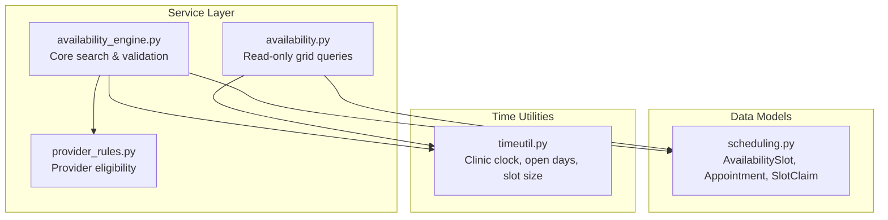
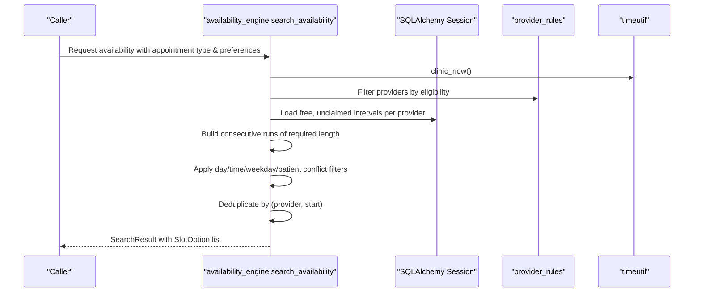
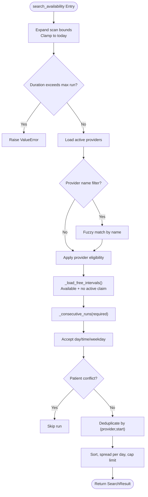
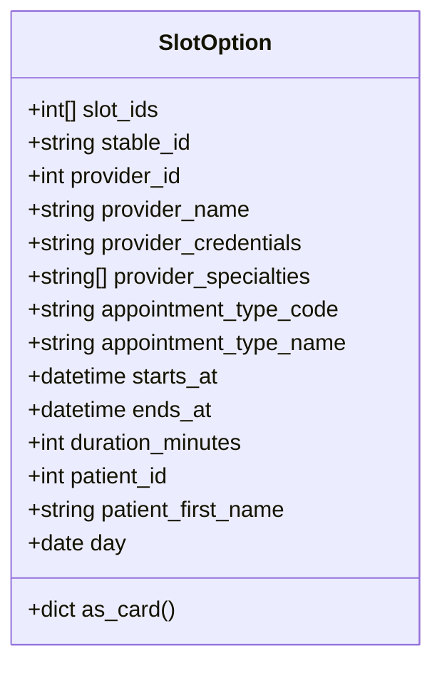
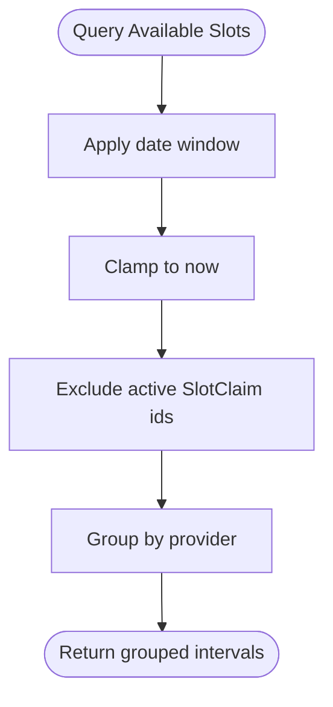
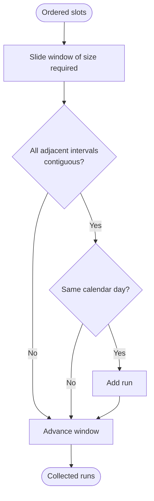
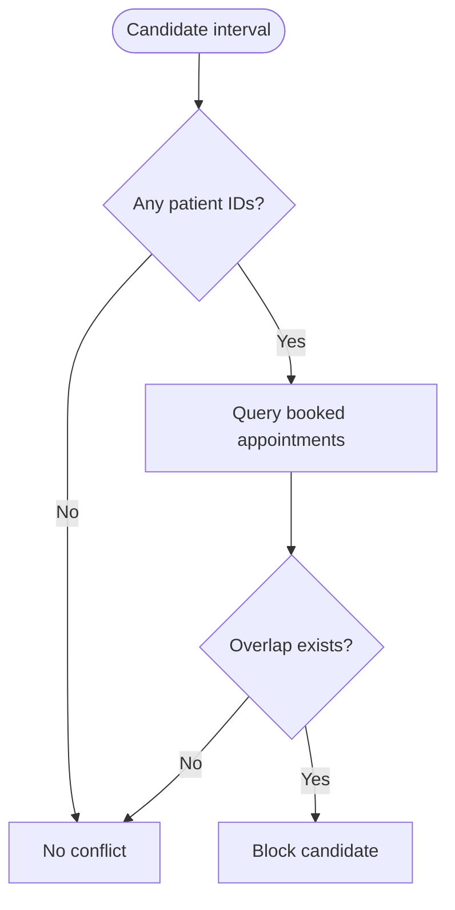
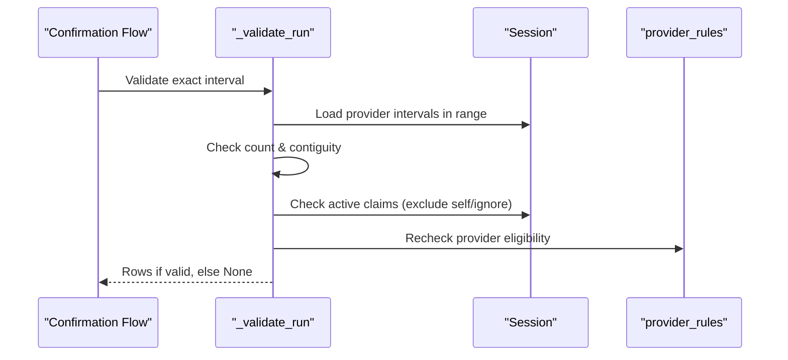
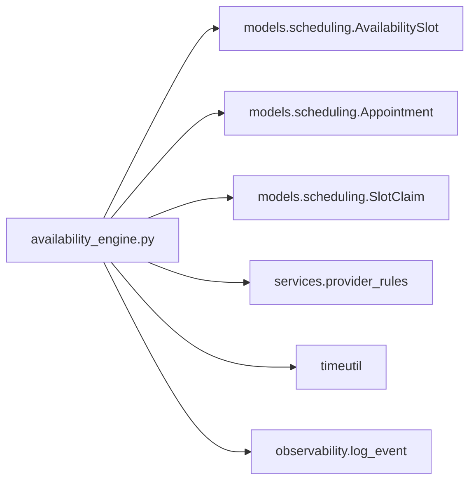

# Availability Calculation Engine

<cite>
**Referenced Files in This Document**   
- [availability_engine.py](file://backend/app/services/availability_engine.py)
- [availability.py](file://backend/app/services/availability.py)
- [provider_rules.py](file://backend/app/services/provider_rules.py)
- [scheduling.py](file://backend/app/models/scheduling.py)
- [timeutil.py](file://backend/app/timeutil.py)
</cite>

## Table of Contents
1. [Introduction](#introduction)
2. [Project Structure](#project-structure)
3. [Core Components](#core-components)
4. [Architecture Overview](#architecture-overview)
5. [Detailed Component Analysis](#detailed-component-analysis)
6. [Dependency Analysis](#dependency-analysis)
7. [Performance Considerations](#performance-considerations)
8. [Troubleshooting Guide](#troubleshooting-guide)
9. [Conclusion](#conclusion)

## Introduction
This document explains the availability calculation engine that determines which provider time slots can be offered to patients. The system filters raw 30-minute provider intervals through multiple constraints: business hours, provider eligibility, appointment duration requirements, existing appointments, staff blocks, and active claims. It then returns stable, deduplicated slot runs suitable for display and booking confirmation.

The core filtering logic is implemented by `search_availability`, which expands date ranges, matches eligible providers, builds contiguous runs of free intervals, applies patient preferences and conflicts, and produces a bounded, day-spaced list of `SlotOption` results.

## Project Structure
The availability engine lives under the backend service layer and depends on shared models, provider rules, and clinic time utilities.

**Diagram sources**
- [availability_engine.py:1-47](file://backend/app/services/availability_engine.py#L1-L47)
- [availability.py:1-34](file://backend/app/services/availability.py#L1-L34)
- [provider_rules.py:1-17](file://backend/app/services/provider_rules.py#L1-L17)
- [scheduling.py:1-12](file://backend/app/models/scheduling.py#L1-L12)
- [timeutil.py:1-27](file://backend/app/timeutil.py#L1-L27)

**Section sources**
- [availability_engine.py:1-47](file://backend/app/services/availability_engine.py#L1-L47)
- [availability.py:1-34](file://backend/app/services/availability.py#L1-L34)
- [provider_rules.py:1-17](file://backend/app/services/provider_rules.py#L1-L17)
- [scheduling.py:1-12](file://backend/app/models/scheduling.py#L1-L12)
- [timeutil.py:1-27](file://backend/app/timeutil.py#L1-L27)

## Core Components
- `search_availability`: Main entry point for finding bookable runs across providers and dates.
- `SlotOption`: Immutable-looking data structure representing one filtered, bookable run of intervals.
- `_load_free_intervals`: Database query that loads available, unclaimed intervals within a date window.
- `_consecutive_runs`: Groups ordered intervals into contiguous runs of the required length.
- `_patient_conflict`: Checks whether any provided patient already has a booked appointment overlapping the candidate interval.
- `is_interval_bookable` / `_validate_run`: Revalidates an exact proposed interval before finalizing a booking.
- Provider eligibility helpers: `provider_rules.provider_eligible`.
- Time helpers: `clinic_now`, `is_open_weekday`, `SLOT_MINUTES`.

**Section sources**
- [availability_engine.py:51-109](file://backend/app/services/availability_engine.py#L51-L109)
- [availability_engine.py:143-189](file://backend/app/services/availability_engine.py#L143-L189)
- [availability_engine.py:192-220](file://backend/app/services/availability_engine.py#L192-L220)
- [availability_engine.py:238-354](file://backend/app/services/availability_engine.py#L238-L354)
- [availability_engine.py:357-510](file://backend/app/services/availability_engine.py#L357-L510)
- [provider_rules.py:20-33](file://backend/app/services/provider_rules.py#L20-L33)
- [timeutil.py:19-27](file://backend/app/timeutil.py#L19-L27)

## Architecture Overview
The availability engine separates concerns between read-only availability discovery and strict revalidation at confirmation time.

**Diagram sources**
- [availability_engine.py:238-354](file://backend/app/services/availability_engine.py#L238-L354)
- [provider_rules.py:20-33](file://backend/app/services/provider_rules.py#L20-L33)
- [timeutil.py:30-37](file://backend/app/timeutil.py#L30-L37)

## Detailed Component Analysis

### `search_availability`: Core Filtering Logic
`search_availability` performs the complete availability search pipeline:

1. **Date range expansion**
   - Uses `preferences.scan_bounds` to determine the first and last day.
   - Clamps the first day forward to today if needed.
   - Ensures the requested appointment duration does not exceed the supported maximum run length.

2. **Provider matching algorithms**
   - Loads all active providers with their specialties.
   - Optionally narrows providers by fuzzy name match.
   - Filters providers using `provider_rules.provider_eligible`, which enforces specialty and emergency rules.

3. **Free interval loading**
   - Queries `AvailabilitySlot` rows that are:
     - Status `available`.
     - Within the expanded date window.
     - Not referenced by an active `SlotClaim`.
   - Groups intervals by provider and orders them by start time.

4. **Run construction and constraint evaluation**
   - Builds contiguous runs of exactly `slots_required(appointment_type.duration_minutes)` intervals.
   - Applies preference checks:
     - Day acceptance via `preferences.accepts_day`.
     - Time acceptance via `preferences.accepts_time`.
     - Business weekday check via `is_open_weekday`.
   - Rejects runs that overlap any existing booked appointment for the supplied patients.

5. **Deduplication strategies**
   - Tracks seen `(provider_id, start datetime string)` pairs to emit identical options only once.
   - Sorts options by start time and provider name.

6. **Result shaping**
   - Spreads results across days up to `per_day` per day.
   - Caps total returned options at `limit`.
   - Records closed days from explicit preferences.
   - Emits observability metrics including providers considered, raw options, returned count, and duration.

**Diagram sources**
- [availability_engine.py:238-354](file://backend/app/services/availability_engine.py#L238-L354)

**Section sources**
- [availability_engine.py:238-354](file://backend/app/services/availability_engine.py#L238-L354)

### `SlotOption` Data Structure
`SlotOption` represents one filtered, bookable run of intervals shown to the patient or used during confirmation.

Key fields and semantics:
- `slot_ids`: List of underlying `AvailabilitySlot.id` values forming the run.
- `stable_id`: Deterministic identifier derived from provider and start time; survives reseeding and avoids exposing surrogate keys.
- `provider_id`, `provider_name`, `provider_credentials`, `provider_specialties`: Provider context.
- `appointment_type_code`, `appointment_type_name`: Type metadata.
- `starts_at`, `ends_at`, `duration_minutes`: Interval boundaries and duration.
- Optional patient fields: `patient_id`, `patient_first_name`.
- Helper `as_card()` serializes the option into a UI-friendly dictionary.

**Diagram sources**
- [availability_engine.py:51-89](file://backend/app/services/availability_engine.py#L51-L89)

**Section sources**
- [availability_engine.py:51-89](file://backend/app/services/availability_engine.py#L51-L89)

### Free Interval Loading and Active Claims
`_load_free_intervals` retrieves available intervals while excluding those with active claims.

Constraints enforced:
- `AvailabilitySlot.status == "available"`.
- `AvailabilitySlot.starts_at >= max(window_start, now)`.
- `AvailabilitySlot.starts_at < window_end`.
- `AvailabilitySlot.id NOT IN (active SlotClaim.availability_slot_id)`.

This ensures held or booked intervals are never advertised.

**Diagram sources**
- [availability_engine.py:143-172](file://backend/app/services/availability_engine.py#L143-L172)
- [scheduling.py:175-239](file://backend/app/models/scheduling.py#L175-L239)

**Section sources**
- [availability_engine.py:143-172](file://backend/app/services/availability_engine.py#L143-L172)
- [scheduling.py:175-239](file://backend/app/models/scheduling.py#L175-L239)

### Consecutive Run Construction
`_consecutive_runs` groups an ordered list of intervals into runs of exactly `required` contiguous intervals on the same business day.

Algorithm highlights:
- Slides a window of size `required` over the ordered list.
- Validates each adjacent pair has `next.starts_at == current.ends_at`.
- Ensures the first and last interval share the same date.

**Diagram sources**
- [availability_engine.py:175-189](file://backend/app/services/availability_engine.py#L175-L189)

**Section sources**
- [availability_engine.py:175-189](file://backend/app/services/availability_engine.py#L175-L189)

### Patient Conflict Checking
`_patient_conflict` rejects candidate intervals that overlap any existing booked appointment for the provided patients.

Checks:
- Only considers appointments with status `booked`.
- Overlap condition: `existing.starts_at < candidate.ends_at AND candidate.starts_at < existing.ends_at`.

**Diagram sources**
- [availability_engine.py:192-208](file://backend/app/services/availability_engine.py#L192-L208)

**Section sources**
- [availability_engine.py:192-208](file://backend/app/services/availability_engine.py#L192-L208)

### Revalidation Before Booking
`is_interval_bookable` and `_validate_run` ensure that a specific proposed interval remains valid at confirmation time.

Validation steps:
- Rejects non-business weekdays.
- Computes expected end time based on required number of 30-minute slots.
- Loads the exact interval rows for the provider and time range.
- Verifies row count equals required slots and timestamps are perfectly contiguous.
- Excludes self-holds and ignored appointments when necessary.
- Checks for active claims on the target intervals.
- Rechecks provider eligibility.

**Diagram sources**
- [availability_engine.py:357-510](file://backend/app/services/availability_engine.py#L357-L510)
- [provider_rules.py:20-33](file://backend/app/services/provider_rules.py#L20-L33)

**Section sources**
- [availability_engine.py:357-510](file://backend/app/services/availability_engine.py#L357-L510)
- [provider_rules.py:20-33](file://backend/app/services/provider_rules.py#L20-L33)

### Staff Blocks and Schedule Holds
Staff blocks are represented by `AvailabilitySlot.hold_reason`. A slot marked as blocked is not offered because:
- The availability loader excludes slots whose status is not `available`.
- Blocked slots typically have a non-available status or are otherwise excluded by the query predicates.

This separation keeps schedule holds (staff-level) distinct from proposal holds (patient-facing).

**Section sources**
- [scheduling.py:37-65](file://backend/app/models/scheduling.py#L37-L65)
- [availability_engine.py:143-172](file://backend/app/services/availability_engine.py#L143-L172)

### Business Hours and Weekday Constraints
Business hours and open days are centralized in `timeutil`:
- Clinic operates Monday through Saturday.
- Open hours are 08:00 to 18:00.
- `is_open_weekday` gates day-level availability.
- `SLOT_MINUTES` defines the 30-minute grid.

These constraints are applied both during initial search and during revalidation.

**Section sources**
- [timeutil.py:19-27](file://backend/app/timeutil.py#L19-L27)
- [timeutil.py:61-62](file://backend/app/timeutil.py#L61-L62)
- [availability_engine.py:294-295](file://backend/app/services/availability_engine.py#L294-L295)
- [availability_engine.py:408-410](file://backend/app/services/availability_engine.py#L408-L410)

## Dependency Analysis
The availability engine depends on:
- Models: `Appointment`, `AppointmentType`, `AvailabilitySlot`, `Provider`, `SlotClaim`, `SlotStatus`, `AppointmentStatus`.
- Services: `provider_rules.provider_eligible`.
- Time utilities: `clinic_now`, `is_open_weekday`, `SLOT_MINUTES`.
- Observability: `log_event`.

**Diagram sources**
- [availability_engine.py:30-43](file://backend/app/services/availability_engine.py#L30-L43)
- [scheduling.py:37-65](file://backend/app/models/scheduling.py#L37-L65)
- [provider_rules.py:1-17](file://backend/app/services/provider_rules.py#L1-L17)
- [timeutil.py:1-27](file://backend/app/timeutil.py#L1-L27)

**Section sources**
- [availability_engine.py:30-43](file://backend/app/services/availability_engine.py#L30-L43)
- [scheduling.py:37-65](file://backend/app/models/scheduling.py#L37-L65)
- [provider_rules.py:1-17](file://backend/app/services/provider_rules.py#L1-L17)
- [timeutil.py:1-27](file://backend/app/timeutil.py#L1-L27)

## Performance Considerations
- **Bounded date windows**: The older read-only API caps scanning to a maximum number of days, preventing excessively large queries.
- **Provider prefiltering**: Providers are narrowed by eligibility and optional name matching before querying slots.
- **Indexed queries**: The model defines indexes on `starts_at` and composite indices for provider/status/start combinations.
- **Contiguous run sliding window**: `_consecutive_runs` uses a single pass with a fixed-size window, avoiding nested scans.
- **Deduplication set**: In-memory set lookup prevents duplicate options without repeated database calls.
- **Per-day spreading**: Limits output per day to reduce result volume and improve UX.
- **Maximum run guard**: Prevents extremely long appointment durations from generating expensive searches.

Recommendations for large date ranges:
- Prefer narrower `scan_bounds` from resolved preferences.
- Use provider name filters where possible.
- Keep `limit` and `per_day` conservative to avoid excessive result processing.
- Leverage family-specific searches only when needed, as they combine multiple members.

[No sources needed since this section provides general guidance]

## Troubleshooting Guide
Common issues and diagnostics:

- **No options returned**
  - Check whether the appointment type duration exceeds the supported maximum run length.
  - Verify provider eligibility for the appointment type.
  - Ensure the requested days are open weekdays and within clinic hours.
  - Inspect whether active claims or existing appointments block the candidate intervals.

- **Stale or taken slot IDs**
  - Client-provided slot IDs are treated as hints; revalidation will reject stale or now-taken intervals.
  - Use `is_interval_bookable` to confirm before finalizing.

- **Closed days in preferences**
  - If explicit preference days fall on closed weekdays, they are recorded as closed days in the result.

- **Overlapping provider schedules**
  - The database enforces uniqueness of active claims per slot, preventing double bookings.
  - The engine also checks for active claims and existing appointments to provide clear error signals.

Operational tips:
- Log availability search events to understand how many providers were considered and how many raw options were trimmed.
- When debugging family plans, inspect candidate generation per member and plan scoring.

**Section sources**
- [availability_engine.py:257-258](file://backend/app/services/availability_engine.py#L257-L258)
- [availability_engine.py:339-348](file://backend/app/services/availability_engine.py#L339-L348)
- [scheduling.py:175-239](file://backend/app/models/scheduling.py#L175-L239)

## Conclusion
The availability calculation engine provides a robust, multi-constraint filter over provider schedules. It combines database-backed availability with in-memory preference checks, provider eligibility, and conflict detection to return stable, deduplicated slot runs. The design separates discovery (`search_availability`) from confirmation-time revalidation (`is_interval_bookable`), ensuring correctness even under concurrent changes. With indexed queries, bounded ranges, and deterministic result shaping, the engine scales to realistic scheduling workloads while remaining understandable and testable.

[No sources needed since this section summarizes without analyzing specific files]